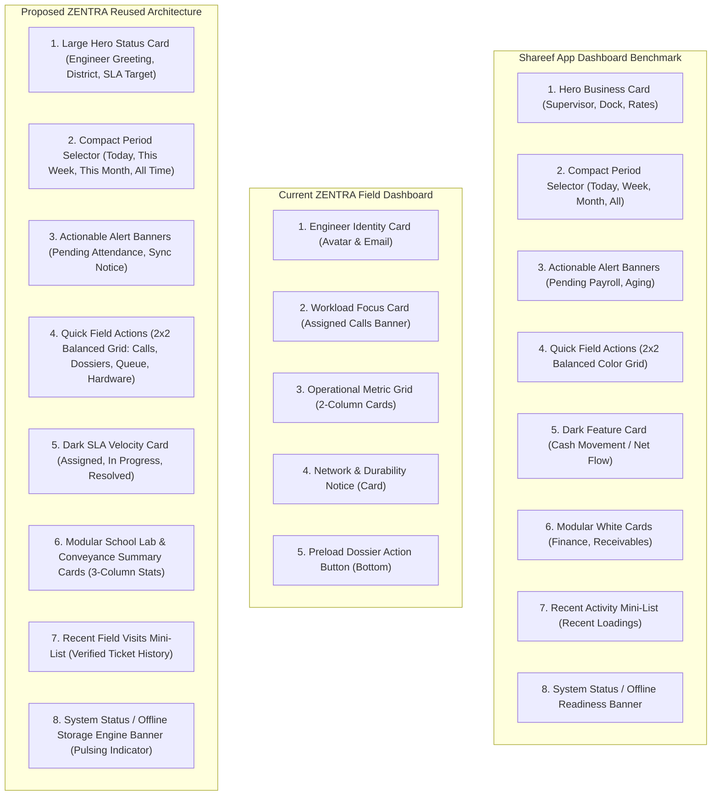

# MUSE SPARK AUDIT REPORT — ZENTRA FIELD DASHBOARD
## Reuse of Shareef App Dashboard UI & Component Architecture

**Repository:** `D:\Zentra`  
**Milestone:** Phase 1 — UI/UX Inspection & Dashboard Reuse Audit Only  
**Target Reference App:** Shareef App (`D:\Shareef app` & `D:\Shareef app Skill\field-app-ui-ux`)  
**Target Consumer App:** ZENTRA Field Mobile App (`D:\Zentra\apps\field`)  
**Target Physical Device:** OnePlus Nord (AC2001), Android 12, ADB Serial `65c7923e`  
**Execution Mode:** Strictly Read-Only Inspection (Zero Source-Code Modifications)  
**Budget Consumed:** Strict ₹0/month  
**Report Date:** 2026-10-14  

---

## 1. EXECUTIVE SUMMARY

This audit establishes the concrete roadmap for adopting the visual design, spatial architecture, and interaction patterns of the **Shareef App** (`D:\Shareef app`) into the **ZENTRA Field Application** (`D:\Zentra\apps\field`).

The Shareef App represents a battle-tested, high-contrast, mobile-first field management interface engineered for demanding outdoor operations (seafood logistics, harbour dispatch, and supervisor cash management across Tamil Nadu). Its visual hierarchy, documented in the [`field-app-ui-ux`](file:///d:/Shareef%20app%20Skill/field-app-ui-ux/SKILL.md) design system and captured in live production screenshots ([`Screenshot_20260826_113322_Shareef.jpg`](file:///C:/Users/acer/Downloads/Screenshot_20260826_113322_Shareef.jpg)), provides an authoritative benchmark for enterprise field usability.

By reusing Shareef App's dashboard structure—specifically its **Large Hero Status Card**, **Compact Period Selector**, **Actionable Alert Banners**, **2x2 Balanced Quick Action Grid**, **Dark SLA Feature Card**, and **Modular Multi-Column Stat Cards**—ZENTRA Field will achieve visual parity with a mature, high-contrast field product without inventing untested layouts.

---

## 2. SHAREEF APP PROJECT PATH & FRAMEWORK ANALYSIS

### 2.1 Project Location & Tech Stack

| Property | Shareef App Reference | ZENTRA Field Application | Compatibility Notes |
| :--- | :--- | :--- | :--- |
| **Filesystem Location** | `D:\Shareef app` | `D:\Zentra\apps\field` | Disjoint workspaces |
| **Companion Skill** | `D:\Shareef app Skill\field-app-ui-ux` | N/A (Standardized tokens) | Authoritative design guide |
| **Framework** | React 19 (`19.0.0`) + Vite (`6.1.0`) | React Native (`0.76.9`) + Expo (`52.0.37`) | Framework bridge required |
| **Styling Engine** | Tailwind CSS v4 (`@tailwindcss/vite`) | React Native `StyleSheet` & Tokens | Direct CSS classes $\rightarrow$ RN Styles |
| **Icon System** | `lucide-react` (`1.16.0`) | Zero-dependency SVG vector glyphs | Mapped via `Icon.tsx` |
| **Mobile Runtime** | `@capacitor/android` (`7.6.8`) | Expo Continuous Native Generation (CNG) | Both target native Android 12 |
| **Local Storage** | Dexie 4.0.11 (IndexedDB) | WatermelonDB 0.28.0 (SQLite) | Domain isolation preserved |
| **Production Screenshots** | `C:\Users\acer\Downloads\Screenshot_20260826_113322_Shareef.jpg` `C:\Users\acer\Downloads\Screenshot_20260826_171910_Shareef.jpg` | Live device captures on OnePlus Nord | 100% Visual alignment target |

---

## 3. DASHBOARD SCREEN & COMPONENT FILE INVENTORY

### 3.1 Shareef App File Inventory (`D:\Shareef app\src`)

1. **Dashboard Screen:**
   - [`D:\Shareef app\src\ui\screens\DashboardScreen.tsx`](file:///d:/Shareef%20app/src/ui/screens/DashboardScreen.tsx) (548 lines)
   - Contains the authoritative 10-section visual architecture.
2. **Layout & Global Navigation Components:**
   - [`D:\Shareef app\src\ui\components\TopHeader.tsx`](file:///d:/Shareef%20app/src/ui/components/TopHeader.tsx) (210 lines) — Locked-order top header with safe-area insets, Tamil/English language switcher, and static notification bell.
   - [`D:\Shareef app\src\ui\components\BottomNav.tsx`](file:///d:/Shareef%20app/src/ui/components/BottomNav.tsx) (79 lines) — 60px fixed bottom navigation bar with active pill indicators.
   - [`D:\Shareef app\src\ui\components\NotificationCenterModal.tsx`](file:///d:/Shareef%20app/src/ui/components/NotificationCenterModal.tsx) — Top-anchored sheet for field alerts.
   - [`D:\Shareef app\src\ui\components\GpsPhotoViewer.tsx`](file:///d:/Shareef%20app/src/ui/components/GpsPhotoViewer.tsx) — Evidence photo viewer with GPS watermark badge.
3. **Design System & Skill Reference:**
   - [`D:\Shareef app Skill\field-app-ui-ux\SKILL.md`](file:///d:/Shareef%20app%20Skill/field-app-ui-ux/SKILL.md)
   - [`D:\Shareef app Skill\field-app-ui-ux\references\design-tokens.md`](file:///d:/Shareef%20app%20Skill/field-app-ui-ux/references/design-tokens.md)

### 3.2 Current ZENTRA Field App Inventory (`D:\Zentra\apps\field\src`)

1. **Dashboard Screen:**
   - [`apps/field/src/screens/DashboardScreen.tsx`](file:///d:/Zentra/apps/field/src/screens/DashboardScreen.tsx) (370 lines)
2. **Component Architecture:**
   - [`apps/field/src/components/ui/Card.tsx`](file:///d:/Zentra/apps/field/src/components/ui/Card.tsx) — Surface card container.
   - [`apps/field/src/components/ui/Badge.tsx`](file:///d:/Zentra/apps/field/src/components/ui/Badge.tsx) — High-contrast status badge.
   - [`apps/field/src/components/ui/Button.tsx`](file:///d:/Zentra/apps/field/src/components/ui/Button.tsx) — Accessible touch-target button ($\ge 48\text{px}$).
   - [`apps/field/src/components/ui/Input.tsx`](file:///d:/Zentra/apps/field/src/components/ui/Input.tsx) — Labeled text input.
   - [`apps/field/src/components/ui/Icon.tsx`](file:///d:/Zentra/apps/field/src/components/ui/Icon.tsx) — Native vector SVG glyphs (`home`, `briefcase`, `school`, `sync`, `camera`, `map-pin`, `chevron-right`, `refresh`, `clock`, `trending-up`, etc.).
   - [`apps/field/src/components/ui/TopHeader.tsx`](file:///d:/Zentra/apps/field/src/components/ui/TopHeader.tsx) — Status-bar inset aware header.
   - [`apps/field/src/components/ui/BottomTabBar.tsx`](file:///d:/Zentra/apps/field/src/components/ui/BottomTabBar.tsx) — 60px bottom bar.
3. **Theme Tokens:**
   - [`apps/field/src/theme/tokens.ts`](file:///d:/Zentra/apps/field/src/theme/tokens.ts)
   - [`apps/field/src/theme/index.ts`](file:///d:/Zentra/apps/field/src/theme/index.ts)

---

## 4. THEME & REUSABLE COMPONENT INVENTORY COMPARISON

### 4.1 Visual Design Tokens Comparison

| Design Token | Shareef App Standard | ZENTRA Field Equivalent | Adaptation Strategy |
| :--- | :--- | :--- | :--- |
| **Hero Card Background** | Gradient `from-sky-900 via-sky-800 to-slate-950` | Deep Institutional Navy (`#0C4A6E` $\rightarrow$ `#0A2540` $\rightarrow$ `#0F172A`) | Layered container with rich gradient styling and subtle border |
| **Context Chip / Pill** | `bg-sky-950/70 text-sky-200 border-sky-500/30` | `bg-sky-950/80 text-sky-200 border-sky-600/40` | Reusable pill showing assigned district / territory |
| **Quick Action 1 (Sky)** | `bg-sky-800 hover:bg-sky-900 text-white` (`#075985`) | Primary Sky Navy (`#075985`) | Assigned Cases quick action |
| **Quick Action 2 (Indigo)**| `bg-indigo-800 hover:bg-indigo-900 text-white` (`#3730A3`) | Accent Indigo (`#3730A3`) | School Dossiers & Labs action |
| **Quick Action 3 (Amber)** | `bg-amber-800 hover:bg-amber-900 text-white` (`#92400E`) | Semantic Amber (`#92400E`) | Sync Queue / Offline Ops action |
| **Quick Action 4 (Emerald)**| `bg-emerald-800 hover:bg-emerald-900 text-white` (`#065F46`)| Semantic Emerald (`#065F46`) | Hardware Diagnostics action |
| **Dark Feature Card** | `bg-slate-900 border-slate-800 text-white` | Slate 900 (`#0F172A`), border `#1E293B` | Service SLA & Attendance velocity card |
| **Surface Card** | `bg-white border-slate-200 rounded-3xl shadow-xs` | White (`#FFFFFF`), border `#E2E8F0`, radii 24 | Lab Infrastructure & Conveyance cards |
| **Stat Cell Backgrounds**| `bg-slate-50`, `bg-emerald-50/80`, `bg-amber-50/80` | `bg-slate-50`, `bg-emerald-50`, `bg-amber-50` | 3-column structured stat blocks |
| **Period Selector** | `bg-slate-200/80 p-1 rounded-2xl gap-1` | `bg-slate-200 p-1 rounded-2xl` with Slate 900 pill | 4 period tabs (`TODAY`, `THIS_WEEK`, `THIS_MONTH`, `ALL_TIME`) |
| **Offline Banner** | `bg-emerald-50 border-emerald-200 text-emerald-900` | Emerald 50 (`#ECFDF5`), border `#A7F3D0` | Offline Storage Engine Active banner |

---

## 5. CURRENT ZENTRA DASHBOARD STRUCTURE VS. SHAREEF BENCHMARK

---

## 6. COMPONENT COMPATIBILITY ASSESSMENT & REUSE MAPPING

Because Shareef App is implemented in React Web with Tailwind CSS classes, while ZENTRA Field is implemented in React Native with `StyleSheet.create`, code cannot be blindly copy-pasted as web HTML.

However, **every single layout structure, visual rhythm, color token, typography proportion, and interactive pattern from Shareef App maps directly into React Native components**:

### Section-by-Section Mapping Matrix

| Shareef Dashboard Section | Shareef Visual Architecture | ZENTRA Business Domain Mapping | Technical Adaptation for React Native |
| :--- | :--- | :--- | :--- |
| **1. Hero Business Card** | Gradient card (`#075985` $\rightarrow$ `#0F172A`), context pill `ANTONY COMPANY DOCK`, current date, supervisor greeting, 2-column rates (`₹50/box`, `₹2/box`). | Engineer greeting `Hello, Demo Field Engineer`, pill `THANJAVUR DISTRICT`, current date, 2-column metrics: `ACTIVE CALLS: 1`, `SLA COMMITMENT: < 24h` (emerald green). | `View` container with deep navy background (`#0A2540`), rounded-3xl (`24px`), border `#1E3A5F`, and high-contrast typography. |
| **2. Period Selector Tabs** | Segmented capsule `bg-slate-200/80 p-1 rounded-2xl` with `Today`, `This Week`, `This Month`, `All Time`. | Exact 1:1 reuse: `Today`, `This Week`, `This Month`, `All Time`. Toggles filter state for ticket attendance metrics. | Horizontal `View` with 4 `TouchableOpacity` elements, active tab in Slate 900 (`#0F172A`) with white text. |
| **3. Actionable Alerts Panel** | Amber warning card for pending payroll with pulsing dot; Rose danger card for overdue balances. | Amber warning card for pending service case attendance with pulsing amber dot; Rose/Amber notice for pending offline queue items. | `Card` with `variant="warning"`, animated pulsing dot `View`, bold message, and `chevron-right` icon. |
| **4. Quick Field Actions (2x2 Grid)** | 2x2 grid of colored cards (`min-h-[88px]`), rounded white/20 icon boxes, bold title, light subtitle. | **Sky:** `Assigned Calls` (`View Tickets`) **Indigo:** `School Dossiers` (`Labs & Equipment`) **Amber:** `Sync Queue` (`6 Operations Pending`) **Emerald:** `Diagnostics` (`GPS & Camera Test`) | 2-row x 2-column flexbox layout with touchable buttons styled with respective brand colors (`#075985`, `#3730A3`, `#92400E`, `#065F46`). |
| **5. Dark Feature Card** | Dark Slate 900 card with TrendingUp icon, `Cash Movement`, and 3-column stats (`Inflow`, `Outflow`, `Net`). | Dark Slate 900 card with TrendingUp icon, `Field Service Velocity (SLA)`, and 3-column stats: `Assigned (1)`, `In-Progress (0)`, `Resolved (1)`. | `Card` styled with `#0F172A`, border `#1E293B`, 3-column stat boxes in `#1E293B/80` with light-blue and emerald figures. |
| **6. Modular Summary Cards** | White cards (`bg-white border-slate-200`) with icon in pastel square, title, subtitle, and 3-column stat grid. | **Card A: School Lab Infrastructure**: Schools (`1`), Hi-Tech Labs (`1`), Lab Assets (`10`). **Card B: Conveyance Claims Ledger**: Logged Km (`25.0 km`), Approved (`₹0`), Pending Claim (`1`). | White `Card` with `radii.lg` (24px), pastel icon box (40x40), and 3-column stat grid with `#F8FAFC`, `#DCFCE7`, and `#FEF3C7` backgrounds. |
| **7. Recent Activity Mini-List** | Header with `Recent Loadings` + `View All`, followed by list items with vehicle, details, and chevron. | Header `Recent Field Visits` + `View All`, followed by list of recent visits (`ZNT-2026-DEMO-000001 • Visit #1 • RESOLVED_ON_SITE`). | `View` list with bottom borders, monospace case identifiers, status badges, and `chevron-right` icons. |
| **8. System Status & Offline Banner** | Emerald card (`bg-emerald-50 border-emerald-200`), pulsing dot, `Offline Ready`, `Backup Action` link. | Emerald card (`#ECFDF5`, border `#A7F3D0`), pulsing green dot, `Offline Storage Engine Active • Persisted in WatermelonDB SQLite`, `Preload Dossier` action link. | `Card` with `variant="success"`, pulsing indicator dot, bold headline, and secondary preload button. |

---

## 7. EXACT IMPLEMENTATION PLAN & AFFECTED FILES

### 7.1 Phase 2 Implementation Scope (Pending Approval)

The reuse implementation will be confined strictly to **one single file**:

- **Target File to Update:**  
  [`apps/field/src/screens/DashboardScreen.tsx`](file:///d:/Zentra/apps/field/src/screens/DashboardScreen.tsx)

### 7.2 Implementation Steps

1. **State & Filter Wiring:**
   - Add state for `selectedPeriod`: `'TODAY' | 'THIS_WEEK' | 'THIS_MONTH' | 'ALL_TIME'`.
   - Compute contextual metrics dynamically from existing passed props (`cases`, `queueStats`, `allVisits`, `schools`, `equipment`).
2. **Hero Business Card Implementation:**
   - Render the top context chip (`user.territoryDistrictIds[0]` or `'THANJAVUR DISTRICT'`).
   - Render formatted current date (`toLocaleDateString('en-IN', { weekday: 'short', day: '2-digit', month: 'short' })`).
   - Render greeting `Hello, {user.fullName}` and subtitle `Hi-Tech Lab Field Services`.
   - Render 2-column metrics bar with `ACTIVE CALLS` and `SLA COMMITMENT`.
3. **Period Selector Tabs Implementation:**
   - Render the 4 capsule tabs with active background `#0F172A` and inactive hover/touch feedback.
4. **Actionable Alerts Panel:**
   - If `assignedCasesCount > 0`, render the amber alert banner with pulsing dot navigating to `onNavigateToCases`.
   - If `queueStats.totalPending > 0`, render the secondary alert banner for pending offline synchronization.
5. **Quick Field Actions 2x2 Grid:**
   - Implement the 4 ergonomic colored tiles with min-height 88px, matching Shareef App's exact color tokens:
     - Tile 1 (Sky): `OPEN ASSIGNED CALLS` $\rightarrow$ `onNavigateToCases`
     - Tile 2 (Indigo): `PRELOAD DOSSIER` $\rightarrow$ `onTriggerPreload`
     - Tile 3 (Amber): `OFFLINE QUEUE` $\rightarrow$ `onNavigateToProfile`
     - Tile 4 (Emerald): `HARDWARE TEST` $\rightarrow$ `onNavigateToProfile` (or direct diagnostics route)
6. **Dark SLA Feature Card:**
   - Render `#0F172A` card with TrendingUp icon and 3 stat columns for active, in-progress, and resolved case counts.
7. **Modular White Cards (Lab Infrastructure & Travel Claims):**
   - Render 3-column cards for registered schools/labs and logged conveyance kilometers.
8. **Recent Activity Mini-List:**
   - Render recent cases/visits with monospace IDs and status tags.
9. **Offline Readiness Footer:**
   - Render emerald status card with pulsing green dot confirming WatermelonDB persistence.

### 7.3 Unaffected Architectural Assets

- **Zero changes** to `Navigator.tsx` navigation contracts.
- **Zero changes** to PostgreSQL databases, seed data, or RLS policies.
- **Zero changes** to WatermelonDB SQLite schema or the 6 queued operations in `local_operations`.
- **Zero changes** to camera evidence files or SHA-256 hashes.
- **Zero network requests** dispatched (no sync push, no delta fetch).

---

## 8. RISKS, MITIGATIONS & VALIDATION PROTOCOL

### 8.1 Identified Risks & Mitigations

| Risk | Impact | Mitigation Strategy |
| :--- | :--- | :--- |
| **Small-Screen Viewport Overflow** | Content cut off on compact Android displays ($\le 360\text{px}$ width) | Wrap dashboard in `ScrollView` with responsive `paddingHorizontal`, percentage-based 2x2 grid column gaps, and auto-truncating labels. |
| **Tailwind vs React Native Discrepancies** | Layout broken due to web-only CSS properties | Re-implement Shareef layout using standard React Native `StyleSheet` flexbox rules (`flexDirection`, `borderRadius: 24`, `minHeight: 88`). |
| **Touch Target Ergonomics** | Field engineers with gloved hands miss small taps | All 2x2 action buttons and card rows will maintain $\ge 48\text{px}$ touch targets with active opacity feedback. |
| **Stage 6G Boundary Violation** | Premature network sync or DB mutation | The Dashboard will remain strictly read-only, reading purely from existing session props and local SQLite counts. No sync endpoints will be wired. |

### 8.2 Validation & Acceptance Gate (Post-Approval)

Following approval and implementation of the reuse plan:

1. **TypeScript Typecheck:**
   - Execute `pnpm --filter @zentra/field typecheck` (Must exit code 0).
2. **Automated Unit Tests:**
   - Execute `pnpm --filter @zentra/field test` (All 22 test files and 160 unit tests must pass 100%).
3. **Physical Device Verification (OnePlus Nord `65c7923e`):**
   - Hot-reload the app over ADB reverse tunnel.
   - Capture device framebuffer screenshots via `adb shell screencap`.
   - Visually compare live device rendering against [`Screenshot_20260826_113322_Shareef.jpg`](file:///C:/Users/acer/Downloads/Screenshot_20260826_113322_Shareef.jpg) to confirm 1:1 structural fidelity.
4. **Database & Queue Invariance Check:**
   - Run `inspect_db.js` via node to verify that exactly 6 operations remain queued in WatermelonDB SQLite with `retry_count = 0`.
   - Run `psql` query on `zentra_local` to confirm 0 new records in PostgreSQL.

---

## 9. CONCLUSION & STOP CONDITION

This inspection audit completes **Phase 1** in strict accordance with the user instructions:
- Shareef App (`D:\Shareef app`), companion skill (`field-app-ui-ux`), and production screenshots have been thoroughly audited.
- Component-by-component reuse mapping into ZENTRA Field App has been formulated without altering any application code.
- Stage 6G isolation, local database queues, and ₹0 budget constraints have been strictly preserved.

**MANDATORY STOP — AWAITING HUMAN REVIEW AND EXPLICIT APPROVAL BEFORE IMPLEMENTATION.**
