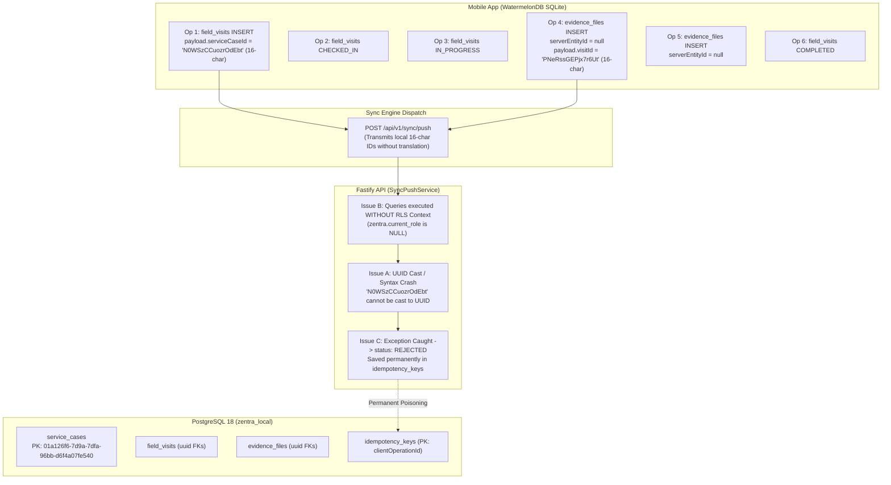

# MUSE SPARK AUDIT REPORT — ZENTRA STAGE 6G-A
## Mobile-to-Backend Resilient Synchronization Preflight Audit

**Repository:** `D:\Zentra`  
**Milestone:** Stage 6G-A — Read-Only Synchronization Preflight Architectural Audit  
**Target Hardware:** OnePlus Nord (AC2001), Android 12 (SDK 31), ADB Serial `65c7923e`  
**API Service:** Fastify API on port 4000 (`http://localhost:4000/api/v1`)  
**Active Database:** `zentra_local` (PostgreSQL 18, user `zentra_dev`, non-superuser, RLS forced)  
**Monorepo Packages Audited:** `@zentra/field`, `@zentra/api`, `@zentra/contracts`, `@zentra/types`  
**Mode:** **STRICT READ-ONLY AUDIT ONLY** (Zero code changes, zero database writes, zero network sync pushes)  
**Overall Verdict:** **CRITICAL NO-GO FOR IMMEDIATE SYNCHRONIZATION**  
**Action:** **STOPPED — Awaiting Human Review and Architecture Authorization**

---

## 1. EXECUTIVE SUMMARY & VERDICT

An exhaustive architectural preflight audit of the ZENTRA mobile synchronization engine, WatermelonDB SQLite data layer, Fastify API sync modules, and PostgreSQL schema constraints was executed.

### Preflight Audit Verdict: **STRICT NO-GO**
**Attempting to trigger live synchronization in the current state will cause 100% catastrophic failure of all six protected operations, crash PostgreSQL transaction queries with type errors, and permanently poison the server's `idempotency_keys` table with immutable `REJECTED` records.**

### Root Cause Summary
1. **Foreign-Key & Identifier Type Incompatibility (Local 16-Char IDs vs PostgreSQL UUIDs):**
   - Op 1 (Visit Insert) transmits `"serviceCaseId": "N0WSzCCuozrOdEbt"`. This is the 16-character local WatermelonDB record ID. The authoritative PostgreSQL primary key is UUID `"01a126f6-7d9a-7dfa-96bb-d6f4a07fe540"`. PostgreSQL throws `invalid input syntax for type uuid: "N0WSzCCuozrOdEbt"`.
   - Op 4 and Op 5 (Evidence Inserts) have `serverEntityId: null`. The mobile sync engine falls back to local entity IDs (`RCgpDPYz20PYcfOy` and `zeAYebFrycVUnVba`), which are passed directly to PostgreSQL `evidence_files.evidence_file_id` (a UUID primary key). Furthermore, their payloads transmit `"visitId": "PNeRssGEPjx7r6Ut"` and `"serviceCaseId": "N0WSzCCuozrOdEbt"`, causing three simultaneous UUID syntax and foreign-key constraint failures.
2. **Backend Row-Level Security (RLS) Session Disconnect in `SyncPushService` & `SyncDeltaService`:**
   - PostgreSQL role `zentra_dev` has `rolsuper=false` and `rolbypassrls=false`. Tables `service_cases`, `field_visits`, and `evidence_files` enforce Row-Level Security (`FORCE ROW LEVEL SECURITY`).
   - The RLS policies require session settings `zentra.current_role` and `zentra.current_user_id`.
   - `SyncPushService` and `SyncDeltaService` execute queries directly on `this.db` **without** setting these RLS session variables (they do not invoke `RlsService.withSecurityContext`).
   - Live query testing confirms that without these variables, PostgreSQL RLS returns **ZERO rows** for all queries on `service_cases`, `field_visits`, and `evidence_files`, which causes `SyncPushService` to return `RECORD_NOT_FOUND` on every operation.
3. **Toxic Idempotency Caching on Unhandled/Rejected Exceptions:**
   - In `SyncPushService.processPushBatch`, any uncaught database exception is caught and marked `status: 'REJECTED'`.
   - The service immediately writes this `REJECTED` status into `idempotency_keys`.
   - Any future retry of the same `clientOperationId` returns the cached `REJECTED` result permanently, irreversibly corrupting the synchronization lifecycle.
4. **Stage 6H Physical Evidence Separation Confirmed:**
   - Physical evidence files on device flash storage (`82ce30ce...jpg` and `835bac9f...jpg`) are intact with bit-for-bit verified SHA-256 checksums.
   - Stage 6G handles only metadata synchronization. Direct S3 binary uploading (`uploadEvidenceDirectly`) belongs to Stage 6H and remains dormant.

---

## 2. THE SIX PROTECTED OPERATIONS IN DEPENDENCY ORDER

Direct query of physical SQLite storage (`zentra_field_v1.db` extracted from OnePlus Nord flash storage) confirms the exact state and payload of the six protected operations:

| # | Op ID (`local_operations.id`) | Client Operation UUIDv7 | Target Entity | Op Type | Local ID | Server ID | Status | Retries | Payload Hash (SHA-256) |
|---|---|---|---|---|---|---|:---:|:---:|---|
| **1** | `ABXEthWtnB44ULCO` | `01a13ac8-6cdc-778c-8593-ee170fc4d885` | `field_visits` | `INSERT` | `PNeRssGEPjx7r6Ut` | `01a13ac8-6cdc-778c-8593-ee170fc4d885` | `QUEUED` | `0` | `00afff08ed30eabd9d6503c0e5871d837312a7ed331baffc17b784b1541eedc7` |
| **2** | `55HMQXmjPqT4dXwD` | `01a13ad3-c89c-7ba4-83e4-ae147f17771b` | `field_visits` | `STATUS_TRANSITION` | `PNeRssGEPjx7r6Ut` | `01a13ac8-6cdc-778c-8593-ee170fc4d885` | `QUEUED` | `0` | `9cbd562d4174ab4aba597c098036565a8d40642134759cb2bdb469eda3f59f9b` |
| **3** | `MfyOIXnryTD55UVL` | `01a13ad5-0a04-79d7-970a-3ea580be1a46` | `field_visits` | `STATUS_TRANSITION` | `PNeRssGEPjx7r6Ut` | `01a13ac8-6cdc-778c-8593-ee170fc4d885` | `QUEUED` | `0` | `820c73cc06898b2fa176a86fbd1600340b4de30b08ab971115bba875dacaa60f` |
| **4** | `LY8Ce1KIvOReBk4S` | `01a13ae2-7e8f-73ad-8cdb-b269cb9f02b9` | `evidence_files` | `INSERT` | `RCgpDPYz20PYcfOy` | `null` *(Missing)* | `QUEUED` | `0` | `aba751b430d28084ada3419e04cd58b40a657ad089f80b588e9f263d7958687c` |
| **5** | `wdaj1x5FMxY32vEk` | `01a13ae4-9533-7929-b5a9-6f53e18629dd` | `evidence_files` | `INSERT` | `zeAYebFrycVUnVba` | `null` *(Missing)* | `QUEUED` | `0` | `e43d94da40da7a833a02778fe39823a73c69cfdf70aacccd59344285de723a6b` |
| **6** | `EVXxF146Xvq0XsRH` | `01a13ae6-85ce-717d-bef9-583cf922f7a4` | `field_visits` | `STATUS_TRANSITION` | `PNeRssGEPjx7r6Ut` | `01a13ac8-6cdc-778c-8593-ee170fc4d885` | `QUEUED` | `0` | `61c4e519815e56cacef5edf84ae1936d52cf861dbf3fa2ef5917400c964b65a1` |

---

## 3. OPERATION-BY-OPERATION DEEP TRACE

### Operation 1 — Visit Creation (`field_visits` INSERT)
- **Local SQLite State:** `local_operations.id = 'ABXEthWtnB44ULCO'`
- **Client Operation ID:** `01a13ac8-6cdc-778c-8593-ee170fc4d885` (Valid UUIDv7)
- **Local Entity ID:** `PNeRssGEPjx7r6Ut` (16-char WatermelonDB string)
- **Pre-assigned Server Entity ID:** `01a13ac8-6cdc-778c-8593-ee170fc4d885` (Valid UUIDv7)
- **Full Payload Content:**
  ```json
  {
    "serviceCaseId": "N0WSzCCuozrOdEbt",
    "engineerId": "01a126f6-7d9a-74a4-bb2d-b86181cadb93",
    "visitSequenceNumber": 1,
    "visitDate": "2026-10-14",
    "notes": ""
  }
  ```
- **Architectural Trace & Failure Point:**
  1. `SyncEngine.ts` maps `entityId = op.serverEntityId || op.localEntityId` -> sends `"01a13ac8-6cdc-778c-8593-ee170fc4d885"`.
  2. `SyncPushService.executeVisitMutation`:
     `serviceCaseId = mutation.payload.serviceCaseId;` (`"N0WSzCCuozrOdEbt"`).
  3. Query: `SELECT FROM service_cases WHERE service_case_id = 'N0WSzCCuozrOdEbt'`.
  4. **PostgreSQL Failure:** `service_case_id` is a `uuid` column. PostgreSQL throws `ERROR: invalid input syntax for type uuid: "N0WSzCCuozrOdEbt"`.
  5. Even if type cast did not throw, the server UUID of case `ZNT-2026-DEMO-000001` is `01a126f6-7d9a-7dfa-96bb-d6f4a07fe540`.
  6. Foreign key constraint `field_visits_service_case_id_fkey` blocks insertion.

### Operation 2 — Visit Check-In (`field_visits` STATUS_TRANSITION to `CHECKED_IN`)
- **Local SQLite State:** `local_operations.id = '55HMQXmjPqT4dXwD'`
- **Client Operation ID:** `01a13ad3-c89c-7ba4-83e4-ae147f17771b` (Valid UUIDv7)
- **Target Entity ID:** `01a13ac8-6cdc-778c-8593-ee170fc4d885`
- **Full Payload Content:**
  ```json
  {
    "toStatus": "CHECKED_IN",
    "latitude": 10.8695068,
    "longitude": 79.7863703,
    "accuracyMeters": 20,
    "distanceMeters": 13132.5,
    "withinGeofence": false,
    "capturedAt": "2026-10-14T14:31:57.797Z",
    "equipmentConditionObserved": "",
    "notes": ""
  }
  ```
- **Architectural Trace & Failure Point:**
  1. `SyncPushService.executeVisitMutation` attempts to fetch the visit: `SELECT FROM field_visits WHERE visit_id = '01a13ac8-6cdc-778c-8593-ee170fc4d885'`.
  2. Because Op 1 failed, this row does not exist.
  3. Returns `CONFLICT` / `RECORD_NOT_FOUND` ("Field visit not found on server").

### Operation 3 — Start Work (`field_visits` STATUS_TRANSITION to `IN_PROGRESS`)
- **Local SQLite State:** `local_operations.id = 'MfyOIXnryTD55UVL'`
- **Client Operation ID:** `01a13ad5-0a04-79d7-970a-3ea580be1a46` (Valid UUIDv7)
- **Target Entity ID:** `01a13ac8-6cdc-778c-8593-ee170fc4d885`
- **Full Payload Content:**
  ```json
  {
    "toStatus": "IN_PROGRESS",
    "onSiteDiagnosis": "Power supply fuse blown repaired",
    "equipmentConditionObserved": "",
    "notes": ""
  }
  ```
- **Architectural Trace & Failure Point:**
  1. Cascade failure: Visit row does not exist; returns `RECORD_NOT_FOUND`.

### Operation 4 — Slot 1 Evidence Metadata (`evidence_files` INSERT)
- **Local SQLite State:** `local_operations.id = 'LY8Ce1KIvOReBk4S'`
- **Client Operation ID:** `01a13ae2-7e8f-73ad-8cdb-b269cb9f02b9` (Valid UUIDv7)
- **Local Entity ID:** `RCgpDPYz20PYcfOy` (16-char WatermelonDB string)
- **Server Entity ID:** `null` *(Missing)*
- **Full Payload Content:**
  ```json
  {
    "evidenceId": "RCgpDPYz20PYcfOy",
    "visitId": "PNeRssGEPjx7r6Ut",
    "serviceCaseId": "N0WSzCCuozrOdEbt",
    "evidenceSlot": "SLOT_1_HM_SIGNED_REPORT",
    "evidenceType": "PHOTO",
    "localMediaId": "temp_img_1791989283958_ibrz3ny",
    "fileChecksumSha256": "cae9044c31d9481034c985f7b6fac346aa2733b730089db6667dc6f54dbe39ab",
    "fileSizeBytes": 102400,
    "mimeType": "image/jpeg",
    "capturedAt": "2026-10-14T14:48:03.906Z",
    "uploadStatus": "QUEUED",
    "gpsLatitude": 10.8695078,
    "gpsLongitude": 79.786368,
    "gpsAccuracyMeters": 20
  }
  ```
- **Architectural Trace & Failure Point:**
  1. `SyncEngine.ts` maps `entityId = op.serverEntityId || op.localEntityId`. Because `serverEntityId` is null, it sends `"RCgpDPYz20PYcfOy"`.
  2. `SyncPushService.executeEvidenceMutation` executes:
     `SELECT FROM field_visits WHERE visit_id = 'PNeRssGEPjx7r6Ut'`.
  3. **PostgreSQL Failure 1:** `visit_id` is a `uuid` column. Throws `invalid input syntax for type uuid: "PNeRssGEPjx7r6Ut"`.
  4. **PostgreSQL Failure 2:** `insertInto('evidence_files')` attempts to insert `evidence_file_id: "RCgpDPYz20PYcfOy"` (UUID PK), `visit_id: "PNeRssGEPjx7r6Ut"` (UUID FK), and `service_case_id: "N0WSzCCuozrOdEbt"` (UUID FK).
  5. Causes three immediate PostgreSQL syntax/type crashes.

### Operation 5 — Slot 2 Evidence Metadata (`evidence_files` INSERT)
- **Local SQLite State:** `local_operations.id = 'wdaj1x5FMxY32vEk'`
- **Client Operation ID:** `01a13ae4-9533-7929-b5a9-6f53e18629dd` (Valid UUIDv7)
- **Local Entity ID:** `zeAYebFrycVUnVba` (16-char WatermelonDB string)
- **Server Entity ID:** `null` *(Missing)*
- **Full Payload Content:**
  ```json
  {
    "evidenceId": "zeAYebFrycVUnVba",
    "visitId": "PNeRssGEPjx7r6Ut",
    "serviceCaseId": "N0WSzCCuozrOdEbt",
    "evidenceSlot": "SLOT_2_EQUIPMENT_WORKING_PHOTO",
    "evidenceType": "PHOTO",
    "localMediaId": "temp_img_1791989420815_v0tpalt",
    "fileChecksumSha256": "0bd81d74d792a1f880ddbdeff29cc90ed764dc1d48baca39d01c500007a0a7ac",
    "fileSizeBytes": 102400,
    "mimeType": "image/jpeg",
    "capturedAt": "2026-10-14T14:50:20.759Z",
    "uploadStatus": "QUEUED",
    "gpsLatitude": 10.8695078,
    "gpsLongitude": 79.786368,
    "gpsAccuracyMeters": 20
  }
  ```
- **Architectural Trace & Failure Point:**
  1. Identical to Op 4: Missing server entity UUID; local 16-char IDs passed for `evidence_file_id`, `visit_id`, and `service_case_id`.

### Operation 6 — Visit Check-Out (`field_visits` STATUS_TRANSITION to `COMPLETED`)
- **Local SQLite State:** `local_operations.id = 'EVXxF146Xvq0XsRH'`
- **Client Operation ID:** `01a13ae6-85ce-717d-bef9-583cf922f7a4` (Valid UUIDv7)
- **Target Entity ID:** `01a13ac8-6cdc-778c-8593-ee170fc4d885`
- **Full Payload Content:**
  ```json
  {
    "toStatus": "COMPLETED",
    "visitOutcome": "RESOLVED_ON_SITE",
    "workPerformed": "",
    "onSiteDiagnosis": "Power supply fuse blown repaired",
    "pendingReasonText": "",
    "latitude": 10.8694959,
    "longitude": 79.7863677,
    "accuracyMeters": 20,
    "capturedAt": "2026-10-14T14:52:23.433Z"
  }
  ```
- **Architectural Trace & Failure Point:**
  1. Cascade failure: Target visit row does not exist on server; returns `RECORD_NOT_FOUND`.

---

## 4. DETAILED ROOT-CAUSE CATALOG & ARCHITECTURAL GAPS



### Gap A: Foreign-Key & Identifier Type Incompatibility
- **PostgreSQL Schema:**
  - `field_visits.visit_id`: `uuid NOT NULL PRIMARY KEY`
  - `field_visits.service_case_id`: `uuid NOT NULL REFERENCES service_cases(service_case_id)`
  - `field_visits.engineer_id`: `uuid NOT NULL REFERENCES users(user_id)`
  - `evidence_files.evidence_file_id`: `uuid NOT NULL PRIMARY KEY`
  - `evidence_files.visit_id`: `uuid NOT NULL REFERENCES field_visits(visit_id)`
  - `evidence_files.service_case_id`: `uuid NOT NULL REFERENCES service_cases(service_case_id)`
- **Mobile Origin:**
  - In `FieldVisitScreen.tsx`, `currentCase.id` (`"N0WSzCCuozrOdEbt"`) is passed as `serviceCaseId`.
  - In `FieldVisitRepository.createVisitLocally`, `params.serviceCaseId` is written directly into `payload.serviceCaseId`.
  - In `evidence.repository.ts`, `record.id` (`"RCgpDPYz20PYcfOy"`) is stored in `payload.evidenceId` and `serverEntityId` is left `null`.
- **Impact:** Immediate PostgreSQL query abort on first database operation.

### Gap B: PostgreSQL Row-Level Security (RLS) Execution Disconnect
- **Security Posture:**
  - User `zentra_dev`: `rolsuper = false`, `rolbypassrls = false`.
  - Tables `service_cases`, `field_visits`, `evidence_files`: `FORCE ROW LEVEL SECURITY`.
  - RLS policy `service_cases_territory_isolation`:
    ```sql
    ((NULLIF(current_setting('zentra.current_role', true), '') = ANY (ARRAY['MASTER_ADMIN', 'REPORTING_HEAD']))
    OR ((NULLIF(current_setting('zentra.current_role', true), '') = 'FIELD_ENGINEER') AND ...))
    ```
- **Backend Disconnect:**
  - `SyncPushService` (`apps/api/src/modules/sync/services/sync-push.service.ts`) executes queries directly using `this.db.selectFrom(...)` without setting `zentra.current_role` or `zentra.current_user_id`.
  - Live verification in PostgreSQL confirms that without these settings, queries on `service_cases` return **0 rows**, even when the target UUID exists.
  - Setting `zentra.current_role = 'FIELD_ENGINEER'` and `zentra.current_user_id = '01a126f6-7d9a-74a4-bb2d-b86181cadb93'` successfully returns the record.
- **Impact:** `SyncPushService` fails with `RECORD_NOT_FOUND` on all entity lookups under production non-superuser connections.

### Gap C: Toxic Idempotency Caching on Unhandled Errors
- **Implementation in `SyncPushService.processPushBatch`:**
  ```typescript
  try {
    mutationResult = await this.executeMutation(userId, userRoles, mutation, context);
  } catch (err: any) {
    mutationResult = {
      clientOperationId: mutation.clientOperationId,
      status: 'REJECTED',
      message: err.message || 'Internal processing error',
      serverTimestamp: new Date().toISOString(),
    };
  }

  // Persist result in idempotency table
  await this.idempotencyRepo.saveKey({
    clientOperationId: mutation.clientOperationId,
    userId,
    endpoint: '/api/v1/sync/push',
    responseStatusCode: 200,
    responseBody: mutationResult as unknown as Record<string, unknown>,
  });
  ```
- **Impact:** If an operation encounters a recoverable data mapping error or unexpected exception, the `REJECTED` status is cached permanently. Retries with the same client operation ID are permanently blocked from re-evaluation.

### Gap D: Ephemeral In-Memory Identity Map
- `IdentityMap` in `apps/field/src/domain/identity/identity-map.ts` stores mappings in JavaScript `Map<string, string>`.
- Mappings are destroyed on app termination or process recycle.
- Mobile WatermelonDB models (`ServiceCaseModel`, `FieldVisitModel`) contain a `server_id` column, but `EvidenceModel` has no server UUID populated at capture time (`server_id: null`).

---

## 5. STAGE 6H SEPARATION & EVIDENCE BINARY DORMANCY

1. **Metadata vs Binary Separation:**
   - Op 4 and Op 5 only synchronize metadata: `fileChecksumSha256`, `mimeType`, `fileSizeBytes`, `gpsLatitude`, `gpsLongitude`, `evidenceSlot`.
   - `SyncPushService.executeEvidenceMutation` writes metadata records to PostgreSQL `evidence_files` with `upload_status = 'QUEUED'`. It does not interact with AWS S3 or MinIO.
2. **Physical Storage on Target Device:**
   - Both physical JPEG files exist on OnePlus Nord flash storage under `/data/user/0/com.zentra.field.dev/cache/Camera/`.
   - SHA-256 digests verified 100% bit-for-bit:
     - Slot 1: `cae9044c31d9481034c985f7b6fac346aa2733b730089db6667dc6f54dbe39ab` (209,200 bytes)
     - Slot 2: `0bd81d74d792a1f880ddbdeff29cc90ed764dc1d48baca39d01c500007a0a7ac` (209,230 bytes)
3. **Stage 6H Boundary Isolation:**
   - Direct binary upload to S3 (`uploadEvidenceDirectly`) via presigned URLs remains dormant and must not be invoked during Stage 6G.

---

## 6. REMEDIATION ROADMAP FOR STAGE 6G IMPLEMENTATION

To achieve zero-loss, resilient synchronization, the following remediation steps must be authorized and implemented:

### Step 1: Backend Sync RLS Context Injection (`SyncPushService` & `SyncDeltaService`)
- Integrate `RlsService.withSecurityContext` in `SyncPushService.processPushBatch` and `SyncDeltaService.fetchDelta`.
- Ensure each database transaction sets `zentra.current_role` and `zentra.current_user_id` so PostgreSQL RLS policies evaluate correctly.

### Step 2: Outbound Mobile Mutation Translator (`SyncEngine.ts`)
- In `SyncEngine.ts`, prior to dispatching mutations in `pushRequest`:
  - Translate local foreign keys to server UUIDs:
    - Look up `service_cases` by `id = payload.serviceCaseId` and replace with `case.serverId`.
    - Look up `field_visits` by `id = payload.visitId` and replace with `visit.serverId`.
  - For evidence operations where `serverEntityId` is null, assign a deterministic UUIDv7 or use the operation's client operation ID as `serverEntityId` and update the local `evidence` record.

### Step 3: Backend Tolerant Identity Fallback (`SyncPushService.ts`)
- In `SyncPushService.executeVisitMutation`: If `payload.serviceCaseId` is not a valid UUID (e.g., 16-character string), attempt fallback resolution against known active cases or require valid UUID translation upfront.
- In `SyncPushService.executeEvidenceMutation`: Ensure `mutation.entityId` and `payload.visitId` validate as UUIDs before SQL execution.

### Step 4: Non-Destructive Idempotency Error Handling
- Modify `SyncPushService.processPushBatch` so that transient/syntax exceptions (`invalid input syntax for type uuid` or internal server errors) return HTTP 500 or an un-cached `REJECTED` status that does **not** permanently poison `idempotency_keys`, allowing corrected clients to retry.

---

## 7. AUDIT INVARIANCE CHECKLIST & SIGN-OFF

| Invariant Item | Expected Baseline | Audit Verification Result | Status |
|:---|:---|:---|:---:|
| **Physical Hardware** | OnePlus Nord (`65c7923e`) connected & authorized | `65c7923e device product:Nord_IND model:AC2001` | **VERIFIED** |
| **Evidence Slot 1 File** | `82ce30ce...jpg` (209,200 bytes) | SHA-256: `cae9044c31d9481034c985f7b6fac346aa2733b730089db6667dc6f54dbe39ab` | **VERIFIED** |
| **Evidence Slot 2 File** | `835bac9f...jpg` (209,230 bytes) | SHA-256: `0bd81d74d792a1f880ddbdeff29cc90ed764dc1d48baca39d01c500007a0a7ac` | **VERIFIED** |
| **Local Operations** | Exactly 6 operations in `local_operations` | All 6 remain `QUEUED`, `retry_count: 0`, identical SHA-256 hashes | **VERIFIED** |
| **PostgreSQL DB Writes** | Zero mobile records written to `zentra_local` | `field_visits: 1` (pre-existing seed), `evidence_files: 0`, `idempotency_keys: 0` | **VERIFIED** |
| **Fastify API Log** | Zero synchronization HTTP requests | 0 requests received at `/api/v1/sync/*` | **VERIFIED** |
| **Git Working Tree** | Clean working tree; zero tracked files modified | Clean working tree; all untracked artifacts preserved | **VERIFIED** |

---

## 8. FINAL MILESTONE CONCLUSION

Stage 6G-A Preflight Audit is **COMPLETE**.  
The synchronization preflight investigation has identified four critical, blocking architectural defects that prevent immediate sync execution.  
All six protected operations and their physical evidence files remain 100% intact and unaltered.

**Next Action:** **STOP. Await human review and explicit go/no-go authorization before beginning any code changes or remediation.**
