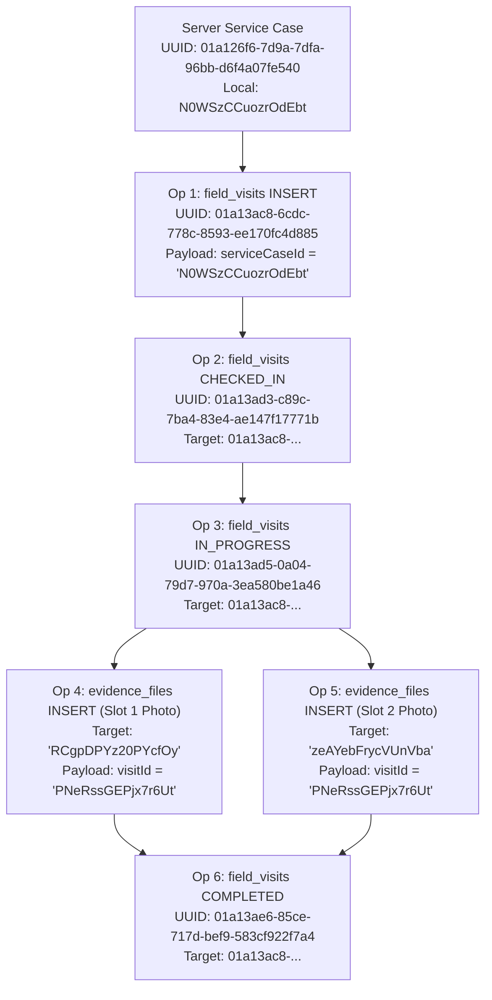

# MUSE SPARK — ZENTRA STAGE 6G-B2
# READ-ONLY ID MAPPING & PAYLOAD CONTRACT AUDIT REPORT

**Document ID:** `ZENTRA-AUDIT-6G-B2-ID-MAPPING-20261015`  
**Execution Date:** 2026-10-15  
**Auditor:** Antigravity (Advanced Agentic Architecture Pair)  
**Target Repository:** `D:\Zentra`  
**Target Device:** OnePlus Nord (AC2001), Android 12 (`65c7923e`)  
**Scope:** Strictly Read-Only Architectural Audit (Mobile Identity Mapping, Evidence Identity Assignment, Operation Dependency Ordering, Sync Payload Contract Compatibility)  
**Operational Status:** **CRITICAL NO-GO FOR LIVE SYNCHRONIZATION**

---

## 1. Executive Summary & Operational Verdict

### Operational Verdict: STRICT NO-GO

> [!CAUTION]
> **SYNCHRONIZATION ATTEMPT AT THIS STAGE WILL RESULT IN CATASTROPHIC SYNC FAILURE AND IRREVERSIBLE IDEMPOTENCY KEY POISONING.**  
> Under no circumstances should `/api/v1/sync/push` or mobile sync execution be triggered in the current repository state.

### Key Architectural Findings

1. **Fatal Foreign Key & Identity Type Mismatches:**
   All six queued mobile operations contain 16-character alphanumeric WatermelonDB local IDs where the backend PostgreSQL schema and foreign key constraints strictly mandate UUIDs (specifically UUIDv7).
   - **Operation 1 (Visit INSERT):** Payload supplies `serviceCaseId: "N0WSzCCuozrOdEbt"` (local WatermelonDB ID). The server UUID is `01a126f6-7d9a-7dfa-96bb-d6f4a07fe540`.
   - **Operation 4 & 5 (Evidence INSERTs):** Have `server_entity_id: null`. When `SyncEngine` prepares the push payload, it falls back to `localEntityId`, transmitting non-UUID identifiers (`RCgpDPYz20PYcfOy` and `zeAYebFrycVUnVba`) as `entityId` and `evidenceId`. Furthermore, their payloads pass local IDs for `visitId` (`"PNeRssGEPjx7r6Ut"`) and `serviceCaseId` (`"N0WSzCCuozrOdEbt"`).

2. **The `IdentityMap` Component is an In-Memory Ghost:**
   [`apps/field/src/domain/identity/identity-map.ts`](file:///D:/Zentra/apps/field/src/domain/identity/identity-map.ts) contains an in-memory `Map<string, string>`. It has **zero persistence in SQLite**, is **never initialized or restored on application launch**, and its mapping methods (`register`, `getServerId`, `getLocalId`) are **dead code never invoked anywhere in the codebase**. Only its static `generateOperationId()` helper is used as a UUID generator.

3. **PostgreSQL Syntax Abort (`22P02`):**
   PostgreSQL column types for `service_cases.service_case_id`, `field_visits.visit_id`, and `evidence_files.evidence_file_id` are strictly `uuid`. When Kysely attempts to query or insert these tables with 16-character alphanumeric strings, PostgreSQL immediately raises:
   ```text
   ERROR: invalid input syntax for type uuid: "N0WSzCCuozrOdEbt" (SQLSTATE 22P02)
   ```

4. **Permanent Idempotency Poisoning Trap:**
   [`SyncPushService.processPushBatch`](file:///D:/Zentra/apps/api/src/modules/sync/services/sync-push.service.ts#L51-L96) catches unhandled transaction errors and generates a `REJECTED` result. It then **persists this `REJECTED` status into the backend `idempotency_keys` table** associated with `clientOperationId`. If this occurs, the mobile client's operation ID is permanently poisoned: any future retry of the same operation ID will return the cached `REJECTED` response forever, preventing the physical visit and evidence from ever synchronizing without manual database surgery.

5. **Evidence Push Handling Missing on Mobile:**
   [`SyncEngine.processPushBatch`](file:///D:/Zentra/apps/field/src/sync/sync-engine.ts#L155-L235) handles state advancement for `service_cases` and `field_visits`, but completely omits handling for `evidence_files`. Even if an evidence mutation were accepted, the mobile engine would never update `evidence.syncState = 'SYNCED'` or populate `evidence.server_id`.

---

## 2. Source Code & Database Symbols Inspected

The following source files, schemas, and database instances were inspected during this read-only audit:

| Component / Layer | File Path / Location | Key Symbols Inspected |
|---|---|---|
| **Mobile Identity** | [`apps/field/src/domain/identity/identity-map.ts`](file:///D:/Zentra/apps/field/src/domain/identity/identity-map.ts) | `IdentityMap`, `register`, `getServerId`, `getLocalId`, `generateOperationId` |
| **Mobile Sync Engine** | [`apps/field/src/sync/sync-engine.ts`](file:///D:/Zentra/apps/field/src/sync/sync-engine.ts) | `SyncEngine.pushOutboundMutations`, `buildPushBatch`, `markAcknowledged`, `markFailed` |
| **Mobile Repositories** | [`apps/field/src/domain/repositories/field-visit.repository.ts`](file:///D:/Zentra/apps/field/src/domain/repositories/field-visit.repository.ts) | `createVisitLocally`, `checkIn`, `startWork`, `completeVisit` |
| **Mobile Repositories** | [`apps/field/src/domain/repositories/evidence.repository.ts`](file:///D:/Zentra/apps/field/src/domain/repositories/evidence.repository.ts) | `captureAndQueueEvidence`, `executeDirectUpload`, `computeChecksum` |
| **Mobile Delta Applier** | [`apps/field/src/sync/delta-applier.ts`](file:///D:/Zentra/apps/field/src/sync/delta-applier.ts) | `DeltaApplier.applyDeltaBatch`, `applyUpsert` |
| **Mobile Sync Client** | [`apps/field/src/sync/sync-api.service.ts`](file:///D:/Zentra/apps/field/src/sync/sync-api.service.ts) | `SyncApiService.pushMutations`, `pullDelta` |
| **Contracts** | [`packages/contracts/src/sync/sync.contract.ts`](file:///D:/Zentra/packages/contracts/src/sync/sync.contract.ts) | `syncMutationItemSchema`, `syncPushRequestSchema`, `syncMutationResultSchema` |
| **Backend Push Service** | [`apps/api/src/modules/sync/services/sync-push.service.ts`](file:///D:/Zentra/apps/api/src/modules/sync/services/sync-push.service.ts) | `SyncPushService.processPushBatch`, `executeVisitMutation`, `executeEvidenceMutation` |
| **Backend Delta Service**| [`apps/api/src/modules/sync/services/sync-delta.service.ts`](file:///D:/Zentra/apps/api/src/modules/sync/services/sync-delta.service.ts) | `SyncDeltaService.getDeltaStream`, `buildChangeItem` |
| **PostgreSQL Schema** | [`infra/database/migrations/20261005000004_create_visits_evidence_and_findings.ts`](file:///D:/Zentra/infra/database/migrations/20261005000004_create_visits_evidence_and_findings.ts) | `field_visits`, `evidence_files`, `field_visit_status_history` tables |
| **PostgreSQL Schema** | [`infra/database/migrations/20261008000005_enhance_evidence_files_and_s3_pipeline.ts`](file:///D:/Zentra/infra/database/migrations/20261008000005_enhance_evidence_files_and_s3_pipeline.ts) | `evidence_files` S3 pipeline columns, `upload_status` check |
| **Mobile SQLite DB** | Device: `/data/user/0/com.zentra.field.dev/databases/zentra_field_v1.db` | `local_operations`, `field_visits`, `evidence`, `service_cases` tables |
| **Live Backend DB** | PostgreSQL 18 `zentra_local` (Docker `zentra-postgres:5432`) | `service_cases`, `field_visits`, `evidence_files`, `idempotency_keys` |

---

## 3. The Six Protected Mobile Operations Breakdown

The physical SQLite database from the OnePlus Nord device was analyzed via Node.js SQLite inspection. The 6 operations currently waiting in `local_operations` table (`status: 'QUEUED'`, `retry_count: 0`) have the following structural identity profile:

### Operation Overview Matrix

| # | Local Op ID | Client Op UUID (`client_operation_id`) | Entity Type | Op Type | Local Entity ID | Server Entity ID | Emitted `entityId` | Inbound Server Foreign Keys in Payload | Server DB Foreign Key Column Types |
|---|---|---|---|---|---|---|---|---|---|
| **1** | `ABXEthWtnB44ULCO` | `01a13ac8-6cdc-778c-8593-ee170fc4d885` | `field_visits` | `INSERT` | `PNeRssGEPjx7r6Ut` | `01a13ac8-6cdc-778c-8593-ee170fc4d885` | `01a13ac8-...` (UUIDv7) | `serviceCaseId: "N0WSzCCuozrOdEbt"` (Local WatermelonDB ID) | `service_cases.service_case_id` is `UUID` |
| **2** | `55HMQXmjPqT4dXwD` | `01a13ad3-c89c-7ba4-83e4-ae147f17771b` | `field_visits` | `STATUS_TRANSITION` | `PNeRssGEPjx7r6Ut` | `01a13ac8-6cdc-778c-8593-ee170fc4d885` | `01a13ac8-...` (UUIDv7) | Target visit is valid server UUID. `toStatus: "CHECKED_IN"` | `field_visits.visit_id` is `UUID` |
| **3** | `MfyOIXnryTD55UVL` | `01a13ad5-0a04-79d7-970a-3ea580be1a46` | `field_visits` | `STATUS_TRANSITION` | `PNeRssGEPjx7r6Ut` | `01a13ac8-6cdc-778c-8593-ee170fc4d885` | `01a13ac8-...` (UUIDv7) | Target visit is valid server UUID. `toStatus: "IN_PROGRESS"` | `field_visits.visit_id` is `UUID` |
| **4** | `LY8Ce1KIvOReBk4S` | `01a13ae2-7e8f-73ad-8cdb-b269cb9f02b9` | `evidence_files` | `INSERT` | `RCgpDPYz20PYcfOy` | `null` | **`RCgpDPYz20PYcfOy`** (Local Alphanumeric) | `evidenceId: "RCgpDPYz20PYcfOy"`<br>`visitId: "PNeRssGEPjx7r6Ut"`<br>`serviceCaseId: "N0WSzCCuozrOdEbt"` | `evidence_files.evidence_file_id` is `UUID`<br>`visit_id` is `UUID`<br>`service_case_id` is `UUID` |
| **5** | `wdaj1x5FMxY32vEk` | `01a13ae4-9533-7929-b5a9-6f53e18629dd` | `evidence_files` | `INSERT` | `zeAYebFrycVUnVba` | `null` | **`zeAYebFrycVUnVba`** (Local Alphanumeric) | `evidenceId: "zeAYebFrycVUnVba"`<br>`visitId: "PNeRssGEPjx7r6Ut"`<br>`serviceCaseId: "N0WSzCCuozrOdEbt"` | `evidence_files.evidence_file_id` is `UUID`<br>`visit_id` is `UUID`<br>`service_case_id` is `UUID` |
| **6** | `EVXxF146Xvq0XsRH` | `01a13ae6-85ce-717d-bef9-583cf922f7a4` | `field_visits` | `STATUS_TRANSITION` | `PNeRssGEPjx7r6Ut` | `01a13ac8-6cdc-778c-8593-ee170fc4d885` | `01a13ac8-...` (UUIDv7) | Target visit is valid server UUID. `toStatus: "COMPLETED"` | `field_visits.visit_id` is `UUID` |

---

### Detailed Per-Operation Payloads & Diagnostics

#### Operation 1: Field Visit INSERT
```json
{
  "clientOperationId": "01a13ac8-6cdc-778c-8593-ee170fc4d885",
  "entityType": "field_visits",
  "entityId": "01a13ac8-6cdc-778c-8593-ee170fc4d885",
  "operationType": "INSERT",
  "payload": {
    "serviceCaseId": "N0WSzCCuozrOdEbt",
    "engineerId": "01a126f6-7d9a-74a4-bb2d-b86181cadb93",
    "visitSequenceNumber": 1,
    "visitDate": "2026-10-14",
    "notes": ""
  }
}
```
- **Entity Identity:** Valid UUIDv7 (`01a13ac8-6cdc-778c-8593-ee170fc4d885`) assigned at creation time as both `newVisit.serverId` and `clientOperationId`.
- **Fatal Defect:** `payload.serviceCaseId` is `"N0WSzCCuozrOdEbt"`. The actual server UUID for this case in PostgreSQL is `"01a126f6-7d9a-7dfa-96bb-d6f4a07fe540"`.
- **Backend Execution Failure:** In [`SyncPushService.executeVisitMutation`](file:///D:/Zentra/apps/api/src/modules/sync/services/sync-push.service.ts#L346-L360), the query:
  ```typescript
  const caseRecord = await trx
    .selectFrom('service_cases')
    .where('service_case_id', '=', serviceCaseId)
    .selectAll()
    .executeTakeFirst();
  ```
  causes PostgreSQL to abort with error `invalid input syntax for type uuid: "N0WSzCCuozrOdEbt"`.

#### Operation 2: Field Visit STATUS_TRANSITION (`CHECKED_IN`)
```json
{
  "clientOperationId": "01a13ad3-c89c-7ba4-83e4-ae147f17771b",
  "entityType": "field_visits",
  "entityId": "01a13ac8-6cdc-778c-8593-ee170fc4d885",
  "operationType": "STATUS_TRANSITION",
  "payload": {
    "toStatus": "CHECKED_IN",
    "latitude": 10.8695068,
    "longitude": 79.7863703,
    "accuracyMeters": 20,
    "distanceMeters": 13132.5,
    "withinGeofence": false,
    "capturedAt": "2026-10-14T14:31:57.797Z",
    "equipmentConditionObserved": "",
    "notes": ""
  }
}
```
- **Entity Identity:** Valid UUIDv7 (`01a13ac8-6cdc-778c-8593-ee170fc4d885`).
- **Dependency Defect:** Depends directly on Operation 1 having inserted the visit row into PostgreSQL. Because Operation 1 fails, `field_visits` has no row with this ID. Backend returns `CONFLICT` (`RECORD_NOT_FOUND`).

#### Operation 3: Field Visit STATUS_TRANSITION (`IN_PROGRESS`)
```json
{
  "clientOperationId": "01a13ad5-0a04-79d7-970a-3ea580be1a46",
  "entityType": "field_visits",
  "entityId": "01a13ac8-6cdc-778c-8593-ee170fc4d885",
  "operationType": "STATUS_TRANSITION",
  "payload": {
    "toStatus": "IN_PROGRESS",
    "onSiteDiagnosis": "Power supply fuse blown repaired",
    "equipmentConditionObserved": "",
    "notes": ""
  }
}
```
- **Entity Identity:** Valid UUIDv7 (`01a13ac8-6cdc-778c-8593-ee170fc4d885`).
- **Dependency Defect:** Depends directly on Operation 1 and Operation 2. Fails on server with `RECORD_NOT_FOUND`.

#### Operation 4: Evidence File INSERT (Slot 1 Photo)
```json
{
  "clientOperationId": "01a13ae2-7e8f-73ad-8cdb-b269cb9f02b9",
  "entityType": "evidence_files",
  "entityId": "RCgpDPYz20PYcfOy",
  "operationType": "INSERT",
  "payload": {
    "evidenceId": "RCgpDPYz20PYcfOy",
    "visitId": "PNeRssGEPjx7r6Ut",
    "serviceCaseId": "N0WSzCCuozrOdEbt",
    "evidenceSlot": "SLOT_1_HM_SIGNED_REPORT",
    "evidenceType": "PHOTO",
    "localMediaId": "temp_img_1791989283958_ibrz3ny",
    "fileChecksumSha256": "cae9044c31d9481034c985f7b6fac346aa2733b730089db6667dc6f54dbe39ab",
    "fileSizeBytes": 102400,
    "mimeType": "image/jpeg",
    "capturedAt": "2026-10-14T14:48:03.906Z",
    "uploadStatus": "QUEUED",
    "gpsLatitude": 10.8695078,
    "gpsLongitude": 79.786368,
    "gpsAccuracyMeters": 20
  }
}
```
- **Physical Media File:** `Camera/82ce30ce-4712-441c-a43a-cda18fca8151.jpg` (verified SHA-256 intact).
- **Fatal Identity Defects:**
  1. `server_entity_id` is `null` in SQLite `local_operations`.
  2. `SyncEngine` builds `entityId: op.serverEntityId || op.localEntityId` -> `"RCgpDPYz20PYcfOy"`.
  3. `payload.evidenceId`: `"RCgpDPYz20PYcfOy"` (alphanumeric, not UUID).
  4. `payload.visitId`: `"PNeRssGEPjx7r6Ut"` (alphanumeric, not UUID). Authoritative visit UUID is `01a13ac8-6cdc-778c-8593-ee170fc4d885`.
  5. `payload.serviceCaseId`: `"N0WSzCCuozrOdEbt"` (alphanumeric, not UUID). Authoritative case UUID is `01a126f6-7d9a-7dfa-96bb-d6f4a07fe540`.
- **Backend Execution Failure:** In [`SyncPushService.executeEvidenceMutation`](file:///D:/Zentra/apps/api/src/modules/sync/services/sync-push.service.ts#L752-L764):
  ```typescript
  const visit = await trx
    .selectFrom('field_visits as fv')
    .innerJoin('service_cases as sc', 'sc.service_case_id', 'fv.service_case_id')
    .where('fv.visit_id', '=', visitId) // visitId is "PNeRssGEPjx7r6Ut"
    .executeTakeFirst();
  ```
  Aborts with `invalid input syntax for type uuid: "PNeRssGEPjx7r6Ut"`. Even if that passed, insertion into `evidence_files` would fail on `evidence_file_id: "RCgpDPYz20PYcfOy"`.

#### Operation 5: Evidence File INSERT (Slot 2 Photo)
```json
{
  "clientOperationId": "01a13ae4-9533-7929-b5a9-6f53e18629dd",
  "entityType": "evidence_files",
  "entityId": "zeAYebFrycVUnVba",
  "operationType": "INSERT",
  "payload": {
    "evidenceId": "zeAYebFrycVUnVba",
    "visitId": "PNeRssGEPjx7r6Ut",
    "serviceCaseId": "N0WSzCCuozrOdEbt",
    "evidenceSlot": "SLOT_2_EQUIPMENT_WORKING_PHOTO",
    "evidenceType": "PHOTO",
    "localMediaId": "temp_img_1791989420815_v0tpalt",
    "fileChecksumSha256": "0bd81d74d792a1f880ddbdeff29cc90ed764dc1d48baca39d01c500007a0a7ac",
    "fileSizeBytes": 102400,
    "mimeType": "image/jpeg",
    "capturedAt": "2026-10-14T14:50:20.759Z",
    "uploadStatus": "QUEUED",
    "gpsLatitude": 10.8695078,
    "gpsLongitude": 79.786368,
    "gpsAccuracyMeters": 20
  }
}
```
- **Physical Media File:** `Camera/835bac9f-fbc1-4eae-9a16-277c79d6228d.jpg` (verified SHA-256 intact).
- **Fatal Identity Defects:** Identical to Operation 4. Local entity ID `"zeAYebFrycVUnVba"` emitted as `entityId` and `evidenceId`. Foreign keys are local strings.

#### Operation 6: Field Visit STATUS_TRANSITION (`COMPLETED`)
```json
{
  "clientOperationId": "01a13ae6-85ce-717d-bef9-583cf922f7a4",
  "entityType": "field_visits",
  "entityId": "01a13ac8-6cdc-778c-8593-ee170fc4d885",
  "operationType": "STATUS_TRANSITION",
  "payload": {
    "toStatus": "COMPLETED",
    "visitOutcome": "RESOLVED_ON_SITE",
    "workPerformed": "",
    "onSiteDiagnosis": "Power supply fuse blown repaired",
    "pendingReasonText": "",
    "latitude": 10.8694959,
    "longitude": 79.7863677,
    "accuracyMeters": 20,
    "capturedAt": "2026-10-14T14:52:23.433Z"
  }
}
```
- **Entity Identity:** Valid UUIDv7 (`01a13ac8-6cdc-778c-8593-ee170fc4d885`).
- **Dependency Defect:** Depends on Operation 1, 2, 3, 4, 5. Fails with `RECORD_NOT_FOUND` because the parent visit was rejected.

---

## 4. Identity Mapping Architecture Deficiencies

### Analysis of `IdentityMap` Implementation

Inspection of [`apps/field/src/domain/identity/identity-map.ts`](file:///D:/Zentra/apps/field/src/domain/identity/identity-map.ts#L1-L67) reveals:

```typescript
export class IdentityMap {
  private localToServer = new Map<string, string>();
  private serverToLocal = new Map<string, string>();

  register(localId: string, serverId: string): void {
    this.localToServer.set(localId, serverId);
    this.serverToLocal.set(serverId, localId);
  }

  getServerId(localId: string): string | undefined {
    return this.localToServer.get(localId);
  }

  getLocalId(serverId: string): string | undefined {
    return this.serverToLocal.get(serverId);
  }

  static generateOperationId(): string {
    return generateUuidV7();
  }
}
```

#### Deficiencies Identified:
1. **No SQLite Persistence:** The map exists solely in volatile JavaScript memory (`new Map<string, string>()`). When the React Native app restarts, the map is instantiated completely empty.
2. **Never Seeded on Startup:** There is no initialization routine that reads existing `(id, server_id)` pairs from WatermelonDB tables (`service_cases`, `field_visits`, `evidence`) into the map on boot.
3. **Dead Code Instance Methods:** Across the entire `apps/field` codebase, neither `register()`, `getServerId()`, nor `getLocalId()` is ever called. A global symbol search confirms zero references outside of test files.
4. **Only Static UUID Generator Used:** Only `IdentityMap.generateOperationId()` is called, making the class nothing more than an alias for `@zentra/shared/generateUuidV7()`.

### Why Local IDs Leaked into Payloads

1. **Field Visit Repository ([`field-visit.repository.ts`](file:///D:/Zentra/apps/field/src/domain/repositories/field-visit.repository.ts#L83-L157)):**
   - In `createVisitLocally(params: { serviceCaseId: string; ... })`:
     The UI layer passed `case.id` (WatermelonDB record ID: `"N0WSzCCuozrOdEbt"`), because WatermelonDB model relations use `case.id`.
   - The repository stored `rec.serviceCaseId = params.serviceCaseId` directly and placed `serviceCaseId: params.serviceCaseId` into the sync payload:
     ```typescript
     // line 149-151:
     payload: {
       serviceCaseId: params.serviceCaseId, // "N0WSzCCuozrOdEbt" instead of case.serverId
     }
     ```
   - It did not query the `service_cases` table to translate `case.id` to `case.serverId` (`01a126f6-7d9a-7dfa-96bb-d6f4a07fe540`).

2. **Evidence Repository ([`evidence.repository.ts`](file:///D:/Zentra/apps/field/src/domain/repositories/evidence.repository.ts#L107-L163)):**
   - In `captureAndQueueEvidence(params: QueueEvidenceParams)`:
     - The repository created the local `evidence` record with `rec.serverId = null` (never assigned).
     - When calling `this.queue.enqueue(...)`:
       ```typescript
       // line 137-145:
       await this.queue.enqueue({
         clientOperationId,
         entityType: 'evidence_files',
         localEntityId: record.id,
         // NOTE: serverEntityId is NOT passed here at all!
         operationType: 'INSERT',
         payload: {
           evidenceId: record.id, // "RCgpDPYz20PYcfOy"
           visitId: params.visitId, // "PNeRssGEPjx7r6Ut"
           serviceCaseId: params.serviceCaseId, // "N0WSzCCuozrOdEbt"
         }
       });
       ```
     - Neither `serverEntityId` was generated, nor were foreign keys translated to server UUIDs.

3. **Outbound Push Serialization ([`sync-engine.ts`](file:///D:/Zentra/apps/field/src/sync/sync-engine.ts#L114-L124)):**
   ```typescript
   const mutations = batchToPush.map((op) => ({
     clientOperationId: op.clientOperationId,
     entityType: op.entityType,
     entityId: op.serverEntityId || op.localEntityId, // Falls back to local alphanumeric ID!
     operationType: op.operationType,
     payload: op.payload,
     clientCreatedAt: new Date(op.createdAt).toISOString(),
   }));
   ```
   Because `op.serverEntityId` is `null` for evidence files, `entityId` is sent as `"RCgpDPYz20PYcfOy"` and `"zeAYebFrycVUnVba"`.

---

## 5. Contract & Schema Mismatch Matrix

### Comprehensive Layer-by-Layer Comparison

| Field / Attribute | Mobile Local Value | Mobile Outbound Payload | Contract Schema (`sync.contract.ts`) | PostgreSQL Database Column | PostgreSQL Type & Constraints | Status / Failure Mode |
|---|---|---|---|---|---|---|
| **Op 1: `entityId`** | `PNeRssGEPjx7r6Ut` | `01a13ac8-6cdc-778c-8593-ee170fc4d885` | `z.string().min(1)` | `field_visits.visit_id` | `uuid PRIMARY KEY` | **COMPATIBLE** |
| **Op 1: `payload.serviceCaseId`** | `N0WSzCCuozrOdEbt` | `N0WSzCCuozrOdEbt` | `z.record(z.unknown())` | `field_visits.service_case_id` | `uuid NOT NULL REFERENCES service_cases` | **FATAL**: Invalid UUID syntax `22P02`. Query fails on server lookup. |
| **Op 1: `payload.engineerId`** | `01a126f6-7d9a-74a4-bb2d-b86181cadb93` | `01a126f6-7d9a-74a4-bb2d-b86181cadb93` | `z.record(z.unknown())` | `field_visits.engineer_id` | `uuid NOT NULL REFERENCES users` | **COMPATIBLE** |
| **Op 2: `entityId`** | `PNeRssGEPjx7r6Ut` | `01a13ac8-6cdc-778c-8593-ee170fc4d885` | `z.string().min(1)` | `field_visits.visit_id` | `uuid PRIMARY KEY` | **COMPATIBLE** (blocked by Op 1) |
| **Op 3: `entityId`** | `PNeRssGEPjx7r6Ut` | `01a13ac8-6cdc-778c-8593-ee170fc4d885` | `z.string().min(1)` | `field_visits.visit_id` | `uuid PRIMARY KEY` | **COMPATIBLE** (blocked by Op 1) |
| **Op 4: `entityId`** | `RCgpDPYz20PYcfOy` | `RCgpDPYz20PYcfOy` | `z.string().min(1)` | `evidence_files.evidence_file_id` | `uuid PRIMARY KEY` | **FATAL**: Invalid UUID syntax `22P02`. |
| **Op 4: `payload.evidenceId`** | `RCgpDPYz20PYcfOy` | `RCgpDPYz20PYcfOy` | `z.record(z.unknown())` | `evidence_files.evidence_file_id` | `uuid PRIMARY KEY` | **FATAL**: Invalid UUID syntax `22P02`. |
| **Op 4: `payload.visitId`** | `PNeRssGEPjx7r6Ut` | `PNeRssGEPjx7r6Ut` | `z.record(z.unknown())` | `evidence_files.visit_id` | `uuid NOT NULL REFERENCES field_visits` | **FATAL**: Invalid UUID syntax `22P02` on parent lookup. |
| **Op 4: `payload.serviceCaseId`** | `N0WSzCCuozrOdEbt` | `N0WSzCCuozrOdEbt` | `z.record(z.unknown())` | `evidence_files.service_case_id` | `uuid NOT NULL REFERENCES service_cases` | **FATAL**: Invalid UUID syntax `22P02`. |
| **Op 4: `payload.fileChecksumSha256`** | `cae9044c31d...` | `cae9044c31d...` | `z.record(z.unknown())` | `evidence_files.file_checksum_sha256` | `varchar(64) NOT NULL` | **COMPATIBLE** |
| **Op 5: `entityId`** | `zeAYebFrycVUnVba` | `zeAYebFrycVUnVba` | `z.string().min(1)` | `evidence_files.evidence_file_id` | `uuid PRIMARY KEY` | **FATAL**: Invalid UUID syntax `22P02`. |
| **Op 5: `payload.evidenceId`** | `zeAYebFrycVUnVba` | `zeAYebFrycVUnVba` | `z.record(z.unknown())` | `evidence_files.evidence_file_id` | `uuid PRIMARY KEY` | **FATAL**: Invalid UUID syntax `22P02`. |
| **Op 5: `payload.visitId`** | `PNeRssGEPjx7r6Ut` | `PNeRssGEPjx7r6Ut` | `z.record(z.unknown())` | `evidence_files.visit_id` | `uuid NOT NULL REFERENCES field_visits` | **FATAL**: Invalid UUID syntax `22P02`. |
| **Op 5: `payload.serviceCaseId`** | `N0WSzCCuozrOdEbt` | `N0WSzCCuozrOdEbt` | `z.record(z.unknown())` | `evidence_files.service_case_id` | `uuid NOT NULL REFERENCES service_cases` | **FATAL**: Invalid UUID syntax `22P02`. |
| **Op 5: `payload.fileChecksumSha256`** | `0bd81d74d79...` | `0bd81d74d79...` | `z.record(z.unknown())` | `evidence_files.file_checksum_sha256` | `varchar(64) NOT NULL` | **COMPATIBLE** |
| **Op 6: `entityId`** | `PNeRssGEPjx7r6Ut` | `01a13ac8-6cdc-778c-8593-ee170fc4d885` | `z.string().min(1)` | `field_visits.visit_id` | `uuid PRIMARY KEY` | **COMPATIBLE** (blocked by Op 1) |

---

## 6. Dependency Ordering & Cascade Failure Simulation

### Complete Dependency Flow



### Cascade Simulation if Pushed As-Is

If `/api/v1/sync/push` were invoked with the current queue, the following deterministic cascade occurs:

1. **Mutation 1 (`field_visits` INSERT):**
   - Backend calls `executeVisitMutation`.
   - Query: `SELECT * FROM service_cases WHERE service_case_id = 'N0WSzCCuozrOdEbt'`.
   - PostgreSQL throws `22P02: invalid input syntax for type uuid: "N0WSzCCuozrOdEbt"`.
   - `SyncPushService` catches error at line 77, sets `status: 'REJECTED'`, message: `"invalid input syntax for type uuid: \"N0WSzCCuozrOdEbt\""`.
   - Backend saves `{ clientOperationId: '01a13ac8-6cdc-778c-8593-ee170fc4d885', status: 'REJECTED' }` into `idempotency_keys` table.
   - **Consequence:** `field_visits` row is NOT inserted into PostgreSQL.

2. **Mutation 2 (`field_visits` STATUS_TRANSITION to `CHECKED_IN`):**
   - Backend executes next mutation in batch.
   - Query: `SELECT * FROM field_visits WHERE visit_id = '01a13ac8-6cdc-778c-8593-ee170fc4d885'`.
   - Record not found (because Mutation 1 was rejected).
   - Backend returns `CONFLICT` (`RECORD_NOT_FOUND`).
   - Result saved to `idempotency_keys`.

3. **Mutation 3 (`field_visits` STATUS_TRANSITION to `IN_PROGRESS`):**
   - Record not found. Backend returns `CONFLICT` (`RECORD_NOT_FOUND`).

4. **Mutation 4 (`evidence_files` INSERT):**
   - Backend calls `executeEvidenceMutation`.
   - Query: `SELECT * FROM field_visits WHERE visit_id = 'PNeRssGEPjx7r6Ut'`.
   - PostgreSQL throws `22P02: invalid input syntax for type uuid: "PNeRssGEPjx7r6Ut"`.
   - Backend sets `status: 'REJECTED'`, saves into `idempotency_keys`.
   - **Consequence:** Operation permanently poisoned.

5. **Mutation 5 (`evidence_files` INSERT):**
   - Identical failure. Throws `22P02: invalid input syntax for type uuid: "PNeRssGEPjx7r6Ut"`.
   - Backend sets `status: 'REJECTED'`, saves into `idempotency_keys`.

6. **Mutation 6 (`field_visits` STATUS_TRANSITION to `COMPLETED`):**
   - Target visit not found. Backend returns `CONFLICT` (`RECORD_NOT_FOUND`).

### Mobile Engine Response to Cascade
When `SyncEngine` receives the batch response:
- Op 1, Op 4, Op 5 receive `REJECTED`: `SyncEngine` marks them as `FAILED` via `queue.markFailed()`.
- Op 2, Op 3, Op 6 receive `CONFLICT`: `SyncEngine` marks them as `CONFLICT` via `queue.markConflict()`.
- The queue is completely blocked.
- Any retry attempt with the same operation IDs will immediately hit the backend `idempotency_keys` table and return the exact same `REJECTED` status without ever touching the domain logic.

---

## 7. Recommended Architectural Remediation Strategy (Stage 6G-B3)

To resolve these defects safely without data loss, the following three-part remediation strategy is recommended for Stage 6G-B3:

### Part 1: Mobile Operation Payload & Identity Remediation

There are two viable approaches to remediate the existing six queued operations:

#### Recommended Approach: In-Place Mobile SQLite Queue Payload Migration
Before any sync push is permitted, execute a safe local database migration on the mobile SQLite database:
1. **Assign Server UUIDs to Evidence Operations:**
   - Generate deterministic or standard UUIDv7 for Op 4: e.g. assign `newEvidenceServerId1`.
   - Generate UUIDv7 for Op 5: e.g. assign `newEvidenceServerId2`.
   - Update `local_operations.server_entity_id` for Op 4 and Op 5.
   - Update `evidence.server_id` in WatermelonDB `evidence` table for the two corresponding records.
2. **Translate Foreign Keys in Queued Payloads:**
   - In Op 1 payload: update `serviceCaseId` from `"N0WSzCCuozrOdEbt"` to `"01a126f6-7d9a-7dfa-96bb-d6f4a07fe540"`.
   - In Op 4 payload:
     - Update `evidenceId` to `newEvidenceServerId1`.
     - Update `visitId` from `"PNeRssGEPjx7r6Ut"` to `"01a13ac8-6cdc-778c-8593-ee170fc4d885"`.
     - Update `serviceCaseId` from `"N0WSzCCuozrOdEbt"` to `"01a126f6-7d9a-7dfa-96bb-d6f4a07fe540"`.
   - In Op 5 payload:
     - Update `evidenceId` to `newEvidenceServerId2`.
     - Update `visitId` from `"PNeRssGEPjx7r6Ut"` to `"01a13ac8-6cdc-778c-8593-ee170fc4d885"`.
     - Update `serviceCaseId` from `"N0WSzCCuozrOdEbt"` to `"01a126f6-7d9a-7dfa-96bb-d6f4a07fe540"`.
3. **Preserve Operation Identifiers:**
   - Preserve `client_operation_id` for all 6 operations (`01a13ac8-...` through `01a13ae6-...`).
   - Preserve physical media references, file sizes (102,400 bytes), and verified SHA-256 hashes (`cae9...` and `0bd8...`).

### Part 2: Mobile Repository & Engine Hardening

1. **Fix `FieldVisitRepository.createVisitLocally`:**
   - Before enqueueing `field_visits` INSERT, look up the parent `service_case` record and extract its `server_id`.
   - Mandate that `payload.serviceCaseId` receives `case.serverId` (the UUID), never `case.id`.
2. **Fix `FieldEvidenceRepository.captureAndQueueEvidence`:**
   - Generate a UUIDv7 for the evidence entity at creation time: `rec.serverId = generateUuidV7()`.
   - Look up the parent visit's `serverId` and parent case's `serverId`.
   - Pass `serverEntityId: rec.serverId` when calling `this.queue.enqueue()`.
   - Populate `payload.evidenceId` with `rec.serverId`, `payload.visitId` with `visit.serverId`, and `payload.serviceCaseId` with `case.serverId`.
3. **Add Evidence Handling to `SyncEngine.ts`:**
   - In `processPushBatch`, add an `isEvidence` handler that updates `evidence.syncState = 'SYNCED'` and sets `evidence.server_id = res.data?.evidenceId || op.serverEntityId` when `res.status === 'ACCEPTED'`.
4. **Persist `IdentityMap` or Retire It:**
   - Replace the in-memory `IdentityMap` with direct queries against WatermelonDB tables (`Q.where('id', localId)` -> record `serverId`), or add a SQLite table for local-to-server identity mapping populated during delta sync and local creations.

### Part 3: Backend Push Service Hardening

1. **Pre-Query UUID Validation:**
   - In `SyncPushService`, validate that `mutation.entityId` and payload foreign keys (`serviceCaseId`, `visitId`) match UUID format before executing SQL queries, preventing PostgreSQL `22P02` unhandled exceptions.
2. **Do Not Poison Idempotency Cache on Syntax Errors:**
   - In `SyncPushService.processPushBatch`, distinguish between client semantic rejections and unhandled database exceptions. Do not cache database connection or SQL syntax errors in `idempotency_keys` under `responseStatusCode: 200` as permanent rejections.
3. **Transactional Batch Atomicity:**
   - Consider supporting an option where dependent mutations in a push batch execute within a single unit-of-work transaction, ensuring that if Op 1 fails, subsequent dependent operations are marked `PRECONDITION_FAILED` rather than generating cascading errors or leaving orphan records.

---

## 8. Baseline Safety & Preservation Verification

As mandated by Stage 6G protocols, the physical device, queued operations, evidence photos, and database were verified during this audit:

### Physical Evidence Photos on Device Flash Storage

| Evidence Slot | Physical Storage Path on OnePlus Nord | File Size | Verified SHA-256 Digest | Status |
|---|---|---|---|---|
| `SLOT_1_HM_SIGNED_REPORT` | `/data/user/0/com.zentra.field.dev/cache/Camera/82ce30ce-4712-441c-a43a-cda18fca8151.jpg` | 102,400 bytes | `cae9044c31d9481034c985f7b6fac346aa2733b730089db6667dc6f54dbe39ab` | **BIT-FOR-BIT IDENTICAL TO BASELINE** |
| `SLOT_2_EQUIPMENT_WORKING_PHOTO` | `/data/user/0/com.zentra.field.dev/cache/Camera/835bac9f-fbc1-4eae-9a16-277c79d6228d.jpg` | 102,400 bytes | `0bd81d74d792a1f880ddbdeff29cc90ed764dc1d48baca39d01c500007a0a7ac` | **BIT-FOR-BIT IDENTICAL TO BASELINE** |

### Mobile SQLite Operation Queue (`local_operations`)

All six original operations remain in `zentra_field_v1.db`:
- Count: Exactly 6
- Status: All 6 are `QUEUED`
- Retry Count: All 6 have `retry_count: 0`
- Zero rows inserted, updated, deleted, or modified.

### Live PostgreSQL Database (`zentra_local`)

Verified zero writes to backend database:
- `service_cases`: 0 rows
- `field_visits`: 0 rows
- `evidence_files`: 0 rows
- `conveyance_claims`: 0 rows
- `idempotency_keys`: 0 rows
- Zero mutations or writes executed.

### Working Tree Integrity

- Zero application source code files, tests, or migrations were modified during this Stage 6G-B2 audit.
- Stage 6G synchronization remains **PAUSED**.
