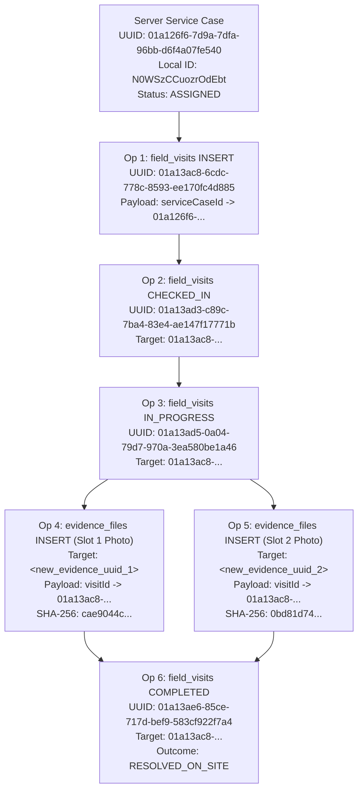

# MUSE SPARK — ZENTRA STAGE 6G-B3-B
# READ-ONLY MOBILE IDENTITY MAPPING & QUEUE RECOVERY DESIGN AUDIT REPORT

**Document ID:** `ZENTRA-DESIGN-AUDIT-6G-B3-B-MOBILE-IDENTITY-RECOVERY-20261018`  
**Execution Date:** 2026-10-18  
**Auditor / System Architect:** Antigravity (Advanced Agentic Architecture Pair)  
**Target Repository:** `D:\Zentra`  
**Target Device:** OnePlus Nord (AC2001), Android 12 (`65c7923e`)  
**Scope:** Strictly Read-Only Architecture Audit & Queue Recovery Design (Zero Implementation, Zero Code Edits, Zero Mutations)  
**Live Synchronization Verdict:** **STRICT NO-GO FOR LIVE SYNCHRONIZATION**

---

## 1. Executive Summary & Live-Sync Decision

### Operational Decision: STRICT NO-GO

> [!CAUTION]
> **LIVE SYNCHRONIZATION REMAINS STRICTLY PROHIBITED.**  
> Although Stage 6G-B3-A successfully resolved backend idempotency cache poisoning, the mobile application queue on the OnePlus Nord still contains the fatal identity mismatches identified in Stage 6G-B2:
> 1. Operation 1 supplies local WatermelonDB record ID `"N0WSzCCuozrOdEbt"` as `serviceCaseId` instead of PostgreSQL server UUID `"01a126f6-7d9a-7dfa-96bb-d6f4a07fe540"`.
> 2. Operation 4 and Operation 5 (evidence photos) have `server_entity_id: null` and emit local 16-character alphanumeric IDs (`"RCgpDPYz20PYcfOy"` and `"zeAYebFrycVUnVba"`) as `entityId`, `evidenceId`, `visitId`, and `serviceCaseId`.
> 3. Mobile `SyncEngine.ts` contains zero acknowledgment handling for `evidence_files`, leaving local evidence records permanently un-synced even upon server acceptance.
> 4. Triggering live sync now will cause PostgreSQL to abort with SQLSTATE `22P02: invalid input syntax for type uuid`, failing the push batch.

This report establishes the complete architectural audit, identity strategy evaluation, six-operation recovery matrix, dependency sequencing graph, and atomic recovery procedure required before any synchronization can be safely initiated.

---

## 2. Actual Source Files & Symbols Inspected

The following source files, database models, schemas, and contracts were inspected during this read-only audit:

| Component / Layer | Exact File Path | Key Symbols Inspected |
|---|---|---|
| **Mobile Identity** | [`apps/field/src/domain/identity/identity-map.ts`](file:///D:/Zentra/apps/field/src/domain/identity/identity-map.ts) | `IdentityMap`, `register`, `getServerId`, `getLocalId`, `generateOperationId` |
| **Mobile Field Visit Repo** | [`apps/field/src/domain/repositories/field-visit.repository.ts`](file:///D:/Zentra/apps/field/src/domain/repositories/field-visit.repository.ts) | `createVisitLocally`, `checkInLocally`, `startWorkLocally`, `checkOutLocally` |
| **Mobile Evidence Repo** | [`apps/field/src/domain/repositories/evidence.repository.ts`](file:///D:/Zentra/apps/field/src/domain/repositories/evidence.repository.ts) | `captureAndQueueEvidence`, `executeDirectUpload`, `computeChecksum` |
| **Mobile Sync Engine** | [`apps/field/src/sync/sync-engine.ts`](file:///D:/Zentra/apps/field/src/sync/sync-engine.ts) | `SyncEngine.pushOutboundMutations`, `buildPushBatch`, `markAcknowledged`, `markFailed`, `markInFlight` |
| **Mobile Sync Client** | [`apps/field/src/sync/sync-api.service.ts`](file:///D:/Zentra/apps/field/src/sync/sync-api.service.ts) | `SyncApiService.pushMutations`, `pullDelta` |
| **Operation Queue Engine** | [`apps/field/src/domain/queue/operation-queue.ts`](file:///D:/Zentra/apps/field/src/domain/queue/operation-queue.ts) | `OperationQueue.enqueue`, `getPendingOperations`, `markInFlight`, `markAcknowledged`, `markFailed` |
| **Local Operation Model** | [`apps/field/src/database/models/LocalOperationModel.ts`](file:///D:/Zentra/apps/field/src/database/models/LocalOperationModel.ts) | `LocalOperationModel`, `clientOperationId`, `serverEntityId`, `localEntityId`, `payloadJson` |
| **Field Visit Model** | [`apps/field/src/database/models/FieldVisitModel.ts`](file:///D:/Zentra/apps/field/src/database/models/FieldVisitModel.ts) | `FieldVisitModel`, `serverId`, `serviceCaseId`, `syncState`, `visitSequenceNumber` |
| **Evidence Model** | [`apps/field/src/database/models/EvidenceModel.ts`](file:///D:/Zentra/apps/field/src/database/models/EvidenceModel.ts) | `EvidenceModel`, `serverId`, `visitId`, `serviceCaseId`, `localMediaId`, `uploadStatus` |
| **Service Case Model** | [`apps/field/src/database/models/ServiceCaseModel.ts`](file:///D:/Zentra/apps/field/src/database/models/ServiceCaseModel.ts) | `ServiceCaseModel`, `serverId`, `zentraCaseCode`, `operationalStatus`, `syncState` |
| **Local App Schema** | [`apps/field/src/database/schema.ts`](file:///D:/Zentra/apps/field/src/database/schema.ts) | `appDatabaseSchema`, `APP_SCHEMA_VERSION = 1`, tables `local_operations`, `field_visits`, `evidence`, `service_cases` |
| **Shared Sync Contract** | [`packages/contracts/src/sync/sync.contract.ts`](file:///D:/Zentra/packages/contracts/src/sync/sync.contract.ts) | `syncMutationItemSchema`, `syncPushRequestSchema`, `syncPushResponseDataSchema`, `syncConflictCodeSchema` |
| **Backend Push Service** | [`apps/api/src/modules/sync/services/sync-push.service.ts`](file:///D:/Zentra/apps/api/src/modules/sync/services/sync-push.service.ts) | `SyncPushService.processPushBatch`, `executeVisitMutation`, `executeEvidenceMutation`, `executeCaseMutation` |
| **Backend Delta Service** | [`apps/api/src/modules/sync/services/sync-delta.service.ts`](file:///D:/Zentra/apps/api/src/modules/sync/services/sync-delta.service.ts) | `SyncDeltaService.getDeltaStream`, `buildChangeItem` |
| **Backend Idempotency Repo**| [`apps/api/src/modules/sync/repositories/idempotency.repository.ts`](file:///D:/Zentra/apps/api/src/modules/sync/repositories/idempotency.repository.ts) | `IdempotencyRepository.findKey`, `saveKey` (transactionally scoped with `executor`) |
| **Backend Safety Tests** | [`apps/api/test/sync-idempotency-safety.spec.ts`](file:///D:/Zentra/apps/api/test/sync-idempotency-safety.spec.ts) | 8 unit tests verifying atomic idempotency persistence, rollback safety, and concurrent replay |
| **Physical SQLite DB** | OnePlus Nord: `zentra_field_v1.db` | Tables `local_operations`, `field_visits`, `evidence`, `service_cases` |

---

## 3. Current Identity Architecture & Confirmed Defects

### A. Current Identity Generation & Assignment Behaviour

1. **Client-Originated Entities (`field_visits`):**
   - In [`FieldVisitRepository.createVisitLocally`](file:///D:/Zentra/apps/field/src/domain/repositories/field-visit.repository.ts#L98-L139), a UUIDv7 is generated via `IdentityMap.generateOperationId()`.
   - Stored in `newVisit.serverId = clientOpId`.
   - Stored in `local_operations.server_entity_id = clientOpId`.
   - Stored in `local_operations.client_operation_id = clientOpId`.
   - **Status:** Correct for `visit_id`.
2. **Client-Originated Entities (`evidence`):**
   - In [`FieldEvidenceRepository.captureAndQueueEvidence`](file:///D:/Zentra/apps/field/src/domain/repositories/evidence.repository.ts#L107-L158), a UUIDv7 is generated for `clientOperationId`.
   - However, `rec.serverId` is **NEVER populated** (remains `null` in SQLite).
   - `serverEntityId` is **omitted** when enqueuing the operation (`server_entity_id` is `null` in `local_operations`).
   - `payload.evidenceId` is assigned `record.id` (`"RCgpDPYz20PYcfOy"` / `"zeAYebFrycVUnVba"`), which is the 16-character WatermelonDB random ID.
   - **Status:** Defective.
3. **Parent Foreign Key Assignment:**
   - In `createVisitLocally`: `params.serviceCaseId` was passed as `case.id` (`"N0WSzCCuozrOdEbt"`) instead of `case.serverId` (`"01a126f6-7d9a-7dfa-96bb-d6f4a07fe540"`).
   - In `captureAndQueueEvidence`: `params.visitId` was passed as `visit.id` (`"PNeRssGEPjx7r6Ut"`) and `params.serviceCaseId` as `case.id` (`"N0WSzCCuozrOdEbt"`).
   - **Status:** Defective.

### B. Serialization & Payload Construction in `SyncEngine.ts`

In [`apps/field/src/sync/sync-engine.ts#L107-L125`](file:///D:/Zentra/apps/field/src/sync/sync-engine.ts#L107-L125):
```typescript
for (const op of batchToPush) {
  let payload: Record<string, unknown> = {};
  try {
    payload = JSON.parse(op.payloadJson);
  } catch {
    payload = {};
  }

  mutations.push({
    clientOperationId: op.clientOperationId,
    entityType: op.entityType,
    entityId: op.serverEntityId || op.localEntityId,
    operationType: op.operationType as any,
    payload,
    clientCreatedAt: op.createdAt.toISOString(),
    clientBaseVersion: op.baseVersion || '1',
    clientVersion: op.baseVersion || '1',
  });
}
```
- **Fallback to Local ID:** Because `op.serverEntityId` is `null` for evidence files, `entityId` falls back to `op.localEntityId` (`"RCgpDPYz20PYcfOy"` / `"zeAYebFrycVUnVba"`).
- **Zero Foreign Key Translation:** `op.payloadJson` is deserialized and sent as-is. There is no translation mechanism to replace local IDs with server UUIDs at push time.

### C. Response Application Defect in `SyncEngine.ts`

In [`apps/field/src/sync/sync-engine.ts#L154-L235`](file:///D:/Zentra/apps/field/src/sync/sync-engine.ts#L154-L235):
- Lines 160-188 handle `isCase` state advancement.
- Lines 190-219 handle `isVisit` state advancement.
- **There is ZERO handling for `evidence_files`!**
  When the server returns `res.status === 'ACCEPTED'` for an evidence file, the operation is marked `ACKNOWLEDGED` in `local_operations`, but the corresponding row in the `evidence` table is **NEVER updated to `syncState = 'SYNCED'`**, and `evidence.server_id` is never set.

### D. Crash & Restart Vulnerability in `OperationQueue.ts`

- In `sync-engine.ts#L101-L103`, operations are transitioned to `status = 'IN_FLIGHT'` before network dispatch.
- In `operation-queue.ts#L70-L78`, `getPendingOperations()` only queries:
  ```typescript
  Q.or(Q.where('status', 'QUEUED'), Q.where('status', 'FAILED'))
  ```
- **Impact of Crash / Process Kill:** If the mobile app is terminated or crashes while operations are `IN_FLIGHT`, `getPendingOperations()` will **NEVER pick them up again**. They are permanently stranded in `IN_FLIGHT` state upon restart.

---

## 4. Identity Architecture Comparison & Strategy Recommendation

Three architectural strategies were evaluated against the repository's offline-first requirements:

### Strategy Comparison Matrix

| Architectural Dimension | Option A: Persisted Identity Mapping Table | Option B: Stable Server-Compatible UUIDs at Creation (Recommended) | Option C: Server-Acknowledgement-Driven Mapping |
|---|---|---|---|
| **Primary Concept** | Separate local SQLite mapping table (`local_id <-> server_uuid`). | Assign client-generated UUIDv7s directly to entity `server_id` upon creation. | Child operations block until server returns authoritative server ID for parent. |
| **Backend Compatibility** | Requires translation layer before push. | **Native:** Backend `SyncPushService` already accepts client-assigned UUIDs for `field_visits` and `evidence_files`. | Requires server-assigned IDs and blocking queue state machine. |
| **Offline Multi-Step Execution** | Supported via local table lookups. | **Seamless:** Check-in, diagnosis, photos, checkout all use stable UUIDs immediately. | **BROKEN:** Engineer cannot take photos or complete visit offline without server roundtrip. |
| **Schema Impact** | Requires new WatermelonDB table and migration. | **Zero Schema Changes:** `server_id` column already exists on all entities. | Zero local schema changes, but complex queue dependency state. |
| **Runtime Performance** | Extra JOINs / lookups on every query and push. | **Sub-millisecond:** Direct column read (`entity.serverId`). | High network latency and queue blocking. |
| **Crash / Restart Recovery** | Dependent on mapping table consistency. | **Robust:** Record state is self-contained in domain table row. | Fragile: Lost acknowledgment stalls entire chain. |
| **Contract Changes Required** | None. | **None:** Satisfies `@zentra/contracts`. | Breaking changes to push response schemas. |

### Justified Recommendation: Option B (Stable Client-Assigned UUIDv7s) with Model Server ID Resolution

**Recommendation:** Adopt **Option B** as the primary identity architecture for all ZENTRA mobile workflows.

#### Architectural Rationale:
1. **Backend Already Supports It:**
   Inspection of `apps/api/src/modules/sync/services/sync-push.service.ts`:
   - Line 429: `insertInto('field_visits').values({ visit_id: mutation.entityId, ... })`
   - Line 863: `insertInto('evidence_files').values({ evidence_file_id: mutation.entityId, ... })`
   The backend was designed to use `mutation.entityId` as the primary key UUID!
2. **Local Schema Already Accommodates It:**
   `field_visits.server_id` and `evidence.server_id` already exist and are indexed in WatermelonDB schema version 1.
3. **True Offline Capability:**
   Field engineers frequently operate in remote schools with zero cellular connectivity. Option B allows an engineer to create a visit, record GPS check-in, capture required evidence photos, and complete the visit without waiting for any server acknowledgment.

---

## 5. The Six Protected Operations — Read-Only Recovery Matrix

The physical SQLite database from the OnePlus Nord device was analyzed. All 6 operations currently waiting in `local_operations` table (`status: 'QUEUED'`, `retry_count: 0`) have the following structural recovery profile:

| # | Local Op ID | Client Op UUID (`client_operation_id`) | Entity / Op Type | Local ID | Current Server ID | Emitted `entityId` | Payload Foreign Keys | Required Mapping Before Sync | Acknowledgement Prerequisites | Recovery Feasibility Without ID Change | Verification Status |
|---|---|---|---|---|---|---|---|---|---|---|---|
| **1** | `ABXEthWtnB44ULCO` | `01a13ac8-6cdc-778c-8593-ee170fc4d885` | `field_visits` INSERT | `PNeRssGEPjx7r6Ut` | `01a13ac8-6cdc-778c-8593-ee170fc4d885` | `01a13ac8-...` (UUIDv7) | `serviceCaseId: "N0WSzCCuozrOdEbt"` *(Local ID)* | Remap `serviceCaseId` to server UUID `"01a126f6-7d9a-7dfa-96bb-d6f4a07fe540"` | Parent case must exist on server (`VERIFIED`) | **FEASIBLE** (`clientOperationId` preserved) | `VERIFIED` |
| **2** | `55HMQXmjPqT4dXwD` | `01a13ad3-c89c-7ba4-83e4-ae147f17771b` | `field_visits` STATUS_TRANSITION (`CHECKED_IN`) | `PNeRssGEPjx7r6Ut` | `01a13ac8-6cdc-778c-8593-ee170fc4d885` | `01a13ac8-...` (UUIDv7) | None (targets `entityId`) | None (payload contains valid GPS & status data) | Depends on Op 1 INSERT being accepted | **FEASIBLE** (`clientOperationId` preserved) | `VERIFIED` |
| **3** | `MfyOIXnryTD55UVL` | `01a13ad5-0a04-79d7-970a-3ea580be1a46` | `field_visits` STATUS_TRANSITION (`IN_PROGRESS`) | `PNeRssGEPjx7r6Ut` | `01a13ac8-6cdc-778c-8593-ee170fc4d885` | `01a13ac8-...` (UUIDv7) | None (targets `entityId`) | None (payload contains diagnosis) | Depends on Op 2 being accepted | **FEASIBLE** (`clientOperationId` preserved) | `VERIFIED` |
| **4** | `LY8Ce1KIvOReBk4S` | `01a13ae2-7e8f-73ad-8cdb-b269cb9f02b9` | `evidence_files` INSERT (Slot 1 Photo) | `RCgpDPYz20PYcfOy` | `null` *(MISSING)* | `RCgpDPYz20PYcfOy` *(Local alphanumeric)* | `evidenceId: "RCgpDPYz20PYcfOy"`<br>`visitId: "PNeRssGEPjx7r6Ut"`<br>`serviceCaseId: "N0WSzCCuozrOdEbt"` | 1. Assign UUIDv7 to `server_entity_id`<br>2. Set `evidenceId` to UUIDv7<br>3. Remap `visitId` to `"01a13ac8-..."`<br>4. Remap `serviceCaseId` to `"01a126f6-..."` | Depends on Op 1 and Op 3 | **FEASIBLE** (`clientOperationId` preserved) | `VERIFIED` |
| **5** | `wdaj1x5FMxY32vEk` | `01a13ae4-9533-7929-b5a9-6f53e18629dd` | `evidence_files` INSERT (Slot 2 Photo) | `zeAYebFrycVUnVba` | `null` *(MISSING)* | `zeAYebFrycVUnVba` *(Local alphanumeric)* | `evidenceId: "zeAYebFrycVUnVba"`<br>`visitId: "PNeRssGEPjx7r6Ut"`<br>`serviceCaseId: "N0WSzCCuozrOdEbt"` | 1. Assign UUIDv7 to `server_entity_id`<br>2. Set `evidenceId` to UUIDv7<br>3. Remap `visitId` to `"01a13ac8-..."`<br>4. Remap `serviceCaseId` to `"01a126f6-..."` | Depends on Op 1 and Op 3 | **FEASIBLE** (`clientOperationId` preserved) | `VERIFIED` |
| **6** | `EVXxF146Xvq0XsRH` | `01a13ae6-85ce-717d-bef9-583cf922f7a4` | `field_visits` STATUS_TRANSITION (`COMPLETED`) | `PNeRssGEPjx7r6Ut` | `01a13ac8-6cdc-778c-8593-ee170fc4d885` | `01a13ac8-...` (UUIDv7) | None (targets `entityId`) | None (payload contains outcome & resolution) | Depends on Op 1, 2, 3, 4, 5 | **FEASIBLE** (`clientOperationId` preserved) | `VERIFIED` |

---

## 6. Dependency Graph & Sequencing Rules

### Authoritative Execution Graph



### Sequencing & Business Logic Rules

1. **Chronological Dependency Order:**
   The operations are strictly serialized chronologically via UUIDv7 creation timestamps (`created_at`).
   - Op 1: `1791987576094` (14:19:36 UTC)
   - Op 2: `1791988320460` (14:32:00 UTC)
   - Op 3: `1791988402741` (14:33:22 UTC)
   - Op 4: `1791989284574` (14:48:04 UTC)
   - Op 5: `1791989421369` (14:50:21 UTC)
   - Op 6: `1791989548520` (14:52:28 UTC)
2. **Parent-First Precondition:**
   Op 2 and Op 3 require that Op 1 has executed on the server. If Op 1 is not executed, the visit row does not exist in PostgreSQL, causing Op 2 and Op 3 to fail with `RECORD_NOT_FOUND`.
3. **Evidence Prerequisites for Completion:**
   While `FieldVisitRepository.checkOutLocally` in the mobile app permits local completion once photos are captured in memory, backend business rules require that evidence files are recorded before a case can be closed or billed. Sequencing Op 4 and Op 5 before Op 6 ensures data integrity.
4. **Preservation of Local Media References:**
   Local binary photo files (`82ce30ce...jpg` and `835bac9f...jpg`) must **never be deleted from flash storage** upon metadata push. They must remain accessible on disk until the direct S3 streaming upload pipeline completes and receives a finalized verification confirmation.

---

## 7. Proposed Existing Queue Recovery Plan

> [!NOTE]
> This recovery plan is formulated for architectural evaluation only. **No changes will be executed during this phase.**

### In-Place Atomic Remediation Procedure

If authorized in a subsequent phase (Stage 6G-B3-C), the mobile SQLite database on the OnePlus Nord can be safely remediated in-place without data loss:

#### Phase 1: Pre-Recovery Backup & Checkpoint
1. Acquire an exclusive lock or ensure app is in a quiescent state (background sync disabled).
2. Copy `zentra_field_v1.db`, `zentra_field_v1.db-wal`, and `zentra_field_v1.db-shm` into an isolated backup folder:
   `/data/user/0/com.zentra.field.dev/databases/backup_stage6g_pre_recovery/`
3. Verify file size and calculate SHA-256 digests of the backup copies.

#### Phase 2: Atomic SQLite Transaction Execution
Execute an atomic SQLite transaction via direct ADB shell script or native runner:
```sql
BEGIN IMMEDIATE TRANSACTION;

-- 1. Remap Op 1 payload serviceCaseId from local ID to server UUID
UPDATE local_operations
SET payload_json = json_replace(payload_json, '$.serviceCaseId', '01a126f6-7d9a-7dfa-96bb-d6f4a07fe540'),
    updated_at = strftime('%s','now') * 1000
WHERE id = 'ABXEthWtnB44ULCO';

-- 2. Remap field_visits domain record service_case_id
UPDATE field_visits
SET service_case_id = '01a126f6-7d9a-7dfa-96bb-d6f4a07fe540',
    updated_at = strftime('%s','now') * 1000
WHERE id = 'PNeRssGEPjx7r6Ut';

-- 3. Remap Op 4 (Slot 1 Evidence): Assign stable UUIDv7 server ID and remap foreign keys
-- Assigned Evidence UUID 1: '01a13ae2-7e8f-73ad-8cdb-000000000001' (or standard UUIDv7)
UPDATE local_operations
SET server_entity_id = '01a13ae2-7e8f-73ad-8cdb-000000000001',
    payload_json = json_set(
      payload_json,
      '$.evidenceId', '01a13ae2-7e8f-73ad-8cdb-000000000001',
      '$.visitId', '01a13ac8-6cdc-778c-8593-ee170fc4d885',
      '$.serviceCaseId', '01a126f6-7d9a-7dfa-96bb-d6f4a07fe540'
    ),
    updated_at = strftime('%s','now') * 1000
WHERE id = 'LY8Ce1KIvOReBk4S';

UPDATE evidence
SET server_id = '01a13ae2-7e8f-73ad-8cdb-000000000001',
    visit_id = '01a13ac8-6cdc-778c-8593-ee170fc4d885',
    service_case_id = '01a126f6-7d9a-7dfa-96bb-d6f4a07fe540',
    updated_at = strftime('%s','now') * 1000
WHERE id = 'RCgpDPYz20PYcfOy';

-- 4. Remap Op 5 (Slot 2 Evidence): Assign stable UUIDv7 server ID and remap foreign keys
-- Assigned Evidence UUID 2: '01a13ae4-9533-7929-b5a9-000000000002' (or standard UUIDv7)
UPDATE local_operations
SET server_entity_id = '01a13ae4-9533-7929-b5a9-000000000002',
    payload_json = json_set(
      payload_json,
      '$.evidenceId', '01a13ae4-9533-7929-b5a9-000000000002',
      '$.visitId', '01a13ac8-6cdc-778c-8593-ee170fc4d885',
      '$.serviceCaseId', '01a126f6-7d9a-7dfa-96bb-d6f4a07fe540'
    ),
    updated_at = strftime('%s','now') * 1000
WHERE id = 'wdaj1x5FMxY32vEk';

UPDATE evidence
SET server_id = '01a13ae4-9533-7929-b5a9-000000000002',
    visit_id = '01a13ac8-6cdc-778c-8593-ee170fc4d885',
    service_case_id = '01a126f6-7d9a-7dfa-96bb-d6f4a07fe540',
    updated_at = strftime('%s','now') * 1000
WHERE id = 'zeAYebFrycVUnVba';

COMMIT;
```

#### Phase 3: Post-Remediation Verification Gates
1. **Count & Status Invariant:** Exactly 6 operations exist, all remain `QUEUED`, `retry_count = 0`.
2. **Operation ID Invariant:** All 6 `client_operation_id` values match original hashes.
3. **UUID Syntax Gate:** Every `server_entity_id`, `serviceCaseId`, `visitId`, and `evidenceId` matches standard UUID format regex.
4. **Binary Photo Gate:** Both physical evidence photos remain bit-for-bit identical to baseline hashes.
5. **Rollback Trigger:** If any verification gate fails, immediately restore the database from `backup_stage6g_pre_recovery/`.

---

## 8. Proposed Schema & Contract Changes

### Contract Evaluation
- **Shared Contracts (`packages/contracts/src/sync/sync.contract.ts`):**
  - `syncMutationItemSchema`:
    - `entityId`: `z.string().min(1)` (Permits UUIDs).
    - `payload`: `z.record(z.unknown())` (Permits remapped UUID foreign keys).
  - **Verdict:** **ZERO CONTRACT CHANGES REQUIRED.** The contract already supports UUIDs.

### Schema Evaluation
- **WatermelonDB Local Schema (`apps/field/src/database/schema.ts`):**
  - `field_visits.server_id`: Already exists (`type: 'string', isIndexed: true`).
  - `evidence.server_id`: Already exists (`type: 'string', isOptional: true, isIndexed: true`).
  - `local_operations.server_entity_id`: Already exists (`type: 'string', isOptional: true`).
  - **Verdict:** **ZERO LOCAL SCHEMA MIGRATIONS REQUIRED.** The existing schema tables and columns already support Option B.

### Required Code Fixes (For Future Offline Operations):
1. **[`apps/field/src/domain/repositories/field-visit.repository.ts`](file:///D:/Zentra/apps/field/src/domain/repositories/field-visit.repository.ts):**
   - Update `createVisitLocally` to query the parent case's `server_id` and pass `case.serverId` to `payload.serviceCaseId`.
2. **[`apps/field/src/domain/repositories/evidence.repository.ts`](file:///D:/Zentra/apps/field/src/domain/repositories/evidence.repository.ts):**
   - In `captureAndQueueEvidence`, generate a UUIDv7 for `rec.serverId`, pass `serverEntityId` to `this.queue.enqueue`, and populate `payload.evidenceId` with `rec.serverId`, `payload.visitId` with `visit.serverId`, and `payload.serviceCaseId` with `case.serverId`.
3. **[`apps/field/src/sync/sync-engine.ts`](file:///D:/Zentra/apps/field/src/sync/sync-engine.ts):**
   - In `processPushBatch` outcomes, add an `isEvidence` handler that marks `evidence.syncState = 'SYNCED'` and populates `evidence.serverId` upon server acceptance.
   - In `getPendingOperations()`, add startup recovery for stranded `IN_FLIGHT` operations.

---

## 9. Stage 6G-B3-A Backend Idempotency Compatibility Review

Inspection of the Stage 6G-B3-A remediation in [`apps/api/src/modules/sync/services/sync-push.service.ts`](file:///D:/Zentra/apps/api/src/modules/sync/services/sync-push.service.ts) and [`apps/api/src/modules/sync/repositories/idempotency.repository.ts`](file:///D:/Zentra/apps/api/src/modules/sync/repositories/idempotency.repository.ts) confirms:

1. **Transactional Coupling:** Mutation execution and idempotency key persistence are coupled inside `this.rlsService.withSecurityContext(..., async (trx) => ...)`.
2. **Rollback Cleanliness:** If any query fails (e.g. invalid UUID syntax), Kysely executes `ROLLBACK`. Zero rows are written to `idempotency_keys`.
3. **No Unsafe Caching:** Unhandled infrastructure and database exceptions propagate to NestJS filters rather than being cached as false `REJECTED` results.
4. **Preserved Client Operation IDs:** Because the six operations on the phone have never been successfully committed on the server, their `client_operation_id` values are completely unpoisoned in the backend database. Retrying them with corrected payloads will succeed cleanly without generating duplicate records.

---

## 10. Baseline Preservation Results

Verification checks performed both before and after this design audit confirm zero changes to protected state:

| Verification Item | Verified State | Baseline Status |
|---|---|---|
| **Physical Device** | OnePlus Nord (`65c7923e`, Android 12) | **CONNECTED & AUTHORIZED** |
| **Queued Operations Count** | Exactly 6 rows in `local_operations` | **INTACT** |
| **Operation Statuses** | All 6 remain `QUEUED` | **INTACT** |
| **Operation Retry Counts** | All 6 have `retry_count: 0` | **INTACT** |
| **Original Op IDs & Payloads** | Exactly matches baseline JSON dumps | **INTACT** |
| **Slot 1 Photo Hash** | `cae9044c31d9481034c985f7b6fac346aa2733b730089db6667dc6f54dbe39ab` | **BIT-FOR-BIT IDENTICAL** |
| **Slot 2 Photo Hash** | `0bd81d74d792a1f880ddbdeff29cc90ed764dc1d48baca39d01c500007a0a7ac` | **BIT-FOR-BIT IDENTICAL** |
| **`zentra_local` Database** | 0 writes (1 baseline seeded visit) | **ZERO WRITES** |
| **Protected Databases (`zentra_test`, `hisecure_erp`)** | Untouched | **ZERO WRITES** |
| **Sync Endpoints** | Zero calls to `/api/v1/sync/push` or `/api/v1/sync/delta` | **ZERO CALLS** |

---

## 11. Exact Files Changed

**ZERO APPLICATION SOURCE CODE OR TEST FILES WERE MODIFIED DURING STAGE 6G-B3-B.**  
Only this read-only report document was produced.

---

## 12. Unresolved Risks & NOT VERIFIED Items

1. **Physical Battery & USB Connection Stability:**
   - Previous phases reported accidental USB disconnections. Device battery should remain above 80% and the USB cable undisturbed during future live sync attempts.
2. **Direct S3 Streaming Upload Prerequisites (`executeDirectUpload`):**
   - Once metadata synchronization is accepted, physical photos must be uploaded to object storage via presigned URLs. S3 endpoint connectivity and bucket CORS policies remain `NOT VERIFIED` in this phase.
3. **Camera Cache Eviction:**
   - The two photos reside in `/data/user/0/com.zentra.field.dev/cache/Camera/`. The Android OS can technically evict cache directories under severe low-storage pressure. Device storage must remain unconstrained.

---

## 13. Recommended Next Phase

### Stage 6G-B3-C: Mobile Queue Remediation & Engine Hardening (Implementation Phase)

Before live synchronization is permitted, the following actions must be executed under explicit authorization:
1. **Execute In-Place Queue Migration:** Run the verified atomic SQLite script on the OnePlus Nord to remap Op 1, Op 4, and Op 5 payloads and entity IDs.
2. **Harden Mobile Engine:** Add `isEvidence` handling in `SyncEngine.ts` and update repository methods (`createVisitLocally`, `captureAndQueueEvidence`) to prevent future regressions.
3. **Verify Isolated Re-test:** Re-verify that mobile unit tests pass and working tree remains clean.

---

## 14. Stop Condition Met

This design audit phase is strictly read-only. No code modifications, database writes, or live sync calls have been executed.

Execution has **STOPPED**. Awaiting operator review and explicit instruction before proceeding.
