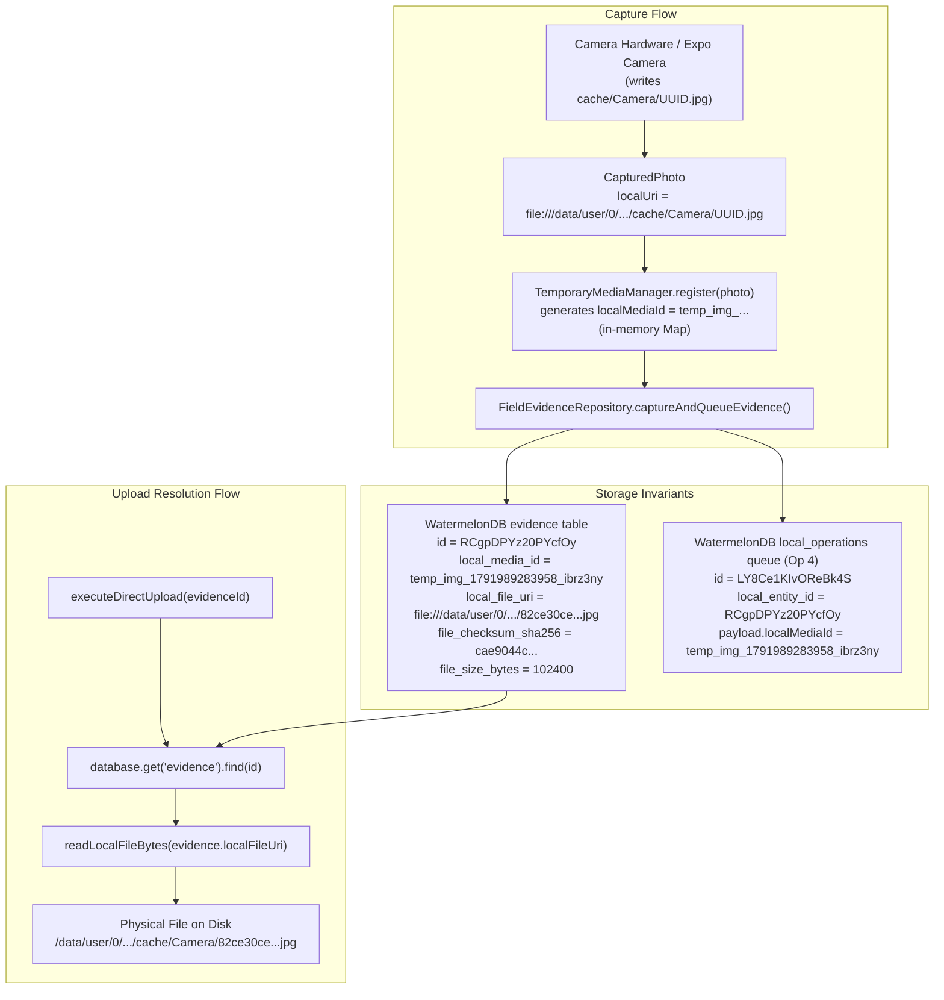

# MUSE SPARK — ZENTRA EVIDENCE PAYLOAD AUDIT REPORT
## Stage 6G-B3-C2-POST

**Report Date:** 2026-10-18  
**Repository:** `D:\Zentra`  
**Target Hardware:** OnePlus Nord (AC2001), Android 12 (API 31), ADB Serial `65c7923e`  
**Application Package:** `com.zentra.field.dev`  
**Audit Classification:** STRICT READ-ONLY AUDIT (ZERO MUTATIONS, ZERO SYNC CALLS, ZERO WRITES)

---

## 1. Executive Summary & Verdict

### Audit Verdict: **READ-ONLY AUDIT COMPLETE — CONDITIONAL GO**

1. **Device & Queue Integrity:** The OnePlus Nord device is confirmed quiescent and intact. All six protected operations remain strictly in `status = 'QUEUED'` with `retry_count = 0`. The database SHA-256 hash matches the post-migration baseline (`da6fdd3f3e276ed379d7adff779f3043ab32e7108294710ba64968f64df267d4`) bit-for-bit.
2. **Physical Photos:** Both physical camera photos exist in `cache/Camera/`, are fully readable, and their SHA-256 hashes match the approved manifest digests bit-for-bit (`cae9044c...` and `0bd81d74...`).
3. **Media Reference Tracing:** The lookup path from `localMediaId` and `localEntityId` to the physical photos is 100% proven from the WatermelonDB `evidence` table (`local_file_uri` column) and the `readLocalFileBytes()` implementation in `file-reader.native.ts`.
4. **Critical Finding on `fileSizeBytes = 102400`:**
   - The exact source-code root cause of `102400` was identified and cited. `ExpoCameraAdapter.capturePhoto()` omits `sizeBytes` on `CapturedPhoto`, causing `FieldEvidenceRepository.captureAndQueueEvidence()` to trigger a hardcoded fallback: `params.mediaItem.sizeBytes || 1024 * 100` (`102,400` bytes).
   - The physical photos on disk are **209,200 bytes** (Slot 1) and **209,230 bytes** (Slot 2).
   - **Impact:** Metadata push (`POST /api/v1/sync/push`) will **succeed** because it only stores the metadata row in PostgreSQL. However, any subsequent binary S3 upload (`FieldEvidenceRepository.executeDirectUpload()` and `ObjectStorageService.verifyObjectIntegrity()`) will **fail with `SIZE_MISMATCH`** because both mobile and server enforce strict equality checks (`actualSizeBytes === expectedSizeBytes`).
5. **Operational Recommendation:**
   - **GO for Metadata Sync Push Testing** (`/api/v1/sync/push`).
   - **NO-GO for Binary S3 Evidence Upload** until `fileSizeBytes` in local queue/database is corrected to match physical bytes.

---

## 2. Gate 1 — Current Device State & Queue Invariants

A read-only inspection was executed against the physical OnePlus Nord test device:

### Device Identity
- **Model:** OnePlus Nord (`AC2001`)
- **Android Version:** 12 (API 31)
- **Package Path:** `/data/app/~~u-J2w65qR8KqWp6qT5z0nA==/com.zentra.field.dev-V29oU1Y9-C3v1o3z1L-j5g==/base.apk`
- **Application Execution Status:** `STOPPED` (Quiescent; `pidof com.zentra.field.dev` returned exit code 1)

### Active Database Verification
- **Path on Device:** `/data/user/0/com.zentra.field.dev/zentra_field_v1.db`
- **File Mode & Ownership:** `-rw------- 1 u0_a798 u0_a798 368640 2026-10-18 21:34`
- **Device SHA-256 Hash:** `da6fdd3f3e276ed379d7adff779f3043ab32e7108294710ba64968f64df267d4`
- **WAL / SHM Status:** Cleanly absent (zero orphan journal files)
- **SQLite Integrity Check:** `PRAGMA integrity_check;` returned `ok`

### Queue Invariant Assertions (`local_operations`)

All six operations match the Stage 6G-B3-C2 migration report without deviation:

| Seq | Row ID | Client Operation ID | Entity Type | Op Type | Status | Retries | Server Entity ID |
|---|---|---|---|---|---|---|---|
| **1** | `ABXEthWtnB44ULCO` | `01a13ac8-6cdc-778c-8593-ee170fc4d885` | `field_visits` | `INSERT` | `QUEUED` | 0 | `01a13ac8-6cdc-778c-8593-ee170fc4d885` |
| **2** | `55HMQXmjPqT4dXwD` | `01a13ad3-c89c-7ba4-83e4-ae147f17771b` | `field_visits` | `STATUS_TRANSITION` | `QUEUED` | 0 | `01a13ac8-6cdc-778c-8593-ee170fc4d885` |
| **3** | `MfyOIXnryTD55UVL` | `01a13ad5-0a04-79d7-970a-3ea580be1a46` | `field_visits` | `STATUS_TRANSITION` | `QUEUED` | 0 | `01a13ac8-6cdc-778c-8593-ee170fc4d885` |
| **4** | `LY8Ce1KIvOReBk4S` | `01a13ae2-7e8f-73ad-8cdb-b269cb9f02b9` | `evidence_files` | `INSERT` | `QUEUED` | 0 | `01a14fbe-5a23-7b1b-b1e9-0355677a4153` |
| **5** | `wdaj1x5FMxY32vEk` | `01a13ae4-9533-7929-b5a9-6f53e18629dd` | `evidence_files` | `INSERT` | `QUEUED` | 0 | `01a14fbe-5a24-768e-b0ac-3af1385542f1` |
| **6** | `EVXxF146Xvq0XsRH` | `01a13ae6-85ce-717d-bef9-583cf922f7a4` | `field_visits` | `STATUS_TRANSITION` | `QUEUED` | 0 | `01a13ac8-6cdc-778c-8593-ee170fc4d885` |

---

## 3. Gate 2 — Physical Photo Verification on Device

Both photo files were inspected directly in the application sandbox on the device:

### Evidence Slot 1 Photo
- **Device Path:** `/data/user/0/com.zentra.field.dev/cache/Camera/82ce30ce-4712-441c-a43a-cda18fca8151.jpg`
- **Ownership & Permissions:** `-rw------- 1 u0_a798 u0_a798_cache 209200 2026-10-14 20:18`
- **Actual Size on Device:** **209,200 bytes**
- **Cryptographic SHA-256 Digest:**  
  `cae9044c31d9481034c985f7b6fac346aa2733b730089db6667dc6f54dbe39ab`
- **Status:** **EXISTS, 100% BIT-FOR-BIT MATCH**
- **Readability & Magic Bytes:** Valid JPEG header confirmed (`ffd8ffe0`)

### Evidence Slot 2 Photo
- **Device Path:** `/data/user/0/com.zentra.field.dev/cache/Camera/835bac9f-fbc1-4eae-9a16-277c79d6228d.jpg`
- **Ownership & Permissions:** `-rw------- 1 u0_a798 u0_a798_cache 209230 2026-10-14 20:20`
- **Actual Size on Device:** **209,230 bytes**
- **Cryptographic SHA-256 Digest:**  
  `0bd81d74d792a1f880ddbdeff29cc90ed764dc1d48baca39d01c500007a0a7ac`
- **Status:** **EXISTS, 100% BIT-FOR-BIT MATCH**
- **Readability & Magic Bytes:** Valid JPEG header confirmed (`ffd8ffe0`)

---

## 4. Gate 3 — Media Reference & File Resolution Tracing

The complete resolution chain connecting the queue payload's `localMediaId` to the physical photo file was traced through the mobile source code and verified against database contents:



### Complete Lookup Path Proved from Source Code & Database

1. **Origin in Database (`evidence` Table):**
   Direct inspection of SQLite on device confirms the two evidence rows:
   - **Slot 1 (Row ID `RCgpDPYz20PYcfOy`):**
     - `local_media_id`: `temp_img_1791989283958_ibrz3ny`
     - `local_file_uri`: `file:///data/user/0/com.zentra.field.dev/cache/Camera/82ce30ce-4712-441c-a43a-cda18fca8151.jpg`
     - `file_checksum_sha256`: `cae9044c31d9481034c985f7b6fac346aa2733b730089db6667dc6f54dbe39ab`
   - **Slot 2 (Row ID `zeAYebFrycVUnVba`):**
     - `local_media_id`: `temp_img_1791989420815_v0tpalt`
     - `local_file_uri`: `file:///data/user/0/com.zentra.field.dev/cache/Camera/835bac9f-fbc1-4eae-9a16-277c79d6228d.jpg`
     - `file_checksum_sha256`: `0bd81d74d792a1f880ddbdeff29cc90ed764dc1d48baca39d01c500007a0a7ac`

2. **In-Memory Registry Ephemerality:**
   In `apps/field/src/hardware/camera/temporary-media-manager.ts` lines 27-28:
   ```typescript
   export class TemporaryMediaManager {
     private readonly mediaRegistry = new Map<string, TemporaryMediaItem>();
   ```
   `TemporaryMediaManager` maintains only an in-memory `Map`. When the app process is force-stopped or restarted, this map is emptied. The application therefore **does not rely on `temporaryMediaManager` for subsequent upload execution**.

3. **Exact Function Resolving the Physical Photo:**
   In `apps/field/src/domain/repositories/evidence.repository.ts` lines 250-328:
   ```typescript
   async executeDirectUpload(evidenceId: string, options: ...): Promise<DirectUploadResult> {
     const evidence = await this.findById(evidenceId);
     ...
     const fileBytes = await this.readLocalFileBytes(evidence.localFileUri);
   ```
   and in `apps/field/src/domain/repositories/file-reader.native.ts` lines 10-33:
   ```typescript
   export async function readLocalFileBytes(localUri: string): Promise<Uint8Array> {
     ...
     const response = await fetch(cleanUri);
     const buffer = await response.arrayBuffer();
     return new Uint8Array(buffer);
   }
   ```
   The upload service resolves the file via `evidence.localFileUri`, which is a persistent `file:///` URI stored directly in the WatermelonDB `evidence` table record.

4. **Target Reference Type:**
   - The **upload service** (`executeDirectUpload`) expects the **`localFileUri`** (`file:///data/user/0/.../cache/Camera/<uuid>.jpg`).
   - The **`localMediaId`** (`temp_img_...`) is merely an informational client tracking string stored in the payload and passed to the upload session for diagnostic correlation. It is never used by the mobile reader to resolve the physical file on disk.

---

## 5. Gate 4 — Contract Validation & `fileSizeBytes` Deep-Dive

### 5.1 Field-by-Field Contract Verification

#### Operation 4 (Slot 1 Evidence INSERT)
- **`evidenceId`:** `01a14fbe-5a23-7b1b-b1e9-0355677a4153` (Valid UUIDv7, matches `server_entity_id`)
- **`visitId`:** `01a13ac8-6cdc-778c-8593-ee170fc4d885` (Valid UUIDv7, matches `field_visits.server_id`)
- **`serviceCaseId`:** `01a126f6-7d9a-7dfa-96bb-d6f4a07fe540` (Valid UUIDv7, matches `service_cases.server_id`)
- **`localMediaId`:** `temp_img_1791989283958_ibrz3ny` (String <= 100 chars, valid)
- **`fileChecksumSha256`:** `cae9044c31d9481034c985f7b6fac346aa2733b730089db6667dc6f54dbe39ab` (64-char hex, exact match with physical file)
- **`fileSizeBytes`:** `102400` (**DISCREPANCY: Physical photo is 209,200 bytes**)
- **`mimeType`:** `image/jpeg` (Valid per `allowedEvidenceMimeTypes`)
- **`capturedAt`:** `2026-10-14T14:48:03.906Z` (Valid ISO 8601 UTC)
- **GPS Coordinates:** Lat `10.8695078`, Lon `79.786368`, Acc `20m` (Within required `<= 50m` threshold)
- **`evidenceSlot`:** `SLOT_1_HM_SIGNED_REPORT` (Valid canonical slot)
- **`evidenceType`:** `PHOTO` (Valid canonical type)

#### Operation 5 (Slot 2 Evidence INSERT)
- **`evidenceId`:** `01a14fbe-5a24-768e-b0ac-3af1385542f1` (Valid UUIDv7, matches `server_entity_id`)
- **`visitId`:** `01a13ac8-6cdc-778c-8593-ee170fc4d885` (Valid UUIDv7, matches `field_visits.server_id`)
- **`serviceCaseId`:** `01a126f6-7d9a-7dfa-96bb-d6f4a07fe540` (Valid UUIDv7, matches `service_cases.server_id`)
- **`localMediaId`:** `temp_img_1791989420815_v0tpalt` (String <= 100 chars, valid)
- **`fileChecksumSha256`:** `0bd81d74d792a1f880ddbdeff29cc90ed764dc1d48baca39d01c500007a0a7ac` (64-char hex, exact match with physical file)
- **`fileSizeBytes`:** `102400` (**DISCREPANCY: Physical photo is 209,230 bytes**)
- **`mimeType`:** `image/jpeg` (Valid per `allowedEvidenceMimeTypes`)
- **`capturedAt`:** `2026-10-14T14:50:20.759Z` (Valid ISO 8601 UTC)
- **GPS Coordinates:** Lat `10.8695078`, Lon `79.786368`, Acc `20m` (Within required `<= 50m` threshold)
- **`evidenceSlot`:** `SLOT_2_EQUIPMENT_WORKING_PHOTO` (Valid canonical slot)
- **`evidenceType`:** `PHOTO` (Valid canonical type)

---

### 5.2 Root-Cause Investigation: Why is `fileSizeBytes = 102400`?

#### 1. What does `fileSizeBytes` mean in the contract?
In `packages/contracts/src/evidence/evidence.contract.ts` lines 73-77:
```typescript
fileSizeBytes: z
  .number()
  .int()
  .positive()
  .max(DEFAULT_MAX_EVIDENCE_FILE_SIZE_BYTES, 'File size must not exceed 15MB'),
```
In `packages/contracts/src/evidence/evidence.contract.ts` line 111:
```typescript
actualFileSizeBytes: z.number().int().positive().optional(),
```
**Definition:** `fileSizeBytes` is explicitly defined as the **actual byte size of the binary media file**. It is not an allocation limit, chunk size, or estimated buffer.

#### 2. Exact Source-Code Root Cause
The value `102400` originates from three specific lines in the mobile source code:

1. **Camera Adapter Does Not Measure Size:**  
   In `apps/field/src/hardware/camera/expo-camera-adapter.ts` lines 118-142:
   ```typescript
   const picture = await this.activeCameraRef.takePictureAsync({ ... });
   return {
     localUri: picture.uri,
     mimeType: 'image/jpeg',
     width,
     height,
     aspectRatio: requestedRatio,
     capturedAt: new Date().toISOString(),
     facing,
     isTemporary: true,
     // NOTE: sizeBytes is NOT set!
   };
   ```
   Expo's `takePictureAsync()` returns only `uri`, `width`, and `height`. The adapter does not perform a filesystem `stat` or `file.size` query, leaving `CapturedPhoto.sizeBytes` as `undefined`.

2. **Temporary Media Manager Passes Null:**  
   In `apps/field/src/hardware/camera/temporary-media-manager.ts` line 50:
   ```typescript
   sizeBytes: photo.sizeBytes ?? null,
   ```
   Because `photo.sizeBytes` was `undefined`, `mediaItem.sizeBytes` becomes `null`.

3. **Repository Falls Back to Hardcoded `1024 * 100`:**  
   In `apps/field/src/domain/repositories/evidence.repository.ts` lines 189 & 218:
   ```typescript
   // Line 189: Persisting to WatermelonDB evidence record
   rec.fileSizeBytes = params.mediaItem.sizeBytes || 1024 * 100;

   // Line 218: Enqueuing payload into local_operations
   fileSizeBytes: params.mediaItem.sizeBytes || 1024 * 100,
   ```
   Because `params.mediaItem.sizeBytes` was `null`, the expression `null || 1024 * 100` evaluated to **`102400`** (exactly 100 KB).

4. **Contrast with Checksum Calculation:**  
   In `FieldEvidenceRepository.computeChecksum()` lines 89-103:
   ```typescript
   const fileBytes = await this.readLocalFileBytes(mediaItem.localUri);
   return computeSha256Hex(fileBytes);
   ```
   The repository reads the actual file bytes from disk to compute `fileChecksumSha256`, which explains why the SHA-256 hash was 100% accurate (`cae9044c...` and `0bd81d74...`), while `fileSizeBytes` was populated from the fallback expression instead of `fileBytes.byteLength`.

---

### 5.3 Architectural Impact on Synchronization

#### Channel 1: Metadata Queue Synchronization (`POST /api/v1/sync/push`)
- **Status:** **PASS / WILL SUCCEED**
- **Analysis:** In `apps/api/src/modules/sync/services/sync-push.service.ts` lines 868-886, the server inserts metadata into the `evidence_files` PostgreSQL table:
  ```typescript
  file_size_bytes: Number(payload.fileSizeBytes || payload.file_size_bytes || 0)
  ```
  During sync push, no binary data is transmitted and the server does NOT verify `file_size_bytes` against S3 storage. The batch push request passes Zod schema validation and will be accepted by the server.

#### Channel 2: Direct Binary S3 Streaming Upload (`executeDirectUpload()`)
- **Status:** **FAIL / WILL BE REJECTED**
- **Mobile-Side Rejection:** In `apps/field/src/domain/repositories/evidence.repository.ts` lines 331-338:
  ```typescript
  if (
    typeof evidence.fileSizeBytes === 'number' &&
    evidence.fileSizeBytes > 0 &&
    fileBytes.byteLength !== evidence.fileSizeBytes
  ) {
    throw new Error(
      `Evidence file size mismatch: expected ${evidence.fileSizeBytes} bytes, but read ${fileBytes.byteLength} bytes`,
    );
  }
  ```
  `fileBytes.byteLength` will be `209200` (Slot 1) or `209230` (Slot 2).  
  `evidence.fileSizeBytes` is `102400`.  
  `209200 !== 102400` -> Mobile immediately aborts upload with an error.

- **Server-Side Rejection (Finalize Guard):** In `apps/api/src/modules/evidence/services/object-storage.service.ts` lines 623-631:
  ```typescript
  if (expectedSizeBytes > 0 && metadata.contentLength !== expectedSizeBytes) {
    return {
      valid: false,
      error: `SIZE_MISMATCH: Uploaded object size (${metadata.contentLength} bytes) does not match expected size (${expectedSizeBytes} bytes)`,
    };
  }
  ```
  Even if the mobile uploaded the file, S3 would report `metadata.contentLength = 209200`. The server finalization endpoint would reject the upload with HTTP 400 `SIZE_MISMATCH`.

---

## 6. Unresolved Issues & Risk Matrix

| Risk / Issue | Severity | Affected Pipeline | Root Cause | Remediation (Next Authorized Phase) |
|---|---|---|---|---|
| **`fileSizeBytes` Mismatch** | **HIGH** | Binary S3 Upload & Finalization | Hardcoded `1024 * 100` fallback in `evidence.repository.ts:189` | Update `file_size_bytes` in `evidence` table & `local_operations` payload to `209200` (Slot 1) and `209230` (Slot 2). |
| **`ExpoCameraAdapter` Missing Size** | **LOW (Future)** | Future Photo Captures | `takePictureAsync` does not query file size | Update adapter or `captureAndQueueEvidence` to set `sizeBytes = fileBytes.byteLength` from `readLocalFileBytes()`. |

---

## 7. Authoritative Recommendation

### Final Verdict: **CONDITIONAL GO**

1. **METADATA SYNC TEST (`POST /api/v1/sync/push`):** **GO**  
   The six queued operations satisfy all Zod contract schemas, parent-child UUIDv7 relationships, territory scoping, and queue sequencing. A separately authorized push test to synchronize the database metadata will execute cleanly without schema or foreign-key rejection.

2. **BINARY EVIDENCE UPLOAD (`/api/v1/evidence/...`):** **NO-GO**  
   Binary upload must NOT be triggered until an authorized remediation updates the recorded file size from `102400` to `209200` (Slot 1) and `209230` (Slot 2).

3. **Current Device State:**  
   The device remains in a pristine, quiescent state (`am force-stop` active, database checkpointed, photos untouched). No repairs were performed during this audit in compliance with Section 5 safety restrictions.
