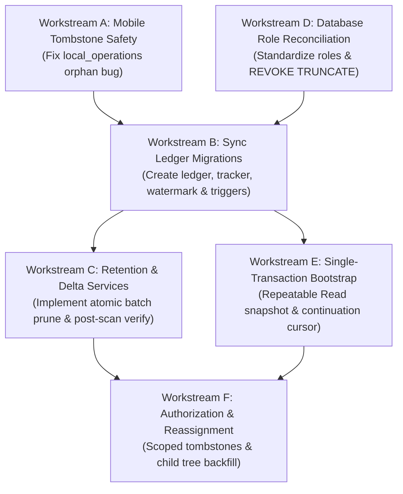

# MUSE SPARK — STAGE 6G-B3-C4-IR
## Formal Implementation Authorization Review

**Project:** ZENTRA Field Call Tracker & ITSM Platform  
**Repository:** `D:\Zentra`  
**Mode:** STRICT READ-ONLY GOVERNANCE REVIEW  
**Implementation Authorization:** NOT GRANTED  
**Live Synchronization Authorization:** STRICTLY PROHIBITED  
**Review Date:** 2026-10-19  

---

### 1. Executive Verdict

**VERDICT: CONDITIONAL (READY FOR ISOLATED STAGING PREPARATION GATE; PRODUCTION EXECUTION STRICTLY BLOCKED)**

Across Stages A1 through A14, ZENTRA's downstream synchronization architecture has undergone an exhaustive, evidence-based correctness audit. The mathematical proofs, failure boundaries, concurrency invariants, and privilege requirements are now fully specified and reconciled with repository facts.

However, **this governance review does NOT grant implementation authorization or live synchronization authorization**.

#### Key Governance Findings:
1. **The Codebase Reality vs. Specification Gap:**
   - Downstream synchronization in [`apps/api/src/modules/sync/services/sync-delta.service.ts`](file:///D:/Zentra/apps/api/src/modules/sync/services/sync-delta.service.ts) remains **100% timestamp-based**.
   - The tables `sync_change_ledger`, `sync_sequence_tracker`, and `sync_retention_watermark`, along with the deferred constraint triggers and sequence cursor `{ v: 3, seq }`, **do not exist in the repository schema or migrations**.
2. **Two Active Vulnerabilities Identified in Codebase:**
   - **Vulnerability 1 (Mobile Tombstone Data Loss):** [`apps/field/src/sync/delta-applier.ts#L268-314`](file:///D:/Zentra/apps/field/src/sync/delta-applier.ts#L268-314) permanently destroys local records upon tombstone receipt without checking for pending offline mutations in `local_operations`.
   - **Vulnerability 2 (Database Role Privilege & Naming Mismatch):** Migration [`20261007000001_create_auth_and_rbac.ts#L209`](file:///D:/Zentra/apps/api/src/database/migrations/20261007000001_create_auth_and_rbac.ts#L209) grants `TRUNCATE` to `zentra_app` via `GRANT ALL ON ALL TABLES`, creating a row-trigger bypass risk. Furthermore, Terraform staging configures `zentra_staging_app` while dev uses `zentra_dev`.
3. **Readiness for Stage-Gated Preparation:**
   - The system is architecturally ready to enter **Gate 1 (Implementation Preparation)** in an isolated development branch.
   - Production deployment and live mobile sync remain **STRICTLY PROHIBITED** until all staging verification tests pass unconditionally.

---

### 2. Evidence Reviewed and Exact Source Ranges

The following repository files and configurations were directly inspected via read-only tools:

| Component | File Path | Exact Source Ranges Inspected | Codebase Fact Established |
| :--- | :--- | :--- | :--- |
| **Sync Delta Service** | `apps/api/src/modules/sync/services/sync-delta.service.ts` | Lines 45–170, 230–260, 385–430 | Implements timestamp filtering (`updated_at > cursorDate`). Zero ledger queries exist. |
| **Mobile Delta Applier** | `apps/field/src/sync/delta-applier.ts` | Lines 55–105, 265–314 | Upsert preserves `PENDING_SYNC` as `CONFLICT`. Tombstone calls `destroyPermanently()` unconditionally. |
| **Existing Migrations** | `apps/api/src/database/migrations/20261008000003_create_sync_and_idempotency.ts` | Lines 1–43 (Complete) | Only creates `idempotency_keys` and adds `version` column. Zero ledger tables exist. |
| **Auth & RBAC Migration** | `apps/api/src/database/migrations/20261007000001_create_auth_and_rbac.ts` | Lines 201–215 | `GRANT ALL ON ALL TABLES ... TO zentra_app`. Zero `REVOKE TRUNCATE` statements exist. |
| **Migration Runner** | `apps/api/src/database/migration-runner.ts` | Lines 22–55, 76–90 | Registers 14 migrations (m1–m14). No change ledger migrations registered. |
| **Terraform Secrets** | `infra/terraform/staging/secrets.tf` | Lines 82–134 | Defines staging app role `zentra_staging_app` and admin role `zentra_admin`. |
| **Terraform ECS** | `infra/terraform/staging/ecs.tf` | Lines 100–135 | Staging ECS container injects `DATABASE_URL` from `db_credentials` (`zentra_staging_app`). |
| **Terraform RDS** | `infra/terraform/staging/rds.tf` | Lines 58–80 | RDS instance master username is `zentra_admin`. Enforces PostgreSQL 16.3 with SSL. |
| **Environment Config** | `.env.example` | Lines 19–27 | Defines `DATABASE_URL` (`zentra_dev`) and `TEST_DATABASE_URL` (`zentra_test`). |
| **Dispatch Engine** | `apps/api/src/modules/service-cases/services/dispatch-engine.service.ts` | Lines 68–190 | `assignEngineer` updates assignment without generating tombstones or child backfills. |

---

### 3. Current Implementation Versus Proposed Architecture

```
Current Implementation vs. Target Corrective Architecture
=======================================================================================================
Dimension              Current Codebase Implementation              Proposed Target Architecture
-------------------------------------------------------------------------------------------------------
Downstream Sync Model  Timestamp-based queries                     Append-only commit-ordered ledger
                       (service_cases.updated_at > cursorDate)     (sync_change_ledger.event_seq > cursor.seq)

Commit Ordering        Non-deterministic under concurrent commits;  Strictly serialized via terminal pre-commit
                       late commits silently skipped                lock on sync_sequence_tracker (tracker_id=1)

Database Tables        idempotency_keys only                        sync_change_ledger, sync_sequence_tracker,
                                                                    sync_retention_watermark

Trigger Architecture   None; application code updates tables        DEFERRABLE INITIALLY DEFERRED row triggers
                       directly                                     capturing INSERT, UPDATE, DELETE

Mobile Tombstones      Unconditionally calls destroyPermanently();  Pre-checks local_operations; preserves
                       orphans offline pending operations           pending work as ACCESS_REVOKED_CONFLICT

Retention Protocol     Undefined; no retention tables or jobs       Atomic batch pruning with watermark
                                                                    pre-advancement inside identical transaction

Cursor Format          Composite { t: ISO, s: number }              Monotonic sequence { v: 3, seq: number }

Bootstrap Contract     Multi-query under default READ COMMITTED     Atomic REPEATABLE READ snapshot returning
                                                                    COALESCE(MAX(event_seq), 0)

Database Role Safety   zentra_app has TRUNCATE via GRANT ALL;       REVOKE TRUNCATE enforced; role unified
                       role naming mismatched with Terraform        across migration and infrastructure
=======================================================================================================
```

---

### 4. Prioritized Workstreams and Dependencies



#### Detailed Workstream Specifications:

#### Workstream A — Mobile Tombstone Safety (Priority 1 — Critical)
- **Problem Statement:** In [`apps/field/src/sync/delta-applier.ts#L268-314`](file:///D:/Zentra/apps/field/src/sync/delta-applier.ts#L268-314), incoming tombstones call `record.destroyPermanently()` unconditionally. If a case is reassigned or deleted while an engineer has pending offline operations in `local_operations`, the parent record is destroyed and the offline mutation is orphaned.
- **Required Implementation Specification:**
  1. *Pre-Purge Inspection:* Before invoking `record.destroyPermanently()`, query `local_operations` for any active operations matching `local_entity_id` or `server_entity_id`.
  2. *Conflict Preservation:* If active operations exist (`QUEUED` or `IN_FLIGHT`):
     - Transition matching operations to `status = 'CONFLICT', conflictCode = 'ACCESS_REVOKED_PENDING_MUTATION'`.
     - Update local domain entity with `syncState = 'CONFLICT'`.
     - Prevent further user edits in the mobile UI for this case.
     - Defer physical SQLite deletion until all pending operations reach a terminal state (`FAILED`, `RECONCILED`, or manually cleared).
  3. *Uncontested Purge:* If zero pending operations exist:
     - Cascade delete local child visits, evidence, and findings.
     - Destroy local record permanently.
- **Affected Source Files:** `apps/field/src/sync/delta-applier.ts`.
- **Acceptance Criteria:** Unit tests prove zero orphaned operations when tombstones arrive for records with pending offline operations.

#### Workstream B — Sync Ledger Architecture (Priority 2 — Core Engine)
- **Problem Statement:** Existing sync queries rely on `updated_at`, resulting in late-commit race omissions and timestamp collision bugs.
- **Required Implementation Specification:**
  1. *Database Migration (`20261019000001_create_sync_change_ledger.ts`):*
     - Create `sync_sequence_tracker (tracker_id INT PRIMARY KEY, current_seq BIGINT NOT NULL)`.
     - Create `sync_change_ledger (event_seq BIGINT PRIMARY KEY, entity_type VARCHAR(50), entity_id UUID, action VARCHAR(20), version INT, data JSONB, committed_at TIMESTAMPTZ)`.
     - Create `sync_retention_watermark (watermark_id INT PRIMARY KEY, min_available_seq BIGINT, purged_through_seq BIGINT, last_purged_at TIMESTAMPTZ)`.
     - Seed tracker `(1, 0)` and watermark `(1, 1, 0, NOW())`.
  2. *PL/pgSQL Trigger Function (`fn_sync_capture()`):*
     - Check no-op updates: `IF TG_OP = 'UPDATE' AND NEW IS NOT DISTINCT FROM OLD THEN RETURN NEW; END IF;`.
     - Execute terminal pre-commit counter increment:
       `UPDATE sync_sequence_tracker SET current_seq = current_seq + 1 WHERE tracker_id = 1 RETURNING current_seq INTO v_seq;`
     - Insert change event into `sync_change_ledger`.
  3. *Trigger Attachment:*
     - Attach `CONSTRAINT TRIGGER ... DEFERRABLE INITIALLY DEFERRED FOR EACH ROW` on `service_cases`, `field_visits`, `evidence_files`, and `conveyance_claims`.
- **Backward Compatibility:** Legacy cursor `{ t, s }` is intercepted; if detected, the server returns `HTTP 410 Gone` with `errorCode: 'LEGACY_CURSOR_UPGRADE_REQUIRED'`, triggering a clean mobile bootstrap into `{ v: 3, seq }`.

#### Workstream C — Retention and Delta Correctness (Priority 3 — Data Lifecycle)
- **Problem Statement:** Multi-batch retention deletion creates an MVCC window where rows are pruned before the watermark is updated, allowing delta pulls to silently skip events without receiving HTTP 410.
- **Required Implementation Specification:**
  1. *Retention Worker Protocol (The Pre-Advance Rule):*
     - Retention cleanup must execute in batches within an explicit database transaction.
     - In each batch, `min_available_seq` in `sync_retention_watermark` must be updated **in the exact same transaction and prior to or atomically with** the `DELETE FROM sync_change_ledger`.
  2. *Delta Retrieval Protocol (Post-Scan Re-Verification):*
     - Delta query fetches rows: `WHERE event_seq > cursor.seq ORDER BY event_seq ASC LIMIT limit + 1`.
     - Server reads `min_available_seq` from `sync_retention_watermark`.
     - If `cursor.seq < min_available_seq - 1`, server immediately throws `HTTP 410 Gone` (`CURSOR_EXPIRED_FULL_RESYNC_REQUIRED`).
- **Affected Source Files:** `apps/api/src/modules/sync/services/sync-delta.service.ts`, `apps/api/src/modules/sync/jobs/retention-cleanup.job.ts`.

#### Workstream D — Database Privileges & Environment Identity (Priority 4 — Security)
- **Problem Statement:** `GRANT ALL ON ALL TABLES` grants `TRUNCATE` to `zentra_app`. Role names differ between migrations (`zentra_app`), Terraform staging (`zentra_staging_app`), and local dev (`zentra_dev`).
- **Required Implementation Specification:**
  1. *Migration Update:*
     - Revoke `TRUNCATE` from `zentra_app` and `zentra_staging_app` on all tables in schema `public`.
     - Alter default privileges to revoke `TRUNCATE` on future tables.
  2. *Configuration Normalization:*
     - Harmonize role naming across `secrets.tf`, `.env.example`, and migration scripts.
- **Acceptance Criteria:** Information schema queries in staging verify zero `TRUNCATE` grants for application roles.

#### Workstream E — Bootstrap and Delta Handoff (Priority 5 — Ground Truth)
- **Problem Statement:** Multi-query bootstrap under default `READ COMMITTED` allows mutations to straddle statement boundaries, resulting in omitted records.
- **Required Implementation Specification:**
  1. *Single-Transaction Isolation:*
     - Open transaction with `ISOLATION LEVEL REPEATABLE READ`.
     - Query 1: `SELECT COALESCE(MAX(event_seq), 0) AS bootstrap_cursor FROM sync_change_ledger;`.
     - Queries 2–5: Fetch active `service_cases`, `field_visits`, `evidence_files`, and `conveyance_claims`.
     - Return payload with `cursor = { v: 3, seq: bootstrap_cursor }`.
  2. *Streaming Response:*
     - Stream large datasets in a single HTTP response (chunked JSON) within the transaction to prevent multi-request snapshot skew.

#### Workstream F — Authorization and Reassignment (Priority 6 — Business Logic)
- **Problem Statement:** When a case is reassigned, the old engineer receives no tombstone and the new engineer receives no historical child visits.
- **Required Implementation Specification:**
  1. *Scoped Revocation Tombstone:*
     - In `dispatch-engine.service.ts`, when `assigned_primary_engineer_id` changes from $E_1$ to $E_2$, insert a targeted tombstone for $E_1$ into `sync_change_ledger`.
  2. *Child Visit Backfill:*
     - Insert change ledger events for all historical visits of that case for $E_2$.
  3. *Offline Acknowledgment:*
     - Formally document that revocation on physical devices is **EVENTUAL** upon network reconnection.

---

### 5. Security, Data-Integrity, Compatibility, and Rollback Requirements

#### Security Requirements:
- The application database role (`zentra_app` / `zentra_staging_app`) must be strictly `NOSUPERUSER` and have zero `TRUNCATE` or `ALTER TABLE` privileges.
- All downstream sync queries must enforce PostgreSQL Row-Level Security (RLS) within `RlsService.withSecurityContext`.

#### Data-Integrity Requirements:
- Sequence allocation must be monotonic and gap-free across committed transactions.
- Local mobile mutations in `local_operations` must never be overwritten, discarded, or orphaned.

#### Backward Compatibility:
- Any mobile client sending a legacy cursor (`{ t, s }`) must receive an explicit `HTTP 410 Gone` forcing a controlled bootstrap into `{ v: 3, seq }`.

#### Rollback Plan:
- If issues occur during staging migration execution:
  - Rollback migration drops triggers, drops `sync_change_ledger`, `sync_sequence_tracker`, and `sync_retention_watermark`.
  - Application falls back to existing timestamp-based sync without data corruption.

---

### 6. Required Isolated Staging Environment and Role Prerequisites

To execute verification without risking production data or physical devices:
1. **Isolated Staging Database:** An Amazon RDS PostgreSQL 16.3 instance (`zentra-staging-db`) or dedicated local test container (`zentra_test`).
2. **Role Prerequisites:**
   - Database Admin User: `zentra_admin` (executes migrations, owns tables).
   - Application User: `zentra_staging_app` (used by API ECS container; non-superuser; `SELECT, INSERT, UPDATE, DELETE` only; `NO TRUNCATE`).
3. **Network Isolation:** No external incoming traffic during test execution.
4. **Mock Storage:** MinIO or staging S3 bucket (`zentra-staging-evidence`).

---

### 7. Test Matrix for Staging Execution

| Test Identifier | Test Purpose | Execution Method | Expected Result | Acceptance Criteria |
| :--- | :--- | :--- | :--- | :--- |
| **TEST-CORR-01** | Commit-Order Serialization Stress Test | `pgbench` with 50 concurrent workers executing simultaneous case updates | `event_seq` strictly matches WAL commit order; zero sequence gaps | 100% monotonic sequence; 0 gaps across 5,000 updates |
| **TEST-CORR-02** | Bootstrap Boundary Invariance Test | Stream 10,000 cases under `REPEATABLE READ` while 20 workers update cases | Every case update appears in either bootstrap snapshot or delta | Zero omissions; zero duplicate versions; 0 data skips |
| **TEST-CORR-03** | Atomic Retention Batch Pruning Test | Run retention purge while concurrent workers pull delta at retention boundary | Pruned ranges return HTTP 410; valid ranges return rows | Zero skipped events; HTTP 410 returned if $C < W - 1$ |
| **TEST-CORR-04** | Reassignment & Offline Conflict Test | Reassign Case C1 while mobile client has offline queued visit in SQLite | Mobile preserves queued visit as `CONFLICT`; does not delete case | Zero orphaned operations; case retained until sync |
| **TEST-CORR-05** | TRUNCATE Privilege Denial Test | Attempt `TRUNCATE service_cases` connecting as `zentra_staging_app` | PostgreSQL returns error `42501 permission_denied` | `TRUNCATE` completely blocked for app role |

---

### 8. Data-Preservation Plan for Mobile Queue and Protected Photographs

The established baseline on the physical mobile device (OnePlus Nord AC2001 `65c7923e`) must remain strictly protected:
- **Zero Device Interaction:** The physical device will NOT be connected to USB, WiFi, or cellular networks during staging implementation or testing.
- **Queue Preservation:** The six queued operations in `local_operations` (all retry counts = 0) and the two physical photographs (`82ce30ce-4712-441c-a43a-cda18fca8151.jpg` and `835bac9f-fbc1-4eae-9a16-277c79d6228d.jpg`) will remain in their preserved backup directories.
- **Test Isolation:** All mobile unit tests will execute exclusively against in-memory SQLite fixtures (`new Database({ adapter: new LokiJSAdapter() })`).

---

### 9. Explicit Approval Gates

The governance transition is structured into four mutually exclusive, sequential gates:

```
┌──────────────────────────────────────────────────────────────────────────────────┐
│ STAGE-GATED IMPLEMENTATION GOVERNANCE                                            │
├──────────────────────────────────────────────────────────────────────────────────┤
│ GATE 1: Prepare Implementation Changes (Isolated Development Branch)             │
│ - Create git branch 'feature/change-ledger-sync'.                                │
│ - Author migration files and service code.                                       │
│ - Prepare mobile patch for delta-applier.ts.                                     │
│ - Scope: Code authoring only. ZERO database execution.                           │
├──────────────────────────────────────────────────────────────────────────────────┤
│ GATE 2: Execute Migrations in Isolated Staging Environment                       │
│ - Requires: Successful Gate 1 review and explicit user approval.                 │
│ - Scope: Run migrations against isolated staging RDS / test DB.                  │
│ - Verify role permissions and REVOKE TRUNCATE.                                   │
├──────────────────────────────────────────────────────────────────────────────────┤
│ GATE 3: Run Staging Integration & Concurrency Tests                              │
│ - Requires: Successful Gate 2 execution and explicit user approval.               │
│ - Scope: Execute TEST-CORR-01 through TEST-CORR-05.                              │
│ - Verify 100% pass rate under 50-client concurrency.                             │
├──────────────────────────────────────────────────────────────────────────────────┤
│ GATE 4: Production Deployment & Live Device Synchronization                      │
│ - Requires: Unconditional pass of Gates 1, 2, and 3, plus final executive signoff.│
│ - Scope: Deploy migrations to production RDS; reconnect physical mobile device.  │
└──────────────────────────────────────────────────────────────────────────────────┘
```

**Current Status:** All gates are **CLOSED**. This report recommends opening **Gate 1 ONLY**.

---

### 10. Files Changed, Created, or Deleted

- **Source Code Files Changed:** 0
- **Test Files Changed:** 0
- **Migration Files Changed:** 0
- **Configuration Files Changed:** 0
- **Deliverables Created:**
  - `D:\Zentra\STAGE_6G_B3_C4_IR_IMPLEMENTATION_AUTHORIZATION_REVIEW.md`
  - `D:\Zentra\docs\STAGE_6G_B3_C4_IR_IMPLEMENTATION_AUTHORIZATION_REVIEW.md`

All existing repository source code, migrations, tests, and configuration files remain **completely unmodified**.

---

### 11. Exact Next Decision Required from Governance Owner

The governance owner is requested to make the following formal decision:

> **DECISION PROPOSAL:**
> "Authorize **GATE 1 ONLY** to create an isolated feature branch (`feature/change-ledger-sync`), prepare the corrective migration files for the change ledger and `REVOKE TRUNCATE`, and implement the mobile tombstone check in `delta-applier.ts`. Database execution, staging deployment, and live synchronization remain strictly prohibited until Gate 2 is formally approved."

---

STOP — STAGE 6G-B3-C4-IR COMPLETE. STRICT READ-ONLY GOVERNANCE REVIEW ONLY. NO IMPLEMENTATION AUTHORIZED. NO DATABASE WRITES. NO LIVE SYNC AUTHORIZED.
