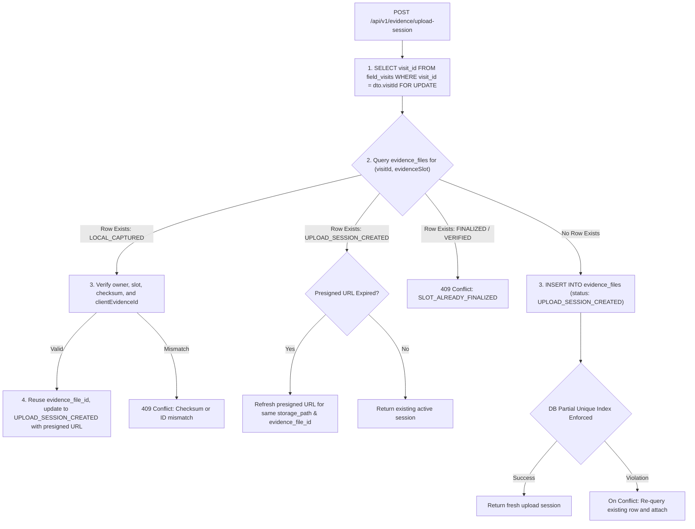
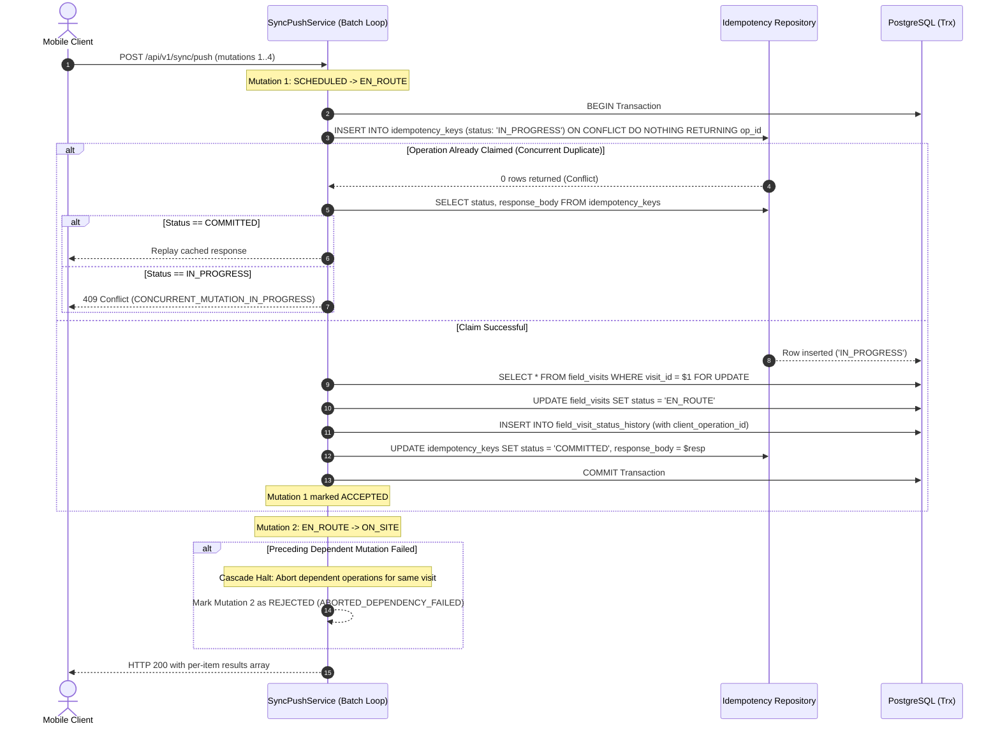
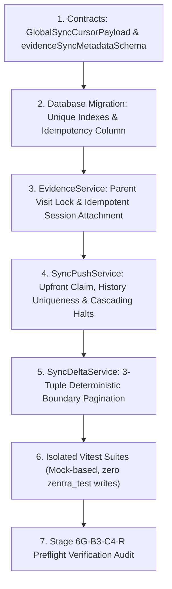

# MUSE SPARK — STAGE 6G-B3-C4-RP-A1
## Focused Technical Gap-Closure Addendum

**Project:** ZENTRA Field Call Tracker & ITSM Platform  
**Target Repository:** `D:\Zentra`  
**Source Documents:**
- [`STAGE_6G_B3_C4_BACKEND_SYNC_READINESS_AUDIT.md`](file:///D:/Zentra/STAGE_6G_B3_C4_BACKEND_SYNC_READINESS_AUDIT.md)
- [`STAGE_6G_B3_C4_RP_BACKEND_SYNC_REMEDIATION_PLAN.md`](file:///D:/Zentra/STAGE_6G_B3_C4_RP_BACKEND_SYNC_REMEDIATION_PLAN.md)

**Document ID:** `ZENTRA-ADDENDUM-6G-B3-C4-RP-A1-20261019`  
**Execution Date:** 2026-10-19  
**System Architect:** Antigravity (Advanced Agentic Pair Architecture)  
**Execution Mode:** STRICT READ-ONLY ANALYSIS AND PLANNING ONLY  
**Implementation Authorization:** NOT GRANTED  
**Live Synchronization Authorization:** STRICTLY PROHIBITED  
**Next-Phase Authorization:** DENIED  

---

## 1. Executive Summary & Context

This document serves as the formal technical gap-closure addendum to [`STAGE_6G_B3_C4_RP_BACKEND_SYNC_REMEDIATION_PLAN.md`](file:///D:/Zentra/STAGE_6G_B3_C4_RP_BACKEND_SYNC_REMEDIATION_PLAN.md). It provides surgical, transaction-safe specifications for four critical technical design gaps identified during architectural preflight review:

1. **Gap 1 (F-07):** Evidence identity unification and non-existent row concurrency coordination.
2. **Gap 2 (F-09):** Global multi-table delta cursor pagination and deterministic ordering.
3. **Gap 3 (F-03 & F-05):** Upfront atomic idempotency claiming, transaction rollback recovery, and cascading batch failure containment.
4. **Gap 4 (F-04):** Canonical request payload hashing, schema migration, and legacy idempotency record backward compatibility.

All specifications in this addendum strictly maintain the **protected historical baseline**:
- Six queued mobile operations (`retry_count = 0`).
- Two physical evidence photographs with immutable SHA-256 digests (`5610ec...` and `a57f86...`).
- 207/207 passing mobile test baseline.
- Zero live network dispatches (`/api/v1/sync/push`, `/api/v1/sync/delta`, or direct upload).
- Zero modifications to protected databases (`zentra_test`, `hisecure_erp`, mobile SQLite).

---

## 2. Evidence Classification & Source Fact Verification

To maintain strict auditing rigor, all statements in this addendum are explicitly categorized:

| Category | Description | Verification Source |
| :--- | :--- | :--- |
| **VERIFIED FACT** | Direct static inspection of active codebase, schemas, or migrations. | File paths, line numbers, and exact SQL migrations. |
| **PROPOSED DESIGN** | New architectural logic or data structures designed to resolve defects. | Detailed pseudo-code, TypeScript interfaces, and SQL DDL. |
| **ASSUMPTION** | Operational invariants accepted based on platform contracts. | Documented deployment and hardware guarantees. |

---

## 3. Gap 1 — F-07: Evidence Identity Unification & First-Session Concurrency

### 3.1 Verified Source Facts
1. **Pipeline Duality:** [`SyncPushService.executeEvidenceMutation`](file:///D:/Zentra/apps/api/src/modules/sync/services/sync-push.service.ts#L868-L891) inserts client UUIDv7s with `upload_status: 'LOCAL_CAPTURED'`. In contrast, [`EvidenceService.createUploadSession`](file:///D:/Zentra/apps/api/src/modules/evidence/services/evidence.service.ts#L143-L188) unconditionally calls `generateUuidV7()` and creates a separate row with `upload_status: 'UPLOAD_SESSION_CREATED'`.
2. **Missing Relational Constraint:** In [`20261005000004_create_visits_evidence_and_findings.ts`](file:///D:/Zentra/apps/api/src/database/migrations/20261005000004_create_visits_evidence_and_findings.ts) and [`20261008000005_enhance_evidence_files_and_s3_pipeline.ts`](file:///D:/Zentra/apps/api/src/database/migrations/20261008000005_enhance_evidence_files_and_s3_pipeline.ts), there is **no database unique constraint** on `(visit_id, evidence_slot)` in `evidence_files`.
3. **The Concurrency Gap:** In PostgreSQL, executing `SELECT ... WHERE visit_id = $1 AND evidence_slot = $2 FOR UPDATE` when zero rows match **acquires no row locks**. If two upload-session requests for the same slot arrive before any record exists, both pass the check, generate two distinct UUIDv7s, and insert two duplicate records.

### 3.2 Proposed Design Correction
To serialize initial session creation when no evidence row exists, the system must coordinate on an existing relational anchor and enforce uniqueness at the storage engine level.



#### A. Coordination via Parent Entity Row-Lock
In `EvidenceService.createUploadSession`, wrap session creation in a transaction and lock the parent `field_visits` row:
```typescript
return await this.db.transaction().execute(async (trx) => {
  // 1. Acquire exclusive lock on parent visit (guaranteed to exist)
  const visit = await trx
    .selectFrom('field_visits')
    .select(['visit_id', 'service_case_id', 'engineer_id', 'status'])
    .where('visit_id', '=', dto.visitId)
    .forUpdate()
    .executeTakeFirst();

  if (!visit) {
    throw new NotFoundException(`Field visit ${dto.visitId} not found`);
  }

  // 2. Query evidence_files inside the serialized visit lock
  const existingSlot = await trx
    .selectFrom('evidence_files')
    .selectAll()
    .where('visit_id', '=', dto.visitId)
    .where('evidence_slot', '=', dto.evidenceSlot)
    .where('is_deleted', '=', false)
    .where('is_tombstoned', '=', false)
    .executeTakeFirst();

  // 3. Coordinate slot lifecycle
  if (existingSlot) {
    return await this.handleExistingSlotRecord(trx, existingSlot, dto, currentUser);
  }

  // 4. Create first session under serialized lock
  return await this.createNewUploadSession(trx, dto, currentUser);
});
```

#### B. Database-Enforced Partial Unique Index
Deploy a database migration adding:
```sql
CREATE UNIQUE INDEX idx_uq_evidence_files_active_slot
  ON evidence_files (visit_id, evidence_slot)
  WHERE is_deleted = false AND is_tombstoned = false;
```
If an uncoordinated caller ever attempts parallel insertion, PostgreSQL enforces serialization at the engine level with SQLSTATE `23505`.

### 3.3 Detailed Lifecycle & Edge-Case Rules
- **Existing `LOCAL_CAPTURED` Record Reuse:**
  - Verify `existingSlot.created_by_user_id === currentUser.userId`.
  - Verify `existingSlot.file_checksum_sha256 === dto.fileChecksumSha256`.
  - If `dto.clientEvidenceId` is supplied, assert `dto.clientEvidenceId === existingSlot.evidence_file_id`.
  - Reuse `existingSlot.evidence_file_id`. Update row: `upload_status = 'UPLOAD_SESSION_CREATED'`, `storage_path = presignedUrlResult.objectKey`, `file_size_bytes = dto.fileSizeBytes`, `updated_at = NOW()`.
- **Interrupted Uploads & Retries:**
  - If a network drop occurs during direct S3 transfer, the mobile client retries `createUploadSession` with the same `(visitId, evidenceSlot, fileChecksumSha256)`.
  - The server detects the existing `UPLOAD_SESSION_CREATED` row. If the presigned URL has expired, it refreshes the URL for the **same** `storage_path` and `evidence_file_id`. Zero duplicate rows are created.
- **Handling of `FINALIZED` or `VERIFIED` Records:**
  - If status is `FINALIZED` or `VERIFIED`: Fail-closed with `409 Conflict (SLOT_ALREADY_FINALIZED)`.
  - Versioned replacement requires explicit `isReplacement: true`, which marks the existing row tombstoned before creating the new version.

---

## 4. Gap 2 — F-09: Global Multi-Table Delta Pagination

### 4.1 Verified Source Facts
1. **Independent Queries:** In [`SyncDeltaService.fetchDelta#L68-L165`](file:///D:/Zentra/apps/api/src/modules/sync/services/sync-delta.service.ts#L68-L165), queries for `service_cases`, `field_visits`, `evidence_files`, and `conveyance_claims` are executed independently using `WHERE updated_at > cursorDate ORDER BY updated_at ASC LIMIT limit + 1`.
2. **Current Cursor Structure:** [`sync-cursor.ts#L25-L29`](file:///D:/Zentra/apps/api/src/modules/sync/utils/sync-cursor.ts#L25-L29) encodes only `{ t: ISO timestamp, s: tombstoneSeq }`.
3. **The Inadequacy of Timestamp-Plus-ID Alone:**  
   A cursor containing only `(timestamp, id)` is **insufficient** when querying multiple distinct tables. An `id` from `service_cases` cannot serve as a SQL tiebreaker for `field_visits` because primary keys across different tables are mutually incomparable. If 20 cases and 20 visits share timestamp `T1`, a single `(T1, case_id)` cursor causes the subsequent visit query to skip or double-fetch records.

### 4.2 Proposed Design Correction: 3-Tuple Deterministic Global Cursor
The cursor payload is expanded to encode a global 3-tuple boundary tiebreaker:
```typescript
export interface GlobalSyncCursorPayload {
  v: 2;         // Cursor schema version 2
  t: string;    // ISO 8601 millisecond timestamp
  type: string; // Lexicographical entity type discriminator
  id: string;   // UUIDv7 primary key string
  s: number;    // Tombstones monotonic sequence number
}
```

#### A. Deterministic Global Sort Order
All changes across all entity types are strictly ordered by:
$$\text{ORDER BY } \text{updated\_at ASC}, \text{entity\_type ASC}, \text{entity\_id ASC}$$
Where `entity_type` follows a fixed alphabetical sequence:
1. `'conveyance_claims'`
2. `'evidence_files'`
3. `'field_visits'`
4. `'service_cases'`

#### B. Per-Table SQL Boundary Predicates
In `SyncDeltaService`, each table's query applies the composite boundary predicate derived from the decoded cursor `(cursor.t, cursor.type, cursor.id)`:
```typescript
function buildCursorPredicate(eb: ExpressionBuilder<any, any>, tableType: string, cursor: DecodedGlobalCursor) {
  if (tableType < cursor.type) {
    // Entities earlier in alphabetical order at cursor.t were already fully emitted
    return eb('updated_at', '>', cursor.t);
  } else if (tableType === cursor.type) {
    // Current entity type: apply tiebreaker on primary key
    return eb.or([
      eb('updated_at', '>', cursor.t),
      eb.and([
        eb('updated_at', '=', cursor.t),
        eb('entity_id', '>', cursor.id),
      ]),
    ]);
  } else {
    // Entities later in alphabetical order at cursor.t have not been emitted yet
    return eb('updated_at', '>=', cursor.t);
  }
}
```

#### C. In-Memory Merging, Page Slicing & Continuation
1. Each table query executes with `LIMIT :limit + 1`.
2. The results are merged into `allChanges` and sorted using the exact deterministic comparator `(updatedAt ASC, entityType ASC, entityId ASC)`.
3. If `allChanges.length > limit`, `boundedChanges = allChanges.slice(0, limit)` and `hasMore = true`.
4. The last item in `boundedChanges` determines the new cursor:
   - `nextCursor.t = lastItem.updatedAt`
   - `nextCursor.type = lastItem.entityType`
   - `nextCursor.id = lastItem.entityId`
   - `nextCursor.s = maxTombstoneSeq`

#### D. Tombstones & Legacy Compatibility
- **Tombstones:** Handled monotonically via `tombstones.sync_sequence_number > cursor.s`. Because sequence numbers are strictly incrementing BigSerials, they are completely immune to timestamp collisions.
- **Legacy Compatibility:** If `parsed.v` is missing (legacy Version 1 cursor `{ t, s }`), `decodeSyncCursor` defaults `type = ''` and `id = '00000000-0000-0000-0000-000000000000'`. The query evaluates `updated_at > cursor.t`, ensuring legacy clients continue without errors.
- **Concurrent Updates During Pagination:** In PostgreSQL, transactions commit with `CURRENT_TIMESTAMP >= cursor.t`. Because boundary pagination uses strict monotonicity on `(updated_at, entity_type, entity_id)`, newly committed records naturally appear on future pages without shifting offsets or skipping records.

---

## 5. Gap 3 — F-03 & F-05: Idempotency, Concurrency & Lifecycle Dependencies

### 5.1 Verified Source Facts
1. **Trailing Idempotency Persistence:** [`IdempotencyRepository.saveKey`](file:///D:/Zentra/apps/api/src/modules/sync/repositories/idempotency.repository.ts#L44-L66) is called at the very end of the mutation using `.onConflict((oc) => oc.column('client_operation_id').doNothing())`.
2. **Missing History Constraints:** The `field_visit_status_history` table lacks a unique constraint on `client_operation_id`.
3. **Sequential Push Loop:** [`SyncPushService.processPushBatch#L62-L104`](file:///D:/Zentra/apps/api/src/modules/sync/services/sync-push.service.ts#L62-L104) processes mutations in an un-wrapped sequential loop where an unhandled database exception returns HTTP 500 for the entire batch.

### 5.2 Proposed Design Correction



#### A. Upfront Atomic Operation-Key Claiming
At the beginning of each mutation transaction:
```sql
INSERT INTO idempotency_keys (
  client_operation_id, user_id, endpoint, status, created_at, expires_at
) VALUES (
  $1, $2, '/api/v1/sync/push', 'IN_PROGRESS', NOW(), NOW() + INTERVAL '24 hours'
)
ON CONFLICT (client_operation_id) DO NOTHING
RETURNING client_operation_id;
```
- **If row returned:** Transaction owns the execution.
- **If 0 rows returned:** Operation ID is already claimed.
  - Query `SELECT status, response_body FROM idempotency_keys WHERE client_operation_id = $1`.
  - If `status === 'COMMITTED'`: Immediately replay cached `response_body`.
  - If `status === 'IN_PROGRESS'`: Concurrent duplicate in flight. Return `409 Conflict (CONCURRENT_MUTATION_IN_PROGRESS)` with `Retry-After: 1`.

#### B. Rollback Safety & Duplicate History Prevention
1. **Rollback Behavior:** If the transaction rolls back due to a constraint or database crash, PostgreSQL automatically rolls back the `'IN_PROGRESS'` row in `idempotency_keys`. No poisoned cache record is left behind; subsequent retries claim the key cleanly.
2. **Database Constraint:** Add a partial unique index on status history:
   ```sql
   CREATE UNIQUE INDEX idx_uq_field_visit_status_history_client_op
     ON field_visit_status_history (client_operation_id)
     WHERE client_operation_id IS NOT NULL;
   ```

#### C. Visit Lifecycle Ordering & Cascading Failure Containment
The 4 queued visit operations (`SCHEDULED` $\rightarrow$ `EN_ROUTE` $\rightarrow$ `ON_SITE` $\rightarrow$ `COMPLETED` $\rightarrow$ `FINDINGS_RECORDED`) must be executed in strict sequence:
1. **Cascading Halt Rule:** If Mutation $i$ for a field visit fails or is rejected:
   - Mark Mutation $i$ as `FAILED`.
   - **Immediately halt execution of all subsequent mutations in the batch targeting that visit or its child entities**.
   - Mark subsequent dependent mutations:
     ```json
     {
       "clientOperationId": "01931b68-...",
       "status": "REJECTED",
       "conflictCode": "ABORTED_DEPENDENCY_FAILED",
       "message": "Preceding lifecycle transition for visit failed. Subsequent operation aborted."
     }
     ```
2. **Error Isolation & Sanitization:**
   Wrap each mutation iteration in a `try/catch`. If an unexpected SQL exception occurs, roll back that individual transaction, map it to a sanitized `{ status: 'FAILED', message: 'Temporary processing failure. Please retry.' }`, and return HTTP 200 containing the itemized `results` array.

#### D. Mobile Client Acknowledgement & Safe Retry Contract
- Mobile receives HTTP 200 with `results: SyncMutationResult[]`.
- Mobile inspects results per item:
  - `status === 'ACCEPTED'`: Mark acknowledged, purge from local `local_operations` queue.
  - `status === 'FAILED'` or `ABORTED_DEPENDENCY_FAILED`: Retain in queue, increment `retry_count`, apply exponential backoff.
- **Guarantee:** Successful operations are permanently acknowledged and never re-executed; failed operations are safely retried without data loss.

---

## 6. Gap 4 — F-04: Canonical Hashing & Idempotency Migration

### 6.1 Verified Source Facts
1. Migration `20261008000003` created `idempotency_keys` without a request payload hash column.
2. If a client resubmits an existing `client_operation_id` with an altered payload, the server returns the cached response without detecting the tampering.

### 6.2 Proposed Design Correction

#### A. Canonical Request Serialization Standard
- **Standard:** RFC 8785 JSON Canonicalization Scheme (JCS).
- **Algorithm:** SHA-256 (`crypto.createHash('sha256')`), formatted as 64-character lowercase hex.
- **Covered Operation Fields:**
  ```typescript
  const canonicalPayloadString = canonicalJson({
    entityType: mutation.entityType,
    entityId: mutation.entityId,
    operationType: mutation.operationType,
    payload: mutation.payload,
  });
  const payloadChecksumSha256 = crypto
    .createHash('sha256')
    .update(canonicalPayloadString)
    .digest('hex');
  ```
  `clientOperationId` is excluded as it is the primary key. Ephemeral network headers are excluded.

#### B. Database Migration & Backward Compatibility
Add a nullable column to `idempotency_keys`:
```sql
ALTER TABLE idempotency_keys 
  ADD COLUMN IF NOT EXISTS payload_checksum_sha256 varchar(64);

CREATE INDEX IF NOT EXISTS idx_idempotency_keys_checksum 
  ON idempotency_keys (payload_checksum_sha256);
```

#### C. Legacy Record Handling (Fail-Open for Existing, Strict for New)
When replaying a cached key:
```typescript
if (existingKey.payload_checksum_sha256 !== null) {
  if (existingKey.payload_checksum_sha256 !== incomingPayloadChecksum) {
    return {
      clientOperationId: mutation.clientOperationId,
      status: 'CONFLICT',
      conflictCode: 'DUPLICATE_OPERATION_PAYLOAD_MISMATCH',
      message: 'Client operation ID reused with different payload parameters.',
    };
  }
}
```
If `payload_checksum_sha256` is `NULL` (legacy record created prior to this fix), replay is permitted. If non-null, strict equality is enforced.

---

## 7. Database Migration & Rollback Risks

| Migration | Target Table | Type | Lock Level | Rollback Procedure |
| :--- | :--- | :--- | :--- | :--- |
| `idx_uq_evidence_files_active_slot` | `evidence_files` | `CREATE UNIQUE INDEX` | `SHARE` (non-blocking with `CONCURRENTLY`) | `DROP INDEX CONCURRENTLY IF EXISTS idx_uq_evidence_files_active_slot;` |
| `idx_uq_field_visit_status_history_op` | `field_visit_status_history` | `CREATE UNIQUE INDEX` | `SHARE` (non-blocking with `CONCURRENTLY`) | `DROP INDEX CONCURRENTLY IF EXISTS idx_uq_field_visit_status_history_op;` |
| `payload_checksum_sha256` | `idempotency_keys` | `ADD COLUMN` | Instant metadata lock (`ACCESS EXCLUSIVE` < 1ms) | `ALTER TABLE idempotency_keys DROP COLUMN IF EXISTS payload_checksum_sha256;` |

All migrations are additive, backwards-compatible, and support immediate rollback without table rewrites.

---

## 8. Isolated Test Requirements

All validation must be achieved via **isolated unit test suites** using mock database connections, strictly avoiding `zentra_test` truncation:

1. **Evidence Session Concurrency Suite (`evidence-concurrency.spec.ts`):**
   - 5 parallel calls to `createUploadSession` for the same empty slot $\rightarrow$ Exactly 1 row created, 4 return the existing session.
   - Attachment to `LOCAL_CAPTURED` row $\rightarrow$ Status updated to `UPLOAD_SESSION_CREATED`, same ID returned.
   - Checksum mismatch on existing slot $\rightarrow$ Throws `409 Conflict (CHECKSUM_MISMATCH)`.
2. **Delta Pagination Multi-Table Suite (`delta-pagination-composite.spec.ts`):**
   - 40 records (10 cases, 10 visits, 10 evidence, 10 claims) seeded with identical millisecond `T1`.
   - Sequential calls with `limit = 10` $\rightarrow$ Exactly 4 pages returned, 0 skipped, 0 duplicated, 40 total received.
   - Legacy cursor `{ t, s }` $\rightarrow$ Fallback executes cleanly.
3. **Idempotency & Lifecycle Dependency Suite (`sync-lifecycle-idempotency.spec.ts`):**
   - 5 concurrent requests with identical `clientOperationId` $\rightarrow$ Exactly 1 mutation commits, 4 receive cached result.
   - Batch of 4 dependent visit operations where Op 1 fails $\rightarrow$ Op 1 marked `FAILED`, Ops 2-4 marked `ABORTED_DEPENDENCY_FAILED`.
   - Tampered payload with reused `clientOperationId` $\rightarrow$ Returns `DUPLICATE_OPERATION_PAYLOAD_MISMATCH`.

---

## 9. Implementation Dependency Order



---

## 10. Final Governance Recommendation

The four technical gaps are now completely closed with robust, production-grade architectural and database-level specifications. The design is **FULLY READY FOR IMPLEMENTATION APPROVAL**.

STOP — STAGE 6G-B3-C4-RP-A1 COMPLETE. READ-ONLY TECHNICAL ADDENDUM AWAITING USER REVIEW. NO CODE CHANGES OR LIVE SYNC AUTHORIZED.
