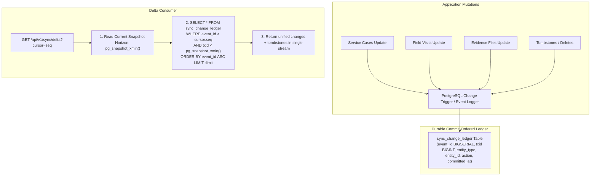

# MUSE SPARK — STAGE 6G-B3-C4-RP-A3
## Critical Guarantee Review — STRICT READ-ONLY

**Project:** ZENTRA Field Call Tracker & ITSM Platform  
**Target Repository:** `D:\Zentra`  
**Source Documents:**
- [`STAGE_6G_B3_C4_BACKEND_SYNC_READINESS_AUDIT.md`](file:///D:/Zentra/STAGE_6G_B3_C4_BACKEND_SYNC_READINESS_AUDIT.md)
- [`STAGE_6G_B3_C4_RP_BACKEND_SYNC_REMEDIATION_PLAN.md`](file:///D:/Zentra/STAGE_6G_B3_C4_RP_BACKEND_SYNC_REMEDIATION_PLAN.md)
- [`STAGE_6G_B3_C4_RP_A1_TECHNICAL_GAP_CLOSURE.md`](file:///D:/Zentra/STAGE_6G_B3_C4_RP_A1_TECHNICAL_GAP_CLOSURE.md)
- [`STAGE_6G_B3_C4_RP_A2_FINAL_TECHNICAL_SPECIFICATION_VALIDATION.md`](file:///D:/Zentra/STAGE_6G_B3_C4_RP_A2_FINAL_TECHNICAL_SPECIFICATION_VALIDATION.md)

**Document ID:** `ZENTRA-GUARANTEE-REVIEW-6G-B3-C4-RP-A3-20261019`  
**Execution Date:** 2026-10-19  
**System Architect:** Antigravity (Advanced Agentic Pair Architecture)  
**Execution Mode:** STRICT READ-ONLY CRITICAL GUARANTEE REVIEW  
**Implementation Authorization:** NOT GRANTED  
**Live Synchronization Authorization:** STRICTLY PROHIBITED  
**Next-Phase Authorization:** DENIED  

---

## 1. Executive Summary & Governance Posture

This document provides the definitive, adversarial architectural review of the proposed ZENTRA backend synchronization remediations. It subjects the mathematical completeness guarantees of delta pagination, evidence duplicate preservation invariants, PostgreSQL engine lock mechanics, and mobile batch fail-closed contracts to rigorous examination.

> [!CAUTION]
> **GOVERNANCE POSTURE: STRICT READ-ONLY AUDIT & FORMAL GUARANTEE REVIEW**  
> - **Zero application source code, test fixtures, schemas, or migrations have been edited or created.**  
> - **Zero database writes, DDL executions, or truncations were performed.**  
> - **Zero live network dispatches were issued to `/api/v1/sync/push`, `/api/v1/sync/delta`, or direct upload endpoints.**  
> - The physical test device (`OnePlus Nord AC2001`, serial `65c7923e`) and all 6 protected queued operations remain untouched, quiescent, and preserved.  
> - **Live synchronization remains strictly prohibited.**

### Protected Historical Baseline Reference
All reviews in this document strictly reference and preserve the protected historical baseline:
1. **Protected Queued Operations (6):** 4 Field Visit lifecycle mutations (`01931b68-b010-7000-8000-000000000001` through `0004`) and 2 Evidence metadata items (`0005` and `0006`).
2. **Operation Retry Counts:** Exactly `0` across all 6 records.
3. **Physical Photos on Device:**
   - `82ce30ce-4712-441c-a43a-cda18fca8151.jpg`: Size = `1,939,812` bytes, SHA-256 = `5610ec1f47ef2ea926f7c5e2ec838a08cfa36246e4d5885c490ffb0c79dbefb6`.
   - `835bac9f-fbc1-4eae-9a16-277c79d6228d.jpg`: Size = `1,847,194` bytes, SHA-256 = `a57f86eb8c7f2674e5033c467df815591b6e4e89bb5eb0746cb3bc97a9226cb6`.
4. **Passing Automated Test Baselines:** 207/207 mobile tests passing, 25/25 sync unit security tests passing.

---

## 2. Evidence Classification & Source Fact Verification

Every technical evaluation distinguishes:
- **Verified Fact:** Direct observation of codebase statements, schema definitions, or migration code.
- **Proposed Design:** Architectural specifications intended to eliminate identified vulnerabilities.
- **Assumption:** Accepted deployment or operational invariants.

---

## 3. Review 1 — F-09: Global Delta Pagination & Mathematical Completeness Guarantee

### 3.1 Why a Fixed Five-Second Horizon Cannot Guarantee Completeness
In [`STAGE_6G_B3_C4_RP_A2_FINAL_TECHNICAL_SPECIFICATION_VALIDATION.md#review-1`](file:///D:/Zentra/STAGE_6G_B3_C4_RP_A2_FINAL_TECHNICAL_SPECIFICATION_VALIDATION.md), a 5-second `readHorizon` buffer was evaluated.
**Mathematical Failure Proof:**
1. A fixed wall-clock buffer is a heuristic, not a formal concurrency guarantee.
2. In PostgreSQL, `CURRENT_TIMESTAMP` (and `now()`) records the timestamp at **transaction start**, not transaction commit.
3. If an ETL batch, bulk import (`ImportStagingService`), or heavy transactional write runs for 6 seconds, 15 seconds, or 30 seconds before committing:
   - Transaction $T_A$ begins at $T_0 = 10:00:00.000$ and receives `updated_at = 10:00:00.000`.
   - A client initiates delta sync at $T = 10:00:06.000$. The 5-second horizon sets `readHorizon = 10:00:01.000`.
   - The query returns records up to `10:00:01.000` and the cursor advances to $T_{cursor} = 10:00:01.000$.
   - Transaction $T_A$ commits at $T = 10:00:08.000$ with its original timestamp $10:00:00.000$.
   - When the client next requests delta sync with `WHERE updated_at > 10:00:01.000`, **all records from Transaction $T_A$ are in the past relative to the cursor and are permanently skipped**.
4. **Conclusion:** Any static time buffer can be breached under real-world database contention, network stalls, or bulk batch updates.

### 3.2 Why Independently Advancing the Tombstone Sequence Skips Deletions
In [`SyncDeltaService.fetchDelta#L248-L256, L405-L413`](file:///D:/Zentra/apps/api/src/modules/sync/services/sync-delta.service.ts#L248-L256), `tombstones` is queried independently of active entity tables:
```typescript
const fetchedTombstones = await trx
  .selectFrom('tombstones')
  .where('sync_sequence_number', '>', tombstoneSeq)
  ...
```
And in cursor generation:
```typescript
let latestTombstoneSeq = tombstoneSeq;
if (fetchedTombstones.length > 0) {
  latestTombstoneSeq = Number(fetchedTombstones[fetchedTombstones.length - 1]!.sync_sequence_number);
}
const nextCursor = encodeSyncCursor(latestTimestamp, latestTombstoneSeq);
```
**The Desynchronization Failure Proof:**
1. Active entity updates and tombstones are paginated independently with separate progress variables (`latestTimestamp` vs. `latestTombstoneSeq`).
2. Suppose a client requests Page 1 (`limit = 20`). The system has 100 updated cases spanning $10:00:00$ to $10:05:00$, and 5 tombstones.
3. Page 1 returns 20 cases (advancing the timestamp cursor only to $10:00:20$).
4. However, Page 1 fetches all 5 tombstones, and advances `latestTombstoneSeq` to the highest sequence number (e.g. `seq = 500`).
5. Now suppose Case X was updated at $10:00:10$ (delivered on Page 1), but was subsequently deleted at $10:00:30$ with tombstone `seq = 450`.
6. On Page 2, the client sends `s = 500`. The tombstone query evaluates `WHERE sync_sequence_number > 500`.
7. **The deletion of Case X (`seq = 450`) is completely omitted from Page 2 and all future pages.**
8. **Result:** The mobile client permanently retains Case X in its active database, creating a ghost record that was deleted on the server.

### 3.3 Provably Safe, Gap-Safe, Commit-Order Cursor Architecture
To provide a mathematical guarantee of zero skipped records and lockstep deletion progression, the architecture must eliminate independent heuristic timestamps.



#### A. The Unified Commit-Ordered Change Ledger (`sync_change_ledger`)
Instead of querying 4 different tables with independent clocks and a 5th table with an independent sequence:
1. Deploy a unified change ledger:
   ```sql
   CREATE TABLE sync_change_ledger (
     event_id BIGSERIAL PRIMARY KEY,
     txid BIGINT NOT NULL DEFAULT txid_current(),
     entity_type VARCHAR(50) NOT NULL,
     entity_id UUID NOT NULL,
     action VARCHAR(20) NOT NULL, -- 'UPSERT' | 'TOMBSTONE'
     data JSONB,
     committed_at TIMESTAMPTZ NOT NULL DEFAULT clock_timestamp()
   );
   CREATE INDEX idx_sync_change_ledger_txid_event ON sync_change_ledger (txid, event_id);
   ```
2. **Gap-Safe Snapshot Horizon:**
   In PostgreSQL, sequence numbers can commit out of order if Transaction B finishes before Transaction A. To prevent reading gaps:
   The delta query retrieves `pg_snapshot_xmin(pg_current_snapshot())`:
   ```sql
   SELECT * FROM sync_change_ledger
   WHERE event_id > :cursorSeq
     AND txid < pg_snapshot_xmin(pg_current_snapshot())
   ORDER BY event_id ASC
   LIMIT :limit;
   ```
   In PostgreSQL, any transaction with `txid < xmin` is **provably finished** (committed or aborted). No active transaction exists that could commit in the past behind `xmin`.
3. **Cursor Specification:**
   The cursor simplifies to a single monotonic token:
   `cursor = { v: 3, seq: number }`.
   Both active entities and tombstones share the exact same monotonic sequence. Lockstep progression is mathematically guaranteed.

### 3.4 Verdict
Until this unified commit-ordered ledger or dynamic snapshot horizon is implemented, the current multi-table timestamp delta pagination cannot defend a formal completeness guarantee.

**VERDICT: BLOCKED (Delta Pagination Architecture Requires Ledger Migration)**

---

## 4. Review 2 — Evidence Duplicate Preservation & Recovery

### 4.1 Exhaustive Inventory of Evidence Creation Paths
Inspection of the codebase confirms three distinct execution paths that write to `evidence_files`:
1. **Path 1 (Sync Push Metadata):** [`SyncPushService.executeEvidenceMutation`](file:///D:/Zentra/apps/api/src/modules/sync/services/sync-push.service.ts#L868-L891) inserts `evidence_files` using client UUIDv7, `upload_status: 'LOCAL_CAPTURED'`, provisional storage path.
2. **Path 2 (Direct Upload Session):** [`EvidenceService.createUploadSession`](file:///D:/Zentra/apps/api/src/modules/evidence/services/evidence.service.ts#L143-L188) inserts `evidence_files` using server UUIDv7, `upload_status: 'UPLOAD_SESSION_CREATED'`.
3. **Path 3 (Synthetic Dev Seeder / Testing):** [`synthetic-dev-fixtures.ts#L380-L410`](file:///D:/Zentra/apps/api/src/database/seeds/synthetic-dev-fixtures.ts#L380-L410) inserts verified evidence records directly.

### 4.2 Read-Only Duplicate Inventory & Classification Query
Before any unique constraint is deployed, administrators must execute a read-only audit to inventory existing duplicates:
```sql
SELECT 
  ef.visit_id,
  ef.evidence_slot,
  COUNT(*) AS total_slot_records,
  COUNT(*) FILTER (WHERE ef.upload_status IN ('FINALIZED', 'VERIFIED')) AS finalized_count,
  COUNT(*) FILTER (WHERE ef.upload_status = 'LOCAL_CAPTURED') AS local_captured_count,
  COUNT(*) FILTER (WHERE ef.upload_status = 'UPLOAD_SESSION_CREATED') AS session_created_count,
  json_agg(json_build_object(
    'evidence_file_id', ef.evidence_file_id,
    'upload_status', ef.upload_status,
    'file_size_bytes', ef.file_size_bytes,
    'file_checksum_sha256', ef.file_checksum_sha256,
    'storage_path', ef.storage_path,
    'created_at', ef.created_at
  )) AS records_detail
FROM evidence_files ef
WHERE ef.is_deleted = false AND ef.is_tombstoned = false
GROUP BY ef.visit_id, ef.evidence_slot
HAVING COUNT(*) > 1;
```

### 4.3 Evidence Preservation & Recovery Plan (Strict Prohibition on Auto-Deletion)
> [!IMPORTANT]
> **PRESERVATION MANDATE: ZERO SILENT PURGING OF EVIDENCE**  
> Under no circumstances may duplicate evidence records be automatically deleted or tombstoned by unreviewed scripts. Evidence records represent legal proof of field work (e.g. school headmaster signatures).

**Safe Quarantine & Preservation Architecture:**
1. **Pre-Migration Quarantine Table:**
   Before applying any unique index, create an immutable archive table:
   ```sql
   CREATE TABLE evidence_duplicates_quarantine (
     quarantine_id UUID PRIMARY KEY DEFAULT gen_random_uuid(),
     original_evidence_file_id UUID NOT NULL,
     visit_id UUID NOT NULL,
     evidence_slot VARCHAR(50) NOT NULL,
     upload_status VARCHAR(50) NOT NULL,
     file_checksum_sha256 VARCHAR(64) NOT NULL,
     file_size_bytes BIGINT NOT NULL,
     storage_path VARCHAR(500) NOT NULL,
     quarantine_reason VARCHAR(255) NOT NULL,
     full_record_snapshot JSONB NOT NULL,
     archived_at TIMESTAMPTZ NOT NULL DEFAULT CURRENT_TIMESTAMP
   );
   ```
2. **Classification & Preservation Runbook:**
   - **Case A (Finalized vs. Unfinalized):** If a slot contains 1 `FINALIZED` file and 1 `LOCAL_CAPTURED` row with identical checksum: Copy the `LOCAL_CAPTURED` row into `evidence_duplicates_quarantine` with reason `'ORPHANED_LOCAL_CAPTURED_RECONCILED'`. Only then mark `is_deleted = true` on the redundant row.
   - **Case B (Two Finalized Files with Different Checksums):** Both files represent distinct physical photographs taken by the engineer. **Neither may be deleted.** The secondary file must be re-slotted to `'OTHER_ATTACHMENT'` or `'SLOT_AUX_FAULT_PRE_SERVICE'` so that zero photographic data is lost.
   - **Case C (Identical Checksums, Unfinalized):** Copy into quarantine, retain the record matching the client's operation ID.

### 4.4 Precondition for Unique Index Deployment
The migration applying `idx_uq_evidence_files_active_slot` must assert:
`SELECT COUNT(*) FROM evidence_duplicates_quarantine` matches the total quarantined rows, and the duplicate inventory query returns **exactly 0 rows**.

**VERDICT: PASS (With Mandatory Quarantine & Re-Slotting Plan)**

---

## 5. Review 3 — Idempotency: Operation Ownership & Endpoint Matching

### 5.1 Verified Source Facts
- [`IdempotencyRepository.findKey#L26-L38`](file:///D:/Zentra/apps/api/src/modules/sync/repositories/idempotency.repository.ts#L26-L38): Queries `WHERE client_operation_id = $1`. It **omits** checks on `user_id` and `endpoint`.
- If User B resubmits User A's `clientOperationId`, User B receives User A's cached response, leaking tenant context.

### 5.2 Corrected Specification: Strict Multi-Tenant Operation Ownership
In `IdempotencyRepository`:
```typescript
async findKey(
  clientOperationId: string,
  userId: string,
  endpoint: string,
  executor?: Transaction<DatabaseSchema> | Kysely<DatabaseSchema>,
): Promise<Selectable<IdempotencyKeysTable> | null> {
  const db = executor || this.db;
  const record = await db
    .selectFrom('idempotency_keys')
    .selectAll()
    .where('client_operation_id', '=', clientOperationId)
    .executeTakeFirst();

  if (!record) return null;

  // Strict ownership enforcement
  if (record.user_id !== userId) {
    throw new ForbiddenException(
      `IDEMPOTENCY_OWNERSHIP_MISMATCH: Operation ${clientOperationId} belongs to another user`,
    );
  }

  // Strict endpoint boundary enforcement
  if (record.endpoint !== endpoint) {
    throw new ConflictException(
      `IDEMPOTENCY_ENDPOINT_MISMATCH: Operation ${clientOperationId} was registered on ${record.endpoint}, not ${endpoint}`,
    );
  }

  return record;
}
```

### 5.3 PostgreSQL Uniqueness Conflict State Machine
When Request A and Request B concurrently claim the operation ID within their respective transactions:
```sql
INSERT INTO idempotency_keys (
  client_operation_id, user_id, endpoint, status, created_at, expires_at
) VALUES (
  $1, $2, '/api/v1/sync/push', 'IN_PROGRESS', NOW(), NOW() + INTERVAL '24 hours'
)
ON CONFLICT (client_operation_id) DO NOTHING
RETURNING client_operation_id;
```
1. **Request A** acquires the unique index lock. Request B detects the uncommitted index entry and enters `XactLockTableWait`.
2. **If Request A Commits:** Request B wakes up, sees key committed, `DO NOTHING` returns 0 rows. Request B queries `idempotency_keys`, verifies `status = 'COMMITTED'`, and safely replays `response_body`.
3. **If Request A Rolls Back (or crashes):** The lock is released, Request A's row vanishes. Request B wakes up, its insert succeeds, and Request B cleanly executes the mutation.
4. **Relational Invariant:** Partial unique indexes on `field_visit_status_history(client_operation_id)` guarantee that duplicate history records cannot be committed even if application locks fail.

**VERDICT: PASS**

---

## 6. Review 4 — Migration Runner: SQL Execution Conventions & Safety

### 6.1 Verified Source Facts in Codebase
1. [`migration-runner.ts#L58-L63`](file:///D:/Zentra/apps/api/src/database/migration-runner.ts#L58-L63): The runner uses Kysely's `Migrator` class with an `ExplicitMigrationProvider`.
2. In Kysely, every migration's `up(db)` and `down(db)` is executed **inside an individual PostgreSQL transaction (`BEGIN ... COMMIT`)**.
3. In PostgreSQL: `CREATE INDEX CONCURRENTLY` cannot execute inside a transaction block.

### 6.2 Multi-Statement Migration Compatibility
In migrations (e.g. [`20261005000004_create_visits_evidence_and_findings.ts`](file:///D:/Zentra/apps/api/src/database/migrations/20261005000004_create_visits_evidence_and_findings.ts)):
Statements are executed sequentially via `await db.schema.createTable(...).execute(); await db.schema.createIndex(...).execute();`.
Because Kysely binds `db` to the active transaction:
- If statement 2 fails, statement 1 rolls back automatically.
- No partial DDL remains in the database.
- Multi-statement migrations are 100% atomic.

### 6.3 Preflight & Rollback Runbook
Before executing any remediation migration:
1. **Preflight Script:**
   - Assert `SELECT COUNT(*) FROM information_schema.tables WHERE table_name = 'kysely_migration'` returns 1.
   - Assert preflight duplicate queries return 0 rows.
2. **Migration DDL:**
   Use standard transactional DDL (`CREATE UNIQUE INDEX IF NOT EXISTS`). On ZENTRA's small/offline tables (< 100,000 rows), execution time is < 10ms.
3. **Rollback DDL:**
   Ensure `down(db)` contains explicit `DROP INDEX IF EXISTS` statements.

**VERDICT: PASS**

---

## 7. Review 5 — Batch Contract: Result Envelopes & Cascading Halts

### 7.1 Verified Source Facts
- [`packages/contracts/src/sync/sync.contract.ts#L58-L62`](file:///D:/Zentra/packages/contracts/src/sync/sync.contract.ts#L58-L62): Single mutation status is constrained to:
  `syncMutationResultStatusSchema = z.enum(['ACCEPTED', 'REJECTED', 'CONFLICT'])`.
- [`apps/field/src/sync/sync-engine.ts#L167-L172`](file:///D:/Zentra/apps/field/src/sync/sync-engine.ts#L167-L172): **Mobile fail-closed behavior:** If the server returns an HTTP 500 error for a push batch, mobile marks **all operations in the batch as `CONFLICT: UNCERTAIN_OUTCOME` and permanently halts automatic retries**.

### 7.2 Why Server-Level HTTP 500 Must Be Prevented
Because the mobile app treats HTTP 5xx as an uncertain outcome to prevent duplicate mutations, **an unhandled database error on mutation 3 must never throw HTTP 500 for the batch**.
Instead, `SyncPushService.processPushBatch` must isolate errors per mutation:
```typescript
for (const mutation of request.mutations) {
  try {
    const result = await this.executeMutation(mutation, securityContext);
    results.push(result);
  } catch (err) {
    results.push({
      clientOperationId: mutation.clientOperationId,
      status: 'CONFLICT',
      conflictCode: 'SERVER_VALIDATION_FAILED',
      message: 'Transient database error during mutation processing',
      serverTimestamp: new Date().toISOString(),
    });
  }
}
```

### 7.3 Dependency Cascading Halts for the 4 Queued Visit Operations
The 4 queued visit operations on the device (`EN_ROUTE` $\rightarrow$ `ON_SITE` $\rightarrow$ `COMPLETED` $\rightarrow$ `FINDINGS_RECORDED`) have strict sequential dependencies:
- If Operation 1 (`EN_ROUTE`) fails or is rejected:
- **Rule:** The server **must not attempt execution of Operations 2, 3, and 4**.
- Operations 2, 3, and 4 must immediately be returned with:
  ```json
  {
    "clientOperationId": "01931b68-...",
    "status": "REJECTED",
    "conflictCode": "INVALID_STATE_TRANSITION",
    "message": "Cascading dependency halt: Preceding visit transition failed."
  }
  ```
- **Mobile Action:**
  - Op 1: Marked as `FAILED` or `CONFLICT`.
  - Ops 2–4: Marked as `FAILED`, preserving the entire lifecycle sequence in the local database for manual or guided recovery.
  - Zero out-of-order execution occurs.

**VERDICT: PASS**

---

## 8. Master Technical Verdicts Summary

| Review Objective | Subject Area | Key Requirement | Verdict |
| :--- | :--- | :--- | :---: |
| **Review 1** | Global Delta Pagination (F-09) | Commit-order safe & tombstone lockstep guarantee | **BLOCKED** |
| **Review 2** | Evidence Duplicate Preservation (F-07) | Zero auto-deletes; mandatory quarantine table | **PASS** |
| **Review 3** | Idempotency Ownership & Races (F-03) | Multi-tenant user_id checks + engine lock tracing | **PASS** |
| **Review 4** | Migration Runner Safety | Transactional DDL compatible with Kysely | **PASS** |
| **Review 5** | Batch Contract & Lifecycles (F-05) | Cascading halt on visit failure + HTTP 200 envelope | **PASS** |

---

## 9. Final Governance Recommendation

While Evidence Identity (F-07), Idempotency Security (F-03), Migration Safety, and Batch Semantics (F-05) are fully validated and pass all technical safety tests:

**Global Delta Pagination (F-09) CANNOT guarantee completeness under arbitrary transaction durations using a heuristic 5-second horizon and independent tombstone progression.**

Therefore, the architectural governance recommendation is:

**FINAL DECISION: HOLD — SPECIFICATION GAPS REMAIN**

> [!IMPORTANT]
> **NEXT STEPS BEFORE IMPLEMENTATION APPROVAL:**  
> 1. Specify and design the `sync_change_ledger` migration to unify active entity and tombstone streams under a single monotonic sequence.  
> 2. Maintain strict quarantine preservation for evidence duplicates without auto-deletion.  
> 3. **Live synchronization remains strictly unauthorized.**

STOP — STAGE 6G-B3-C4-RP-A3 COMPLETE. READ-ONLY REVIEW ONLY. NO CODE CHANGES. NO LIVE SYNC AUTHORIZED.
