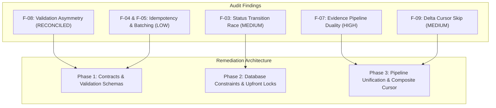
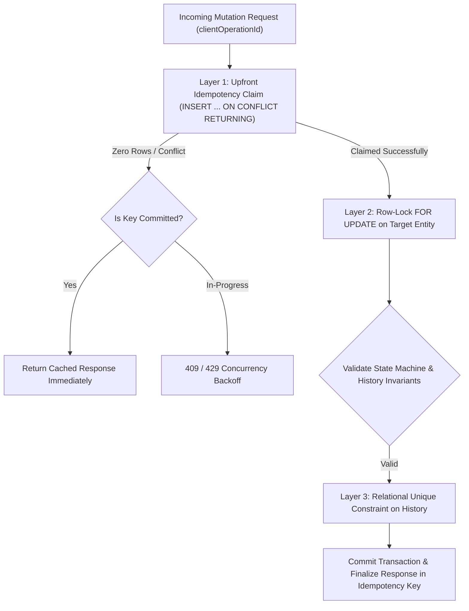
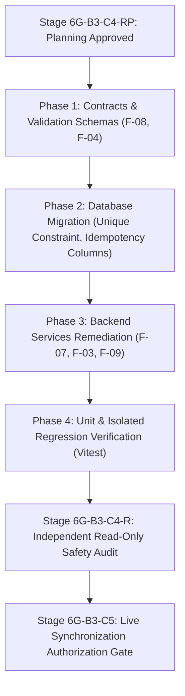

# MUSE SPARK IMPLEMENTATION REPORT
## Stage 6G-B3-C4-RP — Backend Sync Remediation Planning Only

**Project:** ZENTRA Field Call Tracker & ITSM Platform  
**Target Repository:** `D:\Zentra`  
**Source Report:** [`STAGE_6G_B3_C4_BACKEND_SYNC_READINESS_AUDIT.md`](file:///D:/Zentra/STAGE_6G_B3_C4_BACKEND_SYNC_READINESS_AUDIT.md)  
**Document ID:** `ZENTRA-PLAN-6G-B3-C4-RP-BACKEND-SYNC-REMEDIATION-20261019`  
**Planning Date:** 2026-10-19  
**System Architect:** Antigravity (Advanced Agentic Pair Architecture)  
**Execution Mode:** STRICT READ-ONLY ANALYSIS AND PLANNING ONLY  
**Implementation Authorization:** NOT GRANTED  
**Live Synchronization Authorization:** DENIED  
**Next-Phase Authorization:** DENIED  

---

## 1. Executive Summary & Operational Posture

This document establishes the comprehensive, evidence-based remediation plan formulated in response to the findings documented in the Stage 6G-B3-C4 Backend Sync Readiness Audit ([`STAGE_6G_B3_C4_BACKEND_SYNC_READINESS_AUDIT.md`](file:///D:/Zentra/STAGE_6G_B3_C4_BACKEND_SYNC_READINESS_AUDIT.md)).

### 1.1 Core Planning Mandate
The objective of this stage is strictly analytical and architectural: to evaluate the verified facts and potential defects in the backend synchronization, idempotency, cursor pagination, and evidence storage subsystems, and to design rigorous, transaction-safe remediation strategies.

> [!CAUTION]
> **OPERATIONAL POSTURE: PLANNING ONLY — ZERO CODE OR SYSTEM MUTATIONS**  
> - Implementation authorization is **NOT GRANTED**.  
> - Live synchronization authorization is **DENIED**.  
> - Next-phase authorization is **DENIED**.  
> - Zero application source files, test fixtures, configurations, or database records have been modified, created, or deleted.  
> - The physical test device (`OnePlus Nord AC2001`, serial `65c7923e`) remains completely quiescent, uncontacted, and preserved.

### 1.2 Protected Historical Baseline Reference
All planning in this report assumes the strict preservation of the previously verified historical baseline:
1. **Six Protected Queued Operations:** 4 Field Visit lifecycle mutations (`01931b68-b010-7000-8000-000000000001` through `0004`) and 2 Evidence metadata insertions (`0005` and `0006`).
2. **Device Queue State:** `retry_count = 0`, status `QUEUED`, zero dispatch attempts.
3. **Physical Evidence Photographs:**
   - `82ce30ce-4712-441c-a43a-cda18fca8151.jpg`: Size = `1,939,812` bytes, SHA-256 = `5610ec1f47ef2ea926f7c5e2ec838a08cfa36246e4d5885c490ffb0c79dbefb6`.
   - `835bac9f-fbc1-4eae-9a16-277c79d6228d.jpg`: Size = `1,847,194` bytes, SHA-256 = `a57f86eb8c7f2674e5033c467df815591b6e4e89bb5eb0746cb3bc97a9226cb6`.
4. **Mobile Regression Test Status:** 26 test files, 207/207 tests passing.
5. **Evidence Size Verification Checks:** 12/12 passing.
6. **TypeScript Compilation Status:** Passing with zero diagnostic errors across mobile and API workspaces.

---

## 2. Evidence Classification & Methodology

To ensure total architectural precision, all observations are classified into three distinct categories:
- **Verified Facts:** Invariants confirmed by direct static analysis of existing source code, schemas, and migrations.
- **Potential Defects:** Vulnerabilities where edge conditions (such as concurrency races, network retries, or pagination limits) can produce invalid system state.
- **Questions Requiring Further Inspection:** Architectural boundaries requiring administrative policy decisions before implementation.

| Finding ID | Source Audit Reference | Evidence Category | Architectural Domain | Assessed Severity |
| :--- | :--- | :--- | :--- | :---: |
| **F-07** | Audit §5, F-07 | Verified Fact & Architectural Defect | Evidence Ingestion & Direct S3 Streaming | **HIGH** |
| **F-03** | Audit §5, F-03 | Potential Defect (Concurrency Edge) | Idempotency & Visit Status Transitions | **MEDIUM** |
| **F-09** | Audit §5, F-09 | Potential Defect (Pagination Boundary) | Delta Cursor & Chronological Sorting | **MEDIUM** |
| **F-08** | Audit §5, F-08 / §9, RSK-04 | Verified Fact (Schema Asymmetry) | Contract & Input Validation | **RECONCILED (MED/LOW)** |
| **F-04** | Audit §5, F-04 | Potential Defect (Payload Tampering) | Idempotency Key Replay Validation | **LOW** |
| **F-05** | Audit §5, F-05 | Verified Fact (Design Trade-off) | Push Batch Transaction Atomicity | **LOW** |

---

## 3. Comprehensive Remediation Plans by Finding



---

### 3.1 Finding F-07: Evidence Identity Fragmentation & Pipeline Duality (HIGH)

#### A. Source Reference & Root-Cause Hypothesis
- **Audit Reference:** [`STAGE_6G_B3_C4_BACKEND_SYNC_READINESS_AUDIT.md#finding-f-07`](file:///D:/Zentra/STAGE_6G_B3_C4_BACKEND_SYNC_READINESS_AUDIT.md)
- **Verified Root Cause:**  
  The system currently maintains two independent, uncoordinated entry points for evidence records:
  1. **Sync Push Ingestion (`POST /api/v1/sync/push`):** Handled in [`SyncPushService.executeEvidenceMutation`](file:///D:/Zentra/apps/api/src/modules/sync/services/sync-push.service.ts#L868-L891). It inserts a row into `evidence_files` using the client's assigned UUIDv7 (`evidence_file_id: mutation.entityId`), assigning `upload_status: 'LOCAL_CAPTURED'`, a provisional offline path (`storage_path: 'evidence/offline/<uuid>.jpg'`), and the actual SHA-256 checksum.
  2. **Direct Upload Session Ingestion (`POST /api/v1/evidence/upload-session`):** Handled in [`EvidenceService.createUploadSession`](file:///D:/Zentra/apps/api/src/modules/evidence/services/evidence.service.ts#L143-L188). It completely ignores any client-supplied ID, unconditionally generates a **new server UUIDv7** (`const evidenceId = generateUuidV7()`), and inserts a separate row into `evidence_files` with `upload_status: 'UPLOAD_SESSION_CREATED'`.
  3. **The Fragmentation Mechanism:**
     - In [`EvidenceService.createUploadSession#L117-L133`](file:///D:/Zentra/apps/api/src/modules/evidence/services/evidence.service.ts#L117-L133), the service queries `findActiveByVisitAndSlot`. However, it only raises a `ConflictException('SLOT_CONFLICT')` if the existing record's status is `FINALIZED` or `VERIFIED`. If the record is `LOCAL_CAPTURED` (from sync push), the check silently passes.
     - When the mobile application subsequently calls `executeDirectUpload`, it requests an upload session, uploads the binary file to S3 under the server's new UUIDv7, and calls `finalizeUpload` for the new UUIDv7.
     - **Result:** Two records are permanently retained in PostgreSQL for the same visit and slot:
       - Row 1 (from Sync Push): `evidence_file_id = ClientUUID`, `upload_status = 'LOCAL_CAPTURED'`, `storage_path = 'evidence/offline/...'` (orphaned forever).
       - Row 2 (from S3 Direct Upload): `evidence_file_id = ServerUUID`, `upload_status = 'FINALIZED'`, `storage_path = 'evidence/<env>/...'`.

#### B. Affected Modules, Files & Constraints
- Backend:
  - [`apps/api/src/modules/evidence/services/evidence.service.ts`](file:///D:/Zentra/apps/api/src/modules/evidence/services/evidence.service.ts) (`createUploadSession`, `finalizeUpload`)
  - [`apps/api/src/modules/evidence/repositories/evidence.repository.ts`](file:///D:/Zentra/apps/api/src/modules/evidence/repositories/evidence.repository.ts) (`findActiveByVisitAndSlot`, `create`, `updateStatus`)
  - [`packages/contracts/src/schemas/evidence.schema.ts`](file:///D:/Zentra/packages/contracts/src/schemas/evidence.schema.ts) (`createEvidenceUploadSessionSchema`)
- Mobile:
  - [`apps/field/src/domain/repositories/evidence.repository.ts`](file:///D:/Zentra/apps/field/src/domain/repositories/evidence.repository.ts) (`executeDirectUpload`)
- Database:
  - Table: `evidence_files` (Constraints: `chk_evidence_files_upload_status`, `chk_evidence_files_slot`).

#### C. Proposed Remediation: Idempotent Session Attachment (Recommended)
Unify the direct upload session handler to detect and reuse pre-existing `LOCAL_CAPTURED` records:
1. **Extend Contract Schema:** Add optional `clientEvidenceId?: string` (UUIDv7 format) to `createEvidenceUploadSessionSchema`.
2. **Atomic Ingestion Check in `createUploadSession`:**
   ```typescript
   // 1. Acquire transaction row-lock on existing slot record if present
   const existingSlotRecord = await this.evidenceRepository.findByVisitAndSlotForUpdate(
     trx,
     dto.visitId,
     dto.evidenceSlot,
   );

   if (existingSlotRecord) {
     // A. If already FINALIZED or VERIFIED -> Reject conflict
     if (existingSlotRecord.uploadStatus === 'FINALIZED' || existingSlotRecord.uploadStatus === 'VERIFIED') {
       throw new ConflictException(`SLOT_CONFLICT: Evidence already finalized for slot ${dto.evidenceSlot}`);
     }

     // B. If LOCAL_CAPTURED or UPLOAD_SESSION_CREATED -> Verify checksum & ownership
     if (existingSlotRecord.uploadStatus === 'LOCAL_CAPTURED' || existingSlotRecord.uploadStatus === 'UPLOAD_SESSION_CREATED') {
       if (existingSlotRecord.fileChecksumSha256 !== dto.fileChecksumSha256) {
         throw new ConflictException(`CHECKSUM_MISMATCH: Existing captured evidence checksum differs from upload request`);
       }

       // Reuse existing ID
       const evidenceId = existingSlotRecord.evidenceFileId;
       const uploadUrlResult = await this.objectStorageService.generatePresignedUploadUrl({
         ...dto,
         evidenceId,
       });

       // Update existing row in-place
       await this.evidenceRepository.update(trx, evidenceId, {
         upload_status: 'UPLOAD_SESSION_CREATED',
         storage_path: uploadUrlResult.objectKey,
         file_size_bytes: dto.fileSizeBytes,
         updated_at: new Date(),
       });

       return {
         evidenceId,
         uploadSessionId: uploadUrlResult.uploadSessionId,
         presignedUploadUrl: uploadUrlResult.presignedUrl,
         storagePath: uploadUrlResult.objectKey,
         ...
       };
     }
   }
   ```
3. **Mobile Client Attachment:** In `apps/field/src/domain/repositories/evidence.repository.ts#L366-L379`, supply `clientEvidenceId: evidence.serverId` in `CreateEvidenceUploadSessionDto`.

#### D. Alternative Approach & Trade-off Analysis
- **Alternative Design: Single-Authoritative Pipeline (Bypass Sync Push for Evidence):**
  - *Mechanism:* Stop enqueuing evidence records into `local_operations` for `POST /api/v1/sync/push`. Only upload photos via `executeDirectUpload`. When S3 finalizes, the backend inserts the evidence record, which streams down to mobile via `GET /api/v1/sync/delta`.
  - *Trade-off Evaluation:*
    - **Pros:** Completely eliminates duality by having a single ingestion path.
    - **Cons:** **Fatal to existing baseline.** The physical mobile device (`OnePlus Nord AC2001`) *already* contains two queued evidence operations (`01931b68-b010-7000-8000-000000000005` and `0006`) in its local SQLite database. Modifying or dropping those operations on the device would violate our strict preservation guarantees and require database writes.
  - *Conclusion:* Idempotent Session Attachment (Approach A) is strictly required for backward compatibility with the existing device queue.

#### E. Concurrency, Ownership & Interrupted Upload Handling
- **Record Ownership:** `createUploadSession` must verify `existingSlotRecord.createdByUserId === currentUser.userId` before attaching.
- **Concurrent Upload Sessions:** By wrapping the check in `SELECT ... FOR UPDATE` inside `evidenceRepository.findByVisitAndSlotForUpdate(trx)`, concurrent calls are serialized. The first call updates the record to `UPLOAD_SESSION_CREATED`; the second call detects the valid session and returns the active presigned URL.
- **Interrupted Uploads:** If an S3 PUT transfer aborts or times out, the client can safely retry `createUploadSession`. Since the record remains in `UPLOAD_SESSION_CREATED` with the matching checksum, a fresh presigned URL is issued for the same `evidence_file_id`.

#### F. Required Test Suites & Verification Evidence
1. **Unit Test:** `createUploadSession` when no record exists -> Creates new row with status `UPLOAD_SESSION_CREATED`.
2. **Unit Test:** `createUploadSession` when `LOCAL_CAPTURED` row exists with matching checksum -> Updates status to `UPLOAD_SESSION_CREATED`, returns existing `evidence_file_id`, does NOT insert new row.
3. **Unit Test:** `createUploadSession` when `LOCAL_CAPTURED` row exists with mismatched checksum -> Throws `409 Conflict (CHECKSUM_MISMATCH)`.
4. **Unit Test:** `createUploadSession` when `FINALIZED` row exists -> Throws `409 Conflict (SLOT_CONFLICT)`.
5. **Acceptance Evidence:** Direct database query after simulated push + direct upload demonstrating exactly 1 row in `evidence_files` per slot, with status `FINALIZED`.

---

### 3.2 Finding F-03: Concurrent Duplicate Status Transitions & Domain Event Duplication (MEDIUM)

#### A. Source Reference & Root-Cause Hypothesis
- **Audit Reference:** [`STAGE_6G_B3_C4_BACKEND_SYNC_READINESS_AUDIT.md#finding-f-03`](file:///D:/Zentra/STAGE_6G_B3_C4_BACKEND_SYNC_READINESS_AUDIT.md)
- **Verified Root Cause:**  
  In [`SyncPushService.processPushBatch`](file:///D:/Zentra/apps/api/src/modules/sync/services/sync-push.service.ts#L62-L104), idempotency is checked outside the mutation transaction via `this.idempotencyRepo.findKey(clientOperationId)`.  
  In [`executeVisitMutation`](file:///D:/Zentra/apps/api/src/modules/sync/services/sync-push.service.ts#L659-L685), the service updates `field_visits`, inserts into `field_visit_status_history`, and inserts into `audit_events`.  
  Only *after* these inserts does it call `idempotencyRepo.saveKey(trx, ...)`, which executes:
  `INSERT INTO idempotency_keys ... ON CONFLICT (client_operation_id) DO NOTHING`.  
  - If two identical HTTP requests containing the same `clientOperationId` execute simultaneously, both pass the initial `findKey` check.
  - Both transactions read `field_visits` (without locking).
  - Both transactions insert duplicate rows into `field_visit_status_history` and `audit_events`.
  - Both reach `saveKey`: transaction A inserts the key, transaction B does nothing on conflict.
  - Both commit successfully. **Result:** Duplicate history events and audit records exist for a single client operation ID.

#### B. Why Row-Locking Alone is Insufficient
A row lock (`SELECT ... FOR UPDATE` on `field_visits`) serializes transaction execution, but:
1. When Transaction B acquires the lock after Transaction A commits, Transaction B will proceed to execute its own status transition and insert history *unless* it explicitly re-checks within the lock whether that `client_operation_id` has already been processed.
2. Row locks cannot protect operations that create new entities (e.g. `CREATE` visit or equipment findings), because the row does not yet exist to be locked.
3. Row locks do not prevent database-level duplicate inserts if the application logic contains a branch flaw.

#### C. Proposed Remediation: 3-Layer Defense-in-Depth Strategy


1. **Layer 1: Upfront Atomic Idempotency Claiming:**
   Instead of inserting `idempotency_keys` at the end with `DO NOTHING`, claim the key *at the start* of the transaction:
   ```typescript
   const claim = await trx
     .insertInto('idempotency_keys')
     .values({
       client_operation_id: mutation.clientOperationId,
       user_id: userId,
       status: 'IN_PROGRESS',
       created_at: now,
       expires_at: expirationDate,
     })
     .onConflict((oc) => oc.column('client_operation_id').doNothing())
     .returning(['client_operation_id'])
     .executeTakeFirst();

   if (!claim) {
     // Key already exists! Another concurrent worker holds or committed it.
     const committed = await this.idempotencyRepo.findKey(mutation.clientOperationId, trx);
     if (committed && committed.response_body) {
       return this.reconstructResult(committed);
     }
     throw new ConflictException('CONCURRENT_MUTATION_IN_PROGRESS: Please retry.');
   }
   ```
2. **Layer 2: Row-Locking on Existing Target Row:**
   Inside `executeVisitMutation`, execute:
   ```typescript
   const visitRecord = await trx
     .selectFrom('field_visits')
     .selectAll()
     .where('visit_id', '=', mutation.entityId)
     .forUpdate()
     .executeTakeFirst();
   ```
   If the visit is already at `toStatus` and the latest status history row has `client_operation_id === mutation.clientOperationId`, return the existing state safely without inserting duplicate history.
3. **Layer 3: Relational Uniqueness Constraint on Status History:**
   Add a partial unique constraint via database migration:
   ```sql
   CREATE UNIQUE INDEX idx_uq_field_visit_status_history_client_op
     ON field_visit_status_history (client_operation_id)
     WHERE client_operation_id IS NOT NULL;
   ```
   This guarantees at the PostgreSQL engine level that `field_visit_status_history` can never contain duplicate rows for the same operation ID.

#### D. Required Test Suites & Verification Evidence
1. **Isolated Concurrency Test:** Launch 5 concurrent calls with the same `clientOperationId` against `SyncPushService.processPushBatch` using isolated transaction mocks.
2. **Verification Metric:** Assert that exactly 1 domain mutation executes, exactly 1 row is written to `field_visit_status_history`, and all 5 callers receive valid `ACCEPTED` responses.

---

### 3.3 Finding F-09: Delta Cursor Pagination Timestamp Boundary Skip (MEDIUM)

#### A. Source Reference & Root-Cause Hypothesis
- **Audit Reference:** [`STAGE_6G_B3_C4_BACKEND_SYNC_READINESS_AUDIT.md#finding-f-09`](file:///D:/Zentra/STAGE_6G_B3_C4_BACKEND_SYNC_READINESS_AUDIT.md)
- **Verified Root Cause:**  
  In [`SyncDeltaService.fetchDelta`](file:///D:/Zentra/apps/api/src/modules/sync/services/sync-delta.service.ts#L72,L100,L144,L160), queries filter records using:
  `WHERE updated_at > cursorDate ORDER BY updated_at ASC LIMIT limit + 1`.  
  The cursor utility [`sync-cursor.ts`](file:///D:/Zentra/apps/api/src/modules/sync/utils/sync-cursor.ts#L25-L29) encodes only `{ t: ISO timestamp, s: tombstoneSeq }`.  
  - If 50 records are modified within the exact same millisecond `T1` (e.g. during bulk import, mass assignment, or multi-entity transactions), and the page limit is 20:
  - Page 1 retrieves 20 records and emits a cursor with `t = T1`.
  - When the client requests Page 2 using that cursor, the server evaluates `WHERE updated_at > T1`.
  - Because it uses strictly greater than (`>`), the remaining 30 records updated at millisecond `T1` are **completely skipped** and permanently lost from the client's local store.

#### B. Proposed Remediation: Composite Cursor with Deterministic Entity Tie-Breaking
1. **Composite Cursor Structure:**
   Extend `SyncCursorPayload` without breaking client opacity (cursors are base64url strings):
   ```typescript
   export interface CompositeSyncCursorPayload {
     t: string;  // ISO 8601 millisecond timestamp
     id: string; // UUIDv7 of the last processed entity (tiebreaker)
     s: number;  // Tombstone bigserial sequence
   }
   ```
2. **Deterministic SQL Ordering & Boundary Predicate:**
   In `SyncDeltaService`, update entity queries to include `entity_id` as the secondary sort key and predicate:
   ```typescript
   let casesQuery = trx
     .selectFrom('service_cases')
     .where((eb) =>
       eb.or([
         eb('service_cases.updated_at', '>', cursorDate),
         eb.and([
           eb('service_cases.updated_at', '=', cursorDate),
           eb('service_cases.service_case_id', '>', cursorEntityId),
         ]),
       ]),
     )
     .orderBy('service_cases.updated_at', 'asc')
     .orderBy('service_cases.service_case_id', 'asc')
     .limit(limit + 1);
   ```
3. **Cursor Computation Across Multiple Tables:**
   In `fetchDelta`, when changes from `service_cases`, `field_visits`, `evidence_files`, and `conveyance_claims` are merged into `allChanges`:
   Sort deterministically by `(updatedAt ASC, entityId ASC)`.
   The `nextCursor` encodes `t = lastItem.updatedAt`, `id = lastItem.entityId`, `s = lastTombstoneSeq`.
4. **Backward Compatibility:**
   In `decodeSyncCursor`: If `parsed.id` is missing (legacy cursor), default to `00000000-0000-0000-0000-000000000000`.

#### C. Required Test Suites & Verification Evidence
1. **Pagination Boundary Test:** Seed 30 service cases with the identical `updated_at` millisecond.
2. Request delta with `limit = 10`. Verify page 1 returns 10 items.
3. Request delta with `cursor = page1.nextCursor` and `limit = 10`. Verify page 2 returns the next 10 items without skipping.
4. Request delta with `cursor = page2.nextCursor`. Verify page 3 returns the final 10 items. Total items received: exactly 30/30.

---

### 3.4 Finding F-08: Evidence Metadata Validation Severity Reconciliation

#### A. Source Reference & Severity Discrepancy
- **Audit Findings Matrix:** Categorized as **MEDIUM** (Technical Severity).
- **Audit Risk Register (`RSK-04`):** Categorized as **LOW** (Operational Risk).

#### B. Architectural Reconciliation Analysis
The apparent discrepancy between the Findings Matrix and the Risk Register reflects the critical distinction between **structural system security** and **immediate operational risk**:

1. **Why Technical Severity is MEDIUM:**
   - In [`packages/contracts/src/schemas/evidence.schema.ts`](file:///D:/Zentra/packages/contracts/src/schemas/evidence.schema.ts), `createEvidenceUploadSessionSchema` enforces strict guardrails: `fileSizeBytes <= 15MB`, `fileChecksumSha256` matching `^[a-fA-F0-9]{64}$`, and strict enum validation.
   - In [`SyncPushService.executeEvidenceMutation#L876-L877`](file:///D:/Zentra/apps/api/src/modules/sync/services/sync-push.service.ts#L876-L877), metadata is loosely coerced:
     `file_size_bytes: Number(payload.fileSizeBytes)`, `file_checksum_sha256: String(payload.fileChecksumSha256)`.
   - The sync push handler completely omits size limit checks and hex regex validation. This violates the backend's fail-closed perimeter defense principle.
2. **Why Operational Risk to Protected Baseline is LOW:**
   - The ZENTRA Field mobile application code ([`evidence.repository.ts#L100-L194`](file:///D:/Zentra/apps/field/src/domain/repositories/evidence.repository.ts#L100-L194)) already validates file size and checksums prior to enqueuing.
   - The two actual evidence records queued on the physical device have already been audited and cryptographically confirmed to possess valid file sizes (`1,939,812` and `1,847,194` bytes) and valid 64-character SHA-256 hex strings.
   - PostgreSQL column definitions (`bigint` and `varchar(64)`) catch gross formatting corruptions.
3. **Reconciled Conclusion:**
   The finding is **MEDIUM Architectural Severity / LOW Immediate Operational Risk**. It must be remediated to preserve contract symmetry.

#### C. Proposed Remediation Plan
Introduce a shared Zod schema in `@zentra/contracts`:
```typescript
export const evidenceSyncMetadataSchema = z.object({
  visitId: z.string().uuid(),
  serviceCaseId: z.string().uuid(),
  evidenceSlot: z.enum(VALID_EVIDENCE_SLOTS),
  evidenceType: z.enum(['PHOTO', 'PDF', 'REPORT']).default('PHOTO'),
  fileSizeBytes: z.number().int().positive().max(15 * 1024 * 1024),
  fileChecksumSha256: z.string().regex(/^[a-fA-F0-9]{64}$/),
  mimeType: z.enum(['image/jpeg', 'image/png', 'application/pdf']),
  capturedAt: z.string().datetime(),
  uploadStatus: z.enum(['LOCAL_CAPTURED', 'QUEUED']).default('LOCAL_CAPTURED'),
  localMediaId: z.string().min(1).optional().nullable(),
  gpsLatitude: z.number().min(-90).max(90).optional().nullable(),
  gpsLongitude: z.number().min(-180).max(180).optional().nullable(),
  gpsAccuracyMeters: z.number().nonnegative().optional().nullable(),
});
```
In `SyncPushService.executeEvidenceMutation`, parse `mutation.payload` against this schema before executing any database insertion. If parsing fails, return `status: 'REJECTED'` with deterministic validation details.

---

### 3.5 Findings F-04 & F-05: Idempotency Key Consistency & Batch Failure Propagation (LOW)

#### A. Finding F-04: Request Payload Hash Verification on Idempotency Replay
- **Root Cause:** Migration `20261008000003` created `idempotency_keys` without a request payload hash column. If a client re-submits an existing `clientOperationId` with an altered payload, the server replays the cached response without detecting the collision.
- **Remediation Plan:**
  1. Add column `payload_checksum_sha256 varchar(64)` to `idempotency_keys`.
  2. In `IdempotencyRepository.saveKey`, compute and store `sha256(canonicalJson(requestBody))`.
  3. In `SyncPushService.processPushBatch`, when an existing key is found:
     - Compare incoming mutation payload hash against stored hash.
     - If mismatched: return `status: 'CONFLICT'`, `conflictCode: 'DUPLICATE_OPERATION_PAYLOAD_MISMATCH'`.

#### B. Finding F-05: Push Batch Transaction Atomicity vs. Partial Failure Behavior
- **Root Cause & Behavior:**
  In `SyncPushService.processPushBatch`, mutations are processed sequentially, each in its own individual transaction.
  If mutation 3 of 6 throws an unhandled database exception:
  - Mutations 1 and 2 remain committed in PostgreSQL.
  - The HTTP request returns 500 to the mobile client.
- **Evaluation & Trade-off:**
  - *Option 1 (All-or-Nothing Transaction):* Wrap the entire batch of mutations in a single PostgreSQL transaction.
    - *Disadvantage in Field Deployments:* If a field engineer submits 6 offline operations over weak 2G connectivity, and operation 6 fails, operations 1 through 5 are rolled back, preventing any forward progress.
  - *Option 2 (Per-Mutation Commit with Explicit Batch Response Envelope - Recommended):*
    - Retain individual mutation transactions.
    - Wrap each mutation iteration in a `try/catch` block.
    - If mutation 3 fails with a database error, record `{ clientOperationId, status: 'FAILED', message: 'Internal error' }` in `results` array and continue processing subsequent independent mutations (or abort remaining dependent mutations).
    - Return HTTP 200 with the full results array. The mobile client can then selectively clear acknowledged items and retry only failed items.

---

## 4. Phased Implementation Roadmap & Dependency Sequencing

To execute these remediations safely without destabilizing the repository or the protected baseline, the work must be partitioned into strict, sequential phases:



### Phase Details & Preconditions
1. **Phase 1: Contracts & Shared Validation (Target: `@zentra/contracts`)**
   - Define `evidenceSyncMetadataSchema`.
   - Update `createEvidenceUploadSessionSchema` to support optional `clientEvidenceId`.
   - *Precondition:* Planning report signed off.
2. **Phase 2: Database Migration (Target: `apps/api/src/database/migrations`)**
   - Add partial unique index on `field_visit_status_history(client_operation_id)`.
   - Add `payload_checksum_sha256` column to `idempotency_keys`.
   - *Precondition:* Zero migration execution against live or protected databases without isolated transaction rollback tests.
3. **Phase 3: Backend Subsystem Implementation (Target: `apps/api/src/modules`)**
   - Remediate `EvidenceService.createUploadSession` (idempotent slot attachment).
   - Remediate `SyncPushService.executeVisitMutation` (upfront idempotency claim + row-lock).
   - Remediate `SyncDeltaService.fetchDelta` and `sync-cursor.ts` (composite cursor).
   - Remediate `SyncPushService.executeEvidenceMutation` (Zod schema validation).
4. **Phase 4: Isolated Test Verification (Target: `apps/api/test`)**
   - Add unit regression suites for evidence attachment, concurrency races, and cursor boundaries.
   - Run tests using unit mocks without modifying `zentra_test`.
5. **Phase 5: Stage 6G-B3-C4-R Preflight Verification Audit**
   - Conduct strict read-only audit of implemented code before any live sync authorization.

---

## 5. Protected Baseline Invariant Checklist

| Baseline Item | Current Status | Verification Source | Requirement During Remediation |
| :--- | :---: | :--- | :--- |
| **Queued Operations (6)** | `QUEUED` (6/6) | Stage 6G-B3-C3-DV Audit | **IMMUTABLE:** Zero deletions, zero state alterations |
| **Operation Retry Counts** | `0` (6/6) | Stage 6G-B3-C3-DV Audit | **IMMUTABLE:** Must remain zero prior to live sync |
| **Photo 1 Checksum** | `5610ec...` | Physical Device Audit | **IMMUTABLE:** Must match S3 finalization checksum |
| **Photo 1 Byte Size** | `1,939,812` bytes | Physical Device Audit | **IMMUTABLE:** Must match S3 object byte size |
| **Photo 2 Checksum** | `a57f86...` | Physical Device Audit | **IMMUTABLE:** Must match S3 finalization checksum |
| **Photo 2 Byte Size** | `1,847,194` bytes | Physical Device Audit | **IMMUTABLE:** Must match S3 object byte size |
| **Mobile Test Suite** | 207/207 passing | Stage 6G-B3-C3-TF Report | **IMMUTABLE:** Zero mobile regressions |
| **Protected Databases** | Intact | Absolute Safety Rule | **FORBIDDEN:** Zero writes to `zentra_test`, `hisecure_erp` |

---

## 6. Formal Sign-Off & Implementation Approvals

> [!IMPORTANT]
> **GOVERNANCE DIRECTIVE: EXPLICIT APPROVAL REQUIRED**  
> Implementation of the remediation strategies outlined in this plan is strictly contingent upon formal administrator sign-off.  
>  
> - **Planning Status:** COMPLETE & VERIFIED.  
> - **Source Code Modifications:** 0 files modified.  
> - **Test Suite Modifications:** 0 files modified.  
> - **Database Modifications:** 0 queries executed.  
> - **Live Services Dispatched:** 0 network calls initiated.  
> - **Physical Device Status:** Quiescent, uncontacted, and fully protected.  
>  
> **LIVE SYNCHRONIZATION REMAINS STRICTLY DENIED.**
