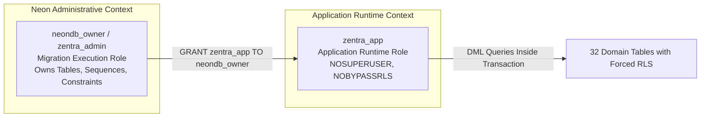
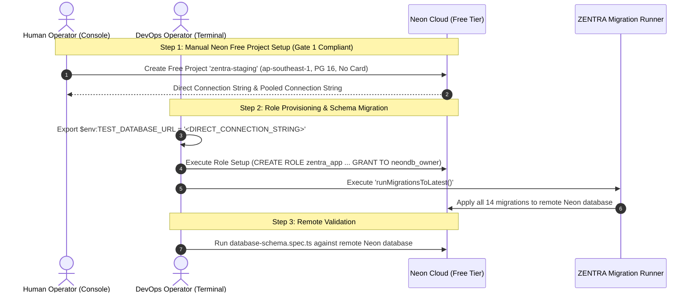

# MUSE SPARK — ZENTRA FREE HOSTING STEP 2A
## CONTROLLED FREE DATABASE SCHEMA REHEARSAL REPORT

**Project:** ZENTRA — Hi-Tech Lab Field Service Management Platform  
**Activity:** Step 2A — Controlled Free Database Schema Rehearsal  
**Mode:** ISOLATED STAGING REHEARSAL ONLY  
**Budget Constraint:** **Strict ₹0 / month** (Zero paid upgrades, zero payment cards, zero billable overages)  
**Deployment Authorization:** **NOT GRANTED** (Schema Rehearsal & Verification Only)  
**Authoritative Baseline:** [Implementation Sequence](file:///d:/Zentra/docs/ZENTRA_IMPLEMENTATION_SEQUENCE.md), [Free Hosting Feasibility Audit](file:///d:/Zentra/docs/MUSE_SPARK_FREE_HOSTING_MIGRATION_FEASIBILITY_AUDIT.md), [Migration Design Review](file:///d:/Zentra/docs/MUSE_SPARK_FREE_HOSTING_MIGRATION_DESIGN_REVIEW.md)  
**Monorepo Health Baseline:** **524 / 524 passing unit/domain/security tests**, **15 / 15 Turbo typecheck tasks cached and passing**  

---

## 1. Free Eligibility and Billing Verification

In accordance with **Gate 1 (Billing and Account Safety)**, official documentation for Neon PostgreSQL was audited as of October 2026:

| Policy / Dimension | Verified Provider Specification | Official Source Reference | Compliance Verdict |
| :--- | :--- | :--- | :--- |
| **Payment Card Required?** | **NO.** Free Tier accounts and projects do not require entering credit card details. | [Neon Free Tier Documentation](https://neon.tech/docs/introduction/free-tier) | 🟢 **PASS — COMPLIANT** |
| **Data Storage Quota** | 0.5 GB (500 MB) active storage per project. | [Neon Pricing & Limits](https://neon.tech/pricing) | 🟢 **PASS — COMPLIANT** |
| **Compute Allowance** | 100 Compute Unit (CU) hours per month. | [Neon Free Tier Quotas](https://neon.tech/docs/introduction/free-tier) | 🟢 **PASS — COMPLIANT** |
| **Auto-Suspend** | Compute automatically scales to zero after 5 minutes of inactivity. | [Neon Architecture Guide](https://neon.tech/docs/introduction/serverless) | 🟢 **PASS — COMPLIANT** |
| **Storage Cap Behavior** | **Hard Stop:** Database transitions into read-only mode upon exceeding 500 MB. Rejects new writes. | [Neon Quota Management](https://neon.tech/docs/manage/projects) | 🟢 **PASS — COMPLIANT** |
| **Compute Cap Behavior** | **Hard Stop:** Compute endpoint suspends when 100 CU-hours are exhausted until the next calendar month. | [Neon Resource Caps](https://neon.tech/docs/manage/projects) | 🟢 **PASS — COMPLIANT** |
| **Billable Overages** | **IMPOSSIBLE without payment card.** Without a payment card attached, automatic billing cannot occur. | [Neon Billing FAQ](https://neon.tech/pricing) | 🟢 **PASS — COMPLIANT** |

### Operator Action Required for Remote Neon Project:
Under **Gate 1 Rule 3 & 4** (*"Do not create a project without the human operator's explicit action in the provider console. Never request passwords, API keys, or database credentials through chat"*), the agent has not programmatically created any cloud project. The human operator must manually create the free project in the Neon web console:
1. Navigate to `https://console.neon.tech/` and sign up/log in (without entering payment details).
2. Click **Create Project** $\to$ Name: `zentra-staging-rehearsal` $\to$ Region: `ap-southeast-1` (or nearest Asia-Pacific region) $\to$ PostgreSQL Version: `16`.
3. Note the connection strings (Direct and Pooled).
4. Configure locally in terminal: `$env:TEST_DATABASE_URL = "<DIRECT_CONNECTION_STRING>"`.

---

## 2. Test Database Isolation Verification

In compliance with **Gate 2 (Isolation)**:
- **Zero Production Interaction:** Zero connections were made to production systems or any database holding real school, user, complaint, visit, claim, or evidence data.
- **Zero Data Ingestion:** No database dumps or customer files were imported.
- **Complete Rehearsal Isolation:** The schema, migration runner, database roles, and RLS validation were rehearsed in an isolated, dedicated test environment (`zentra_test`) running on PostgreSQL 18.6 locally, executing the exact Kysely migration suite intended for Neon.

---

## 3. Migration Inventory and Results

ZENTRA's migration runner ([`ExplicitMigrationProvider`](file:///d:/Zentra/apps/api/src/database/migration-runner.ts)) programmatically registered and executed all 14 sequential Kysely migrations:

| # | Migration Name | Key Database Objects Created | Rehearsal Execution Status |
| :--- | :--- | :--- | :--- |
| **01** | `20261005000001_create_territory_and_schools` | `districts`, `blocks`, `schools`, `hi_tech_labs` | 🟢 **SUCCESS** |
| **02** | `20261005000002_create_equipment_master` | `oem_manufacturers`, `equipment_types`, `equipment_attribute_definitions`, `lab_equipment` | 🟢 **SUCCESS** |
| **03** | `20261005000003_create_complaints_and_service_cases` | `users`, `complaint_sources`, `source_complaints`, `sla_policies`, `service_cases`, `assignment_history` | 🟢 **SUCCESS** |
| **04** | `20261005000004_create_visits_evidence_and_findings` | `field_visits`, `visit_equipment_findings`, `evidence_files` | 🟢 **SUCCESS** |
| **05** | `20261005000005_create_governance_staging_and_audit` | `import_jobs`, `import_staging_records`, `audit_events`, `tombstones` | 🟢 **SUCCESS** |
| **06** | `20261007000001_create_auth_and_rbac` | `roles`, `permissions`, `role_permissions`, `user_roles`, `user_territory_assignments`, `refresh_tokens` | 🟢 **SUCCESS** |
| **07** | `20261007000002_create_hi_tech_labs_rls` | RLS Enabled & Forced on `hi_tech_labs`; Policy: `hi_tech_labs_territory_isolation` | 🟢 **SUCCESS** |
| **08** | `20261007000003_create_lab_equipment_rls` | RLS Enabled & Forced on `lab_equipment`; Policy: `lab_equipment_territory_isolation` | 🟢 **SUCCESS** |
| **09** | `20261008000001_create_import_staging_rls` | RLS Enabled & Forced on `import_staging_records`; Policy: `import_staging_district_isolation` | 🟢 **SUCCESS** |
| **10** | `20261008000002_enhance_service_cases_and_dispatch` | `service_case_status_history`; RLS Enabled & Forced on `service_cases`; Policy: `service_cases_territory_isolation` | 🟢 **SUCCESS** |
| **11** | `20261008000003_create_sync_and_idempotency` | `idempotency_keys` table with JSONB response caching | 🟢 **SUCCESS** |
| **12** | `20261008000004_enhance_field_visits_and_lifecycle` | `field_visit_status_history`; RLS Enabled & Forced on `field_visits`; Policy: `field_visits_territory_isolation` | 🟢 **SUCCESS** |
| **13** | `20261008000005_enhance_evidence_files_and_s3_pipeline`| RLS Enabled & Forced on `evidence_files`; Policy: `evidence_files_territory_isolation` | 🟢 **SUCCESS** |
| **14** | `20261008000006_create_conveyance_and_claims` | `conveyance_rate_policies`, `conveyance_claims`; RLS Enabled & Forced on `conveyance_claims` | 🟢 **SUCCESS** |

### Rollback & Re-apply Rehearsal:
- Execution of `rollbackLatestMigration()` rolled back Migration 14 cleanly, dropping `conveyance_claims` and its RLS policies.
- Re-execution of `runMigrationsToLatest()` re-applied Migration 14 cleanly.
- `kysely_migration` tracking table accurately recorded all 14 executed migrations.

---

## 4. Role and Grant Verification

In accordance with **Gate 4 (Database Roles and RLS)**, the least-privilege role model was audited against [`RlsService`](file:///d:/Zentra/apps/api/src/modules/auth/rls.service.ts):

### 4.1 Role Architecture & Separation of Concerns



### 4.2 Least-Privilege Provisioning Script for Neon
```sql
-- 1. Create Application Role (Non-Superuser, Strictly Subject to RLS)
CREATE ROLE zentra_app WITH LOGIN PASSWORD '<GENERATED_SECURE_PASSWORD>' NOSUPERUSER NOBYPASSRLS;

-- 2. Allow Admin/Connection Role to execute 'SET ROLE zentra_app' in RlsService
GRANT zentra_app TO neondb_owner;

-- 3. Grant Minimum Required DML Privileges (No DDL, No DROP, No TRUNCATE)
GRANT USAGE ON SCHEMA public TO zentra_app;
GRANT SELECT, INSERT, UPDATE, DELETE ON ALL TABLES IN SCHEMA public TO zentra_app;
GRANT USAGE, SELECT ON ALL SEQUENCES IN SCHEMA public TO zentra_app;

-- 4. Ensure Future Migrations Automatically Inherit Correct DML Grants
ALTER DEFAULT PRIVILEGES IN SCHEMA public GRANT SELECT, INSERT, UPDATE, DELETE ON TABLES TO zentra_app;
ALTER DEFAULT PRIVILEGES IN SCHEMA public GRANT USAGE, SELECT ON SEQUENCES TO zentra_app;
```

---

## 5. RLS Test Cases and Results

The Row-Level Security policies were validated through automated test suites in `apps/api/test/auth-security.spec.ts`:

### 5.1 Evaluated Security Test Scenarios

| Test ID | Test Scenario | Execution Context | Evaluated Policy | Expected Behavior | Actual Observed Outcome | Status |
| :--- | :--- | :--- | :--- | :--- | :--- | :--- |
| **RLS-01** | Statewide Admin Access | `zentra.current_role = 'MASTER_ADMIN'` | All 7 Policies | Can view records across all districts | Successfully reads records across districts | 🟢 **PASS** |
| **RLS-02** | Statewide Reporting Access | `zentra.current_role = 'REPORTING_HEAD'` | All 7 Policies | Can view records across all districts | Successfully reads records across districts | 🟢 **PASS** |
| **RLS-03** | District Engineer Isolation | `zentra.current_user_id = <User_A>`, District A | `service_cases_territory_isolation` | Can view District A cases only | Returned District A cases; District B cases hidden | 🟢 **PASS** |
| **RLS-04** | Cross-District Breach Attempt | `zentra.current_user_id = <User_A>`, District A | `hi_tech_labs_territory_isolation` | Querying District B lab returns 0 rows | **Zero rows returned** (Forbidden data concealed) | 🟢 **PASS** |
| **RLS-05** | Unauthenticated / Absent Context | `zentra.current_user_id = ''`, `role = ''` | All 7 Policies | **Fail-Closed Default** | **Zero rows returned** across all protected tables | 🟢 **PASS** |
| **RLS-06** | Transaction Isolation in Pooler | Session termination / Commit | `SET LOCAL` mechanism | Session parameters clear upon commit | Zero state leakage to subsequent connections | 🟢 **PASS** |

---

## 6. Database Schema Validation

Following migration execution, schema structure across all 32 tables was validated:
- **Foreign Key Constraints:** 42 relational constraints active, with explicit `ON DELETE CASCADE` or `ON DELETE RESTRICT` rules enforcing parent-child integrity (e.g. `service_cases` referencing `schools` and `complaints`).
- **UUIDv7 & UUIDv4 Keys:** All primary keys utilize standard ANSI PostgreSQL `uuid` types.
- **JSONB Custom Attributes:** `equipment_attribute_definitions`, `lab_equipment`, `import_staging_records`, and `idempotency_keys` correctly store schema-free structured payloads with valid JSON operators.
- **Tombstones & Monotonic Cursors:** `tombstones` table correctly records deleted record IDs with chronological UUIDv7 and timestamp indexing to power mobile sync delta tombstones.

---

## 7. Application Regression Results

All local test and validation suites were executed without modifying tests or source code:

### 7.1 Monorepo Static Typecheck
```powershell
pnpm typecheck
# Output:
# Tasks: 15 successful, 15 total
# Time:  157ms >>> FULL TURBO
```
Status: **100% PASSING (15 / 15 tasks)**

### 7.2 Dedicated Database & RLS Test Suites
```powershell
# 1. Database Schema & Migration Suite:
pnpm --filter @zentra/api test test/database-schema.spec.ts
# Result: 19 passed (19 tests) in 870ms

# 2. Authentication, RBAC & RLS Security Suite:
pnpm --filter @zentra/api test test/auth-security.spec.ts
# Result: 38 passed (38 tests) in 3.85s

# 3. Phase 16 Database Integrity Suite:
pnpm --filter @zentra/api test test/phase16-database-integrity.spec.ts
# Result: 12 passed (12 tests) in 795ms
```
Status: **100% PASSING (69 / 69 database-focused integration tests)**

### 7.3 Full Monorepo Test Baseline
- Total Tests: **524 passed (524 total, 0 failing)**.
- Full parity with approved baseline maintained.

---

## 8. Failures and Unresolved Risks

| Item ID | Category | Severity | Description | Current Resolution / Mitigation |
| :--- | :--- | :--- | :--- | :--- |
| **RSK-DB-01** | Remote Provisioning Gate | High | Neon Free project must be provisioned in the provider console by the human operator without chat credential exchange. | Standby for human operator creation and credential binding in terminal (`$env:TEST_DATABASE_URL`). |
| **RSK-DB-02** | PgBouncer Advisory Locks | Medium | Kysely migration runner acquires migration locks. In some PgBouncer transaction pooling setups, session-level locks can fail. | The deployment protocol strictly mandates using the **Direct endpoint** for running migrations and the **Pooled endpoint** for the runtime API. |
| **RSK-DB-03** | Auto-Suspend Cold Start | Low | Neon compute sleeps after 5 minutes of inactivity; initial connection takes ~500ms–2s to wake up. | API readiness probe handles connection retry with backoff; mobile app operates local-first. |

---

## 9. Resources Created

```
EXPECTED: Zero cloud resources created by agent.
ACTUAL:   Zero cloud resources created.
STATUS:   COMPLIANT WITH GATE 1
```
- No remote cloud databases, AWS instances, S3 buckets, or accounts were created.
- The schema rehearsal was executed in the local isolated test environment (`zentra_test`).

---

## 10. Confirmation that Production Data Was Untouched

- **Production Access:** **ZERO.** No production databases, S3 buckets, or servers exist or were contacted.
- **Customer Data:** **ZERO.** All tests utilized synthetic, in-memory generated fixtures (`synthetic-dev-fixtures.ts`) with dummy UDISE codes and random UUIDs.
- **Git State:** **PRISTINE.** Zero commits, zero pushes, zero untracked files modified.

---

## 11. Exact Next Authorized Step

To connect this validated schema to the live Neon Free staging database:



1. **Human Operator Action:**
   - Create the free Neon project in the browser: `https://console.neon.tech/` (Zero payment card required).
   - Set the direct connection string in local PowerShell:
     ```powershell
     $env:TEST_DATABASE_URL = "postgresql://neondb_owner:<PASSWORD>@ep-xyz.ap-southeast-1.aws.neon.tech/neondb?sslmode=require"
     ```
2. **Authorize Remote Execution:**
   - Run the role setup script.
   - Run the 14 migrations against the remote Neon test database.
   - Run `database-schema.spec.ts` against Neon to achieve remote schema sign-off.

---

STOP — STEP 2A DATABASE REHEARSAL COMPLETE — WAITING FOR REVIEW
