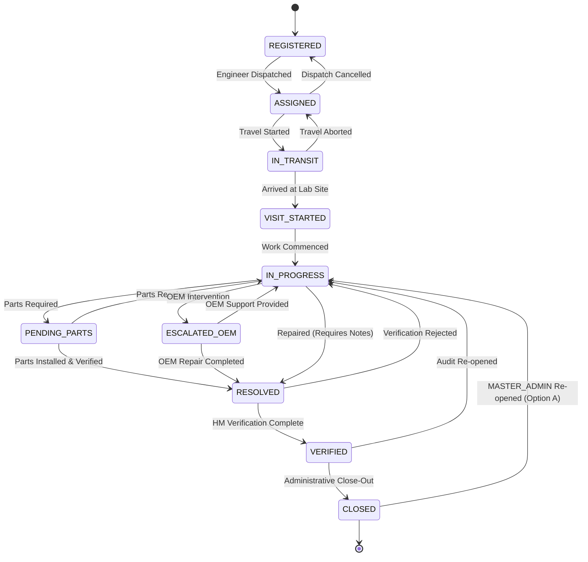

# MUSE SPARK IMPLEMENTATION REPORT — PHASE 9
## Service Case Lifecycle & Dispatch Engine (Correction Pass)

**Project:** ZENTRA — Hi-Tech Lab Field Service Management Platform  
**Phase:** 9 (Service Case Lifecycle & Dispatch Engine)  
**Status:** PHASE 9 — CORRECTED / READY FOR FINAL REVIEW  
**Protocol Gate:** PHASE 9 ONLY  

---

## 1. Executive Summary

Phase 9 implements the authoritative **Service Case Lifecycle & Dispatch Engine** for the ZENTRA platform in strict compliance with the MUSE SPARK Controlled Implementation Protocol and the Phase 9 Correction Pass requirements.

Phase 9 operationalizes field incident management from committed source complaints into tracked, audited, SLA-bounded, and dispatched service cases. It establishes:
1. The 10-state lifecycle finite state machine with strict illegal jump rejection and prerequisite enforcement.
2. A territory-constrained dispatch engine with audited emergency cross-district exception management and configurable engineer workload telemetry.
3. An append-only ledger for dispatch history (`assignment_history`) and lifecycle state transitions (`service_case_status_history`) protected by PostgreSQL kernel immutability triggers.
4. A deterministic SLA policy calculation engine where breach statuses are purely operational metrics that never mutate lifecycle states.
5. Strict RBAC enforcement honoring the Phase 5 authorization matrix, including Option A reopening control (restricting `CLOSED -> IN_PROGRESS` transitions strictly to `MASTER_ADMIN`).

### Regression & Verification Status
- **25 integration and lifecycle tests** pass in `apps/api/test/service-case-lifecycle.spec.ts`.
- **185 total automated tests across 7 test suites** pass cleanly in `@zentra/api` with zero regressions.
- **15 monorepo workspace tasks** succeed with 0 errors across 10 packages in strict TypeScript mode.
- Strict phase boundary preserved: zero premature scaffolding or leakage into Phase 10 through Phase 16.

---

## 2. Architectural Separation & Domain Boundaries

Under the ZENTRA domain model, the following seven concepts are strictly decoupled:

$$\begin{aligned}
\text{SOURCE COMPLAINT} &\neq \text{SERVICE CASE} \\
&\neq \text{FIELD VISIT} \\
&\neq \text{EVIDENCE} \\
&\neq \text{ASSIGNMENT HISTORY} \\
&\neq \text{ADMINISTRATIVE AUDIT LOGGING} \\
&\neq \text{SLA POLICY \& BREACH}
\end{aligned}$$

1. **Source Complaint (`source_complaints`)**:
   - Represents the raw incoming external ticket ingested from legacy systems (such as the EMIS / Helpline / Google Forms spreadsheets via Phase 8).
   - Natural composite key: `(source_system_id, external_ticket_id)`.
   - Never modified by service case progression; preserves source intake fidelity.

2. **Service Case (`service_cases`)**:
   - The primary operational unit within ZENTRA representing end-to-end resolution responsibility.
   - Bound to an approved source complaint via a strict **1:1 unique constraint** (`source_complaint_id`).
   - Assigned human-readable business case code `ZNT-{YEAR}-{DISTRICT_CODE}-{SEQUENTIAL_NUMBER}`.

3. **Field Visit (`field_visits`) — [Deferred to Phase 13]**:
   - Physical visit instance representing a technician arriving on site at a Hi-Tech Lab.
   - **Disambiguation Rule**: Phase 9 implements the central server-side operational state machine and dispatching. Phase 9 does **NOT** execute field visits. Physical visit execution, GPS check-in/out, geofence radius validation, multi-visit flows, and on-site dynamic attribute collection belong strictly to **Phase 13: Field Visit Execution & Multi-Visit Flow**.

4. **Evidence Files (`evidence_files`) — [Deferred to Phase 14]**:
   - Cryptographically hashed (SHA-256) and geofenced photos/documents captured during visits, pre-signed direct S3 upload streaming, and Headmaster (HM) digital sign-off.
   - Strictly deferred to **Phase 14: Evidence Pipeline & Direct S3 Streaming**.

5. **Assignment History (`assignment_history`)**:
   - Append-only operational ledger recording every primary or secondary engineer dispatch, reassignment, or emergency cross-district assignment.
   - Protected by PostgreSQL database trigger `trg_assignment_history_immutable` prohibiting `UPDATE` and `DELETE`.

6. **Administrative Audit Logging (`audit_events`)**:
   - Enterprise security log recording actor user, IP address, device ID, action type, and JSON pre/post mutation states for administrative observability.

7. **SLA Policies & Breach Status (`sla_policies`)**:
   - Operational target times and warning thresholds based on priority tiers.
   - **Architectural Rule**: An SLA breach is strictly an operational performance metric/condition; it **never** triggers an automatic lifecycle state transition.

---

## 3. Service Case Lifecycle Finite State Machine (10 States)

The service case operational lifecycle follows the database-enforced check constraint `chk_service_case_operational_status` consisting of exactly ten valid states:



### Valid Transition Matrix

| From Status | Allowed Target Statuses | Prerequisites / Validation |
| :--- | :--- | :--- |
| `REGISTERED` | `ASSIGNED` | Primary engineer must be designated in `assigned_primary_engineer_id`. |
| `ASSIGNED` | `IN_TRANSIT`, `REGISTERED` | `IN_TRANSIT` requires engineer dispatch. `REGISTERED` allows de-assignment. |
| `IN_TRANSIT` | `VISIT_STARTED`, `ASSIGNED` | `VISIT_STARTED` marks on-site arrival. `ASSIGNED` allows travel abort. |
| `VISIT_STARTED`| `IN_PROGRESS` | Work commenced. |
| `IN_PROGRESS` | `PENDING_PARTS`, `ESCALATED_OEM`, `RESOLVED` | `RESOLVED` requires resolution notes or explanation. |
| `PENDING_PARTS`| `IN_PROGRESS`, `ESCALATED_OEM`, `RESOLVED` | Resumed, escalated, or parts fitted and resolved. |
| `ESCALATED_OEM`| `IN_PROGRESS`, `PENDING_PARTS`, `RESOLVED` | OEM intervention complete or parts ordered. |
| `RESOLVED` | `VERIFIED`, `IN_PROGRESS` | `VERIFIED` on HM verification; `IN_PROGRESS` if rejected. |
| `VERIFIED` | `CLOSED`, `IN_PROGRESS` | `CLOSED` on administrative approval; `IN_PROGRESS` on audit failure. |
| `CLOSED` | `IN_PROGRESS` | **Option A**: Restricted strictly to `MASTER_ADMIN`. Non-admins receive `403 Forbidden`. |

### Closed Case Reopening Authority (Option A Enforced)
In accordance with the Phase 5 RBAC specification (which defines `MASTER_ADMIN`, `REPORTING_HEAD`, `DISTRICT_COORDINATOR`, `FIELD_ENGINEER`, `HM`), no invented "SUPERVISOR" role was introduced. Reopening authority is implemented under **Option A**:
- Transitioning a case from `CLOSED` to `IN_PROGRESS` requires the `MASTER_ADMIN` role.
- If a `DISTRICT_COORDINATOR` or `FIELD_ENGINEER` attempts to reopen a `CLOSED` case, the controller halts the request with HTTP `403 Forbidden`:
  `"Unauthorized: Only MASTER_ADMIN possesses authority to reopen a CLOSED service case. Delegation to other roles REQUIRES CLARIFICATION."`
- Delegation of reopening permissions to other managerial roles remains documented as `REQUIRES CLARIFICATION`.

### Illegal State Jump Prevention
Any transition not present in the allowed matrix (e.g. `REGISTERED -> RESOLVED`, `REGISTERED -> CLOSED`, `ASSIGNED -> CLOSED`, `IN_TRANSIT -> RESOLVED`) is rejected by `ServiceCaseStateMachineService` with HTTP `400 Bad Request`.

Every valid transition atomically executes inside a PostgreSQL transaction:
1. Mutates `service_cases.operational_status` and `service_cases.updated_at`.
2. Appends an immutable record into `service_case_status_history` (`from_status`, `to_status`, `changed_by_user_id`, `transition_reason`).
3. Emits an Administrative Audit Log event (`event_category = 'SERVICE_CASE'`, `action_type = 'STATUS_TRANSITION'`).

---

## 4. Creation Boundary & Natural Identity Uniqueness

1. **Intake Gate**:
   - `POST /api/v1/service-cases` accepts an approved `sourceComplaintId`.
   - Any attempt to create a service case from an unapproved or `DRAFT` complaint is rejected (`400 Bad Request`).
2. **1:1 Uniqueness Guarantee**:
   - `service_cases.source_complaint_id` has a unique constraint.
   - Any attempt to create a second service case for the same complaint is rejected (`409 Conflict`).
3. **Business Code Format**:
   - Generated as `ZNT-{YEAR}-{DISTRICT_CODE}-{6_DIGIT_SEQ}` (e.g. `ZNT-2026-ERO-000001`).
   - Sequenced per district and year to maintain human-readable tracking across paper reports, SMS, and dashboards.

---

## 5. Dispatch Engine & Multi-District / Block Territory Scoping

### Territory Enforcement Model
Field service technicians are bound to territories via `user_territory_assignments`:
- An engineer can only be assigned to a service case if they have an active record in `user_territory_assignments` matching the school's `district_id` (and matching `block_id` if block-specific assignment exists).
- If an out-of-territory engineer is selected, dispatch is **rejected** with HTTP `400 Bad Request` (`Territory mismatch: Engineer is not assigned to the case district`).

### Emergency Cross-District Dispatch Control
To handle natural emergencies, critical exam deadlines, or specialized repair personnel shortages:
- Dispatch allows cross-district assignment **only** when `isEmergencyCrossDistrict = true` AND a justification is provided.
- **Justification Policy Status**: The 10-character minimum threshold (`TECHNICAL_MIN_EMERGENCY_JUSTIFICATION_LENGTH = 10`) is a **technical sanity check**, explicitly documented as `CONFIGURABLE / REQUIRES CLARIFICATION`, not a permanent contractual business law.
- If justification is omitted or $< 10$ characters, the request fails with HTTP `400 Bad Request` (`Emergency cross-district assignment requires justification of at least 10 characters (CONFIGURABLE / REQUIRES CLARIFICATION).`).
- When accepted, the emergency flag and full justification are recorded permanently in both `assignment_history` and `audit_events`.

### Workload Telemetry & Configurable Capacity
- `GET /api/v1/dispatch/eligible-engineers?districtId={id}&capacityThreshold={n}` computes active open workload for all active field engineers in the target district.
- Active workload counts cases in `['ASSIGNED', 'IN_TRANSIT', 'VISIT_STARTED', 'IN_PROGRESS', 'PENDING_PARTS', 'ESCALATED_OEM']`.
- **Removed Hard-Coded Business Rule**: The hard-coded rule `isAvailable = (activeCasesCount < 8)` has been removed. The active count is returned as the authoritative factual workload telemetry (`activeAssignedCasesCount`).
- **Configurable Availability Helper**: `isAvailable` is an evaluated helper comparing `activeAssignedCasesCount < capacityThreshold`.
- **Default Policy Status**: The default capacity limit of 8 (`CANDIDATE_DEFAULT_WORKLOAD_CAPACITY = 8`) is explicitly labeled as `CANDIDATE CONFIGURATION — REQUIRES OPERATIONAL CONFIRMATION`. Callers may dynamically supply `capacityThreshold` in queries, and the contract returns `configuredCapacityThreshold`.

### Primary & Secondary Engineer Support
- **Primary Engineer (`assigned_primary_engineer_id`)**: Holds primary resolution responsibility. Assignment automatically transitions a case from `REGISTERED` to `ASSIGNED`.
- **Secondary Engineer (`assigned_secondary_engineer_id`)**: Assigned for multi-technician jobs (e.g. lab networking + interactive panel replacement) without overwriting primary assignment.
- **Reassignment**: Preserves `previous_engineer_id`, sets `action = 'REASSIGNED'`, and records `reassignment_reason`.

---

## 6. Technical Immutability Kernel: PostgreSQL Triggers

In accordance with Phase 6 and Phase 7 governance decisions, immutability claims are backed by database kernel mechanisms:

1. **`trg_assignment_history_immutable`**:
   ```sql
   CREATE OR REPLACE FUNCTION prevent_assignment_history_mutation()
   RETURNS TRIGGER AS $$
   BEGIN
     RAISE EXCEPTION 'assignment_history is append-only: UPDATE and DELETE operations are prohibited';
   END;
   $$ LANGUAGE plpgsql;

   CREATE TRIGGER trg_assignment_history_immutable
   BEFORE UPDATE OR DELETE ON assignment_history
   FOR EACH ROW EXECUTE FUNCTION prevent_assignment_history_mutation();
   ```

2. **`trg_service_case_status_history_immutable`**:
   ```sql
   CREATE OR REPLACE FUNCTION prevent_status_history_mutation()
   RETURNS TRIGGER AS $$
   BEGIN
     RAISE EXCEPTION 'service_case_status_history is append-only: UPDATE and DELETE operations are prohibited';
   END;
   $$ LANGUAGE plpgsql;

   CREATE TRIGGER trg_service_case_status_history_immutable
   BEFORE UPDATE OR DELETE ON service_case_status_history
   FOR EACH ROW EXECUTE FUNCTION prevent_status_history_mutation();
   ```

Any direct SQL `UPDATE` or `DELETE` on these tables is halted by the database engine, ensuring true append-only history.

---

## 7. Deterministic SLA Engine Architecture

### Priority Tiers & Candidate Default Policies

| Priority Tier | Target Resolution Hours | Warning Threshold | Description | Status |
| :--- | :---: | :---: | :--- | :--- |
| **`CRITICAL`** | 24 hours | 75% (18h) | Server down, electrical hazard, board exam disruption | Seeded Default |
| **`HIGH`** | 48 hours | 75% (36h) | Master projector / interactive panel failure | Seeded Default |
| **`MEDIUM`** | 72 hours | 75% (54h) | Individual student desktop / peripherals down | Seeded Default |
| **`LOW`** | 168 hours (7 days) | 75% (126h) | Routine cable management / non-blocking maintenance | Seeded Default |

### SLA Warning Threshold Policy
- The 75% warning threshold (`CONFIGURABLE_SLA_WARNING_THRESHOLD_DEFAULT = 75`) is labeled:
  `CONFIGURABLE IMPLEMENTATION DEFAULT — REQUIRES OPERATIONAL CONFIRMATION`.
- Thresholds are configurable per policy and evaluate dynamically during SLA calculations.

### SLA Breach Computation & Operational Separation
- Target resolution timestamp `sla_target_at` is calculated deterministically on case registration:
  $$\text{sla\_target\_at} = \text{registered\_at} + (\text{targetResolutionHours} \times 3600 \times 1000)$$
- **Live SLA Status Evaluation**:
  - `WITHIN_SLA`: Elapsed time $< \text{warningThresholdPercentage}$ of target duration.
  - `APPROACHING_BREACH`: Elapsed time $\ge \text{warningThresholdPercentage}$ and $\le 100\%$ while still open.
  - `BREACHED`: Current time $> \text{sla\_target\_at}$ while unresolved, or resolved after deadline.
  - `MET`: Resolved before `sla_target_at`.
- **CRITICAL OPERATIONAL GUARANTEE**: An SLA breach is strictly an operational/analytical metric and **never** alters the case's operational lifecycle state. An unresolved case whose deadline passes transitions its SLA status to `BREACHED`, but its operational status remains intact (e.g. `IN_PROGRESS` or `PENDING_PARTS`).

---

## 8. RESTful API Surface & Endpoint Documentation

All endpoints are hosted at `/api/v1` and protected by `JwtAuthGuard` and `RolesGuard`:

| Method | Endpoint | RBAC Roles | Description |
| :--- | :--- | :--- | :--- |
| `POST` | `/api/v1/service-cases` | `MASTER_ADMIN`, `DISTRICT_COORDINATOR` | Create service case from committed source complaint |
| `GET` | `/api/v1/service-cases` | `MASTER_ADMIN`, `REPORTING_HEAD`, `DISTRICT_COORDINATOR`, `FIELD_ENGINEER` | Paginated search with multi-district/engineer scoping |
| `GET` | `/api/v1/service-cases/:id` | `MASTER_ADMIN`, `REPORTING_HEAD`, `DISTRICT_COORDINATOR`, `FIELD_ENGINEER` | Get case details, joined relations, SLA telemetry, and full history |
| `POST` | `/api/v1/service-cases/:id/transition` | `MASTER_ADMIN`, `DISTRICT_COORDINATOR`, `FIELD_ENGINEER` | Execute valid state machine lifecycle transition (Reopening `CLOSED` cases strictly restricted to `MASTER_ADMIN`) |
| `GET` | `/api/v1/dispatch/eligible-engineers` | `MASTER_ADMIN`, `DISTRICT_COORDINATOR` | List eligible technicians with real-time active workload count and optional `capacityThreshold` |
| `POST` | `/api/v1/dispatch/:caseId/assign` | `MASTER_ADMIN`, `DISTRICT_COORDINATOR` | Assign/reassign technician with territory validation or emergency override |
| `GET` | `/api/v1/dispatch/:caseId/history` | `MASTER_ADMIN`, `REPORTING_HEAD`, `DISTRICT_COORDINATOR`, `FIELD_ENGINEER` | Get immutable append-only assignment ledger |
| `GET` | `/api/v1/sla/policies` | `MASTER_ADMIN`, `REPORTING_HEAD`, `DISTRICT_COORDINATOR`, `FIELD_ENGINEER` | List active resolution policies |
| `GET` | `/api/v1/sla/calculate/:caseId` | `MASTER_ADMIN`, `REPORTING_HEAD`, `DISTRICT_COORDINATOR`, `FIELD_ENGINEER` | Live SLA evaluation: elapsed hours, remaining hours, and breach state |

---

## 9. RBAC & Multi-District Security Enforcement

- **`MASTER_ADMIN`**: Statewide read, write, dispatch, and lifecycle transition authority across all districts. Possesses exclusive authority to reopen `CLOSED` cases.
- **`REPORTING_HEAD`**: Statewide read-only access to service cases, SLA policies, and dispatch history. All mutation attempts return `403 Forbidden`.
- **`DISTRICT_COORDINATOR`**: Scoped strictly to their assigned territory districts. Queries targeting other districts return `403 Forbidden`. Can dispatch engineers and transition non-closed cases within their district. Cannot reopen `CLOSED` cases (`403 Forbidden`).
- **`FIELD_ENGINEER`**: Restricted to reading and transitioning cases assigned to them. Cannot create cases (`403 Forbidden`), cannot dispatch technicians (`403 Forbidden`), cannot transition unassigned cases (`403 Forbidden`), and cannot reopen `CLOSED` cases (`403 Forbidden`).

### Row-Level Security (RLS) on Phase 9 Tables
PostgreSQL kernel RLS policies were established in migration `20261008000002_enhance_service_cases_and_dispatch.ts`:
1. `assignment_history_territory_isolation`: Enforces that non-superuser queries on `assignment_history` only return records for cases whose school belongs to the user's assigned district or where the user is the assigned engineer.
2. `service_case_status_history_territory_isolation`: Scopes status history records to authorized district coordinators and assigned technicians.

---

## 10. Database Migration Specification

Migration: `apps/api/src/database/migrations/20261008000002_enhance_service_cases_and_dispatch.ts`
- **Altered `assignment_history`**:
  - Added `previous_engineer_id` (UUID FK).
  - Added `action` (`varchar(50)` default `'ASSIGNED'`).
  - Added `is_emergency_cross_district` (`boolean` default `false`).
  - Added `emergency_justification` (`text`).
  - Added index `idx_assignment_history_engineer_id` and composite index `idx_assignment_history_case_assigned`.
- **Created `trg_assignment_history_immutable`**: PL/pgSQL trigger preventing `UPDATE` and `DELETE`.
- **Created `service_case_status_history`**:
  - `status_history_id` (UUID PK).
  - `service_case_id` (UUID FK to `service_cases.service_case_id` on delete cascade).
  - `from_status` (`varchar(50)` not null).
  - `to_status` (`varchar(50)` not null).
  - `changed_by_user_id` (UUID FK to `users.user_id`).
  - `transition_reason` (`text`).
  - `created_at` (`timestamptz` default `CURRENT_TIMESTAMP`).
  - Index `idx_status_history_case_id`.
- **Created `trg_service_case_status_history_immutable`**: PL/pgSQL trigger preventing `UPDATE` and `DELETE`.
- **RLS Configuration**: Enabled and forced RLS on both history tables.
- **Seeded SLA Defaults**: Seeded 4 active SLA policies (`CRITICAL` 24h, `HIGH` 48h, `MEDIUM` 72h, `LOW` 168h).
- **Clean Down Migration**: Fully reversible teardown dropping triggers, policies, tables, and restored schema.

---

## 11. Verification & Test Suite Summary

### Test Execution Results
- **Phase 9 Test Suite (`apps/api/test/service-case-lifecycle.spec.ts`)**:
  - **25 tests passing** (100% success rate).
  - Validates:
    1. Case creation from committed source complaints.
    2. Case code sequencing (`ZNT-{YEAR}-{DIST}-{SEQ}`).
    3. 1:1 uniqueness constraint enforcement.
    4. Rejection of unapproved / draft intake.
    5. State machine traversal across all 10 states.
    6. Rejection of invalid state jumps.
    7. Prerequisites (engineer assigned, resolution notes).
    8. Option A closed case reopening restriction (`MASTER_ADMIN` only; `DISTRICT_COORDINATOR` and `FIELD_ENGINEER` rejected with `403 Forbidden`).
    9. Territory checks and out-of-district dispatch rejection.
    10. Emergency cross-district dispatch and justification threshold validation.
    11. Primary and secondary engineer roles.
    12. Workload calculation with configurable capacity thresholds.
    13. PostgreSQL append-only triggers preventing `UPDATE` and `DELETE` on `assignment_history` and `service_case_status_history`.
    14. SLA policy evaluation, warning threshold calculation, and operational status preservation during breach.
    15. Statewide Master Admin authority, Reporting Head read-only enforcement, District Coordinator territory scoping, and Field Engineer assigned-only scoping.
- **API Monorepo Test Suite (`pnpm --filter @zentra/api test`)**:
  - **185 total tests passing across 7 test suites** (0 failures).
- **TypeScript Typecheck (`pnpm turbo run typecheck`)**:
  - **15 turbo tasks successful, 0 errors** across monorepo in strict mode.

---

## 12. Authoritative Later-Phase Sequence (Phases 10–16)

In strict adherence to `docs/ZENTRA_IMPLEMENTATION_SEQUENCE.md`, the authoritative later-phase sequence is:

1. **PHASE 10 — Mobile Local-First Core**:
   - React Native / Expo application shell.
   - WatermelonDB SQLite schema, local storage models, and local encryption.
   - DEFERRED TO PHASE 10.

2. **PHASE 11 — Mobile Hardware GPS & Camera Module**:
   - Native GPS geolocation capture, accuracy threshold checking, and geofence computation.
   - Hardware camera capture module, aspect ratio locking, and client-side photo processing.
   - DEFERRED TO PHASE 11.

3. **PHASE 12 — Delta Synchronization & Conflict Arbitration Engine**:
   - Bi-directional push/pull delta sync protocol (`/api/v1/sync/push`, `/api/v1/sync/pull`).
   - Monotonic sync sequence numbers and deletion tombstones.
   - Domain-owned conflict arbitration matrix (server wins metadata, client wins physical visit field records).
   - DEFERRED TO PHASE 12.

4. **PHASE 13 — Field Visit Execution & Multi-Visit Flow**:
   - Physical visit execution workflow, visit state machine (`ARRIVED` $\rightarrow$ `IN_PROGRESS` $\rightarrow$ `COMPLETED`).
   - Multi-visit flows for parts pending and OEM escalation return trips.
   - Diagnostic findings dynamic attribute entry (`visit_equipment_findings`).
   - DEFERRED TO PHASE 13.

5. **PHASE 14 — Evidence Pipeline & Direct S3 Streaming**:
   - Pre-signed S3/MinIO direct upload streaming.
   - Cryptographic SHA-256 client checksum verification and tamper protection.
   - Headmaster (HM) on-glass digital sign-off and mandatory photo slot enforcement.
   - DEFERRED TO PHASE 14.

6. **PHASE 15 — Conveyance Claims & Management Web Portal**:
   - Automated conveyance claim calculation from GPS check-in/out travel distance.
   - Web management portal (ZENTRA Web / Vite) for district monitoring, SLA dashboards, and claim auditing.
   - DEFERRED TO PHASE 15.

7. **PHASE 16 — E2E Field Rehearsal & Production Hardening**:
   - End-to-end multi-role offline/online field simulation.
   - Chaos testing, network disconnection recovery, load testing, and production deployment scripts.
   - DEFERRED TO PHASE 16.

---

STOPPED AFTER THIS STEP — AWAITING REVIEW.
