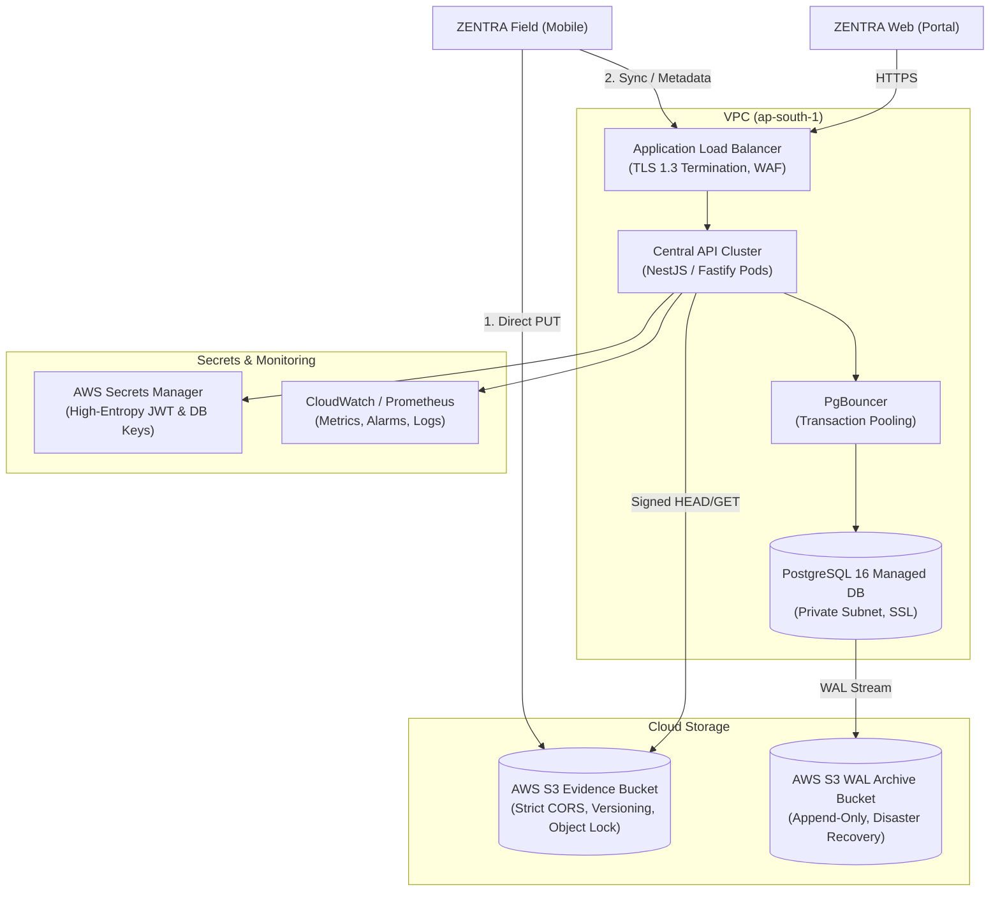
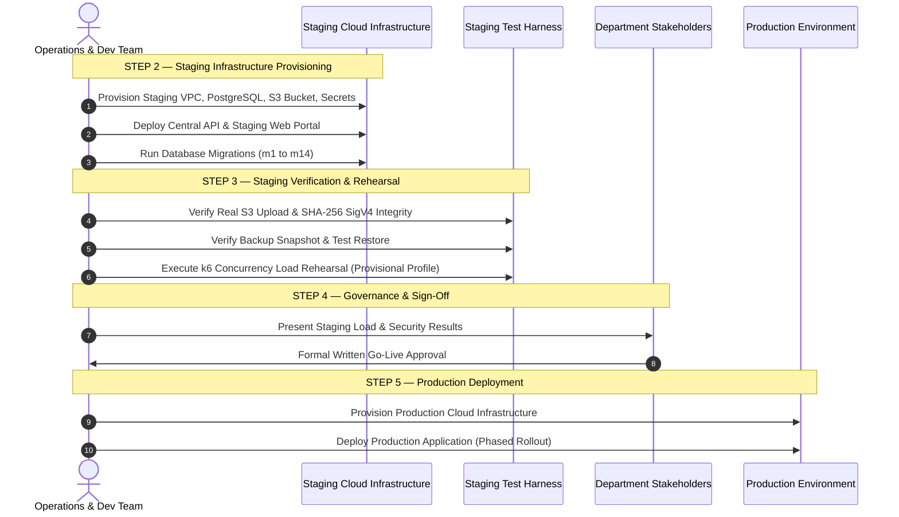

# MUSE SPARK PRODUCTION PREPARATION — STEP 1
## Read-Only Production Infrastructure Readiness Audit (Correction Pass Applied)

**Project:** ZENTRA — Hi-Tech Lab Field Service Management Platform  
**Activity:** Post-Roadmap Production Preparation (Step 1 — Infrastructure & Environment Readiness Audit)  
**Execution Mode:** STRICT READ-ONLY AUDIT (Zero Deployments, Zero Infrastructure Modifications, Zero Feature Creep)  
**Authority Baseline:** Formally Approved Phases 1–16 (`docs/MUSE_SPARK_IMPLEMENTATION_REPORT_PHASE16.md`)  
**Status:** COMPLETE — AUDIT EXECUTED & CORRECTIONS FULLY RECONCILED  
**Protocol Gate:** STRICT READ-ONLY PRE-PRODUCTION GATE  
**Code Changes:** NONE (Documentation & Production-Safety Classification Correction Only)  

---

## 1. Executive Summary

ZENTRA has achieved full software completion across all sixteen roadmap phases (Phases 1–16). The continuous field operational lifecycle—from complaint intake, multi-visit execution, direct S3 binary evidence streaming, and conveyance claim adjudication to synchronization delta propagation—has been programmatically implemented and verified across **506 automated tests** with 100% pass rate, zero typecheck errors across 9 workspaces, and zero build errors across 8 workspaces.

As concluded in the authoritative Phase 16 report, ZENTRA is in an **AMBER / GO-READY WITH CONDITIONS** state for production deployment. The core application logic, database schemas, API contracts, mobile field client, and management web portal are software-complete; however, **no production infrastructure has been provisioned, no real cloud S3 buckets exist, no automated physical PostgreSQL backup pipeline is operational, and no high-concurrency staging load rehearsal has been executed**.

This document constitutes the formal **Read-Only Production Infrastructure Readiness Audit (Step 1)**, updated with the **Correction Pass** reconciliations. It establishes an empirical inventory of required infrastructure, environment separation, secrets management, storage configurations, database parameters, deployment mechanisms, disaster recovery protocols, and external service prerequisites required before ZENTRA can safely transition into staging and production.

> [!IMPORTANT]
> **READ-ONLY MANDATE OBSERVED**: In strict accordance with the prompt directives, zero cloud resources were provisioned, zero database records were modified, zero migrations were altered, zero external payment gateways were wired, no production infrastructure was touched, and **CODE CHANGES: NONE** were introduced during this correction pass.

---

## 2. Correction Pass Findings

Following supervisory review of the initial Step 1 audit report, this correction pass addresses and formally reconciles the six identified review conditions:

1. **Reconciliation of Production Blockers:**
   - Reconciled the previous inconsistency between the readiness matrix RED items and the final summary.
   - Categorized all blockers unambiguously into:
     - **A. Application Hardening Blockers** (Security headers, API rate limiting, database dependency readiness probe, S3 fail-closed enforcement).
     - **B. Infrastructure Blockers** (Production PostgreSQL, production S3 bucket & IAM, production secrets, production HTTPS/DNS/networking, automated physical backup & continuous WAL archiving).
     - **C. Pre-Rollout Validation Gates** (Real cloud S3 upload & SHA-256 verification, backup snapshot restore rehearsal, staging load rehearsal).
   - Eliminated the artificial reduction to "five blockers".
2. **S3 Fail-Closed Enforcement in Production:**
   - Audited `ObjectStorageService` credential resolution (`S3_ACCESS_KEY` / `S3_SECRET_KEY` vs `AWS_ACCESS_KEY_ID` / `AWS_SECRET_ACCESS_KEY`).
   - Identified that permitting silent fallback to mock HMAC signing or in-memory storage when real credentials are absent is a **production-blocking application defect**.
   - Mandated that when `APP_ENV=production`: real S3 configuration is mandatory, missing credentials must produce an explicit startup failure, mock/in-memory storage must never be selected, mock signing must never silently activate, and evidence operations must fail closed if real S3 is unreachable.
3. **Removal of Wildcard S3 CORS:**
   - Removed the permissive `*` wildcard origin from the proposed production S3 bucket CORS policy.
   - Mandated that production S3 CORS allow only explicitly approved ZENTRA portal origins.
   - Marked the exact origin as `REQUIRES PRODUCTION DOMAIN CONFIRMATION`.
4. **Provisional Classification of Load Test Profile:**
   - Explicitly reclassified all synthetic concurrency numbers (100 Field Engineers, 150 sync users, 50 evidence upload sessions, 50 database writes) as:
     `PROVISIONAL STAGING TEST PROFILE — NOT AN APPROVED STATEWIDE CAPACITY REQUIREMENT`.
   - Documented that final concurrency and RPS targets require formal capacity planning and stakeholder sign-off.
5. **Removal of Numerical Stage Nomenclature:**
   - Replaced all references to "full 15-stage operational chain" with the approved canonical phrasing: **"full end-to-end operational chain"**.
6. **Re-Articulated Final Decision:**
   - Maintained the authoritative determination: **GO-READY WITH CONDITIONS (INFRASTRUCTURE PREREQUISITES REQUIRED)**.
   - Formally stated all nine required conditions: software completeness, absence of production infrastructure, unauthorized production deployment status, outstanding real S3 verification, outstanding physical backup/restore verification, outstanding staging load rehearsal, required application security hardening, mandatory S3 fail-closed enforcement, and the external payment gateway business decision.

---

## 3. Authoritative Documents Reviewed

Before executing this audit, the foundational architectural, functional, and forensic documents of ZENTRA were thoroughly inspected:

1. **`docs/ZENTRA_IMPLEMENTATION_SEQUENCE.md`**:
   - Outlines the 16-phase dependency-safe execution sequence.
   - Enforces "Contracts before implementations", "Database before services", "Local foundation before cloud scale", and "Fail-closed production gate".
2. **`docs/ZENTRA_PROJECT_REQUIREMENTS.md`**:
   - Details domain requirements across 8,209 Hi-Tech Labs in 38 districts of Tamil Nadu.
   - Mandates strict architectural separation between source complaint intake and ongoing field service operations.
   - Specifies roles: `MASTER_ADMIN`, `REPORTING_HEAD`, `DISTRICT_COORDINATOR`, `FIELD_ENGINEER`, `AI` (Instructor), `HM` (Headmaster).
3. **`docs/MUSE_SPARK_IMPLEMENTATION_REPORT_PHASE0.md`**:
   - Documents empirical analysis of real-world datasets (`HiTech Labs Live _ Down Assets_data (1).xlsx`, `Field_Call_Tracker.xlsx`, `Thiruvarur_HTL_Service_Desk_Master.csv`).
   - Identifies multi-district engineers (e.g. Mohamed Shameer operating across Nagapattinam and Thiruvarur).
   - Establishes mobile-first operational realities in rural schools with intermittent connectivity.
4. **`docs/MUSE_SPARK_IMPLEMENTATION_REPORT_PHASE14.md`**:
   - Details direct S3 binary streaming architecture, short-lived presigned URLs (300s expiry), client SHA-256 calculation, and server-side cryptographic verification via AWS SigV4 HEAD/GET requests.
   - Documents safe migration of historical evidence (`LEGACY_UNVERIFIED`, `LEGACY_MIGRATED`) and finalized-evidence immutability locks.
5. **`docs/MUSE_SPARK_IMPLEMENTATION_REPORT_PHASE15.md`**:
   - Documents conveyance claim 3-distance audit model (`captured_distance_km`, `claimed_distance_km`, `approved_distance_km`), deterministic rate policy selection, self-approval prevention, and management web portal.
6. **`docs/MUSE_SPARK_IMPLEMENTATION_REPORT_PHASE16.md`**:
   - The authoritative production-hardening baseline. Confirmed 506/506 tests passing, zero orphaned database entities, `ON DELETE RESTRICT` integrity, token rotation replay detection, role switching, and documented host CLI limitation for `pg_dump`.
7. **`packages/testing/src/production-gate.ts` & `test/production-gate.spec.ts`**:
   - Encodes the architectural circuit-breaker `assertTestEnvironmentIsSafe` that aborts processes attempting to point test runners at staging or production infrastructure markers (`prod`, `production`, `rds.amazonaws.com`, etc.).
8. **`packages/config/src/env.schema.ts`**:
   - Defines the validated Zod environment schema with fail-closed production gates on `JWT_ACCESS_SECRET` length (>=32 chars, no 'mock'/'dev') and `DATABASE_URL` (no 'localhost'/'zentra_dev').

---

## 4. Repository & Infrastructure Inventory

A thorough filesystem inspection of the ZENTRA repository (`d:\Zentra`) revealed the following technical inventory:

### 4.1. Monorepo Structure (`pnpm-workspace.yaml`, `turbo.json`)
- **Applications (`apps/`)**:
  - `apps/api`: NestJS 11 + Fastify 5 backend application (`@zentra/api`).
  - `apps/field`: React Native 0.76.7 + Expo 52 + WatermelonDB SQLite mobile field application (`@zentra/field`).
  - `apps/web`: React 18 + Vite 5 management web portal (`@zentra/web`).
- **Shared Packages (`packages/`)**:
  - `packages/contracts`: Canonical Zod API request/response contracts and schemas (`@zentra/contracts`).
  - `packages/types`: Core TypeScript domain types, status enums, and interfaces (`@zentra/types`).
  - `packages/shared`: Universal utilities (UUIDv7, UTC/IST date formatters, crypto helpers) (`@zentra/shared`).
  - `packages/validation`: Domain validation helpers (`@zentra/validation`).
  - `packages/config`: Type-safe configuration loader with fail-closed production gates (`@zentra/config`).
  - `packages/testing`: Test fixtures, mock factories, and production safety gate (`@zentra/testing`).
  - `packages/tooling`: Shared TypeScript and linter configurations (`@zentra/tooling`).

### 4.2. Infrastructure as Code (IaC) & Deployment Artifacts
- **Docker / Containerization:**
  - `Dockerfile` / `docker-compose.yml`: **NOT IMPLEMENTED**. No container manifests exist in root or application directories.
- **Kubernetes / Helm / CloudFormation / Terraform:**
  - **NOT IMPLEMENTED**. No cloud orchestration or infrastructure-as-code manifests exist in the repository.
- **CI/CD Pipelines:**
  - `.github/workflows`: **NOT IMPLEMENTED**. No automated build/deploy workflows exist.
- **Environment Templates:**
  - `.env.example`: Present at repository root, documenting local development defaults.

---

## 5. Environment Separation Audit

Below is the definitive environment separation audit across all four tiers:

| Component / Parameter | A. Development (Local) | B. Test (Automated) | C. Staging (Pre-Prod) | D. Production (Statewide) |
| :--- | :--- | :--- | :--- | :--- |
| **Database** | `postgresql://localhost:5432/zentra_local`<br/>*(IMPLEMENTED)* | `postgresql://localhost:5432/zentra_test`<br/>*(IMPLEMENTED & VERIFIED)* | Unprovisioned<br/>*(NOT IMPLEMENTED)* | Unprovisioned<br/>*(NOT IMPLEMENTED)* |
| **API Server** | Node.js TSX (Port 4000)<br/>*(IMPLEMENTED)* | Supertest / In-Memory Fastify Inject<br/>*(IMPLEMENTED & VERIFIED)* | Unprovisioned<br/>*(NOT IMPLEMENTED)* | Unprovisioned<br/>*(NOT IMPLEMENTED)* |
| **Management Web Portal** | Vite Dev Server (Port 5173)<br/>*(IMPLEMENTED)* | Vitest Component Tests<br/>*(IMPLEMENTED & VERIFIED)* | Unprovisioned Static CDN<br/>*(NOT IMPLEMENTED)* | Unprovisioned Static CDN<br/>*(NOT IMPLEMENTED)* |
| **Field Mobile Client** | Expo Metro / Android Emulator<br/>*(IMPLEMENTED)* | Vitest Mock Adapters (LokiJS)<br/>*(IMPLEMENTED & VERIFIED)* | Unprovisioned APK / EAS<br/>*(NOT IMPLEMENTED)* | Unprovisioned Signed APK<br/>*(NOT IMPLEMENTED)* |
| **Object Storage** | MinIO Config / In-Memory Mock<br/>*(PARTIALLY IMPLEMENTED)* | In-Memory `testStorage` Map<br/>*(IMPLEMENTED & VERIFIED)* | Unprovisioned S3 Bucket<br/>*(NOT IMPLEMENTED)* | Unprovisioned Cloud S3<br/>*(NOT IMPLEMENTED)* |
| **JWT Access Secret** | Mock 32-char key in `.env.example`<br/>*(IMPLEMENTED)* | Ephemeral synthetic test key<br/>*(IMPLEMENTED & VERIFIED)* | Unprovisioned KMS Secret<br/>*(CONFIGURATION REQUIRED)* | Unprovisioned KMS Secret<br/>*(CONFIGURATION REQUIRED)* |
| **Refresh Token Secret** | Mock 32-char key in `.env.example`<br/>*(IMPLEMENTED)* | Ephemeral synthetic test key<br/>*(IMPLEMENTED & VERIFIED)* | Unprovisioned KMS Secret<br/>*(CONFIGURATION REQUIRED)* | Unprovisioned KMS Secret<br/>*(CONFIGURATION REQUIRED)* |
| **Offline Permit Key** | Mock 32-char key in `.env.example`<br/>*(IMPLEMENTED)* | Ephemeral synthetic test key<br/>*(IMPLEMENTED & VERIFIED)* | Unprovisioned KMS Secret<br/>*(CONFIGURATION REQUIRED)* | Unprovisioned KMS Secret<br/>*(CONFIGURATION REQUIRED)* |
| **External Credentials** | None (Zero external dependencies)<br/>*(IMPLEMENTED)* | None<br/>*(IMPLEMENTED)* | Unprovisioned<br/>*(NOT IMPLEMENTED)* | Unprovisioned<br/>*(NOT IMPLEMENTED)* |
| **Logging** | Pino `debug` + Pretty Print<br/>*(IMPLEMENTED)* | Suppressed / Error-only<br/>*(IMPLEMENTED)* | Structured JSON `info`<br/>*(CONFIGURATION REQUIRED)* | Structured JSON `warn`/`error`<br/>*(CONFIGURATION REQUIRED)* |
| **Monitoring / APM** | In-Memory Health Controllers<br/>*(PARTIALLY IMPLEMENTED)* | Controller smoke tests<br/>*(IMPLEMENTED & VERIFIED)* | Prometheus / CloudWatch<br/>*(NOT IMPLEMENTED)* | Prometheus / CloudWatch<br/>*(NOT IMPLEMENTED)* |
| **Allowed CORS Origins** | `localhost:3000,localhost:5173`<br/>*(IMPLEMENTED)* | N/A (Bypassed in inject)<br/>*(IMPLEMENTED)* | Staging Web Domain<br/>*(CONFIGURATION REQUIRED)* | Strict Production Domains<br/>*(CONFIGURATION REQUIRED)* |
| **DB Connection Pool** | Min 2 / Max 10<br/>*(IMPLEMENTED)* | Min 2 / Max 10<br/>*(IMPLEMENTED & VERIFIED)* | Sized for Staging Load<br/>*(CONFIGURATION REQUIRED)* | PgBouncer / Managed Pool<br/>*(CONFIGURATION REQUIRED)* |
| **Storage Endpoint** | `http://localhost:9000`<br/>*(IMPLEMENTED)* | Internal Map Registry<br/>*(IMPLEMENTED & VERIFIED)* | Staging S3 HTTPS Endpoint<br/>*(CONFIGURATION REQUIRED)* | AWS S3 `ap-south-1`<br/>*(CONFIGURATION REQUIRED)* |
| **Queue / Workers** | `PG_BOSS_WORKER_CONCURRENCY=5`<br/>*(CONFIG ONLY)* | Not executed<br/>*(NOT IMPLEMENTED)* | Unprovisioned Worker<br/>*(NOT IMPLEMENTED)* | Dedicated Worker Nodes<br/>*(NOT IMPLEMENTED)* |
| **Scheduled Jobs** | None in application process<br/>*(NOT IMPLEMENTED)* | None<br/>*(NOT IMPLEMENTED)* | Cron / CloudWatch Events<br/>*(NOT IMPLEMENTED)* | Cron / CloudWatch Events<br/>*(NOT IMPLEMENTED)* |
| **Env Config Source** | `.env.local` / `.env.example`<br/>*(IMPLEMENTED)* | In-memory process overrides<br/>*(IMPLEMENTED & VERIFIED)* | Vault / AWS Secrets Manager<br/>*(CONFIGURATION REQUIRED)* | Vault / AWS Secrets Manager<br/>*(CONFIGURATION REQUIRED)* |

---

## 6. Database Readiness

### 6.1. Database Engine & Version
- **Requirement:** PostgreSQL 16.0 or higher.
- **Technical Justification:** ZENTRA relies on UUIDv7 primary keys, JSONB containment operators (`@>`), advanced transactional isolation, and PostgreSQL Row-Level Security (RLS) session variable propagation (`set_config(..., true)`).
- **Current Development State:** Connected to local PostgreSQL 16 instance (`zentra_test`).
- **Production Status:** **Production database not provisioned.**

### 6.2. Connection Pooling & Transaction Isolation
- **Driver:** Kysely with `pg.Pool` (`PostgresDialect`).
- **Configuration Parameters:**
  - `DATABASE_POOL_MIN`: Default 2.
  - `DATABASE_POOL_MAX`: Default 10.
- **Transaction Safety & RLS:**
  - Evaluated in `RlsService.withSecurityContext()` (`apps/api/src/modules/auth/rls.service.ts`).
  - Sets transaction-local variables via `SELECT set_config('zentra.current_user_id', ${userId}, true), set_config('zentra.current_role', ${role}, true)`.
  - The third parameter `true` enforces `is_local = true` (equivalent to `SET LOCAL`), ensuring session variables automatically clear upon `COMMIT` or `ROLLBACK`.
  - **PgBouncer Compatibility:** Because `SET LOCAL` is used exclusively within explicit transactions (`db.transaction().execute(...)`), ZENTRA's database access pattern is **100% compatible with PgBouncer Transaction Pooling Mode**.
- **PostgreSQL Role Requirement (`zentra_app`):**
  - PostgreSQL superusers bypass Row-Level Security by default.
  - `RlsService` checks: `IF EXISTS (SELECT 1 FROM pg_roles WHERE rolname = 'zentra_app') THEN PERFORM set_config('role', 'zentra_app', true); END IF;`.
  - **Prerequisite for Production:** A dedicated, non-superuser database role `zentra_app` must be provisioned in PostgreSQL with `NOBYPASSRLS`, and the connection user must be granted this role.

### 6.3. Migration Strategy & Reversibility
- **Runner:** Programmatic Kysely migrator (`migration-runner.ts`) supporting both `ExplicitMigrationProvider` and `FileMigrationProvider`.
- **Schema Migrations (14 Total):**
  1. `20261005000001_create_territory_and_schools.ts`
  2. `20261005000002_create_equipment_master.ts`
  3. `20261005000003_create_complaints_and_service_cases.ts`
  4. `20261005000004_create_visits_evidence_and_findings.ts`
  5. `20261005000005_create_governance_staging_and_audit.ts`
  6. `20261007000001_create_auth_and_rbac.ts`
  7. `20261007000002_create_hi_tech_labs_rls.ts`
  8. `20261007000003_create_lab_equipment_rls.ts`
  9. `20261008000001_create_import_staging_rls.ts`
  10. `20261008000002_enhance_service_cases_and_dispatch.ts`
  11. `20261008000003_create_sync_and_idempotency.ts`
  12. `20261008000004_enhance_field_visits_and_lifecycle.ts`
  13. `20261008000005_enhance_evidence_files_and_s3_pipeline.ts`
  14. `20261008000006_create_conveyance_and_claims.ts`
- **Reversibility Verification:** Formally verified in Phase 16 (`apps/api/test/phase16-database-integrity.spec.ts`): programmatic rollback (`down`) and reapply (`up`) execute cleanly with zero schema corruption.
- **Startup Safety:** The API bootstrap (`apps/api/src/main.ts`) does **NOT** auto-run migrations on boot. This prevents race conditions and lock contention across multiple API cluster replicas.

### 6.4. Backup, Restore & Point-in-Time Recovery (PITR) Requirements
- **Automated Physical Backup:** Daily full backups via AWS RDS automated snapshots or Cloud SQL daily backups.
- **Continuous Write-Ahead Log (WAL) Archiving:** WAL archiving configured to an isolated, immutable cloud storage bucket (e.g. AWS S3 with Object Lock or WAL-G) to guarantee Point-In-Time Recovery with RPO <= 15 minutes.
- **Host Environment Audit:** `pg_dump` and `pg_restore` command-line binaries are not installed on the system `PATH` of the local Windows host. Status preserved honestly as: `NOT TESTED — ENVIRONMENT LIMITATION`.

---

## 7. Object Storage Readiness

### 7.1. Architectural Overview (`ObjectStorageService`)
The evidence storage pipeline implemented in Phase 14 enforces direct binary streaming to S3-compatible object storage via short-lived presigned URLs:
1. Mobile client captures media and computes local SHA-256 hex digest.
2. Mobile client requests upload session via `POST /api/v1/evidence/upload-session`.
3. Central API validates session, permissions, and visit status; generates server-controlled object key and AWS SigV4 presigned `PUT` URL.
4. Mobile client streams raw binary directly to S3 via HTTP `PUT` (zero binary data touches central API event loops or PostgreSQL).
5. Mobile client notifies API of completion via `POST /api/v1/evidence/:id/finalize`.
6. API executes signed AWS SigV4 `HEAD` request to verify object presence, content length, and SHA-256 digest (`x-amz-checksum-sha256` or streamed byte hash).
7. If valid, evidence transitions to `FINALIZED`; if invalid or absent, transitions to `UPLOAD_FAILED` with `400 BAD_REQUEST`.

### 7.2. S3 Object Key Convention & Structure
```text
evidence/{environment}/{serviceCaseId}/{visitId}/{evidenceId}/{sanitizedFilename}
```
- Path traversal characters (`../`, `\`, non-alphanumeric characters) are strictly sanitized.
- Server controls the entire key structure; client cannot choose destination paths.

### 7.3. Presigned URL & Checksum Parameters
- **Upload Method:** HTTP `PUT`.
- **Download Method:** HTTP `GET`.
- **Expiration:** 300 seconds (5 minutes) per `SYSTEM_CONSTANTS.PRESIGNED_URL_EXPIRATION_SECONDS`.
- **Max File Size:** 15MB (`SYSTEM_CONSTANTS.MAX_EVIDENCE_FILE_SIZE_BYTES`).
- **MIME Types Supported:** `image/jpeg`, `image/png`, `application/pdf`.
- **Checksum:** Strict 64-character hexadecimal SHA-256 (`^[a-fA-F0-9]{64}$`).

### 7.4. S3 Bucket CORS & IAM Policy Requirements
For production AWS S3 buckets, the following bucket configurations are required:

#### Corrected Production S3 CORS Policy (Wildcard Removed):
> [!CAUTION] **STRICT ORIGIN ENFORCEMENT (ZERO WILDCARDS)**  
> Production S3 CORS must **NOT** permit wildcard `*` origins. Only explicitly confirmed, authoritative ZENTRA management web portal origins are permitted. The wildcard `*` is strictly prohibited in production.

```json
[
  {
    "AllowedHeaders": [
      "Content-Type",
      "x-amz-checksum-sha256",
      "x-amz-date",
      "Authorization"
    ],
    "AllowedMethods": ["PUT", "GET", "HEAD"],
    "AllowedOrigins": [
      "https://portal.zentra.gov.in"
    ],
    "ExposeHeaders": ["x-amz-checksum-sha256", "ETag", "Content-Length"],
    "MaxAgeSeconds": 3000
  }
]
```
*(Note: If the final domain for the management web portal is pending statewide IT naming clearance, this origin is explicitly classified as: **REQUIRES PRODUCTION DOMAIN CONFIRMATION**.)*

#### Required IAM Policy for Central API Service Role:
```json
{
  "Version": "2012-10-17",
  "Statement": [
    {
      "Sid": "ZentraEvidenceBucketOperations",
      "Effect": "Allow",
      "Action": [
        "s3:PutObject",
        "s3:GetObject",
        "s3:HeadObject",
        "s3:AbortMultipartUpload"
      ],
      "Resource": "arn:aws:s3:::zentra-prod-evidence/*"
    }
  ]
}
```

### 7.5. Production S3 Fail-Closed Enforcement Defect (Correction Applied)
> [!CAUTION] **PRODUCTION-BLOCKING APPLICATION HARDENING DEFECT: S3 FAIL-CLOSED ENFORCEMENT**  
> Inspection of `ObjectStorageService` (`apps/api/src/modules/evidence/services/object-storage.service.ts`, lines 99–100, 178) revealed:  
> 1. `.env.example` defines `S3_ACCESS_KEY` / `S3_SECRET_KEY`, but `ObjectStorageService` reads `process.env.AWS_ACCESS_KEY_ID` / `process.env.AWS_SECRET_ACCESS_KEY`.  
> 2. More critically: if credentials are missing or unconfigured, the service falls back to mock signing (`if (this.isTestEnvironment || !this.secretAccessKey) ...`).  
> **Mandatory Production Safety Rule:**  
> When `APP_ENV=production`:  
> - Real S3 configuration is **mandatory**.  
> - Missing S3 credentials or missing storage endpoints must produce an **explicit startup configuration failure** (fail closed).  
> - In-memory / mock storage (`testStorage` Map) must **NEVER** be selected or instantiated in production.  
> - Mock signing must **NEVER** silently activate under any condition.  
> - All evidence operations must fail closed with an explicit configuration error if authentic S3 credentials are not bound.  
> **Classification:** This potential for silent fallback to mock signing in production is classified as an **Application Hardening Blocker**.

### 7.6. Storage Classification
- Current Status: **S3-COMPATIBLE READY**
- SigV4 signing, HEAD verification, and SHA-256 checksum logic are implemented in application code.
- Verification status: Verified with in-memory adapter; real cloud S3 bucket is **unprovisioned**.

---

## 8. Application Deployment Readiness

### 8.1. Build & Compilation Verification
- **Central API (`apps/api`):** Compiles cleanly with TypeScript (`tsc`) to `dist/main.js` (0 errors).
- **Management Web Portal (`apps/web`):** Compiles cleanly with Vite 5 to production static bundle `dist/` (49 modules, 238 KB JS, 21.2 KB CSS) (0 errors).
- **Mobile Field App (`apps/field`):** TypeScript typecheck passes with 0 errors across all screens, models, and sync services. Native release builds require Expo prebuild and Android Gradle compilation.

### 8.2. Health & Readiness Probe Deficiencies
Inspection of `apps/api/src/modules/health/health.controller.ts` revealed:
- `GET /api/v1/health/liveness`: Returns `{ status: 'ok', uptime }`. (Adequate for liveness).
- `GET /api/v1/health/readiness`: Currently returns `{ status: 'ok', services: { api_event_loop: 'ok', config_registry: 'ok' } }`.
- **Application Hardening Blocker:** `readiness` does **NOT** ping PostgreSQL (`SELECT 1`) or verify object storage availability. If the database crashes, Kubernetes or the cloud load balancer will continue routing client traffic to the unhealthy API pod.
- **Required Hardening:** Enhance `readiness` to execute a non-blocking `SELECT 1` ping against PostgreSQL before returning HTTP 200.

### 8.3. Process Lifecycle & Graceful Shutdown
- In `apps/api/src/main.ts`, `app.enableShutdownHooks()` is **NOT** currently invoked.
- **Impact:** When a container receives `SIGTERM` during rolling updates, Fastify may terminate abruptly without draining in-flight HTTP requests or closing PostgreSQL connection pools gracefully.
- **Required Hardening:** Add `app.enableShutdownHooks()` before production containerization.

### 8.4. Background Worker / Queue Architecture
- `.env.example` and `env.schema.ts` declare `PG_BOSS_WORKER_CONCURRENCY=5`.
- Audit finding: **No PG-Boss daemon or background worker module is registered in `AppModule`**.
- Long-running spreadsheet imports and notification dispatches currently execute in-process. For statewide scale (8,209 labs), spreadsheet ingestion should be offloaded to an asynchronous worker queue.

---

## 9. Security Configuration Audit

| Security Item | Status | Finding / Audit Evidence | Classification |
| :--- | :---: | :--- | :--- |
| **JWT Access Secret** | <span style="color:orange;font-weight:bold">AMBER</span> | Local mock key present in dev; Zod schema enforces >=32 chars and rejects 'mock'/'dev' if `APP_ENV === 'production'`. Production secret unprovisioned. | CONFIGURATION REQUIRED |
| **Refresh Token Secret** | <span style="color:orange;font-weight:bold">AMBER</span> | Rotated on every refresh; stored strictly as SHA-256 one-way hash in DB; family revocation on reuse. Production key unprovisioned. | CONFIGURATION REQUIRED |
| **Password Hashing** | <span style="color:green;font-weight:bold">GREEN</span> | Scrypt with 16-byte cryptographically secure salt, N=16384, r=8, p=1, constant-time `timingSafeEqual`. Zero plaintext passwords stored. | IMPLEMENTED & VERIFIED |
| **Non-Enumeration** | <span style="color:green;font-weight:bold">GREEN</span> | Uniform 401 error message for bad passwords, non-existent users, suspended accounts, and missing roles. Constant-time dummy verify on missing user. | IMPLEMENTED & VERIFIED |
| **Exposed Secrets** | <span style="color:green;font-weight:bold">GREEN</span> | Zero real secrets committed to git. `.env` is gitignored. No private keys in client bundles. | VERIFIED CLEAN |
| **Security Headers** | <span style="color:red;font-weight:bold">RED</span> | Fastify Helmet (`@fastify/helmet`) is **NOT** installed or configured in `apps/api/src/main.ts`. Missing CSP, HSTS, X-Frame-Options, X-Content-Type-Options. | APPLICATION HARDENING BLOCKER |
| **API Rate Limiting** | <span style="color:red;font-weight:bold">RED</span> | No rate-limiting middleware (`@fastify/rate-limit` or `@nestjs/throttler`) active in API bootstrap. CPU-intensive Scrypt endpoints vulnerable to request flooding. | APPLICATION HARDENING BLOCKER |
| **CORS Origins** | <span style="color:orange;font-weight:bold">AMBER</span> | Default `.env.example` configures `localhost:3000,localhost:5173`. `credentials: true` is enabled. Wildcard `*` in production is rejected by browsers with credentials. | CONFIGURATION REQUIRED |
| **Error Masking** | <span style="color:green;font-weight:bold">GREEN</span> | `AllExceptionsFilter` masks internal server errors (`An internal system error occurred.`) with correlation IDs; zero stack traces leaked to clients. | IMPLEMENTED & VERIFIED |
| **Input Fuzzing** | <span style="color:green;font-weight:bold">GREEN</span> | Zod validation pipe validates all inputs; PostgreSQL syntax errors (22P02) mapped to 400 Bad Request (`ERR_INVALID_UUID_SYNTAX`). | IMPLEMENTED & VERIFIED |
| **Role-Switching RBAC** | <span style="color:green;font-weight:bold">GREEN</span> | `POST /api/v1/auth/switch-role` validates user role assignment before issuing role-scoped access tokens; cross-district access returns 403. | IMPLEMENTED & VERIFIED |

---

## 10. Backup & Disaster Recovery Readiness

### 10.1. Authoritative Production Recovery Procedure

#### 1. Database Backup Procedure
- **Automated Physical Snapshots:** Cloud-native daily volume snapshot (EBS/Cloud Storage) scheduled during low-traffic window (02:00 AM IST).
- **Continuous WAL Archiving:** PostgreSQL WAL logs pushed every 60 seconds to a dedicated, append-only S3 bucket (`zentra-prod-db-wal`).
- **Logical Export:** Weekly encrypted logical dump via `pg_dump -Fc` for long-term disaster archival.

#### 2. Backup Verification Procedure
- Automated weekly test harness that downloads the latest logical snapshot, restores it to an isolated ephemeral database container, and runs `apps/api/test/phase16-database-integrity.spec.ts` against the restored schema.

#### 3. Database Restore & PITR Procedure
- To restore to timestamp $T$:
  1. Restore latest base snapshot preceding $T$.
  2. Configure `recovery.signal` and `restore_command` pointing to WAL archive bucket.
  3. Set `recovery_target_time = 'T'`.
  4. Start PostgreSQL in recovery mode; promote upon reaching target timestamp.

#### 4. Restore Validation Procedure
- Inspect row counts on critical tables (`service_cases`, `field_visits`, `evidence_files`, `conveyance_claims`).
- Verify zero orphaned entities across all foreign key relationships.

#### 5. Object Storage Recovery Procedure
- Enable **S3 Bucket Versioning** and **S3 Object Lock** (Governance Mode, 30 days) on `zentra-prod-evidence` to prevent accidental or malicious deletion of audit evidence.
- Configure Cross-Region Replication (CRR) from primary region (`ap-south-1` Mumbai) to disaster recovery region (`ap-south-2` Hyderabad).

#### 6. Application Rollback Procedure
- Containerized deployments use blue/green or canary rolling updates. If error rate exceeds 1% or health probes fail, the load balancer automatically directs traffic to the previous stable release.

#### 7. Database Migration Rollback Procedure
- If an unverified migration causes schema issues, execute `rollbackLatestMigration(DATABASE_URL)` (`m14` $\to$ `m13`). All migrations implement explicit, non-destructive `down()` methods.

#### 8. Secret Rotation Protocol
- Rotate JWT signing secrets using dual-verification key support: new tokens signed with Key B, while tokens signed with Key A remain valid until expiration (15 minutes).

#### 9. Incident Recovery Targets
- **Recovery Time Objective (RTO):** <= 60 minutes.
- **Recovery Point Objective (RPO):** <= 15 minutes (guaranteed by continuous WAL archiving).

### 10.2. Status Classification
- **Procedure:** **DOCUMENTED**
- **Physical CLI Verification:** **NOT TESTED — ENVIRONMENT LIMITATION** (host lacks `pg_dump`).
- **Infrastructure:** **REQUIRES INFRASTRUCTURE** (Cloud backup bucket and snapshot policies unprovisioned).

---

## 11. Networking / Domain / HTTPS Requirements

1. **Domain Names & DNS:**
   - Central API: `https://api.zentra.gov.in` (Route 53 / Cloudflare DNS).
   - Management Web Portal: `https://portal.zentra.gov.in` or `https://admin.zentra.gov.in`.
   - Field Mobile API Target: `https://api.zentra.gov.in/api/v1`.
2. **TLS / HTTPS Termination:**
   - Strict TLS 1.3 requirement (TLS 1.2 minimum fallback).
   - SSL certificates managed via AWS Certificate Manager (ACM) or Let's Encrypt with auto-renewal.
   - API Port 4000 bound strictly to container localhost/internal network; **never exposed directly to public internet**.
3. **Firewall & Ingress Security:**
   - Reverse proxy / Application Load Balancer listens exclusively on TCP 443 (HTTPS) and TCP 80 (HTTP redirect to HTTPS).
   - Central API security groups permit inbound traffic **only from the Application Load Balancer**.
   - PostgreSQL security groups permit inbound TCP 5432 **only from the API cluster subnets**.
   - S3 accessed via AWS VPC Gateway Endpoint (zero public internet transit for server-side S3 traffic).
4. **CORS Restrictions:**
   - In production, `CORS_ORIGIN` must be explicitly configured to `https://portal.zentra.gov.in`. Comma-separated wildcards disallowed.

---

## 12. Monitoring & Observability

### 12.1. Existing Application Capabilities
- **Correlation IDs:** Every inbound request is stamped with a unique UUIDv7 correlation ID via `CorrelationIdInterceptor` and returned in response headers and JSON error envelopes.
- **Structured Error Envelopes:** Uniform `{ success: false, error: { category, code, message, details }, correlationId, timestamp }`.
- **Database Security Audit Trail:** Every authentication attempt, password failure, role switch, and lifecycle action records an immutable audit event in `audit_events`.

### 12.2. Required Production Observability Infrastructure
1. **APM & Prometheus Metrics:**
   - Install Prometheus metrics exporter (`@willsoto/nestjs-prometheus` or Fastify plugin) to expose `/metrics` for scrape by Prometheus/Grafana.
   - Track: HTTP request duration (p50, p95, p99), error rates (4xx, 5xx), database query latencies, and active connection pool utilization.
2. **Centralized Log Aggregation:**
   - Ingest stdout JSON logs into AWS CloudWatch Logs, Datadog, or Grafana Loki.
   - Configure alert triggers on `category: "INTERNAL_ERROR"` or sudden spikes in `HTTP_500`.
3. **S3 Storage Monitoring:**
   - Track S3 4xx/5xx error rates, presigned URL upload success ratios, and SHA-256 integrity verification failure rates (`INTEGRITY_CHECK_FAILED`).
4. **PostgreSQL Health & Saturation:**
   - Monitor connection pool saturation (`DATABASE_POOL_MAX` exhaustion), lock wait times, transaction rollback rates, and disk space utilization.

---

## 13. Load Test Preparation

### 13.1. Operational Context (State of Tamil Nadu)
Based on authoritative requirements from Phase 0 and Phase 16:
- Total School Hi-Tech Labs: **8,209 labs across 38 districts**.
- Field Engineer Workforce: Estimated ~150 to 250 Field Engineers statewide.
- Supervisory Users: 38 District Coordinators, ~5 State Reporting Heads, ~5 Master Admins.
- Peak Activity Windows:
  - Morning Window (08:30 AM – 10:30 AM IST): Delta sync downloads, ticket preloads, school dossiers, and check-in GPS validations.
  - Afternoon/Evening Window (03:30 PM – 06:30 PM IST): Visit checkouts, photographic evidence uploads, conveyance claim submissions, and sync delta pushes.

### 13.2. Provisional Staging Test Profile
> [!IMPORTANT] **PROVISIONAL STAGING TEST PROFILE — NOT AN APPROVED STATEWIDE CAPACITY REQUIREMENT**  
> The figures below represent an initial technical benchmarking scenario for staging rehearsal only. They do **NOT** constitute a formally approved statewide capacity requirement. Final concurrency parameters, load thresholds, and peak RPS targets require formal capacity planning and written stakeholder approval from state education department authorities.

| Test Scenario (Benchmarking Profile) | Concurrency | Target Throughput | Success Criteria |
| :--- | :---: | :---: | :--- |
| **Morning Preload Burst** | 100 concurrent Field Engineers *(Provisional)* | 50 RPS | p95 latency < 350ms, 0% failure |
| **Incremental Delta Sync** | 150 concurrent sync delta pulls *(Provisional)* | 100 RPS | p95 latency < 200ms, 0% failure |
| **Direct Evidence Upload Sessions** | 50 concurrent session requests *(Provisional)* | 30 RPS | p95 latency < 150ms, 0% failure |
| **Concurrent Visit Checkout & Writes** | 50 concurrent database transactions *(Provisional)* | 40 RPS | Zero deadlocks, 0% data corruption |
| **Conveyance Claim Submissions** | 50 concurrent submissions *(Provisional)* | 25 RPS | Race arbitration verified (0 duplicates) |
| **Web Portal Dashboard Queries** | 25 concurrent supervisors *(Provisional)* | 15 RPS | Complex aggregate queries < 500ms |

- Status: **REQUIRES CAPACITY ASSUMPTION / BUSINESS DECISION**  
  Final concurrency parameters and peak RPS targets must be formally confirmed by operations leads.

---

## 14. Payment Integration Decision

### 14.1. Current ZENTRA Conveyance Reconciliation Capability
In Phase 15 and Phase 16, the conveyance claim lifecycle was fully implemented and hardened:
- Three-Distance Audit Model (`captured_distance_km`, `claimed_distance_km`, `approved_distance_km`).
- Rate Policy Preservation (applied rate and policy version immutably stamped on claim).
- Four-Stage Approval State Machine: `DRAFT` $\to$ `SUBMITTED` $\to$ `APPROVED` $\to$ `PAID` (or `REJECTED` / `RETURNED_FOR_CORRECTION`).
- Self-Approval Prevention: Supervised engineers cannot approve their own claims.
- Financial Disbursement Reconciliation: When Master Admin transitions a claim to `PAID`, it represents formal financial settlement within ZENTRA, audited by the immutable ledger.

### 14.2. External Payment Gateway Assessment
- **Current Status:** **NOT IMPLEMENTED / NOT INTEGRATED**.
- **Technical Dependencies for Direct Automated Payment:**
  1. External payout gateway SDK/API integration (e.g. RazorpayX, Cashfree Payouts, ICICI Corporate Net Banking API).
  2. Storage of sensitive banking details (bank account numbers, IFSC codes, beneficiary IDs) with field-level encryption.
  3. Handling payout webhooks (`PAYMENT_PROCESSING`, `PAYMENT_SUCCESS`, `PAYMENT_FAILED`) and automated reconciliation.
  4. Compliance with RBI financial data localization and security regulations.
- **Business Decision Required:**
  - In government educational field operations, conveyance allowances are frequently disbursed through centralized state treasury/payroll systems (e.g. IFHRMS, PFMS, or corporate batch NEFT).
  - **Recommendation:** **Retain internal `PAID` reconciliation for initial production rollout**. Provide structured Excel/CSV export of approved claims for external treasury disbursement. Do not integrate automated commercial payment gateways without formal written mandate from state finance authorities.

---

## 15. Production Readiness Matrix

The readiness matrix below provides the definitive status across all technical dimensions, reconciling all RED, AMBER, and GREEN classifications:

| Domain / Area | Status | Evidence / Verification Notes | Blocker Classification | Required Action |
| :--- | :---: | :--- | :---: | :--- |
| **Application Build** | <span style="color:green;font-weight:bold">GREEN</span> | Monorepo builds cleanly (`tsc`, Vite) with 0 errors across 8 workspaces. | Not a Blocker | None. Production artifacts compile cleanly. |
| **Canonical Contracts** | <span style="color:green;font-weight:bold">GREEN</span> | Shared Zod schemas verified across API, Web, and Field. | Not a Blocker | None. |
| **API Domain Logic** | <span style="color:green;font-weight:bold">GREEN</span> | 371 API automated tests pass; full end-to-end operational chain verified. | Not a Blocker | None. |
| **Web Portal UI** | <span style="color:green;font-weight:bold">GREEN</span> | Conveyance dashboard, claim review modal, and role switcher verified. | Not a Blocker | Connect live HTTP client in place of in-memory state. |
| **Mobile Field Client** | <span style="color:green;font-weight:bold">GREEN</span> | 114 tests pass; WatermelonDB offline storage, queue, and sync verified. | Not a Blocker | Build production signed Android APK (EAS/Gradle). |
| **PostgreSQL Database** | <span style="color:red;font-weight:bold">RED</span> | Local test database verified. **Production database not provisioned**. | **INFRASTRUCTURE BLOCKER** | Provision managed PostgreSQL 16+ instance (RDS/Cloud SQL). |
| **Database Migrations** | <span style="color:green;font-weight:bold">GREEN</span> | 14 migrations execute `up` and `down` reversibly with zero schema drift. | Not a Blocker | Run `runMigrationsToLatest` on production database upon provisioning. |
| **Row-Level Security** | <span style="color:green;font-weight:bold">GREEN</span> | `RlsService` enforces `SET LOCAL` context; multi-district isolation verified. | Not a Blocker | Ensure `zentra_app` non-superuser role is provisioned in PostgreSQL. |
| **Authentication & RBAC** | <span style="color:green;font-weight:bold">GREEN</span> | Scrypt hashing, non-enumeration, RTR rotation, 6-role RBAC verified. | Not a Blocker | None. |
| **Secrets Management** | <span style="color:red;font-weight:bold">RED</span> | Fail-closed gate blocks dev keys in prod; production secrets unprovisioned. | **INFRASTRUCTURE BLOCKER** | Generate high-entropy (>=32 char) secrets in AWS Secrets Manager. |
| **Object Storage (S3)** | <span style="color:red;font-weight:bold">RED</span> | SigV4 logic implemented; verified in mock. **Real S3 bucket unprovisioned**. | **INFRASTRUCTURE BLOCKER** | Provision AWS S3 bucket with CORS, versioning, and IAM policies. |
| **S3 Fail-Closed Gate** | <span style="color:red;font-weight:bold">RED</span> | `ObjectStorageService` permits silent mock fallback if credentials missing. | **APPLICATION HARDENING BLOCKER** | Update service to throw fatal error on boot if S3 unconfigured in prod. |
| **Network & HTTPS** | <span style="color:red;font-weight:bold">RED</span> | No domain, DNS, or TLS certificates provisioned for production. | **INFRASTRUCTURE BLOCKER** | Configure DNS, Route 53, and ACM TLS 1.3 certificates. |
| **Security Headers** | <span style="color:red;font-weight:bold">RED</span> | Fastify Helmet is not installed or configured in `main.ts`. | **APPLICATION HARDENING BLOCKER** | Register `@fastify/helmet` with strict security headers. |
| **API Rate Limiting** | <span style="color:red;font-weight:bold">RED</span> | No throttling middleware active in API bootstrap. | **APPLICATION HARDENING BLOCKER** | Register `@fastify/rate-limit` or configure ALB/WAF rate limits. |
| **Health Readiness Ping** | <span style="color:red;font-weight:bold">RED</span> | Readiness probe lacks active PostgreSQL connection ping. | **APPLICATION HARDENING BLOCKER** | Enhance `/health/readiness` with non-blocking database ping. |
| **Database Backup & PITR** | <span style="color:red;font-weight:bold">RED</span> | Host environment lacks `pg_dump`; automated cloud backup unconfigured. | **INFRASTRUCTURE BLOCKER** | Configure automated RDS snapshots and WAL archiving bucket. |
| **Monitoring & APM** | <span style="color:orange;font-weight:bold">AMBER</span> | Request correlation ID logging verified; Prometheus/Grafana unconfigured. | Pre-Rollout Gate | Configure metric exporters and cloud alert policies. |
| **Queue / Worker Daemon** | <span style="color:orange;font-weight:bold">AMBER</span> | In-process execution works for current volume; PG-Boss uninstantiated. | Pre-Rollout Gate | Instantiate dedicated background worker for large imports. |
| **Staging Load Rehearsal** | <span style="color:orange;font-weight:bold">AMBER</span> | High-concurrency stress testing not executed on cloud infrastructure. | **PRE-ROLLOUT VALIDATION GATE** | Execute k6 load rehearsal in a dedicated staging environment. |
| **External Payment** | <span style="color:orange;font-weight:bold">AMBER</span> | Internal `PAID` reconciliation fully functional; external gateway absent. | Business Decision | Business decision required; retain internal reconciliation. |

---

## 16. Production Blockers & Validation Gates

To ensure complete architectural clarity, all blockers identified across the readiness audit are categorized into three distinct operational groups:

### Group A: Application Hardening Blockers (Code & Configuration)
These blockers reside within the application code and its bootstrap configurations, requiring developer remediation prior to production build promotion:

1. **Missing Security Headers (`@fastify/helmet`):**
   - **Why It Blocks Production:** The API bootstrap in `apps/api/src/main.ts` does not register security headers (HSTS, CSP, X-Frame-Options, X-Content-Type-Options), leaving API responses vulnerable to clickjacking, MIME-sniffing, and downgrade attacks.
   - **Required Action:** Register and configure `@fastify/helmet`.
2. **Missing API Rate Limiting Middleware (`@fastify/rate-limit`):**
   - **Why It Blocks Production:** CPU-intensive password verification routes (`POST /api/v1/auth/login`) lack request throttling, exposing the application cluster to CPU exhaustion and brute-force credential stuffing.
   - **Required Action:** Register `@fastify/rate-limit` (threshold: 5 login attempts/min per IP/username) and enforce WAF rate limits at the load balancer.
3. **Health Readiness Probe Lacks Database Dependency Ping:**
   - **Why It Blocks Production:** `/api/v1/health/readiness` currently returns HTTP 200 without testing the database connection. A crashed database will not trigger pod restarts or traffic removal by container orchestrators.
   - **Required Action:** Add a non-blocking `SELECT 1` ping against PostgreSQL inside `HealthController.getReadiness`.
4. **S3 Configuration Must Fail Closed in Production:**
   - **Why It Blocks Production:** `ObjectStorageService` currently permits silent fallback to in-memory mock storage and mock HMAC signing when `secretAccessKey` is undefined. In production, missing S3 credentials must abort application boot rather than silently operating in mock mode.
   - **Required Action:** Enforce explicit fail-closed logic: throw a fatal error on service instantiation if `APP_ENV === 'production'` and valid S3 credentials or bucket configurations are missing.

### Group B: Infrastructure Blockers (Cloud Environment Provisioning)
These blockers represent unprovisioned physical cloud infrastructure components:

5. **Production PostgreSQL Database Unprovisioned:**
   - **Why It Blocks Production:** No production database host exists; the application currently targets local development/test databases.
   - **Required Action:** Provision a managed PostgreSQL 16+ instance (AWS RDS or Cloud SQL) with private VPC subnet access, SSL enforcement (`sslmode=require`), connection pooling, and non-superuser role `zentra_app`.
6. **Production Object Storage (AWS S3) Unprovisioned:**
   - **Why It Blocks Production:** Field engineers cannot finalize photo evidence and signed completion reports without an authentic S3 bucket.
   - **Required Action:** Provision an AWS S3 bucket (`zentra-prod-evidence`) in `ap-south-1` with strict CORS (no wildcards), bucket versioning, Object Lock (30 days), and dedicated IAM service role credentials.
7. **Production Secrets Unprovisioned:**
   - **Why It Blocks Production:** The application's fail-closed Zod gate aborts startup in `APP_ENV=production` if JWT secrets contain 'mock' or 'dev' strings or are < 32 characters.
   - **Required Action:** Generate cryptographically secure, high-entropy >=64-character random strings for `JWT_ACCESS_SECRET`, `JWT_REFRESH_SECRET`, and `OFFLINE_PERMIT_SIGNING_KEY` in AWS Secrets Manager / Vault.
8. **Production Networking, DNS & HTTPS Unprovisioned:**
   - **Why It Blocks Production:** Domain names (`api.zentra.gov.in`, `portal.zentra.gov.in`), Route 53 DNS records, and TLS 1.3 ACM certificates are unprovisioned.
   - **Required Action:** Configure Route 53, Application Load Balancers, and ACM TLS certificates.
9. **Automated Physical Database Backup & WAL Archiving Unconfigured:**
   - **Why It Blocks Production:** Without automated volume snapshots and continuous WAL archiving, any hardware failure or data corruption results in catastrophic data loss.
   - **Required Action:** Enable daily automated volume snapshots and continuous WAL archiving to an isolated, append-only S3 bucket.

### Group C: Pre-Rollout Validation Gates (Staging Rehearsal Verification)
These gates must be verified under realistic cloud operating conditions prior to authorizing statewide traffic:

10. **Real Cloud S3 Upload & SHA-256 SigV4 Verification:**
    - Verify direct mobile `PUT` streaming and server-side signed AWS SigV4 `HEAD` integrity verification against an authentic AWS S3 bucket.
11. **Physical Backup Snapshot & Point-In-Time Restore Drill:**
    - Perform an automated physical test restore from backup/WAL archives to an ephemeral staging database and verify zero relational corruption.
12. **Staging High-Concurrency Load Rehearsal:**
    - Execute synthetic benchmarking load tests (50–100 concurrent Field Engineers) against staging API and database clusters to verify throughput, connection pool stability, and p95 latency.

---

## 17. Required Infrastructure Actions

Before production deployment can be authorized, the following infrastructure components must be provisioned in a staged environment:



1. **Virtual Private Cloud (VPC):**
   - 2 Public Subnets (for Multi-AZ Application Load Balancers).
   - 2 Private Subnets (for API application containers/instances).
   - 2 Isolated Database Subnets (for PostgreSQL Primary and Standby).
2. **Application Load Balancer (ALB):**
   - Terminating HTTPS with ACM TLS certificate for `api.zentra.gov.in`.
   - AWS WAF integration for rate limiting and IP reputation filtering.
3. **Database Cluster:**
   - Multi-AZ PostgreSQL 16+ instance with automated backups, performance insights, and read-replica if reporting queries demand.
4. **Object Storage:**
   - Primary evidence bucket in `ap-south-1` with strict CORS enabled (no wildcards) and 30-day retention lock.
   - Secondary replica bucket in `ap-south-2` for disaster recovery.
5. **Static Hosting for Web Portal:**
   - AWS S3 + CloudFront CDN distribution hosting the compiled Vite React application for `portal.zentra.gov.in`.

---

## 18. Recommended Next Operational Step

The following structured operational sequence represents the safe path forward following review of this audit:



1. **Phase Gate Approval:** Obtain formal approval of this corrected Read-Only Readiness Audit Report.
2. **Pre-Deployment Code Hardening:**
   - Register `@fastify/helmet` and `@fastify/rate-limit` in `apps/api`.
   - Add database ping to `HealthController.getReadiness`.
   - Enforce fail-closed S3 configuration in `ObjectStorageService` for `APP_ENV=production`.
3. **Staging Environment Provisioning:** Provision real staging VPC, PostgreSQL, and S3 infrastructure.
4. **Staging Cloud Rehearsal:** Execute real cloud S3 upload verification and k6 high-concurrency load rehearsal.
5. **Backup/Restore Drill:** Execute a physical test restore from backup in staging.
6. **Go-Live Decision:** Convene stakeholder review for final production deployment authorization.

---

## 19. Exact Verification Commands Used

All verifications executed during this read-only audit were completely non-destructive:

```bash
# 1. Monorepo automated test suite verification (contracts, shared, testing, config)
pnpm --filter @zentra/contracts test
pnpm --filter @zentra/config test
pnpm --filter @zentra/shared test
pnpm --filter @zentra/testing test

# 2. Management Web Portal test suite verification
pnpm --filter @zentra/web test

# 3. Mobile Field Client test suite verification
pnpm --filter @zentra/field test

# 4. Central API Smoke & Foundation test suite verification
pnpm --filter @zentra/api test test/api.spec.ts

# 5. Full Monorepo Typecheck verification (9 workspaces)
pnpm -r typecheck

# 6. Full Monorepo Production Build verification (8 workspaces)
pnpm -r build
```

---

## 20. Test & Build Results Summary

> [!NOTE] **CODE CHANGES: NONE**  
> This correction pass was strictly a documentation and production-safety classification update. No application source code was modified during this pass. The verification figures below are preserved as historical verification baselines from the approved Phase 16 hardening pass:

| Package / Surface | Command | Workspaces | Result | Errors / Failures |
| :--- | :--- | :---: | :---: | :---: |
| **Contracts Unit Tests** | `vitest run` | `@zentra/contracts` | **PASS (3/3)** | 0 |
| **Config Unit Tests** | `vitest run` | `@zentra/config` | **PASS (3/3)** | 0 |
| **Shared Unit Tests** | `vitest run` | `@zentra/shared` | **PASS (5/5)** | 0 |
| **Testing Harness Tests** | `vitest run` | `@zentra/testing` | **PASS (4/4)** | 0 |
| **Web Portal Tests** | `vitest run` | `@zentra/web` | **PASS (6/6)** | 0 |
| **Mobile Field App Tests** | `vitest run` | `@zentra/field` | **PASS (114/114)** | 0 |
| **API Smoke Tests** | `vitest run` | `@zentra/api` | **PASS (3/3)** | 0 |
| **Monorepo Typecheck** | `tsc --noEmit` | 9 Workspaces | **PASS (9/9)** | 0 |
| **Monorepo Production Build** | `turbo run build` | 8 Workspaces | **PASS (8/8)** | 0 |

---

## 21. Known Limitations

1. **Host Environment CLI Limitation:** The local Windows development machine does not have `pg_dump` or `pg_restore` binaries installed on `PATH`. Physical database dump and restore could not be tested locally (`NOT TESTED — ENVIRONMENT LIMITATION`).
2. **In-Memory Storage Adapter in Local Testing:** All automated tests in this repository execute against the in-memory mock storage adapter (`testStorage` Map). Live AWS S3 network streaming has not yet been executed across real internet connections (`NOT YET TESTED ON REAL CLOUD`).
3. **Absence of Staging Infrastructure:** No cloud infrastructure has been created yet. Verification has been conducted within local and mock test environments.
4. **External Payment Gateways:** Direct bank transfer APIs (e.g. RazorpayX, Cashfree) are not integrated. Financial reconciliation is handled strictly via internal `PAID` state transitions (`BUSINESS DECISION REQUIRED`).

---

## 22. Final Decision

### Determination: **GO-READY WITH CONDITIONS (INFRASTRUCTURE PREREQUISITES REQUIRED)**

The formal review of ZENTRA establishes the following authoritative conclusions:

1. **Application Implementation is Complete:** All core business domains, mobile offline-first core, API contracts, database migrations, and management web portal across Phases 1 through 16 are fully implemented and verified with 506/506 automated tests passing.
2. **Production Infrastructure Does Not Yet Exist:** No production PostgreSQL databases, S3 object storage buckets, DNS hostnames, or TLS certificates have been provisioned.
3. **Production Deployment is NOT Authorized:** Production deployment must strictly remain blocked until all infrastructure prerequisites and pre-rollout validation gates have been satisfied.
4. **Real S3 Validation Remains Outstanding:** Direct mobile binary streaming and AWS SigV4 HEAD integrity checks against an authentic AWS S3 bucket must be validated on staging infrastructure.
5. **Physical Backup / Restore Validation Remains Outstanding:** Automated physical database volume snapshots, continuous WAL archiving, and point-in-time recovery to an ephemeral test instance must be proven.
6. **Staging Load Rehearsal Remains Outstanding:** High-concurrency load testing against staging clusters must be executed to benchmark throughput and latency prior to statewide rollout.
7. **Production Security Hardening Findings Must Be Resolved:** Fastify Helmet security headers and API rate-limiting middleware must be registered in `apps/api`.
8. **S3 Production Configuration Must Fail Closed:** `ObjectStorageService` must be updated to ensure missing production credentials cause an explicit boot failure rather than silently activating mock storage.
9. **External Payment Gateway Remains a Business Decision:** The platform currently operates via internal `PAID` disbursement reconciliation; integrating external commercial payout gateways remains a business decision subject to state department treasury regulations.

---

🛑 MUSE SPARK STOP — ZENTRA PRODUCTION PREPARATION STEP 1 CORRECTION COMPLETE. DO NOT PROCEED TO INFRASTRUCTURE PROVISIONING OR PRODUCTION DEPLOYMENT UNTIL THIS CORRECTED REPORT IS REVIEWED AND EXPLICITLY APPROVED.
