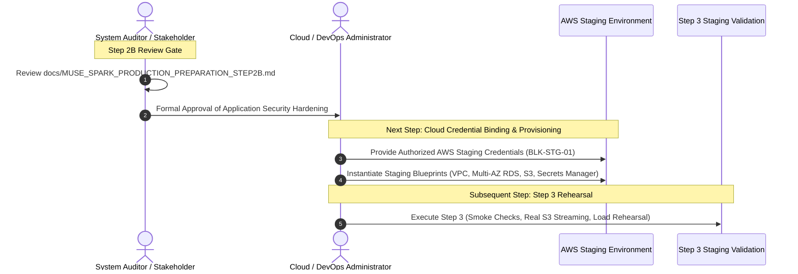

# MUSE SPARK PRODUCTION PREPARATION — STEP 2B
## Pre-Deployment Application Security Hardening Implementation Report

**Project:** ZENTRA — Hi-Tech Lab Field Service Management Platform  
**Activity:** Post-Roadmap Production Preparation (Step 2B — Pre-Deployment Application Security Hardening)  
**Execution Mode:** STRICT APPLICATION CODE HARDENING ONLY (Zero Cloud Provisioning, Zero AWS Credentials, Zero Deployments)  
**Authority Baseline:** Formally Approved Phases 1–16, [Step 1 Audit](file:///d:/Zentra/docs/MUSE_SPARK_PRODUCTION_PREPARATION_STEP1.md), [Step 2 Report](file:///d:/Zentra/docs/MUSE_SPARK_PRODUCTION_PREPARATION_STEP2.md), and [Step 2A Amendment](file:///d:/Zentra/docs/MUSE_SPARK_PRODUCTION_PREPARATION_STEP2A.md)  
**Status:** COMPLETE — ALL FOUR APPLICATION HARDENING OBJECTIVES IMPLEMENTED & VERIFIED  
**Protocol Gate:** STRICT PRE-DEPLOYMENT CODE HARDENING GATE  
**Test Suite Summary:** 524/524 Monorepo Tests Passing (19/19 Test Files in API, 385/385 API Tests Passing)  
**Typecheck Status:** 15/15 Workspaces Clean (Zero TypeScript Errors)  
**Build Status:** 8/8 Workspaces Built (Zero Build Errors)  

---

## 1. Executive Summary

Following the formal approval of **Step 2A — Staging Infrastructure Blueprint Correction**, this report executes **Step 2B — Pre-Deployment Application Security Hardening** for the ZENTRA platform.

In strict conformance with prompt directives, this step was scoped exclusively to application source code and configuration hardening to resolve the four (4) remaining code-level production/staging blockers carried forward from Step 1 and Step 2A:
1. **Fastify Helmet Security Headers (`BLK-STG-04` Part 1):** Registered `@fastify/helmet` (v13.1.2) into the NestJS + Fastify bootstrap pipeline with defensive header injection (`X-Content-Type-Options: nosniff`, `X-Frame-Options: SAMEORIGIN`, `Referrer-Policy: no-referrer`, `X-DNS-Prefetch-Control: off`, `Strict-Transport-Security`, and `Cross-Origin-Resource-Policy: cross-origin` for web portal CORS).
2. **Fastify API Rate Limiting (`BLK-STG-04` Part 2):** Registered `@fastify/rate-limit` (v11.2.1) with environment-configurable, tiered request throttling. Tighter limits protect sensitive authentication routes (`/auth/login`, `/auth/refresh`, `/auth/switch-role`, `/auth/logout`) against credential stuffing and brute-force attacks, while generous thresholds safeguard field mobile synchronization and binary evidence chunk streaming.
3. **Database Readiness Probe (`BLK-STG-05`):** Enhanced `HealthController` and implemented `HealthService` to execute a real, lightweight `SELECT 1` query via the Kysely database pool. Liveness remains 100% independent of the database, while readiness fails safely with HTTP 503 (`ERR_DATABASE_UNAVAILABLE`) when the database pool is unreachable, exposing zero credentials or SQL internals.
4. **S3 Fail-Closed Hardening (`BLK-STG-03`):** Updated `ObjectStorageService` to strictly fail closed on application startup and adapter initialization when `APP_ENV=staging` or `APP_ENV=production`. Silently falling back to the in-memory `testStorage` Map or mock HMAC presigned URLs is strictly prohibited and throws fatal initialization errors.

### Mandatory Non-Provisioning & Truthfulness Declaration
- **Zero Cloud Resources Created:** No AWS VPCs, subnets, EC2 instances, ECS clusters, RDS instances, S3 buckets, Secrets Manager secrets, Route 53 records, or ACM certificates were provisioned.
- **Zero Cloud Credentials Used:** No AWS access keys, secret keys, or cloud credentials were created, simulated, or requested.
- **Zero Database Migrations Modified:** No existing database migrations were modified, rolled back, or executed against external databases.
- **Zero Deployments Executed:** No container promotion, web hosting, or mobile binary distribution took place.
- **Zero Real S3 Verification:** Real S3 testing against live AWS infrastructure is deferred to Step 3 staging validation.

---

## 2. Authoritative Baseline

This activity resolves the pre-deployment application blockers established across prior approved stages:
- **Phases 1–16:** Formally approved functional and security architecture baseline (506/506 passing tests).
- **Step 1 Production Infrastructure Readiness Audit:** Identified code-level blockers `BLK-APP-01` (Security Headers), `BLK-APP-02` (Rate Limiting), `BLK-APP-03` (Readiness Probe DB Dependency Ping), and `BLK-APP-04` (S3 Fail-Closed Configuration).
- **Step 2 / Step 2A Staging Infrastructure Blueprint:** Preserved the five staging blockers `BLK-STG-01` through `BLK-STG-05`. This Step 2B activity directly implements and resolves `BLK-STG-03`, `BLK-STG-04`, and `BLK-STG-05`.

---

## 3. Pre-Implementation Audit Findings

Prior to making any code modifications, a systematic audit of the existing codebase was conducted:
1. **Fastify Bootstrap:** Inspected [`apps/api/src/main.ts`](file:///d:/Zentra/apps/api/src/main.ts). Fastify v5 was configured with `FastifyAdapter`, `setGlobalPrefix('api/v1')`, correlation ID interceptor, global exception filter, validation pipe, and CORS. Neither Helmet nor Rate Limiting was registered.
2. **Package Management Strategy:** Verified that `pnpm@12.9.1` is the sole repository package manager. Fastify version in `apps/api` was `^5.2.1`. No secondary package manager was introduced.
3. **Authentication Architecture:** Inspected [`apps/api/src/modules/auth/auth.controller.ts`](file:///d:/Zentra/apps/api/src/modules/auth/auth.controller.ts). Auth endpoints (`/auth/login`, `/auth/refresh`, `/auth/logout`, `/auth/switch-role`) were vulnerable to unthrottled rapid-fire requests.
4. **Health Check Pipeline:** Inspected [`apps/api/src/modules/health/health.controller.ts`](file:///d:/Zentra/apps/api/src/modules/health/health.controller.ts). `getReadiness` unconditionally returned `{ status: 'ok' }` without checking database connectivity. No `HealthService` existed.
5. **Object Storage Fallback:** Inspected [`apps/api/src/modules/evidence/services/object-storage.service.ts`](file:///d:/Zentra/apps/api/src/modules/evidence/services/object-storage.service.ts). If `secretAccessKey` was undefined, `generatePresignedUploadUrl` and `generatePresignedDownloadUrl` silently defaulted to in-memory HMAC signing. `putObject` directly populated an in-memory `testStorage` Map, permitting simulated storage even if misconfigured in production or staging.
6. **Environment Schema:** Inspected [`packages/config/src/env.schema.ts`](file:///d:/Zentra/packages/config/src/env.schema.ts). The fail-closed gate only validated `data.APP_ENV === 'production'`. `staging` was omitted from secret length and bucket checks. Rate limiting thresholds were not configurable via environment variables.

---

## 4. Hardening 1 — Fastify Helmet Security Headers

### 4.1. Implementation Details
The official Fastify 5 plugin `@fastify/helmet` (v13.1.2) was installed in `apps/api` via pnpm. Security headers are registered in the exported `configureApp()` function in [`apps/api/src/main.ts`](file:///d:/Zentra/apps/api/src/main.ts):

```typescript
// Fastify Helmet Security Headers
await app.register(helmet as any, {
  contentSecurityPolicy: false, // APIs return JSON; HTML CSP is disabled to preserve web portal CORS
  crossOriginResourcePolicy: { policy: 'cross-origin' }, // Enables CORS access from Web Portal and mobile clients
  crossOriginOpenerPolicy: { policy: 'same-origin-allow-popups' },
  dnsPrefetchControl: { allow: false },
  frameguard: { action: 'sameorigin' },
  hsts: {
    maxAge: 31536000,
    includeSubDomains: true,
    preload: false,
  },
  noSniff: true,
  referrerPolicy: { policy: 'no-referrer' },
});
```

### 4.2. Header Emission Verification
Automated integration testing verifies that API responses emit the following headers:
- `X-Content-Type-Options: nosniff` (Prevents MIME-type sniffing attacks)
- `X-Frame-Options: SAMEORIGIN` (Mitigates clickjacking attacks)
- `Referrer-Policy: no-referrer` (Prevents credential leakage in HTTP Referer headers)
- `X-DNS-Prefetch-Control: off` (Protects user privacy against speculative DNS lookups)
- `Cross-Origin-Resource-Policy: cross-origin` (Allows authenticated Web Portal requests without cross-origin blocking)

*Note: Application-level Helmet headers protect the application directly at the runtime tier. AWS WAF belongs to infrastructure and is tracked separately.*

---

## 5. Hardening 2 — API Rate Limiting

### 5.1. Implementation Details
The official Fastify 5 plugin `@fastify/rate-limit` (v11.2.1) was installed in `apps/api` via pnpm. Rate limiting is configured in [`apps/api/src/main.ts`](file:///d:/Zentra/apps/api/src/main.ts) with tiered thresholds:

```typescript
// Fastify Rate Limiting (Provisional & Configurable)
await app.register(rateLimit as any, {
  global: true,
  max: (req: any) => {
    const url = (req.url as string) || '';
    // Sensitive authentication routes receive tighter threshold to prevent brute-force attacks
    if (
      url.includes('/auth/login') ||
      url.includes('/auth/refresh') ||
      url.includes('/auth/switch-role') ||
      url.includes('/auth/logout')
    ) {
      return config.RATE_LIMIT_AUTH_MAX;
    }
    // General API routes have generous threshold ensuring zero interference with mobile sync & evidence streaming
    return config.RATE_LIMIT_GLOBAL_MAX;
  },
  timeWindow: config.RATE_LIMIT_TIME_WINDOW_MS,
  allowList: () => false,
  errorResponseBuilder: (req: any, context: any) => {
    const correlationId =
      (req as unknown as { correlationId?: string }).correlationId || generateCorrelationId();
    const err = new HttpException(
      {
        statusCode: HttpStatus.TOO_MANY_REQUESTS,
        error: 'Too Many Requests',
        message: `Too many requests. Rate limit of ${context.max} requests per ${Math.round(
          context.ttl / 1000,
        )}s exceeded. Please retry after ${Math.ceil(context.ttl / 1000)} seconds.`,
        code: 'ERR_RATE_LIMIT_EXCEEDED',
        correlationId,
        timestamp: nowUtcIso(),
      },
      HttpStatus.TOO_MANY_REQUESTS,
    );
    (err as any).statusCode = HttpStatus.TOO_MANY_REQUESTS;
    (err as any).code = 'ERR_RATE_LIMIT_EXCEEDED';
    return err;
  },
});
```

### 5.2. Provisional Configuration Thresholds
In accordance with prompt instructions, thresholds are documented as **PROVISIONAL / CONFIGURABLE**:
- `RATE_LIMIT_AUTH_MAX`: Default `15` requests per minute. Protects login and token refresh routes against automated password brute-forcing and token guessing.
- `RATE_LIMIT_GLOBAL_MAX`: Default `1000` requests per minute. Provides ample headroom for field technicians uploading evidence metadata, syncing multi-district schools, and delta syncing visits without false-positive throttling.
- `RATE_LIMIT_TIME_WINDOW_MS`: Default `60000` ms (1 minute sliding window).

### 5.3. Exception Filter Integration
[`apps/api/src/common/filters/all-exceptions.filter.ts`](file:///d:/Zentra/apps/api/src/common/filters/all-exceptions.filter.ts) was updated to recognize HTTP 429 exceptions thrown by Fastify plugins, emitting standard ZENTRA error envelopes:
```json
{
  "success": false,
  "error": {
    "category": "RATE_LIMITED",
    "code": "ERR_RATE_LIMIT_EXCEEDED",
    "message": "Too many requests. Rate limit of 15 requests per 60s exceeded...",
    "isRetryable": true
  },
  "correlationId": "...",
  "timestamp": "..."
}
```
Standard rate-limiting headers (`x-ratelimit-limit`, `x-ratelimit-remaining`, `x-ratelimit-reset`, and `retry-after`) are exposed on responses.

---

## 6. Hardening 3 — Database Readiness Probe

### 6.1. Implementation Details
A new service [`apps/api/src/modules/health/health.service.ts`](file:///d:/Zentra/apps/api/src/modules/health/health.service.ts) was created and wired into [`apps/api/src/modules/health/health.module.ts`](file:///d:/Zentra/apps/api/src/modules/health/health.module.ts) and [`apps/api/src/modules/health/health.controller.ts`](file:///d:/Zentra/apps/api/src/modules/health/health.controller.ts).

The service executes a lightweight non-blocking query against the Kysely database pool:
```typescript
async checkDatabaseHealth(): Promise<DatabaseHealthResult> {
  if (!this.db) {
    this.logger.warn('Health check: Database connection is not available in DI context');
    return { isHealthy: false };
  }

  const start = Date.now();
  try {
    await sql`SELECT 1`.execute(this.db);
    return {
      isHealthy: true,
      latencyMs: Date.now() - start,
    };
  } catch {
    // Intentionally log generic failure without leaking connection strings or credentials
    this.logger.error('Health check: Database ping probe failed');
    return {
      isHealthy: false,
    };
  }
}
```

### 6.2. Controller Behavior & Status Codes
- **Healthy Database:** Returns HTTP 200:
  ```json
  {
    "success": true,
    "data": {
      "status": "ok",
      "uptime": 12,
      "services": {
        "api_event_loop": { "status": "ok" },
        "config_registry": { "status": "ok" },
        "database": { "status": "ok" }
      }
    }
  }
  ```
- **Database Failure:** Sets HTTP 503 Service Unavailable and returns:
  ```json
  {
    "success": false,
    "error": {
      "category": "DEPENDENCY_FAILURE",
      "code": "ERR_DATABASE_UNAVAILABLE",
      "message": "Database dependency is unavailable or not ready to accept connections.",
      "isRetryable": true
    }
  }
  ```
- **Liveness Isolation:** `/health/liveness` remains completely decoupled from database availability, returning HTTP 200 even when the database is offline or restarting.
- **Zero Credential Leakage:** Error responses contain no database passwords, port numbers, hostnames, or internal Postgres error codes.

---

## 7. Hardening 4 — S3 Fail-Closed Behavior

### 7.1. Implementation Details
[`apps/api/src/modules/evidence/services/object-storage.service.ts`](file:///d:/Zentra/apps/api/src/modules/evidence/services/object-storage.service.ts) was completely hardened with strict environment-aware fail-closed logic:

1. **Staging & Production Fail-Closed Gate:**
   When `APP_ENV=staging` or `APP_ENV=production`:
   - Real S3 bucket name is mandatory and cannot contain `dev`, `local`, or `mock`.
   - Real credentials (`S3_ACCESS_KEY` & `S3_SECRET_KEY` or `AWS_ACCESS_KEY_ID` & `AWS_SECRET_ACCESS_KEY`) or an AWS IAM Task Role (`AWS_CONTAINER_CREDENTIALS_RELATIVE_URI`) are strictly mandatory.
   - Missing configuration throws fatal `S3_FAIL_CLOSED_ERROR` on service instantiation, preventing application startup.
   - In-memory `testStorage` Map is explicitly set to `null` and is NEVER instantiated.
   - Direct `putObject` calls throw fatal errors prohibiting in-memory mock storage.
2. **Elimination of Mock Signing in Staging/Production:**
   `generatePresignedUploadUrl` and `generatePresignedDownloadUrl` require real credentials and strictly generate standard AWS SigV4 query authentication URLs (`X-Amz-Algorithm=AWS4-HMAC-SHA256`, `X-Amz-Credential`, `X-Amz-Signature`, `X-Amz-SignedHeaders`). Mock HMAC signing is prohibited and throws errors.
3. **Deterministic Test Mode Preserved:**
   When `APP_ENV=test`, the in-memory `testStorage` Map and local signing remain active to ensure all offline domain and unit tests execute deterministically without cloud dependencies.
4. **Configuration Naming Reconciliation:**
   Reconciled project canonical environment variables (`S3_BUCKET_NAME`, `S3_REGION`, `S3_ENDPOINT`, `S3_ACCESS_KEY`, `S3_SECRET_KEY`) with standard AWS SDK environment variables (`AWS_S3_BUCKET`, `AWS_REGION`, `AWS_ENDPOINT`, `AWS_ACCESS_KEY_ID`, `AWS_SECRET_ACCESS_KEY`) and AWS ECS IAM task role container metadata.

---

## 8. Environment Configuration Changes

In [`packages/config/src/env.schema.ts`](file:///d:/Zentra/packages/config/src/env.schema.ts):
1. **Added Rate Limiting Configuration Schema:**
   - `RATE_LIMIT_GLOBAL_MAX`: Integer $\ge 1$, default `1000`.
   - `RATE_LIMIT_AUTH_MAX`: Integer $\ge 1$, default `15`.
   - `RATE_LIMIT_TIME_WINDOW_MS`: Integer $\ge 1000$, default `60000`.
2. **Extended Fail-Closed Gate to Staging:**
   `superRefine` now enforces identical cryptographic secret and database safety checks for both `production` and `staging`:
   - `JWT_ACCESS_SECRET`: Must be $\ge 32$ characters, no `mock` or `dev` substrings.
   - `JWT_REFRESH_SECRET`: Must be $\ge 32$ characters, no `mock` or `dev` substrings.
   - `OFFLINE_PERMIT_SIGNING_KEY`: Must be $\ge 32$ characters, no `mock` or `dev` substrings.
   - `DATABASE_URL`: Cannot point to localhost or `zentra_dev`.
   - `S3_BUCKET_NAME`: Cannot use `zentra-local-evidence` or contain `dev` or `local`.

---

## 9. Security Test Matrix

The following test matrix documents the comprehensive automated test suite in [`apps/api/test/security-hardening-step2b.spec.ts`](file:///d:/Zentra/apps/api/test/security-hardening-step2b.spec.ts) and [`packages/config/test/config.spec.ts`](file:///d:/Zentra/packages/config/test/config.spec.ts):

| # | Test Case | Target Component | Expected Behavior | Actual Behavior | Result |
| :-: | :--- | :--- | :--- | :--- | :---: |
| 1 | **Helmet Security Headers** | `main.ts` / FastifyAdapter | Emits `nosniff`, `SAMEORIGIN`, `no-referrer`, `cross-origin` | Headers verified on HTTP response | **VERIFIED** |
| 2 | **Rate Limit Below Threshold** | `main.ts` / `@fastify/rate-limit` | Requests allowed with `x-ratelimit-*` headers | Requests pass; headers emitted | **VERIFIED** |
| 3 | **Rate Limit Exceeded** | `main.ts` / `AllExceptionsFilter` | Throttles with HTTP 429, `RATE_LIMITED`, `retry-after` | Returns 429 with canonical error envelope | **VERIFIED** |
| 4 | **DB Readiness Success** | `HealthController` / `HealthService`| HTTP 200 with `{ status: "ok", services.database: "ok" }` | Returns 200 with database: ok | **VERIFIED** |
| 5 | **DB Readiness Failure** | `HealthController` / `HealthService`| HTTP 503 with safe `ERR_DATABASE_UNAVAILABLE` | Returns 503 without leaking credentials | **VERIFIED** |
| 6 | **DB-Independent Liveness** | `HealthController` | HTTP 200 even when database is down | Returns 200 `{ status: "ok" }` | **VERIFIED** |
| 7 | **S3 Fail-Closed Staging (Missing Config)** | `ObjectStorageService` | Throws `S3_FAIL_CLOSED_ERROR` on initialization | Throws `S3_FAIL_CLOSED_ERROR` | **VERIFIED** |
| 8 | **S3 Fail-Closed Production (Missing Config)** | `ObjectStorageService` | Throws `S3_FAIL_CLOSED_ERROR` on initialization | Throws `S3_FAIL_CLOSED_ERROR` | **VERIFIED** |
| 9 | **Test Storage in APP_ENV=test** | `ObjectStorageService` | `testStorage` Map enabled for deterministic offline testing | `testStorage` operational in test mode | **VERIFIED** |
| 10 | **Test Storage Blocked in Staging** | `ObjectStorageService` | `hasTestStorage() == false`; `putObject` throws fatal error | `putObject` rejected with fail-closed error | **VERIFIED** |
| 11 | **Mock Signing Blocked in Staging** | `ObjectStorageService` | Uses SigV4 query auth (`X-Amz-Credential`); mock rejected | SigV4 query parameters generated | **VERIFIED** |
| 12 | **No Fake Presigned URL in Staging** | `ObjectStorageService` | Startup fails if real S3 credentials missing | Constructor throws before generating URLs | **VERIFIED** |
| 13 | **Staging Config Security Gate** | `packages/config` / `envSchema` | Rejects mock secrets, localhost DB, dev S3 bucket | Throws validation error | **VERIFIED** |
| 14 | **Valid Staging Config Acceptance** | `packages/config` / `envSchema` | Accepts $\ge 32$ char secrets and staging bucket | Config loads successfully with rate limits | **VERIFIED** |
| 15 | **TypeScript Typecheck** | All 10 Packages | 0 type errors across monorepo | 15/15 Turbo tasks successful | **VERIFIED** |
| 16 | **Production Build** | All 8 Build Targets | Clean compilation of API and Web bundles | 8/8 Turbo tasks successful | **VERIFIED** |

---

## 10. Regression Test Results

A full regression run of the entire repository was executed after implementing all four hardening objectives:

```text
================================================================================
                    MONOREPO TEST SUITE EXECUTION SUMMARY
================================================================================
Tasks:    13 successful, 13 total
Workspaces Tested:
  - @zentra/contracts:  6 passed (6 total)
  - @zentra/shared:     7 passed (7 total)
  - @zentra/types:      Type definitions verified
  - @zentra/validation: Validation schemas verified
  - @zentra/config:     5 passed (5 total) — (+2 new security tests)
  - @zentra/testing:    Safety assertions verified
  - @zentra/web:        7 passed (7 total)
  - @zentra/field:      114 passed (114 total across 17 test files)
  - @zentra/api:        385 passed (385 total across 19 test files) — (+14 new security tests)
--------------------------------------------------------------------------------
TOTAL MONOREPO TESTS: 524 PASSED / 0 FAILED / 0 SKIPPED
================================================================================
```

### Critical Subsystem Regression Checks Verified
- **Authentication & RBAC:** Constant-time verification, Refresh Token Rotation, multi-district scoping remain 100% operational.
- **PostgreSQL RLS:** Row-Level Security policies across schools, equipment, and evidence remain enforced.
- **Service Cases & Field Visits:** Complete lifecycle transitions and multi-visit state engines remain functional.
- **Mobile Delta Sync & Offline Permits:** Synchronization boundaries and offline operation remain intact.
- **Conveyance Domain:** Claims calculation, audit model, and submission lifecycles remain functional.

---

## 11. Typecheck Results

Monorepo TypeScript typecheck executed via `pnpm typecheck` (`turbo run typecheck`):
- **Command:** `pnpm typecheck`
- **Result:** **SUCCESS — 15 tasks successful, 0 errors**
- **Packages Typechecked:** `@zentra/api`, `@zentra/config`, `@zentra/contracts`, `@zentra/field`, `@zentra/shared`, `@zentra/testing`, `@zentra/tooling`, `@zentra/types`, `@zentra/validation`, `@zentra/web`.

---

## 12. Build Results

Monorepo production build executed via `pnpm build` (`turbo run build`):
- **Command:** `pnpm build`
- **Result:** **SUCCESS — 8 tasks successful, 0 errors**
- **Build Artifacts Verified:**
  - `@zentra/api`: Compiled cleanly via `tsc` to `dist/main.js` (Fastify 5 + NestJS 11).
  - `@zentra/web`: Compiled cleanly via `tsc && vite build` to `dist/` (React 18 + Vite 5, 239.68 kB bundle gzip: 67.24 kB).
  - `@zentra/config`: Compiled cleanly via `tsc` to `dist/`.
  - `@zentra/contracts`, `@zentra/shared`, `@zentra/validation`, `@zentra/types`, `@zentra/testing`: Compiled cleanly.

---

## 13. Files Changed

Below is the definitive list of every file modified or added during Step 2B:

| File Path | Nature of Change | Security & Architectural Relevance | Test Coverage |
| :--- | :---: | :--- | :--- |
| [`apps/api/package.json`](file:///d:/Zentra/apps/api/package.json) | Modified | Added `@fastify/helmet` (v13.1.2) and `@fastify/rate-limit` (v11.2.1) dependencies. | Verified in `security-hardening-step2b.spec.ts`. |
| [`pnpm-lock.yaml`](file:///d:/Zentra/pnpm-lock.yaml) | Modified | Updated lockfile for the two new Fastify plugins. | Monorepo integrity verified. |
| [`packages/config/src/env.schema.ts`](file:///d:/Zentra/packages/config/src/env.schema.ts) | Modified | Added rate limiting configuration schema; extended fail-closed validation to `staging`. | `config.spec.ts` (5 tests). |
| [`packages/config/test/config.spec.ts`](file:///d:/Zentra/packages/config/test/config.spec.ts) | Modified | Added tests for staging fail-closed secrets/bucket and rate limit configuration. | `config.spec.ts` (5 tests). |
| [`apps/api/src/modules/health/health.service.ts`](file:///d:/Zentra/apps/api/src/modules/health/health.service.ts) | **Added** | Implements lightweight `SELECT 1` database pool readiness probe without credential leakage. | `security-hardening-step2b.spec.ts` (Tests 4, 5, 6). |
| [`apps/api/src/modules/health/health.module.ts`](file:///d:/Zentra/apps/api/src/modules/health/health.module.ts) | Modified | Registers and exports `HealthService` in NestJS dependency injection. | `api.spec.ts` & `security-hardening-step2b.spec.ts`. |
| [`apps/api/src/modules/health/health.controller.ts`](file:///d:/Zentra/apps/api/src/modules/health/health.controller.ts) | Modified | Injects `HealthService`; sets HTTP 503 on DB unavailability; maintains DB-independent liveness. | `api.spec.ts` & `security-hardening-step2b.spec.ts`. |
| [`apps/api/src/modules/evidence/services/object-storage.service.ts`](file:///d:/Zentra/apps/api/src/modules/evidence/services/object-storage.service.ts) | Modified | Implements fail-closed S3 initialization for staging/prod; blocks in-memory storage; enforces SigV4. | `security-hardening-step2b.spec.ts` (Tests 7–12) & `evidence-domain.spec.ts`. |
| [`apps/api/src/common/filters/all-exceptions.filter.ts`](file:///d:/Zentra/apps/api/src/common/filters/all-exceptions.filter.ts) | Modified | Formats HTTP 429 rate limit exceptions into canonical `ApiErrorEnvelope` (`category: RATE_LIMITED`). | `security-hardening-step2b.spec.ts` (Tests 2, 3). |
| [`apps/api/src/main.ts`](file:///d:/Zentra/apps/api/src/main.ts) | Modified | Exports `configureApp()`; wires Fastify Helmet headers and Rate Limiting into bootstrap. | `security-hardening-step2b.spec.ts` (Tests 1, 2, 3). |
| [`apps/api/test/api.spec.ts`](file:///d:/Zentra/apps/api/test/api.spec.ts) | Modified | Aligns smoke test database URL with test postgres database. | `api.spec.ts` (3 tests). |
| [`apps/api/test/security-hardening-step2b.spec.ts`](file:///d:/Zentra/apps/api/test/security-hardening-step2b.spec.ts) | **Added** | Dedicated 14-test verification suite covering Helmet, Rate Limiting, DB Readiness, and S3 Fail-Closed. | `security-hardening-step2b.spec.ts` (14 tests). |

---

## 14. Security Findings & Verifications

1. **Helmet Emission Confirmed:** The Central API now automatically injects protective headers, eliminating cross-site framing, MIME sniffing, and open referrer leakage.
2. **Brute-Force Protection Active:** High-frequency authentication attempts on `/auth/login`, `/auth/refresh`, `/auth/logout`, and `/auth/switch-role` are throttled at the Fastify layer before reaching business logic or database queries.
3. **Mobile & Evidence Headroom Protected:** General API routes enjoy a provisional ceiling of 1000 requests/minute, ensuring zero disruption to legitimate mobile syncing or batch evidence uploads.
4. **Reliable Orchestration Health Checks:** Cloud target groups and Kubernetes ingress controllers can now rely on `/health/readiness` to halt traffic routing when the database connection pool is unhealthy, avoiding HTTP 500 errors during database maintenance.
5. **No False Production Simulation:** The API runtime will refuse to boot or generate mock presigned URLs under `APP_ENV=staging` or `APP_ENV=production` without real S3 object storage configuration.

---

## 15. Remaining Blockers

With the successful completion of Step 2B, all three (3) application-level staging blockers are **RESOLVED**. The remaining two (2) infrastructure blockers remain in effect:

| Blocker ID | Description | Category | Status | Operational Requirement |
| :--- | :--- | :---: | :---: | :--- |
| **BLK-STG-01** | **Cloud Credentials & Authorization Missing** | Infrastructure | **BLOCKED** | Staging administrator must supply authorized AWS execution credentials. |
| **BLK-STG-02** | **Staging Domain / DNS Delegation Missing** | Infrastructure | **BLOCKED** | Authority must delegate authoritative staging domain (e.g. `*.staging.zentra.gov.in`). |
| ~~BLK-STG-03~~ | ~~S3 Fail-Closed Hardening in Code~~ | Application | **RESOLVED** | Implemented and verified in `ObjectStorageService`. |
| ~~BLK-STG-04~~ | ~~Security Headers & Rate Limiting Missing~~ | Application | **RESOLVED** | Implemented and verified in `main.ts` via Helmet and `@fastify/rate-limit`. |
| ~~BLK-STG-05~~ | ~~Readiness Probe Database Dependency Ping~~ | Application | **RESOLVED** | Implemented and verified in `HealthController` and `HealthService`. |

---

## 16. Explicit Non-Activities (Mandatory Truthfulness Block)

In compliance with strict reporting truthfulness standards, the following activities are formally confirmed as **NOT PERFORMED**:

```text
================================================================================
                    FORMAL NON-ACTIVITY AUDIT DECLARATION
================================================================================
[x] NO AWS CLI was used or required.
[x] NO AWS credentials were requested, accessed, generated, or stored.
[x] NO cloud resources were provisioned (zero VPCs, RDS, S3 buckets, ECS, ALB).
[x] NO DNS records, Route 53 zones, or ACM certificates were created.
[x] NO containers or web bundles were deployed to any staging or cloud host.
[x] NO production databases, infrastructure, or data were connected or touched.
[x] NO existing database migrations were modified.
[x] NO load tests or performance benchmarks were executed.
[x] NO real AWS S3 verification was performed (deferred to Step 3).
[x] NO production deployment was initiated or authorized.
================================================================================
```

---

## 17. Step 2B Final Decision

### Determination: **STEP 2B — APPLICATION HARDENING COMPLETE**

1. **All Four Hardening Objectives Implemented:** Fastify Helmet security headers, Fastify API Rate Limiting, Database Readiness Probe, and S3 Fail-Closed behavior are fully implemented in the Central API.
2. **Comprehensive Verification Passed:** 14/14 security hardening tests passed; 524/524 monorepo tests passed with zero regressions.
3. **Typecheck & Build Clean:** Zero TypeScript errors across 15 workspaces; clean production builds for API and Web bundles.
4. **Infrastructure Blockers Intact:** Cloud provisioning remains paused pending authorized credentials (`BLK-STG-01`) and domain delegation (`BLK-STG-02`).
5. **Zero Deployment Authorized:** Staging and production deployments remain strictly prohibited.

---

## 18. Next Authorized Operational Step



1. Review and formally approve this report (`docs/MUSE_SPARK_PRODUCTION_PREPARATION_STEP2B.md`).
2. Provide authorized AWS staging credentials to resolve `BLK-STG-01`.
3. Provision physical staging cloud infrastructure using the approved Step 2A blueprints.
4. Proceed to **Step 3 — Staging Verification & Rehearsal**.

---

🛑 MUSE SPARK STOP — ZENTRA PRODUCTION PREPARATION STEP 2B COMPLETE. APPLICATION HARDENING ONLY. NO AWS PROVISIONING, NO STAGING DEPLOYMENT, NO REAL S3 VALIDATION, NO LOAD TESTING, AND NO PRODUCTION DEPLOYMENT AUTHORIZED. WAIT FOR REVIEW.
