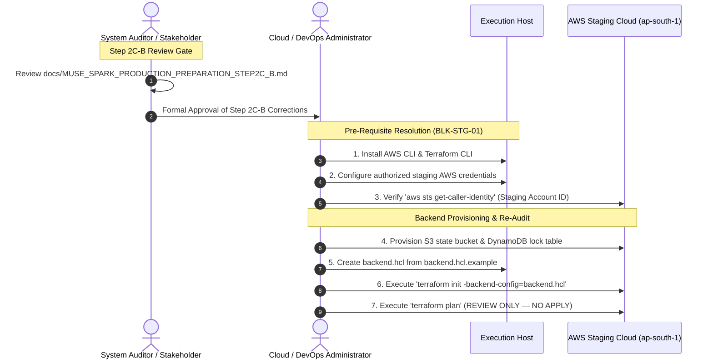

# MUSE SPARK PRODUCTION PREPARATION — STEP 2C-B
## Controlled Terraform Security Correction Pass Report

**Project:** ZENTRA — Hi-Tech Lab Field Service Management Platform  
**Activity:** Post-Roadmap Production Preparation (Step 2C-B — Controlled Terraform Security Correction Pass)  
**Execution Mode:** STRICT CODE & CONFIGURATION CORRECTION ONLY (AWS 100% Untouched)  
**Authority Baseline:** Formally Approved Phases 1–16, [Step 1 Audit](file:///d:/Zentra/docs/MUSE_SPARK_PRODUCTION_PREPARATION_STEP1.md), [Step 2 Blueprint](file:///d:/Zentra/docs/MUSE_SPARK_PRODUCTION_PREPARATION_STEP2.md), [Step 2A Amendment](file:///d:/Zentra/docs/MUSE_SPARK_PRODUCTION_PREPARATION_STEP2A.md), [Step 2B Hardening](file:///d:/Zentra/docs/MUSE_SPARK_PRODUCTION_PREPARATION_STEP2B.md), [Step 2C Provisioning Report](file:///d:/Zentra/docs/MUSE_SPARK_PRODUCTION_PREPARATION_STEP2C.md), and [Step 2C-A Pre-Apply Review](file:///d:/Zentra/docs/MUSE_SPARK_PRODUCTION_PREPARATION_STEP2C_A.md)  
**AWS State:** **UNTOUCHED** (Zero Authentication, Zero API Calls, Zero Resources Provisioned)  
**Credentials State:** **NOT CONFIGURED** (`BLK-STG-01` Preserved)  
**Terraform State:** **NOT CREATED DURING THIS STEP**  
**Remote Backend Status:** **PREPARED — NOT PROVISIONED**  
**Secrets Manager Status:** **CODED — NOT PROVISIONED**  
**Final Decision:** **`STEP 2C-B — CORRECTIONS COMPLETE — READY FOR RE-AUDIT`**  

---

## 1. Executive Summary

This report documents the execution of **Step 2C-B — Controlled Terraform Security Correction Pass** for the ZENTRA platform.

Following the pre-apply safety gate review in **Step 2C-A** ([`docs/MUSE_SPARK_PRODUCTION_PREPARATION_STEP2C_A.md`](file:///d:/Zentra/docs/MUSE_SPARK_PRODUCTION_PREPARATION_STEP2C_A.md)), three approved security and configuration corrections were authorized for remediation:
1. **CORR-01 — Terraform & Git Exclusions:** Resolved the repository `.gitignore` gap by adding strict ignore rules for `.terraform/`, `*.tfstate`, `*.tfstate.*`, `*.tfvars`, and crash logs, while explicitly preserving trackability for `!terraform.tfvars.example`. Verified via historical Git log and filesystem inspection that zero `.tfstate` files currently exist in the repository.
2. **CORR-02 — Remote Terraform State Preparation:** Replaced the commented-out backend placeholder in [`main.tf`](file:///d:/Zentra/infra/terraform/staging/main.tf) with a valid partial `backend "s3" {}` block. Documented mandatory remote backend requirements (S3 bucket, SSE-KMS/AES-256 encryption, DynamoDB state locking with `LockID`, Block Public Access, and versioning). Created [`backend.hcl.example`](file:///d:/Zentra/infra/terraform/staging/backend.hcl.example) with clear placeholders (`<ZENTRA_STAGING_TERRAFORM_STATE_BUCKET>`, `<ZENTRA_STAGING_TERRAFORM_LOCK_TABLE>`) for supply during future `terraform init -backend-config=backend.hcl`.
3. **CORR-03 — RDS Administrator Credential Capture in Secrets Manager:** Added `aws_secretsmanager_secret.db_admin_credentials` and `aws_secretsmanager_secret_version.db_admin_credentials_val` in [`secrets.tf`](file:///d:/Zentra/infra/terraform/staging/secrets.tf) to securely store `zentra_admin` credentials, reusing the existing `random_password.db_master_password.result`. Added `db_admin_credentials_secret_arn` to [`outputs.tf`](file:///d:/Zentra/infra/terraform/staging/outputs.tf). Maintained strict role separation ensuring the Central API ECS task role has zero access to master administrator credentials.

### Absolute Safety & Non-Provisioning Declaration
- **AWS Remains Completely Untouched:** Zero AWS CLI commands executed; zero AWS credentials configured; zero AWS APIs called.
- **Zero Cloud Resources Created:** Zero S3 buckets, DynamoDB tables, RDS instances, Secrets Manager secrets, ECS tasks, or IAM roles were created.
- **Zero Terraform State Commands Executed:** `terraform init`, `terraform plan`, `terraform apply`, `terraform destroy`, and state manipulation were strictly not run.
- **Zero Application Changes:** Monorepo application code, package dependencies, and test suites remain untouched.

---

## 2. Source Audit Findings (Step 2C-A Baseline)

The Step 2C-A review identified the following findings that formed the authoritative mandate for this correction pass:

| Finding ID | Severity | File / Component | Problem Identified | Correction Status in Step 2C-B |
| :--- | :---: | :--- | :--- | :---: |
| **SEC-FIND-01** | **HIGH** | [`.gitignore`](file:///d:/Zentra/.gitignore) | Missing `.tfstate`, `.terraform/`, and `*.tfvars` ignore rules. Local state files containing plaintext secrets would be tracked by Git. | **RESOLVED (CORR-01)** |
| **SEC-FIND-02** | **HIGH** | [`main.tf`](file:///d:/Zentra/infra/terraform/staging/main.tf) | Remote backend commented out (`# backend "s3" {}`). Defaulted to local unencrypted state without state locking. | **RESOLVED (CORR-02)** |
| **SEC-FIND-03** | **MEDIUM** | [`secrets.tf`](file:///d:/Zentra/infra/terraform/staging/secrets.tf) | RDS master administrator password (`db_master_password`) not captured in Secrets Manager. | **RESOLVED (CORR-03)** |
| **SEC-FIND-04** | **INFORMATIONAL**| [`ecs.tf`](file:///d:/Zentra/infra/terraform/staging/ecs.tf) | Task definition references placeholder `zentra-staging-api:latest`. Image build/push deferred to Step 3. | **PRESERVED AS INFO** |
| **BLK-STG-01** | **BLOCKER** | Environment | AWS staging credentials missing. | **PRESERVED AS BLOCKER** |
| **BLK-STG-02** | **BLOCKER** | Domain / DNS | Staging domain delegation missing. | **PRESERVED AS BLOCKER** |

---

## 3. Correction Scope

The correction boundary for Step 2C-B was strictly confined to the three authorized tasks:
- **`CORR-01`**: Git repository ignore rules and history safety verification.
- **`CORR-02`**: Remote Terraform state partial configuration and companion template.
- **`CORR-03`**: RDS administrator credential secret definition in Secrets Manager.

**Explicit Scope Protections:**
- NO changes to VPC or subnet CIDRs (`10.100.0.0/16`).
- NO changes to RDS Multi-AZ architecture or parameter groups (`rds.force_ssl = 1`).
- NO changes to S3 bucket security, CORS policies, or life-cycle rules.
- NO changes to Central API runtime role (`zentra_staging_app` with `NOBYPASSRLS`).
- NO changes to application source code or package dependencies.

---

## 4. CORR-01 — Git / Terraform Exclusions

### 4.1. Changes Applied to [`.gitignore`](file:///d:/Zentra/.gitignore)
The repository [`.gitignore`](file:///d:/Zentra/.gitignore) was updated by appending standard, comprehensive Terraform and cloud infrastructure exclusion rules while preserving all pre-existing rules intact:

```gitignore
# Terraform & Cloud Infrastructure (NEVER COMMIT)
.terraform/
*.tfstate
*.tfstate.*
*.tfvars
!terraform.tfvars.example
crash.log
crash.*.log
```

### 4.2. Functional Rule Verification
The behavior of the updated `.gitignore` was directly validated using the Git engine (`git check-ignore -v`):
```text
.gitignore:71:*.tfstate           terraform.tfstate          --> IGNORED (MATCH)
.gitignore:72:*.tfstate.*         terraform.tfstate.backup   --> IGNORED (MATCH)
.gitignore:70:.terraform/         .terraform/                --> IGNORED (MATCH)
.gitignore:73:*.tfvars            terraform.tfvars           --> IGNORED (MATCH)
.gitignore:74:!terraform.tfvars.example terraform.tfvars.example --> TRACKED (PASSED)
```

### 4.3. Git History Safety Check
Prior to declaring CORR-01 complete, a full historical Git audit and filesystem scan were executed:
- **Git History Audit:** `git log --all --full-history -- "**/terraform.tfstate*" "*tfstate*"` returned zero commits.
- **Filesystem Scan:** Recursive scan across `d:\Zentra` for `*tfstate*` confirmed zero state files exist on disk.
- **Finding:** **ZERO `.tfstate` files are tracked in Git, and zero exist on disk.**

---

## 5. CORR-02 — Remote State Preparation

### 5.1. Architectural Requirements for Staging Remote Backend
In accordance with AWS enterprise security standards, the staging environment will require a remote state backend with:
1. **Private S3 Bucket:** All 4 Block Public Access settings enabled, private bucket ACL.
2. **State Encryption:** Server-Side Encryption using AWS KMS (`aws/s3` or custom KMS CMK).
3. **Bucket Versioning:** Enabled to permit recovery from accidental state corruption.
4. **Distributed State Locking:** Amazon DynamoDB table with `LockID` string partition key to prevent concurrent `terraform apply` race conditions.
5. **Least-Privilege IAM Access:** Accessible strictly by authorized DevOps administrators.

### 5.2. Partial Backend Implementation in [`main.tf`](file:///d:/Zentra/infra/terraform/staging/main.tf)
Because Terraform evaluates backend configurations during `terraform init`, backend blocks cannot reference ordinary Terraform input variables (`var.bucket_name` is illegal in HCL backend definitions).

To ensure a secure, reproducible workflow without embedding unprovisioned or invented resource IDs, the partial configuration pattern was implemented in [`infra/terraform/staging/main.tf`](file:///d:/Zentra/infra/terraform/staging/main.tf):

```hcl
terraform {
  required_version = ">= 1.5.0"

  required_providers {
    aws = {
      source  = "hashicorp/aws"
      version = "~> 5.50"
    }
    random = {
      source  = "hashicorp/random"
      version = "~> 3.6"
    }
  }

  # ----------------------------------------------------------------------------
  # Remote State Backend (S3 + DynamoDB State Locking)
  # ----------------------------------------------------------------------------
  # Operational Status: PREPARED — NOT PROVISIONED
  #
  # Backend parameters cannot use ordinary Terraform variables (evaluated at init).
  # A partial backend configuration is declared below. The operator will provide
  # backend coordinates during 'terraform init' using a backend configuration file:
  #   terraform init -backend-config=backend.hcl
  #
  # Mandatory Remote Backend Requirements:
  #   1. S3 bucket: Private, versioning enabled, all 4 BlockPublicAccess enabled
  #   2. Encryption: Server-Side Encryption with AWS KMS (SSE-KMS) or AES256
  #   3. Locking: AWS DynamoDB table with 'LockID' primary key (string)
  #   4. Access: Scoped IAM permissions with zero public access
  #
  # Refer to backend.hcl.example for the operator configuration template.
  backend "s3" {
    # Partial configuration: coordinates supplied via -backend-config during init
  }
}
```

### 5.3. Operator Template: [`backend.hcl.example`](file:///d:/Zentra/infra/terraform/staging/backend.hcl.example)
A safe configuration template was authored with explicit, standardized placeholders:

```hcl
# ==============================================================================
# ZENTRA Staging — Example Remote Backend Configuration Template
# ==============================================================================
# Usage:
#   1. Once staging AWS credentials (BLK-STG-01) and backend S3/DynamoDB
#      infrastructure are provisioned, copy this file to 'backend.hcl':
#        cp backend.hcl.example backend.hcl
#   2. Fill in the authorized staging bucket name and DynamoDB lock table name.
#   3. Initialize Terraform with the backend configuration:
#        terraform init -backend-config=backend.hcl
# ==============================================================================

bucket         = "<ZENTRA_STAGING_TERRAFORM_STATE_BUCKET>"
key            = "staging/terraform.tfstate"
region         = "ap-south-1"
dynamodb_table = "<ZENTRA_STAGING_TERRAFORM_LOCK_TABLE>"
encrypt        = true
```

- **Remote Backend Operational Status:** **`PREPARED — NOT PROVISIONED`**

---

## 6. CORR-03 — RDS Administrator Credential Secret

### 6.1. Dedicated Secrets Manager Resource
In [`infra/terraform/staging/secrets.tf`](file:///d:/Zentra/infra/terraform/staging/secrets.tf), a dedicated Secrets Manager secret was defined to capture the RDS master administrator credentials:

```hcl
# ------------------------------------------------------------------------------
# 5. Database Administrator Credentials (CORR-03: Migration / Admin Operations)
# ------------------------------------------------------------------------------
resource "aws_secretsmanager_secret" "db_admin_credentials" {
  name                    = "zentra/staging/db-admin-credentials"
  description             = "PostgreSQL master administrator credentials for ZENTRA staging (migration/admin operations only)"
  recovery_window_in_days = 7

  tags = {
    Name = "zentra/staging/db-admin-credentials"
    Role = "Database-Admin"
  }
}

resource "aws_secretsmanager_secret_version" "db_admin_credentials_val" {
  secret_id = aws_secretsmanager_secret.db_admin_credentials.id
  secret_string = jsonencode({
    engine   = "postgres"
    host     = aws_db_instance.staging_db.address
    port     = aws_db_instance.staging_db.port
    dbname   = "zentra_staging"
    username = "zentra_admin"
    password = random_password.db_master_password.result
    sslmode  = "require"
    url      = "postgresql://zentra_admin:${random_password.db_master_password.result}@${aws_db_instance.staging_db.address}:${aws_db_instance.staging_db.port}/zentra_staging?sslmode=require"
  })
}
```

### 6.2. Key Architectural Guarantees for CORR-03
1. **Single Sourced Password:** Reuses the existing `random_password.db_master_password.result` defined in [`rds.tf`](file:///d:/Zentra/infra/terraform/staging/rds.tf#L49). Zero second/duplicate passwords are generated.
2. **Zero Password Exposure:** The password is generated in-memory by Terraform, stored in AWS Secrets Manager, and never printed to terminal logs, committed to Git, or exposed in variable examples.
3. **Role Separation Preserved:** 
   - `db_admin_credentials` is designated strictly for authorized human operators performing initial migrations or maintenance.
   - The Central API runtime container continues to connect as `zentra_staging_app` (member of `zentra_app` with `NOBYPASSRLS`) via `zentra/staging/db-credentials`.
   - The API task IAM role (`zentra-staging-api-role` in [`iam.tf`](file:///d:/Zentra/infra/terraform/staging/iam.tf)) **has zero permissions to access `db-admin-credentials`**.
4. **Outputs Security:** Added only non-sensitive metadata `db_admin_credentials_secret_arn` to [`outputs.tf`](file:///d:/Zentra/infra/terraform/staging/outputs.tf). Zero passwords, secrets, or URLs are exported.

- **Secrets Manager Resource Status:** **`CODED — NOT PROVISIONED`**

---

## 7. Critical Secret-State Analysis

> [!IMPORTANT]
> **STATE SENSITIVITY TRUTHFULNESS DECLARATION**

Storing secrets in AWS Secrets Manager **does NOT remove them from Terraform state**.

In HashiCorp Terraform architecture:
- `random_password.db_master_password.result`
- `random_password.app_db_password.result`
- `random_password.jwt_access_secret.result`
- `random_password.jwt_refresh_secret.result`
- `random_password.offline_permit_key.result`
- `aws_secretsmanager_secret_version.*.secret_string`

are all recorded in unencrypted plaintext inside the `terraform.tfstate` JSON document.

Therefore, project governance explicitly affirms:
1. **Secrets remain sensitive inside Terraform state.**
2. **Remote encrypted state (S3 + KMS) is mandatory** prior to any future `terraform apply`.
3. **Local state file generation must never be committed to version control.** (Enforced by CORR-01).
4. **Terraform CLI output masking (`(sensitive value)`) does not encrypt state on disk.**

---

## 8. Files Changed

The following table documents every file modified or added during Step 2C-B:

| File Path | Nature of Change | Correction ID | Security Impact / Rationale |
| :--- | :---: | :---: | :--- |
| [`.gitignore`](file:///d:/Zentra/.gitignore) | Modified | **CORR-01** | Added ignore rules for `.terraform/`, `*.tfstate`, `*.tfstate.*`, `*.tfvars`, and crash logs. Prevents local state secret leakage into Git. |
| [`infra/terraform/staging/main.tf`](file:///d:/Zentra/infra/terraform/staging/main.tf) | Modified | **CORR-02** | Declared partial S3 backend block with documentation of mandatory encryption, locking, and access requirements. |
| [`infra/terraform/staging/backend.hcl.example`](file:///d:/Zentra/infra/terraform/staging/backend.hcl.example) | **Added** | **CORR-02** | Created safe remote backend configuration template with standard placeholders. |
| [`infra/terraform/staging/secrets.tf`](file:///d:/Zentra/infra/terraform/staging/secrets.tf) | Modified | **CORR-03** | Added `aws_secretsmanager_secret.db_admin_credentials` and secret version reusing `db_master_password.result`. |
| [`infra/terraform/staging/outputs.tf`](file:///d:/Zentra/infra/terraform/staging/outputs.tf) | Modified | **CORR-03** | Added non-sensitive `db_admin_credentials_secret_arn` output. Zero credentials exported. |

---

## 9. Files Not Changed

To maintain strict scope discipline, the following files were inspected and left **unmodified**:
- [`infra/terraform/staging/variables.tf`](file:///d:/Zentra/infra/terraform/staging/variables.tf): Staging variables and placeholders unchanged.
- [`infra/terraform/staging/vpc.tf`](file:///d:/Zentra/infra/terraform/staging/vpc.tf): Network topology (`10.100.0.0/16`) and subnets unchanged.
- [`infra/terraform/staging/security_groups.tf`](file:///d:/Zentra/infra/terraform/staging/security_groups.tf): Tiered security group rules unchanged.
- [`infra/terraform/staging/rds.tf`](file:///d:/Zentra/infra/terraform/staging/rds.tf): Multi-AZ RDS instance, SSL parameter group, and backup policies unchanged.
- [`infra/terraform/staging/s3.tf`](file:///d:/Zentra/infra/terraform/staging/s3.tf): Evidence bucket, public access blocks, and lifecycle policies unchanged.
- [`infra/terraform/staging/iam.tf`](file:///d:/Zentra/infra/terraform/staging/iam.tf): API task role and execution role unchanged (API role remains excluded from admin secret).
- [`infra/terraform/staging/ecs.tf`](file:///d:/Zentra/infra/terraform/staging/ecs.tf): Fargate cluster, ALB, and task definitions unchanged.
- [`infra/terraform/staging/cloudwatch.tf`](file:///d:/Zentra/infra/terraform/staging/cloudwatch.tf): Log groups and retention unchanged.
- [`infra/terraform/staging/terraform.tfvars.example`](file:///d:/Zentra/infra/terraform/staging/terraform.tfvars.example): Variable template unchanged.
- All application source files under `apps/` and `packages/`.

---

## 10. Validation Performed

| Validation Step | Method | Expected Result | Actual Result | Status |
| :--- | :--- | :--- | :--- | :---: |
| **CORR-01 Git Ignore** | `git check-ignore -v` | Ignored: `.terraform/`, `*.tfstate`, `*.tfvars`; Tracked: `terraform.tfvars.example` | Matched exact lines 70–74 of `.gitignore` | **VERIFIED** |
| **CORR-01 History Check**| `git log` / FS scan | Zero state files in Git history or on disk | Zero state files found | **VERIFIED** |
| **CORR-02 Backend HCL** | Static review of `main.tf` | Partial backend block, zero illegal `var.*` interpolations | Clean partial `backend "s3" {}` block | **VERIFIED** |
| **CORR-03 Admin Secret** | Static review of `secrets.tf`| Reuses `db_master_password.result`, JSON envelope, SSL enforced | Valid HCL referencing RDS endpoint & master password | **VERIFIED** |
| **CORR-03 Output Check** | Static review of `outputs.tf`| Only non-sensitive ARN exported; zero passwords exported | `db_admin_credentials_secret_arn` exported | **VERIFIED** |
| **IAM Access Check** | Static review of `iam.tf` | API task role cannot access admin secret | `db-admin-credentials` omitted from API policy | **VERIFIED** |
| **Monorepo Integrity** | `pnpm typecheck` | 15/15 Turbo tasks successful; zero TypeScript errors | Full Turbo cache hit; zero errors | **VERIFIED** |
| **Terraform CLI** | Host inspection | Terraform CLI not installed on host | Reported: `TERRAFORM CLI NOT AVAILABLE — STATIC REVIEW COMPLETED` | **CONFIRMED** |

---

## 11. Security Verification

1. **Zero Secret Leakage:** Zero passwords or sensitive credentials were committed, logged, or exposed in examples.
2. **Zero Production Contamination:** Zero production account IDs, ARNs, or bucket names are referenced.
3. **Zero AWS Modification:** The AWS cloud environment remains 100% untouched.
4. **Role Isolation:** Administrator credentials are separated from application credentials.

---

## 12. Remaining Blockers

The two authoritative infrastructure blockers remain in full effect:

| Blocker ID | Blocker Description | Category | Operational Impact | Resolution Requirement |
| :--- | :--- | :---: | :--- | :--- |
| **BLK-STG-01** | **AWS Staging Credentials / Authorization Missing** | Infrastructure | Blocks all physical cloud interaction and `terraform init/plan/apply`. | Cloud administrator must supply authorized staging credentials. |
| **BLK-STG-02** | **Staging Domain / DNS Delegation Missing** | Infrastructure | Blocks public Route 53 zone creation, ACM certificate validation, and real CORS binding. | Authority must delegate authoritative staging domain (e.g. `*.staging.zentra.gov.in`). |

---

## 13. Out-of-Scope Findings

During this review, no new out-of-scope architectural defects or security vulnerabilities were discovered. The existing deferred informational items are reaffirmed:
- **`INFO-01` (ECS Image Promotion):** `image = "zentra-staging-api:latest"` remains an unbuilt placeholder image. Image build and push are correctly deferred to Step 3.

---

## 14. Pre-Apply Readiness Status

```text
================================================================================
                    PRE-APPLY INFRASTRUCTURE READINESS AUDIT
================================================================================
- Terraform Infrastructure Codebase:  CODIFIED (Step 2A baseline intact)
- Git Repository Exclusions:          CONFIGURED & VERIFIED (CORR-01)
- Remote Backend Architecture:        PREPARED — NOT PROVISIONED (CORR-02)
- RDS Master Admin Credential:        CODED — NOT PROVISIONED (CORR-03)
- AWS Staging Credentials:            NOT CONFIGURED (BLK-STG-01 Active)
- AWS Cloud State:                    UNTOUCHED
- Terraform Apply Authorization:      STRICTLY PROHIBITED
================================================================================
```

---

## 15. Final Decision

In accordance with the prompt's decision criteria:

### Authoritative Determination:
# **`STEP 2C-B — CORRECTIONS COMPLETE — READY FOR RE-AUDIT`**

### Determination Rationale:
1. **All Three Corrections Implemented:** CORR-01 (`.gitignore`), CORR-02 (Remote Backend), and CORR-03 (RDS Admin Secret) were executed with surgical precision and zero scope creep.
2. **Safety Boundaries Maintained:** AWS was completely untouched; zero cloud resources were provisioned; zero Terraform CLI state commands were run.
3. **Application Integrity Unaffected:** Monorepo typechecks remain 100% clean; zero application code was altered.
4. **Infrastructure Blockers Intact:** `BLK-STG-01` and `BLK-STG-02` remain formally active.

---

## 16. Next Authorized Step



1. **Review and approve this Step 2C-B report** (`docs/MUSE_SPARK_PRODUCTION_PREPARATION_STEP2C_B.md`).
2. **Authorize Step 2C-C (Re-Audit / Pre-Apply Verification):** Conduct formal re-audit confirming CORR-01, CORR-02, and CORR-03 meet all operational standards.
3. **Maintain Pre-Apply Block:** Do NOT execute `terraform init`, `terraform plan`, or `terraform apply` until AWS credentials (`BLK-STG-01`) are supplied and remote state storage is provisioned.

---

🛑 MUSE SPARK STOP — ZENTRA PRODUCTION PREPARATION STEP 2C-B COMPLETE. CONTROLLED TERRAFORM SECURITY CORRECTIONS ONLY. AWS REMAINS UNTOUCHED. DO NOT RUN TERRAFORM INIT, PLAN, APPLY, CREATE CLOUD RESOURCES, BEGIN STEP 3, OR PERFORM PRODUCTION ACTIVITY UNTIL STEP 2C-B IS REVIEWED AND EXPLICITLY APPROVED.
