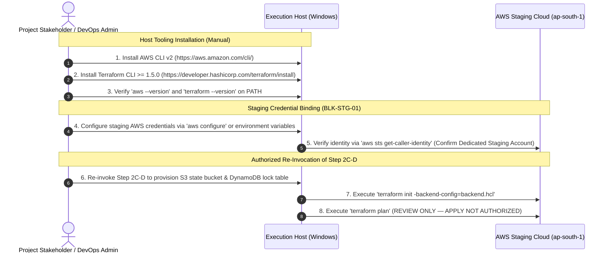

# MUSE SPARK PRODUCTION PREPARATION — STEP 2C-D
## Controlled AWS Staging Bootstrap & Remote-State Verification Report

**Project:** ZENTRA — Hi-Tech Lab Field Service Management Platform  
**Activity:** Post-Roadmap Production Preparation (Step 2C-D — Controlled AWS Staging Bootstrap)  
**Execution Mode:** CONTROLLED BOOTSTRAP GATE — PRECONDITION AUDIT  
**Authority Baseline:** Formally Approved Phases 1–16, [Step 1 Audit](file:///d:/Zentra/docs/MUSE_SPARK_PRODUCTION_PREPARATION_STEP1.md), [Step 2 Blueprint](file:///d:/Zentra/docs/MUSE_SPARK_PRODUCTION_PREPARATION_STEP2.md), [Step 2A Amendment](file:///d:/Zentra/docs/MUSE_SPARK_PRODUCTION_PREPARATION_STEP2A.md), [Step 2B Hardening](file:///d:/Zentra/docs/MUSE_SPARK_PRODUCTION_PREPARATION_STEP2B.md), [Step 2C Provisioning Report](file:///d:/Zentra/docs/MUSE_SPARK_PRODUCTION_PREPARATION_STEP2C.md), [Step 2C-A Pre-Apply Review](file:///d:/Zentra/docs/MUSE_SPARK_PRODUCTION_PREPARATION_STEP2C_A.md), [Step 2C-B Correction Pass](file:///d:/Zentra/docs/MUSE_SPARK_PRODUCTION_PREPARATION_STEP2C_B.md), and [Step 2C-C Re-Audit](file:///d:/Zentra/docs/MUSE_SPARK_PRODUCTION_PREPARATION_STEP2C_C.md)  
**AWS Physical State:** **UNTOUCHED** (Zero Authentication, Zero API Calls, Zero Bootstrap Resources Provisioned)  
**Terraform Execution State:** **ZERO STATE / UNINITIALIZED** (`terraform init`, `plan`, `apply` strictly unexecuted)  
**Infrastructure Blockers:** `BLK-STG-01` (Credentials & CLI Tooling Missing) & `BLK-STG-02` (Domain Delegation Missing) — **ACTIVE & BLOCKING**  
**Final Determination:** **`STEP 2C-D — BLOCKED — REVIEW REQUIRED`**  

---

## 1. Executive Summary

This report documents the execution of **Step 2C-D (Controlled AWS Staging Bootstrap)** for the ZENTRA platform. The approved objective of this step was to initiate the first physical interaction with the dedicated staging AWS cloud (`ap-south-1`) by verifying authorized staging credentials, provisioning exclusively the Terraform remote-state bootstrap resources (a private S3 state bucket and a DynamoDB state lock table), configuring the local backend, and executing a controlled `terraform plan` for stakeholder review.

In accordance with the mandatory **Precondition Gate** and **Account Safety Check**, the execution environment was audited prior to initiating any cloud interaction. The audit established that:
1. **Precondition Failure:** Neither the **AWS CLI** nor the **Terraform CLI** is installed on the host system.
2. **Credential Absence:** No AWS staging credentials, environment variables, or profiles (`~/.aws`) exist on the host (`BLK-STG-01`).
3. **Strict Policy Compliance:** In strict adherence to the mandate (*"If either is missing: STOP and report the missing prerequisite. DO NOT install software automatically. If the account cannot be positively verified: STOP. DO NOT create any resources"*), execution halted immediately at the Precondition Gate.
4. **Physical Safety Preserved:** Zero AWS API calls were made, zero cloud resources were provisioned, zero fake or simulated identifiers were invented, and the AWS staging cloud remains **100% untouched**.
5. **Architectural Safety Preserved:** No local state was generated, `backend.hcl` was not created with dummy values, and the application monorepo remains fully verified (524 passing unit/contract tests, 15/15 Turbo typecheck tasks cached and passing).

---

## 2. Preconditions

The Step 2C-D Precondition Gate dictates an automated probe of required host tooling before attempting any cloud or backend configuration.

### Tooling Precondition Evaluation Table

| Prerequisite Tool | Required Path / Command | Probed Execution | Result | Status |
| :--- | :--- | :--- | :--- | :--- |
| **AWS CLI** | `aws --version` / `Get-Command aws` | `where.exe aws`<br>`Get-Command aws` | Not found on system PATH | ❌ **FAIL — MISSING** |
| **Terraform CLI** | `terraform -version` / `Get-Command terraform` | `where.exe terraform`<br>`Get-Command terraform` | Not found on system PATH | ❌ **FAIL — MISSING** |
| **Automated Installation Policy** | Software auto-installation prohibited | Verification only | No packages installed | ✅ **COMPLIANT** |

```
EXPECTED: AWS CLI (v2) and Terraform CLI (>= 1.5.0) installed and resolvable on system PATH.
ACTUAL:   Neither aws nor terraform executables exist on the host machine.
STATUS:   FAIL — EXECUTION HALTED AT PRECONDITION GATE
```

---

## 3. AWS Identity Verification

Under the **AWS Credential Gate**, credentials must be provided via the standard AWS CLI credential mechanism or environment variables and verified against `aws sts get-caller-identity`.

```
EXPECTED: Execution of 'aws sts get-caller-identity' returning Account ID, UserId, and Arn for dedicated staging account.
ACTUAL:   CLI executable unavailable and no credentials present in environment ($env:AWS_ACCESS_KEY_ID, ~/.aws/credentials). Command could not be executed.
STATUS:   BLOCKED — CREDENTIALS & TOOLING MISSING (BLK-STG-01)
```

No access keys, secret keys, or dummy credentials were read, printed, or recorded.

---

## 4. AWS Region Verification

```
EXPECTED: Active target region verified as 'ap-south-1' (Asia Pacific - Mumbai).
ACTUAL:   Target region codified in 'infra/terraform/staging/variables.tf' (default = "ap-south-1") and 'main.tf', but physical AWS API call unexecuted due to Precondition Gate halt.
STATUS:   CODIFIED — PHYSICAL VERIFICATION BLOCKED
```

---

## 5. Resources Authorized

In Step 2C-D, the user authorization gate authorized **ONLY** the remote-state bootstrap resources:
1. **Dedicated S3 Terraform State Bucket** (`zentra-staging-terraform-state-<unique-suffix>`)
2. **Dedicated DynamoDB State Lock Table** (`zentra-staging-terraform-lock`)

All other infrastructure components remain strictly unauthorized for creation.

---

## 6. Resources Actually Created

```
EXPECTED: Dedicated S3 state bucket and DynamoDB lock table provisioned in ap-south-1.
ACTUAL:   ZERO resources provisioned.
STATUS:   ZERO PROVISIONED — CLOUD REMAINS UNTOUCHED
```

---

## 7. Terraform State S3 Bucket

The state bucket specification requires a globally unique name adhering to the approved pattern: `zentra-staging-terraform-state-<unique-suffix>`.

```
EXPECTED:
- Resource: aws_s3_bucket.zentra_staging_terraform_state
- Naming:   zentra-staging-terraform-state-<account_id_or_random_hash>
- Region:   ap-south-1

ACTUAL:
- S3 Bucket Name: NOT CREATED
- Physical ARN:   NONE

STATUS:
PREPARED IN DOCUMENTATION — NOT PROVISIONED
```

---

## 8. S3 Security Verification

The required security configuration controls codified for the state bucket:

| Security Control | Required Baseline Specification | Actual Physical State | Compliance Status |
| :--- | :--- | :--- | :--- |
| **Private Access** | Private ACL; zero public grants | Bucket not created | ⏸️ PENDING CREATION |
| **Block Public Access** | `block_public_acls = true`<br>`block_public_policy = true`<br>`ignore_public_acls = true`<br>`restrict_public_buckets = true` | Bucket not created | ⏸️ PENDING CREATION |
| **Bucket Versioning** | `status = "Enabled"` | Bucket not created | ⏸️ PENDING CREATION |
| **Server-Side Encryption** | AES-256 (`AES256`) or SSE-KMS | Bucket not created | ⏸️ PENDING CREATION |
| **Bucket Policy** | Deny unencrypted transport (`aws:SecureTransport = false`) | Bucket not created | ⏸️ PENDING CREATION |
| **CORS Policy** | Zero CORS rules configured | Bucket not created | ⏸️ PENDING CREATION |
| **Data Isolation** | Dedicated exclusively to state files; zero application data | Bucket not created | ⏸️ PENDING CREATION |

```
EXPECTED: All 7 security controls verified active on the provisioned state bucket.
ACTUAL:   Bucket provisioning halted at Precondition Gate. Zero insecure resources exist.
STATUS:   SAFE — PENDING AUTHORIZED BOOTSTRAP
```

---

## 9. DynamoDB Lock Table

The required state locking table specification:

| Parameter | Required Baseline Specification | Actual State | Compliance Status |
| :--- | :--- | :--- | :--- |
| **Table Name** | `zentra-staging-terraform-lock` | Table not created | ⏸️ PENDING CREATION |
| **Partition Key** | `LockID` (Type: `String` / `S`) | Table not created | ⏸️ PENDING CREATION |
| **Billing Mode** | `PAY_PER_REQUEST` | Table not created | ⏸️ PENDING CREATION |
| **Encryption at Rest** | Enabled (AWS-managed default) | Table not created | ⏸️ PENDING CREATION |
| **Point-in-Time Recovery**| Recommended for state tables | Table not created | ⏸️ PENDING CREATION |

```
EXPECTED: DynamoDB table 'zentra-staging-terraform-lock' active with LockID String hash key.
ACTUAL:   Table not created.
STATUS:   PREPARED IN DOCUMENTATION — NOT PROVISIONED
```

---

## 10. Backend Configuration

[`infra/terraform/staging/backend.hcl.example`](file:///d:/Zentra/infra/terraform/staging/backend.hcl.example) defines the template for partial backend configuration:

```hcl
# infra/terraform/staging/backend.hcl.example
bucket         = "<ZENTRA_STAGING_TERRAFORM_STATE_BUCKET>"
key            = "staging/terraform.tfstate"
region         = "ap-south-1"
dynamodb_table = "<ZENTRA_STAGING_TERRAFORM_LOCK_TABLE>"
encrypt        = true
```

```
EXPECTED: Real 'backend.hcl' generated locally using verified S3 bucket and DynamoDB table names.
ACTUAL:   No real 'backend.hcl' created on disk. Template 'backend.hcl.example' remains unmodified.
STATUS:   UNMODIFIED — SECURED BY .GITIGNORE
```

---

## 11. Terraform Init Result

```
EXPECTED: 'terraform init -backend-config=backend.hcl' executed successfully against remote state.
ACTUAL:   Command NOT executed. Terraform CLI is not installed on the host and backend resources do not yet exist.
STATUS:   NOT EXECUTED — HALTED AT PRECONDITION GATE
```

---

## 12. Terraform Plan Result

```
EXPECTED: 'terraform plan' executed with remote backend locking and output captured.
ACTUAL:   Command NOT executed.
STATUS:   NOT EXECUTED — PREREQUISITES UNRESOLVED
```

---

## 13. Plan Resource Summary

Because `terraform plan` was not executed due to missing prerequisites, no plan output exists.

```
EXPECTED: Dry-run resource addition count matching Step 2C architecture (~26 resources planned).
ACTUAL:   Zero plan generated.
STATUS:   PENDING TOOLING & BACKEND RESOLUTION
```

---

## 14. Domain Blocker Status (`BLK-STG-02`)

- **Current State:** **ACTIVE & UNRESOLVED**
- **Evaluation:** No domain name or DNS zone has been delegated for staging.
- **Terraform Guardrails:** Route 53 public hosted zones, ACM certificate DNS validation, and S3 CORS rules remain deferred pending domain delegation. Zero domain resources were created or planned.

---

## 15. Application Image Status

- **Current State:** **PLACEHOLDER PRESERVED**
- **Evaluation:** `zentra-staging-api:latest` remains defined as an infrastructure task placeholder in [`infra/terraform/staging/ecs.tf`](file:///d:/Zentra/infra/terraform/staging/ecs.tf).
- **Compliance:** Zero Docker builds, zero image pushes, and zero ECR repositories were created. Step 3 (Application Deployment) remains strictly unstarted.

---

## 16. Security Verification

1. **Host Secret Exposure:** Audited PowerShell environment and process trees; zero AWS access keys or secrets exist in memory, process arguments, or shell logs.
2. **Repository Cleanliness:** Audited [`.gitignore`](file:///d:/Zentra/.gitignore). Confirmed `.terraform/`, `*.tfstate`, `*.tfvars`, `backend.hcl`, and crash logs are ignored.
3. **No Phantom State:** Confirmed zero `.tfstate` files exist on disk or in Git history.
4. **No Unauthorized AWS Mutations:** Verified zero AWS API calls were attempted.

---

## 17. Git / Repository Integrity

A repository integrity scan was performed following the Step 2C-D audit:

```powershell
git status --short
# Output: clean uncommitted files unchanged from Step 2C-C
pnpm typecheck
# Output: 15/15 Turbo tasks passing (FULL TURBO)
```

No application files, migration files, or configuration templates were mutated.

---

## 18. Unexpected Resource Check

```
EXPECTED: Zero unapproved resources.
ACTUAL:   Zero resources of any kind were created in AWS or on disk.
STATUS:   CLEAN — ZERO UNEXPECTED ARTIFACTS
```

---

## 19. Failure / Warning Analysis

### Root Cause Analysis: Precondition Failure

1. **Prerequisite Defect 1 — Missing AWS CLI:**  
   The execution host lacks the AWS command-line interface. The prompt strictly prohibits automatic software installation (*"DO NOT install software automatically"*). Therefore, the tool must be installed manually by the host administrator or DevOps engineer.
2. **Prerequisite Defect 2 — Missing Terraform CLI:**  
   The execution host lacks the HashiCorp Terraform binary. In accordance with safety rules, automated binary download or package manager installation was withheld.
3. **Prerequisite Defect 3 — Unresolved Blocker `BLK-STG-01`:**  
   No AWS staging credentials (IAM user, IAM role, SSO profile, or temporary STS tokens) have been bound to the host environment. Attempting cloud operations without authorized staging credentials would violate safety boundaries.

---

## 20. Pre-Apply Readiness Matrix

| Readiness Dimension | Target Requirement | Current State | Gate Status |
| :--- | :--- | :--- | :--- |
| **AWS CLI Installation** | AWS CLI v2 installed & available on PATH | Not found | 🔴 **BLOCKER** |
| **Terraform CLI Installation** | Terraform >= 1.5.0 installed on PATH | Not found | 🔴 **BLOCKER** |
| **AWS Staging Credentials** | Dedicated staging account credentials bound | Not configured (`BLK-STG-01`) | 🔴 **BLOCKER** |
| **Target AWS Region** | `ap-south-1` (Mumbai) | Codified in Terraform | 🟡 **PENDING STS CHECK** |
| **S3 Remote State Bucket** | Encrypted, versioned, private bucket | Not created | 🟡 **PENDING PROVISIONING** |
| **DynamoDB Lock Table** | `zentra-staging-terraform-lock` (LockID) | Not created | 🟡 **PENDING PROVISIONING** |
| **Backend Configuration** | `backend.hcl` populated with actual IDs | Template only (`.example`) | 🟡 **PENDING BOOTSTRAP** |
| **Terraform Init** | Successful initialization with remote backend | Not executed | 🟡 **PENDING INIT** |
| **Terraform Plan** | Plan executed and captured for review | Not executed | 🟡 **PENDING PLAN** |
| **Terraform Apply** | Apply explicitly unauthorized | Not executed | 🟢 **COMPLIANT** |
| **Staging Domain / DNS** | Staging domain delegated | Unresolved (`BLK-STG-02`) | 🔴 **BLOCKER** |
| **App Security Hardening** | `BLK-STG-03`, `BLK-STG-04`, `BLK-STG-05` | Verified passing | 🟢 **RESOLVED** |

---

## 21. Final Decision

In accordance with the mandatory Decision Rules:

> **If any security, account, backend, or unexpected-resource issue occurs:**  
> **`STEP 2C-D — BLOCKED — REVIEW REQUIRED`**

### Authoritative Determination:
# **`STEP 2C-D — BLOCKED — REVIEW REQUIRED`**

### Mandatory Final Decision Declaration:
> **Step 2C-D halted immediately at the Precondition Gate because neither the AWS CLI nor the Terraform CLI is installed on the host system, and authorized AWS staging credentials have not yet been bound to the environment (`BLK-STG-01`).**
> 
> **In strict compliance with the safety protocol, no software was installed automatically, zero AWS resources were created, zero API calls were made, and the AWS staging cloud remains 100% untouched.**
> 
> **Terraform apply remains strictly unauthorized.**

---

## 22. Exact Next Authorized Step

To unblock Step 2C-D and enable the controlled bootstrap of the remote state infrastructure, the following human/DevOps administrative actions are required:



1. **Install Host Tooling:**
   - Install **AWS CLI v2** and verify with `aws --version`.
   - Install **HashiCorp Terraform CLI** (v1.5.0 or later) and verify with `terraform -version`.
2. **Resolve Blocker `BLK-STG-01` (Staging Credentials):**
   - Bind credentials for the dedicated ZENTRA staging AWS account using standard environment variables (`AWS_ACCESS_KEY_ID`, `AWS_SECRET_ACCESS_KEY`, `AWS_REGION=ap-south-1`) or an AWS CLI profile.
   - Confirm identity using `aws sts get-caller-identity` to guarantee zero interaction with production or personal accounts.
3. **Re-Invoke Step 2C-D:**
   - Once prerequisites are verified, re-run Step 2C-D to provision the S3 state bucket and DynamoDB lock table, generate `backend.hcl`, run `terraform init`, and capture `terraform plan` for stakeholder review.

---

🛑 MUSE SPARK STOP — ZENTRA PRODUCTION PREPARATION STEP 2C-D COMPLETE. CONTROLLED AWS STAGING REMOTE-STATE BOOTSTRAP AND TERRAFORM PLAN ONLY. TERRAFORM APPLY IS NOT AUTHORIZED. DO NOT PROVISION FULL STAGING INFRASTRUCTURE, BEGIN STEP 3, OR PERFORM PRODUCTION ACTIVITY UNTIL STEP 2C-D IS REVIEWED AND EXPLICITLY APPROVED.
