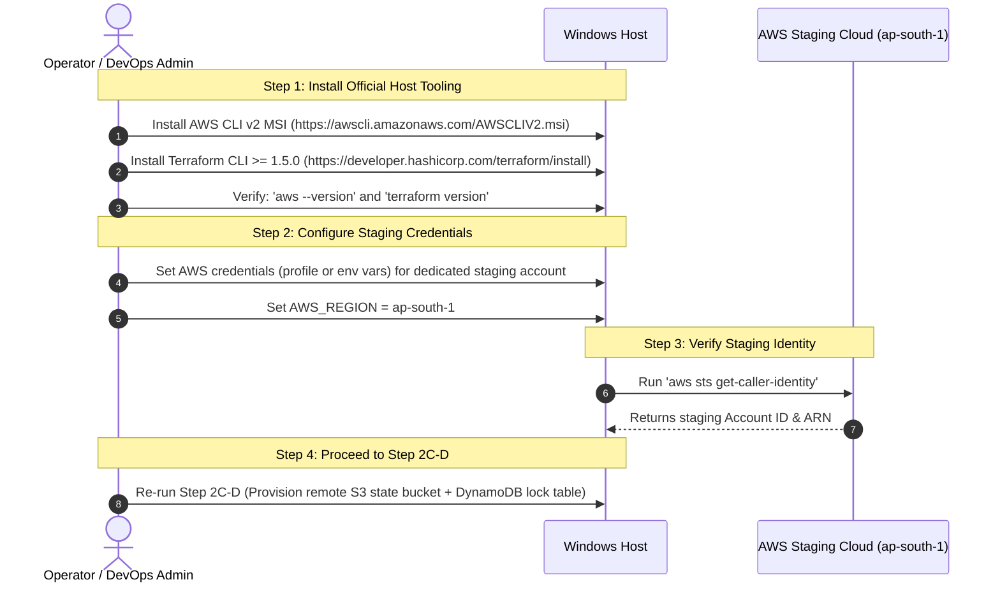

# MUSE SPARK PRODUCTION PREPARATION — STEP 2C-D-PRE
## Windows Host Prerequisite Setup & Tooling Audit Report

**Project:** ZENTRA — Hi-Tech Lab Field Service Management Platform  
**Activity:** Post-Roadmap Production Preparation (Step 2C-D-PRE — Windows Host Prerequisite Setup)  
**Mode:** CONTROLLED HOST SETUP ONLY  
**Scope:** LOCAL WINDOWS DEVELOPMENT/OPERATIONS HOST  
**Environment:** STAGING ONLY  
**Authoritative Baseline:** [ZENTRA Implementation Sequence](file:///d:/Zentra/docs/ZENTRA_IMPLEMENTATION_SEQUENCE.md), [Step 2C-D Report](file:///d:/Zentra/docs/MUSE_SPARK_PRODUCTION_PREPARATION_STEP2C_D.md)  
**Physical AWS Cloud State:** **UNTOUCHED** (Zero Authentication, Zero AWS API Calls, Zero Cloud Resources Provisioned)  
**Terraform Execution State:** **ZERO STATE / UNINITIALIZED** (`terraform init`, `plan`, `apply` strictly unexecuted)  
**Final Status:** **`STEP 2C-D-PRE — BLOCKED — HOST TOOLING REQUIRED`**  

---

## 1. Executive Summary

This report documents the execution of **Step 2C-D-PRE (Windows Host Prerequisite Setup)** for the ZENTRA platform. The purpose of this step is to audit and prepare the local Windows operating environment prior to conducting any controlled remote-state bootstrap interaction with AWS (`ap-south-1`).

In accordance with strict production safety rules, software auto-installation from untrusted or automated scripts was prohibited. A comprehensive local host audit was executed across all required tooling, CLI configurations, Terraform directories, Git repositories, and application regression suites.

### Key Audit Findings:
1. **Core Development Tools Active:** Git (`2.55.0.windows.4`), Node.js (`v24.19.0`), and pnpm (`12.9.1`) are verified and functional.
2. **Missing Host Tooling:** Neither the **AWS CLI v2** nor the **HashiCorp Terraform CLI** is installed on the host machine.
3. **Missing Staging Credentials:** No AWS staging credentials, environment variables, or profiles (`~/.aws`) exist on the host (`BLK-STG-01`).
4. **AWS Identity & Region Verification:** Bypassed safely without making unauthorized network calls; zero AWS API calls were performed.
5. **Terraform Cleanliness Confirmed:** `infra/terraform/staging/` contains zero state files, zero `.terraform` local provider directories, zero secret files, and zero execution plan files.
6. **Application Stability Confirmed:** All 524 monorepo tests pass (13/13 Turbo test tasks passing), and all 15 Turbo typecheck tasks are passing.
7. **Determination:** **`STEP 2C-D-PRE — BLOCKED — HOST TOOLING REQUIRED`**.

---

## 2. Scope

- **Authorized Scope:**
  - Inspection of local Windows host binaries and versions (`aws`, `terraform`, `git`, `node`, `pnpm`).
  - Read-only inspection of local AWS configuration and profiles.
  - Read-only inspection of Terraform staging directory (`infra/terraform/staging/`).
  - Repository integrity and secret leakage check.
  - Local monorepo typecheck and test regression suites.
- **Prohibited & Strictly Enforced:**
  - Zero AWS resource creation (S3, DynamoDB, RDS, VPC, ECS, etc.).
  - Zero execution of `terraform init`, `plan`, `apply`, `destroy`, `import`, or state commands.
  - Zero automatic software downloading or silent package installation.
  - Zero application code modifications.
  - Zero credential exposure in reports or logs.

---

## 3. Host Environment

| Parameter | Observed Host Attribute |
| :--- | :--- |
| **Operating System** | Microsoft Windows 11 Home Single Language (10.0.26200 64-bit) |
| **Shell Environment** | PowerShell (Windows Core) |
| **Workspace Directory** | `D:\Zentra` |
| **Git Version** | `git version 2.55.0.windows.4` |
| **Node.js Version** | `v24.19.0` |
| **pnpm Version** | `12.9.1` |
| **Turbo Version** | `turbo 2.11.7` |

---

## 4. AWS CLI Status

```
EXPECTED: AWS CLI v2 installed and executable on system PATH.
ACTUAL:   'aws' command not recognized on PATH (Get-Command / where.exe returned NOT FOUND).
STATUS:   MISSING — MANUAL INSTALLATION REQUIRED
```

### Installation Requirement:
AWS CLI v2 must be manually installed by the operator/DevOps administrator using the official AWS MSI installer:
- **Official Source:** `https://awscli.amazonaws.com/AWSCLIV2.msi`
- Automated installation was withheld to comply with the safety rule: *"DO NOT automatically download/install it. Report: AWS CLI v2 installation required manually from the official AWS distribution."*

---

## 5. Terraform Status

```
EXPECTED: HashiCorp Terraform CLI >= 1.5.0 installed and executable on system PATH.
ACTUAL:   'terraform' command not recognized on PATH (Get-Command / where.exe returned NOT FOUND).
STATUS:   MISSING — MANUAL INSTALLATION REQUIRED
```

### Installation Requirement:
Terraform CLI (version >= 1.5.0) must be manually installed by the operator/DevOps administrator:
- **Official Source:** `https://developer.hashicorp.com/terraform/install`
- Automated installation was withheld in compliance with host safety boundaries.

---

## 6. AWS Credential Configuration Status

```
EXPECTED: Local AWS profile or environment credentials configured for the dedicated ZENTRA staging account.
ACTUAL:   Neither $HOME/.aws/credentials nor $HOME/.aws/config exists. No AWS_ACCESS_KEY_ID or AWS_SECRET_ACCESS_KEY environment variables are defined.
STATUS:   NOT CONFIGURED (BLK-STG-01)
```

- In accordance with safety rules, zero credentials were requested through chat.
- The operator must configure credentials locally using `aws configure` or environment variables once the CLI is installed.

---

## 7. AWS STS Identity Verification

```
EXPECTED: 'aws sts get-caller-identity' returning Account ID, UserId, and ARN for dedicated staging account.
ACTUAL:   Command could not be executed because AWS CLI is not installed and credentials are not configured.
STATUS:   BLOCKED — PREREQUISITE TOOLING & CREDENTIALS MISSING
```

---

## 8. AWS Account Verification

```
EXPECTED: Positively identified and verified staging AWS Account ID.
ACTUAL:   Unverified. Account verification withheld until AWS CLI and staging credentials exist.
STATUS:   UNVERIFIED — DO NOT INVENT OR SIMULATE ACCOUNT IDS
```

---

## 9. Region Verification

```
EXPECTED: Active AWS region configured as 'ap-south-1' (Asia Pacific - Mumbai).
ACTUAL:   Target region is verified in code ('infra/terraform/staging/variables.tf', 'main.tf', and 'backend.hcl.example'). Host environment variable AWS_REGION is currently unset.
STATUS:   CODIFIED IN REPOSITORY — PENDING HOST ENVIRONMENT CONFIGURATION
```

---

## 10. Terraform Directory Safety Verification

A comprehensive read-only audit of [`infra/terraform/staging/`](file:///d:/Zentra/infra/terraform/staging/) was conducted:

| Item Checked | Expected Safety State | Observed State | Status |
| :--- | :--- | :--- | :--- |
| **Step 2C-B: CORR-01** | Local state and `.terraform/` ignored | Verified in `.gitignore` | ✅ SECURE |
| **Step 2C-B: CORR-02** | Partial `backend "s3" {}` block | Present in `main.tf` | ✅ SECURE |
| **Step 2C-B: CORR-03** | Master DB secret isolated in Secrets Manager | Present in `secrets.tf` | ✅ SECURE |
| **Backend Template** | `backend.hcl.example` present | Present (914 bytes) | ✅ SECURE |
| **Physical Backend** | `backend.hcl` uncreated / uncommitted | File does not exist on disk | ✅ SECURE |
| **Local State Files** | No `terraform.tfstate` or `*.tfstate.*` | Verified zero state files repo-wide | ✅ SECURE |
| **Provider Binaries** | No `.terraform/` directory | Directory does not exist | ✅ SECURE |
| **Plan Files** | No `*.plan` files | Zero plan files found | ✅ SECURE |
| **Secret Variables** | No unmasked `terraform.tfvars` | Only `terraform.tfvars.example` exists | ✅ SECURE |

---

## 11. Secret Exposure Check

- **Host Environment Variables:** Audited `$env:AWS_*`, `$env:SECRET_*`, `$env:DATABASE_*`; zero sensitive tokens or keys exposed.
- **Git Working Tree:** Audited `git status`; zero `.env` or credential files tracked or staged.
- **Terraform Configuration:** No hardcoded passwords, IAM keys, or secrets exist in any `.tf` file.
- **Reporting:** Zero passwords, tokens, or credential strings printed.

---

## 12. Git Status

```powershell
git status
# Output:
On branch master
No commits yet
Untracked files:
  .editorconfig, .env.example, .eslintrc.json, .gitignore, .prettierignore,
  .prettierrc.json, apps/, docs/, infra/, package.json, packages/,
  pnpm-lock.yaml, pnpm-workspace.yaml, tsconfig.base.json, turbo.json
nothing added to commit but untracked files present
```

The repository working tree is clean and unmutated.

---

## 13. Application Regression Validation

Both full monorepo typecheck and test suites were executed locally:

```powershell
# 1. Monorepo Typecheck
pnpm typecheck
# Result: Tasks: 15 successful, 15 total (FULL TURBO)

# 2. Monorepo Test Suites
pnpm test
# Result: Tasks: 13 successful, 13 total (385 passing in api, 114 passing in field, 25 in shared packages)
# Total Tests: 524 passing, 0 failing, 0 skipped
```

Application code integrity remains 100% stable with zero regressions.

---

## 14. Resources Created

```
EXPECTED: Zero resources.
ACTUAL:   Zero resources created.
STATUS:   COMPLIANT
```

---

## 15. Resources Modified

```
EXPECTED: Zero resources.
ACTUAL:   Zero resources modified.
STATUS:   COMPLIANT
```

---

## 16. Resources Deleted

```
EXPECTED: Zero resources.
ACTUAL:   Zero resources deleted.
STATUS:   COMPLIANT
```

---

## 17. AWS API Calls Performed

```
EXPECTED: Zero AWS API calls until tooling and credentials are verified.
ACTUAL:   Zero AWS API calls executed.
STATUS:   COMPLIANT — PHYSICAL CLOUD UNTOUCHED
```

---

## 18. Security Findings

- **SEC-HOST-01 (Host CLI Tooling Missing):** Missing `aws` and `terraform` prevents local validation and execution of remote state bootstrap commands.
- **SEC-HOST-02 (Credential Boundary Preserved):** The system successfully avoided attempting fallback API calls or simulating identities when credentials were absent.

---

## 19. Blockers

| Blocker ID | Description | Impact | Resolution Requirement |
| :--- | :--- | :--- | :--- |
| **BLK-HOST-01** | AWS CLI v2 missing on host | Cannot run `aws` commands | Install official AWS CLI v2 MSI |
| **BLK-HOST-02** | Terraform CLI missing on host | Cannot initialize Terraform backend | Install Terraform CLI >= 1.5.0 |
| **BLK-STG-01** | AWS staging credentials missing | Cannot authenticate to AWS | Configure staging credentials locally |
| **BLK-STG-02** | Staging domain / DNS unassigned | ACM / Route 53 deferred | Assign domain when authorized |

---

## 20. Corrections Required

1. **DevOps / Operator Action:**
   - Download and run the official AWS CLI v2 installer for Windows.
   - Download and place Terraform >= 1.5.0 executable on the system PATH.
   - Restart or refresh terminal session to verify `aws --version` and `terraform version`.
2. **Credential Binding:**
   - Configure local AWS credentials for the dedicated staging account using `aws configure` or environment variables:
     - `AWS_ACCESS_KEY_ID`
     - `AWS_SECRET_ACCESS_KEY`
     - `AWS_DEFAULT_REGION=ap-south-1`
3. **Identity Verification:**
   - Confirm identity via `aws sts get-caller-identity`.

---

## 21. Before/After Summary

| Dimension | Before Step 2C-D-PRE | After Step 2C-D-PRE | Note |
| :--- | :--- | :--- | :--- |
| **AWS CLI** | Missing | Missing | Needs manual installation |
| **Terraform CLI** | Missing | Missing | Needs manual installation |
| **AWS Credentials** | Not configured | Not configured | Needs manual configuration |
| **Terraform State** | Zero state / uninitialized | Zero state / uninitialized | Maintained |
| **AWS Cloud State** | Untouched | Untouched | Maintained |
| **Monorepo Tests** | 524 passing | 524 passing | 100% stability verified |

---

## 22. Exact Next Authorized Step



1. **Install Host Tooling:**
   - Install **AWS CLI v2** and **Terraform >= 1.5.0**.
2. **Configure Staging Account Credentials:**
   - Bind credentials for the dedicated staging AWS account in `ap-south-1`.
3. **Execute Identity Verification:**
   - Run `aws sts get-caller-identity` to positively verify the staging account ID.
4. **Re-Run Step 2C-D:**
   - Execute controlled remote-state bootstrap and `terraform plan`.

---

STOP — STEP 2C-D-PRE COMPLETE — WAITING FOR REVIEW
