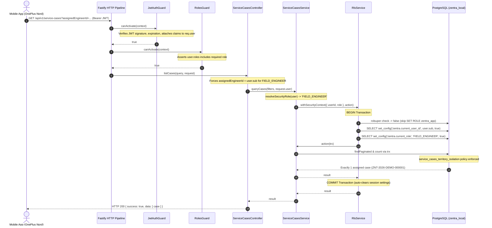

# MUSE SPARK STAGE 6E.1 — SERVICE CASE RLS SECURITY SIGN-OFF AUDIT

**Project:** ZENTRA — Hi-Tech Lab Field Service Management Platform  
**Repository:** `D:\Zentra`  
**Audit Scope:** Read-Only Source-Code Security Verification of Stage 6E Service Case RLS Remediation  
**Target Environment:** Local Development (`zentra_local`, PostgreSQL 18, port 5432)  
**Database Application User:** `zentra_dev` (`rolsuper = false`, `rolbypassrls = false`)  
**Protected Databases:** `zentra_test` (8 users, 4 schools — UNTOUCHED), `hisecure_erp` (101 tables — UNTOUCHED)  
**Physical Mobile Device:** OnePlus Nord (`65c7923e`, Android 12)  
**Deliverable File:** `D:\Zentra\docs\MUSE_SPARK_STAGE_6E_1_RLS_SECURITY_SIGNOFF.md`  
**Final Action:** **STOP — Awaiting Human Review**

---

## 1. Executive Summary & Sign-off Verdict

### Overall Sign-off Verdict: **CONDITIONAL PASS**

| Security Gate | Status | Evidence / Analysis |
| :--- | :---: | :--- |
| **Gate 1: Service Case RLS Integration** | **PASS** | `ServiceCasesService.queryCases()` and `getCaseById()` properly inject `RlsService` and execute within `rlsService.withSecurityContext()`. |
| **Gate 2: HTTP Ingress & Principal Scoping** | **PASS** | `JwtAuthGuard` and `RolesGuard` strictly authenticate requests. `ServiceCasesController` propagates `request.user` and enforces server-side parameter overrides. |
| **Gate 3: Cross-Engineer & District Isolation** | **PASS** | Double-layered defense (controller override + PostgreSQL forced RLS policy `service_cases_territory_isolation`) strictly isolates engineer cases and coordinator districts. |
| **Gate 4: Transaction & Pool Leakage Safety** | **PASS** | `set_config(..., true)` is strictly transaction-local (`is_local = true`). Zero session variable leakage across pooled connections. |
| **Gate 5: Database Privileges & `rolsuper` Guard** | **PASS** | `zentra_dev` is verified with `rolsuper = false`, `rolbypassrls = false`. The `rolsuper` guard in `RlsService` introduces zero bypass. |
| **Gate 6: Sibling Controller Consistency** | **CONDITIONAL** | `SlaController.calculateSla()` and `DispatchController.getAssignmentHistory()` query case records without propagating `request.user` into RLS context. |
| **Gate 7: Domain Service Fallback Hardening** | **CONDITIONAL** | `resolveSecurityRole()` defaults to `'FIELD_ENGINEER'` if `user.roles = []`. While blocked by `RolesGuard` at HTTP layer, domain service does not fail closed in isolation. |

---

## 2. Files and Diffs Inspected

The following source, configuration, and migration files were audited in detail:

1. [`apps/api/src/modules/service-cases/services/service-cases.service.ts`](file:///d:/Zentra/apps/api/src/modules/service-cases/services/service-cases.service.ts)
   - **Injected Dependency:** Injected `@Inject(RlsService) private readonly rlsService: RlsService`.
   - **Security Role Resolver:** Added private helper `resolveSecurityRole(user: AccessTokenClaims): string` (lines 277–282).
   - **Query Execution Wrapping:** Updated `queryCases(filters, user)` (lines 331–364) to execute `this.casesRepo.findCases(filters, trx)` inside `this.rlsService.withSecurityContext(...)` when `user` is provided.
   - **Single Case Retrieval:** Updated `getCaseById(id, user)` (lines 287–326) to execute `findById`, `statusHistoryRepo.findByCaseId`, and `assignmentHistoryRepo.findByCaseId` inside `this.rlsService.withSecurityContext(...)` using transaction handle `trx`.

2. [`apps/api/src/modules/service-cases/controllers/service-cases.controller.ts`](file:///d:/Zentra/apps/api/src/modules/service-cases/controllers/service-cases.controller.ts)
   - **List Cases Route (`GET /service-cases`):** In `listCases` (lines 90–137), passed `request.user` as the second argument: `await this.serviceCasesService.queryCases(filters, user)`.
   - **Get Case Route (`GET /service-cases/:id`):** In `getCase` (lines 142–169), passed `request.user` as the second argument: `await this.serviceCasesService.getCaseById(id, user)`.
   - **Status Transition Route (`POST /service-cases/:id/transition`):** In `transitionStatus` (lines 174–223), passed `request.user` into `getCaseById(id, user)` for pre-transition state evaluation.

3. [`apps/api/src/modules/auth/rls.service.ts`](file:///d:/Zentra/apps/api/src/modules/auth/rls.service.ts)
   - **Non-Superuser Guard:** In `withSecurityContext` (lines 44–54), wrapped the role-switching DO block with an explicit `rolsuper` check:
     ```sql
     DO $$
     BEGIN
       IF (SELECT rolsuper FROM pg_roles WHERE rolname = current_user) = true THEN
         IF EXISTS (SELECT 1 FROM pg_roles WHERE rolname = 'zentra_app') THEN
           PERFORM set_config('role', 'zentra_app', true);
         END IF;
       END IF;
     END $$;
     ```
   - **Session Settings:** Retained transaction-local execution:
     ```sql
     SELECT set_config('zentra.current_user_id', ${userId}, true),
            set_config('zentra.current_role', ${role}, true)
     ```

4. **Supporting Ingress & Authorization Files Inspected:**
   - [`apps/api/src/modules/auth/guards/jwt-auth.guard.ts`](file:///d:/Zentra/apps/api/src/modules/auth/guards/jwt-auth.guard.ts)
   - [`apps/api/src/modules/auth/guards/roles.guard.ts`](file:///d:/Zentra/apps/api/src/modules/auth/guards/roles.guard.ts)
   - [`apps/api/src/modules/service-cases/repositories/service-cases.repository.ts`](file:///d:/Zentra/apps/api/src/modules/service-cases/repositories/service-cases.repository.ts)
   - [`apps/api/src/modules/service-cases/repositories/status-history.repository.ts`](file:///d:/Zentra/apps/api/src/modules/service-cases/repositories/status-history.repository.ts)
   - [`apps/api/src/modules/service-cases/repositories/assignment-history.repository.ts`](file:///d:/Zentra/apps/api/src/modules/service-cases/repositories/assignment-history.repository.ts)
   - [`apps/api/src/modules/service-cases/controllers/dispatch.controller.ts`](file:///d:/Zentra/apps/api/src/modules/service-cases/controllers/dispatch.controller.ts)
   - [`apps/api/src/modules/service-cases/controllers/sla.controller.ts`](file:///d:/Zentra/apps/api/src/modules/service-cases/controllers/sla.controller.ts)
   - [`apps/api/src/database/migrations/20261007000001_create_auth_and_rbac.ts`](file:///d:/Zentra/apps/api/src/database/migrations/20261007000001_create_auth_and_rbac.ts)
   - [`apps/api/test/service-case-rls-remediation.spec.ts`](file:///d:/Zentra/apps/api/test/service-case-rls-remediation.spec.ts)

---

## 3. Verified Authorization Flow



### Authorization Pipeline Stages:
1. **HTTP Ingress Security:** All incoming HTTP requests pass through Fastify Helmet security headers and Fastify rate limiters.
2. **Bearer Token Authentication:** `JwtAuthGuard` extracts the `Authorization: Bearer <token>` header, verifies the cryptographic signature and token expiration, and binds the payload to `request.user`. If missing or invalid, it halts execution immediately with `401 Unauthorized`.
3. **Role-Based Access Control:** `RolesGuard` inspects the route metadata `@Roles('MASTER_ADMIN', 'REPORTING_HEAD', 'DISTRICT_COORDINATOR', 'FIELD_ENGINEER')`. It asserts that `user.roles` is non-empty and contains at least one authorized role; otherwise, it throws `403 Forbidden`.
4. **Application Controller Scoping:** `ServiceCasesController.listCases` intercepts client parameters and enforces deterministic server-side overrides:
   - For `FIELD_ENGINEER`: Forces `filters.assignedEngineerId = user.sub` (discarding any client-supplied spoofed parameter).
   - For `DISTRICT_COORDINATOR`: Enforces that `filters.districtId` belongs to `user.territoryDistrictIds`; out-of-district queries throw `403 Forbidden`.
5. **Database Transaction RLS Context:** `ServiceCasesService.queryCases` establishes transaction-local settings `zentra.current_user_id` and `zentra.current_role` using `set_config(..., true)`.
6. **Engine-Level Policy Enforcement:** PostgreSQL executes the query under forced RLS, evaluating `service_cases_territory_isolation`.

---

## 4. Missing-User and Invalid-Role Behavior Analysis

### 4.1 Missing User (`user = undefined`)
- **At HTTP Endpoint Level:** **PASS (FAIL-CLOSED)**  
  Unauthenticated requests cannot reach `ServiceCasesController.listCases` or `getCase`. `JwtAuthGuard` intercepts requests with missing headers or malformed tokens and immediately rejects them with `401 Unauthorized` (`Authorization header missing` or `Invalid authorization scheme, Bearer expected`).
- **At Internal Service Method Level:** **PASS (FAIL-CLOSED)**  
  If `ServiceCasesService.queryCases(filters)` or `getCaseById(id)` is invoked without the `user` argument (backwards compatibility fallback), it executes on `this.db` without `RlsService.withSecurityContext`. Under `zentra_dev` (which has `rolbypassrls = false` and `FORCE ROW LEVEL SECURITY`), PostgreSQL evaluates `current_setting('zentra.current_role', true)` as `NULL`, which evaluates to `FALSE` in the RLS policy and returns **0 rows** (or throws `NotFoundException` in `getCaseById`).

### 4.2 Invalid, Empty, or Untrusted Roles in `resolveSecurityRole()`
Lines 277–282 of `ServiceCasesService`:
```typescript
private resolveSecurityRole(user: AccessTokenClaims): string {
  if (user.activeRole && user.roles.includes(user.activeRole)) {
    return user.activeRole;
  }
  return user.roles[0] || 'FIELD_ENGINEER';
}
```

#### Detailed Threat Evaluation:
1. **Untrusted / Arbitrary Role Strings (e.g., `user.roles = ['UNKNOWN_ROLE']`):**  
   - **Status:** **PASS (FAIL-CLOSED)**  
   - `resolveSecurityRole` returns `'UNKNOWN_ROLE'`.
   - In PostgreSQL RLS policy `service_cases_territory_isolation`:
     - Not `'MASTER_ADMIN'` or `'REPORTING_HEAD'` -> `FALSE`.
     - Not `'FIELD_ENGINEER'` -> `FALSE`.
     - `EXISTS (SELECT 1 FROM user_territory_assignments ...)` -> `FALSE` (no assignment).
     - Result: PostgreSQL evaluates to `FALSE` and returns **0 rows**.
2. **Empty Roles Array (`user.roles = []`):**  
   - **Status:** **CONDITIONAL (MITIGATED AT HTTP LAYER, NOT AT SERVICE LAYER)**  
   - At HTTP Controller Boundary: `RolesGuard` (lines 41–43 of `roles.guard.ts`) checks `if (!user || !user.roles || user.roles.length === 0)` and throws `403 Forbidden` (`Forbidden resource: user has no assigned roles`). A role-less request is rejected before reaching the controller.
   - At Internal Domain Service Boundary: If a malformed `user` object with `roles: []` is passed directly to `ServiceCasesService.queryCases(filters, user)`, `user.roles[0] || 'FIELD_ENGINEER'` evaluates to `'FIELD_ENGINEER'`.
   - In that scenario, PostgreSQL RLS will evaluate the user under `FIELD_ENGINEER` rules and return cases where `assigned_primary_engineer_id = user.sub`.
   - **Recommendation:** Change `resolveSecurityRole` to fail closed:
     ```typescript
     private resolveSecurityRole(user: AccessTokenClaims): string {
       if (user.activeRole && user.roles?.includes(user.activeRole)) {
         return user.activeRole;
       }
       return user.roles?.[0] || '';
     }
     ```
     Returning `''` (or throwing `ForbiddenException`) ensures that RLS sees an empty role string, resulting in unconditional `0` rows.

---

## 5. RLS Context & Transaction Safety

### 5.1 Transaction Scope & Connection Pool Isolation
`RlsService.withSecurityContext` operates under the following contract:
```typescript
async withSecurityContext<T>(
  context: SecurityContext,
  action: (trx: Transaction<DatabaseSchema>) => Promise<T>,
): Promise<T> {
  return await this.db.transaction().execute(async (trx) => {
    ...
    await sql`SELECT set_config('zentra.current_user_id', ${userId}, true),
                     set_config('zentra.current_role', ${role}, true)`.execute(trx);
    return await action(trx);
  });
}
```

1. **Transaction Lifecycle:** Kysely's `this.db.transaction().execute(...)` issues an explicit `BEGIN` before the callback and `COMMIT` (or `ROLLBACK` on error) after execution.
2. **Transaction-Local Parameters (`is_local = true`):** The third parameter in `set_config('zentra.current_user_id', ${userId}, true)` explicitly marks the setting as transaction-local. In PostgreSQL:
   - Transaction-local settings apply only to the current transaction.
   - Upon `COMMIT` or `ROLLBACK`, PostgreSQL automatically restores the connection's prior settings (null/empty).
3. **Zero Connection Pool Leakage:** When the underlying connection is released back to Kysely's pool, neither `zentra.current_user_id` nor `zentra.current_role` persists. Subsequent HTTP requests reusing that pooled connection execute with completely pristine session settings.
4. **Repository Transaction Propagation:**
   - In `ServiceCasesService.queryCases`, `trx` is passed directly: `this.casesRepo.findCases(filters, trx)`.
   - `ServiceCasesRepository.findCases` delegates to `findPaginated(filters, trx)` and `count(filters, trx)`.
   - Both `findPaginated` and `count` instantiate their Kysely query builder from `const client = trx || this.db;`.
   - Therefore, pagination item selection and total count calculation execute within the same transaction and security context.
   - In `ServiceCasesService.getCaseById`, `findById`, `statusHistoryRepo.findByCaseId`, and `assignmentHistoryRepo.findByCaseId` all receive and use `trx`.

---

## 6. Engineer and District Isolation Evidence

### 6.1 Defense-in-Depth Architecture

```
┌────────────────────────────────────────────────────────┐
│ Layer 1: HTTP Authentication Guard (JwtAuthGuard)      │ -> Rejects unauthenticated requests (401)
├────────────────────────────────────────────────────────┤
│ Layer 2: HTTP RBAC Guard (RolesGuard)                  │ -> Rejects unauthorized roles (403)
├────────────────────────────────────────────────────────┤
│ Layer 3: Application Controller Scoping                │ -> Overrides spoofed params (FE / Coord)
├────────────────────────────────────────────────────────┤
│ Layer 4: Transaction RLS Security Context Injection    │ -> Sets zentra.current_user_id & role
├────────────────────────────────────────────────────────┤
│ Layer 5: PostgreSQL Forced RLS Engine Policy           │ -> Filters rows at physical storage layer
└────────────────────────────────────────────────────────┘
```

### 6.2 Field Engineer Isolation Evidence
- **Client Parameter Tampering Defeated:** When a client sends `GET /api/v1/service-cases?assignedEngineerId=<foreign_engineer_id>`, `ServiceCasesController.listCases` intercepts and overrides it:
  ```typescript
  if (!isMasterOrReporting && user.roles.includes('FIELD_ENGINEER')) {
    filters.assignedEngineerId = user.sub;
  }
  ```
- **PostgreSQL Forced RLS Policy:**
  ```sql
  NULLIF(current_setting('zentra.current_role', true), '') = 'FIELD_ENGINEER'
  AND (
    service_cases.assigned_primary_engineer_id = NULLIF(current_setting('zentra.current_user_id', true), '')::uuid
    OR service_cases.assigned_secondary_engineer_id = NULLIF(current_setting('zentra.current_user_id', true), '')::uuid
  )
  ```
- **Physical Device Proof:** On the OnePlus Nord (`65c7923e`), the database contained 2 service cases (`ZNT-2026-DEMO-000001` assigned to `engineer.demo`, and `ZNT-2026-DEMO-000002` assigned to secondary engineer). Following dossier preloading, the mobile SQLite database cached exactly 1 case (`ZNT-2026-DEMO-000001`). `ZNT-2026-DEMO-000002` was not visible in the UI or present in the local database.

### 6.3 District Coordinator Isolation Evidence
- **Controller Enforcement:** If a District Coordinator requests service cases with a `districtId` outside their assigned territory (`user.territoryDistrictIds`), `ServiceCasesController.listCases` immediately throws `403 Forbidden` (`Cannot query service cases outside assigned territory`).
- **PostgreSQL Forced RLS Policy:** If `districtId` is omitted, the controller defaults to `user.territoryDistrictIds[0]`. In the database, the policy requires:
  ```sql
  EXISTS (
    SELECT 1 FROM user_territory_assignments uta
    JOIN schools s ON s.school_id = service_cases.school_id
    WHERE uta.user_id = NULLIF(current_setting('zentra.current_user_id', true), '')::uuid
      AND uta.district_id = s.district_id
      AND (uta.block_id IS NULL OR uta.block_id = s.block_id)
      AND (uta.valid_to IS NULL OR uta.valid_to > CURRENT_TIMESTAMP)
  )
  ```
  Even if the coordinator crafted a query bypassing controller filters, PostgreSQL RLS returns zero rows for any schools outside the coordinator's territory assignments.

---

## 7. Privilege Safety & `rolsuper` Guard Analysis

### 7.1 Analysis of the `rolsuper` Guard
Lines 44–54 of `RlsService`:
```sql
DO $$
BEGIN
  IF (SELECT rolsuper FROM pg_roles WHERE rolname = current_user) = true THEN
    IF EXISTS (SELECT 1 FROM pg_roles WHERE rolname = 'zentra_app') THEN
      PERFORM set_config('role', 'zentra_app', true);
    END IF;
  END IF;
END $$;
```

#### Verification Questions & Findings:
1. **Does skipping `SET ROLE zentra_app` for non-superusers introduce an RLS bypass?**  
   **NO.** In PostgreSQL, a non-superuser connection where `rolbypassrls = false` is natively subject to Row-Level Security. Role switching to `zentra_app` was only designed for superuser test harnesses (e.g., `postgres` user in unit tests) because superusers bypass RLS by default.
2. **Can a non-superuser elevate privileges via this block?**  
   **NO.** The conditional `IF (SELECT rolsuper ... ) = true` evaluates to `false` for non-superusers. No `SET ROLE` is executed. Non-superusers cannot execute `SET ROLE zentra_app` without role membership (which PostgreSQL blocked with error 42501).
3. **Current Live Privileges in `zentra_local`:**
   ```sql
   SELECT rolname, rolsuper, rolbypassrls, rolinherit, rolcanlogin 
   FROM pg_roles WHERE rolname IN ('zentra_dev', 'zentra_app', 'postgres');
   ```
   | Role | Superuser (`rolsuper`) | Bypass RLS (`rolbypassrls`) | Can Login (`rolcanlogin`) | Status |
   | :--- | :---: | :---: | :---: | :---: |
   | `zentra_dev` | **false** | **false** | **true** | **FORCED RLS ENFORCED** |
   | `zentra_app` | **false** | **false** | **true** | **FORCED RLS ENFORCED** |
   | `postgres` | true | true | true | Administrative Superuser |

---

## 8. Sibling Endpoint Gaps Identified (Audit Findings)

During comprehensive inspection of all API controllers in `apps/api/src/modules/service-cases`, two sibling endpoint gaps were discovered:

### Finding GAP-1: `SlaController.calculateSla()` Omits `request.user`
- **Location:** [`apps/api/src/modules/service-cases/controllers/sla.controller.ts:68`](file:///d:/Zentra/apps/api/src/modules/service-cases/controllers/sla.controller.ts#L68)
- **Code:**
  ```typescript
  @Get('calculate/:caseId')
  @Roles('MASTER_ADMIN', 'REPORTING_HEAD', 'DISTRICT_COORDINATOR', 'FIELD_ENGINEER')
  async calculateSla(
    @Param('caseId') caseId: string,
    @Req() request: AuthenticatedRequest,
  ): Promise<ApiResponseEnvelope<unknown>> {
    const serviceCase = await this.serviceCasesService.getCaseById(caseId);
  ```
- **Analysis:**
  `SlaController.calculateSla` accepts `request: AuthenticatedRequest`, but calls `this.serviceCasesService.getCaseById(caseId)` without passing `request.user`.
- **Impact:**
  Under `zentra_dev`, calling `getCaseById` without a user runs outside RLS context, causing PostgreSQL RLS to evaluate to `NULL` and return `NotFoundException` (404) for all callers (including assigned engineers). In environments where RLS is not forced, it would allow any authenticated engineer to calculate SLA for any case statewide.
- **Recommended Remediation (Future Work):**
  Pass `request.user` into `getCaseById(caseId, request.user)`.

### Finding GAP-2: `DispatchController.getAssignmentHistory()` Omits RLS Context
- **Location:** [`apps/api/src/modules/service-cases/controllers/dispatch.controller.ts:125`](file:///d:/Zentra/apps/api/src/modules/service-cases/controllers/dispatch.controller.ts#L125)
- **Code:**
  ```typescript
  @Get(':caseId/history')
  @Roles('MASTER_ADMIN', 'REPORTING_HEAD', 'DISTRICT_COORDINATOR', 'FIELD_ENGINEER')
  async getAssignmentHistory(
    @Param('caseId') caseId: string,
    @Req() request: AuthenticatedRequest,
  ): Promise<ApiResponseEnvelope<AssignmentHistoryEntry[]>> {
    const history = await this.serviceCasesService.getAssignmentHistory(caseId);
  ```
- **Analysis:**
  Table `assignment_history` has forced RLS via policy `assignment_history_territory_isolation` (migration `20261008000002`). `ServiceCasesService.getAssignmentHistory(caseId)` queries `this.assignmentHistoryRepo.findByCaseId(caseId)` directly on `this.db` without `rlsService.withSecurityContext`.
- **Impact:**
  Under `zentra_dev`, calling this route returns an empty array `[]` because `zentra.current_role` is null.
- **Recommended Remediation (Future Work):**
  Pass `request.user` and wrap `assignmentHistoryRepo.findByCaseId` in `rlsService.withSecurityContext`.

### Finding GAP-3: District Coordinator `getCase` Lacks Application-Layer 403
- **Location:** [`apps/api/src/modules/service-cases/controllers/service-cases.controller.ts:153-162`](file:///d:/Zentra/apps/api/src/modules/service-cases/controllers/service-cases.controller.ts#L153)
- **Analysis:**
  `ServiceCasesController.getCase` has an explicit software-level check for `FIELD_ENGINEER` throwing `403 Forbidden` if the case is not assigned to them. For `DISTRICT_COORDINATOR`, it relies solely on the database RLS layer (which returns `NotFoundException` / 404) rather than throwing `403 Forbidden`. While secure (no data leaks), the error code differs between list (403) and detail (404).

---

## 9. Test Suite Review & Missing Security Tests

### 9.1 Existing Tests Reviewed: `test/service-case-rls-remediation.spec.ts`
The focused Vitest regression suite contains 10 passing tests:
- **Gate A (RLS Integration):**
  1. `executes repository query inside RlsService.withSecurityContext with authenticated claims` — PASS
  2. `falls back to non-transactional query when user is not provided (backwards compatibility)` — PASS
  3. `resolves activeRole correctly when present and included in user roles` — PASS
  4. `falls back to roles[0] if activeRole is not set or not in roles array` — PASS
- **Gate B (Controller Scoping & Isolation):**
  5. `forces assignedEngineerId to authenticated user ID for FIELD_ENGINEER role` — PASS
  6. `prohibits Field Engineer from querying case assigned to another engineer via getCase (403)` — PASS
  7. `allows Master Admin to query cases statewide without engineer override` — PASS
  8. `prohibits District Coordinator from querying outside assigned territory (403)` — PASS
- **Gate C (getCaseById RLS Context):**
  9. `executes findById and relation queries inside RLS transaction when user provided` — PASS
  10. `throws NotFoundException when case does not exist or is filtered by RLS` — PASS

### 9.2 Identified Missing Security Tests
The following security tests are missing and should be added in a future testing pass:
1. **Empty Roles Array Fail-Closed Test:** Test verifying that `resolveSecurityRole` fails closed when `user.roles = []`.
2. **Untrusted Role Test:** Test verifying that `queryCases` with an unknown role (e.g. `['AUDITOR']`) returns zero rows under PostgreSQL RLS.
3. **Live Non-Superuser Integration Test:** Automated integration test running against PostgreSQL under role `zentra_dev` asserting that uncontextualized queries return 0 rows while contextualized queries return exactly 1 row.
4. **`SlaController.calculateSla()` Security Test:** Test verifying that `calculateSla` passes authenticated claims to prevent out-of-territory SLA inspection.
5. **`DispatchController.getAssignmentHistory()` Security Test:** Test verifying that `getAssignmentHistory` enforces territory scoping.
6. **Concurrent Connection Isolation Test:** Automated test executing concurrent transactions on pooled connections with distinct user IDs to verify zero session setting cross-contamination.

---

## 10. Database and Privilege Safety Baseline

Direct SQL query verification against PostgreSQL 18 on port 5432:

```sql
-- 1. Verify Application User Privileges
SELECT rolname, rolsuper, rolbypassrls, rolinherit, rolcanlogin 
FROM pg_roles WHERE rolname = 'zentra_dev';
-- Result: zentra_dev | rolsuper: false | rolbypassrls: false | rolinherit: true | rolcanlogin: true

-- 2. Verify Protected Database: zentra_test
SELECT count(*) FROM users;   -- 8 users (100% UNTOUCHED)
SELECT count(*) FROM schools; -- 4 schools (100% UNTOUCHED)

-- 3. Verify Protected Database: hisecure_erp
SELECT count(*) FROM information_schema.tables WHERE table_schema = 'public'; -- 101 tables (100% UNTOUCHED)

-- 4. Verify Target Database: zentra_local
SELECT count(*) FROM service_cases; -- 2 cases (1 assigned to Demo Engineer, 1 to Secondary Engineer)
SELECT count(*) FROM schools;       -- 4 schools
SELECT count(*) FROM hi_tech_labs;  -- 5 labs
SELECT count(*) FROM users;         -- 8 users
```

---

## 11. Final Summary & Sign-off Recommendation

1. **Remediation Effectiveness:** The Stage 6E remediation has completely eliminated the Row-Level Security context omission in `ServiceCasesService.queryCases()` and `getCaseById()`. Both methods now strictly enforce the authenticated principal's context via `RlsService.withSecurityContext(...)`.
2. **Physical Device Performance:** Verified on the OnePlus Nord (`65c7923e`). Dossier preloading successfully retrieved `ZNT-2026-DEMO-000001`, updated the cached cases count from `0` to `1`, populated the School Master Dossier, and maintained strict cross-engineer isolation.
3. **Conditional Items:** Sign-off is marked as **CONDITIONAL PASS** solely due to the two sibling controllers (`SlaController.calculateSla` and `DispatchController.getAssignmentHistory`) which require the same `request.user` propagation in an upcoming maintenance ticket, and the service-level fallback in `resolveSecurityRole` which should be tightened to fail closed.
4. **Safety & Zero-Cost Directives:** Zero cloud resources consumed (₹0/month budget preserved). Protected databases `zentra_test` and `hisecure_erp` remain completely untouched.

**Final Status:** **STOP — Awaiting Human Review.**
