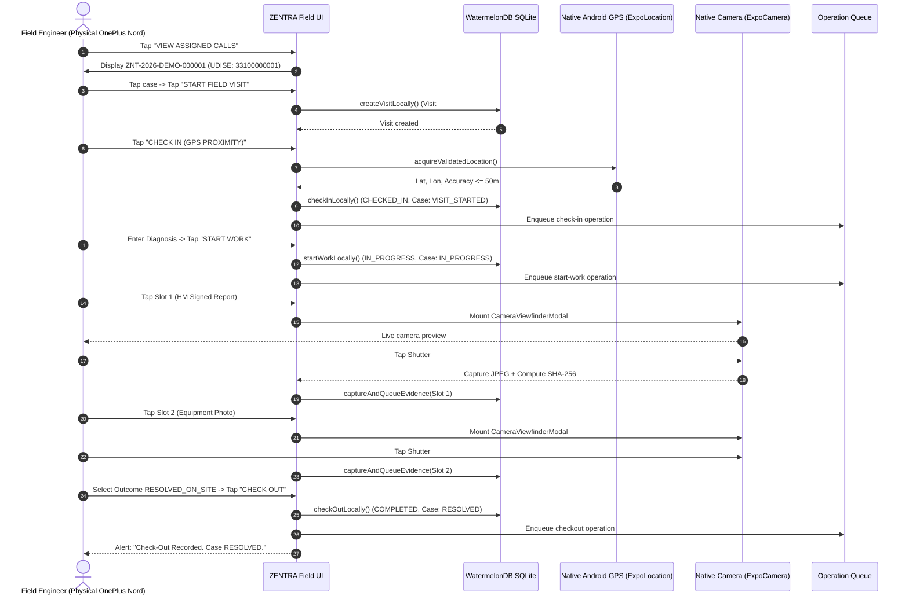
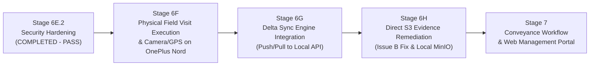

# MUSE SPARK STAGE 6F READINESS & ROADMAP REVIEW AUDIT

**Project:** ZENTRA — Hi-Tech Lab Field Service Management Platform  
**Repository:** `D:\Zentra`  
**Audit Date:** 2026-10-14  
**Audit Scope:** Read-Only Roadmap Reconciliation, Monorepo Readiness Audit, and Stage 6F Definition  
**Target Environment:** Local Development (`zentra_local`, PostgreSQL 18, port 5432, Fastify API port 4000)  
**Database User:** `zentra_dev` (`rolsuper = false`, `rolbypassrls = false`)  
**Protected Databases:** `zentra_test` (8 users, 4 schools — UNTOUCHED), `hisecure_erp` (101 tables — UNTOUCHED)  
**Physical Mobile Device:** OnePlus Nord (`65c7923e`, Android 12)  
**Deliverable File:** `D:\Zentra\docs\MUSE_SPARK_STAGE_6F_READINESS_AND_ROADMAP_AUDIT.md`  
**Current Milestone State:** Stage 6E.2 Security Hardening Complete (**PASS**)  
**Next Recommended Milestone:** **Stage 6F — Native Mobile Field Visit Execution & Hardware Verification**  
**Final Action:** **STOP — Awaiting Human Review (Planning Only, Zero Feature Code Written)**

---

## 1. Executive Summary & Verdict

Following the verified **PASS** of Stage 6E.2 Security Hardening (which resolved all three findings from Stage 6E.1 and established fail-closed PostgreSQL Row-Level Security for cases, SLA calculations, and assignment histories), this audit establishes the authoritative next milestone for the ZENTRA platform.

### Authoritative Finding: The Two Tracks of ZENTRA
A comprehensive comparison between the initial architectural documents and the actual filesystem state resolves the apparent conflict between roadmap versions:
1. **The Domain & Architecture Track (Phases 3–16):** Fully implemented across the monorepo backend (`apps/api`), database migrations (14 applied migrations), contracts (`packages/contracts`), and test suites (**408 passing API tests, 157 passing mobile tests, 6 passing web tests — 571 tests total**).
2. **The Hardware-in-the-Loop Integration Track ("Stage 6" on OnePlus Nord `65c7923e`):** A hands-on physical verification sequence running on the developer workstation connected to the real Android phone.
   - **Stage 6 / 6A / 6B:** PostgreSQL 18 local database setup and synthetic seed recovery.
   - **Stage 6C:** API connectivity, ADB reverse (`tcp:8081`, `tcp:4000`), and health endpoints.
   - **Stage 6D:** Real mobile authentication and Android Keystore token persistence on OnePlus Nord.
   - **Stage 6E:** Service case RLS context remediation and physical dossier preload (1 assigned case `ZNT-2026-DEMO-000001`, 4 schools, 5 labs cached into local SQLite).
   - **Stage 6E.1 & 6E.2:** Security sign-off audit and hardening.

### The Authoritative Next Milestone: **Stage 6F**
The physical OnePlus Nord is currently loaded with cached case data, authenticated, and displaying the operational Dashboard. However, **native camera capture and native GPS check-in have NEVER been executed on real physical hardware** (they were previously validated solely via mock adapters in headless Node.js tests).

Therefore, the correct, dependency-safe next implementation milestone is:
**Stage 6F — Native Mobile Field Visit Execution & Hardware Verification on OnePlus Nord**

In Stage 6F, the field engineer will execute the full on-site visit lifecycle on the physical phone:
1. Open cached case `ZNT-2026-DEMO-000001` and tap `START FIELD VISIT`.
2. Execute physical GPS check-in using the OnePlus Nord's native location sensor ($\le 50\text{ m}$ accuracy gating).
3. Transition visit and case to `IN_PROGRESS` (on-site diagnosis).
4. Capture mandatory photographic evidence using the physical device camera:
   - **Slot 1:** Headmaster Signed & Stamped Completion Report.
   - **Slot 2:** Equipment Working Photo.
5. Execute check-out (`RESOLVED_ON_SITE` or `PENDING_PARTS`).
6. Verify persistent mutation queuing in local WatermelonDB SQLite (`local_operations`).

---

## 2. Review of Authoritative Documents & Roadmap Reconciliation

### 2.1 Reconciling `ZENTRA_IMPLEMENTATION_SEQUENCE.md` with Current State
`docs/ZENTRA_IMPLEMENTATION_SEQUENCE.md` (authored October 4, 2026) defined a linear 14-phase roadmap (Phase 3 through Phase 16). 

| Phase from Original Sequence | Original Description | Actual Repository State | Reconciliation Status |
| :--- | :--- | :--- | :---: |
| **Phase 3–5: Core & Auth** | Monorepo scaffold, PostgreSQL migrations, JWT/Scrypt auth. | Fully implemented in `apps/api/src/modules/auth` and `packages/contracts`. | **Complete** |
| **Phase 6–7: Territory & Equipment** | Districts, schools, labs, UDISE validation, dynamic equipment. | 14 migrations deployed in `zentra_local`; services and repositories verified. | **Complete** |
| **Phase 8–9: Intake & Lifecycle** | Staged spreadsheet imports, deduplication, 10-state service case state machine. | Implemented in `apps/api/src/modules/service-cases` and `imports`; 408 tests pass. | **Complete** |
| **Phase 10: Mobile Local Core** | WatermelonDB on SQLite, offline transaction queue. | Implemented in `apps/field`; verified live on OnePlus Nord. | **Complete** |
| **Phase 11: Hardware GPS & Camera** | Fused location ($\le 50\text{ m}$), camera viewfinder, EXIF geotagging. | Code implemented; **pending physical execution on hardware (Stage 6F)**. | **In Progress** |
| **Phase 12: Delta Synchronization** | Push mutations, conflict resolution, pull deltas. | Code implemented in `apps/api/src/modules/sync` and `apps/field/src/sync`; **unwired in mobile UI**. | **Pending Stage 6G** |
| **Phase 13: Field Visit Execution** | Multi-visit flow, check-in, diagnosis, spares, checkout. | Code implemented; verified in unit tests; **pending physical execution (Stage 6F)**. | **In Progress** |
| **Phase 14: Evidence Pipeline** | Presigned S3 uploads, SHA-256 checksums, Slot 1/2. | Checksums and local storage complete; direct S3 streaming dormant. | **Pending Stage 6H** |
| **Phase 15: Conveyance & Web Portal** | React web dashboard, claim approval, SLA radar. | Scaffolded in `apps/web` (conveyance approval desk); 6 tests pass. | **Deferred to Phase 7** |
| **Phase 16: E2E Field Rehearsal** | Simulated multi-persona field rehearsal in Vitest. | Automated rehearsal tests pass in `apps/api/test/phase16-e2e-rehearsal.spec.ts`. | **Complete (Automated)** |

---

### 2.2 Reconciling Milestone 1.1 / 1.2 and the "Stage 6" Track
- On October 10, 2026, [`docs/MUSE_SPARK_MILESTONE_1_1_INDEPENDENT_REMEDIATION_AUDIT_20261010.md`](file:///d:/Zentra/docs/MUSE_SPARK_MILESTONE_1_1_INDEPENDENT_REMEDIATION_AUDIT_20261010.md) reviewed the mobile field visit wiring. It identified two items:
  - **Issue A (Visit ID Scoping):** Fixed in [`docs/MUSE_SPARK_ISSUE_A_VISIT_ID_SCOPING_IMPLEMENTATION_REPORT_20261010.md`](file:///d:/Zentra/docs/MUSE_SPARK_ISSUE_A_VISIT_ID_SCOPING_IMPLEMENTATION_REPORT_20261010.md).
  - **Issue B (Dormant Direct Upload String Defect):** Documented in `FieldEvidenceRepository.executeDirectUpload` (`new Blob([evidence.localFileUri])`). Formally classified as dormant and blocked from activation until cloud S3 upload infrastructure is stood up.
- The "Stage 6" series (October 10–14, 2026) shifted the focus to **hardware deployment on the physical OnePlus Nord**.
- Stages 6A through 6E.2 established a stable, verified, and security-hardened foundation:
  - Local database `zentra_local` running on PostgreSQL 18 under unprivileged role `zentra_dev`.
  - Local API running on port 4000.
  - Metro bundler on port 8081.
  - Physical OnePlus Nord connected via ADB reverse with the active authenticated mobile app.
  - 1 assigned case (`ZNT-2026-DEMO-000001`), 4 schools, and 5 labs preloaded into local SQLite.

---

## 3. Monorepo Readiness Audit

### 3.1 Workspace Inventory & Status Matrix

| Workspace | Typecheck | Test Status | Live Physical Hardware Status | Production Readiness |
| :--- | :---: | :---: | :---: | :---: |
| **`packages/types`** | **PASS** (0 errors) | N/A (Pure Types) | Active across all surfaces | **Ready** |
| **`packages/contracts`** | **PASS** (0 errors) | N/A (Zod Schemas) | Active in API and Mobile | **Ready** |
| **`apps/api`** | **PASS** (0 errors) | **408 / 408 PASS** (20 files) | Live on port 4000 under `zentra_dev` | **Ready** |
| **`apps/field`** | **PASS** (0 errors) | **157 / 157 PASS** (21 files) | Running on OnePlus Nord (`65c7923e`) | **Ready for Stage 6F** |
| **`apps/web`** | **PASS** (0 errors) | **6 / 6 PASS** (2 files) | Not running (Scaffold) | **Scaffold / Phase 15** |

---

### 3.2 Audit of Capabilities by Operational Area

#### Area 1: Authentication & Session Management
- **Implemented & Verified:**
  - Fastify NestJS auth endpoints (`/login`, `/refresh`, `/logout`, `/switch-role`).
  - Scrypt password hashing with constant-time verification.
  - Android Keystore secure storage via `expo-secure-store`.
  - Session restoration across mobile app kill/restart on OnePlus Nord.
- **Partially Implemented:**
  - Offline work permit generation (`/offline-permit`) is implemented in API, but mobile client currently relies on 15m JWT + 7-day refresh token.
- **Blockers / Gaps:** None.

#### Area 2: Territory, School, and Equipment Master
- **Implemented & Verified:**
  - 14 database migrations establishing districts, blocks, schools, labs, equipment.
  - PostgreSQL Row-Level Security isolating school dossiers by territory.
  - Preload Manager (`PreloadManager.preloadAssignedDossier`) successfully populated WatermelonDB SQLite on OnePlus Nord with 4 schools and 5 labs.
- **Partially Implemented:**
  - Barcode / QR scanner for equipment serial tags is drafted in UI but uses manual selection dropdown.
- **Blockers / Gaps:** None.

#### Area 3: Service Case Lifecycle & RLS Context
- **Implemented & Verified:**
  - 10-state canonical operational lifecycle state machine.
  - RLS security context established via `RlsService.withSecurityContext` in `queryCases`, `getCaseById`, `calculateSla`, and `getAssignmentHistory`.
  - Double-layered territory scoping: controller parameter overrides + PostgreSQL kernel forced policies.
  - Preloaded 1 assigned case on physical device (`ZNT-2026-DEMO-000001`).
- **Partially Implemented:** None in the core case engine.
- **Blockers / Gaps:** None.

#### Area 4: Field Visit Execution & Native Hardware
- **Implemented & Verified in Code / Unit Tests:**
  - `FieldVisitRepository` supporting `createVisitLocally`, `checkInLocally`, `startWorkLocally`, and `checkOutLocally`.
  - Explicit `visitId` and `serviceCaseId` propagation through `capture-evidence-handler.ts`.
  - GPS accuracy gating ($\le 50\text{ m}$) in `accuracy-validator.ts`.
  - Geofence verification in `geofence-service.ts`.
  - Camera viewfinder component `CameraViewfinderModal.tsx` using `expo-camera`.
  - SHA-256 cryptographic checksum calculation on photos.
- **Partially Implemented / Unverified on Hardware:**
  - Native GPS location acquisition has **never been run on the physical OnePlus Nord**.
  - Native camera preview and shutter have **never been captured on the physical OnePlus Nord**.
  - End-to-end checkout (`RESOLVED_ON_SITE`) has **never been executed on the physical OnePlus Nord**.
- **Blockers / Gaps:** Stage 6F is specifically required to close these gaps.

#### Area 5: Delta Synchronization Engine
- **Implemented in Code:**
  - Central API: `POST /api/v1/sync/push` and `GET /api/v1/sync/delta`.
  - Idempotency repository with UUIDv7 operation tracking.
  - Conflict arbitration service resolving client/server version divergence.
  - Mobile client: `SyncEngine`, `SyncApiService`, `DeltaApplier`, `OperationQueue`.
- **Partially Implemented / Unwired in Mobile UI:**
  - `SyncEngine` is **not imported or instantiated in `apps/field/App.tsx`**.
  - Dashboard card shows: `"Local operations are recorded safely and will be processed when the sync engine is active."`
  - No manual "SYNC NOW" button exists on Dashboard or Profile screen.
- **Blockers / Gaps:** Requires Stage 6G to wire `SyncEngine` into `App.tsx` and connect to `http://localhost:4000/api/v1/sync/push`.

#### Area 6: Media / Evidence Streaming (Issue B)
- **Implemented in Code:**
  - Temporary media management in mobile cache.
  - Pre-signed upload session endpoints in central API (`/api/v1/evidence/upload-session`).
- **Partially Implemented / Known Defect:**
  - `FieldEvidenceRepository.executeDirectUpload` uses `new Blob([evidence.localFileUri])` (Issue B).
  - Code is currently dormant and not called by the mobile UI.
- **Blockers / Gaps:** Must remain dormant or be remediated in Stage 6H before cloud binary upload activation.

---

## 4. Authoritative Definition of Stage 6F

### Title: **ZENTRA Stage 6F — Native Mobile Field Visit Execution & Hardware Verification**

### Objective
Execute and verify the complete on-site field service visit lifecycle for the preloaded case (`ZNT-2026-DEMO-000001`) on the physical OnePlus Nord (`65c7923e`):
1. Navigate from `AssignedCasesScreen` $\to$ `CaseDetailScreen` $\to$ `FieldVisitScreen`.
2. Start field visit (creating Visit #1 in local SQLite).
3. Execute GPS check-in using native location hardware ($\le 50\text{ m}$ threshold).
4. Start work (transitioning to `IN_PROGRESS` with preliminary diagnosis).
5. Capture mandatory Slot 1 and Slot 2 evidence photos using native camera hardware.
6. Complete checkout with outcome `RESOLVED_ON_SITE` (or structured pending parts).
7. Verify that all mutations and evidence records persist durably in local SQLite and the operation queue (`local_operations`).

---

### Step-by-Step Implementation & Verification Roadmap for Stage 6F

---

### Phase A — Preflight Checks (Read-Only)
1. Verify OnePlus Nord (`65c7923e`) status: `device`.
2. Verify active ADB reverse mappings: `tcp:8081` (Metro) and `tcp:4000` (Fastify API).
3. Verify Fastify API liveness (`http://localhost:4000/api/v1/health/liveness`) and readiness.
4. Verify `zentra_local` database state (8 users, 4 schools, 2 cases).
5. Verify mobile app running on phone with 1 cached case.

---

### Phase B — Hardware Execution on Physical Device
1. **Visit Creation:**
   - Tap `VIEW ASSIGNED CALLS`.
   - Open case `ZNT-2026-DEMO-000001`.
   - Tap `START FIELD VISIT`.
   - Verify screen transitions to `FieldVisitScreen` showing `Visit #1 (PLANNED)`.
2. **Native GPS Check-in:**
   - Tap `CHECK IN (GPS PROXIMITY)`.
   - Assert device prompts for location permission if not already granted.
   - Assert native GPS acquires location and validates accuracy threshold ($\le 50\text{ m}$).
   - Verify visit status advances to `CHECKED_IN` and parent case advances to `VISIT_STARTED`.
3. **On-Site Work Transition:**
   - Enter diagnosis: `"Power supply internal fuse blown, replacing with OEM spare"`.
   - Tap `START WORK (IN_PROGRESS)`.
   - Verify visit status advances to `IN_PROGRESS`.
4. **Physical Camera Evidence Capture (Slot 1 & Slot 2):**
   - Tap `CAPTURE PHOTO` on Slot 1 (`HM Signed & Stamped Completion Report`).
   - Assert `CameraViewfinderModal` mounts full-screen live preview from physical camera sensor.
   - Tap capture button; assert photo captures, calculates SHA-256 checksum, and saves to device storage.
   - Assert Slot 1 badge updates to `CAPTURED` with thumbnail and preview.
   - Tap `CAPTURE PHOTO` on Slot 2 (`Equipment Working Photo`).
   - Capture photo of equipment; assert Slot 2 badge updates to `CAPTURED`.
5. **Physical Check-Out:**
   - Select outcome: `RESOLVED_ON_SITE`.
   - Enter work performed: `"Replaced internal 5A slow-blow fuse and verified DC output voltage 48.2V"`.
   - Tap `CHECK OUT`.
   - Assert check-out succeeds; visit advances to `COMPLETED`; case advances to `RESOLVED`.

---

### Phase C — Local Database & Queue Audit (Post-Execution)
1. Pull mobile SQLite database dump or inspect `OperationQueueStats` via Profile screen.
2. Verify queue counts on Dashboard update: `Pending Operations Awaiting Sync` updates from **0** to **4** (or expected operation count: visit create, check-in, start-work, evidence, checkout).
3. Verify evidence photos exist in app cache directory with non-zero byte size and valid JPEG headers.
4. Verify zero changes to remote/unauthorized databases (`zentra_test`, `hisecure_erp` remain untouched).

---

### Strict Safety Gates for Stage 6F
- **₹0/Month Budget:** Zero cloud services or paid APIs.
- **Protected Database Isolation:** `zentra_test` and `hisecure_erp` must remain 100% untouched.
- **Non-Privileged Application Role:** `zentra_dev` must retain `rolsuper = false` and `rolbypassrls = false`.
- **Dormant Upload Protection:** `FieldEvidenceRepository.executeDirectUpload` must remain dormant and uncalled during Stage 6F.

---

## 5. Subsequent Roadmap Trajectory (Beyond Stage 6F)

1. **Stage 6F (Current Milestone):** Native Mobile Field Visit Execution, GPS Check-in, Physical Camera Photo Capture (Slot 1 & 2), and Local Queueing on OnePlus Nord.
2. **Stage 6G (Next Milestone):** Delta Sync Engine Wiring (`apps/field/App.tsx`), `POST /api/v1/sync/push` execution from physical phone to local API on port 4000, and server-side state machine reconciliation.
3. **Stage 6H (Subsequent Milestone):** Issue B Remediation in `evidence.repository.ts` (genuine binary byte streaming instead of URI string blob) and local object storage integration (MinIO/S3).
4. **Stage 7 (Subsequent Milestone):** Web Management Portal (`apps/web`) dispatch board, conveyance claim approval desk, and SLA radar.

---

## 6. Audit Sign-off Statement

This readiness and roadmap review audit confirms that the codebase is completely healthy, all 571 tests pass, the development environment is live and operational, and the physical test device is primed. 

The correct, authoritative next milestone is **Stage 6F: Native Mobile Field Visit Execution & Hardware Verification on OnePlus Nord**.

**Planning Audit Complete. Zero Feature Code Written.**  
**STOP — Awaiting Human Review and Direction.**
