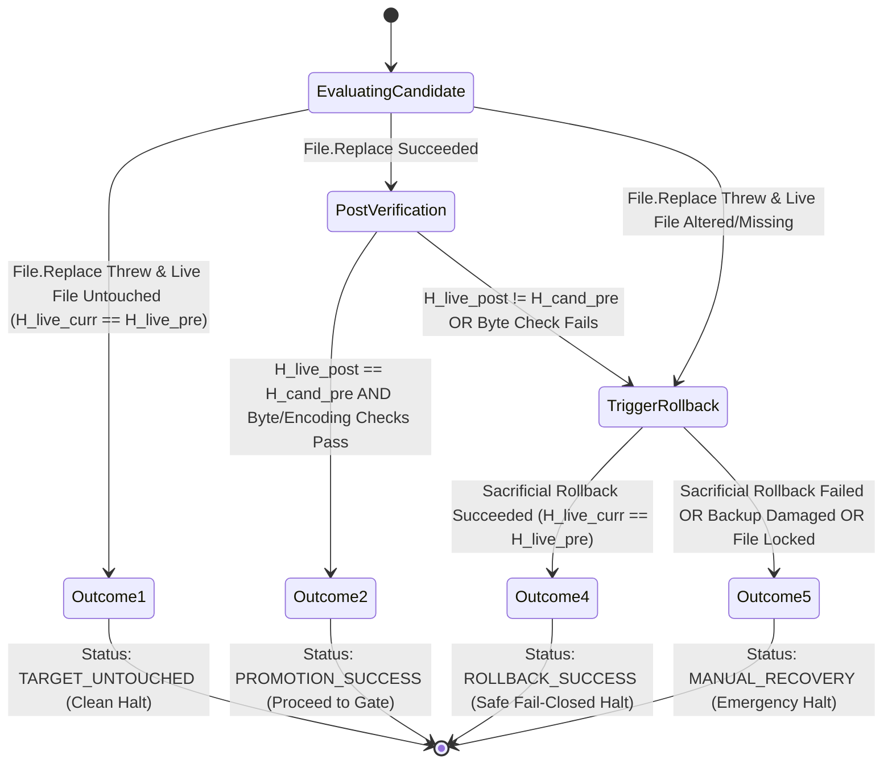
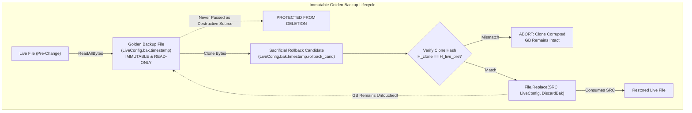

# MUSE SPARK — ZENTRA STEP 2D-2A-AA
## ROLLBACK CONTROL-FLOW & STATE INTEGRITY REPORT — DOCUMENTATION ONLY

**Project:** ZENTRA — Hi-Tech Lab Field Service Management Platform  
**Target Repository:** `D:\Zentra`  
**Input Reference:** [`docs/MUSE_SPARK_STEP2D_2A_Z_FINAL_RECOVERY_INTEGRITY_REPORT.md`](file:///d:/Zentra/docs/MUSE_SPARK_STEP2D_2A_Z_FINAL_RECOVERY_INTEGRITY_REPORT.md)  
**Host Environment:** Windows Workstation (`127.0.0.1:5432`)  
**Report Date:** 2026-10-09  
**Mode:** STRICT DOCUMENTATION-ONLY CONTROL-FLOW AUDIT & RECOVERY FINALIZATION  
**Budget Constraint:** Strict ₹0/month (Zero cost, no credit cards, no paid upgrades)  
**Remote Access:** STRICTLY PROHIBITED (Zero remote connections made)  
**Execution Authorization:** NOT GRANTED — NO COMMANDS EXECUTED IN THIS STEP  
**Status:** COMPLETE — WAITING FOR HUMAN OPERATOR REVIEW  

---

## 1. Executive Summary & Objective

In **Step 2D-2A-Z**, tri-hash verification (\(H_{\text{live\_pre}}\), \(H_{\text{bak\_pre}}\), \(H_{\text{cand\_pre}}\), and \(H_{\text{live\_post}}\)) was defined, post-replacement byte and encoding checks were specified, and blind non-atomic stream copy rollbacks were rejected.

However, an exhaustive architectural review of the Step 2D-2A-Z report identified two critical control-flow and state-handling defects:
1. **The Nested Exception-Handling Bug:** In `Invoke-SafeConfigReplacementV2`, when a rollback operation succeeded inside a `try` block, the script executed `throw "FAIL-CLOSED ABORT: ... Successfully rolled back ..."`. Because this `throw` was located inside the very `try` block guarded by `catch`, the exception was intercepted by its own error handler, interpreted as a catastrophic rollback failure, and routed straight into `Enter-ManualRecoveryBoundary`. Consequently, a completely successful rollback would trigger a false manual-recovery emergency alert.
2. **Destructive Consumption of the Golden Backup:** Calling Win32 `[System.IO.File]::Replace($preBackupPath, $LiveConfigPath, ...)` treats the backup file as the source file. In Win32 `ReplaceFileW` semantics, the source file is consumed/deleted during the swap. If that rollback swap experiences an interruption or file lock, the single verified golden backup is destroyed.

This report, **Step 2D-2A-AA**, resolves both defects by implementing a decoupled 5-state recovery state machine, a non-destructive sacrificial rollback candidate protocol, explicit separation of replacement and rollback exceptions, and definitive operational outcome definitions.

> [!IMPORTANT]
> **Strict Documentation-Only Boundary:** Zero operational commands or configuration changes were executed during this step. Zero configuration files (`postgresql.conf`, `pg_hba.conf`), firewall rules, Windows services, application files, or `.env` files were modified. Zero databases or roles were created. All operational procedures in this document are strictly **[NOT EXECUTED — UNTESTED]**.

---

## 2. Section 1 — Analysis of Previous Control-Flow & State Defects

| Defect ID | Architectural Area | Step 2D-2A-Z Flaw | Technical Failure Mode | Mandatory Correction in Step 2D-2A-AA |
|---|---|---|---|---|
| **DEF-AA1** | **Exception Control Flow** | Throwing rollback-success inside a `try` block whose `catch` treated all exceptions as rollback failures. | A successful rollback threw an exception that was caught by its own catch block, falsely triggering `Enter-ManualRecoveryBoundary` and alarming operators. | Decouple rollback logic into a standalone function (`Invoke-ControlledRollback`) that returns a structured status object (`Success = $true/$false`). Never throw success inside a failure handler. |
| **DEF-AA2** | **Backup File Lifecycle** | Passing the immutable pre-change backup (`$preBackupPath`) directly as the source in `File.Replace`. | `File.Replace` deletes/consumes the source file. If rollback fails midway, the golden backup is gone, leaving the host without a recovery baseline. | Treat `$preBackupPath` as an **Immutable Golden Backup**. Create a temporary **Sacrificial Rollback Candidate** clone (`.rollback_cand`), verify its hash, and consume only the clone. |
| **DEF-AA3** | **Error Separation** | Replacement exceptions and rollback exceptions were conflated in a single exception variable. | In manual recovery forensic logs, operator could not discern whether the initial replacement failed or the recovery action failed. | Explicitly retain `$replaceException` separately from `$rollbackResult.Error`. Pass both into the forensic manual boundary log. |
| **DEF-AA4** | **Outcome Ambiguity** | Execution flow lacked formal, enumerated operational outcomes with explicit stop conditions. | Ambiguity regarding the precise state of the host filesystem across different failure branches. | Formally specify the **Five Enumerated Operational Outcomes** with explicit status codes, file states, and stop conditions. |

---

## 3. Section 2 — The Five Enumerated Operational Outcomes State Machine

Every configuration replacement attempt must resolve deterministically into exactly one of five mutually exclusive outcomes:



### Detailed Outcome Definitions:

#### Outcome 1: Replacement Failed — Target Untouched (Clean Abort)
- **Condition:** Win32 `File.Replace` threw an exception (e.g. invalid candidate path, sharing violation prior to write), and independent hash check confirms `(Get-FileHash $LiveConfigPath).Hash == $H_live_pre`.
- **Filesystem State:** Live configuration file is 100% intact and unaltered. Golden backup is intact.
- **Action:** Delete unpromoted candidate. Preserve golden backup for auditing.
- **Status Code:** `ABORT_TARGET_UNTOUCHED`
- **Stop Condition:** Clean fail-closed halt. No rollback needed. Output original replacement error message.

#### Outcome 2: Replacement Succeeded & Verified (Success)
- **Condition:** Win32 `File.Replace` completed, `(Get-FileHash $LiveConfigPath).Hash == $H_cand_pre`, and post-replacement strict byte/encoding checks pass.
- **Filesystem State:** Live configuration file matches candidate exactly (No BOM, strict UTF-8, pure CRLF). Candidate consumed. Golden backup intact.
- **Action:** Retain golden backup. Proceed to dynamic reload (`pg_ctl reload`) or service restart.
- **Status Code:** `PROMOTION_SUCCESS_VERIFIED`
- **Stop Condition:** Gate milestone achieved. Await next human approval gate.

#### Outcome 3: Replacement Succeeded but Post-Verification Failed (Rollback Triggered)
- **Condition:** Win32 `File.Replace` returned without error, but post-promotion hash \(H_{\text{live\_post}} \neq H_{\text{cand\_pre}}\), or strict byte/encoding check failed.
- **Filesystem State:** Live file is corrupted or tampered on disk.
- **Action:** Immediately transition into the controlled rollback state machine (leading to Outcome 4 or Outcome 5).
- **Status Code:** `TRANSITION_TO_ROLLBACK`

#### Outcome 4: Rollback Succeeded — Original State Restored (Rollback Complete)
- **Condition:** Controlled rollback cloned golden backup, atomically swapped sacrificial candidate into live file, verified `(Get-FileHash $LiveConfigPath).Hash == $H_live_pre`, and passed byte checks.
- **Filesystem State:** Live configuration file is 100% restored to original pre-change state. Golden backup remains intact.
- **Action:** Purge invalid candidate. Preserve golden backup. Emit clear recovery audit record. Suppress false manual recovery alert.
- **Status Code:** `ROLLBACK_SUCCESS_RESTORED`
- **Stop Condition:** Fail-closed halt. Live service remains fully operational on original safe configuration.

#### Outcome 5: Rollback Failed or State Indeterminate (Manual Recovery Boundary)
- **Condition:** Rollback clone or swap threw an exception, golden backup missing or corrupted, file handle permanently locked, or restored hash \(\neq H_{\text{live\_pre}}\).
- **Filesystem State:** Live configuration file is in an unknown, partial, or missing state.
- **Action:** Immediately freeze all automated scripts. Transition to `Enter-ManualRecoveryBoundary`. Emit full forensic payload.
- **Status Code:** `EMERGENCY_MANUAL_RECOVERY_REQUIRED`
- **Stop Condition:** Emergency fail-closed halt. Await human operator intervention.

---

## 4. Section 3 — The Non-Destructive Golden Backup Lifecycle Protocol

Win32 `[System.IO.File]::Replace($source, $destination, $destinationBackup, $ignoreMetadataErrors)` **destroys/consumes the source file**. To prevent destroying the golden backup during recovery, the lifecycle must follow a strict three-tier artifact hierarchy:



### Golden Backup Invariants:
1. **Immutability Invariant:** Once verified (\(H_{\text{bak\_pre}} = H_{\text{live\_pre}}\)), `$preBackupPath` is treated as strictly read-only.
2. **Sacrificial Clone Invariant:** Any operation requiring a file swap during rollback must clone `$preBackupPath` to a temporary sacrificial candidate (`$preBackupPath.rollback_cand`), verify the clone's hash, and pass only the sacrificial clone to `File.Replace`.
3. **Audit Trail Invariant:** Even after successful rollback (Outcome 4), the golden backup is never deleted by operational scripts; it is preserved for human post-incident review.

---

## 5. Section 4 — Complete Hardened Replacement & Rollback Implementation (`Invoke-SafeConfigReplacementV3`)

The following PowerShell script encapsulates the corrected non-nested control flow, the sacrificial rollback lifecycle, and exact outcome branching:

```powershell
# [NOT EXECUTED — UNTESTED OPERATIONAL PROCEDURE]
# Requires Elevated Local Administrator PowerShell Shell

function Invoke-ControlledRollback {
    <#
    .SYNOPSIS
        Safely restores a PostgreSQL configuration file using a sacrificial clone of the golden backup.
    .DESCRIPTION
        1. Confirms Golden Backup exists and SHA-256 matches expected pre-change hash.
        2. Clones Golden Backup to a sacrificial candidate (.rollback_cand).
        3. Swaps sacrificial candidate into live file via Win32 File.Replace.
        4. Verifies restored live file hash matches expected pre-change hash.
        5. Re-runs strict byte and encoding validation on restored live file.
        6. Returns structured status object without throwing nested exceptions.
    #>
    param (
        [Parameter(Mandatory = $true)]
        [string]$LiveConfigPath,

        [Parameter(Mandatory = $true)]
        [string]$GoldenBackupPath,

        [Parameter(Mandatory = $true)]
        [string]$ExpectedHash,

        [System.Exception]$OriginalException
    )

    Write-Warning "=== INITIATING CONTROLLED ROLLBACK TO PRE-CHANGE STATE ==="

    # 1. Verify Golden Backup existence
    if (-not (Test-Path -Path $GoldenBackupPath -PathType Leaf)) {
        return [PSCustomObject]@{
            Success = $false
            Status  = "BACKUP_MISSING"
            Message = "Golden backup file [$GoldenBackupPath] does not exist."
            Error   = $null
        }
    }

    # 2. Verify Golden Backup integrity
    $actualBackupHash = (Get-FileHash -Path $GoldenBackupPath -Algorithm SHA256).Hash
    if ($actualBackupHash -ne $ExpectedHash) {
        return [PSCustomObject]@{
            Success = $false
            Status  = "BACKUP_HASH_CORRUPT"
            Message = "Golden backup hash [$actualBackupHash] does not match expected pre-change hash [$ExpectedHash]."
            Error   = $null
        }
    }

    # 3. Create Sacrificial Rollback Candidate
    $sacrificialPath = "$GoldenBackupPath.rollback_cand"
    try {
        $backupBytes = [System.IO.File]::ReadAllBytes($GoldenBackupPath)
        [System.IO.File]::WriteAllBytes($sacrificialPath, $backupBytes)
        
        $cloneHash = (Get-FileHash -Path $sacrificialPath -Algorithm SHA256).Hash
        if ($cloneHash -ne $ExpectedHash) {
            Remove-Item -Path $sacrificialPath -Force -ErrorAction SilentlyContinue
            return [PSCustomObject]@{
                Success = $false
                Status  = "CLONE_HASH_MISMATCH"
                Message = "Sacrificial candidate hash [$cloneHash] does not match expected hash [$ExpectedHash]."
                Error   = $null
            }
        }

        # 4. Perform Win32 Atomic Swap using Sacrificial Candidate
        $discardBackup = "$LiveConfigPath.rollback_discard.$((Get-Date).Ticks)"
        [System.IO.File]::Replace($sacrificialPath, $LiveConfigPath, $discardBackup, $true)
        
        if (Test-Path -Path $discardBackup) {
            Remove-Item -Path $discardBackup -Force -ErrorAction SilentlyContinue
        }

        # 5. Verify Restored Live File Hash
        $restoredLiveHash = (Get-FileHash -Path $LiveConfigPath -Algorithm SHA256).Hash
        if ($restoredLiveHash -ne $ExpectedHash) {
            return [PSCustomObject]@{
                Success = $false
                Status  = "RESTORED_HASH_MISMATCH"
                Message = "Restored live file hash [$restoredLiveHash] does not match expected hash [$ExpectedHash]."
                Error   = $null
            }
        }

        # 6. Verify Restored File Byte Integrity
        Test-CandidateByteAndEncodingIntegrity -FilePath $LiveConfigPath

        Write-Host "[ROLLBACK VERIFIED] Live file [$LiveConfigPath] successfully restored to original state [SHA256: $restoredLiveHash]." -ForegroundColor Green
        return [PSCustomObject]@{
            Success      = $true
            Status       = "ROLLBACK_SUCCESS"
            RestoredHash = $restoredLiveHash
            Message      = "Configuration successfully restored to pre-change state. Golden backup preserved."
            Error        = $null
        }
    }
    catch {
        Remove-Item -Path $sacrificialPath -Force -ErrorAction SilentlyContinue
        return [PSCustomObject]@{
            Success = $false
            Status  = "ROLLBACK_EXCEPTION"
            Message = "Exception occurred during rollback swap: $($_.Exception.Message)"
            Error   = $_.Exception
        }
    }
}

function Invoke-SafeConfigReplacementV3 {
    <#
    .SYNOPSIS
        Safely replaces a PostgreSQL configuration file with decoupled error handling,
        non-destructive backup lifecycle, and explicit 5-outcome branching.
    #>
    param (
        [Parameter(Mandatory = $true)]
        [string]$LiveConfigPath,

        [Parameter(Mandatory = $true)]
        [string]$CandidatePath,

        [Parameter(Mandatory = $true)]
        [string]$Description
    )

    Write-Host "=== INITIATING HARDENED CONFIGURATION REPLACEMENT: $Description ===" -ForegroundColor Cyan

    # -------------------------------------------------------------
    # STAGE 1: PRE-FLIGHT VALIDATION & TRI-HASH INITIALIZATION
    # -------------------------------------------------------------
    if (-not (Test-Path -Path $LiveConfigPath -PathType Leaf)) {
        throw "FAIL-CLOSED ABORT: Live configuration file [$LiveConfigPath] does not exist."
    }
    if (-not (Test-Path -Path $CandidatePath -PathType Leaf)) {
        throw "FAIL-CLOSED ABORT: Candidate file [$CandidatePath] does not exist."
    }

    # Strict byte, BOM, UTF-8, and CRLF validation on candidate
    Test-CandidateByteAndEncodingIntegrity -FilePath $CandidatePath

    $H_live_pre = (Get-FileHash -Path $LiveConfigPath -Algorithm SHA256).Hash
    $H_cand_pre = (Get-FileHash -Path $CandidatePath -Algorithm SHA256).Hash

    # Create immutable golden backup on same volume
    $timestamp = (Get-Date -Format 'yyyyMMdd_HHmmss')
    $goldenBackupPath = "$LiveConfigPath.bak.$timestamp"
    
    $liveBytes = [System.IO.File]::ReadAllBytes($LiveConfigPath)
    [System.IO.File]::WriteAllBytes($goldenBackupPath, $liveBytes)

    $H_bak_pre = (Get-FileHash -Path $goldenBackupPath -Algorithm SHA256).Hash
    if ($H_bak_pre -ne $H_live_pre) {
        Remove-Item -Path $CandidatePath -Force -ErrorAction SilentlyContinue
        Remove-Item -Path $goldenBackupPath -Force -ErrorAction SilentlyContinue
        throw "FAIL-CLOSED ABORT: Pre-change backup hash mismatch. Candidate purged. Live file untouched."
    }
    Write-Host "[PRE-FLIGHT PASSED] Verified Golden Backup: $goldenBackupPath [SHA256: $H_bak_pre]" -ForegroundColor Green
    Write-Host "[PRE-FLIGHT PASSED] Candidate Hash Retained: [SHA256: $H_cand_pre]" -ForegroundColor Green

    # -------------------------------------------------------------
    # STAGE 2: CONTROLLED WIN32 FILE REPLACEMENT
    # -------------------------------------------------------------
    $engineBackupPath = "$LiveConfigPath.enginebak.$timestamp"
    $replaceError = $null

    try {
        [System.IO.File]::Replace($CandidatePath, $LiveConfigPath, $engineBackupPath, $true)
        Write-Host "[REPLACE SUCCEEDED] Win32 File.Replace completed." -ForegroundColor Green
    }
    catch {
        $replaceError = $_.Exception
        Write-Error "Replacement operation threw an exception: $($replaceError.Message)"

        # Check if live file was actually touched
        if (Test-Path -Path $LiveConfigPath) {
            $H_live_curr = (Get-FileHash -Path $LiveConfigPath -Algorithm SHA256).Hash
            if ($H_live_curr -eq $H_live_pre) {
                # OUTCOME 1: REPLACEMENT FAILED — TARGET UNTOUCHED
                Remove-Item -Path $CandidatePath -Force -ErrorAction SilentlyContinue
                Write-Host "[OUTCOME 1: TARGET UNTOUCHED] Live file hash matches pre-change hash. Target was never modified." -ForegroundColor Yellow
                throw "FAIL-CLOSED ABORT [OUTCOME 1]: Replacement failed before touching target file ($($replaceError.Message)). Live file remains intact."
            }
        }

        # Target altered, damaged, or missing -> Initiate controlled rollback
        $rollbackResult = Invoke-ControlledRollback -LiveConfigPath $LiveConfigPath -GoldenBackupPath $goldenBackupPath -ExpectedHash $H_live_pre -OriginalException $replaceError

        if ($rollbackResult.Success) {
            # OUTCOME 4: ROLLBACK SUCCEEDED
            Remove-Item -Path $CandidatePath -Force -ErrorAction SilentlyContinue
            Write-Host "[OUTCOME 4: ROLLBACK SUCCESS] Original configuration verified and restored. Golden backup preserved." -ForegroundColor Yellow
            throw "FAIL-CLOSED ABORT [OUTCOME 4]: Replacement failed ($($replaceError.Message)), but rollback successfully restored original configuration. Live service safe."
        }
        else {
            # OUTCOME 5: ROLLBACK FAILED / INDETERMINATE -> ENTER MANUAL RECOVERY BOUNDARY
            Enter-ManualRecoveryBoundary -LivePath $LiveConfigPath -BackupPath $goldenBackupPath -ExpectedHash $H_live_pre -CandidateHash $H_cand_pre -ReplaceException $replaceError -RollbackResult $rollbackResult
        }
    }

    # -------------------------------------------------------------
    # STAGE 3: POST-REPLACEMENT INTEGRITY VERIFICATION
    # -------------------------------------------------------------
    $H_live_post = (Get-FileHash -Path $LiveConfigPath -Algorithm SHA256).Hash
    $postValidationPassed = $false
    $postValidationError = $null

    if ($H_live_post -eq $H_cand_pre) {
        try {
            Test-CandidateByteAndEncodingIntegrity -FilePath $LiveConfigPath
            $postValidationPassed = $true
        }
        catch {
            $postValidationError = $_.Exception
        }
    }
    else {
        $postValidationError = [System.InvalidOperationException]::new("Post-replacement live hash [$H_live_post] does not match candidate hash [$H_cand_pre].")
    }

    if ($postValidationPassed) {
        # OUTCOME 2: PROMOTION SUCCESS VERIFIED
        Write-Host "[OUTCOME 2: PROMOTION SUCCESS] Promoted live configuration verified on disk [SHA256: $H_live_post]." -ForegroundColor Green
        return $goldenBackupPath
    }
    else {
        # OUTCOME 3 -> Rollback triggered
        Write-Error "[OUTCOME 3: POST-VERIFICATION FAILED] $($postValidationError.Message)"
        $rollbackResult = Invoke-ControlledRollback -LiveConfigPath $LiveConfigPath -GoldenBackupPath $goldenBackupPath -ExpectedHash $H_live_pre -OriginalException $postValidationError

        if ($rollbackResult.Success) {
            # OUTCOME 4: ROLLBACK SUCCEEDED
            throw "FAIL-CLOSED ABORT [OUTCOME 4]: Post-replacement verification failed ($($postValidationError.Message)), but rollback successfully restored original configuration."
        }
        else {
            # OUTCOME 5: ROLLBACK FAILED -> ENTER MANUAL RECOVERY BOUNDARY
            Enter-ManualRecoveryBoundary -LivePath $LiveConfigPath -BackupPath $goldenBackupPath -ExpectedHash $H_live_pre -CandidateHash $H_cand_pre -ReplaceException $postValidationError -RollbackResult $rollbackResult
        }
    }
}
```

---

## 6. Section 5 — Decoupled Manual Recovery Boundary & Forensic Diagnostic Payload

When an operational failure transitions into Outcome 5, `Enter-ManualRecoveryBoundary` executes without throwing nested exceptions, reporting both the replacement exception and the rollback failure:

```powershell
# [NOT EXECUTED — UNTESTED OPERATIONAL PROCEDURE]

function Enter-ManualRecoveryBoundary {
    param (
        [string]$LivePath,
        [string]$BackupPath,
        [string]$ExpectedHash,
        [string]$CandidateHash,
        [System.Exception]$ReplaceException,
        [PSCustomObject]$RollbackResult
    )

    Write-Host "`n" -NoNewline
    Write-Host "****************************************************************" -ForegroundColor Red
    Write-Host "         CRITICAL: ENTERING MANUAL RECOVERY BOUNDARY (OUTCOME 5)  " -ForegroundColor Red
    Write-Host "****************************************************************" -ForegroundColor Red
    Write-Host "Automated configuration recovery cannot be guaranteed safe."
    Write-Host "All automated operations have ceased to prevent data corruption."
    Write-Host "----------------------------------------------------------------"
    Write-Host "FORENSIC STATUS:"
    Write-Host "  Target Live File:        $LivePath"
    Write-Host "  Golden Backup File:      $BackupPath"
    Write-Host "  Expected Pre-Hash:       $ExpectedHash"
    Write-Host "  Candidate Hash:          $CandidateHash"
    Write-Host "  Original Replace Error:  $($ReplaceException.GetType().Name): $($ReplaceException.Message)"
    Write-Host "  Rollback Status:         $($RollbackResult.Status)"
    Write-Host "  Rollback Detail:         $($RollbackResult.Message)"
    if ($RollbackResult.Error) {
        Write-Host "  Rollback Exception:      $($RollbackResult.Error.GetType().Name): $($RollbackResult.Error.Message)"
    }
    
    if (Test-Path -Path $LivePath) {
        $currHash = (Get-FileHash -Path $LivePath -Algorithm SHA256).Hash
        Write-Host "  Current Live Hash:       $currHash"
    } else {
        Write-Host "  Current Live Hash:       TARGET FILE DOES NOT EXIST"
    }

    Write-Host "----------------------------------------------------------------"
    Write-Host "REQUIRED OPERATOR ACTIONS:"
    Write-Host "  1. Check for locked processes: Get-Process | Where-Object { `$_.ProcessName -match 'postgres' }"
    Write-Host "  2. Inspect Windows Event Log:  Get-EventLog -LogName System -Newest 10"
    Write-Host "  3. Manually restore original configuration from verified Golden Backup:"
    Write-Host "     $BackupPath"
    Write-Host "  4. Check PostgreSQL service:   Get-Service -Name postgresql-x64-18"
    Write-Host "****************************************************************`n" -ForegroundColor Red

    throw "FAIL-CLOSED EMERGENCY STOP [OUTCOME 5]: Manual recovery required. Review forensic diagnostic output above."
}
```

---

## 7. Section 6 — Tested Ground Truth vs. Untested Proposed Code Matrix

| Procedure / Component | Category | Verification Status | Basis / Verification Method | Operational Prerequisite |
|---|---|---|---|---|
| **Cluster Collation Baseline** | Read-Only SQL | 🟢 **Verified Fact** | Inspected all 5 catalogs in Step 2D-2A-S: `English_United States.1252` (`UTF8`). | None. Safe to use `TEMPLATE template1`. |
| **Port 5432 Listener Bindings** | Read-Only OS | 🟢 **Verified Fact** | `Get-NetTCPConnection` confirmed listening on `0.0.0.0:5432` and `[::]:5432`. | None. Proves socket hardening is required. |
| **Firewall Profile State** | Read-Only OS | 🟢 **Verified Fact** | `netsh advfirewall` confirmed `Public: OFF` on active Wi-Fi interface. | Operator decision on profile activation. |
| **Shared Catalog Baseline** | Read-Only SQL | 🟢 **Verified Fact** | Catalogs `hisecure_erp`, `hitech_platform`, and `zentra_test` verified intact. | Protected via fail-closed assertions. |
| **`Test-CandidateByteAndEncodingIntegrity`** | PowerShell Script | 🔴 **UNTESTED** | Authored in documentation; not executed against live files. | Operator dry-run in isolated scratch folder. |
| **`Invoke-ControlledRollback`** | PowerShell Script | 🔴 **UNTESTED** | Authored in documentation; sacrificial clone swap not executed live. | Operator dry-run in scratch folder. |
| **`Invoke-SafeConfigReplacementV3`** | PowerShell Script | 🔴 **UNTESTED** | Authored in documentation; not run on PostgreSQL data directory. | Operator dry-run in scratch folder. |
| **`postgres.exe -C` Validation** | Engine CLI | 🔴 **UNTESTED** | Flag documented from PostgreSQL manuals; not run live on host. | Run dry-run `postgres.exe -C` before promotion. |
| **`pg_ctl reload` Dynamic Signal** | Service CLI | 🔴 **UNTESTED** | Documented reload mechanism; not triggered in active environment. | Requires local Administrator console session. |
| **`pg_hba_file_rules` Inspection** | SQL Catalog Query | 🔴 **UNTESTED** | System view documented; query not run post-change. | Requires active loopback psql connection. |
| **Interactive `\password` Assignment** | psql Meta-Command | 🔴 **UNTESTED** | Meta-command documented; interactive password assignment not run. | Interactive operator terminal session. |
| **Standalone Migration Runner** | Application CLI | 🔴 **UNTESTED** | CLI script does not exist in repository; proposal pending. | Author and review runner prior to Stage B. |

---

## 8. Section 7 — Reaffirmation of Safeguards, Six Human Approval Gates & Scope

The execution roadmap preserves all six decoupled human approval gates without alteration:

```mermaid
graph TD
    subgraph ClusterHardening["Pre-Initialization Shared Cluster Hardening"]
        G1{"Gate 1: Network Hardening<br/>Human Approval"} --> P1["Phase 1: Candidate Generation<br/>listen_addresses = 'localhost'<br/>Strict UTF-8 Test + postgres.exe -C + Tri-Hash V3 Swap + Restart"]
        P1 --> T1["Tier 1 & Tier 2 Observable Health Checks<br/>(Hi-Secure-ERP & Test App)"]
        T1 --> G2{"Gate 2: Host Firewall Evaluation<br/>Human Approval"}
        G2 --> P2["Phase 2: Inbound Firewall Review<br/>(Targeted Port 5432 Block Rule;<br/>Profile remains OFF unless authorized)"]
        P2 --> G3{"Gate 3: Auth Policy Deployment<br/>Human Approval"}
        G3 --> P3["Phase 3: Targeted SCRAM Candidate<br/>(Prepend zentra_local rules to pg_hba.conf)<br/>Strict UTF-8 Test + Tri-Hash V3 Swap + Dynamic Reload + pg_hba_file_rules Check"]
        P3 --> T2["Verify Legacy Apps Continue Unaffected Under trust"]
    end

    subgraph ZentraInit["ZENTRA Database Initialization Stages"]
        T2 --> G4{"Gate 4: Stage A Provisioning<br/>Human Approval"}
        G4 --> SA1["Stage A.1: Create zentra_dev Role<br/>(CREATE ROLE without password)"]
        SA1 --> SA2["Stage A.2: Assign SCRAM Password<br/>(Interactive \\password zentra_dev with hidden echo)"]
        SA2 --> SA3["Stage A.3: Create zentra_local Database<br/>(Autocommit Mode, TEMPLATE template1)"]
        SA3 --> G5{"Gate 5: Stage B Migrations<br/>Human Approval"}
        G5 --> SB["Stage B: Controlled Migrations<br/>(Execute 14 Kysely Migrations via reviewed runner)"]
        SB --> G6{"Gate 6: Stage C Seeding<br/>Human Approval"}
        G6 --> SC["Stage C: Synthetic Dev Seeding<br/>(Pre-seed 0-row check + Single Execution)"]
    end
```



| Gate ID | Scope & Milestone | Mandatory Prerequisites Before Granting Approval | Action Authorized Upon Operator Approval |
|---|---|---|---|
| **Gate 1** | **Network Socket Hardening** | Verified backup exists; candidate passes strict UTF-8 & CRLF check; `postgres.exe -C` passes; tri-hash validated; diff approved. | Promote candidate `postgresql.conf` via `Invoke-SafeConfigReplacementV3`; restart Windows service `postgresql-x64-18`. |
| **Gate 2** | **Host Firewall Policy** | Verified firewall profile states; evaluated impact of Public profile activation across local tools. | Create targeted port 5432 inbound block rule; review profile activation decision. |
| **Gate 3** | **Targeted SCRAM Policy** | Verified backup exists; candidate passes strict UTF-8 & CRLF check; tri-hash validated; diff approved. | Promote candidate `pg_hba.conf` via `Invoke-SafeConfigReplacementV3`; dynamic `pg_ctl reload`; verify `pg_hba_file_rules` has 0 errors. |
| **Gate 4** | **Stage A Database Creation** | Phases 1 & 3 complete; Tier 1 & 2 health checks pass; SCRAM rule active; `zentra_local` does not exist. | Create `zentra_dev` role; assign password via `\password`; create `zentra_local` DB via autocommit. |
| **Gate 5** | **Stage B Schema Migrations** | Stage A verified; `current_database() === 'zentra_local'`; 0 public tables; standalone runner reviewed. | Execute 14 Kysely migrations sequentially; verify 34 tables created. |
| **Gate 6** | **Stage C Synthetic Seeding** | Stage B verified; 14 migrations complete; domain table row counts strictly 0. | Execute synthetic mock seeding; verify row counts; confirm zero real PII. |

---

## 9. Section 8 — Concise List of Unresolved Blockers

Before any operator issues an execution command, the following four unresolved operational blockers must be resolved:

1. **Elevated Administrator Privileges:** The PostgreSQL 18 data directory (`C:\Program Files\PostgreSQL\18\data`) is protected by Windows NTFS permissions. Generating candidate files, backups, and invoking `File.Replace` requires an elevated Administrator PowerShell console session.
2. **Firewall Policy Decision:** Windows Defender Firewall's `Public` profile is currently `State: OFF` on the active Wi-Fi adapter (`Airtel_Rayyan@2103`). Adding an inbound block rule on port 5432 remains dormant unless the administrator explicitly enables the Public firewall profile.
3. **Interactive Password Assignment Channel:** Assigning the password for `zentra_dev` via `\password zentra_dev` cannot be automated via non-interactive scripts. It requires an interactive operator console to prevent credential capture in process trees, shell history, or logs.
4. **Standalone Migration Runner Implementation:** A reviewed, fail-closed CLI migration runner that imports the 14 Kysely migrations, verifies target database assertions, and reports status without invoking the full test suite does not yet exist and must be authored prior to Gate 5.

---

## 10. Section 9 — Confirmation of Safety & Compliance

- **Operational Execution:** **ZERO.** No operational commands were executed.
- **Database Writes / DDL:** **ZERO.** No databases, roles, tables, schemas, or records were created, modified, or dropped.
- **Data Mutating Commands:** **ZERO.** No `INSERT`, `UPDATE`, `DELETE`, `TRUNCATE`, migrations, seeds, or tests were executed.
- **Configuration Modifications:** **ZERO.** No changes were made to `postgresql.conf`, `pg_hba.conf`, Windows Firewall, Windows services, application code, or `.env` files.
- **Remote Cloud Connections:** **ZERO.** No connections made to Neon, AWS, Supabase, Render, or any remote host.
- **Budget Integrity:** Strict ₹0/month budget preserved.
- **Preserved Existing Databases:** Catalogs `hisecure_erp`, `hitech_platform`, and `zentra_test` remain completely untouched.
- **Production Scope:** Strictly local development workstation scope; no production readiness certification is claimed.

---

```
STOP — STEP 2D-2A-AA COMPLETE — WAITING FOR HUMAN REVIEW
```
