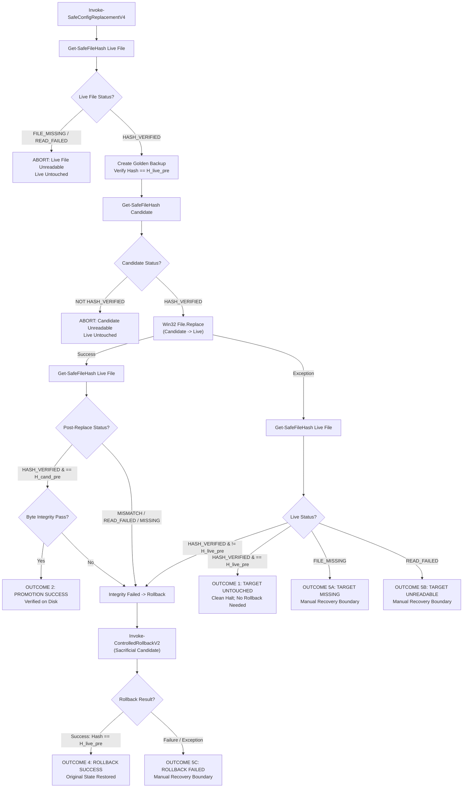

# MUSE SPARK — ZENTRA STEP 2D-2A-AB
## HASH-FAILURE & MISSING-FILE RECOVERY REPORT — DOCUMENTATION ONLY

**Project:** ZENTRA — Hi-Tech Lab Field Service Management Platform  
**Target Repository:** `D:\Zentra`  
**Input Reference:** [`docs/MUSE_SPARK_STEP2D_2A_AA_ROLLBACK_CONTROL_FLOW_REPORT.md`](file:///d:/Zentra/docs/MUSE_SPARK_STEP2D_2A_AA_ROLLBACK_CONTROL_FLOW_REPORT.md)  
**Host Environment:** Windows Workstation (`127.0.0.1:5432`)  
**Report Date:** 2026-10-09  
**Mode:** STRICT DOCUMENTATION-ONLY RECOVERY AUDIT & RUNBOOK FINALIZATION  
**Budget Constraint:** Strict ₹0/month (Zero cost, no credit cards, no paid upgrades)  
**Remote Access:** STRICTLY PROHIBITED (Zero remote connections made)  
**Execution Authorization:** NOT GRANTED — NO COMMANDS EXECUTED IN THIS STEP  
**Status:** COMPLETE — WAITING FOR HUMAN OPERATOR REVIEW  

---

## 1. Executive Summary & Objective

In **Step 2D-2A-AA**, the nested exception-handling bug was resolved by decoupling the rollback routine into a structured object-returning function (`Invoke-ControlledRollback`), and the immutable golden backup was protected from destructive consumption by introducing a sacrificial rollback candidate (`.rollback_cand`).

A rigorous systems-level audit of the Step 2D-2A-AA specification identified two critical failure edge cases:
1. **Unprotected Hash-Inspection Calls:** Raw calls to `Get-FileHash` assume that the file is continuously present, unlocked, and readable. If a file is locked by an external process (e.g. `postgres.exe`, antivirus scanner, search indexer) or disappears during execution, `Get-FileHash` throws an unhandled PowerShell terminating exception, crashing the script and bypassing the recovery state machine.
2. **Missing Live File & Win32 `File.Replace()` Invariant:** Under Win32 `ReplaceFileW` / .NET `[System.IO.File]::Replace()`, the **destination file must already exist**. If an interrupted operation, catastrophic disk fault, or concurrent administrator action leaves the live configuration file absent, `File.Replace()` throws `FileNotFoundException` and cannot perform a replacement or rollback. Assuming that rollback works when the live file is missing leads to cascading script failures.

This report, **Step 2D-2A-AB**, resolves both vulnerabilities by implementing a fail-safe hash inspection engine (`Get-SafeFileHash`), formalizing the missing-destination recovery boundary, and establishing an immutable dual-error forensic logging protocol.

> [!IMPORTANT]
> **Strict Documentation-Only Boundary:** Zero operational commands or configuration changes were executed during this step. Zero configuration files (`postgresql.conf`, `pg_hba.conf`), firewall rules, Windows services, application files, or `.env` files were modified. Zero databases or roles were created. All operational procedures in this document are strictly **[NOT EXECUTED — UNTESTED]**.

---

## 2. Section 1 — Four Core Recovery & Hash Integrity Corrections

| Correction ID | Architectural Area | Step 2D-2A-AA Flaw | Technical Failure Mode | Mandatory Correction in Step 2D-2A-AB |
|---|---|---|---|---|
| **CORR-AB1** | **Hash Trapping** | Direct `(Get-FileHash).Hash` calls lacked error trapping for locked, unreadable, or missing files. | An unhandled exception during post-check or rollback crashed PowerShell, leaving the service in an unverified state. | Implement `Get-SafeFileHash` returning four explicit states: `HASH_VERIFIED`, `HASH_MISMATCH`, `FILE_MISSING`, and `HASH_READ_FAILED`. Trap all I/O exceptions. |
| **CORR-AB2** | **Missing Destination** | Assumed `File.Replace` works unconditionally during rollback even if live file is absent. | Win32 `ReplaceFileW` strictly requires an existing destination. If live file is missing, `File.Replace` throws `FileNotFoundException`. | Detect missing live file explicitly. Do NOT attempt automatic file overwrite. Halt immediately at `Enter-ManualRecoveryBoundary` with status `TARGET_FILE_MISSING`. |
| **CORR-AB3** | **Golden Backup Preservation** | Verification of golden backup occurred inside the rollback block without independent pre-recovery check. | Risk of attempting recovery against a missing or unverified backup file. | Verify golden backup existence and SHA-256 before every recovery attempt. Preserve golden backup untouched. Retain dual forensic errors (Replace Error + Hash/Recovery Error). |
| **CORR-AB4** | **Safeguards & Controls** | Preserved throughout all runbook iterations. | Risk of premature operational authorization. | Reaffirm all 6 approval gates, ₹0/month budget, local-only loopback scope, and preservation of `hisecure_erp`, `hitech_platform`, and `zentra_test`. |

---

## 3. Section 2 — Technical Specifications of Corrected Procedures

### 3.1 The `Get-SafeFileHash` Robust Inspection Engine

To prevent unexpected I/O exceptions from crashing the configuration workflow, every hash operation is mediated by `Get-SafeFileHash`:

```powershell
# [NOT EXECUTED — UNTESTED OPERATIONAL PROCEDURE]

function Get-SafeFileHash {
    <#
    .SYNOPSIS
        Safely computes the SHA-256 hash of a file with comprehensive exception trapping.
    .DESCRIPTION
        Returns a structured object with one of four explicit statuses:
        - HASH_VERIFIED: File exists, readable, SHA-256 computed successfully.
        - FILE_MISSING:  File does not exist on disk.
        - HASH_READ_FAILED: File exists but cannot be read (locked, sharing violation, permissions).
    #>
    param (
        [Parameter(Mandatory = $true)]
        [string]$FilePath
    )

    if (-not (Test-Path -Path $FilePath -PathType Leaf)) {
        return [PSCustomObject]@{
            Status  = "FILE_MISSING"
            Hash    = $null
            Error   = $null
            Message = "Target file [$FilePath] does not exist."
        }
    }

    try {
        $hashResult = Get-FileHash -Path $FilePath -Algorithm SHA256 -ErrorAction Stop
        return [PSCustomObject]@{
            Status  = "HASH_VERIFIED"
            Hash    = $hashResult.Hash
            Error   = $null
            Message = "Hash successfully computed."
        }
    }
    catch {
        return [PSCustomObject]@{
            Status  = "HASH_READ_FAILED"
            Hash    = $null
            Error   = $_.Exception
            Message = "Failed to read or compute hash for [$FilePath]: $($_.Exception.Message)"
        }
    }
}
```

#### Hash Inspection Status Semantics:
- **`HASH_VERIFIED`:** File exists, is completely readable, and returns a verified 64-character hexadecimal SHA-256 string.
- **`FILE_MISSING`:** `Test-Path` confirms the file does not exist. Handled as a discrete structural condition rather than an exception.
- **`HASH_READ_FAILED`:** File exists on disk, but an attempt to open the file handle failed (e.g. `System.IO.IOException` due to sharing violation, or `UnauthorizedAccessException`).

---

### 3.2 The Destination-Missing Trap in Win32 `ReplaceFileW`

#### Win32 API Invariant:
According to Microsoft Win32 API documentation for `ReplaceFileW`:
> *"The file to be replaced must exist. If lpReplacedFileName does not exist, the function fails with ERROR_FILE_NOT_FOUND (2)."*

In .NET, `System.IO.File.Replace(source, destination, backup)` directly wraps `ReplaceFileW`:
- If `destination` is absent, it throws `System.IO.FileNotFoundException`.
- It does **NOT** fall back to creating the destination file.
- It does **NOT** fall back to copying the source file.

#### Architectural Consequence for Recovery:
If an operational interruption results in the live configuration file being deleted or missing:
1. **Normal Win32 Rollback is Impossible:** Calling `File.Replace($sacrificialCandidate, $LiveConfigPath, ...)` will fail immediately with `FileNotFoundException`.
2. **Automated Stream Copy is Prohibited:** A script must **NEVER** automatically perform an unverified `File.Copy` or `Set-Content` when the live file is missing, because:
   - The reason for the disappearance is unknown (disk failure, concurrent operator intervention, antivirus quarantine).
   - Writing to the path while the service is in an unverified state risks compounding filesystem corruption.
3. **Mandatory Manual Recovery Gate:** When the live file is missing, the script must immediately halt, preserve all backups, and transition to the Manual Recovery Boundary with status `TARGET_FILE_MISSING`.

---

### 3.3 The Comprehensive Hardened State Machine (`Invoke-SafeConfigReplacementV4`)

The following specification incorporates safe hash inspection, missing destination detection, non-destructive sacrificial rollback, and explicit dual-error logging:



#### Complete Implementation Script [NOT EXECUTED — UNTESTED]:

```powershell
# [NOT EXECUTED — UNTESTED OPERATIONAL PROCEDURE]
# Requires Elevated Local Administrator PowerShell Shell

function Invoke-ControlledRollbackV2 {
    <#
    .SYNOPSIS
        Restores a PostgreSQL configuration file using a sacrificial clone of the golden backup.
        Traps all hash inspection errors and accounts for destination-missing conditions.
    #>
    param (
        [Parameter(Mandatory = $true)]
        [string]$LiveConfigPath,

        [Parameter(Mandatory = $true)]
        [string]$GoldenBackupPath,

        [Parameter(Mandatory = $true)]
        [string]$ExpectedHash,

        [System.Exception]$OriginalException
    )

    Write-Warning "=== INITIATING CONTROLLED ROLLBACK V2 ==="

    # 1. Verify Golden Backup existence and hash
    $gbHashInfo = Get-SafeFileHash -FilePath $GoldenBackupPath
    if ($gbHashInfo.Status -ne "HASH_VERIFIED") {
        return [PSCustomObject]@{
            Success = $false
            Status  = "GOLDEN_BACKUP_UNAVAILABLE"
            Message = "Golden backup [$GoldenBackupPath] is unavailable: $($gbHashInfo.Status). $($gbHashInfo.Message)"
            Error   = $gbHashInfo.Error
        }
    }

    if ($gbHashInfo.Hash -ne $ExpectedHash) {
        return [PSCustomObject]@{
            Success = $false
            Status  = "GOLDEN_BACKUP_HASH_CORRUPT"
            Message = "Golden backup hash [$($gbHashInfo.Hash)] does not match expected pre-change hash [$ExpectedHash]."
            Error   = $null
        }
    }

    # 2. Check live configuration destination status
    $liveDestInfo = Get-SafeFileHash -FilePath $LiveConfigPath
    if ($liveDestInfo.Status -eq "FILE_MISSING") {
        return [PSCustomObject]@{
            Success = $false
            Status  = "LIVE_DESTINATION_MISSING"
            Message = "Live destination file [$LiveConfigPath] is missing. Win32 File.Replace cannot execute against an absent destination."
            Error   = $null
        }
    }

    # 3. Create Sacrificial Rollback Candidate
    $sacrificialPath = "$GoldenBackupPath.rollback_cand"
    try {
        $backupBytes = [System.IO.File]::ReadAllBytes($GoldenBackupPath)
        [System.IO.File]::WriteAllBytes($sacrificialPath, $backupBytes)
        
        $cloneHashInfo = Get-SafeFileHash -FilePath $sacrificialPath
        if ($cloneHashInfo.Status -ne "HASH_VERIFIED" -or $cloneHashInfo.Hash -ne $ExpectedHash) {
            Remove-Item -Path $sacrificialPath -Force -ErrorAction SilentlyContinue
            return [PSCustomObject]@{
                Success = $false
                Status  = "CLONE_INTEGRITY_MISMATCH"
                Message = "Sacrificial clone hash mismatch or read failure: $($cloneHashInfo.Status)."
                Error   = $cloneHashInfo.Error
            }
        }

        # 4. Perform Win32 Atomic Swap using Sacrificial Candidate
        $discardBackup = "$LiveConfigPath.rollback_discard.$((Get-Date).Ticks)"
        [System.IO.File]::Replace($sacrificialPath, $LiveConfigPath, $discardBackup, $true)
        
        if (Test-Path -Path $discardBackup) {
            Remove-Item -Path $discardBackup -Force -ErrorAction SilentlyContinue
        }

        # 5. Verify Restored Live File Hash
        $restoredHashInfo = Get-SafeFileHash -FilePath $LiveConfigPath
        if ($restoredHashInfo.Status -ne "HASH_VERIFIED" -or $restoredHashInfo.Hash -ne $ExpectedHash) {
            return [PSCustomObject]@{
                Success = $false
                Status  = "RESTORED_HASH_MISMATCH"
                Message = "Restored live file hash verification failed: $($restoredHashInfo.Status). Hash: $($restoredHashInfo.Hash)."
                Error   = $restoredHashInfo.Error
            }
        }

        # 6. Verify Restored File Byte Integrity
        Test-CandidateByteAndEncodingIntegrity -FilePath $LiveConfigPath

        Write-Host "[ROLLBACK VERIFIED] Live file [$LiveConfigPath] successfully restored to original state [SHA256: $($restoredHashInfo.Hash)]." -ForegroundColor Green
        return [PSCustomObject]@{
            Success      = $true
            Status       = "ROLLBACK_SUCCESS"
            RestoredHash = $restoredHashInfo.Hash
            Message      = "Configuration successfully restored to pre-change state. Golden backup preserved."
            Error        = $null
        }
    }
    catch {
        Remove-Item -Path $sacrificialPath -Force -ErrorAction SilentlyContinue
        return [PSCustomObject]@{
            Success = $false
            Status  = "ROLLBACK_EXCEPTION"
            Message = "Exception occurred during rollback swap: $($_.Exception.Message)"
            Error   = $_.Exception
        }
    }
}

function Invoke-SafeConfigReplacementV4 {
    <#
    .SYNOPSIS
        Safely replaces a PostgreSQL configuration file with robust hash-trapping,
        missing-destination detection, and non-destructive golden backup lifecycle.
    #>
    param (
        [Parameter(Mandatory = $true)]
        [string]$LiveConfigPath,

        [Parameter(Mandatory = $true)]
        [string]$CandidatePath,

        [Parameter(Mandatory = $true)]
        [string]$Description
    )

    Write-Host "=== INITIATING HARDENED CONFIGURATION REPLACEMENT V4: $Description ===" -ForegroundColor Cyan

    # -------------------------------------------------------------
    # STAGE 1: PRE-FLIGHT VALIDATION & ROBUST HASH INITIALIZATION
    # -------------------------------------------------------------
    $livePreHashInfo = Get-SafeFileHash -FilePath $LiveConfigPath
    if ($livePreHashInfo.Status -ne "HASH_VERIFIED") {
        throw "FAIL-CLOSED ABORT: Pre-flight live configuration check failed ($($livePreHashInfo.Status)): $($livePreHashInfo.Message)"
    }
    $H_live_pre = $livePreHashInfo.Hash

    $candPreHashInfo = Get-SafeFileHash -FilePath $CandidatePath
    if ($candPreHashInfo.Status -ne "HASH_VERIFIED") {
        throw "FAIL-CLOSED ABORT: Pre-flight candidate check failed ($($candPreHashInfo.Status)): $($candPreHashInfo.Message)"
    }
    $H_cand_pre = $candPreHashInfo.Hash

    # Strict byte, BOM, UTF-8, and CRLF validation on candidate
    Test-CandidateByteAndEncodingIntegrity -FilePath $CandidatePath

    # Create immutable golden backup on same volume
    $timestamp = (Get-Date -Format 'yyyyMMdd_HHmmss')
    $goldenBackupPath = "$LiveConfigPath.bak.$timestamp"
    
    $liveBytes = [System.IO.File]::ReadAllBytes($LiveConfigPath)
    [System.IO.File]::WriteAllBytes($goldenBackupPath, $liveBytes)

    $gbHashInfo = Get-SafeFileHash -FilePath $goldenBackupPath
    if ($gbHashInfo.Status -ne "HASH_VERIFIED" -or $gbHashInfo.Hash -ne $H_live_pre) {
        Remove-Item -Path $CandidatePath -Force -ErrorAction SilentlyContinue
        Remove-Item -Path $goldenBackupPath -Force -ErrorAction SilentlyContinue
        throw "FAIL-CLOSED ABORT: Golden backup hash verification failed. Candidate purged. Live file untouched."
    }
    Write-Host "[PRE-FLIGHT PASSED] Verified Golden Backup: $goldenBackupPath [SHA256: $H_live_pre]" -ForegroundColor Green
    Write-Host "[PRE-FLIGHT PASSED] Candidate Hash Retained: [SHA256: $H_cand_pre]" -ForegroundColor Green

    # -------------------------------------------------------------
    # STAGE 2: CONTROLLED WIN32 FILE REPLACEMENT
    # -------------------------------------------------------------
    $engineBackupPath = "$LiveConfigPath.enginebak.$timestamp"
    $replaceError = $null

    try {
        [System.IO.File]::Replace($CandidatePath, $LiveConfigPath, $engineBackupPath, $true)
        Write-Host "[REPLACE SUCCEEDED] Win32 File.Replace completed." -ForegroundColor Green
    }
    catch {
        $replaceError = $_.Exception
        Write-Error "Replacement operation threw an exception: $($replaceError.Message)"

        # Inspect current live file state safely
        $liveCurrHashInfo = Get-SafeFileHash -FilePath $LiveConfigPath
        
        if ($liveCurrHashInfo.Status -eq "HASH_VERIFIED" -and $liveCurrHashInfo.Hash -eq $H_live_pre) {
            # OUTCOME 1: REPLACEMENT FAILED — TARGET UNTOUCHED
            Remove-Item -Path $CandidatePath -Force -ErrorAction SilentlyContinue
            Write-Host "[OUTCOME 1: TARGET UNTOUCHED] Live file hash matches pre-change hash. Target was never modified." -ForegroundColor Yellow
            throw "FAIL-CLOSED ABORT [OUTCOME 1]: Replacement failed before touching target file ($($replaceError.Message)). Live file remains intact."
        }
        elseif ($liveCurrHashInfo.Status -eq "FILE_MISSING") {
            # OUTCOME 5A: TARGET MISSING
            Enter-ManualRecoveryBoundaryV2 -LivePath $LiveConfigPath -BackupPath $goldenBackupPath -ExpectedHash $H_live_pre -CandidateHash $H_cand_pre -ReplaceException $replaceError -Detail "Live destination file is missing after failed replace operation."
        }
        elseif ($liveCurrHashInfo.Status -eq "HASH_READ_FAILED") {
            # OUTCOME 5B: TARGET UNREADABLE / LOCKED
            Enter-ManualRecoveryBoundaryV2 -LivePath $LiveConfigPath -BackupPath $goldenBackupPath -ExpectedHash $H_live_pre -CandidateHash $H_cand_pre -ReplaceException $replaceError -Detail "Live file is unreadable or locked: $($liveCurrHashInfo.Message)"
        }

        # Live file altered -> Initiate controlled rollback
        $rollbackResult = Invoke-ControlledRollbackV2 -LiveConfigPath $LiveConfigPath -GoldenBackupPath $goldenBackupPath -ExpectedHash $H_live_pre -OriginalException $replaceError

        if ($rollbackResult.Success) {
            # OUTCOME 4: ROLLBACK SUCCEEDED
            Remove-Item -Path $CandidatePath -Force -ErrorAction SilentlyContinue
            Write-Host "[OUTCOME 4: ROLLBACK SUCCESS] Original configuration verified and restored. Golden backup preserved." -ForegroundColor Yellow
            throw "FAIL-CLOSED ABORT [OUTCOME 4]: Replacement failed ($($replaceError.Message)), but rollback successfully restored original configuration. Live service safe."
        }
        else {
            # OUTCOME 5C: ROLLBACK FAILED
            Enter-ManualRecoveryBoundaryV2 -LivePath $LiveConfigPath -BackupPath $goldenBackupPath -ExpectedHash $H_live_pre -CandidateHash $H_cand_pre -ReplaceException $replaceError -RollbackResult $rollbackResult -Detail "Rollback execution failed."
        }
    }

    # -------------------------------------------------------------
    # STAGE 3: POST-REPLACEMENT INTEGRITY VERIFICATION
    # -------------------------------------------------------------
    $livePostHashInfo = Get-SafeFileHash -FilePath $LiveConfigPath
    $postValidationPassed = $false
    $postValidationError = $null

    if ($livePostHashInfo.Status -eq "HASH_VERIFIED" -and $livePostHashInfo.Hash -eq $H_cand_pre) {
        try {
            Test-CandidateByteAndEncodingIntegrity -FilePath $LiveConfigPath
            $postValidationPassed = $true
        }
        catch {
            $postValidationError = $_.Exception
        }
    }
    else {
        $postValidationError = [System.InvalidOperationException]::new("Post-replacement live hash check failed ($($livePostHashInfo.Status)): Expected $H_cand_pre, observed $($livePostHashInfo.Hash).")
    }

    if ($postValidationPassed) {
        # OUTCOME 2: PROMOTION SUCCESS VERIFIED
        Write-Host "[OUTCOME 2: PROMOTION SUCCESS] Promoted live configuration verified on disk [SHA256: $($livePostHashInfo.Hash)]." -ForegroundColor Green
        return $goldenBackupPath
    }
    else {
        # OUTCOME 3 -> Rollback triggered
        Write-Error "[OUTCOME 3: POST-VERIFICATION FAILED] $($postValidationError.Message)"
        $rollbackResult = Invoke-ControlledRollbackV2 -LiveConfigPath $LiveConfigPath -GoldenBackupPath $goldenBackupPath -ExpectedHash $H_live_pre -OriginalException $postValidationError

        if ($rollbackResult.Success) {
            # OUTCOME 4: ROLLBACK SUCCEEDED
            throw "FAIL-CLOSED ABORT [OUTCOME 4]: Post-replacement verification failed ($($postValidationError.Message)), but rollback successfully restored original configuration."
        }
        else {
            # OUTCOME 5C: ROLLBACK FAILED
            Enter-ManualRecoveryBoundaryV2 -LivePath $LiveConfigPath -BackupPath $goldenBackupPath -ExpectedHash $H_live_pre -CandidateHash $H_cand_pre -ReplaceException $postValidationError -RollbackResult $rollbackResult -Detail "Post-verification rollback failed."
        }
    }
}
```

---

### 3.4 The Decoupled Manual Recovery Boundary Diagnostic Engine (`Enter-ManualRecoveryBoundaryV2`)

```powershell
# [NOT EXECUTED — UNTESTED OPERATIONAL PROCEDURE]

function Enter-ManualRecoveryBoundaryV2 {
    param (
        [string]$LivePath,
        [string]$BackupPath,
        [string]$ExpectedHash,
        [string]$CandidateHash,
        [System.Exception]$ReplaceException,
        [PSCustomObject]$RollbackResult,
        [string]$Detail
    )

    Write-Host "`n" -NoNewline
    Write-Host "****************************************************************" -ForegroundColor Red
    Write-Host "         CRITICAL: ENTERING MANUAL RECOVERY BOUNDARY (OUTCOME 5)  " -ForegroundColor Red
    Write-Host "****************************************************************" -ForegroundColor Red
    Write-Host "Automated configuration recovery cannot be guaranteed safe."
    Write-Host "All automated operations have ceased to prevent data corruption."
    Write-Host "----------------------------------------------------------------"
    Write-Host "FORENSIC STATUS:"
    Write-Host "  Context / Detail:        $Detail"
    Write-Host "  Target Live File:        $LivePath"
    Write-Host "  Golden Backup File:      $BackupPath"
    Write-Host "  Expected Pre-Hash:       $ExpectedHash"
    Write-Host "  Candidate Hash:          $CandidateHash"
    if ($ReplaceException) {
        Write-Host "  Replace Exception:       $($ReplaceException.GetType().Name): $($ReplaceException.Message)"
    }
    if ($RollbackResult) {
        Write-Host "  Rollback Status:         $($RollbackResult.Status)"
        Write-Host "  Rollback Message:        $($RollbackResult.Message)"
        if ($RollbackResult.Error) {
            Write-Host "  Rollback Error Detail:   $($RollbackResult.Error.GetType().Name): $($RollbackResult.Error.Message)"
        }
    }
    
    # Safe inspection of live file state
    $liveInspection = Get-SafeFileHash -FilePath $LivePath
    Write-Host "  Current Live Status:     $($liveInspection.Status)"
    Write-Host "  Current Live Hash:       $($liveInspection.Hash)"
    if ($liveInspection.Error) {
        Write-Host "  Live Inspection Error:   $($liveInspection.Error.Message)"
    }

    Write-Host "----------------------------------------------------------------"
    Write-Host "REQUIRED OPERATOR ACTIONS:"
    Write-Host "  1. Check for locked processes: Get-Process | Where-Object { `$_.ProcessName -match 'postgres' }"
    Write-Host "  2. Inspect Windows Event Log:  Get-EventLog -LogName System -Newest 10"
    Write-Host "  3. Verify Golden Backup integrity before any manual restoration:"
    Write-Host "     Get-FileHash -Path '$BackupPath' -Algorithm SHA256"
    Write-Host "  4. If target file is missing, manually copy from Golden Backup:"
    Write-Host "     Copy-Item -Path '$BackupPath' -Destination '$LivePath'"
    Write-Host "  5. Check PostgreSQL service:   Get-Service -Name postgresql-x64-18"
    Write-Host "****************************************************************`n" -ForegroundColor Red

    throw "FAIL-CLOSED EMERGENCY STOP [OUTCOME 5]: Manual recovery required. Review forensic diagnostic output above."
}
```

---

## 4. Section 3 — Tested Ground Truth vs. Untested Proposed Code Matrix

| Procedure / Component | Category | Verification Status | Basis / Verification Method | Operational Prerequisite |
|---|---|---|---|---|
| **Cluster Collation Baseline** | Read-Only SQL | 🟢 **Verified Fact** | Inspected all 5 catalogs in Step 2D-2A-S: `English_United States.1252` (`UTF8`). | None. Safe to use `TEMPLATE template1`. |
| **Port 5432 Listener Bindings** | Read-Only OS | 🟢 **Verified Fact** | `Get-NetTCPConnection` confirmed listening on `0.0.0.0:5432` and `[::]:5432`. | None. Proves socket hardening is required. |
| **Firewall Profile State** | Read-Only OS | 🟢 **Verified Fact** | `netsh advfirewall` confirmed `Public: OFF` on active Wi-Fi interface. | Operator decision on profile activation. |
| **Shared Catalog Baseline** | Read-Only SQL | 🟢 **Verified Fact** | Catalogs `hisecure_erp`, `hitech_platform`, and `zentra_test` verified intact. | Protected via fail-closed assertions. |
| **`Get-SafeFileHash`** | PowerShell Script | 🔴 **UNTESTED** | Authored in documentation; not executed against live files. | Operator dry-run in isolated scratch folder. |
| **`Invoke-ControlledRollbackV2`** | PowerShell Script | 🔴 **UNTESTED** | Authored in documentation; sacrificial clone swap not executed live. | Operator dry-run in scratch folder. |
| **`Invoke-SafeConfigReplacementV4`** | PowerShell Script | 🔴 **UNTESTED** | Authored in documentation; not run on PostgreSQL data directory. | Operator dry-run in scratch folder. |
| **`postgres.exe -C` Validation** | Engine CLI | 🔴 **UNTESTED** | Flag documented from PostgreSQL manuals; not run live on host. | Run dry-run `postgres.exe -C` before promotion. |
| **`pg_ctl reload` Dynamic Signal** | Service CLI | 🔴 **UNTESTED** | Documented reload mechanism; not triggered in active environment. | Requires local Administrator console session. |
| **`pg_hba_file_rules` Inspection** | SQL Catalog Query | 🔴 **UNTESTED** | System view documented; query not run post-change. | Requires active loopback psql connection. |
| **Interactive `\password` Assignment** | psql Meta-Command | 🔴 **UNTESTED** | Meta-command documented; interactive password assignment not run. | Interactive operator terminal session. |
| **Standalone Migration Runner** | Application CLI | 🔴 **UNTESTED** | CLI script does not exist in repository; proposal pending. | Author and review runner prior to Stage B. |

---

## 5. Section 4 — The Six Human Approval Gates Reaffirmed

The execution roadmap preserves all six decoupled human approval gates without alteration:

```mermaid
graph TD
    subgraph ClusterHardening["Pre-Initialization Shared Cluster Hardening"]
        G1{"Gate 1: Network Hardening<br/>Human Approval"} --> P1["Phase 1: Candidate Generation<br/>listen_addresses = 'localhost'<br/>Strict UTF-8 Test + postgres.exe -C + Tri-Hash V4 Swap + Restart"]
        P1 --> T1["Tier 1 & Tier 2 Observable Health Checks<br/>(Hi-Secure-ERP & Test App)"]
        T1 --> G2{"Gate 2: Host Firewall Evaluation<br/>Human Approval"}
        G2 --> P2["Phase 2: Inbound Firewall Review<br/>(Targeted Port 5432 Block Rule;<br/>Profile remains OFF unless authorized)"]
        P2 --> G3{"Gate 3: Auth Policy Deployment<br/>Human Approval"}
        G3 --> P3["Phase 3: Targeted SCRAM Candidate<br/>(Prepend zentra_local rules to pg_hba.conf)<br/>Strict UTF-8 Test + Tri-Hash V4 Swap + Dynamic Reload + pg_hba_file_rules Check"]
        P3 --> T2["Verify Legacy Apps Continue Unaffected Under trust"]
    end

    subgraph ZentraInit["ZENTRA Database Initialization Stages"]
        T2 --> G4{"Gate 4: Stage A Provisioning<br/>Human Approval"}
        G4 --> SA1["Stage A.1: Create zentra_dev Role<br/>(CREATE ROLE without password)"]
        SA1 --> SA2["Stage A.2: Assign SCRAM Password<br/>(Interactive \\password zentra_dev with hidden echo)"]
        SA2 --> SA3["Stage A.3: Create zentra_local Database<br/>(Autocommit Mode, TEMPLATE template1)"]
        SA3 --> G5{"Gate 5: Stage B Migrations<br/>Human Approval"}
        G5 --> SB["Stage B: Controlled Migrations<br/>(Execute 14 Kysely Migrations via reviewed runner)"]
        SB --> G6{"Gate 6: Stage C Seeding<br/>Human Approval"}
        G6 --> SC["Stage C: Synthetic Dev Seeding<br/>(Pre-seed 0-row check + Single Execution)"]
    end
```



| Gate ID | Scope & Milestone | Mandatory Prerequisites Before Granting Approval | Action Authorized Upon Operator Approval |
|---|---|---|---|
| **Gate 1** | **Network Socket Hardening** | Verified backup exists; candidate passes strict UTF-8 & CRLF check; `postgres.exe -C` passes; tri-hash validated; diff approved. | Promote candidate `postgresql.conf` via `Invoke-SafeConfigReplacementV4`; restart Windows service `postgresql-x64-18`. |
| **Gate 2** | **Host Firewall Policy** | Verified firewall profile states; evaluated impact of Public profile activation across local tools. | Create targeted port 5432 inbound block rule; review profile activation decision. |
| **Gate 3** | **Targeted SCRAM Policy** | Verified backup exists; candidate passes strict UTF-8 & CRLF check; tri-hash validated; diff approved. | Promote candidate `pg_hba.conf` via `Invoke-SafeConfigReplacementV4`; dynamic `pg_ctl reload`; verify `pg_hba_file_rules` has 0 errors. |
| **Gate 4** | **Stage A Database Creation** | Phases 1 & 3 complete; Tier 1 & 2 health checks pass; SCRAM rule active; `zentra_local` does not exist. | Create `zentra_dev` role; assign password via `\password`; create `zentra_local` DB via autocommit. |
| **Gate 5** | **Stage B Schema Migrations** | Stage A verified; `current_database() === 'zentra_local'`; 0 public tables; standalone runner reviewed. | Execute 14 Kysely migrations sequentially; verify 34 tables created. |
| **Gate 6** | **Stage C Synthetic Seeding** | Stage B verified; 14 migrations complete; domain table row counts strictly 0. | Execute synthetic mock seeding; verify row counts; confirm zero real PII. |

---

## 6. Section 5 — Concise List of Unresolved Blockers

Before any operator issues an execution command, the following four unresolved operational blockers must be resolved:

1. **Elevated Administrator Privileges:** The PostgreSQL 18 data directory (`C:\Program Files\PostgreSQL\18\data`) is protected by Windows NTFS permissions. Generating candidate files, backups, and invoking `File.Replace` requires an elevated Administrator PowerShell console session.
2. **Firewall Policy Decision:** Windows Defender Firewall's `Public` profile is currently `State: OFF` on the active Wi-Fi adapter (`Airtel_Rayyan@2103`). Adding an inbound block rule on port 5432 remains dormant unless the administrator explicitly enables the Public firewall profile.
3. **Interactive Password Assignment Channel:** Assigning the password for `zentra_dev` via `\password zentra_dev` cannot be automated via non-interactive scripts. It requires an interactive operator console to prevent credential capture in process trees, shell history, or logs.
4. **Standalone Migration Runner Implementation:** A reviewed, fail-closed CLI migration runner that imports the 14 Kysely migrations, verifies target database assertions, and reports status without invoking the full test suite does not yet exist and must be authored prior to Gate 5.

---

## 7. Section 6 — Confirmation of Safety & Compliance

- **Operational Execution:** **ZERO.** No operational commands were executed.
- **Database Writes / DDL:** **ZERO.** No databases, roles, tables, schemas, or records were created, modified, or dropped.
- **Data Mutating Commands:** **ZERO.** No `INSERT`, `UPDATE`, `DELETE`, `TRUNCATE`, migrations, seeds, or tests were executed.
- **Configuration Modifications:** **ZERO.** No changes were made to `postgresql.conf`, `pg_hba.conf`, Windows Firewall, Windows services, application code, or `.env` files.
- **Remote Cloud Connections:** **ZERO.** No connections made to Neon, AWS, Supabase, Render, or any remote host.
- **Budget Integrity:** Strict ₹0/month budget preserved.
- **Preserved Existing Databases:** Catalogs `hisecure_erp`, `hitech_platform`, and `zentra_test` remain completely untouched.
- **Production Scope:** Strictly local development workstation scope; no production readiness certification is claimed.

---

```
STOP — STEP 2D-2A-AB COMPLETE — WAITING FOR HUMAN REVIEW
```
