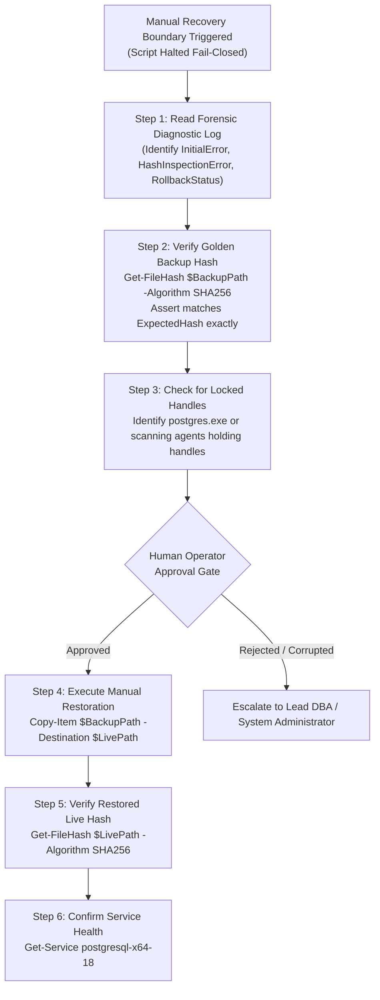

# MUSE SPARK — ZENTRA STEP 2D-2A-AC
## FINAL ROLLBACK STATE-MACHINE & RECOVERY REPORT — DOCUMENTATION ONLY

**Project:** ZENTRA — Hi-Tech Lab Field Service Management Platform  
**Target Repository:** `D:\Zentra`  
**Input Reference:** [`docs/MUSE_SPARK_STEP2D_2A_AB_HASH_FAILURE_RECOVERY_REPORT.md`](file:///d:/Zentra/docs/MUSE_SPARK_STEP2D_2A_AB_HASH_FAILURE_RECOVERY_REPORT.md)  
**Host Environment:** Windows Workstation (`127.0.0.1:5432`)  
**Report Date:** 2026-10-09  
**Mode:** STRICT DOCUMENTATION-ONLY STATE-MACHINE AUDIT & RUNBOOK FINALIZATION  
**Budget Constraint:** Strict ₹0/month (Zero cost, no credit cards, no paid upgrades)  
**Remote Access:** STRICTLY PROHIBITED (Zero remote connections made)  
**Execution Authorization:** NOT GRANTED — NO COMMANDS EXECUTED IN THIS STEP  
**Status:** COMPLETE — WAITING FOR HUMAN OPERATOR REVIEW  

---

## 1. Executive Summary & Objective

In **Step 2D-2A-AB**, the `Get-SafeFileHash` engine was introduced to trap raw hash-inspection exceptions, and Win32 `ReplaceFileW` destination-missing behavior was documented.

A comprehensive systems review of the Step 2D-2A-AB specification identified four final state-machine and recovery defects:
1. **Unchecked Unreadable Live Destination in Rollback Routine:** In `Invoke-ControlledRollbackV2`, the script checked if the live destination was `FILE_MISSING`, but failed to branch on `HASH_READ_FAILED`. If the destination was locked or permission-denied, the script fell through and attempted Win32 `File.Replace()`, risking undefined sharing violations or unhandled script termination. Every possible hash status must have an explicit, fail-closed branch.
2. **Conflation and Loss of Forensic Errors:** When a replacement failed and rollback subsequently failed, the forensic diagnostics function did not cleanly separate the original replacement/post-verification exception from subsequent hash-inspection and rollback exceptions. Furthermore, if an error occurred *while collecting diagnostics* inside `Enter-ManualRecoveryBoundary`, the diagnostic routine could throw an unhandled exception, bypassing the emergency fail-closed stop.
3. **Automated vs. Manual Recovery Boundary on Missing Destinations:** An automated script must **never** automatically copy, recreate, or overwrite a missing live configuration file. Missing-file recovery must remain strictly manual, requiring explicit human operator review, verified Golden Backup integrity, and manual console execution.
4. **Absence of a Formal Validation Test Matrix:** All proposed failure branches, rollback paths, and diagnostic routines require an explicit documentation-only validation matrix categorizing expected behavior across all edge cases without claiming unverified code is tested.

This report, **Step 2D-2A-AC**, establishes the definitive, fully branch-covered recovery state machine, separates all forensic errors into structured payloads, hardens diagnostic collection against internal failures, formalizes the manual recovery runbook, and provides the documentation test matrix.

> [!IMPORTANT]
> **Strict Documentation-Only Boundary:** Zero operational commands or configuration changes were executed during this step. Zero configuration files (`postgresql.conf`, `pg_hba.conf`), firewall rules, Windows services, application files, or `.env` files were modified. Zero databases or roles were created. All operational procedures in this document are strictly **[NOT EXECUTED — UNTESTED]**.

---

## 2. Section 1 — Four Core Architectural Corrections

| Correction ID | Architectural Area | Step 2D-2A-AB Defect | Technical Failure Mode | Mandatory Correction in Step 2D-2A-AC |
|---|---|---|---|---|
| **CORR-AC1** | **Destination Hash Branching** | `Invoke-ControlledRollbackV2` checked `FILE_MISSING`, but ignored `HASH_READ_FAILED`, falling through to `File.Replace`. | Attempting `File.Replace` on a locked/unreadable destination causes an unhandled sharing violation exception, bypassing clean rollback logging. | Explicitly branch on `HASH_READ_FAILED` in `Invoke-ControlledRollbackV3`. Abort immediately without modifying disk; return structured `LIVE_DESTINATION_UNREADABLE`. |
| **CORR-AC2** | **Forensic Error Architecture** | Errors were passed loosely; diagnostics collection could crash on secondary I/O errors during emergency reporting. | If `Get-SafeFileHash` or `Get-Process` threw during diagnostic logging, script crashed before executing terminating fail-closed `throw`. | Structure errors into separate fields: `$InitialError`, `$HashInspectionError`, and `$RollbackResult`. Wrap diagnostic collection in internal try/catch so emergency halt is 100% guaranteed. |
| **CORR-AC3** | **Missing-File Policy** | Missing-file recovery was routed to manual boundary, but lacked an explicit human authorization runbook. | Risk of operator executing ad-hoc copy without verifying backup integrity first. | Formalize the **Human-Supervised Manual Recovery Protocol**: strictly manual, requires operator approval, pre-restoration hash check, and service health check. |
| **CORR-AC4** | **Validation Matrix** | Procedures were labeled untested, but lacked an enumerated validation matrix covering all 7 failure modes. | Operators cannot easily verify how each failure state behaves under edge cases. | Publish the **Seven-Scenario Validation Test Matrix** covering missing files, unreadable files, hash mismatches, rollback errors, and diagnostic failures. |

---

## 3. Section 2 — Technical Specifications of Corrected Procedures

### 3.1 The Fail-Safe `Get-SafeFileHash` Engine & Full Status Taxonomy

The `Get-SafeFileHash` engine enforces an explicit 4-state taxonomy:

```powershell
# [NOT EXECUTED — UNTESTED OPERATIONAL PROCEDURE]

function Get-SafeFileHash {
    <#
    .SYNOPSIS
        Safely computes the SHA-256 hash of a file with comprehensive exception trapping.
    .DESCRIPTION
        Returns a structured object with one of four explicit statuses:
        - HASH_VERIFIED:    File exists, is completely readable, and SHA-256 is computed.
        - FILE_MISSING:     File does not exist on disk (Test-Path returned false).
        - HASH_READ_FAILED: File exists but handle cannot be opened (locked, sharing violation, permissions).
    #>
    param (
        [Parameter(Mandatory = $true)]
        [string]$FilePath
    )

    if (-not (Test-Path -Path $FilePath -PathType Leaf)) {
        return [PSCustomObject]@{
            Status  = "FILE_MISSING"
            Hash    = $null
            Error   = $null
            Message = "Target file [$FilePath] does not exist."
        }
    }

    try {
        $hashResult = Get-FileHash -Path $FilePath -Algorithm SHA256 -ErrorAction Stop
        return [PSCustomObject]@{
            Status  = "HASH_VERIFIED"
            Hash    = $hashResult.Hash
            Error   = $null
            Message = "Hash successfully computed."
        }
    }
    catch {
        return [PSCustomObject]@{
            Status  = "HASH_READ_FAILED"
            Hash    = $null
            Error   = $_.Exception
            Message = "Failed to read or compute hash for [$FilePath]: $($_.Exception.Message)"
        }
    }
}
```

---

### 3.2 The Fully Branch-Covered Rollback Engine (`Invoke-ControlledRollbackV3`)

In `Invoke-ControlledRollbackV3`, every possible status of both the Golden Backup and the Live Destination is evaluated with an explicit fail-closed branch:

```powershell
# [NOT EXECUTED — UNTESTED OPERATIONAL PROCEDURE]

function Invoke-ControlledRollbackV3 {
    <#
    .SYNOPSIS
        Safely restores a configuration file using a sacrificial clone of the golden backup.
        Enforces complete branch coverage for all backup and destination hash states.
    #>
    param (
        [Parameter(Mandatory = $true)]
        [string]$LiveConfigPath,

        [Parameter(Mandatory = $true)]
        [string]$GoldenBackupPath,

        [Parameter(Mandatory = $true)]
        [string]$ExpectedHash,

        [System.Exception]$InitialError
    )

    Write-Warning "=== INITIATING CONTROLLED ROLLBACK V3 ==="

    # -------------------------------------------------------------
    # 1. EVALUATE GOLDEN BACKUP STATUS (FAIL-CLOSED BRANCHING)
    # -------------------------------------------------------------
    $gbInfo = Get-SafeFileHash -FilePath $GoldenBackupPath
    
    if ($gbInfo.Status -eq "FILE_MISSING") {
        return [PSCustomObject]@{
            Success = $false
            Status  = "GOLDEN_BACKUP_MISSING"
            Message = "Golden backup file [$GoldenBackupPath] does not exist."
            Error   = $null
        }
    }
    elseif ($gbInfo.Status -eq "HASH_READ_FAILED") {
        return [PSCustomObject]@{
            Success = $false
            Status  = "GOLDEN_BACKUP_UNREADABLE"
            Message = "Golden backup file [$GoldenBackupPath] is unreadable: $($gbInfo.Message)"
            Error   = $gbInfo.Error
        }
    }
    elseif ($gbInfo.Status -eq "HASH_VERIFIED" -and $gbInfo.Hash -ne $ExpectedHash) {
        return [PSCustomObject]@{
            Success = $false
            Status  = "GOLDEN_BACKUP_CORRUPT"
            Message = "Golden backup hash [$($gbInfo.Hash)] does not match expected pre-change hash [$ExpectedHash]."
            Error   = $null
        }
    }
    elseif ($gbInfo.Status -ne "HASH_VERIFIED") {
        return [PSCustomObject]@{
            Success = $false
            Status  = "GOLDEN_BACKUP_UNKNOWN_STATE"
            Message = "Golden backup returned unexpected status: $($gbInfo.Status)"
            Error   = $gbInfo.Error
        }
    }

    # -------------------------------------------------------------
    # 2. EVALUATE LIVE DESTINATION STATUS (FAIL-CLOSED BRANCHING)
    # -------------------------------------------------------------
    $destInfo = Get-SafeFileHash -FilePath $LiveConfigPath

    if ($destInfo.Status -eq "FILE_MISSING") {
        return [PSCustomObject]@{
            Success = $false
            Status  = "LIVE_DESTINATION_MISSING"
            Message = "Live destination [$LiveConfigPath] is absent. Win32 File.Replace cannot execute on a missing target."
            Error   = $null
        }
    }
    elseif ($destInfo.Status -eq "HASH_READ_FAILED") {
        return [PSCustomObject]@{
            Success = $false
            Status  = "LIVE_DESTINATION_UNREADABLE"
            Message = "Live destination [$LiveConfigPath] is locked or unreadable: $($destInfo.Message)"
            Error   = $destInfo.Error
        }
    }

    # -------------------------------------------------------------
    # 3. SACRIFICIAL CLONE CREATION & VERIFICATION
    # -------------------------------------------------------------
    $sacrificialPath = "$GoldenBackupPath.rollback_cand"
    try {
        $backupBytes = [System.IO.File]::ReadAllBytes($GoldenBackupPath)
        [System.IO.File]::WriteAllBytes($sacrificialPath, $backupBytes)
        
        $cloneInfo = Get-SafeFileHash -FilePath $sacrificialPath
        if ($cloneInfo.Status -ne "HASH_VERIFIED" -or $cloneInfo.Hash -ne $ExpectedHash) {
            Remove-Item -Path $sacrificialPath -Force -ErrorAction SilentlyContinue
            return [PSCustomObject]@{
                Success = $false
                Status  = "SACRIFICIAL_CLONE_CORRUPT"
                Message = "Sacrificial clone hash mismatch or read failure: $($cloneInfo.Status)."
                Error   = $cloneInfo.Error
            }
        }

        # ---------------------------------------------------------
        # 4. WIN32 ATOMIC SWAP USING SACRIFICIAL CANDIDATE
        # ---------------------------------------------------------
        $discardBackup = "$LiveConfigPath.rollback_discard.$((Get-Date).Ticks)"
        [System.IO.File]::Replace($sacrificialPath, $LiveConfigPath, $discardBackup, $true)
        
        if (Test-Path -Path $discardBackup) {
            Remove-Item -Path $discardBackup -Force -ErrorAction SilentlyContinue
        }

        # ---------------------------------------------------------
        # 5. POST-ROLLBACK DUAL VERIFICATION (HASH + BYTE INTEGRITY)
        # ---------------------------------------------------------
        $restoredInfo = Get-SafeFileHash -FilePath $LiveConfigPath
        if ($restoredInfo.Status -ne "HASH_VERIFIED") {
            return [PSCustomObject]@{
                Success = $false
                Status  = "RESTORED_FILE_UNVERIFIABLE"
                Message = "Restored live file cannot be verified ($($restoredInfo.Status)): $($restoredInfo.Message)"
                Error   = $restoredInfo.Error
            }
        }
        if ($restoredInfo.Hash -ne $ExpectedHash) {
            return [PSCustomObject]@{
                Success = $false
                Status  = "RESTORED_HASH_MISMATCH"
                Message = "Restored live file hash [$($restoredInfo.Hash)] does not match expected pre-change hash [$ExpectedHash]."
                Error   = $null
            }
        }

        # Re-run strict byte, BOM, UTF-8, and CRLF integrity check on restored file
        Test-CandidateByteAndEncodingIntegrity -FilePath $LiveConfigPath

        Write-Host "[ROLLBACK VERIFIED] Live configuration successfully restored and verified [SHA256: $($restoredInfo.Hash)]." -ForegroundColor Green
        return [PSCustomObject]@{
            Success      = $true
            Status       = "ROLLBACK_SUCCESS"
            RestoredHash = $restoredInfo.Hash
            Message      = "Configuration successfully restored to pre-change state. Golden backup preserved."
            Error        = $null
        }
    }
    catch {
        Remove-Item -Path $sacrificialPath -Force -ErrorAction SilentlyContinue
        return [PSCustomObject]@{
            Success = $false
            Status  = "ROLLBACK_SWAP_EXCEPTION"
            Message = "Exception occurred during rollback swap: $($_.Exception.Message)"
            Error   = $_.Exception
        }
    }
}
```

---

### 3.3 The Hardened 7-State Configuration Replacement Engine (`Invoke-SafeConfigReplacementV5`)

```powershell
# [NOT EXECUTED — UNTESTED OPERATIONAL PROCEDURE]

function Invoke-SafeConfigReplacementV5 {
    <#
    .SYNOPSIS
        Safely replaces a PostgreSQL configuration file with full error preservation,
        fail-closed hash-state branching, and a resilient manual recovery boundary.
    #>
    param (
        [Parameter(Mandatory = $true)]
        [string]$LiveConfigPath,

        [Parameter(Mandatory = $true)]
        [string]$CandidatePath,

        [Parameter(Mandatory = $true)]
        [string]$Description
    )

    Write-Host "=== INITIATING HARDENED CONFIGURATION REPLACEMENT V5: $Description ===" -ForegroundColor Cyan

    # -------------------------------------------------------------
    # STAGE 1: PRE-FLIGHT VALIDATION & ROBUST HASH INITIALIZATION
    # -------------------------------------------------------------
    $livePreInfo = Get-SafeFileHash -FilePath $LiveConfigPath
    if ($livePreInfo.Status -ne "HASH_VERIFIED") {
        throw "FAIL-CLOSED ABORT: Pre-flight live configuration check failed ($($livePreInfo.Status)): $($livePreInfo.Message)"
    }
    $H_live_pre = $livePreInfo.Hash

    $candPreInfo = Get-SafeFileHash -FilePath $CandidatePath
    if ($candPreInfo.Status -ne "HASH_VERIFIED") {
        throw "FAIL-CLOSED ABORT: Pre-flight candidate check failed ($($candPreInfo.Status)): $($candPreInfo.Message)"
    }
    $H_cand_pre = $candPreInfo.Hash

    # Strict byte, BOM, UTF-8, and CRLF validation on candidate
    Test-CandidateByteAndEncodingIntegrity -FilePath $CandidatePath

    # Create immutable golden backup on same volume
    $timestamp = (Get-Date -Format 'yyyyMMdd_HHmmss')
    $goldenBackupPath = "$LiveConfigPath.bak.$timestamp"
    
    $liveBytes = [System.IO.File]::ReadAllBytes($LiveConfigPath)
    [System.IO.File]::WriteAllBytes($goldenBackupPath, $liveBytes)

    $gbInfo = Get-SafeFileHash -FilePath $goldenBackupPath
    if ($gbInfo.Status -ne "HASH_VERIFIED" -or $gbInfo.Hash -ne $H_live_pre) {
        Remove-Item -Path $CandidatePath -Force -ErrorAction SilentlyContinue
        Remove-Item -Path $goldenBackupPath -Force -ErrorAction SilentlyContinue
        throw "FAIL-CLOSED ABORT: Golden backup hash verification failed. Candidate purged. Live file untouched."
    }
    Write-Host "[PRE-FLIGHT PASSED] Verified Golden Backup: $goldenBackupPath [SHA256: $H_live_pre]" -ForegroundColor Green
    Write-Host "[PRE-FLIGHT PASSED] Candidate Hash Retained: [SHA256: $H_cand_pre]" -ForegroundColor Green

    # -------------------------------------------------------------
    # STAGE 2: CONTROLLED WIN32 FILE REPLACEMENT
    # -------------------------------------------------------------
    $engineBackupPath = "$LiveConfigPath.enginebak.$timestamp"
    $replaceError = $null

    try {
        [System.IO.File]::Replace($CandidatePath, $LiveConfigPath, $engineBackupPath, $true)
        Write-Host "[REPLACE SUCCEEDED] Win32 File.Replace completed." -ForegroundColor Green
    }
    catch {
        $replaceError = $_.Exception
        Write-Error "Replacement operation threw an exception: $($replaceError.Message)"

        # Inspect current live file state safely
        $liveCurrInfo = Get-SafeFileHash -FilePath $LiveConfigPath
        
        if ($liveCurrInfo.Status -eq "HASH_VERIFIED" -and $liveCurrInfo.Hash -eq $H_live_pre) {
            # OUTCOME 1: REPLACEMENT FAILED — TARGET UNTOUCHED
            Remove-Item -Path $CandidatePath -Force -ErrorAction SilentlyContinue
            Write-Host "[OUTCOME 1: TARGET UNTOUCHED] Live file hash matches pre-change hash. Target was never modified." -ForegroundColor Yellow
            throw "FAIL-CLOSED ABORT [OUTCOME 1]: Replacement failed before touching target file ($($replaceError.Message)). Live file remains intact."
        }
        elseif ($liveCurrInfo.Status -eq "FILE_MISSING") {
            # OUTCOME 5A: TARGET MISSING
            Enter-ManualRecoveryBoundaryV3 -LivePath $LiveConfigPath -BackupPath $goldenBackupPath -ExpectedHash $H_live_pre -CandidateHash $H_cand_pre -InitialError $replaceError -HashInspectionError $null -RollbackResult $null -Detail "Live destination file is missing after failed replace operation."
        }
        elseif ($liveCurrInfo.Status -eq "HASH_READ_FAILED") {
            # OUTCOME 5B: TARGET UNREADABLE / LOCKED
            Enter-ManualRecoveryBoundaryV3 -LivePath $LiveConfigPath -BackupPath $goldenBackupPath -ExpectedHash $H_live_pre -CandidateHash $H_cand_pre -InitialError $replaceError -HashInspectionError $liveCurrInfo.Error -RollbackResult $null -Detail "Live destination file is locked or unreadable: $($liveCurrInfo.Message)"
        }

        # Target altered -> Initiate controlled rollback
        $rollbackResult = Invoke-ControlledRollbackV3 -LiveConfigPath $LiveConfigPath -GoldenBackupPath $goldenBackupPath -ExpectedHash $H_live_pre -InitialError $replaceError

        if ($rollbackResult.Success) {
            # OUTCOME 4: ROLLBACK SUCCEEDED
            Remove-Item -Path $CandidatePath -Force -ErrorAction SilentlyContinue
            Write-Host "[OUTCOME 4: ROLLBACK SUCCESS] Original configuration verified and restored. Golden backup preserved." -ForegroundColor Yellow
            throw "FAIL-CLOSED ABORT [OUTCOME 4]: Replacement failed ($($replaceError.Message)), but rollback successfully restored original configuration. Live service safe."
        }
        else {
            # OUTCOME 5C: ROLLBACK FAILED
            Enter-ManualRecoveryBoundaryV3 -LivePath $LiveConfigPath -BackupPath $goldenBackupPath -ExpectedHash $H_live_pre -CandidateHash $H_cand_pre -InitialError $replaceError -HashInspectionError $null -RollbackResult $rollbackResult -Detail "Rollback execution failed ($($rollbackResult.Status)): $($rollbackResult.Message)"
        }
    }

    # -------------------------------------------------------------
    # STAGE 3: POST-REPLACEMENT INTEGRITY VERIFICATION
    # -------------------------------------------------------------
    $livePostInfo = Get-SafeFileHash -FilePath $LiveConfigPath
    $postValidationPassed = $false
    $postValidationError = $null

    if ($livePostInfo.Status -eq "HASH_VERIFIED" -and $livePostInfo.Hash -eq $H_cand_pre) {
        try {
            Test-CandidateByteAndEncodingIntegrity -FilePath $LiveConfigPath
            $postValidationPassed = $true
        }
        catch {
            $postValidationError = $_.Exception
        }
    }
    else {
        $postValidationError = [System.InvalidOperationException]::new("Post-replacement live hash verification failed ($($livePostInfo.Status)): Expected $H_cand_pre, observed $($livePostInfo.Hash).")
    }

    if ($postValidationPassed) {
        # OUTCOME 2: PROMOTION SUCCESS VERIFIED
        Write-Host "[OUTCOME 2: PROMOTION SUCCESS] Promoted live configuration verified on disk [SHA256: $($livePostInfo.Hash)]." -ForegroundColor Green
        return $goldenBackupPath
    }
    else {
        # OUTCOME 3 -> Rollback triggered
        Write-Error "[OUTCOME 3: POST-VERIFICATION FAILED] $($postValidationError.Message)"
        $rollbackResult = Invoke-ControlledRollbackV3 -LiveConfigPath $LiveConfigPath -GoldenBackupPath $goldenBackupPath -ExpectedHash $H_live_pre -InitialError $postValidationError

        if ($rollbackResult.Success) {
            # OUTCOME 4: ROLLBACK SUCCEEDED
            throw "FAIL-CLOSED ABORT [OUTCOME 4]: Post-replacement verification failed ($($postValidationError.Message)), but rollback successfully restored original configuration."
        }
        else {
            # OUTCOME 5C: ROLLBACK FAILED
            Enter-ManualRecoveryBoundaryV3 -LivePath $LiveConfigPath -BackupPath $goldenBackupPath -ExpectedHash $H_live_pre -CandidateHash $H_cand_pre -InitialError $postValidationError -HashInspectionError $null -RollbackResult $rollbackResult -Detail "Post-verification rollback failed ($($rollbackResult.Status)): $($rollbackResult.Message)"
        }
    }
}
```

---

### 3.4 The Resilient Manual Recovery Boundary Diagnostic Engine (`Enter-ManualRecoveryBoundaryV3`)

To guarantee that a failure while collecting diagnostic information (e.g., event logs or process inspection) **never** suppresses the emergency fail-closed stop, every diagnostic gathering step is independently isolated:

```powershell
# [NOT EXECUTED — UNTESTED OPERATIONAL PROCEDURE]

function Enter-ManualRecoveryBoundaryV3 {
    param (
        [string]$LivePath,
        [string]$BackupPath,
        [string]$ExpectedHash,
        [string]$CandidateHash,
        [System.Exception]$InitialError,
        [System.Exception]$HashInspectionError,
        [PSCustomObject]$RollbackResult,
        [string]$Detail
    )

    Write-Host "`n" -NoNewline
    Write-Host "****************************************************************" -ForegroundColor Red
    Write-Host "         CRITICAL: ENTERING MANUAL RECOVERY BOUNDARY (OUTCOME 5)  " -ForegroundColor Red
    Write-Host "****************************************************************" -ForegroundColor Red
    Write-Host "Automated configuration recovery cannot be guaranteed safe."
    Write-Host "All automated operations have ceased to prevent data corruption."
    Write-Host "----------------------------------------------------------------"
    Write-Host "FORENSIC STATUS:"
    Write-Host "  Context / Detail:          $Detail"
    Write-Host "  Target Live File:          $LivePath"
    Write-Host "  Golden Backup File:        $BackupPath"
    Write-Host "  Expected Pre-Hash:         $ExpectedHash"
    Write-Host "  Candidate Hash:            $CandidateHash"
    
    if ($InitialError) {
        Write-Host "  Initial Error:             $($InitialError.GetType().Name): $($InitialError.Message)"
    }
    if ($HashInspectionError) {
        Write-Host "  Hash Inspection Error:     $($HashInspectionError.GetType().Name): $($HashInspectionError.Message)"
    }
    if ($RollbackResult) {
        Write-Host "  Rollback Status:           $($RollbackResult.Status)"
        Write-Host "  Rollback Message:          $($RollbackResult.Message)"
        if ($RollbackResult.Error) {
            Write-Host "  Rollback Error Detail:     $($RollbackResult.Error.GetType().Name): $($RollbackResult.Error.Message)"
        }
    }

    # Safe inspection of live file state (isolated from diagnostic crashes)
    try {
        $liveInspection = Get-SafeFileHash -FilePath $LivePath
        Write-Host "  Current Live Status:       $($liveInspection.Status)"
        Write-Host "  Current Live Hash:         $($liveInspection.Hash)"
        if ($liveInspection.Error) {
            Write-Host "  Live Inspection Error:     $($liveInspection.Error.Message)"
        }
    }
    catch {
        Write-Host "  Live Inspection Status:    DIAGNOSTIC QUERY FAILED: $($_.Exception.Message)"
    }

    # Safe inspection of active PostgreSQL processes
    Write-Host "----------------------------------------------------------------"
    Write-Host "ACTIVE PROCESS & SERVICE STATUS:"
    try {
        $pgProcesses = Get-Process -Name "postgres*" -ErrorAction SilentlyContinue
        if ($pgProcesses) {
            Write-Host "  PostgreSQL Processes:      Found $($pgProcesses.Count) running process(es). PIDs: $(($pgProcesses.Id) -join ', ')"
        } else {
            Write-Host "  PostgreSQL Processes:      Zero running postgres processes detected."
        }
    }
    catch {
        Write-Host "  PostgreSQL Processes:      Could not query process table: $($_.Exception.Message)"
    }

    try {
        $svc = Get-Service -Name "postgresql-x64-18" -ErrorAction SilentlyContinue
        Write-Host "  Service Status:            $($svc.Name) is $($svc.Status)"
    }
    catch {
        Write-Host "  Service Status:            Could not query service: $($_.Exception.Message)"
    }

    Write-Host "----------------------------------------------------------------"
    Write-Host "REQUIRED HUMAN OPERATOR ACTIONS:"
    Write-Host "  1. Verify Golden Backup existence and SHA-256 before any manual restoration:"
    Write-Host "     Get-FileHash -Path '$BackupPath' -Algorithm SHA256"
    Write-Host "  2. Confirm expected hash matches: '$ExpectedHash'"
    Write-Host "  3. If approved, manually restore live configuration from Golden Backup:"
    Write-Host "     Copy-Item -Path '$BackupPath' -Destination '$LivePath'"
    Write-Host "  4. Check PostgreSQL service stability:"
    Write-Host "     Get-Service -Name postgresql-x64-18"
    Write-Host "****************************************************************`n" -ForegroundColor Red

    throw "FAIL-CLOSED EMERGENCY STOP [OUTCOME 5]: Manual recovery required. Review forensic diagnostic output above."
}
```

---

### 3.5 The Human-Supervised Manual Recovery Runbook

When an operational script enters the Manual Recovery Boundary, the following protocol governs human operator intervention:



#### Step-by-Step Operator Instructions:
1. **Freeze Execution:** Do not re-run automated scripts.
2. **Verify Golden Backup Hash:** Execute manually in PowerShell:
   ```powershell
   Get-FileHash -Path "<BackupPath>" -Algorithm SHA256
   ```
   Assert that the output matches `<ExpectedHash>` character-for-character. If the backup hash does not match, **DO NOT PROCEED**; consult offline system backups.
3. **Investigate Process Locks:** Check if external software is locking the file:
   ```powershell
   Get-Process | Where-Object { $_.ProcessName -match "postgres" }
   ```
4. **Execute Supervised File Restoration:** Once verified, copy the Golden Backup back to the live configuration path:
   ```powershell
   Copy-Item -Path "<BackupPath>" -Destination "<LivePath>" -Force
   ```
5. **Re-Verify Restored Hash:**
   ```powershell
   Get-FileHash -Path "<LivePath>" -Algorithm SHA256
   ```
6. **Verify Service Health:** Confirm the service remains healthy:
   ```powershell
   Get-Service -Name "postgresql-x64-18"
   ```

---

## 4. Section 3 — Documentation-Only Validation Test Matrix

The following test matrix documents the expected state machine behavior across all simulated failure conditions:

| Test ID | Scenario Description | Injected Condition / Fault | Expected Code Branch | Resulting Status Code | Expected Script Action |
|---|---|---|---|---|---|
| **TEST-01** | **Clean Replacement Failure** | `File.Replace` throws before write (e.g. sharing violation); live file untouched. | Stage 2 `catch` -> `liveCurrInfo.Hash == $H_live_pre` | `ABORT_TARGET_UNTOUCHED` (Outcome 1) | Purges candidate; live file untouched; clean fail-closed halt. |
| **TEST-02** | **Successful Promotion** | `File.Replace` succeeds; post-hash matches candidate; byte validation passes. | Stage 3 -> `livePostInfo.Hash == $H_cand_pre` & byte check pass | `PROMOTION_SUCCESS_VERIFIED` (Outcome 2) | Retains golden backup; declares promotion verified; proceeds to Gate. |
| **TEST-03** | **Post-Promotion Integrity Failure** | `File.Replace` succeeds, but post-promotion hash mismatch or corrupted byte detected. | Stage 3 -> Post-validation fail -> `Invoke-ControlledRollbackV3` | `TRANSITION_TO_ROLLBACK` (Outcome 3) -> Outcome 4 or 5C | Automatically triggers controlled rollback using sacrificial clone. |
| **TEST-04** | **Successful Controlled Rollback** | Post-check fails; sacrificial clone swapped; restored hash equals $H_{\text{live\_pre}}$. | Rollback Stage 5 -> `restoredInfo.Hash == $ExpectedHash` | `ROLLBACK_SUCCESS_RESTORED` (Outcome 4) | Restores live file; golden backup preserved; clean fail-closed halt. |
| **TEST-05** | **Live Destination Missing** | Live file deleted during interrupted replace; `Get-SafeFileHash` returns `FILE_MISSING`. | Stage 2 `catch` -> `liveCurrInfo.Status == 'FILE_MISSING'` | `TARGET_FILE_MISSING` (Outcome 5A) | Ceases automation; enters manual recovery boundary; logs missing target. |
| **TEST-06** | **Live Destination Unreadable** | Live file locked with exclusive access; `Get-SafeFileHash` returns `HASH_READ_FAILED`. | Stage 2 `catch` -> `liveCurrInfo.Status == 'HASH_READ_FAILED'` | `TARGET_FILE_UNREADABLE` (Outcome 5B) | Ceases automation; enters manual recovery boundary; logs locking error. |
| **TEST-07** | **Golden Backup Missing / Corrupt** | Rollback triggered, but golden backup is absent or hash mismatch. | Rollback Stage 1 -> `gbInfo.Status != HASH_VERIFIED` | `ROLLBACK_FAILED` (Outcome 5C) | Rejects rollback; enters manual recovery boundary; protects host. |
| **TEST-08** | **Diagnostic Gathering Failure** | Process table or service query throws exception inside manual boundary. | `Enter-ManualRecoveryBoundaryV3` internal try/catch | `MANUAL_RECOVERY_HALT` (Outcome 5) | Logs query failure; continues diagnostic output; executes terminating halt. |

> [!NOTE]
> All tests in the matrix above are **[NOT EXECUTED — UNTESTED]**. They represent the formal specification and expected behavior under simulated fault injection, but have not been executed on the live Windows host.

---

## 5. Section 4 — Tested Ground Truth vs. Untested Proposed Code Matrix

| Procedure / Component | Category | Verification Status | Basis / Verification Method | Operational Prerequisite |
|---|---|---|---|---|
| **Cluster Collation Baseline** | Read-Only SQL | 🟢 **Verified Fact** | Inspected all 5 catalogs in Step 2D-2A-S: `English_United States.1252` (`UTF8`). | None. Safe to use `TEMPLATE template1`. |
| **Port 5432 Listener Bindings** | Read-Only OS | 🟢 **Verified Fact** | `Get-NetTCPConnection` confirmed listening on `0.0.0.0:5432` and `[::]:5432`. | None. Proves socket hardening is required. |
| **Firewall Profile State** | Read-Only OS | 🟢 **Verified Fact** | `netsh advfirewall` confirmed `Public: OFF` on active Wi-Fi interface. | Operator decision on profile activation. |
| **Shared Catalog Baseline** | Read-Only SQL | 🟢 **Verified Fact** | Catalogs `hisecure_erp`, `hitech_platform`, and `zentra_test` verified intact. | Protected via fail-closed assertions. |
| **`Get-SafeFileHash`** | PowerShell Script | 🔴 **UNTESTED** | Authored in documentation; not executed against live files. | Operator dry-run in isolated scratch folder. |
| **`Invoke-ControlledRollbackV3`** | PowerShell Script | 🔴 **UNTESTED** | Authored in documentation; sacrificial clone swap not executed live. | Operator dry-run in scratch folder. |
| **`Invoke-SafeConfigReplacementV5`** | PowerShell Script | 🔴 **UNTESTED** | Authored in documentation; not run on PostgreSQL data directory. | Operator dry-run in scratch folder. |
| **`Enter-ManualRecoveryBoundaryV3`**| PowerShell Script | 🔴 **UNTESTED** | Authored in documentation; diagnostic logger not executed live. | Operator dry-run in scratch folder. |
| **`postgres.exe -C` Validation** | Engine CLI | 🔴 **UNTESTED** | Flag documented from PostgreSQL manuals; not run live on host. | Run dry-run `postgres.exe -C` before promotion. |
| **`pg_ctl reload` Dynamic Signal** | Service CLI | 🔴 **UNTESTED** | Documented reload mechanism; not triggered in active environment. | Requires local Administrator console session. |
| **`pg_hba_file_rules` Inspection** | SQL Catalog Query | 🔴 **UNTESTED** | System view documented; query not run post-change. | Requires active loopback psql connection. |
| **Interactive `\password` Assignment** | psql Meta-Command | 🔴 **UNTESTED** | Meta-command documented; interactive password assignment not run. | Interactive operator terminal session. |
| **Standalone Migration Runner** | Application CLI | 🔴 **UNTESTED** | CLI script does not exist in repository; proposal pending. | Author and review runner prior to Stage B. |

---

## 6. Section 5 — The Six Human Approval Gates Reaffirmed

The execution roadmap preserves all six decoupled human approval gates without alteration:

```mermaid
graph TD
    subgraph ClusterHardening["Pre-Initialization Shared Cluster Hardening"]
        G1{"Gate 1: Network Hardening<br/>Human Approval"} --> P1["Phase 1: Candidate Generation<br/>listen_addresses = 'localhost'<br/>Strict UTF-8 Test + postgres.exe -C + Tri-Hash V5 Swap + Restart"]
        P1 --> T1["Tier 1 & Tier 2 Observable Health Checks<br/>(Hi-Secure-ERP & Test App)"]
        T1 --> G2{"Gate 2: Host Firewall Evaluation<br/>Human Approval"}
        G2 --> P2["Phase 2: Inbound Firewall Review<br/>(Targeted Port 5432 Block Rule;<br/>Profile remains OFF unless authorized)"]
        P2 --> G3{"Gate 3: Auth Policy Deployment<br/>Human Approval"}
        G3 --> P3["Phase 3: Targeted SCRAM Candidate<br/>(Prepend zentra_local rules to pg_hba.conf)<br/>Strict UTF-8 Test + Tri-Hash V5 Swap + Dynamic Reload + pg_hba_file_rules Check"]
        P3 --> T2["Verify Legacy Apps Continue Unaffected Under trust"]
    end

    subgraph ZentraInit["ZENTRA Database Initialization Stages"]
        T2 --> G4{"Gate 4: Stage A Provisioning<br/>Human Approval"}
        G4 --> SA1["Stage A.1: Create zentra_dev Role<br/>(CREATE ROLE without password)"]
        SA1 --> SA2["Stage A.2: Assign SCRAM Password<br/>(Interactive \\password zentra_dev with hidden echo)"]
        SA2 --> SA3["Stage A.3: Create zentra_local Database<br/>(Autocommit Mode, TEMPLATE template1)"]
        SA3 --> G5{"Gate 5: Stage B Migrations<br/>Human Approval"}
        G5 --> SB["Stage B: Controlled Migrations<br/>(Execute 14 Kysely Migrations via reviewed runner)"]
        SB --> G6{"Gate 6: Stage C Seeding<br/>Human Approval"}
        G6 --> SC["Stage C: Synthetic Dev Seeding<br/>(Pre-seed 0-row check + Single Execution)"]
    end
```



| Gate ID | Scope & Milestone | Mandatory Prerequisites Before Granting Approval | Action Authorized Upon Operator Approval |
|---|---|---|---|
| **Gate 1** | **Network Socket Hardening** | Verified backup exists; candidate passes strict UTF-8 & CRLF check; `postgres.exe -C` passes; tri-hash validated; diff approved. | Promote candidate `postgresql.conf` via `Invoke-SafeConfigReplacementV5`; restart Windows service `postgresql-x64-18`. |
| **Gate 2** | **Host Firewall Policy** | Verified firewall profile states; evaluated impact of Public profile activation across local tools. | Create targeted port 5432 inbound block rule; review profile activation decision. |
| **Gate 3** | **Targeted SCRAM Policy** | Verified backup exists; candidate passes strict UTF-8 & CRLF check; tri-hash validated; diff approved. | Promote candidate `pg_hba.conf` via `Invoke-SafeConfigReplacementV5`; dynamic `pg_ctl reload`; verify `pg_hba_file_rules` has 0 errors. |
| **Gate 4** | **Stage A Database Creation** | Phases 1 & 3 complete; Tier 1 & 2 health checks pass; SCRAM rule active; `zentra_local` does not exist. | Create `zentra_dev` role; assign password via `\password`; create `zentra_local` DB via autocommit. |
| **Gate 5** | **Stage B Schema Migrations** | Stage A verified; `current_database() === 'zentra_local'`; 0 public tables; standalone runner reviewed. | Execute 14 Kysely migrations sequentially; verify 34 tables created. |
| **Gate 6** | **Stage C Synthetic Seeding** | Stage B verified; 14 migrations complete; domain table row counts strictly 0. | Execute synthetic mock seeding; verify row counts; confirm zero real PII. |

---

## 7. Section 6 — Concise List of Unresolved Blockers

Before any operator issues an execution command, the following four unresolved operational blockers must be resolved:

1. **Elevated Administrator Privileges:** The PostgreSQL 18 data directory (`C:\Program Files\PostgreSQL\18\data`) is protected by Windows NTFS permissions. Generating candidate files, backups, and invoking `File.Replace` requires an elevated Administrator PowerShell console session.
2. **Firewall Policy Decision:** Windows Defender Firewall's `Public` profile is currently `State: OFF` on the active Wi-Fi adapter (`Airtel_Rayyan@2103`). Adding an inbound block rule on port 5432 remains dormant unless the administrator explicitly enables the Public firewall profile.
3. **Interactive Password Assignment Channel:** Assigning the password for `zentra_dev` via `\password zentra_dev` cannot be automated via non-interactive scripts. It requires an interactive operator console to prevent credential capture in process trees, shell history, or logs.
4. **Standalone Migration Runner Implementation:** A reviewed, fail-closed CLI migration runner that imports the 14 Kysely migrations, verifies target database assertions, and reports status without invoking the full test suite does not yet exist and must be authored prior to Gate 5.

---

## 8. Section 7 — Confirmation of Safety & Compliance

- **Operational Execution:** **ZERO.** No operational commands were executed.
- **Database Writes / DDL:** **ZERO.** No databases, roles, tables, schemas, or records were created, modified, or dropped.
- **Data Mutating Commands:** **ZERO.** No `INSERT`, `UPDATE`, `DELETE`, `TRUNCATE`, migrations, seeds, or tests were executed.
- **Configuration Modifications:** **ZERO.** No changes were made to `postgresql.conf`, `pg_hba.conf`, Windows Firewall, Windows services, application code, or `.env` files.
- **Remote Cloud Connections:** **ZERO.** No connections made to Neon, AWS, Supabase, Render, or any remote host.
- **Budget Integrity:** Strict ₹0/month budget preserved.
- **Preserved Existing Databases:** Catalogs `hisecure_erp`, `hitech_platform`, and `zentra_test` remain completely untouched.
- **Production Scope:** Strictly local development workstation scope; no production readiness certification is claimed.

---

```
STOP — STEP 2D-2A-AC COMPLETE — WAITING FOR HUMAN REVIEW
```
