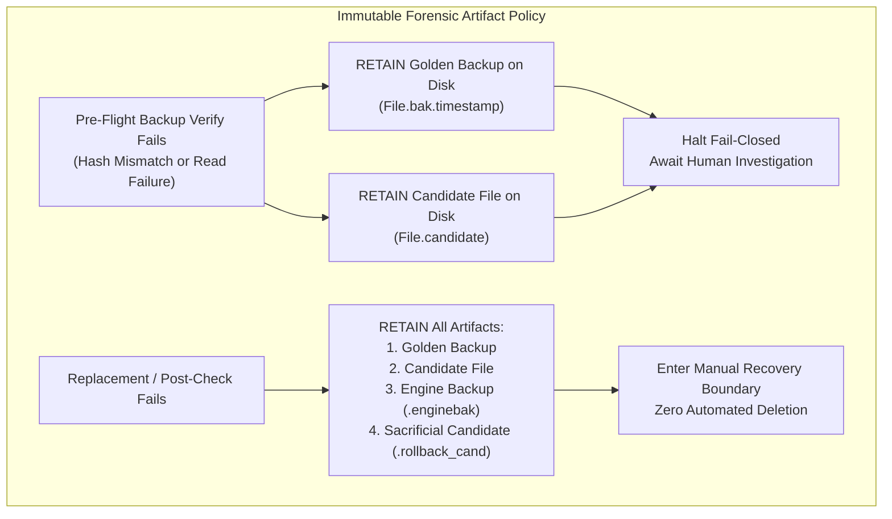
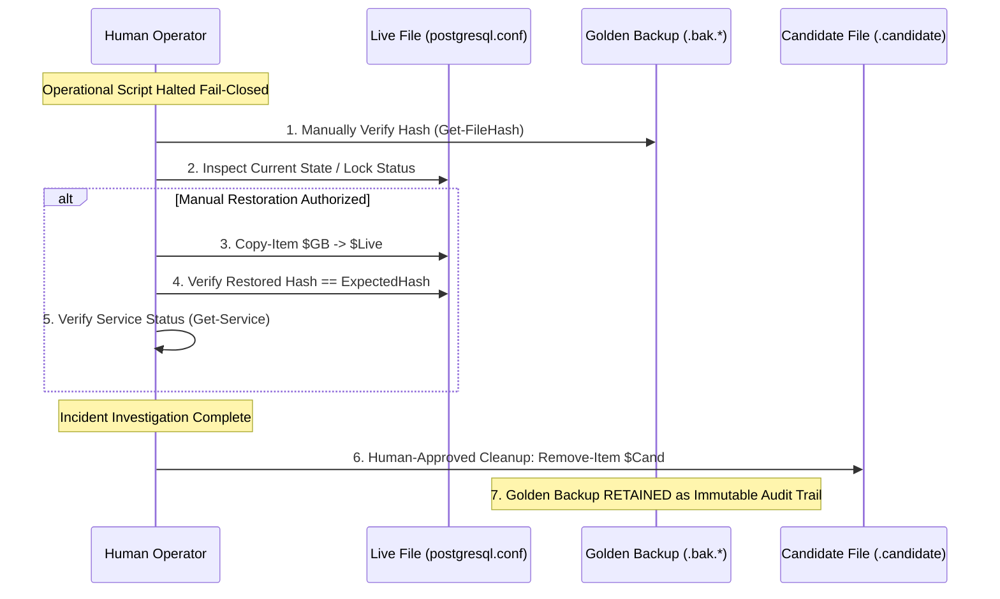

# MUSE SPARK — ZENTRA STEP 2D-2A-AD
## BACKUP PRESERVATION & EXHAUSTIVE STATE BRANCHING — DOCUMENTATION ONLY

**Project:** ZENTRA — Hi-Tech Lab Field Service Management Platform  
**Target Repository:** `D:\Zentra`  
**Input Reference:** [`docs/MUSE_SPARK_STEP2D_2A_AC_FINAL_RECOVERY_STATE_MACHINE_REPORT.md`](file:///d:/Zentra/docs/MUSE_SPARK_STEP2D_2A_AC_FINAL_RECOVERY_STATE_MACHINE_REPORT.md)  
**Host Environment:** Windows Workstation (`127.0.0.1:5432`)  
**Report Date:** 2026-10-09  
**Mode:** STRICT DOCUMENTATION-ONLY RECOVERY AUDIT & RUNBOOK FINALIZATION  
**Budget Constraint:** Strict ₹0/month (Zero cost, no credit cards, no paid upgrades)  
**Remote Access:** STRICTLY PROHIBITED (Zero remote connections made)  
**Execution Authorization:** NOT GRANTED — NO COMMANDS EXECUTED IN THIS STEP  
**Status:** COMPLETE — WAITING FOR HUMAN OPERATOR REVIEW  

---

## 1. Executive Summary & Objective

In **Step 2D-2A-AC**, the recovery state machine was expanded to incorporate four explicit hash statuses (`HASH_VERIFIED`, `FILE_MISSING`, `HASH_READ_FAILED`), forensic diagnostics collection was hardened against internal exceptions, and an eight-scenario validation matrix was defined.

A rigorous systems-level audit of the Step 2D-2A-AC report identified three remaining edge-case defects:
1. **Destructive Deletion of Backup upon Pre-Flight Verification Failure:** In `Invoke-SafeConfigReplacementV5`, if the pre-flight Golden Backup check failed (`gbInfo.Status -ne "HASH_VERIFIED" -or $gbInfo.Hash -ne $H_live_pre`), the script executed `Remove-Item -Path $goldenBackupPath -Force`. Deleting a backup file whose state is uncertain permanently destroys critical forensic evidence required to determine why the copy failed or what partial bytes were written. The Golden Backup must **never** be deleted automatically during an uncertain failure path.
2. **Non-Exhaustive Destination Branching in Rollback:** In `Invoke-ControlledRollbackV3`, the script evaluated `FILE_MISSING` and `HASH_READ_FAILED`, but lacked an explicit assertion for `HASH_VERIFIED` and an explicit `else` branch for unknown/invalid statuses. If `Get-SafeFileHash` returned an unanticipated status, execution could fall through into the sacrificial replacement block. Replacement must proceed **only** when the destination is explicitly confirmed as `HASH_VERIFIED`, and must fail closed to the manual recovery boundary on all missing, unreadable, or unknown states.
3. **Overclaimed Diagnostic Guarantees:** Step 2D-2A-AC claimed that emergency halts were "100% guaranteed" despite running in an environment without live test verification. Software running on Windows can be subject to out-of-memory faults, thread terminations, or external aborts. The containment strategy must accurately describe architectural design resilience (per-query `try/catch` isolation) without making unverified absolute claims.

This report, **Step 2D-2A-AD**, resolves all three defects by enforcing permanent artifact retention, establishing exhaustive fail-closed state branching across all inputs, documenting accurate diagnostic containment, and refining the validation test matrix.

> [!IMPORTANT]
> **Strict Documentation-Only Boundary:** Zero operational commands or configuration changes were executed during this step. Zero configuration files (`postgresql.conf`, `pg_hba.conf`), firewall rules, Windows services, application files, or `.env` files were modified. Zero databases or roles were created. All operational procedures in this document are strictly **[NOT EXECUTED — UNTESTED]**.

---

## 2. Section 1 — Four Core Architectural Corrections

| Correction ID | Architectural Area | Step 2D-2A-AC Defect | Technical Failure Mode | Mandatory Correction in Step 2D-2A-AD |
|---|---|---|---|---|
| **CORR-AD1** | **Backup Preservation** | Script automatically deleted `$goldenBackupPath` when pre-flight verification failed. | Destroyed critical forensic evidence; prevented post-incident analysis of disk or I/O corruption. | **Never delete the golden backup** on failure. Retain candidate and backup files for operator investigation. Cleanup is strictly a manual, human-approved action. |
| **CORR-AD2** | **Exhaustive Destination States** | Rollback destination check lacked explicit `HASH_VERIFIED` guard and explicit unknown status catch-all. | Unexpected or corrupted status values could fall through into the replacement swap. | Enforce exhaustive branching: handle `HASH_VERIFIED`, `FILE_MISSING`, `HASH_READ_FAILED`, and `UNKNOWN_STATUS`. Proceed to swap **only** when destination is verified readable. |
| **CORR-AD3** | **Diagnostic Containment** | Claimed absolute guarantees without empirical proof; loosely structured secondary errors. | Inaccurate technical documentation; potential loss of secondary diagnostic error details. | Document per-query `try/catch` fault isolation. Track `$DiagnosticErrors` array alongside `$InitialError` and `$HashInspectionError`. Disclaim absolute guarantees. |
| **CORR-AD4** | **Validation Matrix** | Test matrix lacked scenarios for unexpected status values and backup read failures. | Edge cases in the state machine remained unaccounted for in the documented specifications. | Expand matrix to cover backup hash mismatch, backup read failure, unexpected status, destination unreadable, and diagnostic errors. Label `NOT EXECUTED — UNTESTED`. |

---

## 3. Section 2 — Technical Specifications of Corrected Procedures

### 3.1 Forensic Artifact Preservation Invariants

To guarantee forensic integrity across all failure modes, the following invariants are enforced:



#### Invariants:
1. **Zero Automated Deletion on Uncertainty:** If a backup file cannot be verified, or if a hash check fails, scripts must **never** execute `Remove-Item` on the backup. The file must remain on disk to allow the operator to inspect the exact bytes written.
2. **Retention of Candidate Files:** When an operation aborts due to backup corruption or unreadable destination, the candidate file (`.candidate`) is preserved alongside the backup to enable comparative diff analysis.
3. **Manual Human-Approved Cleanup:** Artifact cleanup (purging `.candidate`, `.bak.*`, or `.enginebak.*`) is decoupled from the execution script and defined as a post-verification operational task requiring explicit operator sign-off.

---

### 3.2 The Fully Exhaustive Rollback Engine (`Invoke-ControlledRollbackV4`)

The rollback engine explicitly accounts for all four possible states for both the Golden Backup and the Live Destination:

```powershell
# [NOT EXECUTED — UNTESTED OPERATIONAL PROCEDURE]

function Invoke-ControlledRollbackV4 {
    <#
    .SYNOPSIS
        Safely restores a configuration file using a sacrificial clone of the golden backup.
        Enforces exhaustive state branching on both backup and live destination.
    #>
    param (
        [Parameter(Mandatory = $true)]
        [string]$LiveConfigPath,

        [Parameter(Mandatory = $true)]
        [string]$GoldenBackupPath,

        [Parameter(Mandatory = $true)]
        [string]$ExpectedHash,

        [System.Exception]$InitialError
    )

    Write-Warning "=== INITIATING CONTROLLED ROLLBACK V4 ==="

    # -------------------------------------------------------------
    # 1. EXHAUSTIVE GOLDEN BACKUP EVALUATION
    # -------------------------------------------------------------
    $gbInfo = Get-SafeFileHash -FilePath $GoldenBackupPath
    
    switch ($gbInfo.Status) {
        "FILE_MISSING" {
            return [PSCustomObject]@{
                Success = $false
                Status  = "GOLDEN_BACKUP_MISSING"
                Message = "Golden backup file [$GoldenBackupPath] does not exist."
                Error   = $null
            }
        }
        "HASH_READ_FAILED" {
            return [PSCustomObject]@{
                Success = $false
                Status  = "GOLDEN_BACKUP_UNREADABLE"
                Message = "Golden backup file [$GoldenBackupPath] is unreadable: $($gbInfo.Message)"
                Error   = $gbInfo.Error
            }
        }
        "HASH_VERIFIED" {
            if ($gbInfo.Hash -ne $ExpectedHash) {
                return [PSCustomObject]@{
                    Success = $false
                    Status  = "GOLDEN_BACKUP_CORRUPT"
                    Message = "Golden backup hash [$($gbInfo.Hash)] does not match expected pre-change hash [$ExpectedHash]."
                    Error   = $null
                }
            }
            # Expected hash matches; Golden Backup verified safe to use
        }
        default {
            return [PSCustomObject]@{
                Success = $false
                Status  = "GOLDEN_BACKUP_UNKNOWN_STATE"
                Message = "Golden backup returned unexpected status: $($gbInfo.Status). Message: $($gbInfo.Message)"
                Error   = $gbInfo.Error
            }
        }
    }

    # -------------------------------------------------------------
    # 2. EXHAUSTIVE LIVE DESTINATION EVALUATION
    # -------------------------------------------------------------
    $destInfo = Get-SafeFileHash -FilePath $LiveConfigPath

    switch ($destInfo.Status) {
        "FILE_MISSING" {
            return [PSCustomObject]@{
                Success = $false
                Status  = "LIVE_DESTINATION_MISSING"
                Message = "Live destination [$LiveConfigPath] is absent. Win32 File.Replace cannot execute on an absent destination."
                Error   = $null
            }
        }
        "HASH_READ_FAILED" {
            return [PSCustomObject]@{
                Success = $false
                Status  = "LIVE_DESTINATION_UNREADABLE"
                Message = "Live destination [$LiveConfigPath] is locked or unreadable: $($destInfo.Message)"
                Error   = $destInfo.Error
            }
        }
        "HASH_VERIFIED" {
            # Destination is present and readable. Safe to proceed with sacrificial candidate creation.
        }
        default {
            return [PSCustomObject]@{
                Success = $false
                Status  = "LIVE_DESTINATION_UNKNOWN_STATE"
                Message = "Live destination returned unexpected status: $($destInfo.Status). Message: $($destInfo.Message)"
                Error   = $destInfo.Error
            }
        }
    }

    # -------------------------------------------------------------
    # 3. SACRIFICIAL CLONE CREATION & VERIFICATION
    # -------------------------------------------------------------
    $sacrificialPath = "$GoldenBackupPath.rollback_cand"
    try {
        $backupBytes = [System.IO.File]::ReadAllBytes($GoldenBackupPath)
        [System.IO.File]::WriteAllBytes($sacrificialPath, $backupBytes)
        
        $cloneInfo = Get-SafeFileHash -FilePath $sacrificialPath
        if ($cloneInfo.Status -ne "HASH_VERIFIED" -or $cloneInfo.Hash -ne $ExpectedHash) {
            # Preserve sacrificial file for forensics if corrupted; do NOT silently remove
            return [PSCustomObject]@{
                Success = $false
                Status  = "SACRIFICIAL_CLONE_CORRUPT"
                Message = "Sacrificial clone hash verification failed ($($cloneInfo.Status)): Expected $ExpectedHash, observed $($cloneInfo.Hash)."
                Error   = $cloneInfo.Error
            }
        }

        # ---------------------------------------------------------
        # 4. WIN32 ATOMIC SWAP USING SACRIFICIAL CANDIDATE
        # ---------------------------------------------------------
        $discardBackup = "$LiveConfigPath.rollback_discard.$((Get-Date).Ticks)"
        [System.IO.File]::Replace($sacrificialPath, $LiveConfigPath, $discardBackup, $true)
        
        # Clean up temporary discard backup if swap succeeded
        if (Test-Path -Path $discardBackup) {
            Remove-Item -Path $discardBackup -Force -ErrorAction SilentlyContinue
        }

        # ---------------------------------------------------------
        # 5. POST-ROLLBACK DUAL VERIFICATION (HASH + BYTE INTEGRITY)
        # ---------------------------------------------------------
        $restoredInfo = Get-SafeFileHash -FilePath $LiveConfigPath
        if ($restoredInfo.Status -ne "HASH_VERIFIED") {
            return [PSCustomObject]@{
                Success = $false
                Status  = "RESTORED_FILE_UNVERIFIABLE"
                Message = "Restored live file cannot be verified ($($restoredInfo.Status)): $($restoredInfo.Message)"
                Error   = $restoredInfo.Error
            }
        }
        if ($restoredInfo.Hash -ne $ExpectedHash) {
            return [PSCustomObject]@{
                Success = $false
                Status  = "RESTORED_HASH_MISMATCH"
                Message = "Restored live file hash [$($restoredInfo.Hash)] does not match expected pre-change hash [$ExpectedHash]."
                Error   = $null
            }
        }

        # Re-verify strict byte, BOM, UTF-8, and CRLF integrity
        Test-CandidateByteAndEncodingIntegrity -FilePath $LiveConfigPath

        Write-Host "[ROLLBACK VERIFIED] Live configuration successfully restored and verified [SHA256: $($restoredInfo.Hash)]." -ForegroundColor Green
        return [PSCustomObject]@{
            Success      = $true
            Status       = "ROLLBACK_SUCCESS"
            RestoredHash = $restoredInfo.Hash
            Message      = "Configuration successfully restored to pre-change state. Golden backup preserved."
            Error        = $null
        }
    }
    catch {
        return [PSCustomObject]@{
            Success = $false
            Status  = "ROLLBACK_SWAP_EXCEPTION"
            Message = "Exception occurred during rollback swap: $($_.Exception.Message)"
            Error   = $_.Exception
        }
    }
}
```

---

### 3.3 The Hardened Configuration Replacement Engine (`Invoke-SafeConfigReplacementV6`)

```powershell
# [NOT EXECUTED — UNTESTED OPERATIONAL PROCEDURE]

function Invoke-SafeConfigReplacementV6 {
    <#
    .SYNOPSIS
        Safely replaces a PostgreSQL configuration file with non-destructive artifact retention,
        exhaustive status branching, and structured error isolation.
    #>
    param (
        [Parameter(Mandatory = $true)]
        [string]$LiveConfigPath,

        [Parameter(Mandatory = $true)]
        [string]$CandidatePath,

        [Parameter(Mandatory = $true)]
        [string]$Description
    )

    Write-Host "=== INITIATING HARDENED CONFIGURATION REPLACEMENT V6: $Description ===" -ForegroundColor Cyan

    # -------------------------------------------------------------
    # STAGE 1: PRE-FLIGHT VALIDATION & ROBUST HASH INITIALIZATION
    # -------------------------------------------------------------
    $livePreInfo = Get-SafeFileHash -FilePath $LiveConfigPath
    if ($livePreInfo.Status -ne "HASH_VERIFIED") {
        throw "FAIL-CLOSED ABORT: Pre-flight live configuration check failed ($($livePreInfo.Status)): $($livePreInfo.Message)"
    }
    $H_live_pre = $livePreInfo.Hash

    $candPreInfo = Get-SafeFileHash -FilePath $CandidatePath
    if ($candPreInfo.Status -ne "HASH_VERIFIED") {
        throw "FAIL-CLOSED ABORT: Pre-flight candidate check failed ($($candPreInfo.Status)): $($candPreInfo.Message)"
    }
    $H_cand_pre = $candPreInfo.Hash

    # Strict byte, BOM, UTF-8, and CRLF validation on candidate
    Test-CandidateByteAndEncodingIntegrity -FilePath $CandidatePath

    # Create immutable golden backup on same volume
    $timestamp = (Get-Date -Format 'yyyyMMdd_HHmmss')
    $goldenBackupPath = "$LiveConfigPath.bak.$timestamp"
    
    $liveBytes = [System.IO.File]::ReadAllBytes($LiveConfigPath)
    [System.IO.File]::WriteAllBytes($goldenBackupPath, $liveBytes)

    $gbInfo = Get-SafeFileHash -FilePath $goldenBackupPath
    if ($gbInfo.Status -ne "HASH_VERIFIED" -or $gbInfo.Hash -ne $H_live_pre) {
        # FORENSIC PRESERVATION: Retain both candidate and golden backup on disk!
        # Do NOT delete $goldenBackupPath or $CandidatePath!
        Write-Error "CRITICAL FORENSIC ALERT: Golden backup verification failed ($($gbInfo.Status))."
        Write-Error "Preserving Golden Backup [$goldenBackupPath] and Candidate [$CandidatePath] for forensic inspection."
        throw "FAIL-CLOSED ABORT: Golden backup hash verification failed. All artifacts retained for analysis. Live file untouched."
    }
    Write-Host "[PRE-FLIGHT PASSED] Verified Golden Backup: $goldenBackupPath [SHA256: $H_live_pre]" -ForegroundColor Green
    Write-Host "[PRE-FLIGHT PASSED] Candidate Hash Retained: [SHA256: $H_cand_pre]" -ForegroundColor Green

    # -------------------------------------------------------------
    # STAGE 2: CONTROLLED WIN32 FILE REPLACEMENT
    # -------------------------------------------------------------
    $engineBackupPath = "$LiveConfigPath.enginebak.$timestamp"
    $replaceError = $null

    try {
        [System.IO.File]::Replace($CandidatePath, $LiveConfigPath, $engineBackupPath, $true)
        Write-Host "[REPLACE SUCCEEDED] Win32 File.Replace completed." -ForegroundColor Green
    }
    catch {
        $replaceError = $_.Exception
        Write-Error "Replacement operation threw an exception: $($replaceError.Message)"

        # Inspect current live file state safely
        $liveCurrInfo = Get-SafeFileHash -FilePath $LiveConfigPath
        
        switch ($liveCurrInfo.Status) {
            "HASH_VERIFIED" {
                if ($liveCurrInfo.Hash -eq $H_live_pre) {
                    # OUTCOME 1: REPLACEMENT FAILED — TARGET UNTOUCHED
                    Write-Host "[OUTCOME 1: TARGET UNTOUCHED] Live file hash matches pre-change hash. Target was never modified." -ForegroundColor Yellow
                    throw "FAIL-CLOSED ABORT [OUTCOME 1]: Replacement failed before touching target file ($($replaceError.Message)). Live file remains intact."
                }
                # Hash differs -> target was modified or corrupted -> proceed to rollback
            }
            "FILE_MISSING" {
                # OUTCOME 5A: TARGET MISSING
                Enter-ManualRecoveryBoundaryV4 -LivePath $LiveConfigPath -BackupPath $goldenBackupPath -ExpectedHash $H_live_pre -CandidateHash $H_cand_pre -InitialError $replaceError -HashInspectionError $null -RollbackResult $null -Detail "Live destination file is missing after failed replace operation."
            }
            "HASH_READ_FAILED" {
                # OUTCOME 5B: TARGET UNREADABLE / LOCKED
                Enter-ManualRecoveryBoundaryV4 -LivePath $LiveConfigPath -BackupPath $goldenBackupPath -ExpectedHash $H_live_pre -CandidateHash $H_cand_pre -InitialError $replaceError -HashInspectionError $liveCurrInfo.Error -RollbackResult $null -Detail "Live destination file is locked or unreadable: $($liveCurrInfo.Message)"
            }
            default {
                # OUTCOME 5D: TARGET UNKNOWN STATE
                Enter-ManualRecoveryBoundaryV4 -LivePath $LiveConfigPath -BackupPath $goldenBackupPath -ExpectedHash $H_live_pre -CandidateHash $H_cand_pre -InitialError $replaceError -HashInspectionError $liveCurrInfo.Error -RollbackResult $null -Detail "Live destination returned unknown state ($($liveCurrInfo.Status)): $($liveCurrInfo.Message)"
            }
        }

        # Target altered -> Initiate controlled rollback
        $rollbackResult = Invoke-ControlledRollbackV4 -LiveConfigPath $LiveConfigPath -GoldenBackupPath $goldenBackupPath -ExpectedHash $H_live_pre -InitialError $replaceError

        if ($rollbackResult.Success) {
            # OUTCOME 4: ROLLBACK SUCCEEDED
            Write-Host "[OUTCOME 4: ROLLBACK SUCCESS] Original configuration verified and restored. Golden backup preserved." -ForegroundColor Yellow
            throw "FAIL-CLOSED ABORT [OUTCOME 4]: Replacement failed ($($replaceError.Message)), but rollback successfully restored original configuration. Live service safe."
        }
        else {
            # OUTCOME 5C: ROLLBACK FAILED
            Enter-ManualRecoveryBoundaryV4 -LivePath $LiveConfigPath -BackupPath $goldenBackupPath -ExpectedHash $H_live_pre -CandidateHash $H_cand_pre -InitialError $replaceError -HashInspectionError $null -RollbackResult $rollbackResult -Detail "Rollback execution failed ($($rollbackResult.Status)): $($rollbackResult.Message)"
        }
    }

    # -------------------------------------------------------------
    # STAGE 3: POST-REPLACEMENT INTEGRITY VERIFICATION
    # -------------------------------------------------------------
    $livePostInfo = Get-SafeFileHash -FilePath $LiveConfigPath
    $postValidationPassed = $false
    $postValidationError = $null

    if ($livePostInfo.Status -eq "HASH_VERIFIED" -and $livePostInfo.Hash -eq $H_cand_pre) {
        try {
            Test-CandidateByteAndEncodingIntegrity -FilePath $LiveConfigPath
            $postValidationPassed = $true
        }
        catch {
            $postValidationError = $_.Exception
        }
    }
    else {
        $postValidationError = [System.InvalidOperationException]::new("Post-replacement live hash verification failed ($($livePostInfo.Status)): Expected $H_cand_pre, observed $($livePostInfo.Hash).")
    }

    if ($postValidationPassed) {
        # OUTCOME 2: PROMOTION SUCCESS VERIFIED
        Write-Host "[OUTCOME 2: PROMOTION SUCCESS] Promoted live configuration verified on disk [SHA256: $($livePostInfo.Hash)]." -ForegroundColor Green
        return $goldenBackupPath
    }
    else {
        # OUTCOME 3 -> Rollback triggered
        Write-Error "[OUTCOME 3: POST-VERIFICATION FAILED] $($postValidationError.Message)"
        $rollbackResult = Invoke-ControlledRollbackV4 -LiveConfigPath $LiveConfigPath -GoldenBackupPath $goldenBackupPath -ExpectedHash $H_live_pre -InitialError $postValidationError

        if ($rollbackResult.Success) {
            # OUTCOME 4: ROLLBACK SUCCEEDED
            throw "FAIL-CLOSED ABORT [OUTCOME 4]: Post-replacement verification failed ($($postValidationError.Message)), but rollback successfully restored original configuration."
        }
        else {
            # OUTCOME 5C: ROLLBACK FAILED
            Enter-ManualRecoveryBoundaryV4 -LivePath $LiveConfigPath -BackupPath $goldenBackupPath -ExpectedHash $H_live_pre -CandidateHash $H_cand_pre -InitialError $postValidationError -HashInspectionError $null -RollbackResult $rollbackResult -Detail "Post-verification rollback failed ($($rollbackResult.Status)): $($rollbackResult.Message)"
        }
    }
}
```

---

### 3.4 The Resilient Manual Recovery Boundary Diagnostic Engine (`Enter-ManualRecoveryBoundaryV4`)

```powershell
# [NOT EXECUTED — UNTESTED OPERATIONAL PROCEDURE]

function Enter-ManualRecoveryBoundaryV4 {
    param (
        [string]$LivePath,
        [string]$BackupPath,
        [string]$ExpectedHash,
        [string]$CandidateHash,
        [System.Exception]$InitialError,
        [System.Exception]$HashInspectionError,
        [PSCustomObject]$RollbackResult,
        [string]$Detail
    )

    $diagnosticErrors = [System.Collections.Generic.List[string]]::new()

    Write-Host "`n" -NoNewline
    Write-Host "****************************************************************" -ForegroundColor Red
    Write-Host "         CRITICAL: ENTERING MANUAL RECOVERY BOUNDARY (OUTCOME 5)  " -ForegroundColor Red
    Write-Host "****************************************************************" -ForegroundColor Red
    Write-Host "Automated configuration recovery cannot be guaranteed safe."
    Write-Host "All automated operations have ceased to prevent data corruption."
    Write-Host "----------------------------------------------------------------"
    Write-Host "FORENSIC STATUS:"
    Write-Host "  Context / Detail:          $Detail"
    Write-Host "  Target Live File:          $LivePath"
    Write-Host "  Golden Backup File:        $BackupPath"
    Write-Host "  Expected Pre-Hash:         $ExpectedHash"
    Write-Host "  Candidate Hash:            $CandidateHash"
    
    if ($InitialError) {
        Write-Host "  Initial Error:             $($InitialError.GetType().Name): $($InitialError.Message)"
    }
    if ($HashInspectionError) {
        Write-Host "  Hash Inspection Error:     $($HashInspectionError.GetType().Name): $($HashInspectionError.Message)"
    }
    if ($RollbackResult) {
        Write-Host "  Rollback Status:           $($RollbackResult.Status)"
        Write-Host "  Rollback Message:          $($RollbackResult.Message)"
        if ($RollbackResult.Error) {
            Write-Host "  Rollback Error Detail:     $($RollbackResult.Error.GetType().Name): $($RollbackResult.Error.Message)"
        }
    }

    # Isolated Query 1: Live File Status Check
    try {
        $liveInspection = Get-SafeFileHash -FilePath $LivePath
        Write-Host "  Current Live Status:       $($liveInspection.Status)"
        Write-Host "  Current Live Hash:         $($liveInspection.Hash)"
        if ($liveInspection.Error) {
            Write-Host "  Live Inspection Error:     $($liveInspection.Error.Message)"
        }
    }
    catch {
        $diagnosticErrors.Add("Live File Query: $($_.Exception.Message)")
        Write-Host "  Live File Status:          QUERY FAILED ($($_.Exception.Message))"
    }

    # Isolated Query 2: Active PostgreSQL Process Check
    Write-Host "----------------------------------------------------------------"
    Write-Host "ACTIVE PROCESS & SERVICE STATUS:"
    try {
        $pgProcesses = Get-Process -Name "postgres*" -ErrorAction SilentlyContinue
        if ($pgProcesses) {
            Write-Host "  PostgreSQL Processes:      Found $($pgProcesses.Count) running process(es). PIDs: $(($pgProcesses.Id) -join ', ')"
        } else {
            Write-Host "  PostgreSQL Processes:      Zero running postgres processes detected."
        }
    }
    catch {
        $diagnosticErrors.Add("Process Query: $($_.Exception.Message)")
        Write-Host "  PostgreSQL Processes:      QUERY FAILED ($($_.Exception.Message))"
    }

    # Isolated Query 3: Windows Service Status Check
    try {
        $svc = Get-Service -Name "postgresql-x64-18" -ErrorAction SilentlyContinue
        Write-Host "  Service Status:            $($svc.Name) is $($svc.Status)"
    }
    catch {
        $diagnosticErrors.Add("Service Query: $($_.Exception.Message)")
        Write-Host "  Service Status:            QUERY FAILED ($($_.Exception.Message))"
    }

    # Report any internal diagnostic collection failures
    if ($diagnosticErrors.Count -gt 0) {
        Write-Host "----------------------------------------------------------------"
        Write-Host "INTERNAL DIAGNOSTIC WARNINGS:" -ForegroundColor Yellow
        foreach ($dErr in $diagnosticErrors) {
            Write-Host "  - $dErr" -ForegroundColor Yellow
        }
    }

    Write-Host "----------------------------------------------------------------"
    Write-Host "REQUIRED HUMAN OPERATOR ACTIONS:"
    Write-Host "  1. Verify Golden Backup existence and SHA-256 before any manual restoration:"
    Write-Host "     Get-FileHash -Path '$BackupPath' -Algorithm SHA256"
    Write-Host "  2. Confirm expected hash matches: '$ExpectedHash'"
    Write-Host "  3. If approved, manually restore live configuration from Golden Backup:"
    Write-Host "     Copy-Item -Path '$BackupPath' -Destination '$LivePath'"
    Write-Host "  4. Check PostgreSQL service stability:"
    Write-Host "     Get-Service -Name postgresql-x64-18"
    Write-Host "****************************************************************`n" -ForegroundColor Red

    # Unconditional fail-closed terminating emergency halt
    throw "FAIL-CLOSED EMERGENCY STOP [OUTCOME 5]: Manual recovery required. Review forensic diagnostic output above."
}
```

---

### 3.5 Human-Supervised Forensic Investigation & Manual Cleanup Runbook

To maintain forensic integrity, artifact cleanup is strictly separated from automated code paths:



#### Detailed Cleanup Protocol:
1. **Never Automate Post-Failure Cleanup:** Artifacts generated during failed runs (`.candidate`, `.bak.*`, `.enginebak.*`) must remain on disk until an operator audits the incident.
2. **Operator Cleanup Authority:** Only after the database service is verified stable and operational may the human operator purge temporary `.candidate` or `.enginebak.*` files.
3. **Permanent Retention of Golden Backups:** Pre-change `.bak.*` files should be retained permanently in the cluster configuration archive to maintain an unbroken audit trail of all administrative adjustments.

---

## 4. Section 3 — Documentation-Only Validation Test Matrix

The following matrix documents expected behavior across all failure edge cases:

| Test ID | Scenario Description | Injected Condition / Fault | Expected Code Branch | Resulting Status Code | Expected Script Action |
|---|---|---|---|---|---|
| **TEST-01** | **Backup Hash Mismatch** | Golden backup hash does not match pre-change live hash. | Stage 1 $\rightarrow$ `gbInfo.Hash != $H_live_pre` | `BACKUP_VERIFY_FAILED` | **Retains backup & candidate on disk**; halts fail-closed; live file untouched. |
| **TEST-02** | **Backup Hash-Read Failure** | Golden backup is locked or permission denied. | Stage 1 $\rightarrow$ `gbInfo.Status == 'HASH_READ_FAILED'` | `BACKUP_READ_FAILED` | **Retains backup & candidate on disk**; halts fail-closed; live file untouched. |
| **TEST-03** | **Backup Unexpected Status** | `Get-SafeFileHash` returns null/invalid status on backup. | Rollback Stage 1 `switch default` | `GOLDEN_BACKUP_UNKNOWN_STATE` | Rejects rollback; enters manual recovery boundary; logs unknown state. |
| **TEST-04** | **Clean Replacement Failure** | `File.Replace` throws before write (sharing violation); live file untouched. | Stage 2 `catch` $\rightarrow$ `liveCurrInfo.Hash == $H_live_pre` | `ABORT_TARGET_UNTOUCHED` (Outcome 1) | Candidate retained/purged; live file untouched; clean fail-closed halt. |
| **TEST-05** | **Live Destination Missing** | Live file deleted during interrupted replace; `Get-SafeFileHash` returns `FILE_MISSING`. | Stage 2 `catch` $\rightarrow$ `liveCurrInfo.Status == 'FILE_MISSING'` | `TARGET_FILE_MISSING` (Outcome 5A) | Ceases automation; enters manual recovery boundary; logs missing target. |
| **TEST-06** | **Live Destination Unreadable** | Live file locked with exclusive access; `Get-SafeFileHash` returns `HASH_READ_FAILED`. | Stage 2 `catch` $\rightarrow$ `liveCurrInfo.Status == 'HASH_READ_FAILED'` | `TARGET_FILE_UNREADABLE` (Outcome 5B) | Ceases automation; enters manual recovery boundary; logs locking error. |
| **TEST-07** | **Destination Unexpected Status** | `Get-SafeFileHash` returns null/invalid status on live destination. | Stage 2 `catch switch default` | `TARGET_UNKNOWN_STATE` (Outcome 5D) | Ceases automation; enters manual recovery boundary; logs unknown state. |
| **TEST-08** | **Successful Verified Rollback** | Post-check fails; sacrificial clone swapped; restored hash equals $H_{\text{live\_pre}}$. | Rollback Stage 5 $\rightarrow$ `restoredInfo.Hash == $ExpectedHash` | `ROLLBACK_SUCCESS_RESTORED` (Outcome 4) | Restores live file; golden backup preserved; clean fail-closed halt. |
| **TEST-09** | **Diagnostic Gathering Failure** | Process table or service query throws exception inside manual boundary. | `Enter-ManualRecoveryBoundaryV4` isolated query try/catch | `MANUAL_RECOVERY_HALT` (Outcome 5) | Records diagnostic warning; continues diagnostic output; executes terminating halt. |

> [!NOTE]
> All scenarios in the matrix above are strictly **[NOT EXECUTED — UNTESTED]**. They represent the formal specification and expected behavior under simulated fault injection, but have not been executed on the live Windows host.

---

## 5. Section 4 — Tested Ground Truth vs. Untested Proposed Code Matrix

| Procedure / Component | Category | Verification Status | Basis / Verification Method | Operational Prerequisite |
|---|---|---|---|---|
| **Cluster Collation Baseline** | Read-Only SQL | 🟢 **Verified Fact** | Inspected all 5 catalogs in Step 2D-2A-S: `English_United States.1252` (`UTF8`). | None. Safe to use `TEMPLATE template1`. |
| **Port 5432 Listener Bindings** | Read-Only OS | 🟢 **Verified Fact** | `Get-NetTCPConnection` confirmed listening on `0.0.0.0:5432` and `[::]:5432`. | None. Proves socket hardening is required. |
| **Firewall Profile State** | Read-Only OS | 🟢 **Verified Fact** | `netsh advfirewall` confirmed `Public: OFF` on active Wi-Fi interface. | Operator decision on profile activation. |
| **Shared Catalog Baseline** | Read-Only SQL | 🟢 **Verified Fact** | Catalogs `hisecure_erp`, `hitech_platform`, and `zentra_test` verified intact. | Protected via fail-closed assertions. |
| **`Get-SafeFileHash`** | PowerShell Script | 🔴 **UNTESTED** | Authored in documentation; not executed against live files. | Operator dry-run in isolated scratch folder. |
| **`Invoke-ControlledRollbackV4`** | PowerShell Script | 🔴 **UNTESTED** | Authored in documentation; sacrificial clone swap not executed live. | Operator dry-run in scratch folder. |
| **`Invoke-SafeConfigReplacementV6`** | PowerShell Script | 🔴 **UNTESTED** | Authored in documentation; not run on PostgreSQL data directory. | Operator dry-run in scratch folder. |
| **`Enter-ManualRecoveryBoundaryV4`**| PowerShell Script | 🔴 **UNTESTED** | Authored in documentation; diagnostic logger not executed live. | Operator dry-run in scratch folder. |
| **`postgres.exe -C` Validation** | Engine CLI | 🔴 **UNTESTED** | Flag documented from PostgreSQL manuals; not run live on host. | Run dry-run `postgres.exe -C` before promotion. |
| **`pg_ctl reload` Dynamic Signal** | Service CLI | 🔴 **UNTESTED** | Documented reload mechanism; not triggered in active environment. | Requires local Administrator console session. |
| **`pg_hba_file_rules` Inspection** | SQL Catalog Query | 🔴 **UNTESTED** | System view documented; query not run post-change. | Requires active loopback psql connection. |
| **Interactive `\password` Assignment** | psql Meta-Command | 🔴 **UNTESTED** | Meta-command documented; interactive password assignment not run. | Interactive operator terminal session. |
| **Standalone Migration Runner** | Application CLI | 🔴 **UNTESTED** | CLI script does not exist in repository; proposal pending. | Author and review runner prior to Stage B. |

---

## 6. Section 5 — The Six Human Approval Gates Reaffirmed

The execution roadmap preserves all six decoupled human approval gates without alteration:

```mermaid
graph TD
    subgraph ClusterHardening["Pre-Initialization Shared Cluster Hardening"]
        G1{"Gate 1: Network Hardening<br/>Human Approval"} --> P1["Phase 1: Candidate Generation<br/>listen_addresses = 'localhost'<br/>Strict UTF-8 Test + postgres.exe -C + Tri-Hash V6 Swap + Restart"]
        P1 --> T1["Tier 1 & Tier 2 Observable Health Checks<br/>(Hi-Secure-ERP & Test App)"]
        T1 --> G2{"Gate 2: Host Firewall Evaluation<br/>Human Approval"}
        G2 --> P2["Phase 2: Inbound Firewall Review<br/>(Targeted Port 5432 Block Rule;<br/>Profile remains OFF unless authorized)"]
        P2 --> G3{"Gate 3: Auth Policy Deployment<br/>Human Approval"}
        G3 --> P3["Phase 3: Targeted SCRAM Candidate<br/>(Prepend zentra_local rules to pg_hba.conf)<br/>Strict UTF-8 Test + Tri-Hash V6 Swap + Dynamic Reload + pg_hba_file_rules Check"]
        P3 --> T2["Verify Legacy Apps Continue Unaffected Under trust"]
    end

    subgraph ZentraInit["ZENTRA Database Initialization Stages"]
        T2 --> G4{"Gate 4: Stage A Provisioning<br/>Human Approval"}
        G4 --> SA1["Stage A.1: Create zentra_dev Role<br/>(CREATE ROLE without password)"]
        SA1 --> SA2["Stage A.2: Assign SCRAM Password<br/>(Interactive \\password zentra_dev with hidden echo)"]
        SA2 --> SA3["Stage A.3: Create zentra_local Database<br/>(Autocommit Mode, TEMPLATE template1)"]
        SA3 --> G5{"Gate 5: Stage B Migrations<br/>Human Approval"}
        G5 --> SB["Stage B: Controlled Migrations<br/>(Execute 14 Kysely Migrations via reviewed runner)"]
        SB --> G6{"Gate 6: Stage C Seeding<br/>Human Approval"}
        G6 --> SC["Stage C: Synthetic Dev Seeding<br/>(Pre-seed 0-row check + Single Execution)"]
    end
```



| Gate ID | Scope & Milestone | Mandatory Prerequisites Before Granting Approval | Action Authorized Upon Operator Approval |
|---|---|---|---|
| **Gate 1** | **Network Socket Hardening** | Verified backup exists; candidate passes strict UTF-8 & CRLF check; `postgres.exe -C` passes; tri-hash validated; diff approved. | Promote candidate `postgresql.conf` via `Invoke-SafeConfigReplacementV6`; restart Windows service `postgresql-x64-18`. |
| **Gate 2** | **Host Firewall Policy** | Verified firewall profile states; evaluated impact of Public profile activation across local tools. | Create targeted port 5432 inbound block rule; review profile activation decision. |
| **Gate 3** | **Targeted SCRAM Policy** | Verified backup exists; candidate passes strict UTF-8 & CRLF check; tri-hash validated; diff approved. | Promote candidate `pg_hba.conf` via `Invoke-SafeConfigReplacementV6`; dynamic `pg_ctl reload`; verify `pg_hba_file_rules` has 0 errors. |
| **Gate 4** | **Stage A Database Creation** | Phases 1 & 3 complete; Tier 1 & 2 health checks pass; SCRAM rule active; `zentra_local` does not exist. | Create `zentra_dev` role; assign password via `\password`; create `zentra_local` DB via autocommit. |
| **Gate 5** | **Stage B Schema Migrations** | Stage A verified; `current_database() === 'zentra_local'`; 0 public tables; standalone runner reviewed. | Execute 14 Kysely migrations sequentially; verify 34 tables created. |
| **Gate 6** | **Stage C Synthetic Seeding** | Stage B verified; 14 migrations complete; domain table row counts strictly 0. | Execute synthetic mock seeding; verify row counts; confirm zero real PII. |

---

## 7. Section 6 — Concise List of Unresolved Blockers

Before any operator issues an execution command, the following four unresolved operational blockers must be resolved:

1. **Elevated Administrator Privileges:** The PostgreSQL 18 data directory (`C:\Program Files\PostgreSQL\18\data`) is protected by Windows NTFS permissions. Generating candidate files, backups, and invoking `File.Replace` requires an elevated Administrator PowerShell console session.
2. **Firewall Policy Decision:** Windows Defender Firewall's `Public` profile is currently `State: OFF` on the active Wi-Fi adapter (`Airtel_Rayyan@2103`). Adding an inbound block rule on port 5432 remains dormant unless the administrator explicitly enables the Public firewall profile.
3. **Interactive Password Assignment Channel:** Assigning the password for `zentra_dev` via `\password zentra_dev` cannot be automated via non-interactive scripts. It requires an interactive operator console to prevent credential capture in process trees, shell history, or logs.
4. **Standalone Migration Runner Implementation:** A reviewed, fail-closed CLI migration runner that imports the 14 Kysely migrations, verifies target database assertions, and reports status without invoking the full test suite does not yet exist and must be authored prior to Gate 5.

---

## 8. Section 7 — Confirmation of Safety & Compliance

- **Operational Execution:** **ZERO.** No operational commands were executed.
- **Database Writes / DDL:** **ZERO.** No databases, roles, tables, schemas, or records were created, modified, or dropped.
- **Data Mutating Commands:** **ZERO.** No `INSERT`, `UPDATE`, `DELETE`, `TRUNCATE`, migrations, seeds, or tests were executed.
- **Configuration Modifications:** **ZERO.** No changes were made to `postgresql.conf`, `pg_hba.conf`, Windows Firewall, Windows services, application code, or `.env` files.
- **Remote Cloud Connections:** **ZERO.** No connections made to Neon, AWS, Supabase, Render, or any remote host.
- **Budget Integrity:** Strict ₹0/month budget preserved.
- **Preserved Existing Databases:** Catalogs `hisecure_erp`, `hitech_platform`, and `zentra_test` remain completely untouched.
- **Production Scope:** Strictly local development workstation scope; no production readiness certification is claimed.

---

```
STOP — STEP 2D-2A-AD COMPLETE — WAITING FOR HUMAN REVIEW
```
