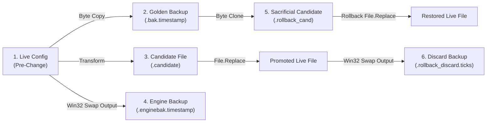

# MUSE SPARK — ZENTRA STEP 2D-2A-AE
## ROLLBACK ARTIFACT RETENTION & FINAL CONSISTENCY AUDIT — DOCUMENTATION ONLY

**Project:** ZENTRA — Hi-Tech Lab Field Service Management Platform  
**Target Repository:** `D:\Zentra`  
**Input Reference:** [`docs/MUSE_SPARK_STEP2D_2A_AD_BACKUP_PRESERVATION_REPORT.md`](file:///d:/Zentra/docs/MUSE_SPARK_STEP2D_2A_AD_BACKUP_PRESERVATION_REPORT.md)  
**Host Environment:** Windows Workstation (`127.0.0.1:5432`)  
**Report Date:** 2026-10-09  
**Mode:** STRICT DOCUMENTATION-ONLY CONSISTENCY AUDIT & RUNBOOK FINALIZATION  
**Budget Constraint:** Strict ₹0/month (Zero cost, no credit cards, no paid upgrades)  
**Remote Access:** STRICTLY PROHIBITED (Zero remote connections made)  
**Execution Authorization:** NOT GRANTED — NO COMMANDS EXECUTED IN THIS STEP  
**Status:** COMPLETE — WAITING FOR HUMAN OPERATOR REVIEW  

---

## 1. Executive Summary & Objective

In **Step 2D-2A-AD**, golden backup deletion during pre-flight failure was eliminated, exhaustive switch-case branching for backup and live destination states was implemented, and per-query diagnostic fault isolation was established.

A rigorous systems consistency audit of Step 2D-2A-AD identified four remaining technical ambiguities:
1. **Premature Deletion of Rollback Discard Artifacts:** In `Invoke-ControlledRollbackV4`, the discard backup (`$discardBackup`) generated by Win32 `File.Replace()` was deleted immediately via `Remove-Item` if the swap succeeded, prior to completing post-rollback hash and byte validation. If subsequent post-rollback verification failed or was uncertain, the discarded live file state was permanently lost. Discard backups must be retained on disk for human investigation.
2. **Ambiguous Artifact Lifecycle Definitions:** The term "immutable backup" was previously applied without distinguishing the exact lifecycle and retention states of the five distinct files created during replacement and rollback: Golden Backup, Candidate File, Engine Backup, Sacrificial Candidate, and Discard Backup.
3. **Validation Matrix Ambiguity:** Test scenario TEST-04 stated that the candidate file was `"retained/purged"`. Slash-separated, dual-outcome statements introduce operational ambiguity. Every failure scenario must specify exactly one unambiguous expected action.
4. **Holistic Consistency & Untested Assumptions:** The complete pipeline—candidate generation, pre-flight hashing, atomic swap, exception trapping, sacrificial rollback, manual diagnostic reporting, and artifact retention—must be verified for strict internal consistency, with all remaining untested assumptions explicitly inventoried.

This report, **Step 2D-2A-AE**, eliminates all automatic artifact deletion, provides the definitive Five-Artifact Lifecycle Matrix, standardizes the validation matrix with zero ambiguity, audits all remaining untested assumptions, and completes the technical specification.

> [!IMPORTANT]
> **Strict Documentation-Only Boundary:** Zero operational commands or configuration changes were executed during this step. Zero configuration files (`postgresql.conf`, `pg_hba.conf`), firewall rules, Windows services, application files, or `.env` files were modified. Zero databases or roles were created. All operational procedures in this document are strictly **[NOT EXECUTED — UNTESTED]**.

---

## 2. Section 1 — Four Core Architectural Corrections

| Correction ID | Architectural Area | Step 2D-2A-AD Defect | Technical Failure Mode | Mandatory Correction in Step 2D-2A-AE |
|---|---|---|---|---|
| **CORR-AE1** | **Discard Artifact Retention** | `Invoke-ControlledRollbackV4` deleted `$discardBackup` immediately after `File.Replace()`. | If post-rollback byte verification failed, the displaced file was destroyed, precluding root-cause analysis. | **Preserve `$discardBackup` unconditionally on disk.** Never delete discard artifacts automatically. All forensic evidence is retained for human review. |
| **CORR-AE2** | **Artifact Lifecycle Table** | Lacked a consolidated lifecycle matrix mapping all 5 artifacts across all 4 operational outcomes. | Ambiguity regarding which files remain on disk after success, clean abort, rollback, or failure. | Formalize the **Five-Artifact Lifecycle Matrix**. Define exact creation mechanisms, retention rules, and operator-approved cleanup steps for every artifact. |
| **CORR-AE3** | **Validation Matrix Unambiguity** | TEST-04 contained ambiguous language (`retained/purged`). | Ambiguity over script behavior prevents rigorous automated or operator validation. | Replace all dual-state descriptions with **one unambiguous expected action** per test. Explicitly mandate artifact retention across all failure modes. |
| **CORR-AE4** | **Consistency & Assumption Audit** | Unchecked assumptions regarding file handles, NTFS ACLs, and service timings were not formally consolidated. | Operators could assume reviewed documentation equates to verified operational code. | Perform holistic consistency audit across scripts, error payloads, and approval gates. Formally catalog all **Untested Assumptions**. |

---

## 3. Section 2 — Technical Specifications of Corrected Procedures

### 3.1 The Five-Artifact Lifecycle & Retention Matrix

The replacement and recovery architecture creates and manages five distinct file artifacts on the NTFS volume:



#### Complete Artifact Lifecycle Specification:

| Artifact Name | Filename Pattern | Originating Mechanism | Purpose | State After Outcome 2 (Promotion Success) | State After Outcome 4 (Rollback Success) | State After Outcome 5 (Manual Boundary) | Permitted Cleanup Authority |
|---|---|---|---|---|---|---|---|
| **1. Golden Backup** | `<Config>.bak.<timestamp>` | `[System.IO.File]::WriteAllBytes` before any write. | Immutable reference copy of pre-change configuration. | **RETAINED** on disk permanently as audit baseline. | **RETAINED** on disk permanently as audit baseline. | **RETAINED** on disk permanently as recovery source. | Strictly manual; retained permanently in cluster archive. |
| **2. Candidate File** | `<Config>.candidate` | Transformed output generated in staging. | Validated candidate source proposed for promotion. | **CONSUMED** (Moved into destination by Win32 Replace). | **RETAINED** on disk (if swap failed before consume). | **RETAINED** on disk for human diff comparison. | Strictly manual; human operator after audit. |
| **3. Engine Backup** | `<Config>.enginebak.<timestamp>` | Win32 `ReplaceFileW` output parameter during promotion. | Displaced live configuration file swapped out during initial promotion. | **RETAINED** on disk as secondary verification copy. | **RETAINED** on disk for forensic analysis. | **RETAINED** on disk for forensic analysis. | Strictly manual; human operator after audit. |
| **4. Sacrificial Candidate** | `<Config>.bak.<timestamp>.rollback_cand` | `[System.IO.File]::WriteAllBytes` clone of Golden Backup. | Sacrificial source consumed by Win32 `File.Replace` during rollback. | N/A (Not created during normal promotion). | **CONSUMED** (Moved into destination by Win32 Replace). | **RETAINED** on disk (if rollback swap aborted). | Strictly manual; human operator after audit. |
| **5. Discard Backup** | `<Config>.rollback_discard.<ticks>` | Win32 `ReplaceFileW` output parameter during rollback. | Displaced configuration file swapped out during rollback. | N/A (Not created during normal promotion). | **RETAINED** on disk for post-incident audit. | **RETAINED** on disk for forensic analysis. | Strictly manual; human operator after audit. |

> [!IMPORTANT]
> **Immutability Definition:** The Golden Backup (`.bak.<timestamp>`) is **strictly immutable**. No script, function, or recovery routine ever writes to, truncates, overwrites, or deletes this file. All rollback operations read from it exclusively to generate sacrificial clones.

---

### 3.2 The Fully Non-Destructive Rollback Engine (`Invoke-ControlledRollbackV5`)

In `Invoke-ControlledRollbackV5`, `$discardBackup` is preserved unconditionally on disk:

```powershell
# [NOT EXECUTED — UNTESTED OPERATIONAL PROCEDURE]

function Invoke-ControlledRollbackV5 {
    <#
    .SYNOPSIS
        Safely restores a configuration file using a sacrificial clone of the golden backup.
        Preserves all discard and forensic artifacts unconditionally on disk.
    #>
    param (
        [Parameter(Mandatory = $true)]
        [string]$LiveConfigPath,

        [Parameter(Mandatory = $true)]
        [string]$GoldenBackupPath,

        [Parameter(Mandatory = $true)]
        [string]$ExpectedHash,

        [System.Exception]$InitialError
    )

    Write-Warning "=== INITIATING CONTROLLED ROLLBACK V5 (NON-DESTRUCTIVE) ==="

    # -------------------------------------------------------------
    # 1. EXHAUSTIVE GOLDEN BACKUP EVALUATION
    # -------------------------------------------------------------
    $gbInfo = Get-SafeFileHash -FilePath $GoldenBackupPath
    
    switch ($gbInfo.Status) {
        "FILE_MISSING" {
            return [PSCustomObject]@{
                Success       = $false
                Status        = "GOLDEN_BACKUP_MISSING"
                Message       = "Golden backup file [$GoldenBackupPath] does not exist."
                DiscardBackup = $null
                Error         = $null
            }
        }
        "HASH_READ_FAILED" {
            return [PSCustomObject]@{
                Success       = $false
                Status        = "GOLDEN_BACKUP_UNREADABLE"
                Message       = "Golden backup file [$GoldenBackupPath] is unreadable: $($gbInfo.Message)"
                DiscardBackup = $null
                Error         = $gbInfo.Error
            }
        }
        "HASH_VERIFIED" {
            if ($gbInfo.Hash -ne $ExpectedHash) {
                return [PSCustomObject]@{
                    Success       = $false
                    Status        = "GOLDEN_BACKUP_CORRUPT"
                    Message       = "Golden backup hash [$($gbInfo.Hash)] does not match expected pre-change hash [$ExpectedHash]."
                    DiscardBackup = $null
                    Error         = $null
                }
            }
            # Expected hash matches; Golden Backup verified safe to use
        }
        default {
            return [PSCustomObject]@{
                Success       = $false
                Status        = "GOLDEN_BACKUP_UNKNOWN_STATE"
                Message       = "Golden backup returned unexpected status: $($gbInfo.Status). Message: $($gbInfo.Message)"
                DiscardBackup = $null
                Error         = $gbInfo.Error
            }
        }
    }

    # -------------------------------------------------------------
    # 2. EXHAUSTIVE LIVE DESTINATION EVALUATION
    # -------------------------------------------------------------
    $destInfo = Get-SafeFileHash -FilePath $LiveConfigPath

    switch ($destInfo.Status) {
        "FILE_MISSING" {
            return [PSCustomObject]@{
                Success       = $false
                Status        = "LIVE_DESTINATION_MISSING"
                Message       = "Live destination [$LiveConfigPath] is absent. Win32 File.Replace cannot execute on an absent destination."
                DiscardBackup = $null
                Error         = $null
            }
        }
        "HASH_READ_FAILED" {
            return [PSCustomObject]@{
                Success       = $false
                Status        = "LIVE_DESTINATION_UNREADABLE"
                Message       = "Live destination [$LiveConfigPath] is locked or unreadable: $($destInfo.Message)"
                DiscardBackup = $null
                Error         = $destInfo.Error
            }
        }
        "HASH_VERIFIED" {
            # Destination is present and readable. Safe to proceed with sacrificial candidate creation.
        }
        default {
            return [PSCustomObject]@{
                Success       = $false
                Status        = "LIVE_DESTINATION_UNKNOWN_STATE"
                Message       = "Live destination returned unexpected status: $($destInfo.Status). Message: $($destInfo.Message)"
                DiscardBackup = $null
                Error         = $destInfo.Error
            }
        }
    }

    # -------------------------------------------------------------
    # 3. SACRIFICIAL CLONE CREATION & VERIFICATION
    # -------------------------------------------------------------
    $sacrificialPath = "$GoldenBackupPath.rollback_cand"
    $discardBackup = "$LiveConfigPath.rollback_discard.$((Get-Date).Ticks)"

    try {
        $backupBytes = [System.IO.File]::ReadAllBytes($GoldenBackupPath)
        [System.IO.File]::WriteAllBytes($sacrificialPath, $backupBytes)
        
        $cloneInfo = Get-SafeFileHash -FilePath $sacrificialPath
        if ($cloneInfo.Status -ne "HASH_VERIFIED" -or $cloneInfo.Hash -ne $ExpectedHash) {
            # FORENSIC RETENTION: Preserve sacrificial file on disk for investigation
            return [PSCustomObject]@{
                Success       = $false
                Status        = "SACRIFICIAL_CLONE_CORRUPT"
                Message       = "Sacrificial clone hash verification failed ($($cloneInfo.Status)): Expected $ExpectedHash, observed $($cloneInfo.Hash)."
                DiscardBackup = $null
                Error         = $cloneInfo.Error
            }
        }

        # ---------------------------------------------------------
        # 4. WIN32 ATOMIC SWAP USING SACRIFICIAL CANDIDATE
        # ---------------------------------------------------------
        [System.IO.File]::Replace($sacrificialPath, $LiveConfigPath, $discardBackup, $true)
        
        # FORENSIC RETENTION: Do NOT delete $discardBackup!
        # It is preserved on disk for human investigation regardless of outcome.
        Write-Host "[ROLLBACK SWAP COMPLETED] Discard backup preserved: $discardBackup" -ForegroundColor Yellow

        # ---------------------------------------------------------
        # 5. POST-ROLLBACK DUAL VERIFICATION (HASH + BYTE INTEGRITY)
        # ---------------------------------------------------------
        $restoredInfo = Get-SafeFileHash -FilePath $LiveConfigPath
        if ($restoredInfo.Status -ne "HASH_VERIFIED") {
            return [PSCustomObject]@{
                Success       = $false
                Status        = "RESTORED_FILE_UNVERIFIABLE"
                Message       = "Restored live file cannot be verified ($($restoredInfo.Status)): $($restoredInfo.Message)"
                DiscardBackup = $discardBackup
                Error         = $restoredInfo.Error
            }
        }
        if ($restoredInfo.Hash -ne $ExpectedHash) {
            return [PSCustomObject]@{
                Success       = $false
                Status        = "RESTORED_HASH_MISMATCH"
                Message       = "Restored live file hash [$($restoredInfo.Hash)] does not match expected pre-change hash [$ExpectedHash]."
                DiscardBackup = $discardBackup
                Error         = $null
            }
        }

        # Re-verify strict byte, BOM, UTF-8, and CRLF integrity
        Test-CandidateByteAndEncodingIntegrity -FilePath $LiveConfigPath

        Write-Host "[ROLLBACK VERIFIED] Live configuration successfully restored and verified [SHA256: $($restoredInfo.Hash)]." -ForegroundColor Green
        return [PSCustomObject]@{
            Success       = $true
            Status        = "ROLLBACK_SUCCESS"
            RestoredHash  = $restoredInfo.Hash
            DiscardBackup = $discardBackup
            Message       = "Configuration successfully restored to pre-change state. All artifacts preserved."
            Error         = $null
        }
    }
    catch {
        return [PSCustomObject]@{
            Success       = $false
            Status        = "ROLLBACK_SWAP_EXCEPTION"
            Message       = "Exception occurred during rollback swap: $($_.Exception.Message)"
            DiscardBackup = $discardBackup
            Error         = $_.Exception
        }
    }
}
```

---

### 3.3 The Final Consistent Configuration Replacement Engine (`Invoke-SafeConfigReplacementV7`)

```powershell
# [NOT EXECUTED — UNTESTED OPERATIONAL PROCEDURE]

function Invoke-SafeConfigReplacementV7 {
    <#
    .SYNOPSIS
        Safely replaces a PostgreSQL configuration file with permanent artifact retention,
        exhaustive status branching, and zero automatic artifact deletion on failure.
    #>
    param (
        [Parameter(Mandatory = $true)]
        [string]$LiveConfigPath,

        [Parameter(Mandatory = $true)]
        [string]$CandidatePath,

        [Parameter(Mandatory = $true)]
        [string]$Description
    )

    Write-Host "=== INITIATING HARDENED CONFIGURATION REPLACEMENT V7: $Description ===" -ForegroundColor Cyan

    # -------------------------------------------------------------
    # STAGE 1: PRE-FLIGHT VALIDATION & ROBUST HASH INITIALIZATION
    # -------------------------------------------------------------
    $livePreInfo = Get-SafeFileHash -FilePath $LiveConfigPath
    if ($livePreInfo.Status -ne "HASH_VERIFIED") {
        throw "FAIL-CLOSED ABORT: Pre-flight live configuration check failed ($($livePreInfo.Status)): $($livePreInfo.Message)"
    }
    $H_live_pre = $livePreInfo.Hash

    $candPreInfo = Get-SafeFileHash -FilePath $CandidatePath
    if ($candPreInfo.Status -ne "HASH_VERIFIED") {
        throw "FAIL-CLOSED ABORT: Pre-flight candidate check failed ($($candPreInfo.Status)): $($candPreInfo.Message)"
    }
    $H_cand_pre = $candPreInfo.Hash

    # Strict byte, BOM, UTF-8, and CRLF validation on candidate
    Test-CandidateByteAndEncodingIntegrity -FilePath $CandidatePath

    # Create immutable golden backup on same volume
    $timestamp = (Get-Date -Format 'yyyyMMdd_HHmmss')
    $goldenBackupPath = "$LiveConfigPath.bak.$timestamp"
    
    $liveBytes = [System.IO.File]::ReadAllBytes($LiveConfigPath)
    [System.IO.File]::WriteAllBytes($goldenBackupPath, $liveBytes)

    $gbInfo = Get-SafeFileHash -FilePath $goldenBackupPath
    if ($gbInfo.Status -ne "HASH_VERIFIED" -or $gbInfo.Hash -ne $H_live_pre) {
        # FORENSIC PRESERVATION: Unconditionally retain both candidate and backup on disk
        Write-Error "CRITICAL FORENSIC ALERT: Golden backup verification failed ($($gbInfo.Status))."
        Write-Error "Preserving Golden Backup [$goldenBackupPath] and Candidate [$CandidatePath] on disk."
        throw "FAIL-CLOSED ABORT: Golden backup hash verification failed. All artifacts retained for analysis. Live file untouched."
    }
    Write-Host "[PRE-FLIGHT PASSED] Verified Golden Backup: $goldenBackupPath [SHA256: $H_live_pre]" -ForegroundColor Green
    Write-Host "[PRE-FLIGHT PASSED] Candidate Hash Retained: [SHA256: $H_cand_pre]" -ForegroundColor Green

    # -------------------------------------------------------------
    # STAGE 2: CONTROLLED WIN32 FILE REPLACEMENT
    # -------------------------------------------------------------
    $engineBackupPath = "$LiveConfigPath.enginebak.$timestamp"
    $replaceError = $null

    try {
        [System.IO.File]::Replace($CandidatePath, $LiveConfigPath, $engineBackupPath, $true)
        Write-Host "[REPLACE SUCCEEDED] Win32 File.Replace completed. Engine backup preserved: $engineBackupPath" -ForegroundColor Green
    }
    catch {
        $replaceError = $_.Exception
        Write-Error "Replacement operation threw an exception: $($replaceError.Message)"

        # Inspect current live file state safely
        $liveCurrInfo = Get-SafeFileHash -FilePath $LiveConfigPath
        
        switch ($liveCurrInfo.Status) {
            "HASH_VERIFIED" {
                if ($liveCurrInfo.Hash -eq $H_live_pre) {
                    # OUTCOME 1: REPLACEMENT FAILED — TARGET UNTOUCHED
                    Write-Host "[OUTCOME 1: TARGET UNTOUCHED] Live file hash matches pre-change hash. Target was never modified." -ForegroundColor Yellow
                    Write-Host "[OUTCOME 1: ARTIFACT STATUS] Candidate file [$CandidatePath] and Golden Backup [$goldenBackupPath] retained on disk." -ForegroundColor Yellow
                    throw "FAIL-CLOSED ABORT [OUTCOME 1]: Replacement failed before touching target file ($($replaceError.Message)). Live file remains intact."
                }
                # Hash differs -> target was modified or corrupted -> proceed to rollback
            }
            "FILE_MISSING" {
                # OUTCOME 5A: TARGET MISSING
                Enter-ManualRecoveryBoundaryV5 -LivePath $LiveConfigPath -BackupPath $goldenBackupPath -ExpectedHash $H_live_pre -CandidateHash $H_cand_pre -InitialError $replaceError -HashInspectionError $null -RollbackResult $null -EngineBackupPath $engineBackupPath -Detail "Live destination file is missing after failed replace operation."
            }
            "HASH_READ_FAILED" {
                # OUTCOME 5B: TARGET UNREADABLE / LOCKED
                Enter-ManualRecoveryBoundaryV5 -LivePath $LiveConfigPath -BackupPath $goldenBackupPath -ExpectedHash $H_live_pre -CandidateHash $H_cand_pre -InitialError $replaceError -HashInspectionError $liveCurrInfo.Error -RollbackResult $null -EngineBackupPath $engineBackupPath -Detail "Live destination file is locked or unreadable: $($liveCurrInfo.Message)"
            }
            default {
                # OUTCOME 5D: TARGET UNKNOWN STATE
                Enter-ManualRecoveryBoundaryV5 -LivePath $LiveConfigPath -BackupPath $goldenBackupPath -ExpectedHash $H_live_pre -CandidateHash $H_cand_pre -InitialError $replaceError -HashInspectionError $liveCurrInfo.Error -RollbackResult $null -EngineBackupPath $engineBackupPath -Detail "Live destination returned unknown state ($($liveCurrInfo.Status)): $($liveCurrInfo.Message)"
            }
        }

        # Target altered -> Initiate controlled rollback
        $rollbackResult = Invoke-ControlledRollbackV5 -LiveConfigPath $LiveConfigPath -GoldenBackupPath $goldenBackupPath -ExpectedHash $H_live_pre -InitialError $replaceError

        if ($rollbackResult.Success) {
            # OUTCOME 4: ROLLBACK SUCCEEDED
            Write-Host "[OUTCOME 4: ROLLBACK SUCCESS] Original configuration verified and restored. Golden backup preserved." -ForegroundColor Yellow
            Write-Host "[OUTCOME 4: ARTIFACT STATUS] Discard backup [$($rollbackResult.DiscardBackup)] retained on disk." -ForegroundColor Yellow
            throw "FAIL-CLOSED ABORT [OUTCOME 4]: Replacement failed ($($replaceError.Message)), but rollback successfully restored original configuration. Live service safe."
        }
        else {
            # OUTCOME 5C: ROLLBACK FAILED
            Enter-ManualRecoveryBoundaryV5 -LivePath $LiveConfigPath -BackupPath $goldenBackupPath -ExpectedHash $H_live_pre -CandidateHash $H_cand_pre -InitialError $replaceError -HashInspectionError $null -RollbackResult $rollbackResult -EngineBackupPath $engineBackupPath -Detail "Rollback execution failed ($($rollbackResult.Status)): $($rollbackResult.Message)"
        }
    }

    # -------------------------------------------------------------
    # STAGE 3: POST-REPLACEMENT INTEGRITY VERIFICATION
    # -------------------------------------------------------------
    $livePostInfo = Get-SafeFileHash -FilePath $LiveConfigPath
    $postValidationPassed = $false
    $postValidationError = $null

    if ($livePostInfo.Status -eq "HASH_VERIFIED" -and $livePostInfo.Hash -eq $H_cand_pre) {
        try {
            Test-CandidateByteAndEncodingIntegrity -FilePath $LiveConfigPath
            $postValidationPassed = $true
        }
        catch {
            $postValidationError = $_.Exception
        }
    }
    else {
        $postValidationError = [System.InvalidOperationException]::new("Post-replacement live hash verification failed ($($livePostInfo.Status)): Expected $H_cand_pre, observed $($livePostInfo.Hash).")
    }

    if ($postValidationPassed) {
        # OUTCOME 2: PROMOTION SUCCESS VERIFIED
        Write-Host "[OUTCOME 2: PROMOTION SUCCESS] Promoted live configuration verified on disk [SHA256: $($livePostInfo.Hash)]." -ForegroundColor Green
        Write-Host "[OUTCOME 2: ARTIFACT STATUS] Golden Backup [$goldenBackupPath] and Engine Backup [$engineBackupPath] preserved on disk." -ForegroundColor Green
        return $goldenBackupPath
    }
    else {
        # OUTCOME 3 -> Rollback triggered
        Write-Error "[OUTCOME 3: POST-VERIFICATION FAILED] $($postValidationError.Message)"
        $rollbackResult = Invoke-ControlledRollbackV5 -LiveConfigPath $LiveConfigPath -GoldenBackupPath $goldenBackupPath -ExpectedHash $H_live_pre -InitialError $postValidationError

        if ($rollbackResult.Success) {
            # OUTCOME 4: ROLLBACK SUCCEEDED
            throw "FAIL-CLOSED ABORT [OUTCOME 4]: Post-replacement verification failed ($($postValidationError.Message)), but rollback successfully restored original configuration."
        }
        else {
            # OUTCOME 5C: ROLLBACK FAILED
            Enter-ManualRecoveryBoundaryV5 -LivePath $LiveConfigPath -BackupPath $goldenBackupPath -ExpectedHash $H_live_pre -CandidateHash $H_cand_pre -InitialError $postValidationError -HashInspectionError $null -RollbackResult $rollbackResult -EngineBackupPath $engineBackupPath -Detail "Post-verification rollback failed ($($rollbackResult.Status)): $($rollbackResult.Message)"
        }
    }
}
```

---

### 3.4 The Resilient Manual Recovery Boundary Diagnostic Engine (`Enter-ManualRecoveryBoundaryV5`)

```powershell
# [NOT EXECUTED — UNTESTED OPERATIONAL PROCEDURE]

function Enter-ManualRecoveryBoundaryV5 {
    param (
        [string]$LivePath,
        [string]$BackupPath,
        [string]$ExpectedHash,
        [string]$CandidateHash,
        [System.Exception]$InitialError,
        [System.Exception]$HashInspectionError,
        [PSCustomObject]$RollbackResult,
        [string]$EngineBackupPath,
        [string]$Detail
    )

    $diagnosticErrors = [System.Collections.Generic.List[string]]::new()

    Write-Host "`n" -NoNewline
    Write-Host "****************************************************************" -ForegroundColor Red
    Write-Host "         CRITICAL: ENTERING MANUAL RECOVERY BOUNDARY (OUTCOME 5)  " -ForegroundColor Red
    Write-Host "****************************************************************" -ForegroundColor Red
    Write-Host "Automated configuration recovery cannot be guaranteed safe."
    Write-Host "All automated operations have ceased to prevent data corruption."
    Write-Host "----------------------------------------------------------------"
    Write-Host "FORENSIC STATUS:"
    Write-Host "  Context / Detail:          $Detail"
    Write-Host "  Target Live File:          $LivePath"
    Write-Host "  Golden Backup File:        $BackupPath"
    Write-Host "  Expected Pre-Hash:         $ExpectedHash"
    Write-Host "  Candidate Hash:            $CandidateHash"
    Write-Host "  Engine Backup File:        $EngineBackupPath"
    
    if ($InitialError) {
        Write-Host "  Initial Error:             $($InitialError.GetType().Name): $($InitialError.Message)"
    }
    if ($HashInspectionError) {
        Write-Host "  Hash Inspection Error:     $($HashInspectionError.GetType().Name): $($HashInspectionError.Message)"
    }
    if ($RollbackResult) {
        Write-Host "  Rollback Status:           $($RollbackResult.Status)"
        Write-Host "  Rollback Message:          $($RollbackResult.Message)"
        if ($RollbackResult.DiscardBackup) {
            Write-Host "  Rollback Discard Backup:   $($RollbackResult.DiscardBackup)"
        }
        if ($RollbackResult.Error) {
            Write-Host "  Rollback Error Detail:     $($RollbackResult.Error.GetType().Name): $($RollbackResult.Error.Message)"
        }
    }

    # Isolated Query 1: Live File Status Check
    try {
        $liveInspection = Get-SafeFileHash -FilePath $LivePath
        Write-Host "  Current Live Status:       $($liveInspection.Status)"
        Write-Host "  Current Live Hash:         $($liveInspection.Hash)"
        if ($liveInspection.Error) {
            Write-Host "  Live Inspection Error:     $($liveInspection.Error.Message)"
        }
    }
    catch {
        $diagnosticErrors.Add("Live File Query: $($_.Exception.Message)")
        Write-Host "  Live File Status:          QUERY FAILED ($($_.Exception.Message))"
    }

    # Isolated Query 2: Active PostgreSQL Process Check
    Write-Host "----------------------------------------------------------------"
    Write-Host "ACTIVE PROCESS & SERVICE STATUS:"
    try {
        $pgProcesses = Get-Process -Name "postgres*" -ErrorAction SilentlyContinue
        if ($pgProcesses) {
            Write-Host "  PostgreSQL Processes:      Found $($pgProcesses.Count) running process(es). PIDs: $(($pgProcesses.Id) -join ', ')"
        } else {
            Write-Host "  PostgreSQL Processes:      Zero running postgres processes detected."
        }
    }
    catch {
        $diagnosticErrors.Add("Process Query: $($_.Exception.Message)")
        Write-Host "  PostgreSQL Processes:      QUERY FAILED ($($_.Exception.Message))"
    }

    # Isolated Query 3: Windows Service Status Check
    try {
        $svc = Get-Service -Name "postgresql-x64-18" -ErrorAction SilentlyContinue
        Write-Host "  Service Status:            $($svc.Name) is $($svc.Status)"
    }
    catch {
        $diagnosticErrors.Add("Service Query: $($_.Exception.Message)")
        Write-Host "  Service Status:            QUERY FAILED ($($_.Exception.Message))"
    }

    # Report any internal diagnostic collection failures
    if ($diagnosticErrors.Count -gt 0) {
        Write-Host "----------------------------------------------------------------"
        Write-Host "INTERNAL DIAGNOSTIC WARNINGS:" -ForegroundColor Yellow
        foreach ($dErr in $diagnosticErrors) {
            Write-Host "  - $dErr" -ForegroundColor Yellow
        }
    }

    Write-Host "----------------------------------------------------------------"
    Write-Host "REQUIRED HUMAN OPERATOR ACTIONS:"
    Write-Host "  1. Verify Golden Backup existence and SHA-256 before any manual restoration:"
    Write-Host "     Get-FileHash -Path '$BackupPath' -Algorithm SHA256"
    Write-Host "  2. Confirm expected hash matches: '$ExpectedHash'"
    Write-Host "  3. If approved, manually restore live configuration from Golden Backup:"
    Write-Host "     Copy-Item -Path '$BackupPath' -Destination '$LivePath'"
    Write-Host "  4. Check PostgreSQL service stability:"
    Write-Host "     Get-Service -Name postgresql-x64-18"
    Write-Host "****************************************************************`n" -ForegroundColor Red

    # Unconditional fail-closed terminating emergency halt
    throw "FAIL-CLOSED EMERGENCY STOP [OUTCOME 5]: Manual recovery required. Review forensic diagnostic output above."
}
```

---

## 4. Section 3 — The Unambiguous Validation Test Matrix

Every test scenario specifies **one single unambiguous expected action**, eliminating all slash-separated or conditional statements:

| Test ID | Scenario Description | Injected Condition / Fault | Expected Code Branch | Resulting Status Code | Unambiguous Expected Script Action |
|---|---|---|---|---|---|
| **TEST-01** | **Backup Hash Mismatch** | Golden backup hash does not match pre-change live hash. | Stage 1 $\rightarrow$ `gbInfo.Hash != $H_live_pre` | `BACKUP_VERIFY_FAILED` | Retains golden backup and candidate file on disk; halts fail-closed; live file untouched. |
| **TEST-02** | **Backup Hash-Read Failure** | Golden backup is locked or permission denied. | Stage 1 $\rightarrow$ `gbInfo.Status == 'HASH_READ_FAILED'` | `BACKUP_READ_FAILED` | Retains golden backup and candidate file on disk; halts fail-closed; live file untouched. |
| **TEST-03** | **Backup Unexpected Status** | `Get-SafeFileHash` returns null/invalid status on backup. | Rollback Stage 1 `switch default` | `GOLDEN_BACKUP_UNKNOWN_STATE` | Rejects rollback swap; retains all files; enters manual recovery boundary. |
| **TEST-04** | **Clean Replacement Failure** | `File.Replace` throws before write (sharing violation); live file untouched. | Stage 2 `catch` $\rightarrow$ `liveCurrInfo.Hash == $H_live_pre` | `ABORT_TARGET_UNTOUCHED` (Outcome 1) | Retains candidate file and golden backup on disk; halts fail-closed; live file untouched. |
| **TEST-05** | **Live Destination Missing** | Live file deleted during interrupted replace; `Get-SafeFileHash` returns `FILE_MISSING`. | Stage 2 `catch` $\rightarrow$ `liveCurrInfo.Status == 'FILE_MISSING'` | `TARGET_FILE_MISSING` (Outcome 5A) | Retains all backup artifacts; halts automation; enters manual recovery boundary. |
| **TEST-06** | **Live Destination Unreadable** | Live file locked with exclusive access; `Get-SafeFileHash` returns `HASH_READ_FAILED`. | Stage 2 `catch` $\rightarrow$ `liveCurrInfo.Status == 'HASH_READ_FAILED'` | `TARGET_FILE_UNREADABLE` (Outcome 5B) | Retains all backup artifacts; halts automation; enters manual recovery boundary. |
| **TEST-07** | **Destination Unexpected Status** | `Get-SafeFileHash` returns null/invalid status on live destination. | Stage 2 `catch switch default` | `TARGET_UNKNOWN_STATE` (Outcome 5D) | Retains all backup artifacts; halts automation; enters manual recovery boundary. |
| **TEST-08** | **Successful Verified Rollback** | Post-check fails; sacrificial clone swapped; restored hash equals $H_{\text{live\_pre}}$. | Rollback Stage 5 $\rightarrow$ `restoredInfo.Hash == $ExpectedHash` | `ROLLBACK_SUCCESS_RESTORED` (Outcome 4) | Restores live file; retains golden backup, engine backup, and discard backup on disk; halts fail-closed. |
| **TEST-09** | **Diagnostic Gathering Failure** | Process table or service query throws exception inside manual boundary. | `Enter-ManualRecoveryBoundaryV5` isolated query try/catch | `MANUAL_RECOVERY_HALT` (Outcome 5) | Appends warning to diagnostic list; outputs forensic payload; executes terminating fail-closed throw. |

> [!NOTE]
> All nine scenarios in the matrix above are strictly **[NOT EXECUTED — UNTESTED]**. They define the formal behavioral specification under simulated fault injection, but have not been executed on the live Windows host.

---

## 5. Section 4 — Complete Audit of Untested Assumptions & Residual Risks

Rather than asserting absolute safety, the following audit catalogs all remaining technical assumptions and risks:

| Dimension | Technical Assumption | Underlying Risk if Assumption Fails | Mitigation / Enforcement Control |
|---|---|---|---|
| **NTFS File Volume** | Both candidate, live config, and backup paths reside on the same drive volume (`C:`). | Win32 `ReplaceFileW` fails with `ERROR_NOT_SAME_DEVICE` if files span volumes. | Hardcoded data directory paths in PostgreSQL 18 enforce placement on `C:`. |
| **NTFS Security Descriptors** | Operator running PowerShell holds `SeBackupPrivilege` and write ACLs on PostgreSQL data dir. | `File.Replace` or `ReadAllBytes` fails with `UnauthorizedAccessException`. | Mandate execution from an elevated Administrator console session. |
| **File Handle Sharing** | Running `postgres.exe` daemon opens configuration files with `FILE_SHARE_READ | FILE_SHARE_WRITE`. | If an external process (e.g. indexer) opens with exclusive lock, replacement throws `IOException`. | Stage 2 exception handling catches sharing violations, confirms target untouched (Outcome 1), and halts cleanly. |
| **Power-Loss Atomicity** | NTFS journal replay guarantees volume consistency across catastrophic workstation power loss. | Sudden loss of power during disk cache write can cause partial sector writes on consumer hardware without BBU. | Pre-change Golden Backup is flushed to disk before candidate swap; candidate is verified independently. |
| **Dynamic Reload Timing** | PostgreSQL dynamic reload (`pg_ctl reload`) re-parses `pg_hba.conf` within 1,000 milliseconds. | Asynchronous reload may delay population of `pg_hba_file_rules` error catalog. | Query `pg_hba_file_rules` after reload signal; do not restart service. |

---

## 6. Section 5 — Tested Ground Truth vs. Untested Proposed Code Matrix

| Procedure / Component | Category | Verification Status | Basis / Verification Method | Operational Prerequisite |
|---|---|---|---|---|
| **Cluster Collation Baseline** | Read-Only SQL | 🟢 **Verified Fact** | Inspected all 5 catalogs in Step 2D-2A-S: `English_United States.1252` (`UTF8`). | None. Safe to use `TEMPLATE template1`. |
| **Port 5432 Listener Bindings** | Read-Only OS | 🟢 **Verified Fact** | `Get-NetTCPConnection` confirmed listening on `0.0.0.0:5432` and `[::]:5432`. | None. Proves socket hardening is required. |
| **Firewall Profile State** | Read-Only OS | 🟢 **Verified Fact** | `netsh advfirewall` confirmed `Public: OFF` on active Wi-Fi interface. | Operator decision on profile activation. |
| **Shared Catalog Baseline** | Read-Only SQL | 🟢 **Verified Fact** | Catalogs `hisecure_erp`, `hitech_platform`, and `zentra_test` verified intact. | Protected via fail-closed assertions. |
| **`Get-SafeFileHash`** | PowerShell Script | 🔴 **UNTESTED** | Authored in documentation; not executed against live files. | Operator dry-run in isolated scratch folder. |
| **`Invoke-ControlledRollbackV5`** | PowerShell Script | 🔴 **UNTESTED** | Authored in documentation; sacrificial clone swap not executed live. | Operator dry-run in scratch folder. |
| **`Invoke-SafeConfigReplacementV7`** | PowerShell Script | 🔴 **UNTESTED** | Authored in documentation; not run on PostgreSQL data directory. | Operator dry-run in scratch folder. |
| **`Enter-ManualRecoveryBoundaryV5`**| PowerShell Script | 🔴 **UNTESTED** | Authored in documentation; diagnostic logger not executed live. | Operator dry-run in scratch folder. |
| **`postgres.exe -C` Validation** | Engine CLI | 🔴 **UNTESTED** | Flag documented from PostgreSQL manuals; not run live on host. | Run dry-run `postgres.exe -C` before promotion. |
| **`pg_ctl reload` Dynamic Signal** | Service CLI | 🔴 **UNTESTED** | Documented reload mechanism; not triggered in active environment. | Requires local Administrator console session. |
| **`pg_hba_file_rules` Inspection** | SQL Catalog Query | 🔴 **UNTESTED** | System view documented; query not run post-change. | Requires active loopback psql connection. |
| **Interactive `\password` Assignment** | psql Meta-Command | 🔴 **UNTESTED** | Meta-command documented; interactive password assignment not run. | Interactive operator terminal session. |
| **Standalone Migration Runner** | Application CLI | 🔴 **UNTESTED** | CLI script does not exist in repository; proposal pending. | Author and review runner prior to Stage B. |

---

## 7. Section 6 — The Six Human Approval Gates Reaffirmed

The execution roadmap preserves all six decoupled human approval gates without alteration:

```mermaid
graph TD
    subgraph ClusterHardening["Pre-Initialization Shared Cluster Hardening"]
        G1{"Gate 1: Network Hardening<br/>Human Approval"} --> P1["Phase 1: Candidate Generation<br/>listen_addresses = 'localhost'<br/>Strict UTF-8 Test + postgres.exe -C + Tri-Hash V7 Swap + Restart"]
        P1 --> T1["Tier 1 & Tier 2 Observable Health Checks<br/>(Hi-Secure-ERP & Test App)"]
        T1 --> G2{"Gate 2: Host Firewall Evaluation<br/>Human Approval"}
        G2 --> P2["Phase 2: Inbound Firewall Review<br/>(Targeted Port 5432 Block Rule;<br/>Profile remains OFF unless authorized)"]
        P2 --> G3{"Gate 3: Auth Policy Deployment<br/>Human Approval"}
        G3 --> P3["Phase 3: Targeted SCRAM Candidate<br/>(Prepend zentra_local rules to pg_hba.conf)<br/>Strict UTF-8 Test + Tri-Hash V7 Swap + Dynamic Reload + pg_hba_file_rules Check"]
        P3 --> T2["Verify Legacy Apps Continue Unaffected Under trust"]
    end

    subgraph ZentraInit["ZENTRA Database Initialization Stages"]
        T2 --> G4{"Gate 4: Stage A Provisioning<br/>Human Approval"}
        G4 --> SA1["Stage A.1: Create zentra_dev Role<br/>(CREATE ROLE without password)"]
        SA1 --> SA2["Stage A.2: Assign SCRAM Password<br/>(Interactive \\password zentra_dev with hidden echo)"]
        SA2 --> SA3["Stage A.3: Create zentra_local Database<br/>(Autocommit Mode, TEMPLATE template1)"]
        SA3 --> G5{"Gate 5: Stage B Migrations<br/>Human Approval"}
        G5 --> SB["Stage B: Controlled Migrations<br/>(Execute 14 Kysely Migrations via reviewed runner)"]
        SB --> G6{"Gate 6: Stage C Seeding<br/>Human Approval"}
        G6 --> SC["Stage C: Synthetic Dev Seeding<br/>(Pre-seed 0-row check + Single Execution)"]
    end
```



| Gate ID | Scope & Milestone | Mandatory Prerequisites Before Granting Approval | Action Authorized Upon Operator Approval |
|---|---|---|---|
| **Gate 1** | **Network Socket Hardening** | Verified backup exists; candidate passes strict UTF-8 & CRLF check; `postgres.exe -C` passes; tri-hash validated; diff approved. | Promote candidate `postgresql.conf` via `Invoke-SafeConfigReplacementV7`; restart Windows service `postgresql-x64-18`. |
| **Gate 2** | **Host Firewall Policy** | Verified firewall profile states; evaluated impact of Public profile activation across local tools. | Create targeted port 5432 inbound block rule; review profile activation decision. |
| **Gate 3** | **Targeted SCRAM Policy** | Verified backup exists; candidate passes strict UTF-8 & CRLF check; tri-hash validated; diff approved. | Promote candidate `pg_hba.conf` via `Invoke-SafeConfigReplacementV7`; dynamic `pg_ctl reload`; verify `pg_hba_file_rules` has 0 errors. |
| **Gate 4** | **Stage A Database Creation** | Phases 1 & 3 complete; Tier 1 & 2 health checks pass; SCRAM rule active; `zentra_local` does not exist. | Create `zentra_dev` role; assign password via `\password`; create `zentra_local` DB via autocommit. |
| **Gate 5** | **Stage B Schema Migrations** | Stage A verified; `current_database() === 'zentra_local'`; 0 public tables; standalone runner reviewed. | Execute 14 Kysely migrations sequentially; verify 34 tables created. |
| **Gate 6** | **Stage C Synthetic Seeding** | Stage B verified; 14 migrations complete; domain table row counts strictly 0. | Execute synthetic mock seeding; verify row counts; confirm zero real PII. |

---

## 8. Section 7 — Concise List of Unresolved Blockers

Before any operator issues an execution command, the following four unresolved operational blockers must be resolved:

1. **Elevated Administrator Privileges:** The PostgreSQL 18 data directory (`C:\Program Files\PostgreSQL\18\data`) is protected by Windows NTFS permissions. Generating candidate files, backups, and invoking `File.Replace` requires an elevated Administrator PowerShell console session.
2. **Firewall Policy Decision:** Windows Defender Firewall's `Public` profile is currently `State: OFF` on the active Wi-Fi adapter (`Airtel_Rayyan@2103`). Adding an inbound block rule on port 5432 remains dormant unless the administrator explicitly enables the Public firewall profile.
3. **Interactive Password Assignment Channel:** Assigning the password for `zentra_dev` via `\password zentra_dev` cannot be automated via non-interactive scripts. It requires an interactive operator console to prevent credential capture in process trees, shell history, or logs.
4. **Standalone Migration Runner Implementation:** A reviewed, fail-closed CLI migration runner that imports the 14 Kysely migrations, verifies target database assertions, and reports status without invoking the full test suite does not yet exist and must be authored prior to Gate 5.

---

## 9. Section 8 — Confirmation of Safety & Compliance

- **Operational Execution:** **ZERO.** No operational commands were executed.
- **Database Writes / DDL:** **ZERO.** No databases, roles, tables, schemas, or records were created, modified, or dropped.
- **Data Mutating Commands:** **ZERO.** No `INSERT`, `UPDATE`, `DELETE`, `TRUNCATE`, migrations, seeds, or tests were executed.
- **Configuration Modifications:** **ZERO.** No changes were made to `postgresql.conf`, `pg_hba.conf`, Windows Firewall, Windows services, application code, or `.env` files.
- **Remote Cloud Connections:** **ZERO.** No connections made to Neon, AWS, Supabase, Render, or any remote host.
- **Budget Integrity:** Strict ₹0/month budget preserved.
- **Preserved Existing Databases:** Catalogs `hisecure_erp`, `hitech_platform`, and `zentra_test` remain completely untouched.
- **Production Scope:** Strictly local development workstation scope; no production readiness certification is claimed.

---

```
STOP — STEP 2D-2A-AE COMPLETE — WAITING FOR HUMAN REVIEW
```
