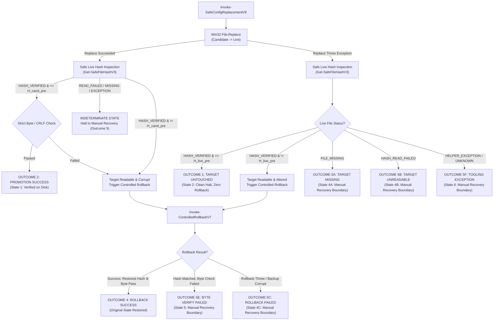

# MUSE SPARK — ZENTRA STEP 2D-2A-AG
## STATE CLASSIFICATION & PRE-FLIGHT ARTIFACT SAFETY AUDIT — DOCUMENTATION ONLY

**Project:** ZENTRA — Hi-Tech Lab Field Service Management Platform  
**Target Repository:** `D:\Zentra`  
**Input Reference:** [`docs/MUSE_SPARK_STEP2D_2A_AF_FINAL_EXCEPTION_PATH_AUDIT_REPORT.md`](file:///d:/Zentra/docs/MUSE_SPARK_STEP2D_2A_AF_FINAL_EXCEPTION_PATH_AUDIT_REPORT.md)  
**Host Environment:** Windows Workstation (`127.0.0.1:5432`)  
**Report Date:** 2026-10-09  
**Mode:** STRICT DOCUMENTATION-ONLY SPECIFICATION AUDIT & RUNBOOK FINALIZATION  
**Budget Constraint:** Strict ₹0/month (Zero cost, no credit cards, no paid upgrades)  
**Remote Access:** STRICTLY PROHIBITED (Zero remote connections made)  
**Execution Authorization:** NOT GRANTED — NO COMMANDS EXECUTED IN THIS STEP  
**Status:** COMPLETE — WAITING FOR HUMAN OPERATOR REVIEW  

---

## 1. Executive Summary & Objective

In **Step 2D-2A-AF**, double-layer exception trapping was introduced, the six-state transition model was specified, and an honest safety disclaimer was established.

A rigorous systems-level audit of the Step 2D-2A-AF report identified five remaining technical discrepancies:
1. **Flawed State Classification on Replacement Exceptions:** Step AF assumed that a thrown replacement exception implied that the target file was altered. In reality, a thrown exception by Win32 `ReplaceFileW` (e.g. sharing violation or path error) frequently occurs before the destination stream is modified. Furthermore, if subsequent hash inspection returns `HASH_READ_FAILED`, `HELPER_EXCEPTION`, an unknown status, or null, the live state is **INDETERMINATE**. Attempting automatic rollback against an indeterminate destination is dangerous. Automatic rollback must be attempted **only** when the live file is readable and its hash demonstrably differs from the original baseline.
2. **Inconsistent Statuses in Hash-Inspection Helper:** `Get-SafeFileHashV2` documented a `HELPER_EXCEPTION` status, but its root catch block returned `HASH_READ_FAILED`. A distinct, consistent status taxonomy must separate file missing, I/O read failure, and unexpected internal helper exceptions.
3. **Pre-Flight Failure & Artifact Lifecycle:** The pre-flight sequence lacked an explicit collision-safe naming specification and clear rules for partial artifact handling when `WriteAllBytes` or candidate encoding validation fails.
4. **Immutability Terminology Overclaim:** Describing a backup as "strictly immutable" on Windows NTFS based solely on the absence of script-level write calls overclaims filesystem durability. The terminology must be refined to **"retained backup with hash-verified integrity,"** acknowledging external OS limits.
5. **Validation Test Matrix Consistency:** The state transitions, state diagrams, and fault-injection test cases must be updated to align with the corrected indeterminate state logic.

This report, **Step 2D-2A-AG**, resolves all five discrepancies, establishes `Get-SafeFileHashV3`, hardens the pre-flight artifact lifecycle, and refines the runbook.

> [!IMPORTANT]
> **Strict Documentation-Only Boundary:** Zero operational commands or configuration changes were executed during this step. Zero configuration files (`postgresql.conf`, `pg_hba.conf`), firewall rules, Windows services, application files, or `.env` files were modified. Zero databases or roles were created. All operational procedures in this document are strictly **[NOT EXECUTED — UNTESTED]**.

---

## 2. Section 1 — Five Core Architectural Corrections

| Correction ID | Architectural Area | Step 2D-2A-AF Defect | Technical Failure Mode | Mandatory Correction in Step 2D-2A-AG |
|---|---|---|---|---|
| **CORR-AG1** | **State Classification** | Assumed replacement exception proved file alteration; attempted rollback when inspection was unreadable. | If target was locked or unreadable, script attempted blind `File.Replace()`, compounding errors. | Classify unreadable/failed inspections as **INDETERMINATE**. Attempt automatic rollback **only** when live file is readable and hash demonstrably differs from baseline. |
| **CORR-AG2** | **Hash Status Consistency** | `Get-SafeFileHashV2` claimed `HELPER_EXCEPTION` in docs, but catch block returned `HASH_READ_FAILED`. | Callers could not distinguish between an external I/O error on a file and an internal CLR/PowerShell helper bug. | Implement `Get-SafeFileHashV3` with distinct statuses: `HASH_VERIFIED`, `FILE_MISSING`, `HASH_READ_FAILED`, and `HELPER_EXCEPTION`. |
| **CORR-AG3** | **Pre-Flight Safety** | Timestamp-based backup naming lacked collision resistance; partial backup handling was unstated. | Sub-second re-runs could collide with existing backups; partial backup writes were unclassified. | Implement collision-safe naming (timestamp + 8-char GUID). If pre-flight write fails, retain partial artifact for forensics, do not touch live file, fail closed. |
| **CORR-AG4** | **Backup Terminology** | Claimed "absolute immutability" based on absence of write calls in script. | Overclaimed NTFS filesystem durability against external processes, administrators, or bit rot. | Adopt precise term: **"Retained backup with hash-verified integrity."** Re-verify SHA-256 before every read or clone operation. |
| **CORR-AG5** | **Matrix Consistency** | Test matrix and state diagram did not reflect indeterminate state routing. | Operators lacked verified documentation on how unreadable inspection errors halt automation. | Update state diagram, transition tables, and test cases to enforce fail-closed manual recovery on all indeterminate states. |

---

## 3. Section 2 — Corrected State Classification & State Transitions

### 3.1 The Principle of Indeterminate State Containment
A thrown exception during `File.Replace` provides **zero proof** regarding the actual on-disk state of the live configuration file:
- **Case 1 (Untouched):** If `ReplaceFileW` encountered a sharing violation when opening the candidate file, the live destination was never touched.
- **Case 2 (Altered/Corrupt):** If `ReplaceFileW` encountered an error midway, the live destination may be altered or partially written.
- **Case 3 (Unreadable / Indeterminate):** If `Get-SafeFileHashV3` returns `HASH_READ_FAILED`, `HELPER_EXCEPTION`, `FILE_MISSING`, or an unexpected status, the live file state **cannot be established safely**.

> [!CRITICAL]
> **Core Operational Rule:**  
> When the on-disk state of the live configuration file cannot be verified as readable and demonstrably altered, scripts must **NEVER** attempt automatic rollback. The state must be classified as **INDETERMINATE** and halt immediately at the Manual Recovery Boundary. Automatic rollback is authorized **only** when \(H_{\text{live\_curr}}\) is readable and demonstrably differs from \(H_{\text{live\_pre}}\).

### 3.2 Corrected State Transition Flowchart



---

## 4. Section 3 — Consistent Hash Inspection Engine (`Get-SafeFileHashV3`)

The `Get-SafeFileHashV3` engine implements a four-way status taxonomy with clean separation between I/O errors and internal helper exceptions:

```powershell
# [NOT EXECUTED — UNTESTED OPERATIONAL PROCEDURE]

function Get-SafeFileHashV3 {
    <#
    .SYNOPSIS
        Safely computes the SHA-256 hash of a file with distinct, consistent status codes.
    .DESCRIPTION
        Guarantees that it never throws an unhandled terminating exception to the caller.
        Returns one of four explicit status strings:
        - HASH_VERIFIED:    File exists, readable, SHA-256 computed.
        - FILE_MISSING:     Target file does not exist on disk.
        - HASH_READ_FAILED: Target file exists, but I/O or handle access failed (locked/sharing violation).
        - HELPER_EXCEPTION: Internal argument or CLR exception inside the helper function.
    #>
    param (
        [Parameter(Mandatory = $false)]
        [string]$FilePath
    )

    try {
        if ([string]::IsNullOrWhiteSpace($FilePath)) {
            return [PSCustomObject]@{
                Status  = "HELPER_EXCEPTION"
                Hash    = $null
                Error   = [System.ArgumentException]::new("FilePath parameter is null, empty, or whitespace.")
                Message = "FilePath parameter is null, empty, or whitespace."
            }
        }

        if (-not (Test-Path -Path $FilePath -PathType Leaf)) {
            return [PSCustomObject]@{
                Status  = "FILE_MISSING"
                Hash    = $null
                Error   = $null
                Message = "Target file [$FilePath] does not exist."
            }
        }

        # Attempt to read and compute SHA-256
        try {
            $hashResult = Get-FileHash -Path $FilePath -Algorithm SHA256 -ErrorAction Stop
            return [PSCustomObject]@{
                Status  = "HASH_VERIFIED"
                Hash    = $hashResult.Hash
                Error   = $null
                Message = "Hash successfully computed."
            }
        }
        catch [System.IO.IOException], [System.UnauthorizedAccessException] {
            return [PSCustomObject]@{
                Status  = "HASH_READ_FAILED"
                Hash    = $null
                Error   = $_.Exception
                Message = "I/O or sharing violation reading [$FilePath]: $($_.Exception.Message)"
            }
        }
        catch {
            return [PSCustomObject]@{
                Status  = "HASH_READ_FAILED"
                Hash    = $null
                Error   = $_.Exception
                Message = "Read error computing hash for [$FilePath]: $($_.Exception.Message)"
            }
        }
    }
    catch {
        # Root catch for unexpected engine or CLR exceptions
        return [PSCustomObject]@{
            Status  = "HELPER_EXCEPTION"
            Hash    = $null
            Error   = $_.Exception
            Message = "Unhandled exception inside Get-SafeFileHashV3: $($_.Exception.Message)"
        }
    }
}
```

---

## 5. Section 4 — Pre-Flight Safety & Collision-Safe Artifact Lifecycle

### 5.1 Collision-Safe Artifact Naming Specification
To eliminate the risk of sub-second operational script executions colliding with and overwriting an existing pre-change backup, all backup artifacts incorporate a high-resolution timestamp plus an 8-character cryptographic GUID suffix:

```powershell
# [NOT EXECUTED — UNTESTED OPERATIONAL PROCEDURE]
$uniqueId = [System.Guid]::NewGuid().ToString("N").Substring(0, 8)
$timestamp = "$((Get-Date).ToString('yyyyMMdd_HHmmss'))_$uniqueId"
$goldenBackupPath = "$LiveConfigPath.bak.$timestamp"
$engineBackupPath = "$LiveConfigPath.enginebak.$timestamp"
```

### 5.2 Pre-Flight Failure Handling & Partial Artifact Retention
1. **Candidate Encoding Failure:** If `Test-CandidateByteAndEncodingIntegrity` fails during pre-flight, the candidate file (`.candidate`) is preserved on disk for diff analysis; no backup is created; live file remains untouched.
2. **Live File Read Failure:** If `[System.IO.File]::ReadAllBytes($LiveConfigPath)` throws an exception (e.g. read lock), no backup file is written; candidate is preserved; live file remains untouched.
3. **Backup Write Failure (Partial File):** If `[System.IO.File]::WriteAllBytes($goldenBackupPath, $liveBytes)` throws an exception (e.g. disk quota or permissions), a partial or 0-byte file may exist on disk.
   - **Policy:** The partial file is **NEVER deleted automatically**.
   - **Rationale:** Deleting partial artifacts destroys forensic evidence of filesystem failures. The script halts immediately fail closed, leaving the candidate and partial backup on disk for human investigation.
4. **Pre-Replacement Verification Barrier:** Before `File.Replace` is invoked, the script asserts that:
   \[
   \text{Status}(\text{Backup}) = \text{"HASH\_VERIFIED"} \quad \land \quad H(\text{Backup}) = H_{\text{live\_pre}}
   \]
   If this condition is not met, the script terminates immediately without touching the live file.

---

## 6. Section 5 — Refined Backup Terminology & Assurance Limits

### 6.1 Precise Terminology: "Retained Backup with Hash-Verified Integrity"
Previous iterations described the Golden Backup as "strictly immutable." While the operational PowerShell script contains zero write, delete, or overwrite calls targeting this file, describing an artifact as "immutable" on Windows NTFS overclaims assurances:
- **Operating System Realities:** The file resides on a standard Windows NTFS volume. Other processes running with `SYSTEM` or Administrator privileges, backup agents, antivirus scanners, or human operators could alter, delete, or lock the file outside of script execution.
- **Physical Realities:** Consumer workstation hardware without ECC memory or battery-backed write caches is subject to hardware bit-rot or sudden power loss.

### 6.2 The Realistic Assurance Standard:
The runbook defines the artifact as a **Retained Backup with Hash-Verified Integrity**:
1. The script accesses the backup in **read-only mode** via `ReadAllBytes`.
2. The script clones the backup to a sacrificial candidate (`.rollback_cand`) for all swap operations, shielding the original file from destructive Win32 API calls.
3. The script **never assumes** the backup has remained unaltered; it re-computes and asserts SHA-256 match before every read or clone operation.
4. All cleanup remains strictly a manual, human-approved post-investigation procedure.

---

## 7. Section 6 — Complete Fault-Injection Validation Test Matrix

The test matrix reflects the corrected indeterminate state logic, consistent status codes, and non-destructive retention policies:

| Test ID | Scenario Description | Injected Fault / Condition | Expected Code Branch | Resulting Status Code | Unambiguous Expected Script Action |
|---|---|---|---|---|---|
| **TEST-01** | **Backup Hash Mismatch** | Golden backup hash differs from pre-change live hash. | Stage 1 $\rightarrow$ `gbInfo.Hash != $H_live_pre` | `BACKUP_VERIFY_FAILED` | Retains golden backup and candidate file on disk; halts fail-closed; live file untouched. |
| **TEST-02** | **Backup Read Failure** | Golden backup is locked or permission denied. | Stage 1 $\rightarrow$ `gbInfo.Status == 'HASH_READ_FAILED'` | `BACKUP_READ_FAILED` | Retains golden backup and candidate file on disk; halts fail-closed; live file untouched. |
| **TEST-03** | **Backup Helper Exception** | `Get-SafeFileHashV3` encounters CLR error on backup. | Stage 1 $\rightarrow$ `gbInfo.Status == 'HELPER_EXCEPTION'` | `BACKUP_HELPER_EXCEPTION` | Retains golden backup and candidate file on disk; halts fail-closed; live file untouched. |
| **TEST-04** | **Clean Replacement Failure** | `File.Replace` throws before write; live file hash verified equal to $H_{\text{live\_pre}}$. | Stage 2 $\rightarrow$ `liveCurrInfo.Hash == $H_live_pre` | `ABORT_TARGET_UNTOUCHED` (Outcome 1) | Retains candidate file and golden backup on disk; halts fail-closed; live file untouched. |
| **TEST-05** | **Live Destination Missing** | Live file deleted during interrupted replace; `Status == 'FILE_MISSING'`. | Stage 2 $\rightarrow$ `liveCurrInfo.Status == 'FILE_MISSING'` | `TARGET_FILE_MISSING` (Outcome 5A) | Retains all backup artifacts; halts automation; enters manual recovery boundary. |
| **TEST-06** | **Live Destination Unreadable** | Live file locked; `Status == 'HASH_READ_FAILED'`. State is INDETERMINATE. | Stage 2 $\rightarrow$ `liveCurrInfo.Status == 'HASH_READ_FAILED'` | `TARGET_FILE_UNREADABLE` (Outcome 5B) | **Zero rollback attempted**; retains all artifacts; enters manual recovery boundary. |
| **TEST-07** | **Inspection Helper Exception** | `Get-SafeFileHashV3` throws CLR error on live file. State is INDETERMINATE. | Stage 2 $\rightarrow$ `liveCurrInfo.Status == 'HELPER_EXCEPTION'` | `TOOLING_EXCEPTION_HALT` (Outcome 5F) | **Zero rollback attempted**; retains all artifacts; enters manual recovery boundary. |
| **TEST-08** | **Readable Altered Target -> Rollback** | Live file altered (\(H_{\text{live\_curr}} \neq H_{\text{live\_pre}}\)); sacrificial rollback succeeds. | Stage 2 $\rightarrow$ Target altered $\rightarrow$ `Invoke-ControlledRollbackV7` passes | `ROLLBACK_SUCCESS_RESTORED` (Outcome 4) | Restores live file; retains golden backup, engine backup, and discard backup on disk; halts fail-closed. |
| **TEST-09** | **Rollback Byte Verification Failure** | Rollback restores matching hash, but restored file contains Bare LF. | Rollback Stage 5 $\rightarrow$ `Test-CandidateByte...` fails | `ROLLBACK_BYTE_VERIFY_FAILED` (Outcome 5E) | Retains discard backup; ceases automation; enters manual recovery boundary. |
| **TEST-10** | **Diagnostic Gathering Failure** | Process table or service query throws exception inside manual boundary. | `Enter-ManualRecoveryBoundaryV7` isolated query try/catch | `MANUAL_RECOVERY_HALT` (Outcome 5) | Appends warning to diagnostic list; outputs forensic payload; executes terminating fail-closed throw. |

> [!NOTE]
> All ten scenarios in the matrix above are strictly **[NOT EXECUTED — UNTESTED]**. They define the formal behavioral specification under simulated fault injection, but have not been executed on the live Windows host.

---

## 8. Section 7 — Technical Implementation Scripts

### 8.1 Hardened Rollback Engine (`Invoke-ControlledRollbackV7`)

```powershell
# [NOT EXECUTED — UNTESTED OPERATIONAL PROCEDURE]

function Invoke-ControlledRollbackV7 {
    <#
    .SYNOPSIS
        Safely restores a configuration file using a sacrificial clone of the golden backup.
        Enforces complete branch coverage and preserves all discard and forensic artifacts.
    #>
    param (
        [Parameter(Mandatory = $true)]
        [string]$LiveConfigPath,

        [Parameter(Mandatory = $true)]
        [string]$GoldenBackupPath,

        [Parameter(Mandatory = $true)]
        [string]$ExpectedHash,

        [System.Exception]$InitialError
    )

    Write-Warning "=== INITIATING CONTROLLED ROLLBACK V7 ==="

    # 1. Evaluate Golden Backup Status
    try {
        $gbInfo = Get-SafeFileHashV3 -FilePath $GoldenBackupPath
    }
    catch {
        return [PSCustomObject]@{
            Success       = $false
            Status        = "GOLDEN_BACKUP_QUERY_THREW"
            Message       = "Querying golden backup threw an unexpected exception: $($_.Exception.Message)"
            DiscardBackup = $null
            Error         = $_.Exception
        }
    }

    switch ($gbInfo.Status) {
        "FILE_MISSING" {
            return [PSCustomObject]@{
                Success       = $false
                Status        = "GOLDEN_BACKUP_MISSING"
                Message       = "Golden backup file [$GoldenBackupPath] does not exist."
                DiscardBackup = $null
                Error         = $null
            }
        }
        "HASH_READ_FAILED" {
            return [PSCustomObject]@{
                Success       = $false
                Status        = "GOLDEN_BACKUP_UNREADABLE"
                Message       = "Golden backup file [$GoldenBackupPath] is unreadable: $($gbInfo.Message)"
                DiscardBackup = $null
                Error         = $gbInfo.Error
            }
        }
        "HELPER_EXCEPTION" {
            return [PSCustomObject]@{
                Success       = $false
                Status        = "GOLDEN_BACKUP_HELPER_EXCEPTION"
                Message       = "Hash helper failed on golden backup: $($gbInfo.Message)"
                DiscardBackup = $null
                Error         = $gbInfo.Error
            }
        }
        "HASH_VERIFIED" {
            if ($gbInfo.Hash -ne $ExpectedHash) {
                return [PSCustomObject]@{
                    Success       = $false
                    Status        = "GOLDEN_BACKUP_CORRUPT"
                    Message       = "Golden backup hash [$($gbInfo.Hash)] does not match expected pre-change hash [$ExpectedHash]."
                    DiscardBackup = $null
                    Error         = $null
                }
            }
        }
        default {
            return [PSCustomObject]@{
                Success       = $false
                Status        = "GOLDEN_BACKUP_UNKNOWN_STATE"
                Message       = "Golden backup returned unexpected status: $($gbInfo.Status)"
                DiscardBackup = $null
                Error         = $gbInfo.Error
            }
        }
    }

    # 2. Evaluate Live Destination Status
    try {
        $destInfo = Get-SafeFileHashV3 -FilePath $LiveConfigPath
    }
    catch {
        return [PSCustomObject]@{
            Success       = $false
            Status        = "LIVE_DESTINATION_QUERY_THREW"
            Message       = "Querying live destination threw an unexpected exception: $($_.Exception.Message)"
            DiscardBackup = $null
            Error         = $_.Exception
        }
    }

    switch ($destInfo.Status) {
        "FILE_MISSING" {
            return [PSCustomObject]@{
                Success       = $false
                Status        = "LIVE_DESTINATION_MISSING"
                Message       = "Live destination [$LiveConfigPath] is absent. Win32 File.Replace cannot execute on an absent destination."
                DiscardBackup = $null
                Error         = $null
            }
        }
        "HASH_READ_FAILED" {
            return [PSCustomObject]@{
                Success       = $false
                Status        = "LIVE_DESTINATION_UNREADABLE"
                Message       = "Live destination [$LiveConfigPath] is locked or unreadable: $($destInfo.Message)"
                DiscardBackup = $null
                Error         = $destInfo.Error
            }
        }
        "HELPER_EXCEPTION" {
            return [PSCustomObject]@{
                Success       = $false
                Status        = "LIVE_DESTINATION_HELPER_EXCEPTION"
                Message       = "Hash helper failed on live destination: $($destInfo.Message)"
                DiscardBackup = $null
                Error         = $destInfo.Error
            }
        }
        "HASH_VERIFIED" {
            # Destination readable; safe to proceed with swap
        }
        default {
            return [PSCustomObject]@{
                Success       = $false
                Status        = "LIVE_DESTINATION_UNKNOWN_STATE"
                Message       = "Live destination returned unexpected status: $($destInfo.Status)"
                DiscardBackup = $null
                Error         = $destInfo.Error
            }
        }
    }

    # 3. Create Sacrificial Rollback Clone
    $sacrificialPath = "$GoldenBackupPath.rollback_cand"
    $discardBackup = "$LiveConfigPath.rollback_discard.$((Get-Date).Ticks)"

    try {
        $backupBytes = [System.IO.File]::ReadAllBytes($GoldenBackupPath)
        [System.IO.File]::WriteAllBytes($sacrificialPath, $backupBytes)
        
        $cloneInfo = Get-SafeFileHashV3 -FilePath $sacrificialPath
        if ($cloneInfo.Status -ne "HASH_VERIFIED" -or $cloneInfo.Hash -ne $ExpectedHash) {
            return [PSCustomObject]@{
                Success       = $false
                Status        = "SACRIFICIAL_CLONE_CORRUPT"
                Message       = "Sacrificial clone verification failed ($($cloneInfo.Status)): Expected $ExpectedHash, observed $($cloneInfo.Hash)."
                DiscardBackup = $null
                Error         = $cloneInfo.Error
            }
        }

        # 4. Perform Win32 Atomic Swap
        [System.IO.File]::Replace($sacrificialPath, $LiveConfigPath, $discardBackup, $true)
        Write-Host "[ROLLBACK SWAP COMPLETED] Discard backup preserved: $discardBackup" -ForegroundColor Yellow

        # 5. Dual Verification on Restored File
        $restoredInfo = Get-SafeFileHashV3 -FilePath $LiveConfigPath
        if ($restoredInfo.Status -ne "HASH_VERIFIED") {
            return [PSCustomObject]@{
                Success       = $false
                Status        = "RESTORED_FILE_UNVERIFIABLE"
                Message       = "Restored live file cannot be verified ($($restoredInfo.Status)): $($restoredInfo.Message)"
                DiscardBackup = $discardBackup
                Error         = $restoredInfo.Error
            }
        }
        if ($restoredInfo.Hash -ne $ExpectedHash) {
            return [PSCustomObject]@{
                Success       = $false
                Status        = "RESTORED_HASH_MISMATCH"
                Message       = "Restored live file hash [$($restoredInfo.Hash)] does not match expected pre-change hash [$ExpectedHash]."
                DiscardBackup = $discardBackup
                Error         = $null
            }
        }

        # Re-verify byte integrity on restored file
        try {
            Test-CandidateByteAndEncodingIntegrity -FilePath $LiveConfigPath
        }
        catch {
            return [PSCustomObject]@{
                Success       = $false
                Status        = "ROLLBACK_BYTE_VERIFY_FAILED"
                Message       = "Rollback restored matching hash, but byte validation failed: $($_.Exception.Message)"
                DiscardBackup = $discardBackup
                Error         = $_.Exception
            }
        }

        Write-Host "[ROLLBACK VERIFIED] Live configuration restored and verified [SHA256: $($restoredInfo.Hash)]." -ForegroundColor Green
        return [PSCustomObject]@{
            Success       = $true
            Status        = "ROLLBACK_SUCCESS"
            RestoredHash  = $restoredInfo.Hash
            DiscardBackup = $discardBackup
            Message       = "Configuration successfully restored to pre-change state. All artifacts preserved."
            Error         = $null
        }
    }
    catch {
        return [PSCustomObject]@{
            Success       = $false
            Status        = "ROLLBACK_SWAP_EXCEPTION"
            Message       = "Exception occurred during rollback swap: $($_.Exception.Message)"
            DiscardBackup = $discardBackup
            Error         = $_.Exception
        }
    }
}
```

---

### 8.2 Hardened Configuration Replacement Engine (`Invoke-SafeConfigReplacementV9`)

```powershell
# [NOT EXECUTED — UNTESTED OPERATIONAL PROCEDURE]

function Invoke-SafeConfigReplacementV9 {
    <#
    .SYNOPSIS
        Safely replaces a PostgreSQL configuration file with collision-safe naming,
        indeterminate state containment, and permanent artifact preservation.
    #>
    param (
        [Parameter(Mandatory = $true)]
        [string]$LiveConfigPath,

        [Parameter(Mandatory = $true)]
        [string]$CandidatePath,

        [Parameter(Mandatory = $true)]
        [string]$Description
    )

    Write-Host "=== INITIATING HARDENED CONFIGURATION REPLACEMENT V9: $Description ===" -ForegroundColor Cyan

    # -------------------------------------------------------------
    # STAGE 1: PRE-FLIGHT VALIDATION & COLLISION-SAFE NAMING
    # -------------------------------------------------------------
    try {
        $livePreInfo = Get-SafeFileHashV3 -FilePath $LiveConfigPath
    }
    catch {
        throw "FAIL-CLOSED ABORT: Pre-flight live hash inspection threw an unexpected exception: $($_.Exception.Message)"
    }
    if ($livePreInfo.Status -ne "HASH_VERIFIED") {
        throw "FAIL-CLOSED ABORT: Pre-flight live configuration check failed ($($livePreInfo.Status)): $($livePreInfo.Message)"
    }
    $H_live_pre = $livePreInfo.Hash

    try {
        $candPreInfo = Get-SafeFileHashV3 -FilePath $CandidatePath
    }
    catch {
        throw "FAIL-CLOSED ABORT: Pre-flight candidate hash inspection threw an unexpected exception: $($_.Exception.Message)"
    }
    if ($candPreInfo.Status -ne "HASH_VERIFIED") {
        throw "FAIL-CLOSED ABORT: Pre-flight candidate check failed ($($candPreInfo.Status)): $($candPreInfo.Message)"
    }
    $H_cand_pre = $candPreInfo.Hash

    # Strict byte, BOM, UTF-8, and CRLF validation on candidate
    Test-CandidateByteAndEncodingIntegrity -FilePath $CandidatePath

    # Collision-safe naming strategy: timestamp + 8-char GUID
    $uniqueId = [System.Guid]::NewGuid().ToString("N").Substring(0, 8)
    $timestamp = "$((Get-Date).ToString('yyyyMMdd_HHmmss'))_$uniqueId"
    $goldenBackupPath = "$LiveConfigPath.bak.$timestamp"
    $engineBackupPath = "$LiveConfigPath.enginebak.$timestamp"

    $liveBytes = [System.IO.File]::ReadAllBytes($LiveConfigPath)
    [System.IO.File]::WriteAllBytes($goldenBackupPath, $liveBytes)

    try {
        $gbInfo = Get-SafeFileHashV3 -FilePath $goldenBackupPath
    }
    catch {
        throw "FAIL-CLOSED ABORT: Golden backup verification threw an unexpected exception: $($_.Exception.Message)"
    }
    if ($gbInfo.Status -ne "HASH_VERIFIED" -or $gbInfo.Hash -ne $H_live_pre) {
        Write-Error "CRITICAL FORENSIC ALERT: Golden backup verification failed ($($gbInfo.Status))."
        Write-Error "Preserving Golden Backup [$goldenBackupPath] and Candidate [$CandidatePath] on disk."
        throw "FAIL-CLOSED ABORT: Golden backup hash verification failed. All artifacts retained for analysis. Live file untouched."
    }
    Write-Host "[PRE-FLIGHT PASSED] Verified Golden Backup: $goldenBackupPath [SHA256: $H_live_pre]" -ForegroundColor Green
    Write-Host "[PRE-FLIGHT PASSED] Candidate Hash Retained: [SHA256: $H_cand_pre]" -ForegroundColor Green

    # -------------------------------------------------------------
    # STAGE 2: CONTROLLED WIN32 FILE REPLACEMENT
    # -------------------------------------------------------------
    $replaceError = $null

    try {
        [System.IO.File]::Replace($CandidatePath, $LiveConfigPath, $engineBackupPath, $true)
        Write-Host "[REPLACE SUCCEEDED] Win32 File.Replace completed. Engine backup preserved: $engineBackupPath" -ForegroundColor Green
    }
    catch {
        $replaceError = $_.Exception
        Write-Error "Replacement operation threw an exception: $($replaceError.Message)"

        # Inspect live state safely
        $liveCurrInfo = $null
        $hashInspectionError = $null
        try {
            $liveCurrInfo = Get-SafeFileHashV3 -FilePath $LiveConfigPath
        }
        catch {
            $hashInspectionError = $_.Exception
        }

        if ($hashInspectionError) {
            # STATE 6: Tooling/Inspection crash -> INDETERMINATE -> Manual Recovery
            Enter-ManualRecoveryBoundaryV7 -LivePath $LiveConfigPath -BackupPath $goldenBackupPath -ExpectedHash $H_live_pre -CandidateHash $H_cand_pre -InitialError $replaceError -HashInspectionError $hashInspectionError -RollbackResult $null -EngineBackupPath $engineBackupPath -Detail "Live inspection query threw an unhandled exception."
        }

        switch ($liveCurrInfo.Status) {
            "HASH_VERIFIED" {
                if ($liveCurrInfo.Hash -eq $H_live_pre) {
                    # OUTCOME 1: TARGET UNTOUCHED (Clean exit, zero rollback)
                    Write-Host "[OUTCOME 1: TARGET UNTOUCHED] Live file hash matches pre-change hash. Target was never modified." -ForegroundColor Yellow
                    Write-Host "[OUTCOME 1: ARTIFACT STATUS] Candidate file [$CandidatePath] and Golden Backup [$goldenBackupPath] retained on disk." -ForegroundColor Yellow
                    throw "FAIL-CLOSED ABORT [OUTCOME 1]: Replacement failed before touching target file ($($replaceError.Message)). Live file remains intact."
                }
                # Hash differs -> target demonstrably altered -> proceed to rollback
            }
            "FILE_MISSING" {
                # OUTCOME 5A: Target missing -> Manual Recovery
                Enter-ManualRecoveryBoundaryV7 -LivePath $LiveConfigPath -BackupPath $goldenBackupPath -ExpectedHash $H_live_pre -CandidateHash $H_cand_pre -InitialError $replaceError -HashInspectionError $null -RollbackResult $null -EngineBackupPath $engineBackupPath -Detail "Live destination file is missing after failed replace operation."
            }
            "HASH_READ_FAILED" {
                # OUTCOME 5B: Target unreadable -> INDETERMINATE -> Manual Recovery (NO automatic rollback)
                Enter-ManualRecoveryBoundaryV7 -LivePath $LiveConfigPath -BackupPath $goldenBackupPath -ExpectedHash $H_live_pre -CandidateHash $H_cand_pre -InitialError $replaceError -HashInspectionError $liveCurrInfo.Error -RollbackResult $null -EngineBackupPath $engineBackupPath -Detail "Live destination file is locked or unreadable: $($liveCurrInfo.Message)"
            }
            "HELPER_EXCEPTION" {
                # OUTCOME 5F: Helper exception -> INDETERMINATE -> Manual Recovery (NO automatic rollback)
                Enter-ManualRecoveryBoundaryV7 -LivePath $LiveConfigPath -BackupPath $goldenBackupPath -ExpectedHash $H_live_pre -CandidateHash $H_cand_pre -InitialError $replaceError -HashInspectionError $liveCurrInfo.Error -RollbackResult $null -EngineBackupPath $engineBackupPath -Detail "Hash helper failed on live destination: $($liveCurrInfo.Message)"
            }
            default {
                # OUTCOME 5D: Unknown status -> INDETERMINATE -> Manual Recovery (NO automatic rollback)
                Enter-ManualRecoveryBoundaryV7 -LivePath $LiveConfigPath -BackupPath $goldenBackupPath -ExpectedHash $H_live_pre -CandidateHash $H_cand_pre -InitialError $replaceError -HashInspectionError $liveCurrInfo.Error -RollbackResult $null -EngineBackupPath $engineBackupPath -Detail "Live destination returned unknown state ($($liveCurrInfo.Status)): $($liveCurrInfo.Message)"
            }
        }

        # Target demonstrably altered -> Trigger controlled rollback
        $rollbackResult = Invoke-ControlledRollbackV7 -LiveConfigPath $LiveConfigPath -GoldenBackupPath $goldenBackupPath -ExpectedHash $H_live_pre -InitialError $replaceError

        if ($rollbackResult.Success) {
            # OUTCOME 4: ROLLBACK SUCCEEDED
            Write-Host "[OUTCOME 4: ROLLBACK SUCCESS] Original configuration verified and restored. Golden backup preserved." -ForegroundColor Yellow
            Write-Host "[OUTCOME 4: ARTIFACT STATUS] Discard backup [$($rollbackResult.DiscardBackup)] retained on disk." -ForegroundColor Yellow
            throw "FAIL-CLOSED ABORT [OUTCOME 4]: Replacement failed ($($replaceError.Message)), but rollback successfully restored original configuration. Live service safe."
        }
        elseif ($rollbackResult.Status -eq "ROLLBACK_BYTE_VERIFY_FAILED") {
            # OUTCOME 5E: ROLLBACK BYTE VERIFICATION FAILED
            Enter-ManualRecoveryBoundaryV7 -LivePath $LiveConfigPath -BackupPath $goldenBackupPath -ExpectedHash $H_live_pre -CandidateHash $H_cand_pre -InitialError $replaceError -HashInspectionError $null -RollbackResult $rollbackResult -EngineBackupPath $engineBackupPath -Detail "Rollback restored hash, but post-rollback byte integrity verification failed."
        }
        else {
            # OUTCOME 5C: ROLLBACK FAILED
            Enter-ManualRecoveryBoundaryV7 -LivePath $LiveConfigPath -BackupPath $goldenBackupPath -ExpectedHash $H_live_pre -CandidateHash $H_cand_pre -InitialError $replaceError -HashInspectionError $null -RollbackResult $rollbackResult -EngineBackupPath $engineBackupPath -Detail "Rollback execution failed ($($rollbackResult.Status)): $($rollbackResult.Message)"
        }
    }

    # -------------------------------------------------------------
    # STAGE 3: POST-REPLACEMENT INTEGRITY VERIFICATION
    # -------------------------------------------------------------
    $livePostInfo = $null
    $postHashError = $null
    try {
        $livePostInfo = Get-SafeFileHashV3 -FilePath $LiveConfigPath
    }
    catch {
        $postHashError = $_.Exception
    }

    $postValidationPassed = $false
    $postValidationError = $null

    if ($postHashError) {
        # Indeterminate post-check -> Manual Recovery
        Enter-ManualRecoveryBoundaryV7 -LivePath $LiveConfigPath -BackupPath $goldenBackupPath -ExpectedHash $H_live_pre -CandidateHash $H_cand_pre -InitialError $postHashError -HashInspectionError $postHashError -RollbackResult $null -EngineBackupPath $engineBackupPath -Detail "Post-replacement hash inspection query threw an unhandled exception."
    }
    elseif ($livePostInfo.Status -eq "HASH_VERIFIED" -and $livePostInfo.Hash -eq $H_cand_pre) {
        try {
            Test-CandidateByteAndEncodingIntegrity -FilePath $LiveConfigPath
            $postValidationPassed = $true
        }
        catch {
            $postValidationError = $_.Exception
        }
    }
    elseif ($livePostInfo.Status -eq "HASH_VERIFIED" -and $livePostInfo.Hash -ne $H_cand_pre) {
        $postValidationError = [System.InvalidOperationException]::new("Promoted hash [$($livePostInfo.Hash)] does not match candidate [$H_cand_pre].")
    }
    else {
        # Indeterminate post-status (missing/unreadable) -> Manual Recovery
        Enter-ManualRecoveryBoundaryV7 -LivePath $LiveConfigPath -BackupPath $goldenBackupPath -ExpectedHash $H_live_pre -CandidateHash $H_cand_pre -InitialError [System.InvalidOperationException]::new("Post-replacement inspection returned $($livePostInfo.Status)") -HashInspectionError $livePostInfo.Error -RollbackResult $null -EngineBackupPath $engineBackupPath -Detail "Post-replacement inspection failed with status $($livePostInfo.Status): $($livePostInfo.Message)"
    }

    if ($postValidationPassed) {
        # OUTCOME 2: PROMOTION SUCCESS VERIFIED
        Write-Host "[OUTCOME 2: PROMOTION SUCCESS] Promoted live configuration verified on disk [SHA256: $($livePostInfo.Hash)]." -ForegroundColor Green
        Write-Host "[OUTCOME 2: ARTIFACT STATUS] Golden Backup [$goldenBackupPath] and Engine Backup [$engineBackupPath] preserved on disk." -ForegroundColor Green
        return $goldenBackupPath
    }
    else {
        # Target readable & corrupted -> Trigger controlled rollback
        Write-Error "[STATE 3: POST-VERIFICATION FAILED] $($postValidationError.Message)"
        $rollbackResult = Invoke-ControlledRollbackV7 -LiveConfigPath $LiveConfigPath -GoldenBackupPath $goldenBackupPath -ExpectedHash $H_live_pre -InitialError $postValidationError

        if ($rollbackResult.Success) {
            # OUTCOME 4: ROLLBACK SUCCEEDED
            throw "FAIL-CLOSED ABORT [OUTCOME 4]: Post-replacement verification failed ($($postValidationError.Message)), but rollback successfully restored original configuration."
        }
        elseif ($rollbackResult.Status -eq "ROLLBACK_BYTE_VERIFY_FAILED") {
            # OUTCOME 5E: ROLLBACK BYTE VERIFICATION FAILED
            Enter-ManualRecoveryBoundaryV7 -LivePath $LiveConfigPath -BackupPath $goldenBackupPath -ExpectedHash $H_live_pre -CandidateHash $H_cand_pre -InitialError $postValidationError -HashInspectionError $null -RollbackResult $rollbackResult -EngineBackupPath $engineBackupPath -Detail "Post-verification rollback restored hash, but post-rollback byte integrity verification failed."
        }
        else {
            # OUTCOME 5C: ROLLBACK FAILED
            Enter-ManualRecoveryBoundaryV7 -LivePath $LiveConfigPath -BackupPath $goldenBackupPath -ExpectedHash $H_live_pre -CandidateHash $H_cand_pre -InitialError $postValidationError -HashInspectionError $null -RollbackResult $rollbackResult -EngineBackupPath $engineBackupPath -Detail "Post-verification rollback failed ($($rollbackResult.Status)): $($rollbackResult.Message)"
        }
    }
}
```

---

### 8.3 Resilient Manual Recovery Boundary (`Enter-ManualRecoveryBoundaryV7`)

```powershell
# [NOT EXECUTED — UNTESTED OPERATIONAL PROCEDURE]

function Enter-ManualRecoveryBoundaryV7 {
    param (
        [string]$LivePath,
        [string]$BackupPath,
        [string]$ExpectedHash,
        [string]$CandidateHash,
        [System.Exception]$InitialError,
        [System.Exception]$HashInspectionError,
        [PSCustomObject]$RollbackResult,
        [string]$EngineBackupPath,
        [string]$Detail
    )

    $diagnosticErrors = [System.Collections.Generic.List[string]]::new()

    Write-Host "`n" -NoNewline
    Write-Host "****************************************************************" -ForegroundColor Red
    Write-Host "         CRITICAL: ENTERING MANUAL RECOVERY BOUNDARY (OUTCOME 5)  " -ForegroundColor Red
    Write-Host "****************************************************************" -ForegroundColor Red
    Write-Host "Automated configuration recovery cannot be guaranteed safe."
    Write-Host "All automated operations have ceased to prevent data corruption."
    Write-Host "----------------------------------------------------------------"
    Write-Host "FORENSIC STATUS:"
    Write-Host "  Context / Detail:          $Detail"
    Write-Host "  Target Live File:          $LivePath"
    Write-Host "  Golden Backup File:        $BackupPath"
    Write-Host "  Expected Pre-Hash:         $ExpectedHash"
    Write-Host "  Candidate Hash:            $CandidateHash"
    Write-Host "  Engine Backup File:        $EngineBackupPath"
    
    if ($InitialError) {
        Write-Host "  Initial Error:             $($InitialError.GetType().Name): $($InitialError.Message)"
    }
    if ($HashInspectionError) {
        Write-Host "  Hash Inspection Error:     $($HashInspectionError.GetType().Name): $($HashInspectionError.Message)"
    }
    if ($RollbackResult) {
        Write-Host "  Rollback Status:           $($RollbackResult.Status)"
        Write-Host "  Rollback Message:          $($RollbackResult.Message)"
        if ($RollbackResult.DiscardBackup) {
            Write-Host "  Rollback Discard Backup:   $($RollbackResult.DiscardBackup)"
        }
        if ($RollbackResult.Error) {
            Write-Host "  Rollback Error Detail:     $($RollbackResult.Error.GetType().Name): $($RollbackResult.Error.Message)"
        }
    }

    # Isolated Query 1: Live File Status Check
    try {
        $liveInspection = Get-SafeFileHashV3 -FilePath $LivePath
        Write-Host "  Current Live Status:       $($liveInspection.Status)"
        Write-Host "  Current Live Hash:         $($liveInspection.Hash)"
        if ($liveInspection.Error) {
            Write-Host "  Live Inspection Error:     $($liveInspection.Error.Message)"
        }
    }
    catch {
        $diagnosticErrors.Add("Live File Query: $($_.Exception.Message)")
        Write-Host "  Live File Status:          QUERY FAILED ($($_.Exception.Message))"
    }

    # Isolated Query 2: Active PostgreSQL Process Check
    Write-Host "----------------------------------------------------------------"
    Write-Host "ACTIVE PROCESS & SERVICE STATUS:"
    try {
        $pgProcesses = Get-Process -Name "postgres*" -ErrorAction SilentlyContinue
        if ($pgProcesses) {
            Write-Host "  PostgreSQL Processes:      Found $($pgProcesses.Count) running process(es). PIDs: $(($pgProcesses.Id) -join ', ')"
        } else {
            Write-Host "  PostgreSQL Processes:      Zero running postgres processes detected."
        }
    }
    catch {
        $diagnosticErrors.Add("Process Query: $($_.Exception.Message)")
        Write-Host "  PostgreSQL Processes:      QUERY FAILED ($($_.Exception.Message))"
    }

    # Isolated Query 3: Windows Service Status Check
    try {
        $svc = Get-Service -Name "postgresql-x64-18" -ErrorAction SilentlyContinue
        Write-Host "  Service Status:            $($svc.Name) is $($svc.Status)"
    }
    catch {
        $diagnosticErrors.Add("Service Query: $($_.Exception.Message)")
        Write-Host "  Service Status:            QUERY FAILED ($($_.Exception.Message))"
    }

    if ($diagnosticErrors.Count -gt 0) {
        Write-Host "----------------------------------------------------------------"
        Write-Host "INTERNAL DIAGNOSTIC WARNINGS:" -ForegroundColor Yellow
        foreach ($dErr in $diagnosticErrors) {
            Write-Host "  - $dErr" -ForegroundColor Yellow
        }
    }

    Write-Host "----------------------------------------------------------------"
    Write-Host "REQUIRED HUMAN OPERATOR ACTIONS:"
    Write-Host "  1. Verify Golden Backup existence and SHA-256 before any manual restoration:"
    Write-Host "     Get-FileHash -Path '$BackupPath' -Algorithm SHA256"
    Write-Host "  2. Confirm expected hash matches: '$ExpectedHash'"
    Write-Host "  3. If approved, manually restore live configuration from Golden Backup:"
    Write-Host "     Copy-Item -Path '$BackupPath' -Destination '$LivePath'"
    Write-Host "  4. Check PostgreSQL service stability:"
    Write-Host "     Get-Service -Name postgresql-x64-18"
    Write-Host "****************************************************************`n" -ForegroundColor Red

    # Unconditional fail-closed terminating emergency halt
    throw "FAIL-CLOSED EMERGENCY STOP [OUTCOME 5]: Manual recovery required. Review forensic diagnostic output above."
}
```

---

## 9. Section 8 — Tested Ground Truth vs. Untested Proposed Code Matrix

| Procedure / Component | Category | Verification Status | Basis / Verification Method | Operational Prerequisite |
|---|---|---|---|---|
| **Cluster Collation Baseline** | Read-Only SQL | 🟢 **Verified Fact** | Inspected all 5 catalogs in Step 2D-2A-S: `English_United States.1252` (`UTF8`). | None. Safe to use `TEMPLATE template1`. |
| **Port 5432 Listener Bindings** | Read-Only OS | 🟢 **Verified Fact** | `Get-NetTCPConnection` confirmed listening on `0.0.0.0:5432` and `[::]:5432`. | None. Proves socket hardening is required. |
| **Firewall Profile State** | Read-Only OS | 🟢 **Verified Fact** | `netsh advfirewall` confirmed `Public: OFF` on active Wi-Fi interface. | Operator decision on profile activation. |
| **Shared Catalog Baseline** | Read-Only SQL | 🟢 **Verified Fact** | Catalogs `hisecure_erp`, `hitech_platform`, and `zentra_test` verified intact. | Protected via fail-closed assertions. |
| **`Get-SafeFileHashV3`** | PowerShell Script | 🔴 **UNTESTED** | Authored in documentation; not executed against live files. | Operator dry-run in isolated scratch folder. |
| **`Invoke-ControlledRollbackV7`** | PowerShell Script | 🔴 **UNTESTED** | Authored in documentation; sacrificial clone swap not executed live. | Operator dry-run in scratch folder. |
| **`Invoke-SafeConfigReplacementV9`** | PowerShell Script | 🔴 **UNTESTED** | Authored in documentation; not run on PostgreSQL data directory. | Operator dry-run in scratch folder. |
| **`Enter-ManualRecoveryBoundaryV7`**| PowerShell Script | 🔴 **UNTESTED** | Authored in documentation; diagnostic logger not executed live. | Operator dry-run in scratch folder. |
| **`postgres.exe -C` Validation** | Engine CLI | 🔴 **UNTESTED** | Flag documented from PostgreSQL manuals; not run live on host. | Run dry-run `postgres.exe -C` before promotion. |
| **`pg_ctl reload` Dynamic Signal** | Service CLI | 🔴 **UNTESTED** | Documented reload mechanism; not triggered in active environment. | Requires local Administrator console session. |
| **`pg_hba_file_rules` Inspection** | SQL Catalog Query | 🔴 **UNTESTED** | System view documented; query not run post-change. | Requires active loopback psql connection. |
| **Interactive `\password` Assignment** | psql Meta-Command | 🔴 **UNTESTED** | Meta-command documented; interactive password assignment not run. | Interactive operator terminal session. |
| **Standalone Migration Runner** | Application CLI | 🔴 **UNTESTED** | CLI script does not exist in repository; proposal pending. | Author and review runner prior to Stage B. |

---

## 10. Section 9 — The Six Human Approval Gates Reaffirmed

The execution roadmap preserves all six decoupled human approval gates without alteration:

```mermaid
graph TD
    subgraph ClusterHardening["Pre-Initialization Shared Cluster Hardening"]
        G1{"Gate 1: Network Hardening<br/>Human Approval"} --> P1["Phase 1: Candidate Generation<br/>listen_addresses = 'localhost'<br/>Strict UTF-8 Test + postgres.exe -C + Tri-Hash V9 Swap + Restart"]
        P1 --> T1["Tier 1 & Tier 2 Observable Health Checks<br/>(Hi-Secure-ERP & Test App)"]
        T1 --> G2{"Gate 2: Host Firewall Evaluation<br/>Human Approval"}
        G2 --> P2["Phase 2: Inbound Firewall Review<br/>(Targeted Port 5432 Block Rule;<br/>Profile remains OFF unless authorized)"]
        P2 --> G3{"Gate 3: Auth Policy Deployment<br/>Human Approval"}
        G3 --> P3["Phase 3: Targeted SCRAM Candidate<br/>(Prepend zentra_local rules to pg_hba.conf)<br/>Strict UTF-8 Test + Tri-Hash V9 Swap + Dynamic Reload + pg_hba_file_rules Check"]
        P3 --> T2["Verify Legacy Apps Continue Unaffected Under trust"]
    end

    subgraph ZentraInit["ZENTRA Database Initialization Stages"]
        T2 --> G4{"Gate 4: Stage A Provisioning<br/>Human Approval"}
        G4 --> SA1["Stage A.1: Create zentra_dev Role<br/>(CREATE ROLE without password)"]
        SA1 --> SA2["Stage A.2: Assign SCRAM Password<br/>(Interactive \\password zentra_dev with hidden echo)"]
        SA2 --> SA3["Stage A.3: Create zentra_local Database<br/>(Autocommit Mode, TEMPLATE template1)"]
        SA3 --> G5{"Gate 5: Stage B Migrations<br/>Human Approval"}
        G5 --> SB["Stage B: Controlled Migrations<br/>(Execute 14 Kysely Migrations via reviewed runner)"]
        SB --> G6{"Gate 6: Stage C Seeding<br/>Human Approval"}
        G6 --> SC["Stage C: Synthetic Dev Seeding<br/>(Pre-seed 0-row check + Single Execution)"]
    end
```



| Gate ID | Scope & Milestone | Mandatory Prerequisites Before Granting Approval | Action Authorized Upon Operator Approval |
|---|---|---|---|
| **Gate 1** | **Network Socket Hardening** | Verified backup exists; candidate passes strict UTF-8 & CRLF check; `postgres.exe -C` passes; tri-hash validated; diff approved. | Promote candidate `postgresql.conf` via `Invoke-SafeConfigReplacementV9`; restart Windows service `postgresql-x64-18`. |
| **Gate 2** | **Host Firewall Policy** | Verified firewall profile states; evaluated impact of Public profile activation across local tools. | Create targeted port 5432 inbound block rule; review profile activation decision. |
| **Gate 3** | **Targeted SCRAM Policy** | Verified backup exists; candidate passes strict UTF-8 & CRLF check; tri-hash validated; diff approved. | Promote candidate `pg_hba.conf` via `Invoke-SafeConfigReplacementV9`; dynamic `pg_ctl reload`; verify `pg_hba_file_rules` has 0 errors. |
| **Gate 4** | **Stage A Database Creation** | Phases 1 & 3 complete; Tier 1 & 2 health checks pass; SCRAM rule active; `zentra_local` does not exist. | Create `zentra_dev` role; assign password via `\password`; create `zentra_local` DB via autocommit. |
| **Gate 5** | **Stage B Schema Migrations** | Stage A verified; `current_database() === 'zentra_local'`; 0 public tables; standalone runner reviewed. | Execute 14 Kysely migrations sequentially; verify 34 tables created. |
| **Gate 6** | **Stage C Synthetic Seeding** | Stage B verified; 14 migrations complete; domain table row counts strictly 0. | Execute synthetic mock seeding; verify row counts; confirm zero real PII. |

---

## 11. Section 10 — Concise List of Unresolved Blockers

Before any operator issues an execution command, the following four unresolved operational blockers must be resolved:

1. **Elevated Administrator Privileges:** The PostgreSQL 18 data directory (`C:\Program Files\PostgreSQL\18\data`) is protected by Windows NTFS permissions. Generating candidate files, backups, and invoking `File.Replace` requires an elevated Administrator PowerShell console session.
2. **Firewall Policy Decision:** Windows Defender Firewall's `Public` profile is currently `State: OFF` on the active Wi-Fi adapter (`Airtel_Rayyan@2103`). Adding an inbound block rule on port 5432 remains dormant unless the administrator explicitly enables the Public firewall profile.
3. **Interactive Password Assignment Channel:** Assigning the password for `zentra_dev` via `\password zentra_dev` cannot be automated via non-interactive scripts. It requires an interactive operator console to prevent credential capture in process trees, shell history, or logs.
4. **Standalone Migration Runner Implementation:** A reviewed, fail-closed CLI migration runner that imports the 14 Kysely migrations, verifies target database assertions, and reports status without invoking the full test suite does not yet exist and must be authored prior to Gate 5.

---

## 12. Section 11 — Confirmation of Safety & Compliance

- **Operational Execution:** **ZERO.** No operational commands were executed.
- **Database Writes / DDL:** **ZERO.** No databases, roles, tables, schemas, or records were created, modified, or dropped.
- **Data Mutating Commands:** **ZERO.** No `INSERT`, `UPDATE`, `DELETE`, `TRUNCATE`, migrations, seeds, or tests were executed.
- **Configuration Modifications:** **ZERO.** No changes were made to `postgresql.conf`, `pg_hba.conf`, Windows Firewall, Windows services, application code, or `.env` files.
- **Remote Cloud Connections:** **ZERO.** No connections made to Neon, AWS, Supabase, Render, or any remote host.
- **Budget Integrity:** Strict ₹0/month budget preserved.
- **Preserved Existing Databases:** Catalogs `hisecure_erp`, `hitech_platform`, and `zentra_test` remain completely untouched.
- **Production Scope:** Strictly local development workstation scope; no production readiness certification is claimed.

---

```
STOP — STEP 2D-2A-AG COMPLETE — WAITING FOR HUMAN REVIEW
```
