# MUSE SPARK — ZENTRA STEP 2D-2A-AH
## HASH STATUS CONSISTENCY & PREFLIGHT EXCEPTION AUDIT — DOCUMENTATION ONLY

**Project:** ZENTRA — Hi-Tech Lab Field Service Management Platform  
**Target Repository:** `D:\Zentra`  
**Input Reference:** [`docs/MUSE_SPARK_STEP2D_2A_AG_STATE_AND_PREFLIGHT_SAFETY_REPORT.md`](file:///d:/Zentra/docs/MUSE_SPARK_STEP2D_2A_AG_STATE_AND_PREFLIGHT_SAFETY_REPORT.md)  
**Host Environment:** Windows Workstation (`127.0.0.1:5432`)  
**Report Date:** 2026-10-09  
**Mode:** STRICT DOCUMENTATION-ONLY SPECIFICATION AUDIT & RUNBOOK HARDENING  
**Budget Constraint:** Strict ₹0/month (Zero cost, no credit cards, no paid upgrades)  
**Remote Access:** STRICTLY PROHIBITED (Zero remote connections made)  
**Execution Authorization:** NOT GRANTED — NO COMMANDS EXECUTED IN THIS STEP  
**Status:** COMPLETE — WAITING FOR HUMAN OPERATOR REVIEW  

---

## 1. Executive Summary & Objective

In **Step 2D-2A-AG**, indeterminate state routing was established, collision-safe naming was introduced, and "retained backup with hash-verified integrity" was adopted in place of overclaimed immutability.

A rigorous systems-level audit of the Step 2D-2A-AG specification revealed four subtle technical failure modes that must be resolved to achieve total operational safety:
1. **Hash Helper Exception Catch-All Mappings:** In `Get-SafeFileHashV3`, a nested catch block caught generic `[System.Exception]` and incorrectly mapped it to `HASH_READ_FAILED`. A generic runtime or CLR exception (such as `OutOfMemoryException`, argument parsing, or internal pipeline fault) is an internal helper defect, not a file I/O error. It must be classified as `HELPER_EXCEPTION`. Furthermore, caller handling must explicitly branch on all statuses, including `$null` and unknown status codes, without permitting any indeterminate state to fall through into automatic rollback.
2. **Pre-Flight Exception Containment Gaps:** While post-swap failures were heavily analyzed, failures occurring *prior* to `File.Replace` (during candidate validation, live file reading, golden backup creation, backup hash verification, or collision detection) lacked an explicit, structured containment matrix specifying live file state, artifact retention, status codes, and manual boundary requirements.
3. **Post-Swap Validation & Rollback Routing:** A successful Win32 swap may be followed by a post-replacement verification failure (such as an unexpected hash or invalid byte formatting). The precise transition logic authorizing controlled rollback versus halting to manual recovery required exhaustive branch mapping.
4. **Artifact Overwrite Guardrails:** Timestamp-plus-GUID naming must include an active pre-write collision check that halts fail-closed if an artifact name already exists, preventing silent overwrites under all circumstances.

This report, **Step 2D-2A-AH**, resolves all identified gaps, publishes `Get-SafeFileHashV4`, defines the complete Pre-Flight Exception Containment Matrix, establishes `Invoke-SafeConfigReplacementV10` and `Invoke-ControlledRollbackV8`, expands the fault-injection test matrix to 16 exhaustive scenarios, and reaffirms the six decoupled human approval gates.

> [!IMPORTANT]
> **Strict Documentation-Only Boundary:** Zero operational commands or configuration changes were executed during this step. Zero configuration files (`postgresql.conf`, `pg_hba.conf`), firewall rules, Windows services, application files, or `.env` files were modified. Zero databases or roles were created. All operational procedures in this document are strictly **[NOT EXECUTED — UNTESTED]**.

---

## 2. Section 1 — Five Core Architectural Corrections (AG $\rightarrow$ AH)

| Correction ID | Architectural Area | Step 2D-2A-AG Limitation | Technical Failure Mode | Mandatory Correction in Step 2D-2A-AH |
|---|---|---|---|---|
| **CORR-AH1** | **Hash Status Classification** | Generic exceptions in `Get-SafeFileHashV3` inner catch mapped to `HASH_READ_FAILED`. | Internal engine or CLR anomalies were misreported as external file I/O locks. | Implement `Get-SafeFileHashV4` strictly distinguishing `FILE_MISSING`, `HASH_READ_FAILED` (I/O & ACL only), and `HELPER_EXCEPTION` (all argument, syntax, and CLR exceptions). |
| **CORR-AH2** | **Pre-Flight Exception Containment** | Pre-swap exceptions lacked a unified lifecycle and artifact containment matrix. | Unclear operator guidance if disk fills during `WriteAllBytes` or candidate byte check throws. | Establish the 6-phase Pre-Flight Containment Matrix defining live file state, partial artifact retention, exit status, and manual boundary routing. |
| **CORR-AH3** | **Collision Guardrail** | Timestamp + GUID generated dynamically without explicit pre-write existence check. | Rare collisions or re-runs could theoretically overwrite an existing forensic file. | Enforce pre-write collision assertion: verify `Test-Path` is false for all backup paths before opening any write streams; halt fail-closed if collision detected. |
| **CORR-AH4** | **Post-Swap Rollback Criteria** | Ambiguity surrounding whether post-swap byte corruption authorizes rollback. | Inadvertently entering manual recovery when a safe sacrificial rollback could have restored baseline. | Authorize automatic rollback when live file is readable and demonstrably differs from baseline ($H_{\text{live\_curr}} \neq H_{\text{live\_pre}}$), or when post-swap byte check fails on a readable candidate. |
| **CORR-AH5** | **Forensic Error Segregation** | Error logging occasionally coalesced original and rollback exceptions into a single message. | Lost root-cause visibility during cascading failure triage. | Maintain strictly separated fields in manual recovery: `$InitialError`, `$HashInspectionError`, `$RollbackResult`, and `$DiagnosticErrors`. |

---

## 3. Section 2 — Consistent Hash Inspection Engine (`Get-SafeFileHashV4`)

### 3.1 Strict Status Taxonomy & Exception Hierarchy

`Get-SafeFileHashV4` guarantees that every possible exit path returns a structured `PSCustomObject` with an unambiguous status code. It adheres to the following classification hierarchy:

1. **`HASH_VERIFIED`**: The file exists on disk, a read handle was acquired, and the SHA-256 cryptographic checksum was computed successfully.
2. **`FILE_MISSING`**: The specified path does not exist on disk (`Test-Path` returned `$false` or `FileNotFoundException` / `DirectoryNotFoundException` was thrown). Error field is `$null` or captured exception.
3. **`HASH_READ_FAILED`**: The file exists on disk, but an OS-level file system or permission error prevented reading. Strictly restricted to:
   - `[System.IO.IOException]` (sharing violations, file locked by another process, device errors).
   - `[System.UnauthorizedAccessException]` (NTFS ACL permissions, access denied).
   - `[System.Security.SecurityException]` (Windows security policy denial).
4. **`HELPER_EXCEPTION`**: Any internal parameter error, path syntax error, CLR runtime fault, or unexpected PowerShell engine failure. Strictly encompasses:
   - Parameter null/empty/whitespace.
   - `[System.ArgumentException]`, `[System.NotSupportedException]`, `[System.IO.PathTooLongException]` (malformed path strings).
   - `[System.OutOfMemoryException]`, `[System.NullReferenceException]`, and all other generic `[System.Exception]` instances.

### 3.2 PowerShell Implementation Specification (`Get-SafeFileHashV4`)

```powershell
# [NOT EXECUTED — UNTESTED OPERATIONAL PROCEDURE]

function Get-SafeFileHashV4 {
    <#
    .SYNOPSIS
        Safely computes the SHA-256 hash of a file with strict status differentiation.
    .DESCRIPTION
        Guarantees that it never bubbles an unhandled terminating exception to the caller.
        Returns a structured object with one of four explicit Status strings:
        - HASH_VERIFIED:    File exists, readable, SHA-256 computed.
        - FILE_MISSING:     Target file or directory does not exist on disk.
        - HASH_READ_FAILED: Target file exists, but I/O or handle access failed (sharing violation/locked).
        - HELPER_EXCEPTION: Internal argument, syntax, CLR, or unexpected engine exception.
    #>
    param (
        [Parameter(Mandatory = $false)]
        [string]$FilePath
    )

    try {
        # 1. Parameter Validation
        if ([string]::IsNullOrWhiteSpace($FilePath)) {
            return [PSCustomObject]@{
                Status  = "HELPER_EXCEPTION"
                Hash    = $null
                Error   = [System.ArgumentException]::new("FilePath parameter is null, empty, or whitespace.")
                Message = "FilePath parameter is null, empty, or whitespace."
            }
        }

        # 2. Path Syntax & Existence Check
        $exists = $false
        try {
            $exists = Test-Path -Path $FilePath -PathType Leaf -ErrorAction Stop
        }
        catch [System.ArgumentException], [System.NotSupportedException], [System.IO.PathTooLongException] {
            return [PSCustomObject]@{
                Status  = "HELPER_EXCEPTION"
                Hash    = $null
                Error   = $_.Exception
                Message = "Path string syntax is invalid for [$FilePath]: $($_.Exception.Message)"
            }
        }
        catch {
            return [PSCustomObject]@{
                Status  = "HELPER_EXCEPTION"
                Hash    = $null
                Error   = $_.Exception
                Message = "Unexpected exception checking path existence for [$FilePath]: $($_.Exception.Message)"
            }
        }

        if (-not $exists) {
            return [PSCustomObject]@{
                Status  = "FILE_MISSING"
                Hash    = $null
                Error   = $null
                Message = "Target file [$FilePath] does not exist on disk."
            }
        }

        # 3. Read Stream & SHA-256 Checksum Computation
        try {
            $hashResult = Get-FileHash -Path $FilePath -Algorithm SHA256 -ErrorAction Stop
            return [PSCustomObject]@{
                Status  = "HASH_VERIFIED"
                Hash    = $hashResult.Hash
                Error   = $null
                Message = "Hash successfully computed."
            }
        }
        catch [System.IO.FileNotFoundException], [System.IO.DirectoryNotFoundException] {
            # File deleted concurrently between Test-Path and Get-FileHash
            return [PSCustomObject]@{
                Status  = "FILE_MISSING"
                Hash    = $null
                Error   = $_.Exception
                Message = "Target file [$FilePath] disappeared before read handle opened: $($_.Exception.Message)"
            }
        }
        catch [System.IO.IOException], [System.UnauthorizedAccessException], [System.Security.SecurityException] {
            # External file system locking or permission denial
            return [PSCustomObject]@{
                Status  = "HASH_READ_FAILED"
                Hash    = $null
                Error   = $_.Exception
                Message = "I/O or sharing violation accessing [$FilePath]: $($_.Exception.Message)"
            }
        }
        catch [System.ArgumentException], [System.NotSupportedException] {
            return [PSCustomObject]@{
                Status  = "HELPER_EXCEPTION"
                Hash    = $null
                Error   = $_.Exception
                Message = "Argument error during Get-FileHash for [$FilePath]: $($_.Exception.Message)"
            }
        }
        catch {
            # Any other generic CLR or runtime exception
            return [PSCustomObject]@{
                Status  = "HELPER_EXCEPTION"
                Hash    = $null
                Error   = $_.Exception
                Message = "Unexpected internal exception computing hash for [$FilePath]: $($_.Exception.Message)"
            }
        }
    }
    catch {
        # Root fallback catch for unexpected PowerShell engine or hosting faults
        return [PSCustomObject]@{
            Status  = "HELPER_EXCEPTION"
            Hash    = $null
            Error   = $_.Exception
            Message = "Unhandled engine exception inside Get-SafeFileHashV4: $($_.Exception.Message)"
        }
    }
}
```

### 3.3 Strict Caller Handling Contract

Every caller invoking `Get-SafeFileHashV4` must wrap the call in a caller-level `try/catch` block (Layer 2 defense) and evaluate the returned object against this contract:

```powershell
# [NOT EXECUTED — UNTESTED OPERATIONAL PROCEDURE]

$info = $null
$queryThrew = $null
try {
    $info = Get-SafeFileHashV4 -FilePath $TargetFile
}
catch {
    $queryThrew = $_.Exception
}

if ($queryThrew -ne $null) {
    # Layer 2 Catch: PowerShell engine or pipeline terminating failure -> INDETERMINATE
    # Action: Enter Manual Recovery Boundary. Zero automated rollback.
}
elseif ($info -eq $null -or $info.Status -eq $null) {
    # Null Object Guard: Helper returned null -> INDETERMINATE
    # Action: Enter Manual Recovery Boundary. Zero automated rollback.
}
else {
    switch ($info.Status) {
        "HASH_VERIFIED" {
            # Hash available in $info.Hash. Safe to perform hash comparisons.
        }
        "FILE_MISSING" {
            # File is confirmed absent from disk.
            # Action: Enter Manual Recovery Boundary. Zero automated rollback.
        }
        "HASH_READ_FAILED" {
            # File exists but handle blocked by I/O lock or permissions -> INDETERMINATE.
            # Action: Enter Manual Recovery Boundary. Zero automated rollback.
        }
        "HELPER_EXCEPTION" {
            # Internal parameter or CLR failure -> INDETERMINATE.
            # Action: Enter Manual Recovery Boundary. Zero automated rollback.
        }
        default {
            # Unrecognized status string -> INDETERMINATE.
            # Action: Enter Manual Recovery Boundary. Zero automated rollback.
        }
    }
}
```

---

## 4. Section 3 — Comprehensive Pre-Flight Exception Containment Matrix

The pre-flight sequence executes strictly *before* any modifying API (such as Win32 `ReplaceFileW`) is invoked. If an exception or validation failure occurs in any pre-flight phase, automation halts immediately fail-closed.

### 4.1 The Six Pre-Flight Phases

1. **Phase PF-0: Candidate Encoding & Byte Validation (`Test-CandidateByteAndEncodingIntegrity`)**
2. **Phase PF-1: Collision-Safe Artifact Naming & Pre-Write Collision Check**
3. **Phase PF-2: Live Configuration Pre-Change Hash Inspection & Read**
4. **Phase PF-3: Golden Backup Creation (`WriteAllBytes`)**
5. **Phase PF-4: Golden Backup Hash Verification against Pre-Change Hash**
6. **Phase PF-5: Pre-Flight Pre-Replacement Barrier Assertion**

### 4.2 Comprehensive Pre-Flight Failure Matrix

| Phase | Operation / Step | Injected Fault / Exception | Live File State on Disk | On-Disk Artifacts Created / Present | Artifact Retention Policy | Exit Status Code | Manual Recovery Boundary Required? | Action Required |
|---|---|---|---|---|---|---|---|---|
| **PF-0** | Candidate byte validation | Bare LF, BOM, non-UTF8 sequence, or read error. | **UNTOUCHED / INTACT** | Candidate (`.candidate`) | Retain candidate file on disk for developer diff analysis. | `PREFLIGHT_CANDIDATE_INVALID` | **NO** (Live service unaffected; no live state changed). | Abort script fail-closed. Correct candidate encoding. |
| **PF-1** | Collision check on backup paths | `Test-Path` returns `$true` for backup path (name collision). | **UNTOUCHED / INTACT** | Candidate (`.candidate`), Pre-existing backup file | Retain candidate and pre-existing backup file untouched. **NEVER overwrite**. | `PREFLIGHT_COLLISION_DETECTED` | **NO** (Live service unaffected; zero writes attempted). | Abort script fail-closed. Re-run to generate new GUID. |
| **PF-2A** | Live file hash check | `Get-SafeFileHashV4` returns `FILE_MISSING`. | **ABSENT / MISSING** | Candidate (`.candidate`) | Retain candidate file on disk. | `PREFLIGHT_LIVE_MISSING` | **YES** (Live configuration is unexpectedly missing!). | Enter Manual Recovery Boundary. Locate live configuration. |
| **PF-2B** | Live file hash check | `Get-SafeFileHashV4` returns `HASH_READ_FAILED` or throws. | **UNTOUCHED / LOCKED** | Candidate (`.candidate`) | Retain candidate file on disk. | `PREFLIGHT_LIVE_UNREADABLE` | **NO** (Live service running, but locked). | Abort script fail-closed. Investigate process locking live file. |
| **PF-2C** | Live file byte read | `ReadAllBytes` throws `IOException` or `UnauthorizedAccess`. | **UNTOUCHED / INTACT** | Candidate (`.candidate`) | Retain candidate file on disk. | `PREFLIGHT_LIVE_READ_FAILED` | **NO** (Live service unaffected; zero writes attempted). | Abort script fail-closed. Verify read permissions. |
| **PF-3** | Golden backup creation | `WriteAllBytes` throws `IOException` (disk full, quota exceeded). | **UNTOUCHED / INTACT** | Candidate (`.candidate`), Partial/0-byte Golden Backup (`.bak.<ts>`) | **NEVER delete partial backup automatically**. Retain all artifacts for forensic triage. | `PREFLIGHT_BACKUP_WRITE_FAILED` | **NO** (Live service unaffected; disk issue identified). | Abort script fail-closed. Investigate disk volume health. |
| **PF-4A** | Golden backup verify | `Get-SafeFileHashV4` returns `HASH_READ_FAILED` on backup. | **UNTOUCHED / INTACT** | Candidate (`.candidate`), Golden Backup (`.bak.<ts>`) | Retain candidate and Golden Backup for investigation. | `PREFLIGHT_BACKUP_UNREADABLE` | **NO** (Live service unaffected; live file intact). | Abort script fail-closed. Investigate filesystem lock. |
| **PF-4B** | Golden backup verify | Hash mismatch: $H(\text{Backup}) \neq H_{\text{live\_pre}}$ (bit-rot or write fault). | **UNTOUCHED / INTACT** | Candidate (`.candidate`), Corrupt Golden Backup (`.bak.<ts>`) | **NEVER delete corrupt backup**. Retain for disk triage. | `PREFLIGHT_BACKUP_CORRUPT` | **NO** (Live service unaffected; live file intact). | Abort script fail-closed. Investigate filesystem integrity. |
| **PF-5** | Pre-replacement barrier | Any prerequisite flag is false or hash variables null. | **UNTOUCHED / INTACT** | Candidate (`.candidate`), Golden Backup (`.bak.<ts>`) | Retain all artifacts on disk. | `PREFLIGHT_BARRIER_UNMET` | **NO** (Live service unaffected). | Abort script fail-closed. Verify automation pipeline. |

> [!CRITICAL]
> **Zero Automatic Deletion Rule:**  
> Under no circumstances does any pre-flight error trigger automated deletion of partial backup files or candidate files. Retaining partial artifacts on disk provides indisputable forensic evidence of disk capacity exhaustion, permission anomalies, or hardware write faults.

---

## 5. Section 4 — Complete State Classification & State Transition Model

### 5.1 Formal State Classifications

The operational engine models the on-disk state of the target configuration file using seven exhaustive states:

1. **`STATE 1: VERIFIED_PROMOTED`**: Win32 `File.Replace` completed, `Get-SafeFileHashV4` returns `HASH_VERIFIED` matching candidate pre-hash ($H_{\text{cand\_pre}}$), and `Test-CandidateByteAndEncodingIntegrity` passed. Live file is fully functional under new configuration.
2. **`STATE 2: TARGET_UNTOUCHED`**: `File.Replace` threw an exception before write streams were opened, and `Get-SafeFileHashV4` confirms live file hash is identical to pre-change hash ($H_{\text{live\_pre}}$). Zero rollback required.
3. **`STATE 3: TARGET_ALTERED_READABLE`**: Live file is verified readable on disk (`HASH_VERIFIED`), but its hash differs from $H_{\text{live\_pre}}$ (either replacement threw midway, or post-replacement byte validation failed). **Controlled rollback is authorized**.
4. **`STATE 4A: TARGET_MISSING`**: Target configuration file does not exist on disk (`FILE_MISSING`). Automated rollback impossible. **Manual Recovery required**.
5. **`STATE 4B: TARGET_UNREADABLE`**: Target configuration file is locked or access denied (`HASH_READ_FAILED`). State is **INDETERMINATE**. **Manual Recovery required; zero automated rollback**.
6. **`STATE 4C: ROLLBACK_FAILED`**: Controlled rollback attempted, but sacrificial clone creation failed, `Replace` threw, or restored hash verification failed. **Manual Recovery required**.
7. **`STATE 5: ROLLBACK_BYTE_VERIFY_FAILED`**: Controlled rollback restored matching hash $H_{\text{live\_pre}}$, but byte integrity check failed (e.g., bare LF introduced). **Manual Recovery required**.
8. **`STATE 6: INDETERMINATE_TOOLING_EXCEPTION`**: `Get-SafeFileHashV4` or caller threw an unhandled CLR exception (`HELPER_EXCEPTION` or `$null`). State is **INDETERMINATE**. **Manual Recovery required; zero automated rollback**.

### 5.2 State Transition Flowchart

```mermaid
flowchart TD
    Start["Invoke-SafeConfigReplacementV10"] --> PreFlight{"Pre-Flight Checks<br/>(PF-0 through PF-5)"}
    PreFlight -->|Failed / Collision / Mismatch| HaltPreFlight["FAIL-CLOSED ABORT<br/>(Live Untouched, Artifacts Retained)"]
    PreFlight -->|Passed & Verified| Swap["Win32 File.Replace<br/>(Candidate -> Live, EngineBackup)"]

    %% Branch A: Swap Threw Exception
    Swap -->|Replace Threw Exception| InspectPre["Safe Live Hash Inspection<br/>(Get-SafeFileHashV4)"]
    InspectPre --> BranchPre{"Live File Status?"}
    BranchPre -->|HASH_VERIFIED & == H_live_pre| Outcome1["OUTCOME 1: TARGET UNTOUCHED<br/>(State 2: Clean Fail-Closed Exit)"]
    BranchPre -->|HASH_VERIFIED & != H_live_pre| TriggerRollback1["Target Readable & Altered (State 3)<br/>Trigger Controlled Rollback"]
    BranchPre -->|FILE_MISSING| Outcome5A["OUTCOME 5A: TARGET MISSING (State 4A)<br/>Halt to Manual Recovery Boundary"]
    BranchPre -->|HASH_READ_FAILED| Outcome5B["OUTCOME 5B: TARGET UNREADABLE (State 4B)<br/>INDETERMINATE -> Manual Recovery"]
    BranchPre -->|HELPER_EXCEPTION / UNKNOWN| Outcome5F["OUTCOME 5F: TOOLING EXCEPTION (State 6)<br/>INDETERMINATE -> Manual Recovery"]

    %% Branch B: Swap Returned Success
    Swap -->|Replace Returned Succeeded| PostCheck["Post-Replacement Hash Inspection<br/>(Get-SafeFileHashV4)"]
    PostCheck --> PostStatus{"Post Status?"}
    PostStatus -->|HASH_VERIFIED & == H_cand_pre| ByteCheck{"Strict Byte & CRLF Check<br/>(Test-CandidateByte...)"}
    ByteCheck -->|Passed| Outcome2["OUTCOME 2: PROMOTION SUCCESS<br/>(State 1: Verified on Disk)"]
    ByteCheck -->|Failed (Byte Corruption)| TriggerRollback2["Post-Byte Check Failed (State 3)<br/>Trigger Controlled Rollback"]
    PostStatus -->|HASH_VERIFIED & != H_cand_pre| TriggerRollback3["Promoted Hash Mismatch (State 3)<br/>Trigger Controlled Rollback"]
    PostStatus -->|FILE_MISSING / READ_FAILED / EXCEPTION| Outcome5IndPost["INDETERMINATE POST-STATE<br/>Halt to Manual Recovery Boundary"]

    %% Controlled Rollback Subsystem
    TriggerRollback1 --> Rollback["Invoke-ControlledRollbackV8"]
    TriggerRollback2 --> Rollback
    TriggerRollback3 --> Rollback

    Rollback --> RollbackResult{"Rollback Result?"}
    RollbackResult -->|Success: Hash & Byte Pass| Outcome4["OUTCOME 4: ROLLBACK SUCCESS<br/>(Original State Restored & Verified)"]
    RollbackResult -->|Byte Verification Failed| Outcome5E["OUTCOME 5E: BYTE VERIFY FAILED (State 5)<br/>Halt to Manual Recovery Boundary"]
    RollbackResult -->|Swap Threw / Clone Failed / Hash Mismatch| Outcome5C["OUTCOME 5C: ROLLBACK FAILED (State 4C)<br/>Halt to Manual Recovery Boundary"]
```

---

## 6. Section 5 — Post-Replacement and Rollback Transitions

### 6.1 Post-Replacement Transition Rules

When `[System.IO.File]::Replace` returns without throwing an exception, the file swap completed at the Win32 API level. However, promotion is **not declared successful** until post-replacement verification succeeds:

1. **Transition PR-1: Post-Replacement Hash Verified & Byte Check Passed**
   - Condition: $S(\text{Post}) = \text{"HASH\_VERIFIED"} \land H(\text{Post}) = H_{\text{cand\_pre}} \land \text{ByteCheck}(\text{Live}) = \text{Pass}$.
   - Result: **OUTCOME 2 (PROMOTION SUCCESS)**. Return Golden Backup path.
2. **Transition PR-2: Post-Replacement Hash Verified & Byte Check Failed**
   - Condition: $S(\text{Post}) = \text{"HASH\_VERIFIED"} \land H(\text{Post}) = H_{\text{cand\_pre}} \land \text{ByteCheck}(\text{Live}) = \text{Fail}$.
   - Rationale: Promoted file is readable, but contains byte corruption (e.g. Bare LF introduced). Because the live file is readable and demonstrably altered ($H_{\text{live\_curr}} \neq H_{\text{live\_pre}}$), **automatic rollback is authorized**.
   - Action: Trigger `Invoke-ControlledRollbackV8`.
3. **Transition PR-3: Post-Replacement Hash Mismatch**
   - Condition: $S(\text{Post}) = \text{"HASH\_VERIFIED"} \land H(\text{Post}) \neq H_{\text{cand\_pre}}$.
   - Action: Live file is readable but corrupted. If $H(\text{Post}) \neq H_{\text{live\_pre}}$, trigger `Invoke-ControlledRollbackV8`.
4. **Transition PR-4: Post-Replacement File Missing**
   - Condition: $S(\text{Post}) = \text{"FILE\_MISSING"}$.
   - Action: Live file disappeared. Win32 `File.Replace` cannot execute without a destination. Halt to **Manual Recovery Boundary (OUTCOME 5A)**.
5. **Transition PR-5: Post-Replacement File Unreadable or Tooling Exception**
   - Condition: $S(\text{Post}) \in \{\text{"HASH\_READ\_FAILED"}, \text{"HELPER\_EXCEPTION"}, \text{"UNKNOWN"}, \$null\}$.
   - Action: Live state is **INDETERMINATE**. Automated rollback is strictly prohibited. Halt to **Manual Recovery Boundary (OUTCOME 5B / 5F)**.

### 6.2 Rollback Transition Rules (`Invoke-ControlledRollbackV8`)

When automatic rollback is authorized, `Invoke-ControlledRollbackV8` restores the live configuration using a sacrificial clone of the Golden Backup:

1. **Golden Backup Pre-Rollback Check:**
   - Must return `HASH_VERIFIED` with $H = H_{\text{live\_pre}}$.
   - If missing, unreadable, or hash mismatch: Halt to Manual Recovery with status `GOLDEN_BACKUP_CORRUPT` or `GOLDEN_BACKUP_UNREADABLE`.
2. **Live Destination Pre-Rollback Check:**
   - Must return `HASH_VERIFIED`.
   - If missing, unreadable, or helper exception: Halt to Manual Recovery with status `LIVE_DESTINATION_UNREADABLE` or `LIVE_DESTINATION_MISSING`. Zero blind replacement attempted.
3. **Sacrificial Clone Verification:**
   - Sacrificial file (`.bak.<ts>.rollback_cand`) written via `[System.IO.File]::WriteAllBytes`.
   - Hash of sacrificial file must return `HASH_VERIFIED` with $H = H_{\text{live\_pre}}$.
   - If clone verification fails: Halt to Manual Recovery with status `SACRIFICIAL_CLONE_CORRUPT`.
4. **Win32 Rollback Swap:**
   - `[System.IO.File]::Replace($sacrificialPath, $LiveConfigPath, $discardBackup, $true)` executes.
   - If `Replace` throws: Halt to Manual Recovery with status `ROLLBACK_SWAP_EXCEPTION`.
5. **Post-Rollback Dual Verification:**
   - Check A (Hash): Restored live file must return `HASH_VERIFIED` with $H = H_{\text{live\_pre}}$.
   - Check B (Byte Integrity): `Test-CandidateByteAndEncodingIntegrity` must pass on restored file.
   - If Check A fails: Halt to Manual Recovery with status `RESTORED_HASH_MISMATCH` or `RESTORED_FILE_UNVERIFIABLE`.
   - If Check B fails: Halt to Manual Recovery with status `ROLLBACK_BYTE_VERIFY_FAILED` (OUTCOME 5E).
   - If both checks pass: **OUTCOME 4 (ROLLBACK SUCCESS)**.

---

## 7. Section 6 — Five-Artifact Lifecycle & Evidence Retention Matrix

### 7.1 The Five Configuration Artifacts Defined

1. **Candidate Configuration File (`$CandidatePath`):**  
   - Generated ahead of time by developer/runbook (`postgresql.conf.candidate` or `pg_hba.conf.candidate`).  
   - Contains intended configuration directives. Pre-validated for UTF-8 No-BOM, CRLF, and engine syntax.
2. **Golden Backup File (`$goldenBackupPath`):**  
   - High-resolution timestamp + 8-character GUID naming (`postgresql.conf.bak.yyyyMMdd_HHmmss_<guid>`).  
   - Byte-exact clone of original live file created via `ReadAllBytes` $\rightarrow$ `WriteAllBytes` before any swap. Verified SHA-256 equals $H_{\text{live\_pre}}$.  
   - Serves as the authoritative forensic benchmark of pre-change state. Never modified or deleted by scripts.
3. **Engine Backup File (`$engineBackupPath`):**  
   - Generated automatically by Win32 `ReplaceFileW` API during promotion (`postgresql.conf.enginebak.yyyyMMdd_HHmmss_<guid>`).  
   - Captures the exact destination state displaced during the Win32 swap operation.
4. **Sacrificial Rollback Candidate (`$sacrificialPath`):**  
   - Created during rollback as a temporary clone of the Golden Backup (`$goldenBackupPath.rollback_cand`).  
   - Consumed/renamed by Win32 `ReplaceFileW` during the rollback swap, shielding the original Golden Backup from destructive API calls.
5. **Rollback Discard Backup (`$discardBackup`):**  
   - Created automatically by Win32 `ReplaceFileW` during rollback (`postgresql.conf.rollback_discard.<ticks>`).  
   - Captures the corrupted/altered destination configuration that was replaced during rollback. Critical for post-incident root-cause investigation.

### 7.2 Exhaustive Artifact Lifecycle & Retention Matrix

| Outcome / Phase | Candidate File | Golden Backup | Engine Backup | Sacrificial Clone | Discard Backup | Automated Deletion? | Final Post-Incident Operator Action |
|---|---|---|---|---|---|---|---|
| **PF-0: Candidate Validation Fail** | Retained on disk | None created | None created | None created | None created | **NONE** | Inspect candidate formatting; correct syntax. |
| **PF-1: Collision Detected** | Retained on disk | None created (pre-existing preserved) | None created | None created | None created | **NONE** | Inspect collision path; re-run script. |
| **PF-2: Live Read Failed** | Retained on disk | None created | None created | None created | None created | **NONE** | Inspect live file permissions and file locks. |
| **PF-3: Backup Write Failed** | Retained on disk | Partial/0-byte retained | None created | None created | None created | **NONE** | Inspect disk space and volume permissions. |
| **PF-4: Backup Verify Failed** | Retained on disk | Corrupt file retained | None created | None created | None created | **NONE** | Inspect storage controller for bit-rot/write truncation. |
| **Outcome 1: Target Untouched** | Retained on disk | Retained on disk | None created | None created | None created | **NONE** | Inspect Win32 replace exception; live file safe. |
| **Outcome 2: Promotion Success** | Promoted (live) | Retained on disk | Retained on disk | None created | None created | **NONE** | Proceed to Tier 1 observable health checks. |
| **Outcome 4: Rollback Success** | Retained on disk | Retained on disk | Retained on disk (if created) | Consumed / Retained | Retained on disk | **NONE** | Review discard backup to identify promotion defect. |
| **Outcome 5A: Target Missing** | Retained on disk | Retained on disk | Retained (if created) | None created | None created | **NONE** | Restore live file manually from Golden Backup. |
| **Outcome 5B: Target Unreadable** | Retained on disk | Retained on disk | Retained (if created) | None created | None created | **NONE** | Investigate process locking live destination file. |
| **Outcome 5C: Rollback Failed** | Retained on disk | Retained on disk | Retained (if created) | Retained on disk | Retained (if created) | **NONE** | Manually restore live file; review all error logs. |
| **Outcome 5E: Byte Verify Failed** | Retained on disk | Retained on disk | Retained (if created) | Consumed / Retained | Retained on disk | **NONE** | Manually re-encode live file from Golden Backup. |
| **Outcome 5F: Tooling Exception** | Retained on disk | Retained on disk | Retained (if created) | None created | None created | **NONE** | Debug PowerShell CLR or environment fault. |

---

## 8. Section 7 — Exhaustive Fault-Injection Validation Test Matrix (16 Scenarios)

The test matrix covers all failure modes across pre-flight, file promotion, post-replacement verification, controlled rollback, and manual recovery:

| Test ID | Scenario Description | Injected Fault / Failure Injection | Code Branch Triggered | Expected Status Code | Unambiguous Operational Action |
|---|---|---|---|---|---|
| **TEST-01** | **Pre-Flight Naming Collision** | Backup file already exists on disk prior to script execution. | PF-1 $\rightarrow$ `Test-Path $goldenBackupPath` is `$true` | `PREFLIGHT_COLLISION_DETECTED` | Live file untouched. Abort script immediately fail-closed. No files overwritten. |
| **TEST-02** | **Candidate Encoding Failure** | Candidate file contains Bare LF (`\n`) without `\r`. | PF-0 $\rightarrow$ `Test-CandidateByte...` throws | `PREFLIGHT_CANDIDATE_INVALID` | Live file untouched. Candidate retained on disk. Abort fail-closed. |
| **TEST-03** | **Live Configuration Unreadable** | Live file locked with exclusive file handle. | PF-2 $\rightarrow$ `Get-SafeFileHashV4` returns `HASH_READ_FAILED` | `PREFLIGHT_LIVE_UNREADABLE` | Live file untouched. Candidate retained. Abort fail-closed. |
| **TEST-04** | **Partial Backup Write Failure** | Disk quota exhausted during `WriteAllBytes`. | PF-3 $\rightarrow$ `WriteAllBytes` throws `IOException` | `PREFLIGHT_BACKUP_WRITE_FAILED` | Live file untouched. Partial backup retained for forensics. Abort fail-closed. |
| **TEST-05** | **Golden Backup Hash Mismatch** | Backup byte corruption: $H(\text{Backup}) \neq H_{\text{live\_pre}}$. | PF-4 $\rightarrow$ `$gbInfo.Hash -ne $H_live_pre` | `PREFLIGHT_BACKUP_CORRUPT` | Live file untouched. Corrupt backup retained. Abort fail-closed. |
| **TEST-06** | **Pre-Flight Helper Exception** | `Get-SafeFileHashV4` encounters internal CLR fault on backup. | PF-4 $\rightarrow$ `$gbInfo.Status == 'HELPER_EXCEPTION'` | `PREFLIGHT_HELPER_EXCEPTION` | Live file untouched. Backup retained. Abort fail-closed. |
| **TEST-07** | **Clean Replacement Failure** | Win32 `File.Replace` throws sharing violation before write; live hash == $H_{\text{live\_pre}}$. | Stage 2 $\rightarrow$ Replace throws $\rightarrow$ `$liveCurrInfo.Hash == $H_live_pre` | `ABORT_TARGET_UNTOUCHED` (Outcome 1) | Live file verified untouched. Candidate & Golden Backup retained. Zero rollback. |
| **TEST-08** | **Interrupted Swap: File Missing** | Live destination file deleted during interrupted swap. | Stage 2 $\rightarrow$ Replace throws $\rightarrow$ `Status == 'FILE_MISSING'` | `TARGET_FILE_MISSING` (Outcome 5A) | Cease automation. All artifacts retained. Enter Manual Recovery Boundary. |
| **TEST-09** | **Interrupted Swap: Unreadable** | Live destination locked; state is INDETERMINATE. | Stage 2 $\rightarrow$ Replace throws $\rightarrow$ `Status == 'HASH_READ_FAILED'` | `TARGET_FILE_UNREADABLE` (Outcome 5B) | **Zero rollback attempted**. Retain all artifacts. Enter Manual Recovery Boundary. |
| **TEST-10** | **Interrupted Swap: Tooling Fault**| `Get-SafeFileHashV4` throws CLR exception on live file. | Stage 2 $\rightarrow$ Replace throws $\rightarrow$ `Status == 'HELPER_EXCEPTION'` | `TOOLING_EXCEPTION_HALT` (Outcome 5F) | **Zero rollback attempted**. Retain all artifacts. Enter Manual Recovery Boundary. |
| **TEST-11** | **Interrupted Swap: Unknown Status**| Helper returns unrecognized status or `$null`. | Stage 2 $\rightarrow$ Replace throws $\rightarrow$ `default` branch | `TARGET_UNKNOWN_STATE` (Outcome 5D) | **Zero rollback attempted**. Retain all artifacts. Enter Manual Recovery Boundary. |
| **TEST-12** | **Altered Target: Rollback Success**| Live file readable and altered ($H_{\text{live\_curr}} \neq H_{\text{live\_pre}}$); rollback succeeds. | Stage 2 $\rightarrow$ Target altered $\rightarrow$ `Invoke-ControlledRollbackV8` passes | `ROLLBACK_SUCCESS_RESTORED` (Outcome 4) | Restores live configuration. Retains Golden Backup, Engine Backup, Discard Backup. |
| **TEST-13** | **Rollback Clone Corrupt** | Disk fault corrupts sacrificial clone during rollback. | Rollback Stage 3 $\rightarrow$ `$cloneInfo.Hash -ne $ExpectedHash` | `SACRIFICIAL_CLONE_CORRUPT` (Outcome 5C) | Sacrificial clone & all backups retained. Enter Manual Recovery Boundary. |
| **TEST-14** | **Rollback Byte Check Failure** | Rollback restores hash, but byte validation detects bare LF. | Rollback Stage 5 $\rightarrow$ `Test-CandidateByte...` throws | `ROLLBACK_BYTE_VERIFY_FAILED` (Outcome 5E) | Discard backup & all artifacts retained. Enter Manual Recovery Boundary. |
| **TEST-15** | **Post-Swap Byte Check Failure** | Swap succeeded, but promoted file contains bare LF corruption. | Stage 3 $\rightarrow$ Hash matches candidate $\rightarrow$ Byte check fails | Authorized Rollback $\rightarrow$ Outcome 4 / 5E | Triggers `Invoke-ControlledRollbackV8`. Discard backup preserved. |
| **TEST-16** | **Diagnostic Gathering Failure** | Process query or service query throws inside boundary. | `Enter-ManualRecoveryBoundaryV8` isolated query try/catch | `MANUAL_RECOVERY_HALT` (Outcome 5) | Appends warning to diagnostic list; prints forensic summary; terminating halt. |

> [!NOTE]
> All 16 scenarios in the matrix above are strictly **[NOT EXECUTED — UNTESTED]**. They define the formal behavioral specification under simulated fault injection, but have not been executed on the live Windows host.

---

## 9. Section 8 — Proposed PowerShell Operational Scripts (Engine V10 / V8)

### 9.1 Hardened Rollback Engine (`Invoke-ControlledRollbackV8`)

```powershell
# [NOT EXECUTED — UNTESTED OPERATIONAL PROCEDURE]

function Invoke-ControlledRollbackV8 {
    <#
    .SYNOPSIS
        Safely restores a configuration file using a sacrificial clone of the golden backup.
        Enforces complete status coverage, preserves all forensic artifacts, and traps byte anomalies.
    #>
    param (
        [Parameter(Mandatory = $true)]
        [string]$LiveConfigPath,

        [Parameter(Mandatory = $true)]
        [string]$GoldenBackupPath,

        [Parameter(Mandatory = $true)]
        [string]$ExpectedHash,

        [System.Exception]$InitialError
    )

    Write-Warning "=== INITIATING CONTROLLED ROLLBACK V8 ==="

    # 1. Evaluate Golden Backup Status
    $gbInfo = $null
    $gbQueryError = $null
    try {
        $gbInfo = Get-SafeFileHashV4 -FilePath $GoldenBackupPath
    }
    catch {
        $gbQueryError = $_.Exception
    }

    if ($gbQueryError -ne $null) {
        return [PSCustomObject]@{
            Success       = $false
            Status        = "GOLDEN_BACKUP_QUERY_THREW"
            Message       = "Querying golden backup threw an unexpected exception: $($gbQueryError.Message)"
            DiscardBackup = $null
            Error         = $gbQueryError
        }
    }

    if ($gbInfo -eq $null -or $gbInfo.Status -eq $null) {
        return [PSCustomObject]@{
            Success       = $false
            Status        = "GOLDEN_BACKUP_NULL_RESULT"
            Message       = "Querying golden backup returned a null result object."
            DiscardBackup = $null
            Error         = $null
        }
    }

    switch ($gbInfo.Status) {
        "FILE_MISSING" {
            return [PSCustomObject]@{
                Success       = $false
                Status        = "GOLDEN_BACKUP_MISSING"
                Message       = "Golden backup file [$GoldenBackupPath] does not exist on disk."
                DiscardBackup = $null
                Error         = $null
            }
        }
        "HASH_READ_FAILED" {
            return [PSCustomObject]@{
                Success       = $false
                Status        = "GOLDEN_BACKUP_UNREADABLE"
                Message       = "Golden backup file [$GoldenBackupPath] is unreadable: $($gbInfo.Message)"
                DiscardBackup = $null
                Error         = $gbInfo.Error
            }
        }
        "HELPER_EXCEPTION" {
            return [PSCustomObject]@{
                Success       = $false
                Status        = "GOLDEN_BACKUP_HELPER_EXCEPTION"
                Message       = "Hash helper failed on golden backup: $($gbInfo.Message)"
                DiscardBackup = $null
                Error         = $gbInfo.Error
            }
        }
        "HASH_VERIFIED" {
            if ($gbInfo.Hash -ne $ExpectedHash) {
                return [PSCustomObject]@{
                    Success       = $false
                    Status        = "GOLDEN_BACKUP_CORRUPT"
                    Message       = "Golden backup hash [$($gbInfo.Hash)] does not match expected pre-change hash [$ExpectedHash]."
                    DiscardBackup = $null
                    Error         = $null
                }
            }
        }
        default {
            return [PSCustomObject]@{
                Success       = $false
                Status        = "GOLDEN_BACKUP_UNKNOWN_STATE"
                Message       = "Golden backup returned unexpected status: $($gbInfo.Status)"
                DiscardBackup = $null
                Error         = $gbInfo.Error
            }
        }
    }

    # 2. Evaluate Live Destination Status
    $destInfo = $null
    $destQueryError = $null
    try {
        $destInfo = Get-SafeFileHashV4 -FilePath $LiveConfigPath
    }
    catch {
        $destQueryError = $_.Exception
    }

    if ($destQueryError -ne $null) {
        return [PSCustomObject]@{
            Success       = $false
            Status        = "LIVE_DESTINATION_QUERY_THREW"
            Message       = "Querying live destination threw an unexpected exception: $($destQueryError.Message)"
            DiscardBackup = $null
            Error         = $destQueryError
        }
    }

    if ($destInfo -eq $null -or $destInfo.Status -eq $null) {
        return [PSCustomObject]@{
            Success       = $false
            Status        = "LIVE_DESTINATION_NULL_RESULT"
            Message       = "Querying live destination returned a null result object."
            DiscardBackup = $null
            Error         = $null
        }
    }

    switch ($destInfo.Status) {
        "FILE_MISSING" {
            return [PSCustomObject]@{
                Success       = $false
                Status        = "LIVE_DESTINATION_MISSING"
                Message       = "Live destination [$LiveConfigPath] is absent. Win32 File.Replace cannot execute on an absent destination."
                DiscardBackup = $null
                Error         = $null
            }
        }
        "HASH_READ_FAILED" {
            return [PSCustomObject]@{
                Success       = $false
                Status        = "LIVE_DESTINATION_UNREADABLE"
                Message       = "Live destination [$LiveConfigPath] is locked or unreadable: $($destInfo.Message)"
                DiscardBackup = $null
                Error         = $destInfo.Error
            }
        }
        "HELPER_EXCEPTION" {
            return [PSCustomObject]@{
                Success       = $false
                Status        = "LIVE_DESTINATION_HELPER_EXCEPTION"
                Message       = "Hash helper failed on live destination: $($destInfo.Message)"
                DiscardBackup = $null
                Error         = $destInfo.Error
            }
        }
        "HASH_VERIFIED" {
            # Destination verified readable; safe to proceed with rollback swap
        }
        default {
            return [PSCustomObject]@{
                Success       = $false
                Status        = "LIVE_DESTINATION_UNKNOWN_STATE"
                Message       = "Live destination returned unexpected status: $($destInfo.Status)"
                DiscardBackup = $null
                Error         = $destInfo.Error
            }
        }
    }

    # 3. Create Sacrificial Rollback Clone
    $sacrificialPath = "$GoldenBackupPath.rollback_cand"
    $discardBackup = "$LiveConfigPath.rollback_discard.$((Get-Date).Ticks)"

    try {
        $backupBytes = [System.IO.File]::ReadAllBytes($GoldenBackupPath)
        [System.IO.File]::WriteAllBytes($sacrificialPath, $backupBytes)
        
        $cloneInfo = Get-SafeFileHashV4 -FilePath $sacrificialPath
        if ($cloneInfo.Status -ne "HASH_VERIFIED" -or $cloneInfo.Hash -ne $ExpectedHash) {
            return [PSCustomObject]@{
                Success       = $false
                Status        = "SACRIFICIAL_CLONE_CORRUPT"
                Message       = "Sacrificial clone verification failed ($($cloneInfo.Status)): Expected $ExpectedHash, observed $($cloneInfo.Hash)."
                DiscardBackup = $null
                Error         = $cloneInfo.Error
            }
        }

        # 4. Perform Win32 Atomic Swap
        [System.IO.File]::Replace($sacrificialPath, $LiveConfigPath, $discardBackup, $true)
        Write-Host "[ROLLBACK SWAP COMPLETED] Discard backup preserved: $discardBackup" -ForegroundColor Yellow

        # 5. Dual Verification on Restored Live File
        $restoredInfo = Get-SafeFileHashV4 -FilePath $LiveConfigPath
        if ($restoredInfo.Status -ne "HASH_VERIFIED") {
            return [PSCustomObject]@{
                Success       = $false
                Status        = "RESTORED_FILE_UNVERIFIABLE"
                Message       = "Restored live file cannot be verified ($($restoredInfo.Status)): $($restoredInfo.Message)"
                DiscardBackup = $discardBackup
                Error         = $restoredInfo.Error
            }
        }
        if ($restoredInfo.Hash -ne $ExpectedHash) {
            return [PSCustomObject]@{
                Success       = $false
                Status        = "RESTORED_HASH_MISMATCH"
                Message       = "Restored live file hash [$($restoredInfo.Hash)] does not match expected pre-change hash [$ExpectedHash]."
                DiscardBackup = $discardBackup
                Error         = $null
            }
        }

        # Re-verify byte integrity on restored file
        try {
            Test-CandidateByteAndEncodingIntegrity -FilePath $LiveConfigPath
        }
        catch {
            return [PSCustomObject]@{
                Success       = $false
                Status        = "ROLLBACK_BYTE_VERIFY_FAILED"
                Message       = "Rollback restored matching hash, but byte validation failed: $($_.Exception.Message)"
                DiscardBackup = $discardBackup
                Error         = $_.Exception
            }
        }

        Write-Host "[ROLLBACK VERIFIED] Live configuration restored and verified [SHA256: $($restoredInfo.Hash)]." -ForegroundColor Green
        return [PSCustomObject]@{
            Success       = $true
            Status        = "ROLLBACK_SUCCESS"
            RestoredHash  = $restoredInfo.Hash
            DiscardBackup = $discardBackup
            Message       = "Configuration successfully restored to pre-change state. All artifacts preserved."
            Error         = $null
        }
    }
    catch {
        return [PSCustomObject]@{
            Success       = $false
            Status        = "ROLLBACK_SWAP_EXCEPTION"
            Message       = "Exception occurred during rollback swap: $($_.Exception.Message)"
            DiscardBackup = $discardBackup
            Error         = $_.Exception
        }
    }
}
```

---

### 9.2 Hardened Configuration Replacement Engine (`Invoke-SafeConfigReplacementV10`)

```powershell
# [NOT EXECUTED — UNTESTED OPERATIONAL PROCEDURE]

function Invoke-SafeConfigReplacementV10 {
    <#
    .SYNOPSIS
        Safely replaces a PostgreSQL configuration file with collision-safe naming,
        strict pre-flight containment, indeterminate state routing, and permanent artifact retention.
    #>
    param (
        [Parameter(Mandatory = $true)]
        [string]$LiveConfigPath,

        [Parameter(Mandatory = $true)]
        [string]$CandidatePath,

        [Parameter(Mandatory = $true)]
        [string]$Description
    )

    Write-Host "=== INITIATING HARDENED CONFIGURATION REPLACEMENT V10: $Description ===" -ForegroundColor Cyan

    # -------------------------------------------------------------
    # STAGE 1: PRE-FLIGHT VALIDATION & COLLISION-SAFE NAMING
    # -------------------------------------------------------------
    
    # PF-0: Candidate Byte & Encoding Validation
    try {
        Test-CandidateByteAndEncodingIntegrity -FilePath $CandidatePath
    }
    catch {
        throw "FAIL-CLOSED ABORT [PREFLIGHT_CANDIDATE_INVALID]: Candidate integrity check failed: $($_.Exception.Message)"
    }

    # PF-1: Live Configuration Pre-Change Hash Inspection
    $livePreInfo = $null
    $livePreError = $null
    try {
        $livePreInfo = Get-SafeFileHashV4 -FilePath $LiveConfigPath
    }
    catch {
        $livePreError = $_.Exception
    }
    if ($livePreError -ne $null) {
        throw "FAIL-CLOSED ABORT [PREFLIGHT_LIVE_QUERY_THREW]: Live pre-hash check threw an exception: $($livePreError.Message)"
    }
    if ($livePreInfo.Status -ne "HASH_VERIFIED") {
        throw "FAIL-CLOSED ABORT [PREFLIGHT_LIVE_FAILED]: Live pre-hash check failed ($($livePreInfo.Status)): $($livePreInfo.Message)"
    }
    $H_live_pre = $livePreInfo.Hash

    # PF-1B: Candidate Hash Inspection
    $candPreInfo = $null
    $candPreError = $null
    try {
        $candPreInfo = Get-SafeFileHashV4 -FilePath $CandidatePath
    }
    catch {
        $candPreError = $_.Exception
    }
    if ($candPreError -ne $null) {
        throw "FAIL-CLOSED ABORT [PREFLIGHT_CAND_QUERY_THREW]: Candidate pre-hash check threw an exception: $($candPreError.Message)"
    }
    if ($candPreInfo.Status -ne "HASH_VERIFIED") {
        throw "FAIL-CLOSED ABORT [PREFLIGHT_CAND_FAILED]: Candidate check failed ($($candPreInfo.Status)): $($candPreInfo.Message)"
    }
    $H_cand_pre = $candPreInfo.Hash

    # PF-1C: Collision-Safe Naming Generation & Existence Check
    $uniqueId = [System.Guid]::NewGuid().ToString("N").Substring(0, 8)
    $timestamp = "$((Get-Date).ToString('yyyyMMdd_HHmmss'))_$uniqueId"
    $goldenBackupPath = "$LiveConfigPath.bak.$timestamp"
    $engineBackupPath = "$LiveConfigPath.enginebak.$timestamp"

    if ((Test-Path -Path $goldenBackupPath) -or (Test-Path -Path $engineBackupPath)) {
        throw "FAIL-CLOSED ABORT [PREFLIGHT_COLLISION_DETECTED]: Backup path collision detected on disk. Existing artifacts preserved. No writes performed."
    }

    # PF-2: Live File Byte Read & Golden Backup Creation
    $liveBytes = $null
    try {
        $liveBytes = [System.IO.File]::ReadAllBytes($LiveConfigPath)
    }
    catch {
        throw "FAIL-CLOSED ABORT [PREFLIGHT_LIVE_READ_FAILED]: Reading live file bytes threw an exception: $($_.Exception.Message)"
    }

    try {
        [System.IO.File]::WriteAllBytes($goldenBackupPath, $liveBytes)
    }
    catch {
        Write-Error "CRITICAL FORENSIC ALERT: Failed writing Golden Backup [$goldenBackupPath]."
        Write-Error "Partial artifact retained on disk. Live file remains untouched."
        throw "FAIL-CLOSED ABORT [PREFLIGHT_BACKUP_WRITE_FAILED]: Writing Golden Backup failed: $($_.Exception.Message)"
    }

    # PF-3: Golden Backup Hash Verification Barrier
    $gbInfo = $null
    $gbError = $null
    try {
        $gbInfo = Get-SafeFileHashV4 -FilePath $goldenBackupPath
    }
    catch {
        $gbError = $_.Exception
    }
    if ($gbError -ne $null) {
        throw "FAIL-CLOSED ABORT [PREFLIGHT_BACKUP_QUERY_THREW]: Golden backup verification threw an exception: $($gbError.Message)"
    }
    if ($gbInfo.Status -ne "HASH_VERIFIED" -or $gbInfo.Hash -ne $H_live_pre) {
        Write-Error "CRITICAL FORENSIC ALERT: Golden backup hash verification failed ($($gbInfo.Status))."
        Write-Error "Preserving Golden Backup [$goldenBackupPath] and Candidate [$CandidatePath] on disk."
        throw "FAIL-CLOSED ABORT [PREFLIGHT_BACKUP_CORRUPT]: Golden backup hash [$($gbInfo.Hash)] does not match pre-change live hash [$H_live_pre]. All artifacts retained. Live file untouched."
    }

    Write-Host "[PRE-FLIGHT PASSED] Verified Golden Backup: $goldenBackupPath [SHA256: $H_live_pre]" -ForegroundColor Green
    Write-Host "[PRE-FLIGHT PASSED] Candidate Hash Retained: [SHA256: $H_cand_pre]" -ForegroundColor Green

    # -------------------------------------------------------------
    # STAGE 2: CONTROLLED WIN32 FILE REPLACEMENT
    # -------------------------------------------------------------
    $replaceError = $null

    try {
        [System.IO.File]::Replace($CandidatePath, $LiveConfigPath, $engineBackupPath, $true)
        Write-Host "[REPLACE SUCCEEDED] Win32 File.Replace completed. Engine backup preserved: $engineBackupPath" -ForegroundColor Green
    }
    catch {
        $replaceError = $_.Exception
        Write-Error "Replacement operation threw an exception: $($replaceError.Message)"

        # Inspect live destination state safely
        $liveCurrInfo = $null
        $hashInspectionError = $null
        try {
            $liveCurrInfo = Get-SafeFileHashV4 -FilePath $LiveConfigPath
        }
        catch {
            $hashInspectionError = $_.Exception
        }

        if ($hashInspectionError -ne $null) {
            # STATE 6: Tooling/Inspection crash -> INDETERMINATE -> Manual Recovery
            Enter-ManualRecoveryBoundaryV8 -LivePath $LiveConfigPath -BackupPath $goldenBackupPath -ExpectedHash $H_live_pre -CandidateHash $H_cand_pre -InitialError $replaceError -HashInspectionError $hashInspectionError -RollbackResult $null -EngineBackupPath $engineBackupPath -Detail "Live inspection query threw an unhandled exception."
        }

        if ($liveCurrInfo -eq $null -or $liveCurrInfo.Status -eq $null) {
            # STATE 6: Null result -> INDETERMINATE -> Manual Recovery
            Enter-ManualRecoveryBoundaryV8 -LivePath $LiveConfigPath -BackupPath $goldenBackupPath -ExpectedHash $H_live_pre -CandidateHash $H_cand_pre -InitialError $replaceError -HashInspectionError $null -RollbackResult $null -EngineBackupPath $engineBackupPath -Detail "Live inspection query returned null result object."
        }

        switch ($liveCurrInfo.Status) {
            "HASH_VERIFIED" {
                if ($liveCurrInfo.Hash -eq $H_live_pre) {
                    # OUTCOME 1: TARGET UNTOUCHED (Clean exit, zero rollback)
                    Write-Host "[OUTCOME 1: TARGET UNTOUCHED] Live file hash matches pre-change hash. Target was never modified." -ForegroundColor Yellow
                    Write-Host "[OUTCOME 1: ARTIFACT STATUS] Candidate file [$CandidatePath] and Golden Backup [$goldenBackupPath] retained on disk." -ForegroundColor Yellow
                    throw "FAIL-CLOSED ABORT [OUTCOME 1]: Replacement failed before touching target file ($($replaceError.Message)). Live file remains intact."
                }
                # Hash differs -> target demonstrably altered -> proceed to rollback
            }
            "FILE_MISSING" {
                # OUTCOME 5A: Target missing -> Manual Recovery
                Enter-ManualRecoveryBoundaryV8 -LivePath $LiveConfigPath -BackupPath $goldenBackupPath -ExpectedHash $H_live_pre -CandidateHash $H_cand_pre -InitialError $replaceError -HashInspectionError $null -RollbackResult $null -EngineBackupPath $engineBackupPath -Detail "Live destination file is missing after failed replace operation."
            }
            "HASH_READ_FAILED" {
                # OUTCOME 5B: Target unreadable -> INDETERMINATE -> Manual Recovery (NO automatic rollback)
                Enter-ManualRecoveryBoundaryV8 -LivePath $LiveConfigPath -BackupPath $goldenBackupPath -ExpectedHash $H_live_pre -CandidateHash $H_cand_pre -InitialError $replaceError -HashInspectionError $liveCurrInfo.Error -RollbackResult $null -EngineBackupPath $engineBackupPath -Detail "Live destination file is locked or unreadable: $($liveCurrInfo.Message)"
            }
            "HELPER_EXCEPTION" {
                # OUTCOME 5F: Helper exception -> INDETERMINATE -> Manual Recovery (NO automatic rollback)
                Enter-ManualRecoveryBoundaryV8 -LivePath $LiveConfigPath -BackupPath $goldenBackupPath -ExpectedHash $H_live_pre -CandidateHash $H_cand_pre -InitialError $replaceError -HashInspectionError $liveCurrInfo.Error -RollbackResult $null -EngineBackupPath $engineBackupPath -Detail "Hash helper failed on live destination: $($liveCurrInfo.Message)"
            }
            default {
                # OUTCOME 5D: Unknown status -> INDETERMINATE -> Manual Recovery (NO automatic rollback)
                Enter-ManualRecoveryBoundaryV8 -LivePath $LiveConfigPath -BackupPath $goldenBackupPath -ExpectedHash $H_live_pre -CandidateHash $H_cand_pre -InitialError $replaceError -HashInspectionError $liveCurrInfo.Error -RollbackResult $null -EngineBackupPath $engineBackupPath -Detail "Live destination returned unknown state ($($liveCurrInfo.Status)): $($liveCurrInfo.Message)"
            }
        }

        # Target demonstrably altered -> Trigger controlled rollback
        $rollbackResult = Invoke-ControlledRollbackV8 -LiveConfigPath $LiveConfigPath -GoldenBackupPath $goldenBackupPath -ExpectedHash $H_live_pre -InitialError $replaceError

        if ($rollbackResult.Success) {
            # OUTCOME 4: ROLLBACK SUCCEEDED
            Write-Host "[OUTCOME 4: ROLLBACK SUCCESS] Original configuration verified and restored. Golden backup preserved." -ForegroundColor Yellow
            Write-Host "[OUTCOME 4: ARTIFACT STATUS] Discard backup [$($rollbackResult.DiscardBackup)] retained on disk." -ForegroundColor Yellow
            throw "FAIL-CLOSED ABORT [OUTCOME 4]: Replacement failed ($($replaceError.Message)), but rollback successfully restored original configuration. Live service safe."
        }
        elseif ($rollbackResult.Status -eq "ROLLBACK_BYTE_VERIFY_FAILED") {
            # OUTCOME 5E: ROLLBACK BYTE VERIFICATION FAILED
            Enter-ManualRecoveryBoundaryV8 -LivePath $LiveConfigPath -BackupPath $goldenBackupPath -ExpectedHash $H_live_pre -CandidateHash $H_cand_pre -InitialError $replaceError -HashInspectionError $null -RollbackResult $rollbackResult -EngineBackupPath $engineBackupPath -Detail "Rollback restored hash, but post-rollback byte integrity verification failed."
        }
        else {
            # OUTCOME 5C: ROLLBACK FAILED
            Enter-ManualRecoveryBoundaryV8 -LivePath $LiveConfigPath -BackupPath $goldenBackupPath -ExpectedHash $H_live_pre -CandidateHash $H_cand_pre -InitialError $replaceError -HashInspectionError $null -RollbackResult $rollbackResult -EngineBackupPath $engineBackupPath -Detail "Rollback execution failed ($($rollbackResult.Status)): $($rollbackResult.Message)"
        }
    }

    # -------------------------------------------------------------
    # STAGE 3: POST-REPLACEMENT INTEGRITY VERIFICATION
    # -------------------------------------------------------------
    $livePostInfo = $null
    $postHashError = $null
    try {
        $livePostInfo = Get-SafeFileHashV4 -FilePath $LiveConfigPath
    }
    catch {
        $postHashError = $_.Exception
    }

    $postValidationPassed = $false
    $postValidationError = $null

    if ($postHashError -ne $null) {
        # Indeterminate post-check -> Manual Recovery
        Enter-ManualRecoveryBoundaryV8 -LivePath $LiveConfigPath -BackupPath $goldenBackupPath -ExpectedHash $H_live_pre -CandidateHash $H_cand_pre -InitialError $postHashError -HashInspectionError $postHashError -RollbackResult $null -EngineBackupPath $engineBackupPath -Detail "Post-replacement hash inspection query threw an unhandled exception."
    }
    elseif ($livePostInfo -eq $null -or $livePostInfo.Status -eq $null) {
        # Indeterminate null result -> Manual Recovery
        Enter-ManualRecoveryBoundaryV8 -LivePath $LiveConfigPath -BackupPath $goldenBackupPath -ExpectedHash $H_live_pre -CandidateHash $H_cand_pre -InitialError [System.InvalidOperationException]::new("Post-replacement inspection returned null") -HashInspectionError $null -RollbackResult $null -EngineBackupPath $engineBackupPath -Detail "Post-replacement inspection returned null result object."
    }
    elseif ($livePostInfo.Status -eq "HASH_VERIFIED" -and $livePostInfo.Hash -eq $H_cand_pre) {
        try {
            Test-CandidateByteAndEncodingIntegrity -FilePath $LiveConfigPath
            $postValidationPassed = $true
        }
        catch {
            $postValidationError = $_.Exception
        }
    }
    elseif ($livePostInfo.Status -eq "HASH_VERIFIED" -and $livePostInfo.Hash -ne $H_cand_pre) {
        $postValidationError = [System.InvalidOperationException]::new("Promoted hash [$($livePostInfo.Hash)] does not match candidate [$H_cand_pre].")
    }
    else {
        # Indeterminate post-status (missing/unreadable/helper exception) -> Manual Recovery
        Enter-ManualRecoveryBoundaryV8 -LivePath $LiveConfigPath -BackupPath $goldenBackupPath -ExpectedHash $H_live_pre -CandidateHash $H_cand_pre -InitialError [System.InvalidOperationException]::new("Post-replacement inspection returned $($livePostInfo.Status)") -HashInspectionError $livePostInfo.Error -RollbackResult $null -EngineBackupPath $engineBackupPath -Detail "Post-replacement inspection failed with status $($livePostInfo.Status): $($livePostInfo.Message)"
    }

    if ($postValidationPassed) {
        # OUTCOME 2: PROMOTION SUCCESS VERIFIED
        Write-Host "[OUTCOME 2: PROMOTION SUCCESS] Promoted live configuration verified on disk [SHA256: $($livePostInfo.Hash)]." -ForegroundColor Green
        Write-Host "[OUTCOME 2: ARTIFACT STATUS] Golden Backup [$goldenBackupPath] and Engine Backup [$engineBackupPath] preserved on disk." -ForegroundColor Green
        return $goldenBackupPath
    }
    else {
        # Target readable & corrupted -> Trigger controlled rollback
        Write-Error "[STATE 3: POST-VERIFICATION FAILED] $($postValidationError.Message)"
        $rollbackResult = Invoke-ControlledRollbackV8 -LiveConfigPath $LiveConfigPath -GoldenBackupPath $goldenBackupPath -ExpectedHash $H_live_pre -InitialError $postValidationError

        if ($rollbackResult.Success) {
            # OUTCOME 4: ROLLBACK SUCCEEDED
            throw "FAIL-CLOSED ABORT [OUTCOME 4]: Post-replacement verification failed ($($postValidationError.Message)), but rollback successfully restored original configuration."
        }
        elseif ($rollbackResult.Status -eq "ROLLBACK_BYTE_VERIFY_FAILED") {
            # OUTCOME 5E: ROLLBACK BYTE VERIFICATION FAILED
            Enter-ManualRecoveryBoundaryV8 -LivePath $LiveConfigPath -BackupPath $goldenBackupPath -ExpectedHash $H_live_pre -CandidateHash $H_cand_pre -InitialError $postValidationError -HashInspectionError $null -RollbackResult $rollbackResult -EngineBackupPath $engineBackupPath -Detail "Post-verification rollback restored hash, but post-rollback byte integrity verification failed."
        }
        else {
            # OUTCOME 5C: ROLLBACK FAILED
            Enter-ManualRecoveryBoundaryV8 -LivePath $LiveConfigPath -BackupPath $goldenBackupPath -ExpectedHash $H_live_pre -CandidateHash $H_cand_pre -InitialError $postValidationError -HashInspectionError $null -RollbackResult $rollbackResult -EngineBackupPath $engineBackupPath -Detail "Post-verification rollback failed ($($rollbackResult.Status)): $($rollbackResult.Message)"
        }
    }
}
```

---

### 9.3 Resilient Manual Recovery Boundary (`Enter-ManualRecoveryBoundaryV8`)

```powershell
# [NOT EXECUTED — UNTESTED OPERATIONAL PROCEDURE]

function Enter-ManualRecoveryBoundaryV8 {
    param (
        [string]$LivePath,
        [string]$BackupPath,
        [string]$ExpectedHash,
        [string]$CandidateHash,
        [System.Exception]$InitialError,
        [System.Exception]$HashInspectionError,
        [PSCustomObject]$RollbackResult,
        [string]$EngineBackupPath,
        [string]$Detail
    )

    $diagnosticErrors = [System.Collections.Generic.List[string]]::new()

    Write-Host "`n" -NoNewline
    Write-Host "****************************************************************" -ForegroundColor Red
    Write-Host "         CRITICAL: ENTERING MANUAL RECOVERY BOUNDARY (OUTCOME 5)  " -ForegroundColor Red
    Write-Host "****************************************************************" -ForegroundColor Red
    Write-Host "Automated configuration recovery cannot be guaranteed safe."
    Write-Host "All automated operations have ceased to prevent data corruption."
    Write-Host "----------------------------------------------------------------"
    Write-Host "FORENSIC STATUS:"
    Write-Host "  Context / Detail:          $Detail"
    Write-Host "  Target Live File:          $LivePath"
    Write-Host "  Golden Backup File:        $BackupPath"
    Write-Host "  Expected Pre-Hash:         $ExpectedHash"
    Write-Host "  Candidate Hash:            $CandidateHash"
    Write-Host "  Engine Backup File:        $EngineBackupPath"
    
    if ($InitialError -ne $null) {
        Write-Host "  Initial Error:             $($InitialError.GetType().Name): $($InitialError.Message)"
    }
    if ($HashInspectionError -ne $null) {
        Write-Host "  Hash Inspection Error:     $($HashInspectionError.GetType().Name): $($HashInspectionError.Message)"
    }
    if ($RollbackResult -ne $null) {
        Write-Host "  Rollback Status:           $($RollbackResult.Status)"
        Write-Host "  Rollback Message:          $($RollbackResult.Message)"
        if ($RollbackResult.DiscardBackup) {
            Write-Host "  Rollback Discard Backup:   $($RollbackResult.DiscardBackup)"
        }
        if ($RollbackResult.Error) {
            Write-Host "  Rollback Error Detail:     $($RollbackResult.Error.GetType().Name): $($RollbackResult.Error.Message)"
        }
    }

    # Isolated Query 1: Live File Status Check
    try {
        $liveInspection = Get-SafeFileHashV4 -FilePath $LivePath
        Write-Host "  Current Live Status:       $($liveInspection.Status)"
        Write-Host "  Current Live Hash:         $($liveInspection.Hash)"
        if ($liveInspection.Error) {
            Write-Host "  Live Inspection Error:     $($liveInspection.Error.Message)"
        }
    }
    catch {
        $diagnosticErrors.Add("Live File Query: $($_.Exception.Message)")
        Write-Host "  Live File Status:          QUERY FAILED ($($_.Exception.Message))"
    }

    # Isolated Query 2: Active PostgreSQL Process Check
    Write-Host "----------------------------------------------------------------"
    Write-Host "ACTIVE PROCESS & SERVICE STATUS:"
    try {
        $pgProcesses = Get-Process -Name "postgres*" -ErrorAction SilentlyContinue
        if ($pgProcesses) {
            Write-Host "  PostgreSQL Processes:      Found $($pgProcesses.Count) running process(es). PIDs: $(($pgProcesses.Id) -join ', ')"
        } else {
            Write-Host "  PostgreSQL Processes:      Zero running postgres processes detected."
        }
    }
    catch {
        $diagnosticErrors.Add("Process Query: $($_.Exception.Message)")
        Write-Host "  PostgreSQL Processes:      QUERY FAILED ($($_.Exception.Message))"
    }

    # Isolated Query 3: Windows Service Status Check
    try {
        $svc = Get-Service -Name "postgresql-x64-18" -ErrorAction SilentlyContinue
        Write-Host "  Service Status:            $($svc.Name) is $($svc.Status)"
    }
    catch {
        $diagnosticErrors.Add("Service Query: $($_.Exception.Message)")
        Write-Host "  Service Status:            QUERY FAILED ($($_.Exception.Message))"
    }

    if ($diagnosticErrors.Count -gt 0) {
        Write-Host "----------------------------------------------------------------"
        Write-Host "INTERNAL DIAGNOSTIC WARNINGS:" -ForegroundColor Yellow
        foreach ($dErr in $diagnosticErrors) {
            Write-Host "  - $dErr" -ForegroundColor Yellow
        }
    }

    Write-Host "----------------------------------------------------------------"
    Write-Host "REQUIRED HUMAN OPERATOR ACTIONS:"
    Write-Host "  1. Verify Golden Backup existence and SHA-256 before any manual restoration:"
    Write-Host "     Get-FileHash -Path '$BackupPath' -Algorithm SHA256"
    Write-Host "  2. Confirm expected hash matches: '$ExpectedHash'"
    Write-Host "  3. If approved, manually restore live configuration from Golden Backup:"
    Write-Host "     Copy-Item -Path '$BackupPath' -Destination '$LivePath'"
    Write-Host "  4. Check PostgreSQL service stability:"
    Write-Host "     Get-Service -Name postgresql-x64-18"
    Write-Host "****************************************************************`n" -ForegroundColor Red

    # Unconditional fail-closed terminating emergency halt
    throw "FAIL-CLOSED EMERGENCY STOP [OUTCOME 5]: Manual recovery required. Review forensic diagnostic output above."
}
```

---

## 10. Section 9 — Tested Ground Truth vs. Untested Proposed Code Matrix

| Procedure / Component | Category | Verification Status | Basis / Verification Method | Operational Prerequisite |
|---|---|---|---|---|
| **Cluster Collation Baseline** | Read-Only SQL | 🟢 **Verified Fact** | Inspected all 5 catalogs in Step 2D-2A-S: `English_United States.1252` (`UTF8`). | None. Safe to use `TEMPLATE template1`. |
| **Port 5432 Listener Bindings** | Read-Only OS | 🟢 **Verified Fact** | `Get-NetTCPConnection` confirmed listening on `0.0.0.0:5432` and `[::]:5432`. | None. Proves socket hardening is required. |
| **Firewall Profile State** | Read-Only OS | 🟢 **Verified Fact** | `netsh advfirewall` confirmed `Public: OFF` on active Wi-Fi interface. | Operator decision on profile activation. |
| **Shared Catalog Baseline** | Read-Only SQL | 🟢 **Verified Fact** | Catalogs `hisecure_erp`, `hitech_platform`, and `zentra_test` verified intact. | Protected via fail-closed assertions. |
| **`Get-SafeFileHashV4`** | PowerShell Script | 🔴 **NOT EXECUTED — UNTESTED** | Authored in documentation; not executed against live files. | Operator dry-run in isolated scratch folder. |
| **`Invoke-ControlledRollbackV8`** | PowerShell Script | 🔴 **NOT EXECUTED — UNTESTED** | Authored in documentation; sacrificial clone swap not executed live. | Operator dry-run in scratch folder. |
| **`Invoke-SafeConfigReplacementV10`** | PowerShell Script | 🔴 **NOT EXECUTED — UNTESTED** | Authored in documentation; not run on PostgreSQL data directory. | Operator dry-run in scratch folder. |
| **`Enter-ManualRecoveryBoundaryV8`**| PowerShell Script | 🔴 **NOT EXECUTED — UNTESTED** | Authored in documentation; diagnostic logger not executed live. | Operator dry-run in scratch folder. |
| **`postgres.exe -C` Validation** | Engine CLI | 🔴 **NOT EXECUTED — UNTESTED** | Flag documented from PostgreSQL manuals; not run live on host. | Run dry-run `postgres.exe -C` before promotion. |
| **`pg_ctl reload` Dynamic Signal** | Service CLI | 🔴 **NOT EXECUTED — UNTESTED** | Documented reload mechanism; not triggered in active environment. | Requires local Administrator console session. |
| **`pg_hba_file_rules` Inspection** | SQL Catalog Query | 🔴 **NOT EXECUTED — UNTESTED** | System view documented; query not run post-change. | Requires active loopback psql connection. |
| **Interactive `\password` Assignment** | psql Meta-Command | 🔴 **NOT EXECUTED — UNTESTED** | Meta-command documented; interactive password assignment not run. | Interactive operator terminal session. |
| **Standalone Migration Runner** | Application CLI | 🔴 **NOT EXECUTED — UNTESTED** | CLI script does not exist in repository; proposal pending. | Author and review runner prior to Stage B. |

> [!CAUTION]
> **No Safety Certification Claimed:**  
> Static code review, rigorous type analysis, and documentation hardening **do not certify operational safety**. Real-world Windows NTFS locking semantics, antivirus file-system filter drivers, and thread timing can behave differently from specification. Operator supervision across each approval gate is mandatory.

---

## 11. Section 10 — The Six Human Approval Gates Reaffirmed

The execution roadmap preserves all six decoupled human approval gates without alteration:

```mermaid
graph TD
    subgraph ClusterHardening["Pre-Initialization Shared Cluster Hardening"]
        G1{"Gate 1: Network Hardening<br/>Human Approval"} --> P1["Phase 1: Candidate Generation<br/>listen_addresses = 'localhost'<br/>Strict UTF-8 Test + postgres.exe -C + Tri-Hash V10 Swap + Restart"]
        P1 --> T1["Tier 1 & Tier 2 Observable Health Checks<br/>(Hi-Secure-ERP & Test App)"]
        T1 --> G2{"Gate 2: Host Firewall Evaluation<br/>Human Approval"}
        G2 --> P2["Phase 2: Inbound Firewall Review<br/>(Targeted Port 5432 Block Rule;<br/>Profile remains OFF unless authorized)"]
        P2 --> G3{"Gate 3: Auth Policy Deployment<br/>Human Approval"}
        G3 --> P3["Phase 3: Targeted SCRAM Candidate<br/>(Prepend zentra_local rules to pg_hba.conf)<br/>Strict UTF-8 Test + Tri-Hash V10 Swap + Dynamic Reload + pg_hba_file_rules Check"]
        P3 --> T2["Verify Legacy Apps Continue Unaffected Under trust"]
    end

    subgraph ZentraInit["ZENTRA Database Initialization Stages"]
        T2 --> G4{"Gate 4: Stage A Provisioning<br/>Human Approval"}
        G4 --> SA1["Stage A.1: Create zentra_dev Role<br/>(CREATE ROLE without password)"]
        SA1 --> SA2["Stage A.2: Assign SCRAM Password<br/>(Interactive \\password zentra_dev with hidden echo)"]
        SA2 --> SA3["Stage A.3: Create zentra_local Database<br/>(Autocommit Mode, TEMPLATE template1)"]
        SA3 --> G5{"Gate 5: Stage B Migrations<br/>Human Approval"}
        G5 --> SB["Stage B: Controlled Migrations<br/>(Execute 14 Kysely Migrations via reviewed runner)"]
        SB --> G6{"Gate 6: Stage C Seeding<br/>Human Approval"}
        G6 --> SC["Stage C: Synthetic Dev Seeding<br/>(Pre-seed 0-row check + Single Execution)"]
    end
```



| Gate ID | Scope & Milestone | Mandatory Prerequisites Before Granting Approval | Action Authorized Upon Operator Approval |
|---|---|---|---|
| **Gate 1** | **Network Socket Hardening** | Verified backup exists; candidate passes strict UTF-8 & CRLF check; `postgres.exe -C` passes; tri-hash validated; diff approved. | Promote candidate `postgresql.conf` via `Invoke-SafeConfigReplacementV10`; restart Windows service `postgresql-x64-18`. |
| **Gate 2** | **Host Firewall Policy** | Verified firewall profile states; evaluated impact of Public profile activation across local tools. | Create targeted port 5432 inbound block rule; review profile activation decision. |
| **Gate 3** | **Targeted SCRAM Policy** | Verified backup exists; candidate passes strict UTF-8 & CRLF check; tri-hash validated; diff approved. | Promote candidate `pg_hba.conf` via `Invoke-SafeConfigReplacementV10`; dynamic `pg_ctl reload`; verify `pg_hba_file_rules` has 0 errors. |
| **Gate 4** | **Stage A Database Creation** | Phases 1 & 3 complete; Tier 1 & 2 health checks pass; SCRAM rule active; `zentra_local` does not exist. | Create `zentra_dev` role; assign password via `\password`; create `zentra_local` DB via autocommit. |
| **Gate 5** | **Stage B Schema Migrations** | Stage A verified; `current_database() === 'zentra_local'`; 0 public tables; standalone runner reviewed. | Execute 14 Kysely migrations sequentially; verify 34 tables created. |
| **Gate 6** | **Stage C Synthetic Seeding** | Stage B verified; 14 migrations complete; domain tables have strictly 0 rows; mock dataset verified. | Execute seed runner once; verify row counts; confirm zero real PII. |

---

## 12. Section 11 — Confirmation of Safety & Compliance

- **Operational Execution:** **ZERO.** No operational commands were executed.
- **Database Writes / DDL:** **ZERO.** No databases, roles, tables, schemas, or records were created, modified, or dropped.
- **Data Mutating Commands:** **ZERO.** No `INSERT`, `UPDATE`, `DELETE`, `TRUNCATE`, migrations, seeds, or tests were executed.
- **Configuration Modifications:** **ZERO.** No changes were made to `postgresql.conf`, `pg_hba.conf`, Windows Firewall, Windows services, application code, or `.env` files.
- **Remote Cloud Connections:** **ZERO.** No connections made to Neon, AWS, Supabase, Render, or any remote host.
- **Budget Integrity:** Strict ₹0/month budget preserved.
- **Preserved Existing Databases:** Catalogs `hisecure_erp`, `hitech_platform`, and `zentra_test` remain completely untouched.
- **Production Scope:** Strictly local development workstation scope; no production readiness certification is claimed.

---

```
STOP — STEP 2D-2A-AH COMPLETE — WAITING FOR HUMAN REVIEW
```
