# MUSE SPARK — ZENTRA STEP 2D-2A-AI
## FINAL ROLLBACK ARTIFACT COLLISION & STATE CONSISTENCY AUDIT — DOCUMENTATION ONLY

**Project:** ZENTRA — Hi-Tech Lab Field Service Management Platform  
**Target Repository:** `D:\Zentra`  
**Input Reference:** [`docs/MUSE_SPARK_STEP2D_2A_AH_HASH_AND_PREFLIGHT_EXCEPTION_REPORT.md`](file:///d:/Zentra/docs/MUSE_SPARK_STEP2D_2A_AH_HASH_AND_PREFLIGHT_EXCEPTION_REPORT.md)  
**Host Environment:** Windows Workstation (`127.0.0.1:5432`)  
**Report Date:** 2026-10-09  
**Mode:** STRICT DOCUMENTATION-ONLY SPECIFICATION AUDIT & RUNBOOK FINALIZATION  
**Budget Constraint:** Strict ₹0/month (Zero cost, no credit cards, no paid upgrades)  
**Remote Access:** STRICTLY PROHIBITED (Zero remote connections made)  
**Execution Authorization:** NOT GRANTED — NO COMMANDS EXECUTED IN THIS STEP  
**Status:** COMPLETE — WAITING FOR HUMAN OPERATOR REVIEW  

---

## 1. Executive Summary & Verdict

In **Step 2D-2A-AH**, the hash-helper status hierarchy (`Get-SafeFileHashV4`) was established, the 6-phase pre-flight containment matrix was defined, and post-swap transitions were specified.

A thorough systems-level audit of the Step 2D-2A-AH deliverable identified four subtle engineering discrepancies:
1. **Incomplete Artifact Collision Protection:** While pre-flight checks verified `$goldenBackupPath` and `$engineBackupPath`, the sacrificial rollback candidate (`$sacrificialPath`) and the rollback discard backup (`$discardBackup`) lacked pre-write existence assertions in `Invoke-ControlledRollbackV8`. Furthermore, using `[System.IO.File]::WriteAllBytes` could silently overwrite an existing file if created concurrently. Atomic kernel-level file creation semantics (`[System.IO.FileMode]::CreateNew`) must be enforced, and unavoidable Win32 Time-of-Check to Time-of-Use (TOCTOU) windows must be documented honestly.
2. **State Model Inconsistency:** Section 4.1 in Step AH claimed "seven exhaustive states," but the enumeration listed eight items (`STATE 1, 2, 3, 4A, 4B, 4C, 5, 6`). The state taxonomy required formal reconciliation into one authoritative, non-overlapping state inventory with standardized IDs, explicit entry conditions, evidence requirements, rollback authorizations, and terminal mappings.
3. **Post-Replacement Unchanged Baseline Branching:** In post-swap verification, if Win32 `ReplaceFileW` completed but the destination file hash on disk equaled the baseline pre-change hash ($H_{\text{live\_pre}}$), the previous specification lacked an explicit branch recognizing the destination as unchanged baseline, risking redundant rollback execution.
4. **Scattered Artifact Lifecycle Assertions:** The artifact retention policies across pre-flight failures, collisions, successful promotions, rollbacks, and manual recovery states required consolidation into a single normative matrix.

This report, **Step 2D-2A-AI**, resolves all four discrepancies, publishes `Invoke-SafeConfigReplacementV11` and `Invoke-ControlledRollbackV9`, establishes the authoritative 10-state inventory, expands the fault-injection test plan to 20 exhaustive scenarios, and reaffirms the six decoupled human approval gates.

> [!IMPORTANT]
> **Strict Documentation-Only Boundary:** Zero operational commands or configuration changes were executed during this step. Zero configuration files (`postgresql.conf`, `pg_hba.conf`), firewall rules, Windows services, application files, or `.env` files were modified. Zero databases or roles were created. All operational procedures in this document are strictly **[NOT EXECUTED — UNTESTED]**.

---

## 2. Section 1 — Architectural Corrections Made (AH $\rightarrow$ AI)

| Correction ID | Architectural Area | Step 2D-2A-AH Discrepancy | Technical Failure Mode | Mandatory Correction in Step 2D-2A-AI |
|---|---|---|---|---|
| **CORR-AI1** | **Artifact Collision Guardrails** | `$sacrificialPath` and `$discardBackup` lacked pre-write existence checks in rollback; `WriteAllBytes` permitted silent overwrites. | A pre-existing sacrificial or discard file could be overwritten without operator awareness, destroying forensic evidence. | Implement pre-write `Test-Path` checks on all five artifacts. Use `[System.IO.FileMode]::CreateNew` with `FileStream` for atomic OS-level collision rejection. |
| **CORR-AI2** | **TOCTOU Race Condition Honesty** | Did not address the Time-of-Check to Time-of-Use race condition between `Test-Path` and `ReplaceFileW`. | Overclaiming collision safety against concurrent external processes. | Document the Win32 `ReplaceFileW` backup parameter limitation honestly: NTFS semantics govern if an external process creates a file during the TOCTOU window. |
| **CORR-AI3** | **State Taxonomy Reconciliation** | Text claimed "seven exhaustive states" but enumerated eight items with mixed alphanumeric IDs. | Operator confusion during diagnostic interpretation and status mapping. | Establish the authoritative **10-State Inventory** (States 1, 2, 3, 4, 5A, 5B, 5C, 5D, 5E, 5F) with consistent IDs and unambiguous definitions. |
| **CORR-AI4** | **Post-Replacement Baseline Guard** | Post-swap branch lacked an explicit check for $H_{\text{live\_curr}} = H_{\text{live\_pre}}$ after `File.Replace` returned success. | If promotion resulted in an unchanged file, script could misclassify or attempt redundant rollback. | Add explicit branch: if $H_{\text{live\_curr}} = H_{\text{live\_pre}}$, classify as unchanged baseline, abort promotion fail-closed without touching live file. |
| **CORR-AI5** | **Forensic Error Segregation** | Manual recovery reporting required absolute segregation of initial, inspection, rollback, and diagnostic errors. | Error coalescing could obscure the primary failure root cause. | Maintain strictly separated parameters in `Enter-ManualRecoveryBoundaryV9`: `$InitialError`, `$HashInspectionError`, `$RollbackResult`, and `$DiagnosticErrors`. |

---

## 3. Section 2 — Authoritative State Inventory & Transition Consistency

### 3.1 The Ten Authoritative Machine States

To eliminate all numbering discrepancies and conflicting definitions, the operational engine models the on-disk state of the target configuration file using ten mutually exclusive states:

| State ID | Authoritative State Name | Entry Condition | Required Empirical Evidence | Automatic Rollback Authorized? | Required Artifact Retention | Terminal Outcome / Next Transition |
|---|---|---|---|---|---|---|
| **STATE 1** | **`VERIFIED_PROMOTED`** | Win32 `File.Replace` returned success, live file hash equals candidate pre-hash ($H_{\text{cand\_pre}}$), and strict byte check passes. | `Get-SafeFileHashV4` returns `HASH_VERIFIED` with $H = H_{\text{cand\_pre}}$; `Test-CandidateByte...` passes. | **NO** (Terminal Success) | Candidate (promoted), Golden Backup, Engine Backup retained on disk. | **OUTCOME 2: PROMOTION SUCCESS** |
| **STATE 2** | **`TARGET_UNTOUCHED`** | `File.Replace` threw an exception OR completed as no-op, but live file hash strictly equals pre-change baseline ($H_{\text{live\_pre}}$). | `Get-SafeFileHashV4` returns `HASH_VERIFIED` with $H = H_{\text{live\_pre}}$. | **NO** (Target is already at pristine baseline; rollback is redundant). | Candidate, Golden Backup retained on disk. | **OUTCOME 1: TARGET UNTOUCHED** (Clean fail-closed exit). |
| **STATE 3** | **`TARGET_ALTERED_READABLE`** | Target is readable on disk, but its hash demonstrably differs from baseline ($H_{\text{live\_curr}} \neq H_{\text{live\_pre}}$). | `Get-SafeFileHashV4` returns `HASH_VERIFIED` with $H \neq H_{\text{live\_pre}}$. | **YES** (The only state authorized for automated rollback). | Candidate, Golden Backup, Engine Backup (if created). | Transitions immediately to `Invoke-ControlledRollbackV9`. |
| **STATE 4** | **`ROLLBACK_RESTORED_VERIFIED`** | Sacrificial rollback completed, restored file hash equals baseline ($H_{\text{live\_pre}}$), and byte check passes. | Restored file returns `HASH_VERIFIED` with $H = H_{\text{live\_pre}}$; `Test-CandidateByte...` passes. | **NO** (Terminal Restored Baseline) | Candidate, Golden Backup, Engine Backup, Sacrificial Clone, Discard Backup. | **OUTCOME 4: ROLLBACK SUCCESS** (Fail-closed exit). |
| **STATE 5A** | **`TARGET_FILE_MISSING`** | Target configuration file does not exist on disk after swap attempt. | `Get-SafeFileHashV4` returns `FILE_MISSING` (`Test-Path` is `$false`). | **NO** (`ReplaceFileW` cannot execute on absent target). | All existing artifacts retained. Zero deletion. | **OUTCOME 5A: MANUAL RECOVERY (TARGET MISSING)** |
| **STATE 5B** | **`TARGET_FILE_UNREADABLE`** | Target configuration file is locked or access denied (`IOException` / ACL denial). | `Get-SafeFileHashV4` returns `HASH_READ_FAILED`. | **NO** (State is INDETERMINATE; blind rollback prohibited). | All existing artifacts retained. Zero deletion. | **OUTCOME 5B: MANUAL RECOVERY (TARGET UNREADABLE)** |
| **STATE 5C** | **`ROLLBACK_EXECUTION_FAILED`** | Sacrificial clone creation failed, clone hash mismatch, or `File.Replace` threw during rollback. | Rollback return object `Success == $false` with failure status. | **NO** (Rollback itself failed; automation ceased). | All existing artifacts including partial rollback artifacts retained. | **OUTCOME 5C: MANUAL RECOVERY (ROLLBACK FAILED)** |
| **STATE 5D** | **`TARGET_UNKNOWN_STATE`** | Hash helper returned an unrecognized status string or `$null` object. | Query result object is `$null` or status string not in taxonomy. | **NO** (State is INDETERMINATE; blind rollback prohibited). | All existing artifacts retained. Zero deletion. | **OUTCOME 5D: MANUAL RECOVERY (UNKNOWN STATE)** |
| **STATE 5E** | **`ROLLBACK_BYTE_VERIFY_FAILED`**| Rollback restored matching hash $H_{\text{live\_pre}}$, but post-rollback byte validation failed. | Hash check passed, but `Test-CandidateByte...` threw on restored file. | **NO** (Restored content has byte anomaly; manual triage required). | Discard Backup and all artifacts retained. | **OUTCOME 5E: MANUAL RECOVERY (BYTE VERIFY FAILED)** |
| **STATE 5F** | **`TOOLING_EXCEPTION_HALT`** | Hash helper or inspection query threw an unhandled CLR or engine exception. | `Get-SafeFileHashV4` returns `HELPER_EXCEPTION` or caller catch intercepted exception. | **NO** (Tooling failure; destination state INDETERMINATE). | All existing artifacts retained. Zero deletion. | **OUTCOME 5F: MANUAL RECOVERY (TOOLING EXCEPTION)** |

### 3.2 State Transition Flowchart

```mermaid
flowchart TD
    Start["Invoke-SafeConfigReplacementV11"] --> PreFlight{"Pre-Flight Assertions<br/>(PF-0 through PF-5)"}
    PreFlight -->|Failed / Collision / Mismatch| HaltPreFlight["FAIL-CLOSED ABORT<br/>(Live Untouched, Artifacts Retained)"]
    PreFlight -->|Passed & Verified| Swap["Win32 File.Replace<br/>(Candidate -> Live, EngineBackup)"]

    %% Branch A: Swap Threw Exception
    Swap -->|Replace Threw Exception| InspectPre["Safe Live Hash Inspection<br/>(Get-SafeFileHashV4)"]
    InspectPre --> BranchPre{"Live File Status?"}
    BranchPre -->|HASH_VERIFIED & == H_live_pre| Outcome1A["OUTCOME 1: TARGET UNTOUCHED (State 2)<br/>Clean Fail-Closed Exit"]
    BranchPre -->|HASH_VERIFIED & != H_live_pre| TriggerRollback1["Target Readable & Altered (State 3)<br/>Trigger Controlled Rollback"]
    BranchPre -->|FILE_MISSING| Outcome5A["OUTCOME 5A: TARGET MISSING (State 5A)<br/>Halt to Manual Recovery Boundary"]
    BranchPre -->|HASH_READ_FAILED| Outcome5B["OUTCOME 5B: TARGET UNREADABLE (State 5B)<br/>INDETERMINATE -> Manual Recovery"]
    BranchPre -->|HELPER_EXCEPTION / UNKNOWN / NULL| Outcome5F["OUTCOME 5F: TOOLING EXCEPTION (State 5F/5D)<br/>INDETERMINATE -> Manual Recovery"]

    %% Branch B: Swap Returned Success
    Swap -->|Replace Returned Succeeded| PostCheck["Post-Replacement Hash Inspection<br/>(Get-SafeFileHashV4)"]
    PostCheck --> PostStatus{"Post Status?"}
    PostStatus -->|HASH_VERIFIED & == H_cand_pre| ByteCheck{"Strict Byte & CRLF Check<br/>(Test-CandidateByte...)"}
    ByteCheck -->|Passed| Outcome2["OUTCOME 2: PROMOTION SUCCESS (State 1)<br/>Verified on Disk"]
    ByteCheck -->|Failed (Byte Anomaly)| TriggerRollback2["Post-Byte Check Failed (State 3)<br/>Trigger Controlled Rollback"]
    PostStatus -->|HASH_VERIFIED & == H_live_pre| Outcome1B["OUTCOME 1: TARGET UNCHANGED (State 2)<br/>Live matches baseline; Abort no-op"]
    PostStatus -->|HASH_VERIFIED & != H_cand_pre & != H_live_pre| TriggerRollback3["Promoted Hash Mismatch (State 3)<br/>Trigger Controlled Rollback"]
    PostStatus -->|FILE_MISSING / READ_FAILED / EXCEPTION| Outcome5IndPost["INDETERMINATE POST-STATE<br/>Halt to Manual Recovery Boundary"]

    %% Controlled Rollback Subsystem
    TriggerRollback1 --> Rollback["Invoke-ControlledRollbackV9"]
    TriggerRollback2 --> Rollback
    TriggerRollback3 --> Rollback

    Rollback --> RollbackResult{"Rollback Result?"}
    RollbackResult -->|Success: Hash & Byte Pass| Outcome4["OUTCOME 4: ROLLBACK SUCCESS (State 4)<br/>Original Baseline Restored & Verified"]
    RollbackResult -->|Byte Verification Failed| Outcome5E["OUTCOME 5E: BYTE VERIFY FAILED (State 5E)<br/>Halt to Manual Recovery Boundary"]
    RollbackResult -->|Swap Threw / Clone Failed / Hash Mismatch| Outcome5C["OUTCOME 5C: ROLLBACK FAILED (State 5C)<br/>Halt to Manual Recovery Boundary"]
```

---

## 4. Section 3 — Complete Artifact Collision Audit & TOCTOU Protection

### 4.1 Exhaustive Five-Artifact Collision Audit

Every file operation in the promotion and rollback lifecycle targets one of five specific paths. The system enforces strict collision guardrails for each:

1. **Candidate Configuration File (`$CandidatePath`):**
   - **Generation:** Authored ahead of time in repository (`docs/` or staging).
   - **Collision Rule:** If a candidate file already exists, it must never be overwritten without explicit operator diff approval.
   - **Pre-Flight Action:** Assert `$CandidatePath` exists as a valid leaf before replacement.
2. **Golden Backup File (`$goldenBackupPath`):**
   - **Naming:** `$LiveConfigPath.bak.yyyyMMdd_HHmmss_<guid8>`.
   - **Pre-Write Check:** `Test-Path -Path $goldenBackupPath`. If `$true`, throw `PREFLIGHT_COLLISION_DETECTED`.
   - **Atomic Write:** Created using `[System.IO.FileStream]::new($goldenBackupPath, [System.IO.FileMode]::CreateNew, [System.IO.FileAccess]::Write, [System.IO.FileShare]::None)`.
   - **Collision Guarantee:** The Win32 `CREATE_NEW` flag guarantees kernel-level atomic failure (`ERROR_FILE_EXISTS` / `0x80070050`) if the file was created concurrently.
3. **Engine Backup File (`$engineBackupPath`):**
   - **Naming:** `$LiveConfigPath.enginebak.yyyyMMdd_HHmmss_<guid8>`.
   - **Pre-Swap Check:** `Test-Path -Path $engineBackupPath`. If `$true`, throw `PREFLIGHT_COLLISION_DETECTED`.
   - **Win32 Swap:** Passed as `lpBackupFileName` to Win32 `ReplaceFileW`.
4. **Sacrificial Rollback Candidate (`$sacrificialPath`):**
   - **Naming:** `$GoldenBackupPath.rollback_cand`.
   - **Pre-Write Check:** `Test-Path -Path $sacrificialPath`. If `$true`, return `SACRIFICIAL_COLLISION_DETECTED`.
   - **Atomic Write:** Created using `[System.IO.FileStream]::new($sacrificialPath, [System.IO.FileMode]::CreateNew, [System.IO.FileAccess]::Write, [System.IO.FileShare]::None)`.
   - **Collision Guarantee:** Win32 `CREATE_NEW` prevents silent overwrites of pre-existing sacrificial files.
5. **Rollback Discard Backup (`$discardBackup`):**
   - **Naming:** `$LiveConfigPath.rollback_discard.yyyyMMdd_HHmmss_<guid8>`.
   - **Pre-Swap Check:** `Test-Path -Path $discardBackup`. If `$true`, return `DISCARD_BACKUP_COLLISION_DETECTED`.
   - **Win32 Swap:** Passed as `lpBackupFileName` to Win32 `ReplaceFileW` during rollback swap.

### 4.2 Time-of-Check to Time-of-Use (TOCTOU) Analysis & Limitations

> [!WARNING]
> **Engineering Reality — Win32 `ReplaceFileW` Backup TOCTOU Window:**  
> While `[System.IO.FileStream]` with `FileMode.CreateNew` provides 100% atomic kernel-level protection against collisions for Golden Backups and Sacrificial Clones, the Win32 API function `ReplaceFileW` does **not** expose a `CREATE_NEW` flag for its `lpBackupFileName` parameter.  
> 
> If a malicious actor, antivirus scanner, or concurrent process creates a file at `$engineBackupPath` or `$discardBackup` in the microsecond window *between* PowerShell's `Test-Path` assertion and the kernel `ReplaceFileW` invocation, Win32 `ReplaceFileW` will overwrite that file by default.  
> 
> **Collision Mitigation Strategy:**  
> 1. Combined timestamp (`yyyyMMdd_HHmmss`) and 8-character cryptographic GUID (`[System.Guid]::NewGuid().ToString("N").Substring(0,8)`) provides $16^8 = 4.29 \times 10^9$ unique space per second, reducing accidental collision probability to near zero ($< 10^{-9}$).  
> 2. Pre-swap `Test-Path` checks immediately prior to invocation catch stale or orphaned files.  
> 3. The residual risk is documented here honestly as an OS API limitation rather than claiming absolute immunity.

---

## 5. Section 4 — Complete Five-Artifact Lifecycle & Evidence Retention Matrix

The retention policy enforces **Zero Automatic Deletion** across all pre-flight failures, collisions, promotion outcomes, rollback outcomes, and manual recovery states:

| Lifecycle Phase / Machine Outcome | Candidate (`.candidate`) | Golden Backup (`.bak.<ts>`) | Engine Backup (`.enginebak.<ts>`) | Sacrificial Clone (`.rollback_cand`) | Discard Backup (`.rollback_discard.<ts>`) | Automated Deletion Permitted? | Required Operator Action |
|---|---|---|---|---|---|---|---|
| **PF-0: Candidate Validation Fail** | Retained on disk | None created | None created | None created | None created | **NONE** | Review candidate syntax; correct bare LF or encoding. |
| **PF-1: Backup Path Collision** | Retained on disk | None created (pre-existing preserved) | None created | None created | None created | **NONE** | Inspect pre-existing collision file; re-run script. |
| **PF-2: Live Read Failed** | Retained on disk | None created | None created | None created | None created | **NONE** | Check file permissions and external process locks. |
| **PF-3: Backup Write Failed** | Retained on disk | Partial/0-byte retained | None created | None created | None created | **NONE** | Check disk space, quotas, and volume permissions. |
| **PF-4: Backup Verify Failed** | Retained on disk | Corrupt file retained | None created | None created | None created | **NONE** | Inspect storage controller for bit-rot/write truncation. |
| **State 2: Target Untouched (Outcome 1)** | Retained on disk | Retained on disk | None created | None created | None created | **NONE** | Inspect Win32 replace error; live file safe. |
| **State 1: Promotion Success (Outcome 2)** | Promoted (live) | Retained on disk | Retained on disk | None created | None created | **NONE** | Proceed to Tier 1 observable health checks. |
| **State 4: Rollback Success (Outcome 4)** | Retained on disk | Retained on disk | Retained on disk (if created) | Consumed / Retained | Retained on disk | **NONE** | Inspect Discard Backup to analyze promotion failure. |
| **State 5A: Target Missing (Outcome 5A)** | Retained on disk | Retained on disk | Retained (if created) | None created | None created | **NONE** | Restore live file manually from Golden Backup. |
| **State 5B: Target Unreadable (Outcome 5B)** | Retained on disk | Retained on disk | Retained (if created) | None created | None created | **NONE** | Identify process holding lock; resolve lock. |
| **State 5C: Rollback Failed (Outcome 5C)** | Retained on disk | Retained on disk | Retained (if created) | Retained on disk | Retained (if created) | **NONE** | Manually restore live file; review all error logs. |
| **State 5D: Unknown State (Outcome 5D)** | Retained on disk | Retained on disk | Retained (if created) | None created | None created | **NONE** | Triage PowerShell engine environment. |
| **State 5E: Byte Verify Failed (Outcome 5E)** | Retained on disk | Retained on disk | Retained (if created) | Consumed / Retained | Retained on disk | **NONE** | Re-encode live file manually from Golden Backup. |
| **State 5F: Tooling Exception (Outcome 5F)** | Retained on disk | Retained on disk | Retained (if created) | None created | None created | **NONE** | Debug PowerShell CLR or helper script failure. |

---

## 6. Section 5 — Proposed PowerShell Operational Scripts (Engine V11 / V9)

### 6.1 Hardened Rollback Engine (`Invoke-ControlledRollbackV9`)

```powershell
# [NOT EXECUTED — UNTESTED OPERATIONAL PROCEDURE]

function Invoke-ControlledRollbackV9 {
    <#
    .SYNOPSIS
        Safely restores a configuration file using a sacrificial clone of the golden backup.
        Enforces atomic collision protection, complete status coverage, and preserves all forensic artifacts.
    #>
    param (
        [Parameter(Mandatory = $true)]
        [string]$LiveConfigPath,

        [Parameter(Mandatory = $true)]
        [string]$GoldenBackupPath,

        [Parameter(Mandatory = $true)]
        [string]$ExpectedHash,

        [System.Exception]$InitialError
    )

    Write-Warning "=== INITIATING CONTROLLED ROLLBACK V9 ==="

    # 1. Evaluate Golden Backup Status
    $gbInfo = $null
    $gbQueryError = $null
    try {
        $gbInfo = Get-SafeFileHashV4 -FilePath $GoldenBackupPath
    }
    catch {
        $gbQueryError = $_.Exception
    }

    if ($gbQueryError -ne $null) {
        return [PSCustomObject]@{
            Success       = $false
            Status        = "GOLDEN_BACKUP_QUERY_THREW"
            Message       = "Querying golden backup threw an unexpected exception: $($gbQueryError.Message)"
            DiscardBackup = $null
            Error         = $gbQueryError
        }
    }

    if ($gbInfo -eq $null -or $gbInfo.Status -eq $null) {
        return [PSCustomObject]@{
            Success       = $false
            Status        = "GOLDEN_BACKUP_NULL_RESULT"
            Message       = "Querying golden backup returned a null result object."
            DiscardBackup = $null
            Error         = $null
        }
    }

    switch ($gbInfo.Status) {
        "FILE_MISSING" {
            return [PSCustomObject]@{
                Success       = $false
                Status        = "GOLDEN_BACKUP_MISSING"
                Message       = "Golden backup file [$GoldenBackupPath] does not exist on disk."
                DiscardBackup = $null
                Error         = $null
            }
        }
        "HASH_READ_FAILED" {
            return [PSCustomObject]@{
                Success       = $false
                Status        = "GOLDEN_BACKUP_UNREADABLE"
                Message       = "Golden backup file [$GoldenBackupPath] is unreadable: $($gbInfo.Message)"
                DiscardBackup = $null
                Error         = $gbInfo.Error
            }
        }
        "HELPER_EXCEPTION" {
            return [PSCustomObject]@{
                Success       = $false
                Status        = "GOLDEN_BACKUP_HELPER_EXCEPTION"
                Message       = "Hash helper failed on golden backup: $($gbInfo.Message)"
                DiscardBackup = $null
                Error         = $gbInfo.Error
            }
        }
        "HASH_VERIFIED" {
            if ($gbInfo.Hash -ne $ExpectedHash) {
                return [PSCustomObject]@{
                    Success       = $false
                    Status        = "GOLDEN_BACKUP_CORRUPT"
                    Message       = "Golden backup hash [$($gbInfo.Hash)] does not match expected pre-change hash [$ExpectedHash]."
                    DiscardBackup = $null
                    Error         = $null
                }
            }
        }
        default {
            return [PSCustomObject]@{
                Success       = $false
                Status        = "GOLDEN_BACKUP_UNKNOWN_STATE"
                Message       = "Golden backup returned unexpected status: $($gbInfo.Status)"
                DiscardBackup = $null
                Error         = $gbInfo.Error
            }
        }
    }

    # 2. Evaluate Live Destination Status
    $destInfo = $null
    $destQueryError = $null
    try {
        $destInfo = Get-SafeFileHashV4 -FilePath $LiveConfigPath
    }
    catch {
        $destQueryError = $_.Exception
    }

    if ($destQueryError -ne $null) {
        return [PSCustomObject]@{
            Success       = $false
            Status        = "LIVE_DESTINATION_QUERY_THREW"
            Message       = "Querying live destination threw an unexpected exception: $($destQueryError.Message)"
            DiscardBackup = $null
            Error         = $destQueryError
        }
    }

    if ($destInfo -eq $null -or $destInfo.Status -eq $null) {
        return [PSCustomObject]@{
            Success       = $false
            Status        = "LIVE_DESTINATION_NULL_RESULT"
            Message       = "Querying live destination returned a null result object."
            DiscardBackup = $null
            Error         = $null
        }
    }

    switch ($destInfo.Status) {
        "FILE_MISSING" {
            return [PSCustomObject]@{
                Success       = $false
                Status        = "LIVE_DESTINATION_MISSING"
                Message       = "Live destination [$LiveConfigPath] is absent. Win32 File.Replace cannot execute on an absent destination."
                DiscardBackup = $null
                Error         = $null
            }
        }
        "HASH_READ_FAILED" {
            return [PSCustomObject]@{
                Success       = $false
                Status        = "LIVE_DESTINATION_UNREADABLE"
                Message       = "Live destination [$LiveConfigPath] is locked or unreadable: $($destInfo.Message)"
                DiscardBackup = $null
                Error         = $destInfo.Error
            }
        }
        "HELPER_EXCEPTION" {
            return [PSCustomObject]@{
                Success       = $false
                Status        = "LIVE_DESTINATION_HELPER_EXCEPTION"
                Message       = "Hash helper failed on live destination: $($destInfo.Message)"
                DiscardBackup = $null
                Error         = $destInfo.Error
            }
        }
        "HASH_VERIFIED" {
            # Destination verified readable; safe to proceed with rollback swap
        }
        default {
            return [PSCustomObject]@{
                Success       = $false
                Status        = "LIVE_DESTINATION_UNKNOWN_STATE"
                Message       = "Live destination returned unexpected status: $($destInfo.Status)"
                DiscardBackup = $null
                Error         = $destInfo.Error
            }
        }
    }

    # 3. Create Sacrificial Rollback Clone with Atomic Collision Protection
    $uniqueRollbackId = [System.Guid]::NewGuid().ToString("N").Substring(0, 8)
    $rollbackTimestamp = "$((Get-Date).ToString('yyyyMMdd_HHmmss'))_$uniqueRollbackId"
    $sacrificialPath = "$GoldenBackupPath.rollback_cand.$uniqueRollbackId"
    $discardBackup = "$LiveConfigPath.rollback_discard.$rollbackTimestamp"

    # Pre-write collision check on sacrificial and discard paths
    if (Test-Path -Path $sacrificialPath) {
        return [PSCustomObject]@{
            Success       = $false
            Status        = "SACRIFICIAL_COLLISION_DETECTED"
            Message       = "Sacrificial clone path [$sacrificialPath] already exists on disk. Collision aborted."
            DiscardBackup = $null
            Error         = $null
        }
    }
    if (Test-Path -Path $discardBackup) {
        return [PSCustomObject]@{
            Success       = $false
            Status        = "DISCARD_BACKUP_COLLISION_DETECTED"
            Message       = "Rollback discard backup path [$discardBackup] already exists on disk. Collision aborted."
            DiscardBackup = $null
            Error         = $null
        }
    }

    try {
        $backupBytes = [System.IO.File]::ReadAllBytes($GoldenBackupPath)

        # Atomic file creation using FileMode::CreateNew
        $cloneStream = [System.IO.FileStream]::new(
            $sacrificialPath,
            [System.IO.FileMode]::CreateNew,
            [System.IO.FileAccess]::Write,
            [System.IO.FileShare]::None
        )
        try {
            $cloneStream.Write($backupBytes, 0, $backupBytes.Length)
        }
        finally {
            $cloneStream.Dispose()
        }
        
        $cloneInfo = Get-SafeFileHashV4 -FilePath $sacrificialPath
        if ($cloneInfo.Status -ne "HASH_VERIFIED" -or $cloneInfo.Hash -ne $ExpectedHash) {
            return [PSCustomObject]@{
                Success       = $false
                Status        = "SACRIFICIAL_CLONE_CORRUPT"
                Message       = "Sacrificial clone verification failed ($($cloneInfo.Status)): Expected $ExpectedHash, observed $($cloneInfo.Hash)."
                DiscardBackup = $null
                Error         = $cloneInfo.Error
            }
        }

        # 4. Perform Win32 Atomic Swap
        [System.IO.File]::Replace($sacrificialPath, $LiveConfigPath, $discardBackup, $true)
        Write-Host "[ROLLBACK SWAP COMPLETED] Discard backup preserved: $discardBackup" -ForegroundColor Yellow

        # 5. Dual Verification on Restored Live File
        $restoredInfo = Get-SafeFileHashV4 -FilePath $LiveConfigPath
        if ($restoredInfo.Status -ne "HASH_VERIFIED") {
            return [PSCustomObject]@{
                Success       = $false
                Status        = "RESTORED_FILE_UNVERIFIABLE"
                Message       = "Restored live file cannot be verified ($($restoredInfo.Status)): $($restoredInfo.Message)"
                DiscardBackup = $discardBackup
                Error         = $restoredInfo.Error
            }
        }
        if ($restoredInfo.Hash -ne $ExpectedHash) {
            return [PSCustomObject]@{
                Success       = $false
                Status        = "RESTORED_HASH_MISMATCH"
                Message       = "Restored live file hash [$($restoredInfo.Hash)] does not match expected pre-change hash [$ExpectedHash]."
                DiscardBackup = $discardBackup
                Error         = $null
            }
        }

        # Re-verify byte integrity on restored file
        try {
            Test-CandidateByteAndEncodingIntegrity -FilePath $LiveConfigPath
        }
        catch {
            return [PSCustomObject]@{
                Success       = $false
                Status        = "ROLLBACK_BYTE_VERIFY_FAILED"
                Message       = "Rollback restored matching hash, but byte validation failed: $($_.Exception.Message)"
                DiscardBackup = $discardBackup
                Error         = $_.Exception
            }
        }

        Write-Host "[ROLLBACK VERIFIED] Live configuration restored and verified [SHA256: $($restoredInfo.Hash)]." -ForegroundColor Green
        return [PSCustomObject]@{
            Success       = $true
            Status        = "ROLLBACK_SUCCESS"
            RestoredHash  = $restoredInfo.Hash
            DiscardBackup = $discardBackup
            Message       = "Configuration successfully restored to pre-change state. All artifacts preserved."
            Error         = $null
        }
    }
    catch {
        return [PSCustomObject]@{
            Success       = $false
            Status        = "ROLLBACK_SWAP_EXCEPTION"
            Message       = "Exception occurred during rollback swap: $($_.Exception.Message)"
            DiscardBackup = $discardBackup
            Error         = $_.Exception
        }
    }
}
```

---

### 6.2 Hardened Configuration Replacement Engine (`Invoke-SafeConfigReplacementV11`)

```powershell
# [NOT EXECUTED — UNTESTED OPERATIONAL PROCEDURE]

function Invoke-SafeConfigReplacementV11 {
    <#
    .SYNOPSIS
        Safely replaces a PostgreSQL configuration file with atomic collision protection,
        strict pre-flight containment, authoritative state routing, and permanent artifact retention.
    #>
    param (
        [Parameter(Mandatory = $true)]
        [string]$LiveConfigPath,

        [Parameter(Mandatory = $true)]
        [string]$CandidatePath,

        [Parameter(Mandatory = $true)]
        [string]$Description
    )

    Write-Host "=== INITIATING HARDENED CONFIGURATION REPLACEMENT V11: $Description ===" -ForegroundColor Cyan

    # -------------------------------------------------------------
    # STAGE 1: PRE-FLIGHT VALIDATION & COLLISION-SAFE NAMING
    # -------------------------------------------------------------
    
    # PF-0: Candidate Byte & Encoding Validation
    try {
        Test-CandidateByteAndEncodingIntegrity -FilePath $CandidatePath
    }
    catch {
        throw "FAIL-CLOSED ABORT [PREFLIGHT_CANDIDATE_INVALID]: Candidate integrity check failed: $($_.Exception.Message)"
    }

    # PF-1: Live Configuration Pre-Change Hash Inspection
    $livePreInfo = $null
    $livePreError = $null
    try {
        $livePreInfo = Get-SafeFileHashV4 -FilePath $LiveConfigPath
    }
    catch {
        $livePreError = $_.Exception
    }
    if ($livePreError -ne $null) {
        throw "FAIL-CLOSED ABORT [PREFLIGHT_LIVE_QUERY_THREW]: Live pre-hash check threw an exception: $($livePreError.Message)"
    }
    if ($livePreInfo.Status -ne "HASH_VERIFIED") {
        throw "FAIL-CLOSED ABORT [PREFLIGHT_LIVE_FAILED]: Live pre-hash check failed ($($livePreInfo.Status)): $($livePreInfo.Message)"
    }
    $H_live_pre = $livePreInfo.Hash

    # PF-1B: Candidate Hash Inspection
    $candPreInfo = $null
    $candPreError = $null
    try {
        $candPreInfo = Get-SafeFileHashV4 -FilePath $CandidatePath
    }
    catch {
        $candPreError = $_.Exception
    }
    if ($candPreError -ne $null) {
        throw "FAIL-CLOSED ABORT [PREFLIGHT_CAND_QUERY_THREW]: Candidate pre-hash check threw an exception: $($candPreError.Message)"
    }
    if ($candPreInfo.Status -ne "HASH_VERIFIED") {
        throw "FAIL-CLOSED ABORT [PREFLIGHT_CAND_FAILED]: Candidate check failed ($($candPreInfo.Status)): $($candPreInfo.Message)"
    }
    $H_cand_pre = $candPreInfo.Hash

    # PF-1C: Collision-Safe Naming Generation & Existence Check
    $uniqueId = [System.Guid]::NewGuid().ToString("N").Substring(0, 8)
    $timestamp = "$((Get-Date).ToString('yyyyMMdd_HHmmss'))_$uniqueId"
    $goldenBackupPath = "$LiveConfigPath.bak.$timestamp"
    $engineBackupPath = "$LiveConfigPath.enginebak.$timestamp"

    if ((Test-Path -Path $goldenBackupPath) -or (Test-Path -Path $engineBackupPath)) {
        throw "FAIL-CLOSED ABORT [PREFLIGHT_COLLISION_DETECTED]: Backup path collision detected on disk. Existing artifacts preserved. No writes performed."
    }

    # PF-2: Live File Byte Read & Atomic Golden Backup Creation
    $liveBytes = $null
    try {
        $liveBytes = [System.IO.File]::ReadAllBytes($LiveConfigPath)
    }
    catch {
        throw "FAIL-CLOSED ABORT [PREFLIGHT_LIVE_READ_FAILED]: Reading live file bytes threw an exception: $($_.Exception.Message)"
    }

    try {
        # Atomic file creation using FileMode::CreateNew
        $backupStream = [System.IO.FileStream]::new(
            $goldenBackupPath,
            [System.IO.FileMode]::CreateNew,
            [System.IO.FileAccess]::Write,
            [System.IO.FileShare]::None
        )
        try {
            $backupStream.Write($liveBytes, 0, $liveBytes.Length)
        }
        finally {
            $backupStream.Dispose()
        }
    }
    catch {
        Write-Error "CRITICAL FORENSIC ALERT: Failed writing Golden Backup [$goldenBackupPath]."
        Write-Error "Partial artifact retained on disk. Live file remains untouched."
        throw "FAIL-CLOSED ABORT [PREFLIGHT_BACKUP_WRITE_FAILED]: Writing Golden Backup failed: $($_.Exception.Message)"
    }

    # PF-3: Golden Backup Hash Verification Barrier
    $gbInfo = $null
    $gbError = $null
    try {
        $gbInfo = Get-SafeFileHashV4 -FilePath $goldenBackupPath
    }
    catch {
        $gbError = $_.Exception
    }
    if ($gbError -ne $null) {
        throw "FAIL-CLOSED ABORT [PREFLIGHT_BACKUP_QUERY_THREW]: Golden backup verification threw an exception: $($gbError.Message)"
    }
    if ($gbInfo.Status -ne "HASH_VERIFIED" -or $gbInfo.Hash -ne $H_live_pre) {
        Write-Error "CRITICAL FORENSIC ALERT: Golden backup hash verification failed ($($gbInfo.Status))."
        Write-Error "Preserving Golden Backup [$goldenBackupPath] and Candidate [$CandidatePath] on disk."
        throw "FAIL-CLOSED ABORT [PREFLIGHT_BACKUP_CORRUPT]: Golden backup hash [$($gbInfo.Hash)] does not match pre-change live hash [$H_live_pre]. All artifacts retained. Live file untouched."
    }

    Write-Host "[PRE-FLIGHT PASSED] Verified Golden Backup: $goldenBackupPath [SHA256: $H_live_pre]" -ForegroundColor Green
    Write-Host "[PRE-FLIGHT PASSED] Candidate Hash Retained: [SHA256: $H_cand_pre]" -ForegroundColor Green

    # -------------------------------------------------------------
    # STAGE 2: CONTROLLED WIN32 FILE REPLACEMENT
    # -------------------------------------------------------------
    $replaceError = $null

    try {
        [System.IO.File]::Replace($CandidatePath, $LiveConfigPath, $engineBackupPath, $true)
        Write-Host "[REPLACE SUCCEEDED] Win32 File.Replace completed. Engine backup preserved: $engineBackupPath" -ForegroundColor Green
    }
    catch {
        $replaceError = $_.Exception
        Write-Error "Replacement operation threw an exception: $($replaceError.Message)"

        # Inspect live destination state safely
        $liveCurrInfo = $null
        $hashInspectionError = $null
        try {
            $liveCurrInfo = Get-SafeFileHashV4 -FilePath $LiveConfigPath
        }
        catch {
            $hashInspectionError = $_.Exception
        }

        if ($hashInspectionError -ne $null) {
            # STATE 5F: Tooling/Inspection crash -> INDETERMINATE -> Manual Recovery
            Enter-ManualRecoveryBoundaryV9 -LivePath $LiveConfigPath -BackupPath $goldenBackupPath -ExpectedHash $H_live_pre -CandidateHash $H_cand_pre -InitialError $replaceError -HashInspectionError $hashInspectionError -RollbackResult $null -EngineBackupPath $engineBackupPath -Detail "Live inspection query threw an unhandled exception."
        }

        if ($liveCurrInfo -eq $null -or $liveCurrInfo.Status -eq $null) {
            # STATE 5D: Null result -> INDETERMINATE -> Manual Recovery
            Enter-ManualRecoveryBoundaryV9 -LivePath $LiveConfigPath -BackupPath $goldenBackupPath -ExpectedHash $H_live_pre -CandidateHash $H_cand_pre -InitialError $replaceError -HashInspectionError $null -RollbackResult $null -EngineBackupPath $engineBackupPath -Detail "Live inspection query returned null result object."
        }

        switch ($liveCurrInfo.Status) {
            "HASH_VERIFIED" {
                if ($liveCurrInfo.Hash -eq $H_live_pre) {
                    # STATE 2 / OUTCOME 1: TARGET UNTOUCHED (Clean exit, zero rollback)
                    Write-Host "[OUTCOME 1: TARGET UNTOUCHED] Live file hash matches pre-change hash. Target was never modified." -ForegroundColor Yellow
                    Write-Host "[OUTCOME 1: ARTIFACT STATUS] Candidate file [$CandidatePath] and Golden Backup [$goldenBackupPath] retained on disk." -ForegroundColor Yellow
                    throw "FAIL-CLOSED ABORT [OUTCOME 1]: Replacement failed before touching target file ($($replaceError.Message)). Live file remains intact."
                }
                # Hash differs -> STATE 3: Target demonstrably altered -> proceed to rollback
            }
            "FILE_MISSING" {
                # STATE 5A / OUTCOME 5A: Target missing -> Manual Recovery
                Enter-ManualRecoveryBoundaryV9 -LivePath $LiveConfigPath -BackupPath $goldenBackupPath -ExpectedHash $H_live_pre -CandidateHash $H_cand_pre -InitialError $replaceError -HashInspectionError $null -RollbackResult $null -EngineBackupPath $engineBackupPath -Detail "Live destination file is missing after failed replace operation."
            }
            "HASH_READ_FAILED" {
                # STATE 5B / OUTCOME 5B: Target unreadable -> INDETERMINATE -> Manual Recovery (NO automatic rollback)
                Enter-ManualRecoveryBoundaryV9 -LivePath $LiveConfigPath -BackupPath $goldenBackupPath -ExpectedHash $H_live_pre -CandidateHash $H_cand_pre -InitialError $replaceError -HashInspectionError $liveCurrInfo.Error -RollbackResult $null -EngineBackupPath $engineBackupPath -Detail "Live destination file is locked or unreadable: $($liveCurrInfo.Message)"
            }
            "HELPER_EXCEPTION" {
                # STATE 5F / OUTCOME 5F: Helper exception -> INDETERMINATE -> Manual Recovery (NO automatic rollback)
                Enter-ManualRecoveryBoundaryV9 -LivePath $LiveConfigPath -BackupPath $goldenBackupPath -ExpectedHash $H_live_pre -CandidateHash $H_cand_pre -InitialError $replaceError -HashInspectionError $liveCurrInfo.Error -RollbackResult $null -EngineBackupPath $engineBackupPath -Detail "Hash helper failed on live destination: $($liveCurrInfo.Message)"
            }
            default {
                # STATE 5D / OUTCOME 5D: Unknown status -> INDETERMINATE -> Manual Recovery (NO automatic rollback)
                Enter-ManualRecoveryBoundaryV9 -LivePath $LiveConfigPath -BackupPath $goldenBackupPath -ExpectedHash $H_live_pre -CandidateHash $H_cand_pre -InitialError $replaceError -HashInspectionError $liveCurrInfo.Error -RollbackResult $null -EngineBackupPath $engineBackupPath -Detail "Live destination returned unknown state ($($liveCurrInfo.Status)): $($liveCurrInfo.Message)"
            }
        }

        # STATE 3: Target demonstrably altered -> Trigger controlled rollback
        $rollbackResult = Invoke-ControlledRollbackV9 -LiveConfigPath $LiveConfigPath -GoldenBackupPath $goldenBackupPath -ExpectedHash $H_live_pre -InitialError $replaceError

        if ($rollbackResult.Success) {
            # STATE 4 / OUTCOME 4: ROLLBACK SUCCEEDED
            Write-Host "[OUTCOME 4: ROLLBACK SUCCESS] Original configuration verified and restored. Golden backup preserved." -ForegroundColor Yellow
            Write-Host "[OUTCOME 4: ARTIFACT STATUS] Discard backup [$($rollbackResult.DiscardBackup)] retained on disk." -ForegroundColor Yellow
            throw "FAIL-CLOSED ABORT [OUTCOME 4]: Replacement failed ($($replaceError.Message)), but rollback successfully restored original configuration. Live service safe."
        }
        elseif ($rollbackResult.Status -eq "ROLLBACK_BYTE_VERIFY_FAILED") {
            # STATE 5E / OUTCOME 5E: ROLLBACK BYTE VERIFICATION FAILED
            Enter-ManualRecoveryBoundaryV9 -LivePath $LiveConfigPath -BackupPath $goldenBackupPath -ExpectedHash $H_live_pre -CandidateHash $H_cand_pre -InitialError $replaceError -HashInspectionError $null -RollbackResult $rollbackResult -EngineBackupPath $engineBackupPath -Detail "Rollback restored hash, but post-rollback byte integrity verification failed."
        }
        else {
            # STATE 5C / OUTCOME 5C: ROLLBACK FAILED
            Enter-ManualRecoveryBoundaryV9 -LivePath $LiveConfigPath -BackupPath $goldenBackupPath -ExpectedHash $H_live_pre -CandidateHash $H_cand_pre -InitialError $replaceError -HashInspectionError $null -RollbackResult $rollbackResult -EngineBackupPath $engineBackupPath -Detail "Rollback execution failed ($($rollbackResult.Status)): $($rollbackResult.Message)"
        }
    }

    # -------------------------------------------------------------
    # STAGE 3: POST-REPLACEMENT INTEGRITY VERIFICATION
    # -------------------------------------------------------------
    $livePostInfo = $null
    $postHashError = $null
    try {
        $livePostInfo = Get-SafeFileHashV4 -FilePath $LiveConfigPath
    }
    catch {
        $postHashError = $_.Exception
    }

    $postValidationPassed = $false
    $postValidationError = $null

    if ($postHashError -ne $null) {
        # STATE 5F: Indeterminate post-check -> Manual Recovery
        Enter-ManualRecoveryBoundaryV9 -LivePath $LiveConfigPath -BackupPath $goldenBackupPath -ExpectedHash $H_live_pre -CandidateHash $H_cand_pre -InitialError $postHashError -HashInspectionError $postHashError -RollbackResult $null -EngineBackupPath $engineBackupPath -Detail "Post-replacement hash inspection query threw an unhandled exception."
    }
    elseif ($livePostInfo -eq $null -or $livePostInfo.Status -eq $null) {
        # STATE 5D: Indeterminate null result -> Manual Recovery
        Enter-ManualRecoveryBoundaryV9 -LivePath $LiveConfigPath -BackupPath $goldenBackupPath -ExpectedHash $H_live_pre -CandidateHash $H_cand_pre -InitialError [System.InvalidOperationException]::new("Post-replacement inspection returned null") -HashInspectionError $null -RollbackResult $null -EngineBackupPath $engineBackupPath -Detail "Post-replacement inspection returned null result object."
    }
    elseif ($livePostInfo.Status -eq "HASH_VERIFIED" -and $livePostInfo.Hash -eq $H_cand_pre) {
        try {
            Test-CandidateByteAndEncodingIntegrity -FilePath $LiveConfigPath
            $postValidationPassed = $true
        }
        catch {
            # Promoted file has byte anomaly -> STATE 3 (Altered readable)
            $postValidationError = $_.Exception
        }
    }
    elseif ($livePostInfo.Status -eq "HASH_VERIFIED" -and $livePostInfo.Hash -eq $H_live_pre) {
        # STATE 2 / OUTCOME 1: Live file matches baseline pre-change hash!
        Write-Host "[OUTCOME 1: TARGET UNCHANGED] Post-replacement hash equals baseline [$H_live_pre]. Replacement had no effect." -ForegroundColor Yellow
        throw "FAIL-CLOSED ABORT [OUTCOME 1]: Replacement reported success, but live file hash is unchanged baseline [$H_live_pre]. No rollback needed. Aborting promotion."
    }
    elseif ($livePostInfo.Status -eq "HASH_VERIFIED" -and $livePostInfo.Hash -ne $H_cand_pre) {
        # STATE 3: Target readable but hash corrupt -> Authorizes rollback
        $postValidationError = [System.InvalidOperationException]::new("Promoted hash [$($livePostInfo.Hash)] matches neither candidate [$H_cand_pre] nor baseline [$H_live_pre].")
    }
    else {
        # Indeterminate post-status (missing/unreadable/helper exception) -> Manual Recovery
        Enter-ManualRecoveryBoundaryV9 -LivePath $LiveConfigPath -BackupPath $goldenBackupPath -ExpectedHash $H_live_pre -CandidateHash $H_cand_pre -InitialError [System.InvalidOperationException]::new("Post-replacement inspection returned $($livePostInfo.Status)") -HashInspectionError $livePostInfo.Error -RollbackResult $null -EngineBackupPath $engineBackupPath -Detail "Post-replacement inspection failed with status $($livePostInfo.Status): $($livePostInfo.Message)"
    }

    if ($postValidationPassed) {
        # STATE 1 / OUTCOME 2: PROMOTION SUCCESS VERIFIED
        Write-Host "[OUTCOME 2: PROMOTION SUCCESS] Promoted live configuration verified on disk [SHA256: $($livePostInfo.Hash)]." -ForegroundColor Green
        Write-Host "[OUTCOME 2: ARTIFACT STATUS] Golden Backup [$goldenBackupPath] and Engine Backup [$engineBackupPath] preserved on disk." -ForegroundColor Green
        return $goldenBackupPath
    }
    else {
        # STATE 3: Target readable & corrupted -> Trigger controlled rollback
        Write-Error "[STATE 3: POST-VERIFICATION FAILED] $($postValidationError.Message)"
        $rollbackResult = Invoke-ControlledRollbackV9 -LiveConfigPath $LiveConfigPath -GoldenBackupPath $goldenBackupPath -ExpectedHash $H_live_pre -InitialError $postValidationError

        if ($rollbackResult.Success) {
            # STATE 4 / OUTCOME 4: ROLLBACK SUCCEEDED
            throw "FAIL-CLOSED ABORT [OUTCOME 4]: Post-replacement verification failed ($($postValidationError.Message)), but rollback successfully restored original configuration."
        }
        elseif ($rollbackResult.Status -eq "ROLLBACK_BYTE_VERIFY_FAILED") {
            # STATE 5E / OUTCOME 5E: ROLLBACK BYTE VERIFICATION FAILED
            Enter-ManualRecoveryBoundaryV9 -LivePath $LiveConfigPath -BackupPath $goldenBackupPath -ExpectedHash $H_live_pre -CandidateHash $H_cand_pre -InitialError $postValidationError -HashInspectionError $null -RollbackResult $rollbackResult -EngineBackupPath $engineBackupPath -Detail "Post-verification rollback restored hash, but post-rollback byte integrity verification failed."
        }
        else {
            # STATE 5C / OUTCOME 5C: ROLLBACK FAILED
            Enter-ManualRecoveryBoundaryV9 -LivePath $LiveConfigPath -BackupPath $goldenBackupPath -ExpectedHash $H_live_pre -CandidateHash $H_cand_pre -InitialError $postValidationError -HashInspectionError $null -RollbackResult $rollbackResult -EngineBackupPath $engineBackupPath -Detail "Post-verification rollback failed ($($rollbackResult.Status)): $($rollbackResult.Message)"
        }
    }
}
```

---

### 6.3 Resilient Manual Recovery Boundary (`Enter-ManualRecoveryBoundaryV9`)

```powershell
# [NOT EXECUTED — UNTESTED OPERATIONAL PROCEDURE]

function Enter-ManualRecoveryBoundaryV9 {
    param (
        [string]$LivePath,
        [string]$BackupPath,
        [string]$ExpectedHash,
        [string]$CandidateHash,
        [System.Exception]$InitialError,
        [System.Exception]$HashInspectionError,
        [PSCustomObject]$RollbackResult,
        [string]$EngineBackupPath,
        [string]$Detail
    )

    $diagnosticErrors = [System.Collections.Generic.List[string]]::new()

    Write-Host "`n" -NoNewline
    Write-Host "****************************************************************" -ForegroundColor Red
    Write-Host "         CRITICAL: ENTERING MANUAL RECOVERY BOUNDARY (OUTCOME 5)  " -ForegroundColor Red
    Write-Host "****************************************************************" -ForegroundColor Red
    Write-Host "Automated configuration recovery cannot be guaranteed safe."
    Write-Host "All automated operations have ceased to prevent data corruption."
    Write-Host "----------------------------------------------------------------"
    Write-Host "FORENSIC STATUS:"
    Write-Host "  Context / Detail:          $Detail"
    Write-Host "  Target Live File:          $LivePath"
    Write-Host "  Golden Backup File:        $BackupPath"
    Write-Host "  Expected Pre-Hash:         $ExpectedHash"
    Write-Host "  Candidate Hash:            $CandidateHash"
    Write-Host "  Engine Backup File:        $EngineBackupPath"
    
    if ($InitialError -ne $null) {
        Write-Host "  Initial Error:             $($InitialError.GetType().Name): $($InitialError.Message)"
    }
    if ($HashInspectionError -ne $null) {
        Write-Host "  Hash Inspection Error:     $($HashInspectionError.GetType().Name): $($HashInspectionError.Message)"
    }
    if ($RollbackResult -ne $null) {
        Write-Host "  Rollback Status:           $($RollbackResult.Status)"
        Write-Host "  Rollback Message:          $($RollbackResult.Message)"
        if ($RollbackResult.DiscardBackup) {
            Write-Host "  Rollback Discard Backup:   $($RollbackResult.DiscardBackup)"
        }
        if ($RollbackResult.Error) {
            Write-Host "  Rollback Error Detail:     $($RollbackResult.Error.GetType().Name): $($RollbackResult.Error.Message)"
        }
    }

    # Isolated Query 1: Live File Status Check
    try {
        $liveInspection = Get-SafeFileHashV4 -FilePath $LivePath
        Write-Host "  Current Live Status:       $($liveInspection.Status)"
        Write-Host "  Current Live Hash:         $($liveInspection.Hash)"
        if ($liveInspection.Error) {
            Write-Host "  Live Inspection Error:     $($liveInspection.Error.Message)"
        }
    }
    catch {
        $diagnosticErrors.Add("Live File Query: $($_.Exception.Message)")
        Write-Host "  Live File Status:          QUERY FAILED ($($_.Exception.Message))"
    }

    # Isolated Query 2: Active PostgreSQL Process Check
    Write-Host "----------------------------------------------------------------"
    Write-Host "ACTIVE PROCESS & SERVICE STATUS:"
    try {
        $pgProcesses = Get-Process -Name "postgres*" -ErrorAction SilentlyContinue
        if ($pgProcesses) {
            Write-Host "  PostgreSQL Processes:      Found $($pgProcesses.Count) running process(es). PIDs: $(($pgProcesses.Id) -join ', ')"
        } else {
            Write-Host "  PostgreSQL Processes:      Zero running postgres processes detected."
        }
    }
    catch {
        $diagnosticErrors.Add("Process Query: $($_.Exception.Message)")
        Write-Host "  PostgreSQL Processes:      QUERY FAILED ($($_.Exception.Message))"
    }

    # Isolated Query 3: Windows Service Status Check
    try {
        $svc = Get-Service -Name "postgresql-x64-18" -ErrorAction SilentlyContinue
        Write-Host "  Service Status:            $($svc.Name) is $($svc.Status)"
    }
    catch {
        $diagnosticErrors.Add("Service Query: $($_.Exception.Message)")
        Write-Host "  Service Status:            QUERY FAILED ($($_.Exception.Message))"
    }

    if ($diagnosticErrors.Count -gt 0) {
        Write-Host "----------------------------------------------------------------"
        Write-Host "INTERNAL DIAGNOSTIC WARNINGS:" -ForegroundColor Yellow
        foreach ($dErr in $diagnosticErrors) {
            Write-Host "  - $dErr" -ForegroundColor Yellow
        }
    }

    Write-Host "----------------------------------------------------------------"
    Write-Host "REQUIRED HUMAN OPERATOR ACTIONS:"
    Write-Host "  1. Verify Golden Backup existence and SHA-256 before any manual restoration:"
    Write-Host "     Get-FileHash -Path '$BackupPath' -Algorithm SHA256"
    Write-Host "  2. Confirm expected hash matches: '$ExpectedHash'"
    Write-Host "  3. If approved, manually restore live configuration from Golden Backup:"
    Write-Host "     Copy-Item -Path '$BackupPath' -Destination '$LivePath'"
    Write-Host "  4. Check PostgreSQL service stability:"
    Write-Host "     Get-Service -Name postgresql-x64-18"
    Write-Host "****************************************************************`n" -ForegroundColor Red

    # Unconditional fail-closed terminating emergency halt
    throw "FAIL-CLOSED EMERGENCY STOP [OUTCOME 5]: Manual recovery required. Review forensic diagnostic output above."
}
```

---

## 7. Section 6 — Fault-Injection Validation Test Matrix (20 Scenarios)

| Test ID | Scenario Description | Injected Fault / Failure Condition | Code Branch Triggered | Expected Status / Outcome | Operational Action & Artifact Retention |
|---|---|---|---|---|---|
| **TEST-01** | **Golden Backup Collision** | Backup file already exists on disk. | PF-1C $\rightarrow$ `Test-Path $goldenBackupPath` is `$true` | `PREFLIGHT_COLLISION_DETECTED` | Abort fail-closed. Pre-existing file untouched. Zero writes. |
| **TEST-02** | **Engine Backup Collision** | Engine backup path already exists on disk. | PF-1C $\rightarrow$ `Test-Path $engineBackupPath` is `$true` | `PREFLIGHT_COLLISION_DETECTED` | Abort fail-closed. Pre-existing file untouched. Zero writes. |
| **TEST-03** | **Sacrificial Clone Collision** | Sacrificial path exists prior to rollback. | Rollback Stage 3 $\rightarrow$ `Test-Path $sacrificialPath` | `SACRIFICIAL_COLLISION_DETECTED` | Cease rollback. Pre-existing file untouched. Enter Manual Recovery. |
| **TEST-04** | **Discard Backup Collision** | Discard path exists prior to rollback. | Rollback Stage 3 $\rightarrow$ `Test-Path $discardBackup` | `DISCARD_BACKUP_COLLISION_DETECTED`| Cease rollback. Pre-existing file untouched. Enter Manual Recovery. |
| **TEST-05** | **Candidate Encoding Failure** | Candidate contains Bare LF (`\n`). | PF-0 $\rightarrow$ `Test-CandidateByte...` throws | `PREFLIGHT_CANDIDATE_INVALID` | Abort fail-closed. Candidate retained. Live file untouched. |
| **TEST-06** | **Live Configuration Read Lock** | Live file locked with exclusive handle. | PF-1 $\rightarrow$ `Get-SafeFileHashV4` returns `HASH_READ_FAILED` | `PREFLIGHT_LIVE_FAILED` | Abort fail-closed. Candidate retained. Zero backup created. |
| **TEST-07** | **Backup Atomic Write Failure** | Disk quota exhausted during `FileStream.Write`.| PF-2 $\rightarrow$ `FileStream` throws `IOException` | `PREFLIGHT_BACKUP_WRITE_FAILED` | Abort fail-closed. Partial backup retained for forensics. |
| **TEST-08** | **Golden Backup Hash Mismatch** | Backup byte corruption: $H(\text{Backup}) \neq H_{\text{live\_pre}}$. | PF-3 $\rightarrow$ `$gbInfo.Hash -ne $H_live_pre` | `PREFLIGHT_BACKUP_CORRUPT` | Abort fail-closed. Corrupt backup retained. Live untouched. |
| **TEST-09** | **Pre-Flight Helper Exception** | `Get-SafeFileHashV4` encounters internal CLR fault. | PF-3 $\rightarrow$ `$gbInfo.Status == 'HELPER_EXCEPTION'` | `PREFLIGHT_BACKUP_QUERY_THREW` | Abort fail-closed. Backup retained. Live untouched. |
| **TEST-10** | **Clean Replacement Failure** | Win32 `File.Replace` throws sharing violation; live hash == $H_{\text{live\_pre}}$. | Stage 2 $\rightarrow$ Replace throws $\rightarrow$ `$liveCurrInfo.Hash == $H_live_pre` | `ABORT_TARGET_UNTOUCHED` (Outcome 1) | Target untouched baseline. Zero rollback. Candidate & backup retained. |
| **TEST-11** | **Post-Swap Unchanged Baseline** | Swap returned success, but live hash equals $H_{\text{live\_pre}}$ (no-op). | Stage 3 $\rightarrow$ `$livePostInfo.Hash == $H_live_pre` | `TARGET_UNCHANGED` (Outcome 1) | Abort promotion fail-closed. Zero rollback. Candidate & backup retained. |
| **TEST-12** | **Interrupted Swap: Missing** | Live destination deleted during interrupted swap. | Stage 2 $\rightarrow$ Replace throws $\rightarrow$ `Status == 'FILE_MISSING'` | `TARGET_FILE_MISSING` (Outcome 5A) | Cease automation. All artifacts retained. Enter Manual Recovery. |
| **TEST-13** | **Interrupted Swap: Unreadable** | Live destination locked; state INDETERMINATE. | Stage 2 $\rightarrow$ Replace throws $\rightarrow$ `Status == 'HASH_READ_FAILED'` | `TARGET_FILE_UNREADABLE` (Outcome 5B) | **Zero rollback attempted**. Retain artifacts. Enter Manual Recovery. |
| **TEST-14** | **Interrupted Swap: Tooling Fault**| `Get-SafeFileHashV4` throws CLR exception. | Stage 2 $\rightarrow$ Replace throws $\rightarrow$ `Status == 'HELPER_EXCEPTION'` | `TOOLING_EXCEPTION_HALT` (Outcome 5F) | **Zero rollback attempted**. Retain artifacts. Enter Manual Recovery. |
| **TEST-15** | **Interrupted Swap: Unknown/Null**| Helper returns unrecognized status or `$null`. | Stage 2 $\rightarrow$ Replace throws $\rightarrow$ `default` branch | `TARGET_UNKNOWN_STATE` (Outcome 5D) | **Zero rollback attempted**. Retain artifacts. Enter Manual Recovery. |
| **TEST-16** | **Altered Target: Rollback Passes**| Live readable & altered; sacrificial rollback passes. | Stage 2 $\rightarrow$ Target altered $\rightarrow$ `Invoke-ControlledRollbackV9` passes | `ROLLBACK_SUCCESS` (Outcome 4) | Original baseline restored. Golden, Engine, Discard backups retained. |
| **TEST-17** | **Rollback Clone Corrupted** | Disk fault corrupts sacrificial clone during rollback. | Rollback Stage 3 $\rightarrow$ `$cloneInfo.Hash -ne $ExpectedHash` | `SACRIFICIAL_CLONE_CORRUPT` (Outcome 5C) | Sacrificial clone & all backups retained. Enter Manual Recovery. |
| **TEST-18** | **Rollback Byte Check Failure** | Rollback restores hash, but byte check detects bare LF. | Rollback Stage 5 $\rightarrow$ `Test-CandidateByte...` throws | `ROLLBACK_BYTE_VERIFY_FAILED` (Outcome 5E)| Discard backup & all artifacts retained. Enter Manual Recovery. |
| **TEST-19** | **Post-Swap Byte Check Failure** | Swap succeeded, but promoted file contains bare LF. | Stage 3 $\rightarrow$ Promoted hash matches candidate $\rightarrow$ Byte check fails | Authorized Rollback $\rightarrow$ Outcome 4 / 5E | Triggers `Invoke-ControlledRollbackV9`. Discard backup preserved. |
| **TEST-20** | **Diagnostic Gathering Failure** | Process or service query throws inside boundary. | `Enter-ManualRecoveryBoundaryV9` isolated query try/catch | `MANUAL_RECOVERY_HALT` (Outcome 5) | Appends warning to diagnostic list; prints forensic summary; terminating halt. |

> [!NOTE]
> All 20 scenarios in the matrix above are strictly **[NOT EXECUTED — UNTESTED]**. They define the formal behavioral specification under simulated fault injection, but have not been executed on the live Windows host.

---

## 8. Section 7 — Remaining Limitations & Untested Assumptions

1. **Win32 `ReplaceFileW` Backup TOCTOU Window:** Windows does not support atomic `CREATE_NEW` flags for the `lpBackupFileName` argument. High-entropy GUIDs and pre-swap `Test-Path` reduce collision risk to negligible levels, but true OS-level atomicity on the backup argument cannot be guaranteed by any Win32 caller.
2. **PostgreSQL Daemon Configuration Cache:** While dynamic reload (`pg_ctl reload`) signals the server to re-read `pg_hba.conf`, if a syntax defect passes our structural checks but fails inside PostgreSQL's internal parser, active backend connections remain authenticated under the previous configuration while new connections fail. Querying `pg_hba_file_rules` for error rows remains mandatory before granting human approval.
3. **Interactive Password Capture:** Assigning the password for `zentra_dev` via `\password zentra_dev` requires an interactive terminal session to prevent password interception in command-line arguments, process lists, or shell history. Non-interactive scripted provisioning of passwords is strictly rejected.
4. **Standalone Migration Runner Absence:** The Kysely migration runner capable of running schema migrations strictly against `zentra_local` with pre-flight database assertion (`current_database() === 'zentra_local'`) does not yet exist and must be authored and reviewed prior to Gate 5.

---

## 9. Section 8 — The Six Human Approval Gates Reaffirmed

The execution roadmap preserves all six decoupled human approval gates without alteration:

```mermaid
graph TD
    subgraph ClusterHardening["Pre-Initialization Shared Cluster Hardening"]
        G1{"Gate 1: Network Hardening<br/>Human Approval"} --> P1["Phase 1: Candidate Generation<br/>listen_addresses = 'localhost'<br/>Strict UTF-8 Test + postgres.exe -C + Tri-Hash V11 Swap + Restart"]
        P1 --> T1["Tier 1 & Tier 2 Observable Health Checks<br/>(Hi-Secure-ERP & Test App)"]
        T1 --> G2{"Gate 2: Host Firewall Evaluation<br/>Human Approval"}
        G2 --> P2["Phase 2: Inbound Firewall Review<br/>(Targeted Port 5432 Block Rule;<br/>Profile remains OFF unless authorized)"]
        P2 --> G3{"Gate 3: Auth Policy Deployment<br/>Human Approval"}
        G3 --> P3["Phase 3: Targeted SCRAM Candidate<br/>(Prepend zentra_local rules to pg_hba.conf)<br/>Strict UTF-8 Test + Tri-Hash V11 Swap + Dynamic Reload + pg_hba_file_rules Check"]
        P3 --> T2["Verify Legacy Apps Continue Unaffected Under trust"]
    end

    subgraph ZentraInit["ZENTRA Database Initialization Stages"]
        T2 --> G4{"Gate 4: Stage A Provisioning<br/>Human Approval"}
        G4 --> SA1["Stage A.1: Create zentra_dev Role<br/>(CREATE ROLE without password)"]
        SA1 --> SA2["Stage A.2: Assign SCRAM Password<br/>(Interactive \\password zentra_dev with hidden echo)"]
        SA2 --> SA3["Stage A.3: Create zentra_local Database<br/>(Autocommit Mode, TEMPLATE template1)"]
        SA3 --> G5{"Gate 5: Stage B Migrations<br/>Human Approval"}
        G5 --> SB["Stage B: Controlled Migrations<br/>(Execute 14 Kysely Migrations via reviewed runner)"]
        SB --> G6{"Gate 6: Stage C Seeding<br/>Human Approval"}
        G6 --> SC["Stage C: Synthetic Dev Seeding<br/>(Pre-seed 0-row check + Single Execution)"]
    end
```



| Gate ID | Scope & Milestone | Mandatory Prerequisites Before Granting Approval | Action Authorized Upon Operator Approval |
|---|---|---|---|
| **Gate 1** | **Network Socket Hardening** | Verified backup exists; candidate passes strict UTF-8 & CRLF check; `postgres.exe -C` passes; tri-hash validated; diff approved. | Promote candidate `postgresql.conf` via `Invoke-SafeConfigReplacementV11`; restart Windows service `postgresql-x64-18`. |
| **Gate 2** | **Host Firewall Policy** | Verified firewall profile states; evaluated impact of Public profile activation across local tools. | Create targeted port 5432 inbound block rule; review profile activation decision. |
| **Gate 3** | **Targeted SCRAM Policy** | Verified backup exists; candidate passes strict UTF-8 & CRLF check; tri-hash validated; diff approved. | Promote candidate `pg_hba.conf` via `Invoke-SafeConfigReplacementV11`; dynamic `pg_ctl reload`; verify `pg_hba_file_rules` has 0 errors. |
| **Gate 4** | **Stage A Database Creation** | Phases 1 & 3 complete; Tier 1 & 2 health checks pass; SCRAM rule active; `zentra_local` does not exist. | Create `zentra_dev` role; assign password via `\password`; create `zentra_local` DB via autocommit. |
| **Gate 5** | **Stage B Schema Migrations** | Stage A verified; `current_database() === 'zentra_local'`; 0 public tables; standalone runner reviewed. | Execute 14 Kysely migrations sequentially; verify 34 tables created. |
| **Gate 6** | **Stage C Synthetic Seeding** | Stage B verified; 14 migrations complete; domain tables have strictly 0 rows; mock dataset verified. | Execute seed runner once; verify row counts; confirm zero real PII. |

---

## 10. Section 9 — Confirmation of Safety & Compliance

- **Operational Execution:** **ZERO.** No operational commands were executed.
- **Database Writes / DDL:** **ZERO.** No databases, roles, tables, schemas, or records were created, modified, or dropped.
- **Data Mutating Commands:** **ZERO.** No `INSERT`, `UPDATE`, `DELETE`, `TRUNCATE`, migrations, seeds, or tests were executed.
- **Configuration Modifications:** **ZERO.** No changes were made to `postgresql.conf`, `pg_hba.conf`, Windows Firewall, Windows services, application code, or `.env` files.
- **Remote Cloud Connections:** **ZERO.** No connections made to Neon, AWS, Supabase, Render, or any remote host.
- **Budget Integrity:** Strict ₹0/month budget preserved.
- **Preserved Existing Databases:** Catalogs `hisecure_erp`, `hitech_platform`, and `zentra_test` remain completely untouched.
- **Production Scope:** Strictly local development workstation scope; no production readiness certification is claimed.

---

```
STOP — STEP 2D-2A-AI COMPLETE — WAITING FOR HUMAN REVIEW
```
