# MUSE SPARK — ZENTRA STEP 2D-2A-AK
## FINAL SNAPSHOT INTEGRITY & TOCTOU AUDIT — DOCUMENTATION ONLY

**Project:** ZENTRA — Hi-Tech Lab Field Service Management Platform  
**Target Repository:** `D:\Zentra`  
**Input References:**  
- [`docs/MUSE_SPARK_STEP2D_2A_AJ_REPLACEMENT_COLLISION_AND_STATE_CORRECTION_REPORT.md`](file:///d:/Zentra/docs/MUSE_SPARK_STEP2D_2A_AJ_REPLACEMENT_COLLISION_AND_STATE_CORRECTION_REPORT.md)  
- [`docs/MUSE_SPARK_STEP2D_2A_AI_FINAL_STATE_AND_COLLISION_AUDIT_REPORT.md`](file:///d:/Zentra/docs/MUSE_SPARK_STEP2D_2A_AI_FINAL_STATE_AND_COLLISION_AUDIT_REPORT.md)  
**Host Environment:** Windows Workstation (`127.0.0.1:5432`)  
**Report Date:** 2026-10-09  
**Mode:** STRICT DOCUMENTATION-ONLY SPECIFICATION AUDIT & RUNBOOK FINALIZATION  
**Budget Constraint:** Strict ₹0/month (Zero cost, no credit cards, no paid upgrades)  
**Remote Access:** STRICTLY PROHIBITED (Zero remote connections made)  
**Execution Authorization:** NOT GRANTED — NO COMMANDS EXECUTED IN THIS STEP  
**Status:** COMPLETE — WAITING FOR HUMAN OPERATOR REVIEW  

---

## 1. Executive Summary & Verdict

In **Step 2D-2A-AJ**, the Decoupled Backup Architecture was introduced, passing `lpBackupFileName = $null` to Win32 `ReplaceFileW` and creating all backups via exclusive `FileMode.CreateNew`.

A comprehensive systems-level audit of the Step AJ specification identified three remaining subtle snapshot-integrity and Time-of-Check to Time-of-Use (TOCTOU) race conditions:
1. **Unverified Discard Backup Capture in Rollback:** In `Invoke-ControlledRollbackV10`, the altered destination bytes were read and written to `$discardBackup`, but the script never verified that the SHA-256 hash of the written discard backup matched the hash recorded when rollback was triggered. If the live file was modified between the trigger inspection and byte reading, an unverified state was captured.
2. **Post-Discard Live Mutation Window:** In `Invoke-ControlledRollbackV10`, after `$discardBackup` was captured, the script prepared the sacrificial clone and called `File.Replace`. If the live destination was modified *after* discard capture but *before* the rollback swap, `File.Replace` would overwrite that newer modification without it ever being captured in `$discardBackup`.
3. **Absence of Immediate Pre-Swap Assertions in Promotion:** In `Invoke-SafeConfigReplacementV12`, between golden backup verification and `File.Replace`, neither the candidate nor the live destination was re-verified. If an external process modified either file during pre-flight, `File.Replace` would execute blind.
4. **Win32 Handle Sharing Conflict Realities:** Holding an unshared open file handle (`FileShare.None`) across the swap operation is architecturally impossible with Win32 `ReplaceFileW`, as the API internally requires opening exclusive handles to both source and destination. The microsecond window between handle closure and API execution cannot be eliminated in user-mode Windows scripts and must be documented as an open limitation rather than claiming absolute race-free execution.

This report, **Step 2D-2A-AK**, resolves these gaps by introducing **Dual-Point Snapshot Verification Barriers** in both promotion and rollback (`Invoke-SafeConfigReplacementV13` and `Invoke-ControlledRollbackV11`), expanding the fault-injection test matrix to 24 scenarios, defining the formal evidence standards, and cataloging open OS-level boundaries.

> [!IMPORTANT]
> **Strict Documentation-Only Boundary:** Zero operational commands or configuration changes were executed during this step. Zero configuration files (`postgresql.conf`, `pg_hba.conf`), firewall rules, Windows services, application files, or `.env` files were modified. Zero databases or roles were created. All operational procedures in this document are strictly **[NOT EXECUTED — UNTESTED]**.

---

## 2. Audit 1 — Golden Backup & Promotion Snapshot Integrity Analysis

### 2.1 Threat Vectors Across Promotion Lifecycle

```
Timeline:
t0: Initial Live Hash (H_live_pre)
    [RACE WINDOW 1: External modification before ReadAllBytes]
t1: Live ReadAllBytes & Golden Backup Write (CreateNew)
t2: Golden Backup Hash Verification == H_live_pre
    [RACE WINDOW 2: Live modification after backup verification]
    [RACE WINDOW 3: Candidate modification after validation]
t3: Win32 File.Replace(Candidate -> Live, Backup = $null)
t4: Post-Replacement Live Hash Inspection
```

### 2.2 Analysis of Race Windows & Countermeasures

1. **Race Window 1 (Live altered between initial hash and read):**
   - **Scenario:** Live file is hashed at $t_0$ ($H_0$). An external process writes to the live file at $t_{0.5}$ ($H_{0.5}$). The script calls `ReadAllBytes` at $t_1$.
   - **Countermeasure:** The golden backup is written with bytes from $t_{0.5}$. The script executes Phase PF-3: `Get-SafeFileHashV4 -FilePath $goldenBackupPath` and asserts $H(\text{Backup}) == H_0$.
   - **Result:** $H_{0.5} \neq H_0$. The assertion fails with `PREFLIGHT_BACKUP_CORRUPT`. The script aborts fail-closed. Live file remains untouched.
2. **Race Window 2 (Live altered after backup verification but before `File.Replace`):**
   - **Scenario:** Golden backup is verified at $t_2$. An external process modifies the live file at $t_{2.5}$ ($H_{\text{live\_mid}}$). `File.Replace` executes at $t_3$.
   - **Hardened Countermeasure:** In `Invoke-SafeConfigReplacementV13`, immediately prior to `File.Replace`, the script executes an **Immediate Pre-Swap Live Barrier**:
     ```powershell
     $liveImmediateInfo = Get-SafeFileHashV4 -FilePath $LiveConfigPath
     if ($liveImmediateInfo.Hash -ne $H_live_pre) {
         throw "FAIL-CLOSED ABORT [PRE_SWAP_LIVE_MUTATED]: Live destination modified after backup verification. Live untouched."
     }
     ```
   - **Result:** Any modification occurring prior to the immediate pre-swap check is caught and aborted fail-closed before `File.Replace` is invoked.
3. **Race Window 3 (Candidate altered after validation but before `File.Replace`):**
   - **Scenario:** Candidate is validated and hashed ($H_{\text{cand\_pre}}$). An external process modifies the candidate file prior to swap.
   - **Hardened Countermeasure:** Immediately prior to `File.Replace`, the script executes an **Immediate Pre-Swap Candidate Barrier**:
     ```powershell
     $candImmediateInfo = Get-SafeFileHashV4 -FilePath $CandidatePath
     if ($candImmediateInfo.Hash -ne $H_cand_pre) {
         throw "FAIL-CLOSED ABORT [PRE_SWAP_CANDIDATE_MUTATED]: Candidate modified after initial validation. Swap aborted."
     }
     ```
   - **Secondary Defense:** Post-replacement verification asserts $H(\text{Post}) == H_{\text{cand\_pre}}$. If a modified candidate slipped through, post-swap verification catches it and triggers rollback.

---

## 3. Audit 2 — Rollback Discard Snapshot Integrity Analysis

### 3.1 Threat Vectors Across Rollback Lifecycle

```
Timeline:
t0: Trigger Live Hash Recorded (H_trigger != H_live_pre)
    [RACE WINDOW R1: Live altered before discard ReadAllBytes]
t1: Live ReadAllBytes & Discard Backup Write (CreateNew)
t2: Discard Backup Hash Verification == H_trigger
t3: Sacrificial Clone Creation & Verification == H_live_pre
    [RACE WINDOW R2: Live altered after discard capture before swap]
t4: Immediate Pre-Rollback-Swap Live Barrier == H_trigger
t5: Win32 File.Replace(Clone -> Live, Backup = $null)
t6: Restored Live Hash Verification == H_live_pre
```

### 3.2 Analysis of Rollback Race Windows & Countermeasures

1. **Race Window R1 (Live altered between trigger hash and discard read):**
   - **Vulnerability in Step AJ:** `Invoke-ControlledRollbackV10` read `$LiveConfigPath` into `$liveAlteredBytes` and wrote `$discardBackup`, but **never hashed `$discardBackup`** to verify that it matched `$destInfo.Hash` ($H_{\text{trigger}}$)!
   - **Hardened Countermeasure in V11:** Immediately after writing `$discardBackup`, `Invoke-ControlledRollbackV11` computes its hash and asserts:
     ```powershell
     $discardInfo = Get-SafeFileHashV4 -FilePath $discardBackup
     if ($discardInfo.Status -ne "HASH_VERIFIED" -or $discardInfo.Hash -ne $ExpectedTriggerHash) {
         return [PSCustomObject]@{
             Success = $false
             Status  = "DISCARD_HASH_MISMATCH"
             Message = "Discard backup hash [$($discardInfo.Hash)] does not match trigger hash [$ExpectedTriggerHash]."
         }
     }
     ```
   - **Result:** If the live destination mutated between trigger inspection and discard capture, rollback **halts immediately** to Manual Recovery. The script will never proceed with a swap when the captured discard evidence is out of sync.
2. **Race Window R2 (Live altered after discard capture before rollback swap):**
   - **Vulnerability in Step AJ:** If an external process modified `$LiveConfigPath` *after* discard capture (e.g. during sacrificial clone creation), `File.Replace` would overwrite that modification without it being preserved in `$discardBackup`.
   - **Hardened Countermeasure in V11:** Immediately before invoking `[System.IO.File]::Replace($sacrificialPath, $LiveConfigPath, $null, $true)`, `Invoke-ControlledRollbackV11` executes an **Immediate Pre-Rollback-Swap Live Barrier**:
     ```powershell
     $livePreSwapInfo = Get-SafeFileHashV4 -FilePath $LiveConfigPath
     if ($livePreSwapInfo.Status -ne "HASH_VERIFIED" -or $livePreSwapInfo.Hash -ne $ExpectedTriggerHash) {
         return [PSCustomObject]@{
             Success = $false
             Status  = "LIVE_MUTATED_POST_DISCARD"
             Message = "Live destination modified after discard capture. Rollback aborted to protect uncaptured state."
         }
     }
     ```
   - **Result:** If the live file mutated after discard capture, automated rollback is **aborted fail-closed**. The uncaptured live file is not overwritten. All artifacts (Candidate, Golden Backup, Sacrificial Clone, and Discard Backup) are retained for manual recovery.

---

## 4. Audit 3 — Handle & Path Consistency (Windows NTFS & .NET Deep Dive)

### 4.1 The Fundamental Win32 `ReplaceFileW` Handle Conflict

A common proposal to eliminate TOCTOU windows is to hold an open file handle with exclusive locking (`FileShare.None`) across the entire validation and replacement sequence.

```
Why Exclusive Open Handles CANNOT Be Held Across Win32 ReplaceFileW:
1. Win32 ReplaceFileW internally calls:
   CreateFileW(lpReplacedFileName, GENERIC_READ | GENERIC_WRITE | DELETE, 0, ...)
   CreateFileW(lpReplacementFileName, GENERIC_READ | DELETE, 0, ...)
2. If PowerShell or .NET holds an open handle to either file without FileShare.ReadWrite | FileShare.Delete,
   the Win32 CreateFileW call inside ReplaceFileW FAILS with ERROR_SHARING_VIOLATION (0x00000020).
3. Therefore, all caller handles MUST be closed before invoking ReplaceFileW.
```

### 4.2 Formal Declaration of Guarantees vs. Unresolved Boundaries

| Mechanism | What the Design CAN Guarantee | What the Design CANNOT Guarantee (Open Limitation) |
|---|---|---|
| **Atomic `FileMode.CreateNew`** | Guarantees at kernel/NTFS level that `$goldenBackupPath`, `$sacrificialPath`, and `$discardBackup` cannot overwrite any existing file. Fails with `ERROR_FILE_EXISTS`. | Does not prevent external deletion or permission alterations by Administrator/SYSTEM accounts outside the script. |
| **Immediate Pre-Swap Hash Barriers** | Narrows the TOCTOU race window to the minimal microsecond interval between the final read-handle close and `ReplaceFileW` handle acquisition. | An external write that begins, completes, and closes in the microsecond interval between caller handle close and `ReplaceFileW` handle acquisition cannot be blocked in user space. |
| **Win32 `ReplaceFileW` Kernel Lock** | `ReplaceFileW` atomically replaces file metadata in the NTFS Master File Table (MFT). If an external process holds an open handle during the swap, `ReplaceFileW` fails-closed with `ERROR_SHARING_VIOLATION`. | If the destination path is a reparse point, junction, or symbolic link, NTFS follows the link to the target; path redirection during the swap could target unexpected files. |
| **Post-Swap Dual Verification** | Guarantees that if any race condition or corruption occurred during or after the swap, it is detected immediately via SHA-256 and byte checks, triggering rollback or manual recovery. | Cannot prevent an external race condition from occurring; it can only detect it post-facto and halt automation safely. |

> [!CAUTION]
> **Open Technical Limitation:**  
> In user-mode Windows PowerShell, a non-zero TOCTOU window exists between the final handle closure of pre-swap verification and the internal handle acquisition of Win32 `ReplaceFileW`. This is an inherent architectural constraint of the Windows Win32 API. True zero-window transactional file replacement would require Windows Transactional NTFS (TxF), which Microsoft has officially deprecated and advises against using.

---

## 5. Audit 4 — Corrected Fail-Closed State Machine & State Inventory

### 5.1 Authoritative 10-State Inventory with Snapshot Sub-States

| State ID | Authoritative State Name | Entry Condition & Snapshot Evidence | Automatic Rollback Authorized? | Deterministic Artifact States | Terminal Outcome / Next Transition |
|---|---|---|---|---|---|
| **STATE 1** | **`VERIFIED_PROMOTED`** | `File.Replace` succeeded, post-swap hash equals $H_{\text{cand\_pre}}$, byte check passes with 0 errors. | **NO** (Terminal Success) | - Candidate: **Consumed (Live)**<br/>- Golden Backup: **Retained on disk**<br/>- Sacrificial Clone: **Not Created**<br/>- Discard Backup: **Not Created** | **OUTCOME 2: PROMOTION SUCCESS** |
| **STATE 2A** | **`TARGET_UNTOUCHED_THROWN`** | `File.Replace` threw an exception, but post-failure live hash equals baseline ($H_{\text{live\_pre}}$). | **NO** (Target pristine baseline; rollback unsafe). | - Candidate: **Retained on disk**<br/>- Golden Backup: **Retained on disk**<br/>- Sacrificial Clone: **Not Created**<br/>- Discard Backup: **Not Created** | **OUTCOME 1: TARGET UNTOUCHED** (Clean fail-closed exit). |
| **STATE 2B** | **`TARGET_UNTOUCHED_NOOP`** | `File.Replace` returned success, but post-swap live hash equals baseline ($H_{\text{live\_pre}}$) (no-op). | **NO** (Target pristine baseline; rollback unsafe). | - Candidate: **Retained on disk**<br/>- Golden Backup: **Retained on disk**<br/>- Sacrificial Clone: **Not Created**<br/>- Discard Backup: **Not Created** | **OUTCOME 1: TARGET UNCHANGED NO-OP** (Clean fail-closed exit). |
| **STATE 3** | **`TARGET_ALTERED_READABLE`** | Target is readable on disk, but hash demonstrably differs from baseline ($H_{\text{live\_curr}} \neq H_{\text{live\_pre}}$). | **YES** (Authorized for rollback provided discard capture passes). | - Candidate: **Retained on disk**<br/>- Golden Backup: **Retained on disk**<br/>- Sacrificial Clone: **Pending Creation**<br/>- Discard Backup: **Pending Creation** | Transitions immediately to `Invoke-ControlledRollbackV11`. |
| **STATE 4** | **`ROLLBACK_RESTORED_VERIFIED`** | Sacrificial rollback completed, restored file hash equals baseline ($H_{\text{live\_pre}}$), byte check passes. | **NO** (Terminal Restored Baseline) | - Candidate: **Retained on disk**<br/>- Golden Backup: **Retained on disk**<br/>- Sacrificial Clone: **Consumed (Live)**<br/>- Discard Backup: **Retained on disk** | **OUTCOME 4: ROLLBACK SUCCESS** (Fail-closed exit). |
| **STATE 5A** | **`TARGET_FILE_MISSING`** | Target configuration file does not exist on disk after swap attempt (`FILE_MISSING`). | **NO** (`ReplaceFileW` cannot execute on absent target). | - Candidate: **Retained on disk**<br/>- Golden Backup: **Retained on disk**<br/>- Sacrificial Clone: **Not Created**<br/>- Discard Backup: **Not Created** | **OUTCOME 5A: MANUAL RECOVERY (TARGET MISSING)** |
| **STATE 5B** | **`TARGET_FILE_UNREADABLE`** | Target configuration file is locked or access denied (`HASH_READ_FAILED`). | **NO** (State INDETERMINATE; blind rollback prohibited). | - Candidate: **Retained on disk**<br/>- Golden Backup: **Retained on disk**<br/>- Sacrificial Clone: **Not Created**<br/>- Discard Backup: **Not Created** | **OUTCOME 5B: MANUAL RECOVERY (TARGET UNREADABLE)** |
| **STATE 5C** | **`ROLLBACK_EXECUTION_FAILED`** | Discard capture failed, clone creation failed, pre-swap lock check failed, or `Replace` threw. | **NO** (Rollback itself failed; automation ceased). | - Candidate: **Retained on disk**<br/>- Golden Backup: **Retained on disk**<br/>- Sacrificial Clone: **Retained on disk** (if created)<br/>- Discard Backup: **Retained on disk** (if created) | **OUTCOME 5C: MANUAL RECOVERY (ROLLBACK FAILED)** |
| **STATE 5D** | **`TARGET_UNKNOWN_STATE`** | Hash helper returned unrecognized status string or `$null` object. | **NO** (State INDETERMINATE; blind rollback prohibited). | - Candidate: **Retained on disk**<br/>- Golden Backup: **Retained on disk**<br/>- Sacrificial Clone: **Not Created**<br/>- Discard Backup: **Not Created** | **OUTCOME 5D: MANUAL RECOVERY (UNKNOWN STATE)** |
| **STATE 5E** | **`ROLLBACK_BYTE_VERIFY_FAILED`**| Rollback restored matching hash $H_{\text{live\_pre}}$, but post-rollback byte validation failed. | **NO** (Restored content has byte anomaly; manual triage). | - Candidate: **Retained on disk**<br/>- Golden Backup: **Retained on disk**<br/>- Sacrificial Clone: **Consumed (Live)**<br/>- Discard Backup: **Retained on disk** | **OUTCOME 5E: MANUAL RECOVERY (BYTE VERIFY FAILED)** |
| **STATE 5F** | **`TOOLING_EXCEPTION_HALT`** | Hash helper or inspection query threw an unhandled CLR or engine exception. | **NO** (Tooling failure; destination state INDETERMINATE). | - Candidate: **Retained on disk**<br/>- Golden Backup: **Retained on disk**<br/>- Sacrificial Clone: **Not Created**<br/>- Discard Backup: **Not Created** | **OUTCOME 5F: MANUAL RECOVERY (TOOLING EXCEPTION)** |

---

## 6. Audit 5 — Complete & Deterministic Artifact Lifecycle Matrix

| Outcome / Lifecycle Event | Candidate File (`$CandidatePath`) | Golden Backup (`$goldenBackupPath`) | Sacrificial Clone (`$sacrificialPath`) | Discard Backup (`$discardBackup`) | Automated Deletion Permitted? | Final Post-Incident Operator Action |
|---|---|---|---|---|---|---|
| **PF-0: Candidate Validation Fail** | **Retained on disk** | **Not Created** | **Not Created** | **Not Created** | **NONE** | Review candidate syntax; correct bare LF or encoding. |
| **PF-1: Backup Path Collision** | **Retained on disk** | **Not Created** (Pre-existing preserved) | **Not Created** | **Not Created** | **NONE** | Inspect pre-existing collision file; re-run script. |
| **PF-2: Live Read Failed** | **Retained on disk** | **Not Created** | **Not Created** | **Not Created** | **NONE** | Check file permissions and external process locks. |
| **PF-3: Backup Write Failed** | **Retained on disk** | **Partial Retained on disk** | **Not Created** | **Not Created** | **NONE** | Check disk space, quotas, and volume permissions. |
| **PF-4: Backup Verify Failed** | **Retained on disk** | **Corrupt Retained on disk** | **Not Created** | **Not Created** | **NONE** | Inspect storage controller for bit-rot/write truncation. |
| **PF-5A: Pre-Swap Candidate Mutated**| **Retained on disk** | **Retained on disk** | **Not Created** | **Not Created** | **NONE** | Investigate process modifying candidate during preflight. |
| **PF-5B: Pre-Swap Live Mutated** | **Retained on disk** | **Retained on disk** | **Not Created** | **Not Created** | **NONE** | Investigate process modifying live config during preflight. |
| **State 2A: Replace Threw Untouched**| **Retained on disk** | **Retained on disk** | **Not Created** | **Not Created** | **NONE** | Inspect Win32 replace error; live file safe. |
| **State 2B: Replace No-Op Untouched** | **Retained on disk** | **Retained on disk** | **Not Created** | **Not Created** | **NONE** | Inspect why candidate swap produced no on-disk change. |
| **State 1: Promotion Success** | **Consumed (Promoted to Live)** | **Retained on disk** | **Not Created** | **Not Created** | **NONE** | Proceed to Tier 1 observable health checks. |
| **State 4: Rollback Success** | **Retained on disk** | **Retained on disk** | **Consumed (Promoted to Live)** | **Retained on disk** | **NONE** | Inspect Discard Backup to analyze promotion defect. |
| **Rollback Discard Hash Mismatch** | **Retained on disk** | **Retained on disk** | **Not Created** | **Retained on disk** | **NONE** | Investigate concurrent write during rollback trigger. |
| **Rollback Live Mutated Post-Discard**| **Retained on disk** | **Retained on disk** | **Retained on disk** | **Retained on disk** | **NONE** | Investigate concurrent write after discard capture. |
| **State 5A: Target Missing** | **Retained on disk** | **Retained on disk** | **Not Created** | **Not Created** | **NONE** | Restore live file manually from Golden Backup. |
| **State 5B: Target Unreadable** | **Retained on disk** | **Retained on disk** | **Not Created** | **Not Created** | **NONE** | Identify process holding lock; resolve lock. |
| **State 5C: Rollback Failed** | **Retained on disk** | **Retained on disk** | **Retained on disk** (if created) | **Retained on disk** (if created) | **NONE** | Manually restore live file; review all error logs. |
| **State 5D: Unknown State** | **Retained on disk** | **Retained on disk** | **Not Created** | **Not Created** | **NONE** | Triage PowerShell engine environment. |
| **State 5E: Byte Verify Failed** | **Retained on disk** | **Retained on disk** | **Consumed (Promoted to Live)** | **Retained on disk** | **NONE** | Re-encode live file manually from Golden Backup. |
| **State 5F: Tooling Exception** | **Retained on disk** | **Retained on disk** | **Not Created** | **Not Created** | **NONE** | Debug PowerShell CLR or helper script failure. |

---

## 7. Audit 6 — Proposed PowerShell Operational Scripts (Engine V13 / V11)

### 7.1 Hardened Rollback Engine with Dual Discard & Pre-Swap Barriers (`Invoke-ControlledRollbackV11`)

```powershell
# [NOT EXECUTED — UNTESTED OPERATIONAL PROCEDURE]

function Invoke-ControlledRollbackV11 {
    <#
    .SYNOPSIS
        Safely restores a configuration file using a sacrificial clone of the golden backup.
        Enforces Dual Discard Snapshot Verification, Immediate Pre-Swap Lock Assertion,
        and invokes Win32 ReplaceFileW with lpBackupFileName = $null.
    #>
    param (
        [Parameter(Mandatory = $true)]
        [string]$LiveConfigPath,

        [Parameter(Mandatory = $true)]
        [string]$GoldenBackupPath,

        [Parameter(Mandatory = $true)]
        [string]$ExpectedBaselineHash,

        [Parameter(Mandatory = $true)]
        [string]$ExpectedTriggerHash,

        [System.Exception]$InitialError
    )

    Write-Warning "=== INITIATING CONTROLLED ROLLBACK V11 ==="

    # 1. Evaluate Golden Backup Status
    $gbInfo = $null
    $gbQueryError = $null
    try {
        $gbInfo = Get-SafeFileHashV4 -FilePath $GoldenBackupPath
    }
    catch {
        $gbQueryError = $_.Exception
    }

    if ($gbQueryError -ne $null) {
        return [PSCustomObject]@{
            Success       = $false
            Status        = "GOLDEN_BACKUP_QUERY_THREW"
            Message       = "Querying golden backup threw an unexpected exception: $($gbQueryError.Message)"
            DiscardBackup = $null
            Error         = $gbQueryError
        }
    }

    if ($gbInfo -eq $null -or $gbInfo.Status -eq $null) {
        return [PSCustomObject]@{
            Success       = $false
            Status        = "GOLDEN_BACKUP_NULL_RESULT"
            Message       = "Querying golden backup returned a null result object."
            DiscardBackup = $null
            Error         = $null
        }
    }

    switch ($gbInfo.Status) {
        "FILE_MISSING" {
            return [PSCustomObject]@{
                Success       = $false
                Status        = "GOLDEN_BACKUP_MISSING"
                Message       = "Golden backup file [$GoldenBackupPath] does not exist on disk."
                DiscardBackup = $null
                Error         = $null
            }
        }
        "HASH_READ_FAILED" {
            return [PSCustomObject]@{
                Success       = $false
                Status        = "GOLDEN_BACKUP_UNREADABLE"
                Message       = "Golden backup file [$GoldenBackupPath] is unreadable: $($gbInfo.Message)"
                DiscardBackup = $null
                Error         = $gbInfo.Error
            }
        }
        "HELPER_EXCEPTION" {
            return [PSCustomObject]@{
                Success       = $false
                Status        = "GOLDEN_BACKUP_HELPER_EXCEPTION"
                Message       = "Hash helper failed on golden backup: $($gbInfo.Message)"
                DiscardBackup = $null
                Error         = $gbInfo.Error
            }
        }
        "HASH_VERIFIED" {
            if ($gbInfo.Hash -ne $ExpectedBaselineHash) {
                return [PSCustomObject]@{
                    Success       = $false
                    Status        = "GOLDEN_BACKUP_CORRUPT"
                    Message       = "Golden backup hash [$($gbInfo.Hash)] does not match expected pre-change hash [$ExpectedBaselineHash]."
                    DiscardBackup = $null
                    Error         = $null
                }
            }
        }
        default {
            return [PSCustomObject]@{
                Success       = $false
                Status        = "GOLDEN_BACKUP_UNKNOWN_STATE"
                Message       = "Golden backup returned unexpected status: $($gbInfo.Status)"
                DiscardBackup = $null
                Error         = $gbInfo.Error
            }
        }
    }

    # 2. Evaluate Live Destination Status
    $destInfo = $null
    $destQueryError = $null
    try {
        $destInfo = Get-SafeFileHashV4 -FilePath $LiveConfigPath
    }
    catch {
        $destQueryError = $_.Exception
    }

    if ($destQueryError -ne $null) {
        return [PSCustomObject]@{
            Success       = $false
            Status        = "LIVE_DESTINATION_QUERY_THREW"
            Message       = "Querying live destination threw an unexpected exception: $($destQueryError.Message)"
            DiscardBackup = $null
            Error         = $destQueryError
        }
    }

    if ($destInfo -eq $null -or $destInfo.Status -eq $null) {
        return [PSCustomObject]@{
            Success       = $false
            Status        = "LIVE_DESTINATION_NULL_RESULT"
            Message       = "Querying live destination returned a null result object."
            DiscardBackup = $null
            Error         = $null
        }
    }

    switch ($destInfo.Status) {
        "FILE_MISSING" {
            return [PSCustomObject]@{
                Success       = $false
                Status        = "LIVE_DESTINATION_MISSING"
                Message       = "Live destination [$LiveConfigPath] is absent. Win32 File.Replace cannot execute on an absent destination."
                DiscardBackup = $null
                Error         = $null
            }
        }
        "HASH_READ_FAILED" {
            return [PSCustomObject]@{
                Success       = $false
                Status        = "LIVE_DESTINATION_UNREADABLE"
                Message       = "Live destination [$LiveConfigPath] is locked or unreadable: $($destInfo.Message)"
                DiscardBackup = $null
                Error         = $destInfo.Error
            }
        }
        "HELPER_EXCEPTION" {
            return [PSCustomObject]@{
                Success       = $false
                Status        = "LIVE_DESTINATION_HELPER_EXCEPTION"
                Message       = "Hash helper failed on live destination: $($destInfo.Message)"
                DiscardBackup = $null
                Error         = $destInfo.Error
            }
        }
        "HASH_VERIFIED" {
            if ($destInfo.Hash -ne $ExpectedTriggerHash) {
                return [PSCustomObject]@{
                    Success       = $false
                    Status        = "LIVE_DESTINATION_TRIGGER_MISMATCH"
                    Message       = "Live destination hash [$($destInfo.Hash)] changed before rollback initiation (expected trigger hash [$ExpectedTriggerHash])."
                    DiscardBackup = $null
                    Error         = $null
                }
            }
        }
        default {
            return [PSCustomObject]@{
                Success       = $false
                Status        = "LIVE_DESTINATION_UNKNOWN_STATE"
                Message       = "Live destination returned unexpected status: $($destInfo.Status)"
                DiscardBackup = $null
                Error         = $destInfo.Error
            }
        }
    }

    # 3. Decoupled Discard Capture: Preserve Altered Destination BEFORE Swap
    $uniqueRollbackId = [System.Guid]::NewGuid().ToString("N").Substring(0, 8)
    $rollbackTimestamp = "$((Get-Date).ToString('yyyyMMdd_HHmmss'))_$uniqueRollbackId"
    $discardBackup = "$LiveConfigPath.rollback_discard.$rollbackTimestamp"

    try {
        $liveAlteredBytes = [System.IO.File]::ReadAllBytes($LiveConfigPath)
        $discardStream = [System.IO.FileStream]::new(
            $discardBackup,
            [System.IO.FileMode]::CreateNew,
            [System.IO.FileAccess]::Write,
            [System.IO.FileShare]::None
        )
        try {
            $discardStream.Write($liveAlteredBytes, 0, $liveAlteredBytes.Length)
        }
        finally {
            $discardStream.Dispose()
        }
    }
    catch {
        return [PSCustomObject]@{
            Success       = $false
            Status        = "DISCARD_CAPTURE_FAILED"
            Message       = "Failed capturing discard backup with atomic CreateNew: $($_.Exception.Message)"
            DiscardBackup = $null
            Error         = $_.Exception
        }
    }

    # 3B. Dual Discard Hash Verification: Assert captured discard matches trigger hash
    $discardInfo = Get-SafeFileHashV4 -FilePath $discardBackup
    if ($discardInfo.Status -ne "HASH_VERIFIED" -or $discardInfo.Hash -ne $ExpectedTriggerHash) {
        return [PSCustomObject]@{
            Success       = $false
            Status        = "DISCARD_HASH_MISMATCH"
            Message       = "Discard backup verification failed ($($discardInfo.Status)): Expected $ExpectedTriggerHash, observed $($discardInfo.Hash)."
            DiscardBackup = $discardBackup
            Error         = $discardInfo.Error
        }
    }
    Write-Host "[DISCARD VERIFIED] Altered destination captured & hash-matched: $discardBackup [SHA256: $ExpectedTriggerHash]" -ForegroundColor Green

    # 4. Create Sacrificial Rollback Clone with Atomic CreateNew
    $sacrificialPath = "$GoldenBackupPath.rollback_cand.$uniqueRollbackId"

    try {
        $backupBytes = [System.IO.File]::ReadAllBytes($GoldenBackupPath)
        $cloneStream = [System.IO.FileStream]::new(
            $sacrificialPath,
            [System.IO.FileMode]::CreateNew,
            [System.IO.FileAccess]::Write,
            [System.IO.FileShare]::None
        )
        try {
            $cloneStream.Write($backupBytes, 0, $backupBytes.Length)
        }
        finally {
            $cloneStream.Dispose()
        }
        
        $cloneInfo = Get-SafeFileHashV4 -FilePath $sacrificialPath
        if ($cloneInfo.Status -ne "HASH_VERIFIED" -or $cloneInfo.Hash -ne $ExpectedBaselineHash) {
            return [PSCustomObject]@{
                Success       = $false
                Status        = "SACRIFICIAL_CLONE_CORRUPT"
                Message       = "Sacrificial clone verification failed ($($cloneInfo.Status)): Expected $ExpectedBaselineHash, observed $($cloneInfo.Hash)."
                DiscardBackup = $discardBackup
                Error         = $cloneInfo.Error
            }
        }

        # 4B. Immediate Pre-Rollback-Swap Live Barrier: Assert live destination has NOT mutated post-discard
        $livePreSwapCheck = Get-SafeFileHashV4 -FilePath $LiveConfigPath
        if ($livePreSwapCheck.Status -ne "HASH_VERIFIED" -or $livePreSwapCheck.Hash -ne $ExpectedTriggerHash) {
            return [PSCustomObject]@{
                Success       = $false
                Status        = "LIVE_MUTATED_POST_DISCARD"
                Message       = "CRITICAL SAFETY HALT: Live destination mutated after discard backup was captured. Rollback aborted to prevent uncaptured data loss."
                DiscardBackup = $discardBackup
                Error         = $null
            }
        }

        # 5. Perform Win32 Atomic Swap with lpBackupFileName = $null
        [System.IO.File]::Replace($sacrificialPath, $LiveConfigPath, $null, $true)
        Write-Host "[ROLLBACK SWAP COMPLETED] Live destination restored via pure atomic swap." -ForegroundColor Yellow

        # 6. Dual Verification on Restored Live File
        $restoredInfo = Get-SafeFileHashV4 -FilePath $LiveConfigPath
        if ($restoredInfo.Status -ne "HASH_VERIFIED") {
            return [PSCustomObject]@{
                Success       = $false
                Status        = "RESTORED_FILE_UNVERIFIABLE"
                Message       = "Restored live file cannot be verified ($($restoredInfo.Status)): $($restoredInfo.Message)"
                DiscardBackup = $discardBackup
                Error         = $restoredInfo.Error
            }
        }
        if ($restoredInfo.Hash -ne $ExpectedBaselineHash) {
            return [PSCustomObject]@{
                Success       = $false
                Status        = "RESTORED_HASH_MISMATCH"
                Message       = "Restored live file hash [$($restoredInfo.Hash)] does not match expected baseline [$ExpectedBaselineHash]."
                DiscardBackup = $discardBackup
                Error         = $null
            }
        }

        # Re-verify byte integrity on restored file
        try {
            Test-CandidateByteAndEncodingIntegrity -FilePath $LiveConfigPath
        }
        catch {
            return [PSCustomObject]@{
                Success       = $false
                Status        = "ROLLBACK_BYTE_VERIFY_FAILED"
                Message       = "Rollback restored matching hash, but byte validation failed: $($_.Exception.Message)"
                DiscardBackup = $discardBackup
                Error         = $_.Exception
            }
        }

        Write-Host "[ROLLBACK VERIFIED] Live configuration restored and verified [SHA256: $($restoredInfo.Hash)]." -ForegroundColor Green
        return [PSCustomObject]@{
            Success       = $true
            Status        = "ROLLBACK_SUCCESS"
            RestoredHash  = $restoredInfo.Hash
            DiscardBackup = $discardBackup
            Message       = "Configuration successfully restored to pre-change state. Discard backup retained."
            Error         = $null
        }
    }
    catch {
        return [PSCustomObject]@{
            Success       = $false
            Status        = "ROLLBACK_SWAP_EXCEPTION"
            Message       = "Exception occurred during rollback swap: $($_.Exception.Message)"
            DiscardBackup = $discardBackup
            Error         = $_.Exception
        }
    }
}
```

---

### 7.2 Hardened Configuration Replacement Engine with Pre-Swap Barriers (`Invoke-SafeConfigReplacementV13`)

```powershell
# [NOT EXECUTED — UNTESTED OPERATIONAL PROCEDURE]

function Invoke-SafeConfigReplacementV13 {
    <#
    .SYNOPSIS
        Safely replaces a PostgreSQL configuration file using the Decoupled Backup Architecture
        with Immediate Pre-Swap Candidate and Live Verification Barriers.
    #>
    param (
        [Parameter(Mandatory = $true)]
        [string]$LiveConfigPath,

        [Parameter(Mandatory = $true)]
        [string]$CandidatePath,

        [Parameter(Mandatory = $true)]
        [string]$Description
    )

    Write-Host "=== INITIATING HARDENED CONFIGURATION REPLACEMENT V13: $Description ===" -ForegroundColor Cyan

    # -------------------------------------------------------------
    # STAGE 1: PRE-FLIGHT VALIDATION & DECOUPLED ATOMIC BACKUP
    # -------------------------------------------------------------
    
    # PF-0: Candidate Byte & Encoding Validation
    try {
        Test-CandidateByteAndEncodingIntegrity -FilePath $CandidatePath
    }
    catch {
        throw "FAIL-CLOSED ABORT [PREFLIGHT_CANDIDATE_INVALID]: Candidate integrity check failed: $($_.Exception.Message)"
    }

    # PF-1: Live Configuration Pre-Change Hash Inspection
    $livePreInfo = $null
    $livePreError = $null
    try {
        $livePreInfo = Get-SafeFileHashV4 -FilePath $LiveConfigPath
    }
    catch {
        $livePreError = $_.Exception
    }
    if ($livePreError -ne $null) {
        throw "FAIL-CLOSED ABORT [PREFLIGHT_LIVE_QUERY_THREW]: Live pre-hash check threw an exception: $($livePreError.Message)"
    }
    if ($livePreInfo.Status -ne "HASH_VERIFIED") {
        throw "FAIL-CLOSED ABORT [PREFLIGHT_LIVE_FAILED]: Live pre-hash check failed ($($livePreInfo.Status)): $($livePreInfo.Message)"
    }
    $H_live_pre = $livePreInfo.Hash

    # PF-1B: Candidate Hash Inspection
    $candPreInfo = $null
    $candPreError = $null
    try {
        $candPreInfo = Get-SafeFileHashV4 -FilePath $CandidatePath
    }
    catch {
        $candPreError = $_.Exception
    }
    if ($candPreError -ne $null) {
        throw "FAIL-CLOSED ABORT [PREFLIGHT_CAND_QUERY_THREW]: Candidate pre-hash check threw an exception: $($candPreError.Message)"
    }
    if ($candPreInfo.Status -ne "HASH_VERIFIED") {
        throw "FAIL-CLOSED ABORT [PREFLIGHT_CAND_FAILED]: Candidate check failed ($($candPreInfo.Status)): $($candPreInfo.Message)"
    }
    $H_cand_pre = $candPreInfo.Hash

    # PF-2: Decoupled Atomic Golden Backup Creation (FileMode::CreateNew)
    $uniqueId = [System.Guid]::NewGuid().ToString("N").Substring(0, 8)
    $timestamp = "$((Get-Date).ToString('yyyyMMdd_HHmmss'))_$uniqueId"
    $goldenBackupPath = "$LiveConfigPath.bak.$timestamp"

    $liveBytes = $null
    try {
        $liveBytes = [System.IO.File]::ReadAllBytes($LiveConfigPath)
    }
    catch {
        throw "FAIL-CLOSED ABORT [PREFLIGHT_LIVE_READ_FAILED]: Reading live file bytes threw an exception: $($_.Exception.Message)"
    }

    try {
        $backupStream = [System.IO.FileStream]::new(
            $goldenBackupPath,
            [System.IO.FileMode]::CreateNew,
            [System.IO.FileAccess]::Write,
            [System.IO.FileShare]::None
        )
        try {
            $backupStream.Write($liveBytes, 0, $liveBytes.Length)
        }
        finally {
            $backupStream.Dispose()
        }
    }
    catch [System.IO.IOException] {
        if (Test-Path -Path $goldenBackupPath) {
            throw "FAIL-CLOSED ABORT [PREFLIGHT_COLLISION_DETECTED]: Golden backup path [$goldenBackupPath] already exists. Atomic CreateNew aborted."
        }
        throw "FAIL-CLOSED ABORT [PREFLIGHT_BACKUP_WRITE_FAILED]: Writing Golden Backup failed: $($_.Exception.Message)"
    }
    catch {
        throw "FAIL-CLOSED ABORT [PREFLIGHT_BACKUP_WRITE_FAILED]: Unexpected exception writing Golden Backup: $($_.Exception.Message)"
    }

    # PF-3: Golden Backup Hash Verification Barrier
    $gbInfo = $null
    $gbError = $null
    try {
        $gbInfo = Get-SafeFileHashV4 -FilePath $goldenBackupPath
    }
    catch {
        $gbError = $_.Exception
    }
    if ($gbError -ne $null) {
        throw "FAIL-CLOSED ABORT [PREFLIGHT_BACKUP_QUERY_THREW]: Golden backup verification threw an exception: $($gbError.Message)"
    }
    if ($gbInfo.Status -ne "HASH_VERIFIED" -or $gbInfo.Hash -ne $H_live_pre) {
        Write-Error "CRITICAL FORENSIC ALERT: Golden backup hash verification failed ($($gbInfo.Status))."
        Write-Error "Preserving Golden Backup [$goldenBackupPath] and Candidate [$CandidatePath] on disk."
        throw "FAIL-CLOSED ABORT [PREFLIGHT_BACKUP_CORRUPT]: Golden backup hash [$($gbInfo.Hash)] does not match pre-change live hash [$H_live_pre]. All artifacts retained. Live file untouched."
    }

    Write-Host "[PRE-FLIGHT PASSED] Verified Golden Backup: $goldenBackupPath [SHA256: $H_live_pre]" -ForegroundColor Green
    Write-Host "[PRE-FLIGHT PASSED] Candidate Hash Retained: [SHA256: $H_cand_pre]" -ForegroundColor Green

    # -------------------------------------------------------------
    # STAGE 2: PRE-SWAP BARRIERS & PURE WIN32 FILE REPLACEMENT
    # -------------------------------------------------------------
    
    # PF-4A: Immediate Pre-Swap Candidate Verification Barrier
    $candImmediate = Get-SafeFileHashV4 -FilePath $CandidatePath
    if ($candImmediate.Status -ne "HASH_VERIFIED" -or $candImmediate.Hash -ne $H_cand_pre) {
        throw "FAIL-CLOSED ABORT [PRE_SWAP_CANDIDATE_MUTATED]: Candidate modified after pre-flight hash verification. Promotion aborted."
    }

    # PF-4B: Immediate Pre-Swap Live Destination Verification Barrier
    $liveImmediate = Get-SafeFileHashV4 -FilePath $LiveConfigPath
    if ($liveImmediate.Status -ne "HASH_VERIFIED" -or $liveImmediate.Hash -ne $H_live_pre) {
        throw "FAIL-CLOSED ABORT [PRE_SWAP_LIVE_MUTATED]: Live destination modified after golden backup verification. Promotion aborted."
    }

    $replaceError = $null

    try {
        [System.IO.File]::Replace($CandidatePath, $LiveConfigPath, $null, $true)
        Write-Host "[REPLACE SUCCEEDED] Win32 File.Replace completed via pure atomic swap." -ForegroundColor Green
    }
    catch {
        $replaceError = $_.Exception
        Write-Error "Replacement operation threw an exception: $($replaceError.Message)"

        # Inspect live destination state safely
        $liveCurrInfo = $null
        $hashInspectionError = $null
        try {
            $liveCurrInfo = Get-SafeFileHashV4 -FilePath $LiveConfigPath
        }
        catch {
            $hashInspectionError = $_.Exception
        }

        if ($hashInspectionError -ne $null) {
            # STATE 5F: Tooling/Inspection crash -> INDETERMINATE -> Manual Recovery
            Enter-ManualRecoveryBoundaryV11 -LivePath $LiveConfigPath -BackupPath $goldenBackupPath -ExpectedBaselineHash $H_live_pre -CandidateHash $H_cand_pre -InitialError $replaceError -HashInspectionError $hashInspectionError -RollbackResult $null -Detail "Live inspection query threw an unhandled exception."
        }

        if ($liveCurrInfo -eq $null -or $liveCurrInfo.Status -eq $null) {
            # STATE 5D: Null result -> INDETERMINATE -> Manual Recovery
            Enter-ManualRecoveryBoundaryV11 -LivePath $LiveConfigPath -BackupPath $goldenBackupPath -ExpectedBaselineHash $H_live_pre -CandidateHash $H_cand_pre -InitialError $replaceError -HashInspectionError $null -RollbackResult $null -Detail "Live inspection query returned null result object."
        }

        switch ($liveCurrInfo.Status) {
            "HASH_VERIFIED" {
                if ($liveCurrInfo.Hash -eq $H_live_pre) {
                    # STATE 2A / OUTCOME 1: TARGET UNTOUCHED (Clean exit, zero rollback)
                    Write-Host "[OUTCOME 1: TARGET UNTOUCHED] Live file hash matches pre-change hash. Target was never modified." -ForegroundColor Yellow
                    Write-Host "[OUTCOME 1: ARTIFACT STATUS] Candidate file [$CandidatePath] and Golden Backup [$goldenBackupPath] retained on disk." -ForegroundColor Yellow
                    throw "FAIL-CLOSED ABORT [OUTCOME 1]: Replacement failed before touching target file ($($replaceError.Message)). Live file remains intact."
                }
                # Hash differs -> STATE 3: Target demonstrably altered -> proceed to rollback
            }
            "FILE_MISSING" {
                # STATE 5A / OUTCOME 5A: Target missing -> Manual Recovery
                Enter-ManualRecoveryBoundaryV11 -LivePath $LiveConfigPath -BackupPath $goldenBackupPath -ExpectedBaselineHash $H_live_pre -CandidateHash $H_cand_pre -InitialError $replaceError -HashInspectionError $null -RollbackResult $null -Detail "Live destination file is missing after failed replace operation."
            }
            "HASH_READ_FAILED" {
                # STATE 5B / OUTCOME 5B: Target unreadable -> INDETERMINATE -> Manual Recovery (NO automatic rollback)
                Enter-ManualRecoveryBoundaryV11 -LivePath $LiveConfigPath -BackupPath $goldenBackupPath -ExpectedBaselineHash $H_live_pre -CandidateHash $H_cand_pre -InitialError $replaceError -HashInspectionError $liveCurrInfo.Error -RollbackResult $null -Detail "Live destination file is locked or unreadable: $($liveCurrInfo.Message)"
            }
            "HELPER_EXCEPTION" {
                # STATE 5F / OUTCOME 5F: Helper exception -> INDETERMINATE -> Manual Recovery (NO automatic rollback)
                Enter-ManualRecoveryBoundaryV11 -LivePath $LiveConfigPath -BackupPath $goldenBackupPath -ExpectedBaselineHash $H_live_pre -CandidateHash $H_cand_pre -InitialError $replaceError -HashInspectionError $liveCurrInfo.Error -RollbackResult $null -Detail "Hash helper failed on live destination: $($liveCurrInfo.Message)"
            }
            default {
                # STATE 5D / OUTCOME 5D: Unknown status -> INDETERMINATE -> Manual Recovery (NO automatic rollback)
                Enter-ManualRecoveryBoundaryV11 -LivePath $LiveConfigPath -BackupPath $goldenBackupPath -ExpectedBaselineHash $H_live_pre -CandidateHash $H_cand_pre -InitialError $replaceError -HashInspectionError $liveCurrInfo.Error -RollbackResult $null -Detail "Live destination returned unknown state ($($liveCurrInfo.Status)): $($liveCurrInfo.Message)"
            }
        }

        # STATE 3: Target demonstrably altered -> Trigger controlled rollback with verified trigger hash
        $rollbackResult = Invoke-ControlledRollbackV11 -LiveConfigPath $LiveConfigPath -GoldenBackupPath $goldenBackupPath -ExpectedBaselineHash $H_live_pre -ExpectedTriggerHash $liveCurrInfo.Hash -InitialError $replaceError

        if ($rollbackResult.Success) {
            # STATE 4 / OUTCOME 4: ROLLBACK SUCCEEDED
            Write-Host "[OUTCOME 4: ROLLBACK SUCCESS] Original configuration verified and restored. Golden backup preserved." -ForegroundColor Yellow
            Write-Host "[OUTCOME 4: ARTIFACT STATUS] Discard backup [$($rollbackResult.DiscardBackup)] retained on disk." -ForegroundColor Yellow
            throw "FAIL-CLOSED ABORT [OUTCOME 4]: Replacement failed ($($replaceError.Message)), but rollback successfully restored original configuration. Live service safe."
        }
        elseif ($rollbackResult.Status -eq "ROLLBACK_BYTE_VERIFY_FAILED") {
            # STATE 5E / OUTCOME 5E: ROLLBACK BYTE VERIFICATION FAILED
            Enter-ManualRecoveryBoundaryV11 -LivePath $LiveConfigPath -BackupPath $goldenBackupPath -ExpectedBaselineHash $H_live_pre -CandidateHash $H_cand_pre -InitialError $replaceError -HashInspectionError $null -RollbackResult $rollbackResult -Detail "Rollback restored hash, but post-rollback byte integrity verification failed."
        }
        else {
            # STATE 5C / OUTCOME 5C: ROLLBACK FAILED
            Enter-ManualRecoveryBoundaryV11 -LivePath $LiveConfigPath -BackupPath $goldenBackupPath -ExpectedBaselineHash $H_live_pre -CandidateHash $H_cand_pre -InitialError $replaceError -HashInspectionError $null -RollbackResult $rollbackResult -Detail "Rollback execution failed ($($rollbackResult.Status)): $($rollbackResult.Message)"
        }
    }

    # -------------------------------------------------------------
    # STAGE 3: POST-REPLACEMENT INTEGRITY VERIFICATION
    # -------------------------------------------------------------
    $livePostInfo = $null
    $postHashError = $null
    try {
        $livePostInfo = Get-SafeFileHashV4 -FilePath $LiveConfigPath
    }
    catch {
        $postHashError = $_.Exception
    }

    $postValidationPassed = $false
    $postValidationError = $null

    if ($postHashError -ne $null) {
        # STATE 5F: Indeterminate post-check -> Manual Recovery
        Enter-ManualRecoveryBoundaryV11 -LivePath $LiveConfigPath -BackupPath $goldenBackupPath -ExpectedBaselineHash $H_live_pre -CandidateHash $H_cand_pre -InitialError $postHashError -HashInspectionError $postHashError -RollbackResult $null -Detail "Post-replacement hash inspection query threw an unhandled exception."
    }
    elseif ($livePostInfo -eq $null -or $livePostInfo.Status -eq $null) {
        # STATE 5D: Indeterminate null result -> Manual Recovery
        Enter-ManualRecoveryBoundaryV11 -LivePath $LiveConfigPath -BackupPath $goldenBackupPath -ExpectedBaselineHash $H_live_pre -CandidateHash $H_cand_pre -InitialError [System.InvalidOperationException]::new("Post-replacement inspection returned null") -HashInspectionError $null -RollbackResult $null -Detail "Post-replacement inspection returned null result object."
    }
    elseif ($livePostInfo.Status -eq "HASH_VERIFIED" -and $livePostInfo.Hash -eq $H_cand_pre) {
        try {
            Test-CandidateByteAndEncodingIntegrity -FilePath $LiveConfigPath
            $postValidationPassed = $true
        }
        catch {
            # Promoted file has byte anomaly -> STATE 3 (Altered readable)
            $postValidationError = $_.Exception
        }
    }
    elseif ($livePostInfo.Status -eq "HASH_VERIFIED" -and $livePostInfo.Hash -eq $H_live_pre) {
        # STATE 2B / OUTCOME 1: Live file matches baseline pre-change hash (Reported-Success No-Op)
        Write-Host "[OUTCOME 1: TARGET UNCHANGED NO-OP] Post-replacement hash equals baseline [$H_live_pre]. Replacement had no effect." -ForegroundColor Yellow
        throw "FAIL-CLOSED ABORT [OUTCOME 1]: Replacement reported success, but live file hash is unchanged baseline [$H_live_pre]. No rollback needed. Aborting promotion."
    }
    elseif ($livePostInfo.Status -eq "HASH_VERIFIED" -and $livePostInfo.Hash -ne $H_cand_pre) {
        # STATE 3: Target readable but hash corrupt -> Authorizes rollback
        $postValidationError = [System.InvalidOperationException]::new("Promoted hash [$($livePostInfo.Hash)] matches neither candidate [$H_cand_pre] nor baseline [$H_live_pre].")
    }
    else {
        # Indeterminate post-status (missing/unreadable/helper exception) -> Manual Recovery
        Enter-ManualRecoveryBoundaryV11 -LivePath $LiveConfigPath -BackupPath $goldenBackupPath -ExpectedBaselineHash $H_live_pre -CandidateHash $H_cand_pre -InitialError [System.InvalidOperationException]::new("Post-replacement inspection returned $($livePostInfo.Status)") -HashInspectionError $livePostInfo.Error -RollbackResult $null -Detail "Post-replacement inspection failed with status $($livePostInfo.Status): $($livePostInfo.Message)"
    }

    if ($postValidationPassed) {
        # STATE 1 / OUTCOME 2: PROMOTION SUCCESS VERIFIED
        Write-Host "[OUTCOME 2: PROMOTION SUCCESS] Promoted live configuration verified on disk [SHA256: $($livePostInfo.Hash)]." -ForegroundColor Green
        Write-Host "[OUTCOME 2: ARTIFACT STATUS] Golden Backup [$goldenBackupPath] preserved on disk." -ForegroundColor Green
        return $goldenBackupPath
    }
    else {
        # STATE 3: Target readable & corrupted -> Trigger controlled rollback with verified trigger hash
        Write-Error "[STATE 3: POST-VERIFICATION FAILED] $($postValidationError.Message)"
        $rollbackResult = Invoke-ControlledRollbackV11 -LiveConfigPath $LiveConfigPath -GoldenBackupPath $goldenBackupPath -ExpectedBaselineHash $H_live_pre -ExpectedTriggerHash $livePostInfo.Hash -InitialError $postValidationError

        if ($rollbackResult.Success) {
            # STATE 4 / OUTCOME 4: ROLLBACK SUCCEEDED
            throw "FAIL-CLOSED ABORT [OUTCOME 4]: Post-replacement verification failed ($($postValidationError.Message)), but rollback successfully restored original configuration."
        }
        elseif ($rollbackResult.Status -eq "ROLLBACK_BYTE_VERIFY_FAILED") {
            # STATE 5E / OUTCOME 5E: ROLLBACK BYTE VERIFICATION FAILED
            Enter-ManualRecoveryBoundaryV11 -LivePath $LiveConfigPath -BackupPath $goldenBackupPath -ExpectedBaselineHash $H_live_pre -CandidateHash $H_cand_pre -InitialError $postValidationError -HashInspectionError $null -RollbackResult $rollbackResult -Detail "Post-verification rollback restored hash, but post-rollback byte integrity verification failed."
        }
        else {
            # STATE 5C / OUTCOME 5C: ROLLBACK FAILED
            Enter-ManualRecoveryBoundaryV11 -LivePath $LiveConfigPath -BackupPath $goldenBackupPath -ExpectedBaselineHash $H_live_pre -CandidateHash $H_cand_pre -InitialError $postValidationError -HashInspectionError $null -RollbackResult $rollbackResult -Detail "Post-verification rollback failed ($($rollbackResult.Status)): $($rollbackResult.Message)"
        }
    }
}
```

---

### 7.3 Resilient Manual Recovery Boundary with Forensic Payload (`Enter-ManualRecoveryBoundaryV11`)

```powershell
# [NOT EXECUTED — UNTESTED OPERATIONAL PROCEDURE]

function Enter-ManualRecoveryBoundaryV11 {
    param (
        [string]$LivePath,
        [string]$BackupPath,
        [string]$ExpectedBaselineHash,
        [string]$CandidateHash,
        [System.Exception]$InitialError,
        [System.Exception]$HashInspectionError,
        [PSCustomObject]$RollbackResult,
        [string]$Detail
    )

    $diagnosticErrors = [System.Collections.Generic.List[string]]::new()

    Write-Host "`n" -NoNewline
    Write-Host "****************************************************************" -ForegroundColor Red
    Write-Host "         CRITICAL: ENTERING MANUAL RECOVERY BOUNDARY (OUTCOME 5)  " -ForegroundColor Red
    Write-Host "****************************************************************" -ForegroundColor Red
    Write-Host "Automated configuration recovery cannot be guaranteed safe."
    Write-Host "All automated operations have ceased to prevent data corruption."
    Write-Host "----------------------------------------------------------------"
    Write-Host "FORENSIC STATUS:"
    Write-Host "  Context / Detail:          $Detail"
    Write-Host "  Target Live File:          $LivePath"
    Write-Host "  Golden Backup File:        $BackupPath"
    Write-Host "  Expected Baseline Hash:    $ExpectedBaselineHash"
    Write-Host "  Candidate Hash:            $CandidateHash"
    
    if ($InitialError -ne $null) {
        Write-Host "  Initial Error:             $($InitialError.GetType().Name): $($InitialError.Message)"
    }
    if ($HashInspectionError -ne $null) {
        Write-Host "  Hash Inspection Error:     $($HashInspectionError.GetType().Name): $($HashInspectionError.Message)"
    }
    if ($RollbackResult -ne $null) {
        Write-Host "  Rollback Status:           $($RollbackResult.Status)"
        Write-Host "  Rollback Message:          $($RollbackResult.Message)"
        if ($RollbackResult.DiscardBackup) {
            Write-Host "  Rollback Discard Backup:   $($RollbackResult.DiscardBackup)"
        }
        if ($RollbackResult.Error) {
            Write-Host "  Rollback Error Detail:     $($RollbackResult.Error.GetType().Name): $($RollbackResult.Error.Message)"
        }
    }

    # Isolated Query 1: Live File Status Check
    try {
        $liveInspection = Get-SafeFileHashV4 -FilePath $LivePath
        Write-Host "  Current Live Status:       $($liveInspection.Status)"
        Write-Host "  Current Live Hash:         $($liveInspection.Hash)"
        if ($liveInspection.Error) {
            Write-Host "  Live Inspection Error:     $($liveInspection.Error.Message)"
        }
    }
    catch {
        $diagnosticErrors.Add("Live File Query: $($_.Exception.Message)")
        Write-Host "  Live File Status:          QUERY FAILED ($($_.Exception.Message))"
    }

    # Isolated Query 2: Active PostgreSQL Process Check
    Write-Host "----------------------------------------------------------------"
    Write-Host "ACTIVE PROCESS & SERVICE STATUS:"
    try {
        $pgProcesses = Get-Process -Name "postgres*" -ErrorAction SilentlyContinue
        if ($pgProcesses) {
            Write-Host "  PostgreSQL Processes:      Found $($pgProcesses.Count) running process(es). PIDs: $(($pgProcesses.Id) -join ', ')"
        } else {
            Write-Host "  PostgreSQL Processes:      Zero running postgres processes detected."
        }
    }
    catch {
        $diagnosticErrors.Add("Process Query: $($_.Exception.Message)")
        Write-Host "  PostgreSQL Processes:      QUERY FAILED ($($_.Exception.Message))"
    }

    # Isolated Query 3: Windows Service Status Check
    try {
        $svc = Get-Service -Name "postgresql-x64-18" -ErrorAction SilentlyContinue
        Write-Host "  Service Status:            $($svc.Name) is $($svc.Status)"
    }
    catch {
        $diagnosticErrors.Add("Service Query: $($_.Exception.Message)")
        Write-Host "  Service Status:            QUERY FAILED ($($_.Exception.Message))"
    }

    if ($diagnosticErrors.Count -gt 0) {
        Write-Host "----------------------------------------------------------------"
        Write-Host "INTERNAL DIAGNOSTIC WARNINGS:" -ForegroundColor Yellow
        foreach ($dErr in $diagnosticErrors) {
            Write-Host "  - $dErr" -ForegroundColor Yellow
        }
    }

    Write-Host "----------------------------------------------------------------"
    Write-Host "REQUIRED HUMAN OPERATOR ACTIONS:"
    Write-Host "  1. Verify Golden Backup existence and SHA-256 before any manual restoration:"
    Write-Host "     Get-FileHash -Path '$BackupPath' -Algorithm SHA256"
    Write-Host "  2. Confirm expected baseline matches: '$ExpectedBaselineHash'"
    Write-Host "  3. If approved, manually restore live configuration from Golden Backup:"
    Write-Host "     Copy-Item -Path '$BackupPath' -Destination '$LivePath'"
    Write-Host "  4. Check PostgreSQL service stability:"
    Write-Host "     Get-Service -Name postgresql-x64-18"
    Write-Host "****************************************************************`n" -ForegroundColor Red

    # Unconditional fail-closed terminating emergency halt
    throw "FAIL-CLOSED EMERGENCY STOP [OUTCOME 5]: Manual recovery required. Review forensic diagnostic output above."
}
```

---

## 8. Audit 7 — Exhaustive Fault-Injection Validation Test Matrix (24 Scenarios)

| Test ID | Scenario Description | Injected Fault / Failure Condition | Code Branch Triggered | Resulting Status / Outcome | Deterministic Artifact States |
|---|---|---|---|---|---|
| **TEST-01** | **Golden Backup Path Collision** | Golden backup path exists on disk prior to script. | PF-2 $\rightarrow$ `FileStream` throws `IOException` | `PREFLIGHT_COLLISION_DETECTED` | Candidate: Retained; Backup: Not Created; Clone: Not Created; Discard: Not Created. |
| **TEST-02** | **Candidate Encoding Failure** | Candidate file contains Bare LF (`\n`). | PF-0 $\rightarrow$ `Test-CandidateByte...` throws | `PREFLIGHT_CANDIDATE_INVALID` | Candidate: Retained; Backup: Not Created; Clone: Not Created; Discard: Not Created. |
| **TEST-03** | **Live Configuration Read Lock** | Live file locked with exclusive handle. | PF-1 $\rightarrow$ `Get-SafeFileHashV4` returns `HASH_READ_FAILED` | `PREFLIGHT_LIVE_FAILED` | Candidate: Retained; Backup: Not Created; Clone: Not Created; Discard: Not Created. |
| **TEST-04** | **Golden Backup Atomic Write Fail**| Disk quota exhausted during `FileStream.Write`.| PF-2 $\rightarrow$ `FileStream` throws `IOException` | `PREFLIGHT_BACKUP_WRITE_FAILED` | Candidate: Retained; Backup: Partial Retained; Clone: Not Created; Discard: Not Created. |
| **TEST-05** | **Golden Backup Hash Mismatch** | Backup byte corruption: $H(\text{Backup}) \neq H_{\text{live\_pre}}$. | PF-3 $\rightarrow$ `$gbInfo.Hash -ne $H_live_pre` | `PREFLIGHT_BACKUP_CORRUPT` | Candidate: Retained; Backup: Corrupt Retained; Clone: Not Created; Discard: Not Created. |
| **TEST-06** | **Pre-Flight Helper Exception** | `Get-SafeFileHashV4` encounters internal CLR fault. | PF-3 $\rightarrow$ `$gbInfo.Status == 'HELPER_EXCEPTION'` | `PREFLIGHT_BACKUP_QUERY_THREW` | Candidate: Retained; Backup: Retained; Clone: Not Created; Discard: Not Created. |
| **TEST-07** | **Pre-Swap Candidate Mutated** | Candidate modified after pre-flight hash check. | PF-4A $\rightarrow$ `$candImmediate.Hash -ne $H_cand_pre`| `PRE_SWAP_CANDIDATE_MUTATED` | Candidate: Retained; Backup: Retained; Clone: Not Created; Discard: Not Created. |
| **TEST-08** | **Pre-Swap Live Mutated** | Live config modified after backup verification. | PF-4B $\rightarrow$ `$liveImmediate.Hash -ne $H_live_pre`| `PRE_SWAP_LIVE_MUTATED` | Candidate: Retained; Backup: Retained; Clone: Not Created; Discard: Not Created. |
| **TEST-09** | **Clean Replacement Failure** | Win32 `File.Replace` throws; live hash == $H_{\text{live\_pre}}$. | Stage 2 $\rightarrow$ Replace throws $\rightarrow$ `$liveCurrInfo.Hash == $H_live_pre` | `ABORT_TARGET_UNTOUCHED` (Outcome 1 / State 2A) | Candidate: Retained; Backup: Retained; Clone: Not Created; Discard: Not Created. |
| **TEST-10** | **Post-Swap Reported No-Op** | Swap returned success, but live hash equals $H_{\text{live\_pre}}$. | Stage 3 $\rightarrow$ `$livePostInfo.Hash == $H_live_pre` | `TARGET_UNCHANGED` (Outcome 1 / State 2B) | Candidate: Retained; Backup: Retained; Clone: Not Created; Discard: Not Created. |
| **TEST-11** | **Interrupted Swap: Missing** | Live destination deleted during interrupted swap. | Stage 2 $\rightarrow$ Replace throws $\rightarrow$ `Status == 'FILE_MISSING'` | `TARGET_FILE_MISSING` (Outcome 5A / State 5A) | Candidate: Retained; Backup: Retained; Clone: Not Created; Discard: Not Created. |
| **TEST-12** | **Interrupted Swap: Unreadable** | Live destination locked; state INDETERMINATE. | Stage 2 $\rightarrow$ Replace throws $\rightarrow$ `Status == 'HASH_READ_FAILED'` | `TARGET_FILE_UNREADABLE` (Outcome 5B / State 5B) | Candidate: Retained; Backup: Retained; Clone: Not Created; Discard: Not Created. |
| **TEST-13** | **Interrupted Swap: Tooling Fault**| `Get-SafeFileHashV4` throws CLR exception. | Stage 2 $\rightarrow$ Replace throws $\rightarrow$ `Status == 'HELPER_EXCEPTION'` | `TOOLING_EXCEPTION_HALT` (Outcome 5F / State 5F) | Candidate: Retained; Backup: Retained; Clone: Not Created; Discard: Not Created. |
| **TEST-14** | **Interrupted Swap: Unknown/Null**| Helper returns unrecognized status or `$null`. | Stage 2 $\rightarrow$ Replace throws $\rightarrow$ `default` branch | `TARGET_UNKNOWN_STATE` (Outcome 5D / State 5D) | Candidate: Retained; Backup: Retained; Clone: Not Created; Discard: Not Created. |
| **TEST-15** | **Altered Target: Rollback Passes**| Live readable & altered; sacrificial rollback passes. | Stage 2 $\rightarrow$ Target altered $\rightarrow$ `Invoke-ControlledRollbackV11` passes | `ROLLBACK_SUCCESS` (Outcome 4 / State 4) | Candidate: Retained; Backup: Retained; Clone: Consumed (Live); Discard: Retained. |
| **TEST-16** | **Rollback Discard Capture Fail**| Disk full during pre-rollback discard capture. | Rollback Stage 3 $\rightarrow$ `FileStream` throws `IOException` | `DISCARD_CAPTURE_FAILED` (Outcome 5C / State 5C) | Candidate: Retained; Backup: Retained; Clone: Not Created; Discard: Partial Retained. |
| **TEST-17** | **Rollback Discard Hash Mismatch**| Live file altered during discard read/write. | Rollback Stage 3B $\rightarrow$ `$discardInfo.Hash -ne $ExpectedTriggerHash` | `DISCARD_HASH_MISMATCH` (Outcome 5C / State 5C)| Candidate: Retained; Backup: Retained; Clone: Not Created; Discard: Retained. |
| **TEST-18** | **Rollback Clone Creation Fail** | Disk fault during sacrificial clone creation. | Rollback Stage 4 $\rightarrow$ `FileStream` throws `IOException` | `SACRIFICIAL_CLONE_CORRUPT` (Outcome 5C / State 5C) | Candidate: Retained; Backup: Retained; Clone: Partial Retained; Discard: Retained. |
| **TEST-19** | **Rollback Clone Hash Corrupt** | Sacrificial clone hash does not match baseline. | Rollback Stage 4 $\rightarrow$ `$cloneInfo.Hash -ne $ExpectedBaselineHash` | `SACRIFICIAL_CLONE_CORRUPT` (Outcome 5C / State 5C) | Candidate: Retained; Backup: Retained; Clone: Retained; Discard: Retained. |
| **TEST-20** | **Live Mutated Post-Discard** | Live file altered after discard capture before swap. | Rollback Stage 4B $\rightarrow$ `$livePreSwapCheck.Hash -ne $ExpectedTriggerHash` | `LIVE_MUTATED_POST_DISCARD` (Outcome 5C / State 5C) | Candidate: Retained; Backup: Retained; Clone: Retained; Discard: Retained. |
| **TEST-21** | **Rollback Swap Threw Exception**| Win32 `File.Replace` throws during rollback swap. | Rollback Stage 5 $\rightarrow$ `Replace` throws `IOException` | `ROLLBACK_SWAP_EXCEPTION` (Outcome 5C / State 5C) | Candidate: Retained; Backup: Retained; Clone: Retained; Discard: Retained. |
| **TEST-22** | **Rollback Byte Check Failure** | Rollback restores hash, but byte check detects bare LF. | Rollback Stage 6 $\rightarrow$ `Test-CandidateByte...` throws | `ROLLBACK_BYTE_VERIFY_FAILED` (Outcome 5E / State 5E)| Candidate: Retained; Backup: Retained; Clone: Consumed (Live); Discard: Retained. |
| **TEST-23** | **Post-Swap Byte Check Failure** | Swap succeeded, but promoted file contains bare LF. | Stage 3 $\rightarrow$ Promoted hash matches candidate $\rightarrow$ Byte check fails | Authorized Rollback $\rightarrow$ Outcome 4 / 5E | Candidate: Promoted then Displaced; Backup: Retained; Clone: Consumed; Discard: Retained. |
| **TEST-24** | **Diagnostic Gathering Failure** | Process or service query throws inside boundary. | `Enter-ManualRecoveryBoundaryV11` isolated query try/catch | `MANUAL_RECOVERY_HALT` (Outcome 5) | All existing artifacts retained. Terminating emergency stop. |

> [!NOTE]
> All 24 scenarios in the matrix above are strictly **[NOT EXECUTED — UNTESTED]**. They define the formal behavioral specification under simulated fault injection, but have not been executed on the live Windows host.

---

## 9. Audit 8 — Static Consistency Review & Traceability Checklist

| Consistency Requirement | Implementation in Step 2D-2A-AK | Audit Verification | Status |
|---|---|---|---|
| **Promotion Pre-Swap Barriers** | Re-verifies candidate and live file hashes immediately prior to `File.Replace`. | Lines in `Invoke-SafeConfigReplacementV13` assert `$candImmediate.Hash` and `$liveImmediate.Hash`. | 🟢 **COMPLIANT** |
| **Dual Discard Verification** | Hashing and assertion of discard backup against recorded trigger hash. | Line 3B in `Invoke-ControlledRollbackV11` checks `$discardInfo.Hash -eq $ExpectedTriggerHash`. | 🟢 **COMPLIANT** |
| **Post-Discard Lock Check** | Live destination re-checked immediately before rollback `File.Replace`. | Line 4B in `Invoke-ControlledRollbackV11` checks `$livePreSwapCheck.Hash -eq $ExpectedTriggerHash`. | 🟢 **COMPLIANT** |
| **Decoupled Swaps** | `File.Replace` called with `lpBackupFileName = $null` in both scripts. | Zero unreserved backup paths passed to Win32 API. | 🟢 **COMPLIANT** |
| **Deterministic States** | Zero ambiguous `Consumed / Retained` entries. | Every lifecycle matrix entry is explicit: `Retained`, `Consumed (Live)`, or `Not Created`. | 🟢 **COMPLIANT** |
| **No-Op Separation** | Distinct handling of replacement exceptions (2A) vs. reported-success no-ops (2B). | Separated in code and lifecycle matrix; both halt fail-closed without rollback. | 🟢 **COMPLIANT** |
| **Indeterminate Containment** | Zero automated rollback when destination state is missing or unreadable. | All missing, unreadable, null, or helper exception states halt fail-closed to manual recovery. | 🟢 **COMPLIANT** |
| **Error Segregation** | Distinct reporting of initial, inspection, rollback, and diagnostic errors. | Maintained 4 distinct structured parameters in `Enter-ManualRecoveryBoundaryV11`. | 🟢 **COMPLIANT** |

---

## 10. Audit 9 — Open Blockers, Technical Limitations & Human Approval Gates

### 10.1 Identified Technical Limitations (Not Claimed Certified)
1. **Inherent Win32 TOCTOU Window:** Windows user-mode scripts cannot eliminate the microsecond window between caller handle closure and Win32 `ReplaceFileW` handle acquisition. If an external process with SYSTEM privileges writes to the file during that exact microsecond, user-mode scripting cannot prevent it.
2. **PostgreSQL Configuration Cache Behavior:** `pg_ctl reload` signals the daemon to reload configuration. If a syntax defect escapes validation, PostgreSQL logs an error and continues running with its previous in-memory configuration. Asserting zero error rows in `pg_hba_file_rules` remains mandatory before operator sign-off.
3. **Interactive Password Capture:** Assigning the password for `zentra_dev` via `\password zentra_dev` requires an interactive terminal console. Automated non-interactive password scripting is strictly prohibited.
4. **Standalone Migration Runner Absence:** A fail-closed CLI migration runner with pre-flight database assertion (`current_database() === 'zentra_local'`) does not yet exist and must be authored and reviewed prior to Gate 5.

### 10.2 The Six Human Approval Gates Reaffirmed

```mermaid
graph TD
    subgraph ClusterHardening["Pre-Initialization Shared Cluster Hardening"]
        G1{"Gate 1: Network Hardening<br/>Human Approval"} --> P1["Phase 1: Candidate Generation<br/>listen_addresses = 'localhost'<br/>Strict UTF-8 Test + postgres.exe -C + Tri-Hash V13 Swap + Restart"]
        P1 --> T1["Tier 1 & Tier 2 Observable Health Checks<br/>(Hi-Secure-ERP & Test App)"]
        T1 --> G2{"Gate 2: Host Firewall Evaluation<br/>Human Approval"}
        G2 --> P2["Phase 2: Inbound Firewall Review<br/>(Targeted Port 5432 Block Rule;<br/>Profile remains OFF unless authorized)"]
        P2 --> G3{"Gate 3: Auth Policy Deployment<br/>Human Approval"}
        G3 --> P3["Phase 3: Targeted SCRAM Candidate<br/>(Prepend zentra_local rules to pg_hba.conf)<br/>Strict UTF-8 Test + Tri-Hash V13 Swap + Dynamic Reload + pg_hba_file_rules Check"]
        P3 --> T2["Verify Legacy Apps Continue Unaffected Under trust"]
    end

    subgraph ZentraInit["ZENTRA Database Initialization Stages"]
        T2 --> G4{"Gate 4: Stage A Provisioning<br/>Human Approval"}
        G4 --> SA1["Stage A.1: Create zentra_dev Role<br/>(CREATE ROLE without password)"]
        SA1 --> SA2["Stage A.2: Assign SCRAM Password<br/>(Interactive \\password zentra_dev with hidden echo)"]
        SA2 --> SA3["Stage A.3: Create zentra_local Database<br/>(Autocommit Mode, TEMPLATE template1)"]
        SA3 --> G5{"Gate 5: Stage B Migrations<br/>Human Approval"}
        G5 --> SB["Stage B: Controlled Migrations<br/>(Execute 14 Kysely Migrations via reviewed runner)"]
        SB --> G6{"Gate 6: Stage C Seeding<br/>Human Approval"}
        G6 --> SC["Stage C: Synthetic Dev Seeding<br/>(Pre-seed 0-row check + Single Execution)"]
    end
```



| Gate ID | Scope & Milestone | Mandatory Prerequisites Before Granting Approval | Action Authorized Upon Operator Approval |
|---|---|---|---|
| **Gate 1** | **Network Socket Hardening** | Verified backup exists; candidate passes strict UTF-8 & CRLF check; `postgres.exe -C` passes; pre-swap barriers pass; diff approved. | Promote candidate `postgresql.conf` via `Invoke-SafeConfigReplacementV13`; restart Windows service `postgresql-x64-18`. |
| **Gate 2** | **Host Firewall Policy** | Verified firewall profile states; evaluated impact of Public profile activation across local tools. | Create targeted port 5432 inbound block rule; review profile activation decision. |
| **Gate 3** | **Targeted SCRAM Policy** | Verified backup exists; candidate passes strict UTF-8 & CRLF check; pre-swap barriers pass; diff approved. | Promote candidate `pg_hba.conf` via `Invoke-SafeConfigReplacementV13`; dynamic `pg_ctl reload`; verify `pg_hba_file_rules` has 0 errors. |
| **Gate 4** | **Stage A Database Creation** | Phases 1 & 3 complete; Tier 1 & 2 health checks pass; SCRAM rule active; `zentra_local` does not exist. | Create `zentra_dev` role; assign password via `\password`; create `zentra_local` DB via autocommit. |
| **Gate 5** | **Stage B Schema Migrations** | Stage A verified; `current_database() === 'zentra_local'`; 0 public tables; standalone runner reviewed. | Execute 14 Kysely migrations sequentially; verify 34 tables created. |
| **Gate 6** | **Stage C Synthetic Seeding** | Stage B verified; 14 migrations complete; domain tables have strictly 0 rows; mock dataset verified. | Execute seed runner once; verify row counts; confirm zero real PII. |

---

## 11. Section 10 — Confirmation of Safety & Compliance

- **Operational Execution:** **ZERO.** No operational commands were executed.
- **Database Writes / DDL:** **ZERO.** No databases, roles, tables, schemas, or records were created, modified, or dropped.
- **Data Mutating Commands:** **ZERO.** No `INSERT`, `UPDATE`, `DELETE`, `TRUNCATE`, migrations, seeds, or tests were executed.
- **Configuration Modifications:** **ZERO.** No changes were made to `postgresql.conf`, `pg_hba.conf`, Windows Firewall, Windows services, application code, or `.env` files.
- **Remote Cloud Connections:** **ZERO.** No connections made to Neon, AWS, Supabase, Render, or any remote host.
- **Budget Integrity:** Strict ₹0/month budget preserved.
- **Preserved Existing Databases:** Catalogs `hisecure_erp`, `hitech_platform`, and `zentra_test` remain completely untouched.
- **Production Scope:** Strictly local development workstation scope; no production readiness certification is claimed.

---

```
STOP — STEP 2D-2A-AK COMPLETE — WAITING FOR HUMAN REVIEW
```
