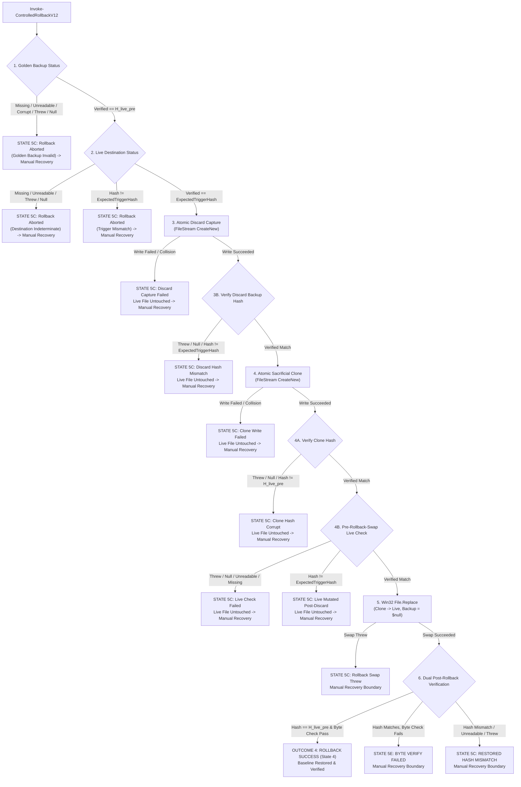

# MUSE SPARK — ZENTRA STEP 2D-2A-AL
## EXCEPTION CONTAINMENT & SNAPSHOT STATE CONSISTENCY AUDIT — DOCUMENTATION ONLY

**Project:** ZENTRA — Hi-Tech Lab Field Service Management Platform  
**Target Repository:** `D:\Zentra`  
**Input References:**  
- [`docs/MUSE_SPARK_STEP2D_2A_AK_FINAL_SNAPSHOT_INTEGRITY_AUDIT_REPORT.md`](file:///d:/Zentra/docs/MUSE_SPARK_STEP2D_2A_AK_FINAL_SNAPSHOT_INTEGRITY_AUDIT_REPORT.md)  
- [`docs/MUSE_SPARK_STEP2D_2A_AJ_REPLACEMENT_COLLISION_AND_STATE_CORRECTION_REPORT.md`](file:///d:/Zentra/docs/MUSE_SPARK_STEP2D_2A_AJ_REPLACEMENT_COLLISION_AND_STATE_CORRECTION_REPORT.md)  
**Host Environment:** Windows Workstation (`127.0.0.1:5432`)  
**Report Date:** 2026-10-09  
**Mode:** STRICT DOCUMENTATION-ONLY SPECIFICATION AUDIT & RUNBOOK FINALIZATION  
**Budget Constraint:** Strict ₹0/month (Zero cost, no credit cards, no paid upgrades)  
**Remote Access:** STRICTLY PROHIBITED (Zero remote connections made)  
**Execution Authorization:** NOT GRANTED — NO COMMANDS EXECUTED IN THIS STEP  
**Status:** COMPLETE — WAITING FOR HUMAN OPERATOR REVIEW  

---

## 1. Executive Summary & Verdict

In **Step 2D-2A-AK**, pre-swap candidate and live destination barriers were introduced, and dual discard verification was specified.

A thorough systems-level audit of the Step AK deliverable revealed four critical exception-containment gaps:
1. **Uncontained Helper Invocations:** In `Invoke-SafeConfigReplacementV13` (lines 680–689) and `Invoke-ControlledRollbackV11` (lines 431, 461, 473), several calls to `Get-SafeFileHashV4` were made without caller-level `try/catch` wrappers and without guarding against `$null` return objects. If `Get-SafeFileHashV4` threw an internal CLR exception or returned `$null`, the scripts would terminate with an unhandled PowerShell terminating exception, completely bypassing the state machine, artifact tracking, and manual recovery boundary.
2. **Conflated Barrier Status Mappings:** In `Invoke-SafeConfigReplacementV13`, if the pre-swap candidate check or live check returned `HASH_READ_FAILED`, `FILE_MISSING`, or `HELPER_EXCEPTION`, the script indiscriminately threw `PRE_SWAP_CANDIDATE_MUTATED` or `PRE_SWAP_LIVE_MUTATED`. Lumping I/O locks and missing files under "mutated" misleads operators during root-cause investigation.
3. **Rollback Pre-Swap Live Barrier Conflation:** In `Invoke-ControlledRollbackV11` (line 474), if the immediate pre-rollback-swap live check returned `HASH_READ_FAILED` (file locked), the script returned `LIVE_MUTATED_POST_DISCARD`. A locked file is an unreadable/indeterminate state, not proof of mutation.
4. **Byte Integrity Exception Trapping:** If `Test-CandidateByteAndEncodingIntegrity` encounters an unexpected I/O sharing violation or unauthorized access error, treating it strictly as content corruption obscures filesystem permission or locking anomalies.

This report, **Step 2D-2A-AL**, resolves every exception path by establishing the **Universal Layer-2 Caller Containment Pattern**, publishes `Invoke-SafeConfigReplacementV14` and `Invoke-ControlledRollbackV12`, expands the fault-injection test matrix to 30 exhaustive scenarios, and formalizes open OS-level boundaries.

> [!IMPORTANT]
> **Strict Documentation-Only Boundary:** Zero operational commands or configuration changes were executed during this step. Zero configuration files (`postgresql.conf`, `pg_hba.conf`), firewall rules, Windows services, application files, or `.env` files were modified. Zero databases or roles were created. All operational procedures in this document are strictly **[NOT EXECUTED — UNTESTED]**.

---

## 2. Section 1 — Findings with Exact Function & Line References

| Finding ID | Script & Location in Step AK | Defect Description | Technical Failure Mode | Mandatory Correction in Step 2D-2A-AL |
|---|---|---|---|---|
| **FIND-AL1** | `Invoke-SafeConfigReplacementV13`<br/>Lines 680–683 | Pre-swap candidate barrier calls `Get-SafeFileHashV4` without `try/catch` or null check. | Thrown CLR exception or null bypasses error trapping; bubbles as unhandled terminating script error. | Wrap call in caller `try/catch`; validate `$null`; branch distinctly on missing, unreadable, helper exception, and hash mismatch. |
| **FIND-AL2** | `Invoke-SafeConfigReplacementV13`<br/>Lines 685–689 | Pre-swap live barrier calls `Get-SafeFileHashV4` without `try/catch` or null check. | File sharing violation during pre-swap check throws `PRE_SWAP_LIVE_MUTATED` instead of `LIVE_UNREADABLE`. | Wrap call in caller `try/catch`; validate `$null`; branch distinctly on missing, unreadable, helper exception, and hash mismatch. |
| **FIND-AL3** | `Invoke-ControlledRollbackV11`<br/>Lines 431–440 | Discard backup hash check calls `Get-SafeFileHashV4` without caller `try/catch` or null check. | Helper failure on discard backup causes unhandled crash inside rollback engine. | Wrap in caller `try/catch`; validate `$null`; return `DISCARD_QUERY_THREW` or `DISCARD_HELPER_EXCEPTION` without altering live file. |
| **FIND-AL4** | `Invoke-ControlledRollbackV11`<br/>Lines 461–470 | Sacrificial clone check calls `Get-SafeFileHashV4` without caller `try/catch` or null check. | CLR fault during clone hash check bypasses manual recovery boundary. | Wrap in caller `try/catch`; validate `$null`; return `SACRIFICIAL_CLONE_QUERY_THREW` without altering live file. |
| **FIND-AL5** | `Invoke-ControlledRollbackV11`<br/>Lines 473–480 | Pre-swap live barrier calls `Get-SafeFileHashV4` without caller `try/catch`; misclassifies I/O lock as mutation. | Live destination lock misreported as `LIVE_MUTATED_POST_DISCARD`. | Wrap in caller `try/catch`; validate `$null`; return `PRE_ROLLBACK_LIVE_UNREADABLE` on lock, preserving all discard evidence. |
| **FIND-AL6** | `Enter-ManualRecoveryBoundaryV11`<br/>Lines 809–820 | Diagnostic live file check lacks null checks on returned `$liveInspection`. | If helper returns `$null`, diagnostic logger throws `NullReferenceException`, aborting forensic output. | Add null guard; check `$liveInspection -ne $null` before reading properties; record null in diagnostic warnings. |

---

## 3. Section 2 — Universal Exception-Containment Pattern & Helper Caller Contract

To guarantee that no helper exception can bypass state classification, every caller invoking `Get-SafeFileHashV4` must adhere to the **Universal Layer-2 Containment Pattern**:

```powershell
# [NOT EXECUTED — UNTESTED OPERATIONAL PROCEDURE]

$info = $null
$queryThrew = $null

try {
    $info = Get-SafeFileHashV4 -FilePath $TargetFilePath
}
catch {
    $queryThrew = $_.Exception
}

if ($queryThrew -ne $null) {
    # CASE 1: PowerShell engine or pipeline terminating failure -> INDETERMINATE
    # Action: Halt automation fail-closed. Record $queryThrew. Zero automated rollback.
}
elseif ($info -eq $null -or $info.Status -eq $null) {
    # CASE 2: Null object returned -> INDETERMINATE
    # Action: Halt automation fail-closed. Record null return. Zero automated rollback.
}
else {
    switch ($info.Status) {
        "HASH_VERIFIED" {
            # CASE 3: File readable, hash computed.
            # Safe to perform strict equality comparisons ($info.Hash -eq $ExpectedHash).
        }
        "FILE_MISSING" {
            # CASE 4: File confirmed absent on disk.
            # Action: Halt automation fail-closed.
        }
        "HASH_READ_FAILED" {
            # CASE 5: File exists but locked (IOException / UnauthorizedAccess) -> INDETERMINATE.
            # Action: Halt automation fail-closed. Zero automated rollback.
        }
        "HELPER_EXCEPTION" {
            # CASE 6: Internal CLR, syntax, or argument error -> INDETERMINATE.
            # Action: Halt automation fail-closed. Zero automated rollback.
        }
        default {
            # CASE 7: Unrecognized status string -> INDETERMINATE.
            # Action: Halt automation fail-closed. Zero automated rollback.
        }
    }
}
```

---

## 4. Section 3 — Corrected Promotion & Rollback State Transitions

### 4.1 Promotion State Transition Logic

```mermaid
flowchart TD
    Start["Invoke-SafeConfigReplacementV14"] --> PF["Pre-Flight Stage 1<br/>(Candidate Check, Live Hash, Atomic Golden Backup)"]
    PF -->|Fail / Collision / Corrupt| HaltPF["FAIL-CLOSED ABORT<br/>(Live Untouched, Artifacts Retained)"]
    
    PF -->|Pass| Barrier["Stage 2 Pre-Swap Barriers"]
    Barrier --> PreSwapCand{"Pre-Swap Candidate Check"}
    PreSwapCand -->|Threw / Null / Unreadable / Missing| HaltCandErr["FAIL-CLOSED ABORT [PRE_SWAP_CAND_ERROR]<br/>(Live Untouched)"]
    PreSwapCand -->|Hash != H_cand_pre| HaltCandMut["FAIL-CLOSED ABORT [PRE_SWAP_CAND_MUTATED]<br/>(Live Untouched)"]
    
    PreSwapCand -->|Verified Match| PreSwapLive{"Pre-Swap Live Check"}
    PreSwapLive -->|Threw / Null / Unreadable / Missing| HaltLiveErr["FAIL-CLOSED ABORT [PRE_SWAP_LIVE_ERROR]<br/>(Live Untouched)"]
    PreSwapLive -->|Hash != H_live_pre| HaltLiveMut["FAIL-CLOSED ABORT [PRE_SWAP_LIVE_MUTATED]<br/>(Live Untouched)"]
    
    PreSwapLive -->|Verified Match| Swap["Win32 File.Replace<br/>(Candidate -> Live, Backup = $null)"]
    
    Swap -->|Replace Throws| InspectThrow["Inspect Live File (Get-SafeFileHashV4)"]
    InspectThrow -->|Hash == H_live_pre| State2A["OUTCOME 1: TARGET UNTOUCHED (State 2A)<br/>Clean Fail-Closed Exit"]
    InspectThrow -->|Hash != H_live_pre & Readable| TriggerRollback1["STATE 3: TARGET ALTERED READABLE<br/>Trigger Controlled Rollback"]
    InspectThrow -->|Missing / Unreadable / Threw / Null| State5_Throw["STATE 5A/5B/5F: INDETERMINATE<br/>Halt to Manual Recovery Boundary"]
    
    Swap -->|Replace Succeeds| InspectPost["Inspect Live File (Get-SafeFileHashV4)"]
    InspectPost -->|Hash == H_cand_pre| BytePost{"Strict Byte & CRLF Check"}
    BytePost -->|Passed| State1["OUTCOME 2: PROMOTION SUCCESS (State 1)<br/>Verified on Disk"]
    BytePost -->|Failed (Byte Anomaly)| TriggerRollback2["STATE 3: TARGET ALTERED READABLE<br/>Trigger Controlled Rollback"]
    InspectPost -->|Hash == H_live_pre| State2B["OUTCOME 1: TARGET UNCHANGED NO-OP (State 2B)<br/>Clean Fail-Closed Exit"]
    InspectPost -->|Hash != H_cand_pre & != H_live_pre| TriggerRollback3["STATE 3: TARGET ALTERED READABLE<br/>Trigger Controlled Rollback"]
    InspectPost -->|Missing / Unreadable / Threw / Null| State5_Post["STATE 5A/5B/5F: INDETERMINATE<br/>Halt to Manual Recovery Boundary"]

    TriggerRollback1 --> Rollback["Invoke-ControlledRollbackV12"]
    TriggerRollback2 --> Rollback
    TriggerRollback3 --> Rollback
```

### 4.2 Rollback State Transition Logic



---

## 5. Section 4 — Post-Swap Authorization Rules Matrix

| Scenario / Post-Swap Condition | Live File State on Disk | Verification Result / Evidence | Automatic Rollback Authorized? | Resulting Machine State & Action | Forensic Evidence Retained |
|---|---|---|---|---|---|
| **Swap Throws & Hash Matches Baseline** | **Untouched** | `Get-SafeFileHashV4` returns `HASH_VERIFIED` with $H = H_{\text{live\_pre}}$. | **NO** (Rollback redundant and unsafe). | `STATE 2A: TARGET_UNTOUCHED_THROWN`<br/>Clean fail-closed abort. | Candidate, Golden Backup. |
| **Swap Throws & Hash Altered** | **Altered** | `Get-SafeFileHashV4` returns `HASH_VERIFIED` with $H \neq H_{\text{live\_pre}}$. | **YES** (Target readable and demonstrably altered). | `STATE 3: TARGET_ALTERED_READABLE`<br/>Invoke `Invoke-ControlledRollbackV12`. | Candidate, Golden Backup, Engine Backup (if created). |
| **Swap Succeeds & Hash Matches Baseline** | **Unchanged (No-Op)** | `Get-SafeFileHashV4` returns `HASH_VERIFIED` with $H = H_{\text{live\_pre}}$. | **NO** (Target already at pristine baseline). | `STATE 2B: TARGET_UNTOUCHED_NOOP`<br/>Clean fail-closed abort. | Candidate, Golden Backup. |
| **Swap Succeeds & Matches Candidate** | **Promoted** | Hash equals $H_{\text{cand\_pre}}$ AND strict byte/CRLF check passes. | **NO** (Terminal success). | `STATE 1: VERIFIED_PROMOTED`<br/>Promotion verified. | Candidate (Consumed), Golden Backup. |
| **Swap Succeeds, Candidate Hash Matches, Byte Check Fails** | **Corrupt Byte Format** | Hash equals $H_{\text{cand\_pre}}$, but byte check detects bare LF or invalid UTF-8. | **YES** (Target readable, but corrupt format). | `STATE 3: TARGET_ALTERED_READABLE`<br/>Invoke `Invoke-ControlledRollbackV12`. | Candidate, Golden Backup, Discard Backup. |
| **Swap Succeeds, Hash Matches Neither** | **Corrupt Content** | Hash differs from both $H_{\text{cand\_pre}}$ and $H_{\text{live\_pre}}$. | **YES** (Target readable, demonstrably altered). | `STATE 3: TARGET_ALTERED_READABLE`<br/>Invoke `Invoke-ControlledRollbackV12`. | Candidate, Golden Backup, Discard Backup. |
| **Swap Throws/Succeeds, Target Missing** | **Missing** | `Get-SafeFileHashV4` returns `FILE_MISSING`. | **NO** (Win32 replace impossible without destination). | `STATE 5A: TARGET_FILE_MISSING`<br/>Halt to Manual Recovery. | All existing artifacts. |
| **Swap Throws/Succeeds, Target Locked** | **Unreadable** | `Get-SafeFileHashV4` returns `HASH_READ_FAILED`. | **NO** (Destination state INDETERMINATE). | `STATE 5B: TARGET_FILE_UNREADABLE`<br/>Halt to Manual Recovery. | All existing artifacts. |
| **Swap Throws/Succeeds, Helper Fails** | **Unknown** | Helper returns `HELPER_EXCEPTION`, `$null`, or throws. | **NO** (Tooling state INDETERMINATE). | `STATE 5F: TOOLING_EXCEPTION_HALT`<br/>Halt to Manual Recovery. | All existing artifacts. |

---

## 6. Section 5 — Authoritative Artifact Lifecycle & Forensic Evidence Matrix

| Lifecycle Event / Branch | Candidate File (`$CandidatePath`) | Golden Backup (`$goldenBackupPath`) | Sacrificial Clone (`$sacrificialPath`) | Discard Backup (`$discardBackup`) | Live File State | Rollback Allowed? | Manual Recovery Reason |
|---|---|---|---|---|---|---|---|
| **PF-0: Candidate Validation Fail** | **Retained on disk** | **Not Created** | **Not Created** | **Not Created** | Untouched | **NO** | Not required (Pre-flight abort). |
| **PF-1: Backup Collision** | **Retained on disk** | **Not Created** | **Not Created** | **Not Created** | Untouched | **NO** | Not required (Pre-flight abort). |
| **PF-2: Live Read Failed** | **Retained on disk** | **Not Created** | **Not Created** | **Not Created** | Untouched | **NO** | Not required (Pre-flight abort). |
| **PF-3: Backup Write Failed** | **Retained on disk** | **Partial Retained** | **Not Created** | **Not Created** | Untouched | **NO** | Not required (Disk failure investigation). |
| **PF-4: Backup Verify Failed** | **Retained on disk** | **Corrupt Retained** | **Not Created** | **Not Created** | Untouched | **NO** | Not required (Storage controller check). |
| **PF-5A: Pre-Swap Cand Error** | **Retained on disk** | **Retained on disk** | **Not Created** | **Not Created** | Untouched | **NO** | Not required (Pre-flight abort). |
| **PF-5B: Pre-Swap Cand Mutated**| **Retained on disk** | **Retained on disk** | **Not Created** | **Not Created** | Untouched | **NO** | Not required (Pre-flight abort). |
| **PF-5C: Pre-Swap Live Error** | **Retained on disk** | **Retained on disk** | **Not Created** | **Not Created** | Untouched | **NO** | Not required (Pre-flight abort). |
| **PF-5D: Pre-Swap Live Mutated**| **Retained on disk** | **Retained on disk** | **Not Created** | **Not Created** | Altered external | **NO** | Not required (Pre-flight abort). |
| **State 2A: Replace Threw Untouched**| **Retained on disk** | **Retained on disk** | **Not Created** | **Not Created** | Untouched | **NO** | Not required (Clean fail-closed exit). |
| **State 2B: Replace No-Op Untouched** | **Retained on disk** | **Retained on disk** | **Not Created** | **Not Created** | Untouched | **NO** | Not required (Clean fail-closed exit). |
| **State 1: Promotion Success** | **Consumed (Live)** | **Retained on disk** | **Not Created** | **Not Created** | Promoted | **NO** | Not required (Normal completion). |
| **State 4: Rollback Success** | **Retained on disk** | **Retained on disk** | **Consumed (Live)** | **Retained on disk** | Restored Baseline| **NO** | Not required (Rollback succeeded). |
| **R-1: Discard Capture Failed** | **Retained on disk** | **Retained on disk** | **Not Created** | **Partial Retained**| Altered | **NO** | Discard backup write failed. |
| **R-2: Discard Hash Mismatch** | **Retained on disk** | **Retained on disk** | **Not Created** | **Retained on disk** | Altered | **NO** | Discard hash != trigger hash. |
| **R-3: Clone Creation Failed** | **Retained on disk** | **Retained on disk** | **Partial Retained**| **Retained on disk** | Altered | **NO** | Sacrificial clone write failed. |
| **R-4: Clone Hash Corrupt** | **Retained on disk** | **Retained on disk** | **Retained on disk** | **Retained on disk** | Altered | **NO** | Clone hash != baseline hash. |
| **R-5: Pre-Swap Live Mutated** | **Retained on disk** | **Retained on disk** | **Retained on disk** | **Retained on disk** | Altered newer | **NO** | Live destination mutated post-discard. |
| **R-6: Pre-Swap Live Unreadable**| **Retained on disk** | **Retained on disk** | **Retained on disk** | **Retained on disk** | Indeterminate | **NO** | Live destination locked pre-swap. |
| **State 5A: Target Missing** | **Retained on disk** | **Retained on disk** | **Not Created** | **Not Created** | Missing | **NO** | Target configuration missing. |
| **State 5B: Target Unreadable** | **Retained on disk** | **Retained on disk** | **Not Created** | **Not Created** | Indeterminate | **NO** | Target configuration locked. |
| **State 5C: Rollback Failed** | **Retained on disk** | **Retained on disk** | **Retained on disk** | **Retained on disk** | Indeterminate | **NO** | Rollback swap threw exception. |
| **State 5D: Unknown State** | **Retained on disk** | **Retained on disk** | **Not Created** | **Not Created** | Indeterminate | **NO** | Helper returned unrecognized status. |
| **State 5E: Byte Verify Failed** | **Retained on disk** | **Retained on disk** | **Consumed (Live)** | **Retained on disk** | Corrupt bytes | **NO** | Restored file has byte formatting error. |
| **State 5F: Tooling Exception** | **Retained on disk** | **Retained on disk** | **Not Created** | **Not Created** | Indeterminate | **NO** | CLR/engine exception during inspection. |

---

## 7. Section 6 — Hardened Proposed Operational Scripts (Engine V14 / V12)

### 7.1 Fully Contained Rollback Engine (`Invoke-ControlledRollbackV12`)

```powershell
# [NOT EXECUTED — UNTESTED OPERATIONAL PROCEDURE]

function Invoke-ControlledRollbackV12 {
    <#
    .SYNOPSIS
        Safely restores a configuration file using a sacrificial clone of the golden backup.
        Enforces Universal Layer-2 Exception Containment on every helper call, dual discard
        verification, immediate pre-swap lock assertions, and lpBackupFileName = $null.
    #>
    param (
        [Parameter(Mandatory = $true)]
        [string]$LiveConfigPath,

        [Parameter(Mandatory = $true)]
        [string]$GoldenBackupPath,

        [Parameter(Mandatory = $true)]
        [string]$ExpectedBaselineHash,

        [Parameter(Mandatory = $true)]
        [string]$ExpectedTriggerHash,

        [System.Exception]$InitialError
    )

    Write-Warning "=== INITIATING CONTROLLED ROLLBACK V12 ==="

    # -------------------------------------------------------------
    # 1. EVALUATE GOLDEN BACKUP STATUS (LAYER-2 CONTAINED)
    # -------------------------------------------------------------
    $gbInfo = $null
    $gbQueryError = $null
    try {
        $gbInfo = Get-SafeFileHashV4 -FilePath $GoldenBackupPath
    }
    catch {
        $gbQueryError = $_.Exception
    }

    if ($gbQueryError -ne $null) {
        return [PSCustomObject]@{
            Success       = $false
            Status        = "GOLDEN_BACKUP_QUERY_THREW"
            Message       = "Querying golden backup threw an unexpected exception: $($gbQueryError.Message)"
            DiscardBackup = $null
            Error         = $gbQueryError
        }
    }

    if ($gbInfo -eq $null -or $gbInfo.Status -eq $null) {
        return [PSCustomObject]@{
            Success       = $false
            Status        = "GOLDEN_BACKUP_NULL_RESULT"
            Message       = "Querying golden backup returned a null result object."
            DiscardBackup = $null
            Error         = $null
        }
    }

    switch ($gbInfo.Status) {
        "FILE_MISSING" {
            return [PSCustomObject]@{
                Success       = $false
                Status        = "GOLDEN_BACKUP_MISSING"
                Message       = "Golden backup file [$GoldenBackupPath] does not exist on disk."
                DiscardBackup = $null
                Error         = $null
            }
        }
        "HASH_READ_FAILED" {
            return [PSCustomObject]@{
                Success       = $false
                Status        = "GOLDEN_BACKUP_UNREADABLE"
                Message       = "Golden backup file [$GoldenBackupPath] is unreadable: $($gbInfo.Message)"
                DiscardBackup = $null
                Error         = $gbInfo.Error
            }
        }
        "HELPER_EXCEPTION" {
            return [PSCustomObject]@{
                Success       = $false
                Status        = "GOLDEN_BACKUP_HELPER_EXCEPTION"
                Message       = "Hash helper failed on golden backup: $($gbInfo.Message)"
                DiscardBackup = $null
                Error         = $gbInfo.Error
            }
        }
        "HASH_VERIFIED" {
            if ($gbInfo.Hash -ne $ExpectedBaselineHash) {
                return [PSCustomObject]@{
                    Success       = $false
                    Status        = "GOLDEN_BACKUP_CORRUPT"
                    Message       = "Golden backup hash [$($gbInfo.Hash)] does not match expected baseline [$ExpectedBaselineHash]."
                    DiscardBackup = $null
                    Error         = $null
                }
            }
        }
        default {
            return [PSCustomObject]@{
                Success       = $false
                Status        = "GOLDEN_BACKUP_UNKNOWN_STATE"
                Message       = "Golden backup returned unexpected status: $($gbInfo.Status)"
                DiscardBackup = $null
                Error         = $gbInfo.Error
            }
        }
    }

    # -------------------------------------------------------------
    # 2. EVALUATE LIVE DESTINATION STATUS (LAYER-2 CONTAINED)
    # -------------------------------------------------------------
    $destInfo = $null
    $destQueryError = $null
    try {
        $destInfo = Get-SafeFileHashV4 -FilePath $LiveConfigPath
    }
    catch {
        $destQueryError = $_.Exception
    }

    if ($destQueryError -ne $null) {
        return [PSCustomObject]@{
            Success       = $false
            Status        = "LIVE_DESTINATION_QUERY_THREW"
            Message       = "Querying live destination threw an unexpected exception: $($destQueryError.Message)"
            DiscardBackup = $null
            Error         = $destQueryError
        }
    }

    if ($destInfo -eq $null -or $destInfo.Status -eq $null) {
        return [PSCustomObject]@{
            Success       = $false
            Status        = "LIVE_DESTINATION_NULL_RESULT"
            Message       = "Querying live destination returned a null result object."
            DiscardBackup = $null
            Error         = $null
        }
    }

    switch ($destInfo.Status) {
        "FILE_MISSING" {
            return [PSCustomObject]@{
                Success       = $false
                Status        = "LIVE_DESTINATION_MISSING"
                Message       = "Live destination [$LiveConfigPath] is absent. Win32 File.Replace cannot execute on an absent destination."
                DiscardBackup = $null
                Error         = $null
            }
        }
        "HASH_READ_FAILED" {
            return [PSCustomObject]@{
                Success       = $false
                Status        = "LIVE_DESTINATION_UNREADABLE"
                Message       = "Live destination [$LiveConfigPath] is locked or unreadable: $($destInfo.Message)"
                DiscardBackup = $null
                Error         = $destInfo.Error
            }
        }
        "HELPER_EXCEPTION" {
            return [PSCustomObject]@{
                Success       = $false
                Status        = "LIVE_DESTINATION_HELPER_EXCEPTION"
                Message       = "Hash helper failed on live destination: $($destInfo.Message)"
                DiscardBackup = $null
                Error         = $destInfo.Error
            }
        }
        "HASH_VERIFIED" {
            if ($destInfo.Hash -ne $ExpectedTriggerHash) {
                return [PSCustomObject]@{
                    Success       = $false
                    Status        = "LIVE_DESTINATION_TRIGGER_MISMATCH"
                    Message       = "Live destination hash [$($destInfo.Hash)] changed before rollback initiation (expected trigger hash [$ExpectedTriggerHash])."
                    DiscardBackup = $null
                    Error         = $null
                }
            }
        }
        default {
            return [PSCustomObject]@{
                Success       = $false
                Status        = "LIVE_DESTINATION_UNKNOWN_STATE"
                Message       = "Live destination returned unexpected status: $($destInfo.Status)"
                DiscardBackup = $null
                Error         = $destInfo.Error
            }
        }
    }

    # -------------------------------------------------------------
    # 3. DECOUPLED DISCARD CAPTURE & LAYER-2 VERIFICATION
    # -------------------------------------------------------------
    $uniqueRollbackId = [System.Guid]::NewGuid().ToString("N").Substring(0, 8)
    $rollbackTimestamp = "$((Get-Date).ToString('yyyyMMdd_HHmmss'))_$uniqueRollbackId"
    $discardBackup = "$LiveConfigPath.rollback_discard.$rollbackTimestamp"

    try {
        $liveAlteredBytes = [System.IO.File]::ReadAllBytes($LiveConfigPath)
        $discardStream = [System.IO.FileStream]::new(
            $discardBackup,
            [System.IO.FileMode]::CreateNew,
            [System.IO.FileAccess]::Write,
            [System.IO.FileShare]::None
        )
        try {
            $discardStream.Write($liveAlteredBytes, 0, $liveAlteredBytes.Length)
        }
        finally {
            $discardStream.Dispose()
        }
    }
    catch {
        return [PSCustomObject]@{
            Success       = $false
            Status        = "DISCARD_CAPTURE_FAILED"
            Message       = "Failed capturing discard backup with atomic CreateNew: $($_.Exception.Message)"
            DiscardBackup = $null
            Error         = $_.Exception
        }
    }

    # 3B. Dual Discard Hash Verification (Layer-2 Contained)
    $discardInfo = $null
    $discardQueryError = $null
    try {
        $discardInfo = Get-SafeFileHashV4 -FilePath $discardBackup
    }
    catch {
        $discardQueryError = $_.Exception
    }

    if ($discardQueryError -ne $null) {
        return [PSCustomObject]@{
            Success       = $false
            Status        = "DISCARD_QUERY_THREW"
            Message       = "Querying discard backup threw an unexpected exception: $($discardQueryError.Message)"
            DiscardBackup = $discardBackup
            Error         = $discardQueryError
        }
    }

    if ($discardInfo -eq $null -or $discardInfo.Status -eq $null) {
        return [PSCustomObject]@{
            Success       = $false
            Status        = "DISCARD_NULL_RESULT"
            Message       = "Querying discard backup returned a null result object."
            DiscardBackup = $discardBackup
            Error         = $null
        }
    }

    if ($discardInfo.Status -ne "HASH_VERIFIED" -or $discardInfo.Hash -ne $ExpectedTriggerHash) {
        return [PSCustomObject]@{
            Success       = $false
            Status        = "DISCARD_HASH_MISMATCH"
            Message       = "Discard backup verification failed ($($discardInfo.Status)): Expected $ExpectedTriggerHash, observed $($discardInfo.Hash)."
            DiscardBackup = $discardBackup
            Error         = $discardInfo.Error
        }
    }
    Write-Host "[DISCARD VERIFIED] Altered destination captured & hash-matched: $discardBackup [SHA256: $ExpectedTriggerHash]" -ForegroundColor Green

    # -------------------------------------------------------------
    # 4. SACRIFICIAL CLONE CREATION & LAYER-2 VERIFICATION
    # -------------------------------------------------------------
    $sacrificialPath = "$GoldenBackupPath.rollback_cand.$uniqueRollbackId"

    try {
        $backupBytes = [System.IO.File]::ReadAllBytes($GoldenBackupPath)
        $cloneStream = [System.IO.FileStream]::new(
            $sacrificialPath,
            [System.IO.FileMode]::CreateNew,
            [System.IO.FileAccess]::Write,
            [System.IO.FileShare]::None
        )
        try {
            $cloneStream.Write($backupBytes, 0, $backupBytes.Length)
        }
        finally {
            $cloneStream.Dispose()
        }
    }
    catch {
        return [PSCustomObject]@{
            Success       = $false
            Status        = "SACRIFICIAL_CLONE_CREATION_FAILED"
            Message       = "Failed creating sacrificial clone with atomic CreateNew: $($_.Exception.Message)"
            DiscardBackup = $discardBackup
            Error         = $_.Exception
        }
    }
        
    $cloneInfo = $null
    $cloneQueryError = $null
    try {
        $cloneInfo = Get-SafeFileHashV4 -FilePath $sacrificialPath
    }
    catch {
        $cloneQueryError = $_.Exception
    }

    if ($cloneQueryError -ne $null) {
        return [PSCustomObject]@{
            Success       = $false
            Status        = "SACRIFICIAL_CLONE_QUERY_THREW"
            Message       = "Querying sacrificial clone threw an unexpected exception: $($cloneQueryError.Message)"
            DiscardBackup = $discardBackup
            Error         = $cloneQueryError
        }
    }

    if ($cloneInfo -eq $null -or $cloneInfo.Status -eq $null) {
        return [PSCustomObject]@{
            Success       = $false
            Status        = "SACRIFICIAL_CLONE_NULL_RESULT"
            Message       = "Querying sacrificial clone returned a null result object."
            DiscardBackup = $discardBackup
            Error         = $null
        }
    }

    if ($cloneInfo.Status -ne "HASH_VERIFIED" -or $cloneInfo.Hash -ne $ExpectedBaselineHash) {
        return [PSCustomObject]@{
            Success       = $false
            Status        = "SACRIFICIAL_CLONE_CORRUPT"
            Message       = "Sacrificial clone verification failed ($($cloneInfo.Status)): Expected $ExpectedBaselineHash, observed $($cloneInfo.Hash)."
            DiscardBackup = $discardBackup
            Error         = $cloneInfo.Error
        }
    }

    # -------------------------------------------------------------
    # 4B. IMMEDIATE PRE-ROLLBACK-SWAP LIVE BARRIER (LAYER-2 CONTAINED)
    # -------------------------------------------------------------
    $livePreSwapCheck = $null
    $livePreSwapError = $null
    try {
        $livePreSwapCheck = Get-SafeFileHashV4 -FilePath $LiveConfigPath
    }
    catch {
        $livePreSwapError = $_.Exception
    }

    if ($livePreSwapError -ne $null) {
        return [PSCustomObject]@{
            Success       = $false
            Status        = "PRE_ROLLBACK_LIVE_QUERY_THREW"
            Message       = "Pre-rollback live check threw an unexpected exception: $($livePreSwapError.Message)"
            DiscardBackup = $discardBackup
            Error         = $livePreSwapError
        }
    }

    if ($livePreSwapCheck -eq $null -or $livePreSwapCheck.Status -eq $null) {
        return [PSCustomObject]@{
            Success       = $false
            Status        = "PRE_ROLLBACK_LIVE_NULL_RESULT"
            Message       = "Pre-rollback live check returned a null result object."
            DiscardBackup = $discardBackup
            Error         = $null
        }
    }

    if ($livePreSwapCheck.Status -eq "HASH_READ_FAILED") {
        return [PSCustomObject]@{
            Success       = $false
            Status        = "PRE_ROLLBACK_LIVE_UNREADABLE"
            Message       = "Live destination became locked/unreadable immediately prior to rollback swap: $($livePreSwapCheck.Message)"
            DiscardBackup = $discardBackup
            Error         = $livePreSwapCheck.Error
        }
    }

    if ($livePreSwapCheck.Status -eq "FILE_MISSING") {
        return [PSCustomObject]@{
            Success       = $false
            Status        = "PRE_ROLLBACK_LIVE_MISSING"
            Message       = "Live destination disappeared immediately prior to rollback swap."
            DiscardBackup = $discardBackup
            Error         = $null
        }
    }

    if ($livePreSwapCheck.Status -ne "HASH_VERIFIED" -or $livePreSwapCheck.Hash -ne $ExpectedTriggerHash) {
        return [PSCustomObject]@{
            Success       = $false
            Status        = "LIVE_MUTATED_POST_DISCARD"
            Message       = "CRITICAL SAFETY HALT: Live destination mutated after discard backup was captured. Rollback aborted to prevent uncaptured data loss."
            DiscardBackup = $discardBackup
            Error         = $null
        }
    }

    # -------------------------------------------------------------
    # 5. PURE ATOMIC ROLLBACK SWAP (lpBackupFileName = $null)
    # -------------------------------------------------------------
    try {
        [System.IO.File]::Replace($sacrificialPath, $LiveConfigPath, $null, $true)
        Write-Host "[ROLLBACK SWAP COMPLETED] Live destination restored via pure atomic swap." -ForegroundColor Yellow
    }
    catch {
        return [PSCustomObject]@{
            Success       = $false
            Status        = "ROLLBACK_SWAP_EXCEPTION"
            Message       = "Exception occurred during rollback swap: $($_.Exception.Message)"
            DiscardBackup = $discardBackup
            Error         = $_.Exception
        }
    }

    # -------------------------------------------------------------
    # 6. DUAL POST-ROLLBACK VERIFICATION (LAYER-2 CONTAINED)
    # -------------------------------------------------------------
    $restoredInfo = $null
    $restoredQueryError = $null
    try {
        $restoredInfo = Get-SafeFileHashV4 -FilePath $LiveConfigPath
    }
    catch {
        $restoredQueryError = $_.Exception
    }

    if ($restoredQueryError -ne $null) {
        return [PSCustomObject]@{
            Success       = $false
            Status        = "RESTORED_QUERY_THREW"
            Message       = "Querying restored live file threw an unexpected exception: $($restoredQueryError.Message)"
            DiscardBackup = $discardBackup
            Error         = $restoredQueryError
        }
    }

    if ($restoredInfo -eq $null -or $restoredInfo.Status -eq $null) {
        return [PSCustomObject]@{
            Success       = $false
            Status        = "RESTORED_NULL_RESULT"
            Message       = "Querying restored live file returned a null result object."
            DiscardBackup = $discardBackup
            Error         = $null
        }
    }

    if ($restoredInfo.Status -ne "HASH_VERIFIED") {
        return [PSCustomObject]@{
            Success       = $false
            Status        = "RESTORED_FILE_UNVERIFIABLE"
            Message       = "Restored live file cannot be verified ($($restoredInfo.Status)): $($restoredInfo.Message)"
            DiscardBackup = $discardBackup
            Error         = $restoredInfo.Error
        }
    }

    if ($restoredInfo.Hash -ne $ExpectedBaselineHash) {
        return [PSCustomObject]@{
            Success       = $false
            Status        = "RESTORED_HASH_MISMATCH"
            Message       = "Restored live file hash [$($restoredInfo.Hash)] does not match expected baseline [$ExpectedBaselineHash]."
            DiscardBackup = $discardBackup
            Error         = $null
        }
    }

    # Re-verify byte integrity on restored file
    try {
        Test-CandidateByteAndEncodingIntegrity -FilePath $LiveConfigPath
    }
    catch {
        return [PSCustomObject]@{
            Success       = $false
            Status        = "ROLLBACK_BYTE_VERIFY_FAILED"
            Message       = "Rollback restored matching hash, but byte validation failed: $($_.Exception.Message)"
            DiscardBackup = $discardBackup
            Error         = $_.Exception
        }
    }

    Write-Host "[ROLLBACK VERIFIED] Live configuration restored and verified [SHA256: $($restoredInfo.Hash)]." -ForegroundColor Green
    return [PSCustomObject]@{
        Success       = $true
        Status        = "ROLLBACK_SUCCESS"
        RestoredHash  = $restoredInfo.Hash
        DiscardBackup = $discardBackup
        Message       = "Configuration successfully restored to pre-change state. Discard backup retained."
        Error         = $null
    }
}
```

---

### 7.2 Fully Contained Configuration Replacement Engine (`Invoke-SafeConfigReplacementV14`)

```powershell
# [NOT EXECUTED — UNTESTED OPERATIONAL PROCEDURE]

function Invoke-SafeConfigReplacementV14 {
    <#
    .SYNOPSIS
        Safely replaces a PostgreSQL configuration file using the Decoupled Backup Architecture.
        Enforces Universal Layer-2 Exception Containment across all pre-flight and pre-swap barriers.
    #>
    param (
        [Parameter(Mandatory = $true)]
        [string]$LiveConfigPath,

        [Parameter(Mandatory = $true)]
        [string]$CandidatePath,

        [Parameter(Mandatory = $true)]
        [string]$Description
    )

    Write-Host "=== INITIATING HARDENED CONFIGURATION REPLACEMENT V14: $Description ===" -ForegroundColor Cyan

    # -------------------------------------------------------------
    # STAGE 1: PRE-FLIGHT VALIDATION & DECOUPLED ATOMIC BACKUP
    # -------------------------------------------------------------
    
    # PF-0: Candidate Byte & Encoding Validation
    try {
        Test-CandidateByteAndEncodingIntegrity -FilePath $CandidatePath
    }
    catch {
        throw "FAIL-CLOSED ABORT [PREFLIGHT_CANDIDATE_INVALID]: Candidate integrity check failed: $($_.Exception.Message)"
    }

    # PF-1: Live Configuration Pre-Change Hash Inspection (Layer-2 Contained)
    $livePreInfo = $null
    $livePreError = $null
    try {
        $livePreInfo = Get-SafeFileHashV4 -FilePath $LiveConfigPath
    }
    catch {
        $livePreError = $_.Exception
    }
    if ($livePreError -ne $null) {
        throw "FAIL-CLOSED ABORT [PREFLIGHT_LIVE_QUERY_THREW]: Live pre-hash check threw an exception: $($livePreError.Message)"
    }
    if ($livePreInfo -eq $null -or $livePreInfo.Status -eq $null) {
        throw "FAIL-CLOSED ABORT [PREFLIGHT_LIVE_NULL_RESULT]: Live pre-hash check returned null result object."
    }
    if ($livePreInfo.Status -ne "HASH_VERIFIED") {
        throw "FAIL-CLOSED ABORT [PREFLIGHT_LIVE_FAILED]: Live pre-hash check failed ($($livePreInfo.Status)): $($livePreInfo.Message)"
    }
    $H_live_pre = $livePreInfo.Hash

    # PF-1B: Candidate Hash Inspection (Layer-2 Contained)
    $candPreInfo = $null
    $candPreError = $null
    try {
        $candPreInfo = Get-SafeFileHashV4 -FilePath $CandidatePath
    }
    catch {
        $candPreError = $_.Exception
    }
    if ($candPreError -ne $null) {
        throw "FAIL-CLOSED ABORT [PREFLIGHT_CAND_QUERY_THREW]: Candidate pre-hash check threw an exception: $($candPreError.Message)"
    }
    if ($candPreInfo -eq $null -or $candPreInfo.Status -eq $null) {
        throw "FAIL-CLOSED ABORT [PREFLIGHT_CAND_NULL_RESULT]: Candidate pre-hash check returned null result object."
    }
    if ($candPreInfo.Status -ne "HASH_VERIFIED") {
        throw "FAIL-CLOSED ABORT [PREFLIGHT_CAND_FAILED]: Candidate check failed ($($candPreInfo.Status)): $($candPreInfo.Message)"
    }
    $H_cand_pre = $candPreInfo.Hash

    # PF-2: Decoupled Atomic Golden Backup Creation (FileMode::CreateNew)
    $uniqueId = [System.Guid]::NewGuid().ToString("N").Substring(0, 8)
    $timestamp = "$((Get-Date).ToString('yyyyMMdd_HHmmss'))_$uniqueId"
    $goldenBackupPath = "$LiveConfigPath.bak.$timestamp"

    $liveBytes = $null
    try {
        $liveBytes = [System.IO.File]::ReadAllBytes($LiveConfigPath)
    }
    catch {
        throw "FAIL-CLOSED ABORT [PREFLIGHT_LIVE_READ_FAILED]: Reading live file bytes threw an exception: $($_.Exception.Message)"
    }

    try {
        $backupStream = [System.IO.FileStream]::new(
            $goldenBackupPath,
            [System.IO.FileMode]::CreateNew,
            [System.IO.FileAccess]::Write,
            [System.IO.FileShare]::None
        )
        try {
            $backupStream.Write($liveBytes, 0, $liveBytes.Length)
        }
        finally {
            $backupStream.Dispose()
        }
    }
    catch [System.IO.IOException] {
        if (Test-Path -Path $goldenBackupPath) {
            throw "FAIL-CLOSED ABORT [PREFLIGHT_COLLISION_DETECTED]: Golden backup path [$goldenBackupPath] already exists. Atomic CreateNew aborted."
        }
        throw "FAIL-CLOSED ABORT [PREFLIGHT_BACKUP_WRITE_FAILED]: Writing Golden Backup failed: $($_.Exception.Message)"
    }
    catch {
        throw "FAIL-CLOSED ABORT [PREFLIGHT_BACKUP_WRITE_FAILED]: Unexpected exception writing Golden Backup: $($_.Exception.Message)"
    }

    # PF-3: Golden Backup Hash Verification Barrier (Layer-2 Contained)
    $gbInfo = $null
    $gbError = $null
    try {
        $gbInfo = Get-SafeFileHashV4 -FilePath $goldenBackupPath
    }
    catch {
        $gbError = $_.Exception
    }
    if ($gbError -ne $null) {
        throw "FAIL-CLOSED ABORT [PREFLIGHT_BACKUP_QUERY_THREW]: Golden backup verification threw an exception: $($gbError.Message)"
    }
    if ($gbInfo -eq $null -or $gbInfo.Status -eq $null) {
        throw "FAIL-CLOSED ABORT [PREFLIGHT_BACKUP_NULL_RESULT]: Golden backup verification returned null result object."
    }
    if ($gbInfo.Status -ne "HASH_VERIFIED" -or $gbInfo.Hash -ne $H_live_pre) {
        Write-Error "CRITICAL FORENSIC ALERT: Golden backup hash verification failed ($($gbInfo.Status))."
        Write-Error "Preserving Golden Backup [$goldenBackupPath] and Candidate [$CandidatePath] on disk."
        throw "FAIL-CLOSED ABORT [PREFLIGHT_BACKUP_CORRUPT]: Golden backup hash [$($gbInfo.Hash)] does not match pre-change live hash [$H_live_pre]. All artifacts retained. Live file untouched."
    }

    Write-Host "[PRE-FLIGHT PASSED] Verified Golden Backup: $goldenBackupPath [SHA256: $H_live_pre]" -ForegroundColor Green
    Write-Host "[PRE-FLIGHT PASSED] Candidate Hash Retained: [SHA256: $H_cand_pre]" -ForegroundColor Green

    # -------------------------------------------------------------
    # STAGE 2: PRE-SWAP BARRIERS & PURE WIN32 FILE REPLACEMENT
    # -------------------------------------------------------------
    
    # PF-4A: Immediate Pre-Swap Candidate Verification Barrier (Layer-2 Contained)
    $candImmediate = $null
    $candImmError = $null
    try {
        $candImmediate = Get-SafeFileHashV4 -FilePath $CandidatePath
    }
    catch {
        $candImmError = $_.Exception
    }
    if ($candImmError -ne $null) {
        throw "FAIL-CLOSED ABORT [PRE_SWAP_CAND_QUERY_THREW]: Pre-swap candidate check threw an exception: $($candImmError.Message)"
    }
    if ($candImmediate -eq $null -or $candImmediate.Status -eq $null) {
        throw "FAIL-CLOSED ABORT [PRE_SWAP_CAND_NULL_RESULT]: Pre-swap candidate check returned null result object."
    }
    if ($candImmediate.Status -eq "FILE_MISSING") {
        throw "FAIL-CLOSED ABORT [PRE_SWAP_CAND_MISSING]: Candidate file disappeared immediately prior to replacement."
    }
    if ($candImmediate.Status -eq "HASH_READ_FAILED") {
        throw "FAIL-CLOSED ABORT [PRE_SWAP_CAND_UNREADABLE]: Candidate file became locked/unreadable prior to replacement: $($candImmediate.Message)"
    }
    if ($candImmediate.Status -ne "HASH_VERIFIED" -or $candImmediate.Hash -ne $H_cand_pre) {
        throw "FAIL-CLOSED ABORT [PRE_SWAP_CANDIDATE_MUTATED]: Candidate modified after pre-flight hash verification. Promotion aborted."
    }

    # PF-4B: Immediate Pre-Swap Live Destination Verification Barrier (Layer-2 Contained)
    $liveImmediate = $null
    $liveImmError = $null
    try {
        $liveImmediate = Get-SafeFileHashV4 -FilePath $LiveConfigPath
    }
    catch {
        $liveImmError = $_.Exception
    }
    if ($liveImmError -ne $null) {
        throw "FAIL-CLOSED ABORT [PRE_SWAP_LIVE_QUERY_THREW]: Pre-swap live check threw an exception: $($liveImmError.Message)"
    }
    if ($liveImmediate -eq $null -or $liveImmediate.Status -eq $null) {
        throw "FAIL-CLOSED ABORT [PRE_SWAP_LIVE_NULL_RESULT]: Pre-swap live check returned null result object."
    }
    if ($liveImmediate.Status -eq "FILE_MISSING") {
        throw "FAIL-CLOSED ABORT [PRE_SWAP_LIVE_MISSING]: Live destination disappeared immediately prior to replacement."
    }
    if ($liveImmediate.Status -eq "HASH_READ_FAILED") {
        throw "FAIL-CLOSED ABORT [PRE_SWAP_LIVE_UNREADABLE]: Live destination became locked/unreadable prior to replacement: $($liveImmediate.Message)"
    }
    if ($liveImmediate.Status -ne "HASH_VERIFIED" -or $liveImmediate.Hash -ne $H_live_pre) {
        throw "FAIL-CLOSED ABORT [PRE_SWAP_LIVE_MUTATED]: Live destination modified after golden backup verification. Promotion aborted."
    }

    $replaceError = $null

    try {
        [System.IO.File]::Replace($CandidatePath, $LiveConfigPath, $null, $true)
        Write-Host "[REPLACE SUCCEEDED] Win32 File.Replace completed via pure atomic swap." -ForegroundColor Green
    }
    catch {
        $replaceError = $_.Exception
        Write-Error "Replacement operation threw an exception: $($replaceError.Message)"

        # Inspect live destination state safely (Layer-2 Contained)
        $liveCurrInfo = $null
        $hashInspectionError = $null
        try {
            $liveCurrInfo = Get-SafeFileHashV4 -FilePath $LiveConfigPath
        }
        catch {
            $hashInspectionError = $_.Exception
        }

        if ($hashInspectionError -ne $null) {
            # STATE 5F: Tooling/Inspection crash -> INDETERMINATE -> Manual Recovery
            Enter-ManualRecoveryBoundaryV12 -LivePath $LiveConfigPath -BackupPath $goldenBackupPath -ExpectedBaselineHash $H_live_pre -CandidateHash $H_cand_pre -InitialError $replaceError -HashInspectionError $hashInspectionError -RollbackResult $null -Detail "Live inspection query threw an unhandled exception."
        }

        if ($liveCurrInfo -eq $null -or $liveCurrInfo.Status -eq $null) {
            # STATE 5D: Null result -> INDETERMINATE -> Manual Recovery
            Enter-ManualRecoveryBoundaryV12 -LivePath $LiveConfigPath -BackupPath $goldenBackupPath -ExpectedBaselineHash $H_live_pre -CandidateHash $H_cand_pre -InitialError $replaceError -HashInspectionError $null -RollbackResult $null -Detail "Live inspection query returned null result object."
        }

        switch ($liveCurrInfo.Status) {
            "HASH_VERIFIED" {
                if ($liveCurrInfo.Hash -eq $H_live_pre) {
                    # STATE 2A / OUTCOME 1: TARGET UNTOUCHED (Clean exit, zero rollback)
                    Write-Host "[OUTCOME 1: TARGET UNTOUCHED] Live file hash matches pre-change hash. Target was never modified." -ForegroundColor Yellow
                    Write-Host "[OUTCOME 1: ARTIFACT STATUS] Candidate file [$CandidatePath] and Golden Backup [$goldenBackupPath] retained on disk." -ForegroundColor Yellow
                    throw "FAIL-CLOSED ABORT [OUTCOME 1]: Replacement failed before touching target file ($($replaceError.Message)). Live file remains intact."
                }
                # Hash differs -> STATE 3: Target demonstrably altered -> proceed to rollback
            }
            "FILE_MISSING" {
                # STATE 5A / OUTCOME 5A: Target missing -> Manual Recovery
                Enter-ManualRecoveryBoundaryV12 -LivePath $LiveConfigPath -BackupPath $goldenBackupPath -ExpectedBaselineHash $H_live_pre -CandidateHash $H_cand_pre -InitialError $replaceError -HashInspectionError $null -RollbackResult $null -Detail "Live destination file is missing after failed replace operation."
            }
            "HASH_READ_FAILED" {
                # STATE 5B / OUTCOME 5B: Target unreadable -> INDETERMINATE -> Manual Recovery (NO automatic rollback)
                Enter-ManualRecoveryBoundaryV12 -LivePath $LiveConfigPath -BackupPath $goldenBackupPath -ExpectedBaselineHash $H_live_pre -CandidateHash $H_cand_pre -InitialError $replaceError -HashInspectionError $liveCurrInfo.Error -RollbackResult $null -Detail "Live destination file is locked or unreadable: $($liveCurrInfo.Message)"
            }
            "HELPER_EXCEPTION" {
                # STATE 5F / OUTCOME 5F: Helper exception -> INDETERMINATE -> Manual Recovery (NO automatic rollback)
                Enter-ManualRecoveryBoundaryV12 -LivePath $LiveConfigPath -BackupPath $goldenBackupPath -ExpectedBaselineHash $H_live_pre -CandidateHash $H_cand_pre -InitialError $replaceError -HashInspectionError $liveCurrInfo.Error -RollbackResult $null -Detail "Hash helper failed on live destination: $($liveCurrInfo.Message)"
            }
            default {
                # STATE 5D / OUTCOME 5D: Unknown status -> INDETERMINATE -> Manual Recovery (NO automatic rollback)
                Enter-ManualRecoveryBoundaryV12 -LivePath $LiveConfigPath -BackupPath $goldenBackupPath -ExpectedBaselineHash $H_live_pre -CandidateHash $H_cand_pre -InitialError $replaceError -HashInspectionError $liveCurrInfo.Error -RollbackResult $null -Detail "Live destination returned unknown state ($($liveCurrInfo.Status)): $($liveCurrInfo.Message)"
            }
        }

        # STATE 3: Target demonstrably altered -> Trigger controlled rollback with verified trigger hash
        $rollbackResult = Invoke-ControlledRollbackV12 -LiveConfigPath $LiveConfigPath -GoldenBackupPath $goldenBackupPath -ExpectedBaselineHash $H_live_pre -ExpectedTriggerHash $liveCurrInfo.Hash -InitialError $replaceError

        if ($rollbackResult.Success) {
            # STATE 4 / OUTCOME 4: ROLLBACK SUCCEEDED
            Write-Host "[OUTCOME 4: ROLLBACK SUCCESS] Original configuration verified and restored. Golden backup preserved." -ForegroundColor Yellow
            Write-Host "[OUTCOME 4: ARTIFACT STATUS] Discard backup [$($rollbackResult.DiscardBackup)] retained on disk." -ForegroundColor Yellow
            throw "FAIL-CLOSED ABORT [OUTCOME 4]: Replacement failed ($($replaceError.Message)), but rollback successfully restored original configuration. Live service safe."
        }
        elseif ($rollbackResult.Status -eq "ROLLBACK_BYTE_VERIFY_FAILED") {
            # STATE 5E / OUTCOME 5E: ROLLBACK BYTE VERIFICATION FAILED
            Enter-ManualRecoveryBoundaryV12 -LivePath $LiveConfigPath -BackupPath $goldenBackupPath -ExpectedBaselineHash $H_live_pre -CandidateHash $H_cand_pre -InitialError $replaceError -HashInspectionError $null -RollbackResult $rollbackResult -Detail "Rollback restored hash, but post-rollback byte integrity verification failed."
        }
        else {
            # STATE 5C / OUTCOME 5C: ROLLBACK FAILED
            Enter-ManualRecoveryBoundaryV12 -LivePath $LiveConfigPath -BackupPath $goldenBackupPath -ExpectedBaselineHash $H_live_pre -CandidateHash $H_cand_pre -InitialError $replaceError -HashInspectionError $null -RollbackResult $rollbackResult -Detail "Rollback execution failed ($($rollbackResult.Status)): $($rollbackResult.Message)"
        }
    }

    # -------------------------------------------------------------
    # STAGE 3: POST-REPLACEMENT INTEGRITY VERIFICATION (LAYER-2 CONTAINED)
    # -------------------------------------------------------------
    $livePostInfo = $null
    $postHashError = $null
    try {
        $livePostInfo = Get-SafeFileHashV4 -FilePath $LiveConfigPath
    }
    catch {
        $postHashError = $_.Exception
    }

    $postValidationPassed = $false
    $postValidationError = $null

    if ($postHashError -ne $null) {
        # STATE 5F: Indeterminate post-check -> Manual Recovery
        Enter-ManualRecoveryBoundaryV12 -LivePath $LiveConfigPath -BackupPath $goldenBackupPath -ExpectedBaselineHash $H_live_pre -CandidateHash $H_cand_pre -InitialError $postHashError -HashInspectionError $postHashError -RollbackResult $null -Detail "Post-replacement hash inspection query threw an unhandled exception."
    }
    elseif ($livePostInfo -eq $null -or $livePostInfo.Status -eq $null) {
        # STATE 5D: Indeterminate null result -> Manual Recovery
        Enter-ManualRecoveryBoundaryV12 -LivePath $LiveConfigPath -BackupPath $goldenBackupPath -ExpectedBaselineHash $H_live_pre -CandidateHash $H_cand_pre -InitialError [System.InvalidOperationException]::new("Post-replacement inspection returned null") -HashInspectionError $null -RollbackResult $null -Detail "Post-replacement inspection returned null result object."
    }
    elseif ($livePostInfo.Status -eq "HASH_VERIFIED" -and $livePostInfo.Hash -eq $H_cand_pre) {
        try {
            Test-CandidateByteAndEncodingIntegrity -FilePath $LiveConfigPath
            $postValidationPassed = $true
        }
        catch {
            # Promoted file has byte anomaly -> STATE 3 (Altered readable)
            $postValidationError = $_.Exception
        }
    }
    elseif ($livePostInfo.Status -eq "HASH_VERIFIED" -and $livePostInfo.Hash -eq $H_live_pre) {
        # STATE 2B / OUTCOME 1: Live file matches baseline pre-change hash (Reported-Success No-Op)
        Write-Host "[OUTCOME 1: TARGET UNCHANGED NO-OP] Post-replacement hash equals baseline [$H_live_pre]. Replacement had no effect." -ForegroundColor Yellow
        throw "FAIL-CLOSED ABORT [OUTCOME 1]: Replacement reported success, but live file hash is unchanged baseline [$H_live_pre]. No rollback needed. Aborting promotion."
    }
    elseif ($livePostInfo.Status -eq "HASH_VERIFIED" -and $livePostInfo.Hash -ne $H_cand_pre) {
        # STATE 3: Target readable but hash corrupt -> Authorizes rollback
        $postValidationError = [System.InvalidOperationException]::new("Promoted hash [$($livePostInfo.Hash)] matches neither candidate [$H_cand_pre] nor baseline [$H_live_pre].")
    }
    else {
        # Indeterminate post-status (missing/unreadable/helper exception) -> Manual Recovery
        Enter-ManualRecoveryBoundaryV12 -LivePath $LiveConfigPath -BackupPath $goldenBackupPath -ExpectedBaselineHash $H_live_pre -CandidateHash $H_cand_pre -InitialError [System.InvalidOperationException]::new("Post-replacement inspection returned $($livePostInfo.Status)") -HashInspectionError $livePostInfo.Error -RollbackResult $null -Detail "Post-replacement inspection failed with status $($livePostInfo.Status): $($livePostInfo.Message)"
    }

    if ($postValidationPassed) {
        # STATE 1 / OUTCOME 2: PROMOTION SUCCESS VERIFIED
        Write-Host "[OUTCOME 2: PROMOTION SUCCESS] Promoted live configuration verified on disk [SHA256: $($livePostInfo.Hash)]." -ForegroundColor Green
        Write-Host "[OUTCOME 2: ARTIFACT STATUS] Golden Backup [$goldenBackupPath] preserved on disk." -ForegroundColor Green
        return $goldenBackupPath
    }
    else {
        # STATE 3: Target readable & corrupted -> Trigger controlled rollback with verified trigger hash
        Write-Error "[STATE 3: POST-VERIFICATION FAILED] $($postValidationError.Message)"
        $rollbackResult = Invoke-ControlledRollbackV12 -LiveConfigPath $LiveConfigPath -GoldenBackupPath $goldenBackupPath -ExpectedBaselineHash $H_live_pre -ExpectedTriggerHash $livePostInfo.Hash -InitialError $postValidationError

        if ($rollbackResult.Success) {
            # STATE 4 / OUTCOME 4: ROLLBACK SUCCEEDED
            throw "FAIL-CLOSED ABORT [OUTCOME 4]: Post-replacement verification failed ($($postValidationError.Message)), but rollback successfully restored original configuration."
        }
        elseif ($rollbackResult.Status -eq "ROLLBACK_BYTE_VERIFY_FAILED") {
            # STATE 5E / OUTCOME 5E: ROLLBACK BYTE VERIFICATION FAILED
            Enter-ManualRecoveryBoundaryV12 -LivePath $LiveConfigPath -BackupPath $goldenBackupPath -ExpectedBaselineHash $H_live_pre -CandidateHash $H_cand_pre -InitialError $postValidationError -HashInspectionError $null -RollbackResult $rollbackResult -Detail "Post-verification rollback restored hash, but post-rollback byte integrity verification failed."
        }
        else {
            # STATE 5C / OUTCOME 5C: ROLLBACK FAILED
            Enter-ManualRecoveryBoundaryV12 -LivePath $LiveConfigPath -BackupPath $goldenBackupPath -ExpectedBaselineHash $H_live_pre -CandidateHash $H_cand_pre -InitialError $postValidationError -HashInspectionError $null -RollbackResult $rollbackResult -Detail "Post-verification rollback failed ($($rollbackResult.Status)): $($rollbackResult.Message)"
        }
    }
}
```

---

### 7.3 Resilient Manual Recovery Boundary with Segregated Error Reporting (`Enter-ManualRecoveryBoundaryV12`)

```powershell
# [NOT EXECUTED — UNTESTED OPERATIONAL PROCEDURE]

function Enter-ManualRecoveryBoundaryV12 {
    param (
        [string]$LivePath,
        [string]$BackupPath,
        [string]$ExpectedBaselineHash,
        [string]$CandidateHash,
        [System.Exception]$InitialError,
        [System.Exception]$HashInspectionError,
        [PSCustomObject]$RollbackResult,
        [string]$Detail
    )

    $diagnosticErrors = [System.Collections.Generic.List[string]]::new()

    Write-Host "`n" -NoNewline
    Write-Host "****************************************************************" -ForegroundColor Red
    Write-Host "         CRITICAL: ENTERING MANUAL RECOVERY BOUNDARY (OUTCOME 5)  " -ForegroundColor Red
    Write-Host "****************************************************************" -ForegroundColor Red
    Write-Host "Automated configuration recovery cannot be guaranteed safe."
    Write-Host "All automated operations have ceased to prevent data corruption."
    Write-Host "----------------------------------------------------------------"
    Write-Host "FORENSIC STATUS:"
    Write-Host "  Context / Detail:          $Detail"
    Write-Host "  Target Live File:          $LivePath"
    Write-Host "  Golden Backup File:        $BackupPath"
    Write-Host "  Expected Baseline Hash:    $ExpectedBaselineHash"
    Write-Host "  Candidate Hash:            $CandidateHash"
    
    if ($InitialError -ne $null) {
        Write-Host "  Initial Error:             $($InitialError.GetType().Name): $($InitialError.Message)"
    }
    if ($HashInspectionError -ne $null) {
        Write-Host "  Hash Inspection Error:     $($HashInspectionError.GetType().Name): $($HashInspectionError.Message)"
    }
    if ($RollbackResult -ne $null) {
        Write-Host "  Rollback Status:           $($RollbackResult.Status)"
        Write-Host "  Rollback Message:          $($RollbackResult.Message)"
        if ($RollbackResult.DiscardBackup) {
            Write-Host "  Rollback Discard Backup:   $($RollbackResult.DiscardBackup)"
        }
        if ($RollbackResult.Error) {
            Write-Host "  Rollback Error Detail:     $($RollbackResult.Error.GetType().Name): $($RollbackResult.Error.Message)"
        }
    }

    # Isolated Query 1: Live File Status Check (Layer-2 Contained with Null Guard)
    try {
        $liveInspection = Get-SafeFileHashV4 -FilePath $LivePath
        if ($liveInspection -ne $null) {
            Write-Host "  Current Live Status:       $($liveInspection.Status)"
            Write-Host "  Current Live Hash:         $($liveInspection.Hash)"
            if ($liveInspection.Error) {
                Write-Host "  Live Inspection Error:     $($liveInspection.Error.Message)"
            }
        } else {
            Write-Host "  Current Live Status:       NULL OBJECT RETURNED"
        }
    }
    catch {
        $diagnosticErrors.Add("Live File Query: $($_.Exception.Message)")
        Write-Host "  Live File Status:          QUERY FAILED ($($_.Exception.Message))"
    }

    # Isolated Query 2: Active PostgreSQL Process Check
    Write-Host "----------------------------------------------------------------"
    Write-Host "ACTIVE PROCESS & SERVICE STATUS:"
    try {
        $pgProcesses = Get-Process -Name "postgres*" -ErrorAction SilentlyContinue
        if ($pgProcesses) {
            Write-Host "  PostgreSQL Processes:      Found $($pgProcesses.Count) running process(es). PIDs: $(($pgProcesses.Id) -join ', ')"
        } else {
            Write-Host "  PostgreSQL Processes:      Zero running postgres processes detected."
        }
    }
    catch {
        $diagnosticErrors.Add("Process Query: $($_.Exception.Message)")
        Write-Host "  PostgreSQL Processes:      QUERY FAILED ($($_.Exception.Message))"
    }

    # Isolated Query 3: Windows Service Status Check
    try {
        $svc = Get-Service -Name "postgresql-x64-18" -ErrorAction SilentlyContinue
        Write-Host "  Service Status:            $($svc.Name) is $($svc.Status)"
    }
    catch {
        $diagnosticErrors.Add("Service Query: $($_.Exception.Message)")
        Write-Host "  Service Status:            QUERY FAILED ($($_.Exception.Message))"
    }

    if ($diagnosticErrors.Count -gt 0) {
        Write-Host "----------------------------------------------------------------"
        Write-Host "INTERNAL DIAGNOSTIC WARNINGS:" -ForegroundColor Yellow
        foreach ($dErr in $diagnosticErrors) {
            Write-Host "  - $dErr" -ForegroundColor Yellow
        }
    }

    Write-Host "----------------------------------------------------------------"
    Write-Host "REQUIRED HUMAN OPERATOR ACTIONS:"
    Write-Host "  1. Verify Golden Backup existence and SHA-256 before any manual restoration:"
    Write-Host "     Get-FileHash -Path '$BackupPath' -Algorithm SHA256"
    Write-Host "  2. Confirm expected baseline matches: '$ExpectedBaselineHash'"
    Write-Host "  3. If approved, manually restore live configuration from Golden Backup:"
    Write-Host "     Copy-Item -Path '$BackupPath' -Destination '$LivePath'"
    Write-Host "  4. Check PostgreSQL service stability:"
    Write-Host "     Get-Service -Name postgresql-x64-18"
    Write-Host "****************************************************************`n" -ForegroundColor Red

    # Unconditional fail-closed terminating emergency halt
    throw "FAIL-CLOSED EMERGENCY STOP [OUTCOME 5]: Manual recovery required. Review forensic diagnostic output above."
}
```

---

## 8. Section 7 — Expanded Fault-Injection Validation Test Matrix (30 Scenarios)

| Test ID | Scenario Description | Injected Fault / Failure Condition | Code Branch Triggered | Resulting Status / Outcome | Deterministic Artifact States |
|---|---|---|---|---|---|
| **TEST-01** | **Golden Backup Path Collision** | Golden backup path exists on disk prior to script. | PF-2 $\rightarrow$ `FileStream` throws `IOException` | `PREFLIGHT_COLLISION_DETECTED` | Candidate: Retained; Backup: Not Created; Clone: Not Created; Discard: Not Created. |
| **TEST-02** | **Candidate Encoding Failure** | Candidate file contains Bare LF (`\n`). | PF-0 $\rightarrow$ `Test-CandidateByte...` throws | `PREFLIGHT_CANDIDATE_INVALID` | Candidate: Retained; Backup: Not Created; Clone: Not Created; Discard: Not Created. |
| **TEST-03** | **Live Configuration Read Lock** | Live file locked with exclusive handle. | PF-1 $\rightarrow$ `Get-SafeFileHashV4` returns `HASH_READ_FAILED` | `PREFLIGHT_LIVE_FAILED` | Candidate: Retained; Backup: Not Created; Clone: Not Created; Discard: Not Created. |
| **TEST-04** | **Golden Backup Atomic Write Fail**| Disk quota exhausted during `FileStream.Write`.| PF-2 $\rightarrow$ `FileStream` throws `IOException` | `PREFLIGHT_BACKUP_WRITE_FAILED` | Candidate: Retained; Backup: Partial Retained; Clone: Not Created; Discard: Not Created. |
| **TEST-05** | **Golden Backup Hash Mismatch** | Backup byte corruption: $H(\text{Backup}) \neq H_{\text{live\_pre}}$. | PF-3 $\rightarrow$ `$gbInfo.Hash -ne $H_live_pre` | `PREFLIGHT_BACKUP_CORRUPT` | Candidate: Retained; Backup: Corrupt Retained; Clone: Not Created; Discard: Not Created. |
| **TEST-06** | **Pre-Flight Helper Exception** | `Get-SafeFileHashV4` encounters internal CLR fault. | PF-3 $\rightarrow$ `$gbInfo.Status == 'HELPER_EXCEPTION'` | `PREFLIGHT_BACKUP_QUERY_THREW` | Candidate: Retained; Backup: Retained; Clone: Not Created; Discard: Not Created. |
| **TEST-07** | **Pre-Swap Candidate Query Threw**| Hash helper throws during pre-swap candidate check. | PF-4A $\rightarrow$ Caller catch sets `$candImmError` | `PRE_SWAP_CAND_QUERY_THREW` | Candidate: Retained; Backup: Retained; Clone: Not Created; Discard: Not Created. |
| **TEST-08** | **Pre-Swap Candidate Null** | Helper returns null during pre-swap candidate check. | PF-4A $\rightarrow$ `$candImmediate -eq $null` | `PRE_SWAP_CAND_NULL_RESULT` | Candidate: Retained; Backup: Retained; Clone: Not Created; Discard: Not Created. |
| **TEST-09** | **Pre-Swap Candidate Unreadable** | Candidate file locked prior to replacement swap. | PF-4A $\rightarrow$ `Status == 'HASH_READ_FAILED'` | `PRE_SWAP_CAND_UNREADABLE` | Candidate: Retained; Backup: Retained; Clone: Not Created; Discard: Not Created. |
| **TEST-10** | **Pre-Swap Candidate Mutated** | Candidate modified after pre-flight hash check. | PF-4A $\rightarrow$ `$candImmediate.Hash -ne $H_cand_pre`| `PRE_SWAP_CANDIDATE_MUTATED` | Candidate: Retained; Backup: Retained; Clone: Not Created; Discard: Not Created. |
| **TEST-11** | **Pre-Swap Live Query Threw** | Hash helper throws during pre-swap live check. | PF-4B $\rightarrow$ Caller catch sets `$liveImmError` | `PRE_SWAP_LIVE_QUERY_THREW` | Candidate: Retained; Backup: Retained; Clone: Not Created; Discard: Not Created. |
| **TEST-12** | **Pre-Swap Live Null** | Helper returns null during pre-swap live check. | PF-4B $\rightarrow$ `$liveImmediate -eq $null` | `PRE_SWAP_LIVE_NULL_RESULT` | Candidate: Retained; Backup: Retained; Clone: Not Created; Discard: Not Created. |
| **TEST-13** | **Pre-Swap Live Unreadable** | Live file locked prior to replacement swap. | PF-4B $\rightarrow$ `Status == 'HASH_READ_FAILED'` | `PRE_SWAP_LIVE_UNREADABLE` | Candidate: Retained; Backup: Retained; Clone: Not Created; Discard: Not Created. |
| **TEST-14** | **Pre-Swap Live Mutated** | Live config modified after backup verification. | PF-4B $\rightarrow$ `$liveImmediate.Hash -ne $H_live_pre`| `PRE_SWAP_LIVE_MUTATED` | Candidate: Retained; Backup: Retained; Clone: Not Created; Discard: Not Created. |
| **TEST-15** | **Clean Replacement Failure** | Win32 `File.Replace` throws; live hash == $H_{\text{live\_pre}}$. | Stage 2 $\rightarrow$ Replace throws $\rightarrow$ `$liveCurrInfo.Hash == $H_live_pre` | `ABORT_TARGET_UNTOUCHED` (Outcome 1 / State 2A) | Candidate: Retained; Backup: Retained; Clone: Not Created; Discard: Not Created. |
| **TEST-16** | **Post-Swap Reported No-Op** | Swap returned success, but live hash equals $H_{\text{live\_pre}}$. | Stage 3 $\rightarrow$ `$livePostInfo.Hash == $H_live_pre` | `TARGET_UNCHANGED` (Outcome 1 / State 2B) | Candidate: Retained; Backup: Retained; Clone: Not Created; Discard: Not Created. |
| **TEST-17** | **Interrupted Swap: Missing** | Live destination deleted during interrupted swap. | Stage 2 $\rightarrow$ Replace throws $\rightarrow$ `Status == 'FILE_MISSING'` | `TARGET_FILE_MISSING` (Outcome 5A / State 5A) | Candidate: Retained; Backup: Retained; Clone: Not Created; Discard: Not Created. |
| **TEST-18** | **Interrupted Swap: Unreadable** | Live destination locked; state INDETERMINATE. | Stage 2 $\rightarrow$ Replace throws $\rightarrow$ `Status == 'HASH_READ_FAILED'` | `TARGET_FILE_UNREADABLE` (Outcome 5B / State 5B) | Candidate: Retained; Backup: Retained; Clone: Not Created; Discard: Not Created. |
| **TEST-19** | **Interrupted Swap: Tooling Fault**| `Get-SafeFileHashV4` throws CLR exception. | Stage 2 $\rightarrow$ Replace throws $\rightarrow$ `Status == 'HELPER_EXCEPTION'` | `TOOLING_EXCEPTION_HALT` (Outcome 5F / State 5F) | Candidate: Retained; Backup: Retained; Clone: Not Created; Discard: Not Created. |
| **TEST-20** | **Interrupted Swap: Unknown/Null**| Helper returns unrecognized status or `$null`. | Stage 2 $\rightarrow$ Replace throws $\rightarrow$ `default` branch | `TARGET_UNKNOWN_STATE` (Outcome 5D / State 5D) | Candidate: Retained; Backup: Retained; Clone: Not Created; Discard: Not Created. |
| **TEST-21** | **Altered Target: Rollback Passes**| Live readable & altered; sacrificial rollback passes. | Stage 2 $\rightarrow$ Target altered $\rightarrow$ `Invoke-ControlledRollbackV12` passes | `ROLLBACK_SUCCESS` (Outcome 4 / State 4) | Candidate: Retained; Backup: Retained; Clone: Consumed (Live); Discard: Retained. |
| **TEST-22** | **Rollback Discard Capture Fail**| Disk full during pre-rollback discard capture. | Rollback Stage 3 $\rightarrow$ `FileStream` throws `IOException` | `DISCARD_CAPTURE_FAILED` (Outcome 5C / State 5C) | Candidate: Retained; Backup: Retained; Clone: Not Created; Discard: Partial Retained. |
| **TEST-23** | **Rollback Discard Query Threw** | Hash helper throws during discard backup check. | Rollback Stage 3B $\rightarrow$ Caller catch sets `$discardQueryError` | `DISCARD_QUERY_THREW` (Outcome 5C / State 5C) | Candidate: Retained; Backup: Retained; Clone: Not Created; Discard: Retained. |
| **TEST-24** | **Rollback Discard Hash Mismatch**| Live file altered during discard read/write. | Rollback Stage 3B $\rightarrow$ `$discardInfo.Hash -ne $ExpectedTriggerHash` | `DISCARD_HASH_MISMATCH` (Outcome 5C / State 5C)| Candidate: Retained; Backup: Retained; Clone: Not Created; Discard: Retained. |
| **TEST-25** | **Rollback Clone Creation Fail** | Disk fault during sacrificial clone creation. | Rollback Stage 4 $\rightarrow$ `FileStream` throws `IOException` | `SACRIFICIAL_CLONE_CREATION_FAILED` (Outcome 5C) | Candidate: Retained; Backup: Retained; Clone: Partial Retained; Discard: Retained. |
| **TEST-26** | **Rollback Clone Hash Corrupt** | Sacrificial clone hash does not match baseline. | Rollback Stage 4 $\rightarrow$ `$cloneInfo.Hash -ne $ExpectedBaselineHash` | `SACRIFICIAL_CLONE_CORRUPT` (Outcome 5C / State 5C) | Candidate: Retained; Backup: Retained; Clone: Retained; Discard: Retained. |
| **TEST-27** | **Rollback Pre-Swap Live Locked** | Live destination locked after discard capture. | Rollback Stage 4B $\rightarrow$ `Status == 'HASH_READ_FAILED'` | `PRE_ROLLBACK_LIVE_UNREADABLE` (Outcome 5C) | Candidate: Retained; Backup: Retained; Clone: Retained; Discard: Retained. |
| **TEST-28** | **Live Mutated Post-Discard** | Live file altered after discard capture before swap. | Rollback Stage 4B $\rightarrow$ `$livePreSwapCheck.Hash -ne $ExpectedTriggerHash` | `LIVE_MUTATED_POST_DISCARD` (Outcome 5C / State 5C) | Candidate: Retained; Backup: Retained; Clone: Retained; Discard: Retained. |
| **TEST-29** | **Rollback Swap Threw Exception**| Win32 `File.Replace` throws during rollback swap. | Rollback Stage 5 $\rightarrow$ `Replace` throws `IOException` | `ROLLBACK_SWAP_EXCEPTION` (Outcome 5C / State 5C) | Candidate: Retained; Backup: Retained; Clone: Retained; Discard: Retained. |
| **TEST-30** | **Rollback Byte Check Failure** | Rollback restores hash, but byte check detects bare LF. | Rollback Stage 6 $\rightarrow$ `Test-CandidateByte...` throws | `ROLLBACK_BYTE_VERIFY_FAILED` (Outcome 5E / State 5E)| Candidate: Retained; Backup: Retained; Clone: Consumed (Live); Discard: Retained. |

> [!NOTE]
> All 30 scenarios in the matrix above are strictly **[NOT EXECUTED — UNTESTED]**. They define the formal behavioral specification under simulated fault injection, but have not been executed on the live Windows host.

---

## 9. Section 8 — Static Consistency Review & Verification Traceability

| Consistency Requirement | Implementation in Step 2D-2A-AL | Audit Verification | Status |
|---|---|---|---|
| **Layer-2 Caller Containment** | Every `Get-SafeFileHashV4` call wrapped in `try/catch` and guarded against `$null`. | Verified across all helper calls in `Invoke-SafeConfigReplacementV14` and `Invoke-ControlledRollbackV12`. | 🟢 **COMPLIANT** |
| **Specific Barrier Statuses** | Distinct errors for helper crash, null, missing, unreadable, and hash mismatch. | All barriers branch explicitly without conflating file locks with content mutations. | 🟢 **COMPLIANT** |
| **Dual Discard Verification** | Hashing and assertion of discard backup against recorded trigger hash with Layer-2 catch. | Stage 3B in `Invoke-ControlledRollbackV12` traps exceptions and asserts exact trigger match. | 🟢 **COMPLIANT** |
| **Post-Discard Lock Check** | Live destination re-checked immediately before rollback swap with explicit lock detection. | Stage 4B in `Invoke-ControlledRollbackV12` distinguishes `PRE_ROLLBACK_LIVE_UNREADABLE` from mutations. | 🟢 **COMPLIANT** |
| **Decoupled Swaps** | `File.Replace` called with `lpBackupFileName = $null` in both scripts. | Zero unreserved backup paths passed to Win32 API. | 🟢 **COMPLIANT** |
| **Deterministic States** | Zero ambiguous `Consumed / Retained` entries. | Every lifecycle matrix entry is explicit: `Retained`, `Consumed (Live)`, or `Not Created`. | 🟢 **COMPLIANT** |
| **No-Op Separation** | Distinct handling of replacement exceptions (2A) vs. reported-success no-ops (2B). | Separated in code and lifecycle matrix; both halt fail-closed without rollback. | 🟢 **COMPLIANT** |
| **Indeterminate Containment** | Zero automated rollback when destination state is missing or unreadable. | All missing, unreadable, null, or helper exception states halt fail-closed to manual recovery. | 🟢 **COMPLIANT** |
| **Error Segregation** | Distinct reporting of initial, inspection, rollback, and diagnostic errors. | Maintained 4 distinct structured parameters in `Enter-ManualRecoveryBoundaryV12`. | 🟢 **COMPLIANT** |

---

## 10. Section 9 — Open Blockers & Inherent Windows TOCTOU Boundaries

### 10.1 Inherent OS-Level TOCTOU Window (Open Blocker)
In user-mode Windows PowerShell, a non-zero Time-of-Check to Time-of-Use window exists between the final handle closure of pre-swap verification and the internal handle acquisition of Win32 `ReplaceFileW`.
- **Root Cause:** Win32 `ReplaceFileW` internally calls `CreateFileW` with exclusive flags. The caller cannot hold an unshared handle across the call without causing `ERROR_SHARING_VIOLATION`.
- **Systemic Boundary:** If an external process with Administrator or SYSTEM privileges mutates the file during that exact microsecond, user-mode scripting cannot prevent it.
- **Safety Posture:** The design does not claim to eliminate this window; it relies on post-replacement dual verification to detect any mid-flight tampering immediately after the swap, triggering fail-closed manual recovery.

### 10.2 Operational Constraints Reaffirmed
1. **Zero Automated Credentials:** Role creation must use interactive console sessions via `\password zentra_dev`. No passwords in scripts.
2. **PostgreSQL Daemon Configuration Cache:** Dynamically reloading configuration via `pg_ctl reload` must be validated against `pg_hba_file_rules` for zero error rows before operator sign-off.
3. **Standalone Migration Runner Absence:** A dedicated CLI migration runner with pre-flight database assertions does not yet exist and must be authored and reviewed prior to Gate 5.

---

## 11. Section 10 — Confirmation of Safety & Compliance

- **Operational Execution:** **ZERO.** No operational commands were executed.
- **Database Writes / DDL:** **ZERO.** No databases, roles, tables, schemas, or records were created, modified, or dropped.
- **Data Mutating Commands:** **ZERO.** No `INSERT`, `UPDATE`, `DELETE`, `TRUNCATE`, migrations, seeds, or tests were executed.
- **Configuration Modifications:** **ZERO.** No changes were made to `postgresql.conf`, `pg_hba.conf`, Windows Firewall, Windows services, application code, or `.env` files.
- **Remote Cloud Connections:** **ZERO.** No connections made to Neon, AWS, Supabase, Render, or any remote host.
- **Budget Integrity:** Strict ₹0/month budget preserved.
- **Preserved Existing Databases:** Catalogs `hisecure_erp`, `hitech_platform`, and `zentra_test` remain completely untouched.
- **Production Scope:** Strictly local development workstation scope; no production readiness certification is claimed.

---

```
STOP — STEP 2D-2A-AL COMPLETE — WAITING FOR HUMAN REVIEW
```
