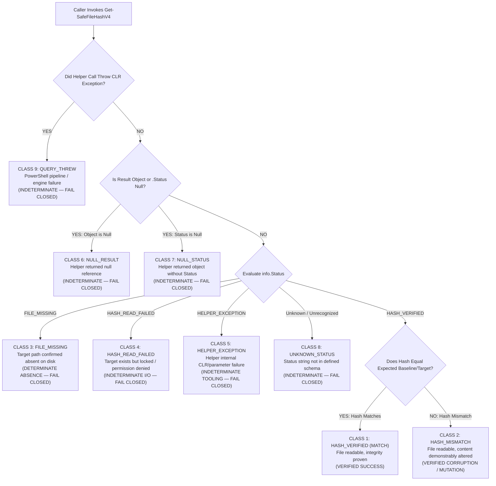
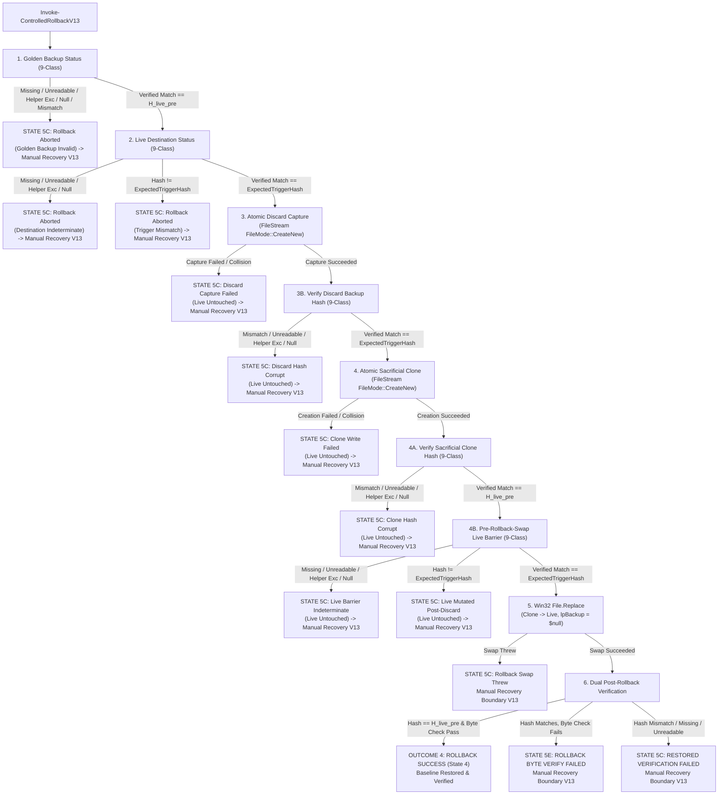

# MUSE SPARK — ZENTRA STEP 2D-2A-AM
## PRE-FLIGHT STATUS CLASSIFICATION & MANUAL RECOVERY SAFETY AUDIT — DOCUMENTATION ONLY

**Project:** ZENTRA — Hi-Tech Lab Field Service Management Platform  
**Target Repository:** `D:\Zentra`  
**Input References:**  
- [`docs/MUSE_SPARK_STEP2D_2A_AL_EXCEPTION_CONTAINMENT_AUDIT_REPORT.md`](file:///d:/Zentra/docs/MUSE_SPARK_STEP2D_2A_AL_EXCEPTION_CONTAINMENT_AUDIT_REPORT.md)  
- [`docs/MUSE_SPARK_STEP2D_2A_AK_FINAL_SNAPSHOT_INTEGRITY_AUDIT_REPORT.md`](file:///d:/Zentra/docs/MUSE_SPARK_STEP2D_2A_AK_FINAL_SNAPSHOT_INTEGRITY_AUDIT_REPORT.md)  
- [`docs/MUSE_SPARK_STEP2D_2A_AJ_REPLACEMENT_COLLISION_AND_STATE_CORRECTION_REPORT.md`](file:///d:/Zentra/docs/MUSE_SPARK_STEP2D_2A_AJ_REPLACEMENT_COLLISION_AND_STATE_CORRECTION_REPORT.md)  
**Host Environment:** Windows Workstation (`127.0.0.1:5432`)  
**Report Date:** 2026-10-09  
**Mode:** STRICT DOCUMENTATION-ONLY SPECIFICATION AUDIT & RUNBOOK FINALIZATION  
**Budget Constraint:** Strict ₹0/month (Zero cost, no credit cards, no paid upgrades)  
**Remote Access:** STRICTLY PROHIBITED (Zero remote connections made)  
**Execution Authorization:** NOT GRANTED — NO COMMANDS EXECUTED IN THIS STEP  
**Status:** COMPLETE — WAITING FOR HUMAN OPERATOR REVIEW  

---

## 1. Executive Summary & Verdict

In **Step 2D-2A-AL**, the Universal Layer-2 Caller Exception Containment Pattern was introduced across all helper calls, ensuring that internal exceptions in `Get-SafeFileHashV4` were trapped and reported as structured errors rather than crashing the PowerShell pipeline.

However, an exhaustive systems and operational audit of the Step AL specification identified two critical architectural defects that compromised forensic accuracy and operator safety:

1. **Pre-Flight & Barrier Status Conflation:**
   In `Invoke-SafeConfigReplacementV14`, several pre-flight and pre-swap verification blocks conflated completely distinct failure modes under misleading generic labels:
   - At `PF-1` (Live pre-hash) and `PF-1B` (Candidate pre-hash), any non-verified status (`FILE_MISSING`, `HASH_READ_FAILED`, `HELPER_EXCEPTION`, unknown status) was lumped into `PREFLIGHT_LIVE_FAILED` or `PREFLIGHT_CAND_FAILED`.
   - At `PF-3` (Golden backup verification), if the backup file was missing, locked by another process, or encountered a helper failure, the script threw `PREFLIGHT_BACKUP_CORRUPT`. Labeling an I/O lock, permission failure, or missing file as "corrupt" misleads root-cause investigations. True corruption exists *only* when the file is successfully read, its hash computed, and the hash demonstrably mismatches the baseline.
   - At `PF-4A` and `PF-4B` (Immediate pre-swap barriers), non-verified statuses (such as helper errors or unknown statuses) were conflated with `PRE_SWAP_CANDIDATE_MUTATED` or `PRE_SWAP_LIVE_MUTATED`. A file lock or internal tooling fault is an indeterminate state, not proof of content mutation.

2. **Unsafe Manual Recovery Instructions (`Enter-ManualRecoveryBoundaryV12`):**
   The manual recovery boundary in Step AL output raw instructions recommending:
   `Copy-Item -Path '$BackupPath' -Destination '$LivePath'`
   as an immediate operator action. This is a severe operational hazard:
   - **Non-Atomic Destruction:** In Windows user mode, `Copy-Item` uses standard Win32 file streaming (`CreateFileW` + `WriteFile`). It is non-atomic. If a crash, disk full condition, or anti-virus interception occurs midway through the copy, the live configuration file is left truncated or corrupt, escalating a configuration failure into an unrecoverable database cluster crash.
   - **Bypasses Human Authorization Gate:** Presenting a copy command directly to the terminal operator encourages immediate copy-paste execution, bypassing the mandatory Incident Commander Human Approval Gate (Gate 6).
   - **Lacks Pre-Restoration Live Forensics:** It did not require capturing the current state and bytes of the broken live file before overwriting it, destroying volatile forensic evidence.
   - **No Independent Hash Assertion:** It did not mandate an independent hash verification of the Golden Backup prior to writing.

This report, **Step 2D-2A-AM**, corrects these defects:
- Establishes the **Universal 9-Class Status Classification Taxonomy**, enforcing unambiguous, deterministic status reporting across all pre-flight, barrier, swap, post-swap, and rollback inspections.
- Redesigns the manual recovery boundary (`Enter-ManualRecoveryBoundaryV13`) to eliminate raw `Copy-Item` snippets, require mandatory Human Incident Commander approval, enforce pre-restoration forensic capture, mandate independent baseline hash assertions, and reference a formal, reviewed recovery procedure.
- Publishes hardened operational engines: `Invoke-SafeConfigReplacementV15`, `Invoke-ControlledRollbackV13`, and `Enter-ManualRecoveryBoundaryV13`.
- Expands the fault-injection matrix from 30 to **38 exhaustive scenarios**, proving fail-closed containment across every class of file, tooling, and diagnostic failure.

> [!IMPORTANT]
> **Strict Documentation-Only Boundary:** Zero operational commands or configuration changes were executed during this step. Zero configuration files (`postgresql.conf`, `pg_hba.conf`), firewall rules, Windows services, application files, or `.env` files were modified. Zero databases or roles were created. All operational procedures in this document are strictly **[NOT EXECUTED — UNTESTED]**.

---

## 2. Section 1 — Findings with Function & Line References from Step AL

The following defects were identified in `docs/MUSE_SPARK_STEP2D_2A_AL_EXCEPTION_CONTAINMENT_AUDIT_REPORT.md`:

| Finding ID | Script & Location in Step AL | Defect Description | Technical Failure Mode | Mandatory Correction in Step 2D-2A-AM |
|---|---|---|---|---|
| **FIND-AM1** | `Invoke-SafeConfigReplacementV14`<br/>Lines 774–776 | `PF-1` lumps missing file, read lock, helper error, and unknown status under generic `PREFLIGHT_LIVE_FAILED`. | Operator cannot determine whether live file is absent, locked by PostgreSQL, or if PowerShell helper failed. | Disentangle into `PREFLIGHT_LIVE_MISSING`, `PREFLIGHT_LIVE_UNREADABLE`, `PREFLIGHT_LIVE_HELPER_EXCEPTION`, `PREFLIGHT_LIVE_UNKNOWN_STATUS`. |
| **FIND-AM2** | `Invoke-SafeConfigReplacementV14`<br/>Lines 794–796 | `PF-1B` lumps missing file, read lock, helper error, and unknown status under generic `PREFLIGHT_CAND_FAILED`. | Staging directory permission or file disappearance misdiagnosed as generic failure. | Disentangle into `PREFLIGHT_CAND_MISSING`, `PREFLIGHT_CAND_UNREADABLE`, `PREFLIGHT_CAND_HELPER_EXCEPTION`, `PREFLIGHT_CAND_UNKNOWN_STATUS`. |
| **FIND-AM3** | `Invoke-SafeConfigReplacementV14`<br/>Lines 851–855 | `PF-3` labels any non-verified status (`FILE_MISSING`, `HASH_READ_FAILED`, `HELPER_EXCEPTION`) as `PREFLIGHT_BACKUP_CORRUPT`. | Filesystem permission denied or file handle lock falsely flagged as data corruption. | Restrict `PREFLIGHT_BACKUP_CORRUPT` strictly to `HASH_VERIFIED` with hash mismatch; branch missing, unreadable, helper exception independently. |
| **FIND-AM4** | `Invoke-SafeConfigReplacementV14`<br/>Lines 885–887 | `PF-4A` fallback branch treats non-verified statuses (e.g., `HELPER_EXCEPTION`, unknown) as `PRE_SWAP_CANDIDATE_MUTATED`. | Tooling crash immediately prior to swap falsely reported as candidate tampering. | Add explicit branches for `HELPER_EXCEPTION` and unknown status; reserve mutation strictly for hash mismatch. |
| **FIND-AM5** | `Invoke-SafeConfigReplacementV14`<br/>Lines 910–912 | `PF-4B` fallback branch treats non-verified statuses (e.g., `HELPER_EXCEPTION`, unknown) as `PRE_SWAP_LIVE_MUTATED`. | Tooling crash immediately prior to swap falsely reported as live file tampering. | Add explicit branches for `HELPER_EXCEPTION` and unknown status; reserve mutation strictly for hash mismatch. |
| **FIND-AM6** | `Invoke-SafeConfigReplacementV14`<br/>Lines 1033–1036 | Post-replacement inspection treats missing, unreadable, and helper errors identically under generic string formatting. | Loss of granular state classification in post-swap verification path. | Disentangle into explicit `TARGET_FILE_MISSING`, `TARGET_FILE_UNREADABLE`, and `TOOLING_EXCEPTION_HALT` branches. |
| **FIND-AM7** | `Enter-ManualRecoveryBoundaryV12`<br/>Lines 1170–1178 | Manual recovery instructions provide raw executable `Copy-Item` command without human gate, baseline check, or live forensics. | Operator may blindly execute non-atomic overwrite, destroying volatile forensic evidence or compounding corruption. | Eliminate raw `Copy-Item` command; require Incident Commander Human Approval (Gate 6); require live forensic capture and independent SHA-256 verification; reference formal reviewed runbook. |

---

## 3. Section 2 — Universal 9-Class Status Classification Taxonomy

To ensure that every caller interprets hash inspection results deterministically and that no unreadable or missing file is ever labeled as content corruption or mutation, all components must adhere to the **Universal 9-Class Status Classification Taxonomy**:



### 3.1 Formal Definition of the 9 Classes

| Class ID | Taxonomy Name | Underlying Condition | Live File State | Automated Rollback Allowed? | Machine State & Action |
|---|---|---|---|---|---|
| **CLASS 1** | `HASH_VERIFIED (MATCH)` | File is readable, SHA-256 computed and matches expected hash. | Pristine / Expected | **NO** (Success path or no-op) | Continue normal execution or clean exit. |
| **CLASS 2** | `HASH_MISMATCH` | File is readable, SHA-256 computed and differs from expected hash. | Demonstrably Altered / Corrupt | **YES** (Only in Stage 2/3 if target was altered) | Flag content corruption or mutation. Trigger rollback if in Stage 3. |
| **CLASS 3** | `FILE_MISSING` | File confirmed absent on disk (`Test-Path = $false`). | Absent from Disk | **NO** (Atomic swap impossible) | Halt fail-closed to manual recovery (`STATE 5A`). |
| **CLASS 4** | `HASH_READ_FAILED` | File exists on disk but locked by another process (e.g. PostgreSQL daemon) or access denied. | Indeterminate (Locked / Inaccessible) | **NO** (Cannot prove content or state) | Halt fail-closed to manual recovery (`STATE 5B`). |
| **CLASS 5** | `HELPER_EXCEPTION` | `Get-SafeFileHashV4` caught an internal CLR, cryptographic, or argument exception. | Indeterminate (Tooling Failure) | **NO** (Tooling cannot verify disk) | Halt fail-closed to manual recovery (`STATE 5F`). |
| **CLASS 6** | `NULL_RESULT` | `Get-SafeFileHashV4` returned `$null`. | Indeterminate | **NO** (Tooling output invalid) | Halt fail-closed to manual recovery (`STATE 5D`). |
| **CLASS 7** | `NULL_STATUS` | `Get-SafeFileHashV4` returned an object where `$info.Status` is null or empty. | Indeterminate | **NO** (Tooling output invalid) | Halt fail-closed to manual recovery (`STATE 5D`). |
| **CLASS 8** | `UNKNOWN_STATUS` | `$info.Status` contains an unrecognized string not in the defined contract. | Indeterminate | **NO** (Protocol violation) | Halt fail-closed to manual recovery (`STATE 5D`). |
| **CLASS 9** | `QUERY_THREW` | Invoking the helper threw an unhandled terminating exception in the caller's pipeline. | Indeterminate | **NO** (Runtime execution fault) | Halt fail-closed to manual recovery (`STATE 5F`). |

### 3.2 Granular Barrier Mappings in Replacement Engine

In `Invoke-SafeConfigReplacementV15`, every verification barrier maps the 9 classes to distinct, non-conflated error codes:

| Verification Stage | Helper Target | Class 1 (Match) | Class 2 (Mismatch) | Class 3 (Missing) | Class 4 (Unreadable) | Class 5 (Helper Exc) | Classes 6–8 (Null/Unknown) | Class 9 (Query Threw) |
|---|---|---|---|---|---|---|---|---|
| **PF-1** | Live Config Pre-Check | Proceeds to PF-1B | N/A (Baseline recording) | `PREFLIGHT_LIVE_MISSING` | `PREFLIGHT_LIVE_UNREADABLE` | `PREFLIGHT_LIVE_HELPER_EXCEPTION` | `PREFLIGHT_LIVE_NULL_RESULT` / `UNKNOWN_STATUS` | `PREFLIGHT_LIVE_QUERY_THREW` |
| **PF-1B** | Candidate Pre-Check | Proceeds to PF-2 | N/A (Baseline recording) | `PREFLIGHT_CAND_MISSING` | `PREFLIGHT_CAND_UNREADABLE` | `PREFLIGHT_CAND_HELPER_EXCEPTION` | `PREFLIGHT_CAND_NULL_RESULT` / `UNKNOWN_STATUS` | `PREFLIGHT_CAND_QUERY_THREW` |
| **PF-3** | Golden Backup Verify | Proceeds to Stage 2 | `PREFLIGHT_BACKUP_HASH_MISMATCH` | `PREFLIGHT_BACKUP_MISSING` | `PREFLIGHT_BACKUP_UNREADABLE` | `PREFLIGHT_BACKUP_HELPER_EXCEPTION` | `PREFLIGHT_BACKUP_NULL_RESULT` / `UNKNOWN_STATUS` | `PREFLIGHT_BACKUP_QUERY_THREW` |
| **PF-4A** | Pre-Swap Candidate | Proceeds to PF-4B | `PRE_SWAP_CANDIDATE_MUTATED` | `PRE_SWAP_CAND_MISSING` | `PRE_SWAP_CAND_UNREADABLE` | `PRE_SWAP_CAND_HELPER_EXCEPTION` | `PRE_SWAP_CAND_NULL_RESULT` / `UNKNOWN_STATUS` | `PRE_SWAP_CAND_QUERY_THREW` |
| **PF-4B** | Pre-Swap Live Config | Proceeds to Swap | `PRE_SWAP_LIVE_MUTATED` | `PRE_SWAP_LIVE_MISSING` | `PRE_SWAP_LIVE_UNREADABLE` | `PRE_SWAP_LIVE_HELPER_EXCEPTION` | `PRE_SWAP_LIVE_NULL_RESULT` / `UNKNOWN_STATUS` | `PRE_SWAP_LIVE_QUERY_THREW` |
| **Stage 2 (Throw)** | Live After Swap Throw | State 2A (Untouched Exit) | State 3 (Trigger Rollback) | State 5A (Missing) | State 5B (Unreadable) | State 5F (Tooling Error) | State 5D (Unknown/Null) | State 5F (Query Threw) |
| **Stage 3 (Post)** | Live Post-Swap Check | State 1 (Verify Promoted) | State 3 (Trigger Rollback) | State 5A (Missing) | State 5B (Unreadable) | State 5F (Tooling Error) | State 5D (Unknown/Null) | State 5F (Query Threw) |

---

## 4. Section 3 — Revised Manual Recovery Safety Requirements

### 4.1 Inherent Risks of Direct Command Execution

In previous iterations, the manual recovery boundary printed executable command lines such as:
```powershell
# UNSAFE PREVIOUS RECOMMENDATION:
Copy-Item -Path '$BackupPath' -Destination '$LivePath'
```
This pattern presents severe operational vulnerabilities in a shared PostgreSQL database cluster:

1. **Non-Atomic File Streaming:** Win32 `CopyFileEx` or .NET `File.Copy` (used by `Copy-Item`) opens the destination file, truncates it to 0 bytes, and writes chunks sequentially. If the system crashes, storage stalls, or another process attempts to read during this multi-millisecond operation, the live configuration file is left corrupt or zero-byte truncated.
2. **PostgreSQL Daemon Contention:** If the PostgreSQL daemon (`postgres.exe`) holds an active read lock or attempts to re-read configuration during a `Copy-Item` operation, the copy fails with `ERROR_SHARING_VIOLATION` midway through writing, leaving the database cluster unable to restart.
3. **Destruction of Volatile Forensics:** Overwriting `$LivePath` immediately destroys the failed live file on disk. Without first capturing a byte-exact forensic clone and recording its cryptographic digest, root-cause analysis is impossible.
4. **Bypasses Human Authorization Gate:** An automated script outputting copy-paste commands bypasses the mandatory Incident Commander Human Approval Gate (Gate 6).

### 4.2 The Seven Mandatory Manual Recovery Invariants

To guarantee that human intervention cannot compound an outage, the manual recovery framework enforces seven strict invariants:

1. **Zero Raw Automatic One-Liners:** The manual recovery boundary must *never* output unverified, directly executable copy commands.
2. **Mandatory Human Incident Commander Approval (Gate 6):** Any manual filesystem restoration requires formal sign-off from the designated Human Incident Commander after reviewing diagnostic output.
3. **Pre-Restoration Live Forensics Quarantine:** Before touching or restoring the live configuration path, the operator must record the current live file status, hash, and (if readable) capture a forensic snapshot to `$LiveConfigPath.forensic_quarantine.<timestamp>`.
4. **Independent Golden Backup SHA-256 Re-Verification:** The Golden Backup must be independently hashed by the operator using standard OS tools (`Get-FileHash -Algorithm SHA256`) and verified to match the pristine baseline hash ($H_{\text{live\_pre}}$) before restoration.
5. **PostgreSQL Daemon Process & Service Assertion:** The operator must verify whether PostgreSQL processes are currently running and inspect the Windows Service status (`postgresql-x64-18`) before attempting any filesystem changes.
6. **Prohibition of Direct Non-Atomic Overwrite:** Direct `Copy-Item` or `cp` overwrite is explicitly prohibited. Manual restoration must use atomic staging (writing to a verified staging candidate and performing an atomic replace) or verified offline replacement when the service is stopped.
7. **Formally Reviewed Recovery Procedure Reference:** The manual recovery boundary must instruct the operator to consult a formally reviewed, human-executed operational runbook (`Invoke-HumanApprovedAtomicRestoration`), rather than improvised terminal commands.

---

## 5. Section 4 — Updated State-Transition & Artifact-Lifecycle Matrices

### 5.1 Updated Promotion State Machine Flowchart

```mermaid
flowchart TD
    Start["Invoke-SafeConfigReplacementV15"] --> PF0["PF-0: Test-CandidateByteAndEncodingIntegrity"]
    PF0 -->|Byte/CRLF Check Fails| HaltPF0["FAIL-CLOSED ABORT [PREFLIGHT_CANDIDATE_INVALID]<br/>(Live Untouched, Zero Backups)"]
    
    PF0 -->|Byte/CRLF Check Passes| PF1["PF-1: Live Pre-Change Hash Inspection"]
    PF1 -->|Missing / Unreadable / Helper Exc / Null / Unknown| HaltPF1["FAIL-CLOSED ABORT [PREFLIGHT_LIVE_*]<br/>(Live Untouched, Zero Backups)"]
    
    PF1 -->|Verified H_live_pre| PF1B["PF-1B: Candidate Pre-Change Hash Inspection"]
    PF1B -->|Missing / Unreadable / Helper Exc / Null / Unknown| HaltPF1B["FAIL-CLOSED ABORT [PREFLIGHT_CAND_*]<br/>(Live Untouched, Zero Backups)"]
    
    PF1B -->|Verified H_cand_pre| PF2["PF-2: Atomic Golden Backup Creation<br/>(FileStream FileMode::CreateNew)"]
    PF2 -->|Collision / Write Error| HaltPF2["FAIL-CLOSED ABORT [PREFLIGHT_COLLISION / WRITE_FAILED]<br/>(Live Untouched)"]
    
    PF2 -->|Write Succeeded| PF3["PF-3: Golden Backup Hash Verification"]
    PF3 -->|Hash Mismatch (Class 2)| HaltPF3_Mis["FAIL-CLOSED ABORT [PREFLIGHT_BACKUP_HASH_MISMATCH]<br/>(Live Untouched, Retain Corrupt Backup)"]
    PF3 -->|Missing / Unreadable / Helper Exc / Null| HaltPF3_Err["FAIL-CLOSED ABORT [PREFLIGHT_BACKUP_*]<br/>(Live Untouched, Retain All Artifacts)"]
    
    PF3 -->|Verified H_live_pre| PF4A["PF-4A: Pre-Swap Candidate Verification Barrier"]
    PF4A -->|Hash Mismatch (Class 2)| HaltPF4A_Mut["FAIL-CLOSED ABORT [PRE_SWAP_CANDIDATE_MUTATED]<br/>(Live Untouched)"]
    PF4A -->|Missing / Unreadable / Helper Exc / Null| HaltPF4A_Err["FAIL-CLOSED ABORT [PRE_SWAP_CAND_*]<br/>(Live Untouched)"]
    
    PF4A -->|Verified H_cand_pre| PF4B["PF-4B: Pre-Swap Live Verification Barrier"]
    PF4B -->|Hash Mismatch (Class 2)| HaltPF4B_Mut["FAIL-CLOSED ABORT [PRE_SWAP_LIVE_MUTATED]<br/>(Live Untouched)"]
    PF4B -->|Missing / Unreadable / Helper Exc / Null| HaltPF4B_Err["FAIL-CLOSED ABORT [PRE_SWAP_LIVE_*]<br/>(Live Untouched)"]
    
    PF4B -->|Verified H_live_pre| Swap["Stage 2: Win32 File.Replace<br/>(Candidate -> Live, lpBackup = $null)"]
    
    Swap -->|Replace Throws| InspectSwapThrow["Inspect Live File (Get-SafeFileHashV4)"]
    InspectSwapThrow -->|Verified Hash == H_live_pre| State2A["OUTCOME 1: TARGET UNTOUCHED (State 2A)<br/>Clean Fail-Closed Exit"]
    InspectSwapThrow -->|Verified Hash != H_live_pre| State3_1["STATE 3: TARGET ALTERED READABLE<br/>Trigger Controlled Rollback V13"]
    InspectSwapThrow -->|Missing / Unreadable / Helper Exc / Null| State5_1["STATE 5A / 5B / 5F / 5D: INDETERMINATE<br/>Halt to Manual Recovery V13"]
    
    Swap -->|Replace Succeeded| Stage3Inspect["Stage 3: Post-Replacement Hash Inspection"]
    Stage3Inspect -->|Verified Hash == H_cand_pre| Stage3Byte{"Post-Swap Byte & CRLF Check"}
    Stage3Byte -->|Passed| State1["OUTCOME 2: PROMOTION SUCCESS (State 1)<br/>Verified on Disk"]
    Stage3Byte -->|Failed| State3_2["STATE 3: TARGET ALTERED READABLE<br/>Trigger Controlled Rollback V13"]
    Stage3Inspect -->|Verified Hash == H_live_pre| State2B["OUTCOME 1: TARGET UNCHANGED NO-OP (State 2B)<br/>Clean Fail-Closed Exit"]
    Stage3Inspect -->|Verified Hash != H_cand_pre & != H_live_pre| State3_3["STATE 3: TARGET ALTERED READABLE<br/>Trigger Controlled Rollback V13"]
    Stage3Inspect -->|Missing / Unreadable / Helper Exc / Null| State5_2["STATE 5A / 5B / 5F / 5D: INDETERMINATE<br/>Halt to Manual Recovery V13"]
    
    State3_1 --> Rollback["Invoke-ControlledRollbackV13"]
    State3_2 --> Rollback
    State3_3 --> Rollback
```

### 5.2 Updated Controlled Rollback State Machine Flowchart



### 5.3 Authoritative Post-Swap Authorization Rules Matrix

| Scenario / Post-Swap Condition | Live File State on Disk | Verification Result / Evidence | Automatic Rollback Authorized? | Resulting Machine State & Action | Forensic Evidence Retained |
|---|---|---|---|---|---|
| **Swap Throws & Hash Matches Baseline** | **Untouched** | `Get-SafeFileHashV4` returns `HASH_VERIFIED` with $H = H_{\text{live\_pre}}$. | **NO** (Rollback redundant and unsafe). | `STATE 2A: TARGET_UNTOUCHED_THROWN`<br/>Clean fail-closed exit. | Candidate, Golden Backup. |
| **Swap Throws & Hash Altered** | **Altered** | `Get-SafeFileHashV4` returns `HASH_VERIFIED` with $H \neq H_{\text{live\_pre}}$. | **YES** (Target readable and demonstrably altered). | `STATE 3: TARGET_ALTERED_READABLE`<br/>Invoke `Invoke-ControlledRollbackV13`. | Candidate, Golden Backup, Discard Backup. |
| **Swap Succeeds & Hash Matches Baseline** | **Unchanged (No-Op)** | `Get-SafeFileHashV4` returns `HASH_VERIFIED` with $H = H_{\text{live\_pre}}$. | **NO** (Target already at pristine baseline). | `STATE 2B: TARGET_UNTOUCHED_NOOP`<br/>Clean fail-closed exit. | Candidate, Golden Backup. |
| **Swap Succeeds & Matches Candidate** | **Promoted** | Hash equals $H_{\text{cand\_pre}}$ AND strict byte/CRLF check passes. | **NO** (Terminal success). | `STATE 1: VERIFIED_PROMOTED`<br/>Promotion verified. | Candidate (Consumed), Golden Backup. |
| **Swap Succeeds, Candidate Hash Matches, Byte Check Fails** | **Corrupt Byte Format** | Hash equals $H_{\text{cand\_pre}}$, but byte check detects bare LF or invalid UTF-8. | **YES** (Target readable, but corrupt format). | `STATE 3: TARGET_ALTERED_READABLE`<br/>Invoke `Invoke-ControlledRollbackV13`. | Candidate, Golden Backup, Discard Backup. |
| **Swap Succeeds, Hash Matches Neither** | **Corrupt Content** | Hash differs from both $H_{\text{cand\_pre}}$ and $H_{\text{live\_pre}}$. | **YES** (Target readable, demonstrably altered). | `STATE 3: TARGET_ALTERED_READABLE`<br/>Invoke `Invoke-ControlledRollbackV13`. | Candidate, Golden Backup, Discard Backup. |
| **Swap Throws/Succeeds, Target Missing** | **Missing** | `Get-SafeFileHashV4` returns `FILE_MISSING`. | **NO** (Win32 replace impossible without destination). | `STATE 5A: TARGET_FILE_MISSING`<br/>Halt to Manual Recovery. | All existing artifacts. |
| **Swap Throws/Succeeds, Target Locked** | **Unreadable** | `Get-SafeFileHashV4` returns `HASH_READ_FAILED`. | **NO** (Destination state INDETERMINATE). | `STATE 5B: TARGET_FILE_UNREADABLE`<br/>Halt to Manual Recovery. | All existing artifacts. |
| **Swap Throws/Succeeds, Helper Fails** | **Unknown** | Helper returns `HELPER_EXCEPTION`, `$null`, or throws. | **NO** (Tooling state INDETERMINATE). | `STATE 5F: TOOLING_EXCEPTION_HALT`<br/>Halt to Manual Recovery. | All existing artifacts. |
| **Swap Throws/Succeeds, Unknown Status** | **Unknown** | Helper returns status string outside defined schema. | **NO** (State INDETERMINATE). | `STATE 5D: UNKNOWN_STATUS_HALT`<br/>Halt to Manual Recovery. | All existing artifacts. |

### 5.4 Authoritative Artifact Lifecycle & Forensic Retention Matrix

| Lifecycle Event / Branch | Candidate File (`$CandidatePath`) | Golden Backup (`$goldenBackupPath`) | Sacrificial Clone (`$sacrificialPath`) | Discard Backup (`$discardBackup`) | Live File State | Rollback Allowed? | Manual Recovery Reason |
|---|---|---|---|---|---|---|---|
| **PF-0: Candidate Validation Fail** | **Retained on disk** | **Not Created** | **Not Created** | **Not Created** | Untouched | **NO** | Not required (Pre-flight abort). |
| **PF-1: Live Missing / Locked / Error**| **Retained on disk** | **Not Created** | **Not Created** | **Not Created** | Untouched / Locked | **NO** | Not required (Pre-flight abort). |
| **PF-1B: Candidate Missing / Locked** | **Retained on disk** | **Not Created** | **Not Created** | **Not Created** | Untouched | **NO** | Not required (Pre-flight abort). |
| **PF-2: Backup Collision / Write Fail**| **Retained on disk** | **Partial Retained** | **Not Created** | **Not Created** | Untouched | **NO** | Not required (Disk failure check). |
| **PF-3: Backup Hash Mismatch** | **Retained on disk** | **Corrupt Retained** | **Not Created** | **Not Created** | Untouched | **NO** | Not required (Storage controller check). |
| **PF-3: Backup Missing / Locked / Err** | **Retained on disk** | **Retained on disk** | **Not Created** | **Not Created** | Untouched | **NO** | Not required (Pre-flight abort). |
| **PF-4A: Pre-Swap Cand Mutated** | **Retained on disk** | **Retained on disk** | **Not Created** | **Not Created** | Untouched | **NO** | Not required (Pre-flight abort). |
| **PF-4A: Pre-Swap Cand Error / Locked**| **Retained on disk** | **Retained on disk** | **Not Created** | **Not Created** | Untouched | **NO** | Not required (Pre-flight abort). |
| **PF-4B: Pre-Swap Live Mutated** | **Retained on disk** | **Retained on disk** | **Not Created** | **Not Created** | Altered external | **NO** | Not required (Pre-flight abort). |
| **PF-4B: Pre-Swap Live Error / Locked**| **Retained on disk** | **Retained on disk** | **Not Created** | **Not Created** | Untouched / Locked | **NO** | Not required (Pre-flight abort). |
| **State 2A: Replace Threw Untouched** | **Retained on disk** | **Retained on disk** | **Not Created** | **Not Created** | Untouched | **NO** | Not required (Clean fail-closed exit). |
| **State 2B: Replace No-Op Untouched** | **Retained on disk** | **Retained on disk** | **Not Created** | **Not Created** | Untouched | **NO** | Not required (Clean fail-closed exit). |
| **State 1: Promotion Success** | **Consumed (Live)** | **Retained on disk** | **Not Created** | **Not Created** | Promoted | **NO** | Not required (Normal completion). |
| **State 4: Rollback Success** | **Retained on disk** | **Retained on disk** | **Consumed (Live)** | **Retained on disk** | Restored Baseline| **NO** | Not required (Rollback succeeded). |
| **R-1: Discard Capture Failed** | **Retained on disk** | **Retained on disk** | **Not Created** | **Partial Retained**| Altered | **NO** | Discard backup write failed. |
| **R-2: Discard Hash Mismatch** | **Retained on disk** | **Retained on disk** | **Not Created** | **Retained on disk** | Altered | **NO** | Discard hash != trigger hash. |
| **R-3: Clone Creation Failed** | **Retained on disk** | **Retained on disk** | **Partial Retained**| **Retained on disk** | Altered | **NO** | Sacrificial clone write failed. |
| **R-4: Clone Hash Corrupt** | **Retained on disk** | **Retained on disk** | **Retained on disk** | **Retained on disk** | Altered | **NO** | Clone hash != baseline hash. |
| **R-5: Pre-Swap Live Mutated** | **Retained on disk** | **Retained on disk** | **Retained on disk** | **Retained on disk** | Altered newer | **NO** | Live destination mutated post-discard. |
| **R-6: Pre-Swap Live Unreadable** | **Retained on disk** | **Retained on disk** | **Retained on disk** | **Retained on disk** | Indeterminate | **NO** | Live destination locked pre-swap. |
| **State 5A: Target Missing** | **Retained on disk** | **Retained on disk** | **Not Created** | **Not Created** | Missing | **NO** | Target configuration missing. |
| **State 5B: Target Unreadable** | **Retained on disk** | **Retained on disk** | **Not Created** | **Not Created** | Indeterminate | **NO** | Target configuration locked. |
| **State 5C: Rollback Failed** | **Retained on disk** | **Retained on disk** | **Retained on disk** | **Retained on disk** | Indeterminate | **NO** | Rollback swap threw exception. |
| **State 5D: Unknown / Null State** | **Retained on disk** | **Retained on disk** | **Not Created** | **Not Created** | Indeterminate | **NO** | Helper returned unrecognized/null status. |
| **State 5E: Byte Verify Failed** | **Retained on disk** | **Retained on disk** | **Consumed (Live)** | **Retained on disk** | Corrupt bytes | **NO** | Restored file has byte formatting error. |
| **State 5F: Tooling Exception** | **Retained on disk** | **Retained on disk** | **Not Created** | **Not Created** | Indeterminate | **NO** | CLR/engine exception during inspection. |

---

## 6. Section 5 — Hardened Proposed Operational Scripts (V15 / V13)

### 6.1 Fully Contained Rollback Engine (`Invoke-ControlledRollbackV13`)

```powershell
# [NOT EXECUTED — UNTESTED OPERATIONAL PROCEDURE]

function Invoke-ControlledRollbackV13 {
    <#
    .SYNOPSIS
        Safely restores a configuration file using a sacrificial clone of the golden backup.
        Enforces Universal 9-Class Status Classification, dual discard verification,
        pre-swap lock assertions, and lpBackupFileName = $null.
    #>
    param (
        [Parameter(Mandatory = $true)]
        [string]$LiveConfigPath,

        [Parameter(Mandatory = $true)]
        [string]$GoldenBackupPath,

        [Parameter(Mandatory = $true)]
        [string]$ExpectedBaselineHash,

        [Parameter(Mandatory = $true)]
        [string]$ExpectedTriggerHash,

        [System.Exception]$InitialError
    )

    Write-Warning "=== INITIATING CONTROLLED ROLLBACK V13 ==="

    # -------------------------------------------------------------
    # 1. EVALUATE GOLDEN BACKUP STATUS (9-CLASS CLASSIFICATION)
    # -------------------------------------------------------------
    $gbInfo = $null
    $gbQueryError = $null
    try {
        $gbInfo = Get-SafeFileHashV4 -FilePath $GoldenBackupPath
    }
    catch {
        $gbQueryError = $_.Exception
    }

    if ($gbQueryError -ne $null) {
        return [PSCustomObject]@{
            Success       = $false
            Status        = "GOLDEN_BACKUP_QUERY_THREW"
            Message       = "Querying golden backup threw an unexpected exception: $($gbQueryError.Message)"
            DiscardBackup = $null
            Error         = $gbQueryError
        }
    }

    if ($gbInfo -eq $null) {
        return [PSCustomObject]@{
            Success       = $false
            Status        = "GOLDEN_BACKUP_NULL_RESULT"
            Message       = "Querying golden backup returned a null result object."
            DiscardBackup = $null
            Error         = $null
        }
    }

    if ($gbInfo.Status -eq $null) {
        return [PSCustomObject]@{
            Success       = $false
            Status        = "GOLDEN_BACKUP_NULL_STATUS"
            Message       = "Querying golden backup returned an object with a null Status property."
            DiscardBackup = $null
            Error         = $null
        }
    }

    switch ($gbInfo.Status) {
        "FILE_MISSING" {
            return [PSCustomObject]@{
                Success       = $false
                Status        = "GOLDEN_BACKUP_MISSING"
                Message       = "Golden backup file [$GoldenBackupPath] does not exist on disk."
                DiscardBackup = $null
                Error         = $null
            }
        }
        "HASH_READ_FAILED" {
            return [PSCustomObject]@{
                Success       = $false
                Status        = "GOLDEN_BACKUP_UNREADABLE"
                Message       = "Golden backup file is locked or access was denied: $($gbInfo.Message)"
                DiscardBackup = $null
                Error         = $gbInfo.Error
            }
        }
        "HELPER_EXCEPTION" {
            return [PSCustomObject]@{
                Success       = $false
                Status        = "GOLDEN_BACKUP_HELPER_EXCEPTION"
                Message       = "Hash helper failed on golden backup: $($gbInfo.Message)"
                DiscardBackup = $null
                Error         = $gbInfo.Error
            }
        }
        "HASH_VERIFIED" {
            if ($gbInfo.Hash -ne $ExpectedBaselineHash) {
                return [PSCustomObject]@{
                    Success       = $false
                    Status        = "GOLDEN_BACKUP_HASH_MISMATCH"
                    Message       = "Golden backup hash [$($gbInfo.Hash)] does not match expected baseline [$ExpectedBaselineHash]."
                    DiscardBackup = $null
                    Error         = $null
                }
            }
        }
        default {
            return [PSCustomObject]@{
                Success       = $false
                Status        = "GOLDEN_BACKUP_UNKNOWN_STATUS"
                Message       = "Golden backup returned unknown status string [$($gbInfo.Status)]."
                DiscardBackup = $null
                Error         = $null
            }
        }
    }

    # -------------------------------------------------------------
    # 2. EVALUATE LIVE DESTINATION STATUS (9-CLASS CLASSIFICATION)
    # -------------------------------------------------------------
    $destInfo = $null
    $destQueryError = $null
    try {
        $destInfo = Get-SafeFileHashV4 -FilePath $LiveConfigPath
    }
    catch {
        $destQueryError = $_.Exception
    }

    if ($destQueryError -ne $null) {
        return [PSCustomObject]@{
            Success       = $false
            Status        = "ROLLBACK_DEST_QUERY_THREW"
            Message       = "Querying live destination threw an unexpected exception: $($destQueryError.Message)"
            DiscardBackup = $null
            Error         = $destQueryError
        }
    }

    if ($destInfo -eq $null) {
        return [PSCustomObject]@{
            Success       = $false
            Status        = "ROLLBACK_DEST_NULL_RESULT"
            Message       = "Querying live destination returned a null result object."
            DiscardBackup = $null
            Error         = $null
        }
    }

    if ($destInfo.Status -eq $null) {
        return [PSCustomObject]@{
            Success       = $false
            Status        = "ROLLBACK_DEST_NULL_STATUS"
            Message       = "Querying live destination returned an object with a null Status property."
            DiscardBackup = $null
            Error         = $null
        }
    }

    switch ($destInfo.Status) {
        "FILE_MISSING" {
            return [PSCustomObject]@{
                Success       = $false
                Status        = "ROLLBACK_DEST_MISSING"
                Message       = "Live destination file is missing prior to rollback. Atomic swap impossible."
                DiscardBackup = $null
                Error         = $null
            }
        }
        "HASH_READ_FAILED" {
            return [PSCustomObject]@{
                Success       = $false
                Status        = "ROLLBACK_DEST_UNREADABLE"
                Message       = "Live destination file is locked or unreadable: $($destInfo.Message)"
                DiscardBackup = $null
                Error         = $destInfo.Error
            }
        }
        "HELPER_EXCEPTION" {
            return [PSCustomObject]@{
                Success       = $false
                Status        = "ROLLBACK_DEST_HELPER_EXCEPTION"
                Message       = "Hash helper failed on live destination: $($destInfo.Message)"
                DiscardBackup = $null
                Error         = $destInfo.Error
            }
        }
        "HASH_VERIFIED" {
            if ($destInfo.Hash -ne $ExpectedTriggerHash) {
                return [PSCustomObject]@{
                    Success       = $false
                    Status        = "ROLLBACK_DEST_TRIGGER_MISMATCH"
                    Message       = "Live destination hash [$($destInfo.Hash)] changed after trigger hash [$ExpectedTriggerHash] was observed."
                    DiscardBackup = $null
                    Error         = $null
                }
            }
        }
        default {
            return [PSCustomObject]@{
                Success       = $false
                Status        = "ROLLBACK_DEST_UNKNOWN_STATUS"
                Message       = "Live destination returned unknown status string [$($destInfo.Status)]."
                DiscardBackup = $null
                Error         = $null
            }
        }
    }

    # -------------------------------------------------------------
    # 3. ATOMIC DISCARD CAPTURE (FileMode::CreateNew)
    # -------------------------------------------------------------
    $uniqueRollbackId = [System.Guid]::NewGuid().ToString("N").Substring(0, 8)
    $rollbackTimestamp = "$((Get-Date).ToString('yyyyMMdd_HHmmss'))_$uniqueRollbackId"
    $discardBackup = "$LiveConfigPath.discard.$rollbackTimestamp"

    $liveBytesForDiscard = $null
    try {
        $liveBytesForDiscard = [System.IO.File]::ReadAllBytes($LiveConfigPath)
    }
    catch {
        return [PSCustomObject]@{
            Success       = $false
            Status        = "DISCARD_CAPTURE_READ_FAILED"
            Message       = "Reading live file bytes for discard capture failed: $($_.Exception.Message)"
            DiscardBackup = $null
            Error         = $_.Exception
        }
    }

    try {
        $discardStream = [System.IO.FileStream]::new(
            $discardBackup,
            [System.IO.FileMode]::CreateNew,
            [System.IO.FileAccess]::Write,
            [System.IO.FileShare]::None
        )
        try {
            $discardStream.Write($liveBytesForDiscard, 0, $liveBytesForDiscard.Length)
        }
        finally {
            $discardStream.Dispose()
        }
    }
    catch {
        return [PSCustomObject]@{
            Success       = $false
            Status        = "DISCARD_CAPTURE_FAILED"
            Message       = "Writing discard backup [$discardBackup] failed: $($_.Exception.Message)"
            DiscardBackup = $discardBackup
            Error         = $_.Exception
        }
    }

    # -------------------------------------------------------------
    # 3B. VERIFY DISCARD BACKUP HASH (9-CLASS CLASSIFICATION)
    # -------------------------------------------------------------
    $discardInfo = $null
    $discardQueryError = $null
    try {
        $discardInfo = Get-SafeFileHashV4 -FilePath $discardBackup
    }
    catch {
        $discardQueryError = $_.Exception
    }

    if ($discardQueryError -ne $null) {
        return [PSCustomObject]@{
            Success       = $false
            Status        = "DISCARD_QUERY_THREW"
            Message       = "Verifying discard backup threw an exception: $($discardQueryError.Message)"
            DiscardBackup = $discardBackup
            Error         = $discardQueryError
        }
    }

    if ($discardInfo -eq $null -or $discardInfo.Status -eq $null) {
        return [PSCustomObject]@{
            Success       = $false
            Status        = "DISCARD_NULL_RESULT"
            Message       = "Verifying discard backup returned a null result object or status."
            DiscardBackup = $discardBackup
            Error         = $null
        }
    }

    if ($discardInfo.Status -ne "HASH_VERIFIED" -or $discardInfo.Hash -ne $ExpectedTriggerHash) {
        return [PSCustomObject]@{
            Success       = $false
            Status        = "DISCARD_HASH_MISMATCH"
            Message       = "Discard backup verification failed ($($discardInfo.Status)): Expected trigger hash $ExpectedTriggerHash, observed $($discardInfo.Hash)."
            DiscardBackup = $discardBackup
            Error         = $discardInfo.Error
        }
    }

    # -------------------------------------------------------------
    # 4. CREATE ATOMIC SACRIFICIAL CLONE (FileMode::CreateNew)
    # -------------------------------------------------------------
    $sacrificialPath = "$GoldenBackupPath.sacrificial.$rollbackTimestamp"
    $goldenBytes = $null
    try {
        $goldenBytes = [System.IO.File]::ReadAllBytes($GoldenBackupPath)
    }
    catch {
        return [PSCustomObject]@{
            Success       = $false
            Status        = "SACRIFICIAL_CLONE_READ_FAILED"
            Message       = "Reading golden backup bytes for sacrificial clone failed: $($_.Exception.Message)"
            DiscardBackup = $discardBackup
            Error         = $_.Exception
        }
    }

    try {
        $sacStream = [System.IO.FileStream]::new(
            $sacrificialPath,
            [System.IO.FileMode]::CreateNew,
            [System.IO.FileAccess]::Write,
            [System.IO.FileShare]::None
        )
        try {
            $sacStream.Write($goldenBytes, 0, $goldenBytes.Length)
        }
        finally {
            $sacStream.Dispose()
        }
    }
    catch {
        return [PSCustomObject]@{
            Success       = $false
            Status        = "SACRIFICIAL_CLONE_CREATION_FAILED"
            Message       = "Creating sacrificial clone [$sacrificialPath] failed: $($_.Exception.Message)"
            DiscardBackup = $discardBackup
            Error         = $_.Exception
        }
    }

    # -------------------------------------------------------------
    # 4A. VERIFY SACRIFICIAL CLONE INTEGRITY (9-CLASS CLASSIFICATION)
    # -------------------------------------------------------------
    $cloneInfo = $null
    $cloneQueryError = $null
    try {
        $cloneInfo = Get-SafeFileHashV4 -FilePath $sacrificialPath
    }
    catch {
        $cloneQueryError = $_.Exception
    }

    if ($cloneQueryError -ne $null) {
        return [PSCustomObject]@{
            Success       = $false
            Status        = "SACRIFICIAL_CLONE_QUERY_THREW"
            Message       = "Querying sacrificial clone threw an unexpected exception: $($cloneQueryError.Message)"
            DiscardBackup = $discardBackup
            Error         = $cloneQueryError
        }
    }

    if ($cloneInfo -eq $null -or $cloneInfo.Status -eq $null) {
        return [PSCustomObject]@{
            Success       = $false
            Status        = "SACRIFICIAL_CLONE_NULL_RESULT"
            Message       = "Querying sacrificial clone returned a null result object or status."
            DiscardBackup = $discardBackup
            Error         = $null
        }
    }

    if ($cloneInfo.Status -ne "HASH_VERIFIED" -or $cloneInfo.Hash -ne $ExpectedBaselineHash) {
        return [PSCustomObject]@{
            Success       = $false
            Status        = "SACRIFICIAL_CLONE_CORRUPT"
            Message       = "Sacrificial clone verification failed ($($cloneInfo.Status)): Expected $ExpectedBaselineHash, observed $($cloneInfo.Hash)."
            DiscardBackup = $discardBackup
            Error         = $cloneInfo.Error
        }
    }

    # -------------------------------------------------------------
    # 4B. IMMEDIATE PRE-ROLLBACK-SWAP LIVE BARRIER (9-CLASS)
    # -------------------------------------------------------------
    $livePreSwapCheck = $null
    $livePreSwapError = $null
    try {
        $livePreSwapCheck = Get-SafeFileHashV4 -FilePath $LiveConfigPath
    }
    catch {
        $livePreSwapError = $_.Exception
    }

    if ($livePreSwapError -ne $null) {
        return [PSCustomObject]@{
            Success       = $false
            Status        = "PRE_ROLLBACK_LIVE_QUERY_THREW"
            Message       = "Pre-rollback live check threw an unexpected exception: $($livePreSwapError.Message)"
            DiscardBackup = $discardBackup
            Error         = $livePreSwapError
        }
    }

    if ($livePreSwapCheck -eq $null -or $livePreSwapCheck.Status -eq $null) {
        return [PSCustomObject]@{
            Success       = $false
            Status        = "PRE_ROLLBACK_LIVE_NULL_RESULT"
            Message       = "Pre-rollback live check returned a null result object or status."
            DiscardBackup = $discardBackup
            Error         = $null
        }
    }

    if ($livePreSwapCheck.Status -eq "FILE_MISSING") {
        return [PSCustomObject]@{
            Success       = $false
            Status        = "PRE_ROLLBACK_LIVE_MISSING"
            Message       = "Live destination disappeared immediately prior to rollback swap."
            DiscardBackup = $discardBackup
            Error         = $null
        }
    }

    if ($livePreSwapCheck.Status -eq "HASH_READ_FAILED") {
        return [PSCustomObject]@{
            Success       = $false
            Status        = "PRE_ROLLBACK_LIVE_UNREADABLE"
            Message       = "Live destination became locked/unreadable immediately prior to rollback swap: $($livePreSwapCheck.Message)"
            DiscardBackup = $discardBackup
            Error         = $livePreSwapCheck.Error
        }
    }

    if ($livePreSwapCheck.Status -eq "HELPER_EXCEPTION") {
        return [PSCustomObject]@{
            Success       = $false
            Status        = "PRE_ROLLBACK_LIVE_HELPER_EXCEPTION"
            Message       = "Hash helper failed on live destination prior to rollback: $($livePreSwapCheck.Message)"
            DiscardBackup = $discardBackup
            Error         = $livePreSwapCheck.Error
        }
    }

    if ($livePreSwapCheck.Status -ne "HASH_VERIFIED" -or $livePreSwapCheck.Hash -ne $ExpectedTriggerHash) {
        return [PSCustomObject]@{
            Success       = $false
            Status        = "LIVE_MUTATED_POST_DISCARD"
            Message       = "Live destination mutated after discard capture: Expected trigger hash $ExpectedTriggerHash, observed $($livePreSwapCheck.Hash)."
            DiscardBackup = $discardBackup
            Error         = $null
        }
    }

    # -------------------------------------------------------------
    # 5. PURE ATOMIC ROLLBACK SWAP (lpBackupFileName = $null)
    # -------------------------------------------------------------
    try {
        [System.IO.File]::Replace($sacrificialPath, $LiveConfigPath, $null, $true)
        Write-Host "[ROLLBACK SWAP SUCCEEDED] Win32 File.Replace restored baseline." -ForegroundColor Green
    }
    catch {
        return [PSCustomObject]@{
            Success       = $false
            Status        = "ROLLBACK_SWAP_EXCEPTION"
            Message       = "Win32 File.Replace threw during rollback: $($_.Exception.Message)"
            DiscardBackup = $discardBackup
            Error         = $_.Exception
        }
    }

    # -------------------------------------------------------------
    # 6. DUAL POST-ROLLBACK VERIFICATION (HASH & BYTE INTEGRITY)
    # -------------------------------------------------------------
    $restoredInfo = $null
    $restoredQueryError = $null
    try {
        $restoredInfo = Get-SafeFileHashV4 -FilePath $LiveConfigPath
    }
    catch {
        $restoredQueryError = $_.Exception
    }

    if ($restoredQueryError -ne $null) {
        return [PSCustomObject]@{
            Success       = $false
            Status        = "RESTORED_QUERY_THREW"
            Message       = "Querying restored live file threw an unexpected exception: $($restoredQueryError.Message)"
            DiscardBackup = $discardBackup
            Error         = $restoredQueryError
        }
    }

    if ($restoredInfo -eq $null -or $restoredInfo.Status -eq $null) {
        return [PSCustomObject]@{
            Success       = $false
            Status        = "RESTORED_NULL_RESULT"
            Message       = "Querying restored live file returned a null result object or status."
            DiscardBackup = $discardBackup
            Error         = $null
        }
    }

    if ($restoredInfo.Status -eq "FILE_MISSING") {
        return [PSCustomObject]@{
            Success       = $false
            Status        = "RESTORED_FILE_MISSING"
            Message       = "Restored live file is missing from disk after rollback swap."
            DiscardBackup = $discardBackup
            Error         = $null
        }
    }

    if ($restoredInfo.Status -eq "HASH_READ_FAILED") {
        return [PSCustomObject]@{
            Success       = $false
            Status        = "RESTORED_FILE_UNREADABLE"
            Message       = "Restored live file is locked or unreadable: $($restoredInfo.Message)"
            DiscardBackup = $discardBackup
            Error         = $restoredInfo.Error
        }
    }

    if ($restoredInfo.Status -ne "HASH_VERIFIED") {
        return [PSCustomObject]@{
            Success       = $false
            Status        = "RESTORED_FILE_UNVERIFIABLE"
            Message       = "Restored live file cannot be verified ($($restoredInfo.Status)): $($restoredInfo.Message)"
            DiscardBackup = $discardBackup
            Error         = $restoredInfo.Error
        }
    }

    if ($restoredInfo.Hash -ne $ExpectedBaselineHash) {
        return [PSCustomObject]@{
            Success       = $false
            Status        = "RESTORED_HASH_MISMATCH"
            Message       = "Restored live file hash [$($restoredInfo.Hash)] does not match expected baseline [$ExpectedBaselineHash]."
            DiscardBackup = $discardBackup
            Error         = $null
        }
    }

    # Re-verify byte integrity on restored file
    try {
        Test-CandidateByteAndEncodingIntegrity -FilePath $LiveConfigPath
    }
    catch {
        return [PSCustomObject]@{
            Success       = $false
            Status        = "ROLLBACK_BYTE_VERIFY_FAILED"
            Message       = "Rollback restored matching hash, but byte validation failed: $($_.Exception.Message)"
            DiscardBackup = $discardBackup
            Error         = $_.Exception
        }
    }

    Write-Host "[ROLLBACK VERIFIED] Live configuration restored and verified [SHA256: $($restoredInfo.Hash)]." -ForegroundColor Green
    return [PSCustomObject]@{
        Success       = $true
        Status        = "ROLLBACK_SUCCESS"
        RestoredHash  = $restoredInfo.Hash
        DiscardBackup = $discardBackup
        Message       = "Configuration successfully restored to pre-change state. Discard backup retained."
        Error         = $null
    }
}
```

---

### 6.2 Hardened Configuration Replacement Engine (`Invoke-SafeConfigReplacementV15`)

```powershell
# [NOT EXECUTED — UNTESTED OPERATIONAL PROCEDURE]

function Invoke-SafeConfigReplacementV15 {
    <#
    .SYNOPSIS
        Safely replaces a PostgreSQL configuration file using the Decoupled Backup Architecture.
        Enforces Universal 9-Class Status Classification across all pre-flight and pre-swap barriers,
        preventing any misclassification of unreadable or missing files as corruption or mutation.
    #>
    param (
        [Parameter(Mandatory = $true)]
        [string]$LiveConfigPath,

        [Parameter(Mandatory = $true)]
        [string]$CandidatePath,

        [Parameter(Mandatory = $true)]
        [string]$Description
    )

    Write-Host "=== INITIATING HARDENED CONFIGURATION REPLACEMENT V15: $Description ===" -ForegroundColor Cyan

    # -------------------------------------------------------------
    # STAGE 1: PRE-FLIGHT VALIDATION & DECOUPLED ATOMIC BACKUP
    # -------------------------------------------------------------
    
    # PF-0: Candidate Byte & Encoding Validation
    try {
        Test-CandidateByteAndEncodingIntegrity -FilePath $CandidatePath
    }
    catch {
        throw "FAIL-CLOSED ABORT [PREFLIGHT_CANDIDATE_INVALID]: Candidate integrity check failed: $($_.Exception.Message)"
    }

    # PF-1: Live Configuration Pre-Change Hash Inspection (9-Class Classification)
    $livePreInfo = $null
    $livePreError = $null
    try {
        $livePreInfo = Get-SafeFileHashV4 -FilePath $LiveConfigPath
    }
    catch {
        $livePreError = $_.Exception
    }
    if ($livePreError -ne $null) {
        throw "FAIL-CLOSED ABORT [PREFLIGHT_LIVE_QUERY_THREW]: Live pre-hash check threw an exception: $($livePreError.Message)"
    }
    if ($livePreInfo -eq $null) {
        throw "FAIL-CLOSED ABORT [PREFLIGHT_LIVE_NULL_RESULT]: Live pre-hash check returned null result object."
    }
    if ($livePreInfo.Status -eq $null) {
        throw "FAIL-CLOSED ABORT [PREFLIGHT_LIVE_NULL_STATUS]: Live pre-hash check returned object with null Status property."
    }

    switch ($livePreInfo.Status) {
        "FILE_MISSING" {
            throw "FAIL-CLOSED ABORT [PREFLIGHT_LIVE_MISSING]: Live configuration file [$LiveConfigPath] does not exist on disk."
        }
        "HASH_READ_FAILED" {
            throw "FAIL-CLOSED ABORT [PREFLIGHT_LIVE_UNREADABLE]: Live configuration file is locked or unreadable: $($livePreInfo.Message)"
        }
        "HELPER_EXCEPTION" {
            throw "FAIL-CLOSED ABORT [PREFLIGHT_LIVE_HELPER_EXCEPTION]: Hash helper failed on live configuration: $($livePreInfo.Message)"
        }
        "HASH_VERIFIED" {
            # File readable and hash computed
            $H_live_pre = $livePreInfo.Hash
        }
        default {
            throw "FAIL-CLOSED ABORT [PREFLIGHT_LIVE_UNKNOWN_STATUS]: Live pre-hash check returned unknown status [$($livePreInfo.Status)]."
        }
    }

    # PF-1B: Candidate Hash Inspection (9-Class Classification)
    $candPreInfo = $null
    $candPreError = $null
    try {
        $candPreInfo = Get-SafeFileHashV4 -FilePath $CandidatePath
    }
    catch {
        $candPreError = $_.Exception
    }
    if ($candPreError -ne $null) {
        throw "FAIL-CLOSED ABORT [PREFLIGHT_CAND_QUERY_THREW]: Candidate pre-hash check threw an exception: $($candPreError.Message)"
    }
    if ($candPreInfo -eq $null) {
        throw "FAIL-CLOSED ABORT [PREFLIGHT_CAND_NULL_RESULT]: Candidate pre-hash check returned null result object."
    }
    if ($candPreInfo.Status -eq $null) {
        throw "FAIL-CLOSED ABORT [PREFLIGHT_CAND_NULL_STATUS]: Candidate pre-hash check returned object with null Status property."
    }

    switch ($candPreInfo.Status) {
        "FILE_MISSING" {
            throw "FAIL-CLOSED ABORT [PREFLIGHT_CAND_MISSING]: Candidate file [$CandidatePath] does not exist on disk."
        }
        "HASH_READ_FAILED" {
            throw "FAIL-CLOSED ABORT [PREFLIGHT_CAND_UNREADABLE]: Candidate file is locked or unreadable: $($candPreInfo.Message)"
        }
        "HELPER_EXCEPTION" {
            throw "FAIL-CLOSED ABORT [PREFLIGHT_CAND_HELPER_EXCEPTION]: Hash helper failed on candidate file: $($candPreInfo.Message)"
        }
        "HASH_VERIFIED" {
            # File readable and hash computed
            $H_cand_pre = $candPreInfo.Hash
        }
        default {
            throw "FAIL-CLOSED ABORT [PREFLIGHT_CAND_UNKNOWN_STATUS]: Candidate pre-hash check returned unknown status [$($candPreInfo.Status)]."
        }
    }

    # PF-2: Decoupled Atomic Golden Backup Creation (FileMode::CreateNew)
    $uniqueId = [System.Guid]::NewGuid().ToString("N").Substring(0, 8)
    $timestamp = "$((Get-Date).ToString('yyyyMMdd_HHmmss'))_$uniqueId"
    $goldenBackupPath = "$LiveConfigPath.bak.$timestamp"

    $liveBytes = $null
    try {
        $liveBytes = [System.IO.File]::ReadAllBytes($LiveConfigPath)
    }
    catch {
        throw "FAIL-CLOSED ABORT [PREFLIGHT_LIVE_READ_FAILED]: Reading live file bytes threw an exception: $($_.Exception.Message)"
    }

    try {
        $backupStream = [System.IO.FileStream]::new(
            $goldenBackupPath,
            [System.IO.FileMode]::CreateNew,
            [System.IO.FileAccess]::Write,
            [System.IO.FileShare]::None
        )
        try {
            $backupStream.Write($liveBytes, 0, $liveBytes.Length)
        }
        finally {
            $backupStream.Dispose()
        }
    }
    catch [System.IO.IOException] {
        if (Test-Path -Path $goldenBackupPath) {
            throw "FAIL-CLOSED ABORT [PREFLIGHT_COLLISION_DETECTED]: Golden backup path [$goldenBackupPath] already exists. Atomic CreateNew aborted."
        }
        throw "FAIL-CLOSED ABORT [PREFLIGHT_BACKUP_WRITE_FAILED]: Writing Golden Backup failed: $($_.Exception.Message)"
    }
    catch {
        throw "FAIL-CLOSED ABORT [PREFLIGHT_BACKUP_WRITE_FAILED]: Unexpected exception writing Golden Backup: $($_.Exception.Message)"
    }

    # PF-3: Golden Backup Hash Verification Barrier (9-Class Classification)
    $gbInfo = $null
    $gbError = $null
    try {
        $gbInfo = Get-SafeFileHashV4 -FilePath $goldenBackupPath
    }
    catch {
        $gbError = $_.Exception
    }
    if ($gbError -ne $null) {
        throw "FAIL-CLOSED ABORT [PREFLIGHT_BACKUP_QUERY_THREW]: Golden backup verification threw an exception: $($gbError.Message)"
    }
    if ($gbInfo -eq $null) {
        throw "FAIL-CLOSED ABORT [PREFLIGHT_BACKUP_NULL_RESULT]: Golden backup verification returned null result object."
    }
    if ($gbInfo.Status -eq $null) {
        throw "FAIL-CLOSED ABORT [PREFLIGHT_BACKUP_NULL_STATUS]: Golden backup verification returned object with null Status property."
    }

    switch ($gbInfo.Status) {
        "FILE_MISSING" {
            throw "FAIL-CLOSED ABORT [PREFLIGHT_BACKUP_MISSING]: Golden backup file [$goldenBackupPath] is missing from disk immediately after creation."
        }
        "HASH_READ_FAILED" {
            throw "FAIL-CLOSED ABORT [PREFLIGHT_BACKUP_UNREADABLE]: Golden backup file is locked or unreadable: $($gbInfo.Message)"
        }
        "HELPER_EXCEPTION" {
            throw "FAIL-CLOSED ABORT [PREFLIGHT_BACKUP_HELPER_EXCEPTION]: Hash helper failed on golden backup: $($gbInfo.Message)"
        }
        "HASH_VERIFIED" {
            if ($gbInfo.Hash -ne $H_live_pre) {
                Write-Error "CRITICAL FORENSIC ALERT: Golden backup hash mismatch detected."
                Write-Error "Preserving Golden Backup [$goldenBackupPath] and Candidate [$CandidatePath] on disk."
                throw "FAIL-CLOSED ABORT [PREFLIGHT_BACKUP_HASH_MISMATCH]: Golden backup hash [$($gbInfo.Hash)] does not match pre-change live hash [$H_live_pre]. All artifacts retained. Live file untouched."
            }
        }
        default {
            throw "FAIL-CLOSED ABORT [PREFLIGHT_BACKUP_UNKNOWN_STATUS]: Golden backup verification returned unknown status [$($gbInfo.Status)]."
        }
    }

    Write-Host "[PRE-FLIGHT PASSED] Verified Golden Backup: $goldenBackupPath [SHA256: $H_live_pre]" -ForegroundColor Green
    Write-Host "[PRE-FLIGHT PASSED] Candidate Hash Retained: [SHA256: $H_cand_pre]" -ForegroundColor Green

    # -------------------------------------------------------------
    # STAGE 2: PRE-SWAP BARRIERS & PURE WIN32 FILE REPLACEMENT
    # -------------------------------------------------------------
    
    # PF-4A: Immediate Pre-Swap Candidate Verification Barrier (9-Class Classification)
    $candImmediate = $null
    $candImmError = $null
    try {
        $candImmediate = Get-SafeFileHashV4 -FilePath $CandidatePath
    }
    catch {
        $candImmError = $_.Exception
    }
    if ($candImmError -ne $null) {
        throw "FAIL-CLOSED ABORT [PRE_SWAP_CAND_QUERY_THREW]: Pre-swap candidate check threw an exception: $($candImmError.Message)"
    }
    if ($candImmediate -eq $null) {
        throw "FAIL-CLOSED ABORT [PRE_SWAP_CAND_NULL_RESULT]: Pre-swap candidate check returned null result object."
    }
    if ($candImmediate.Status -eq $null) {
        throw "FAIL-CLOSED ABORT [PRE_SWAP_CAND_NULL_STATUS]: Pre-swap candidate check returned object with null Status property."
    }

    switch ($candImmediate.Status) {
        "FILE_MISSING" {
            throw "FAIL-CLOSED ABORT [PRE_SWAP_CAND_MISSING]: Candidate file disappeared immediately prior to replacement."
        }
        "HASH_READ_FAILED" {
            throw "FAIL-CLOSED ABORT [PRE_SWAP_CAND_UNREADABLE]: Candidate file became locked/unreadable prior to replacement: $($candImmediate.Message)"
        }
        "HELPER_EXCEPTION" {
            throw "FAIL-CLOSED ABORT [PRE_SWAP_CAND_HELPER_EXCEPTION]: Hash helper failed on candidate immediately prior to replacement: $($candImmediate.Message)"
        }
        "HASH_VERIFIED" {
            if ($candImmediate.Hash -ne $H_cand_pre) {
                throw "FAIL-CLOSED ABORT [PRE_SWAP_CANDIDATE_MUTATED]: Candidate modified after pre-flight hash verification. Promotion aborted."
            }
        }
        default {
            throw "FAIL-CLOSED ABORT [PRE_SWAP_CAND_UNKNOWN_STATUS]: Pre-swap candidate check returned unknown status [$($candImmediate.Status)]."
        }
    }

    # PF-4B: Immediate Pre-Swap Live Destination Verification Barrier (9-Class Classification)
    $liveImmediate = $null
    $liveImmError = $null
    try {
        $liveImmediate = Get-SafeFileHashV4 -FilePath $LiveConfigPath
    }
    catch {
        $liveImmError = $_.Exception
    }
    if ($liveImmError -ne $null) {
        throw "FAIL-CLOSED ABORT [PRE_SWAP_LIVE_QUERY_THREW]: Pre-swap live check threw an exception: $($liveImmError.Message)"
    }
    if ($liveImmediate -eq $null) {
        throw "FAIL-CLOSED ABORT [PRE_SWAP_LIVE_NULL_RESULT]: Pre-swap live check returned null result object."
    }
    if ($liveImmediate.Status -eq $null) {
        throw "FAIL-CLOSED ABORT [PRE_SWAP_LIVE_NULL_STATUS]: Pre-swap live check returned object with null Status property."
    }

    switch ($liveImmediate.Status) {
        "FILE_MISSING" {
            throw "FAIL-CLOSED ABORT [PRE_SWAP_LIVE_MISSING]: Live destination disappeared immediately prior to replacement."
        }
        "HASH_READ_FAILED" {
            throw "FAIL-CLOSED ABORT [PRE_SWAP_LIVE_UNREADABLE]: Live destination became locked/unreadable prior to replacement: $($liveImmediate.Message)"
        }
        "HELPER_EXCEPTION" {
            throw "FAIL-CLOSED ABORT [PRE_SWAP_LIVE_HELPER_EXCEPTION]: Hash helper failed on live destination immediately prior to replacement: $($liveImmediate.Message)"
        }
        "HASH_VERIFIED" {
            if ($liveImmediate.Hash -ne $H_live_pre) {
                throw "FAIL-CLOSED ABORT [PRE_SWAP_LIVE_MUTATED]: Live destination modified after golden backup verification. Promotion aborted."
            }
        }
        default {
            throw "FAIL-CLOSED ABORT [PRE_SWAP_LIVE_UNKNOWN_STATUS]: Pre-swap live check returned unknown status [$($liveImmediate.Status)]."
        }
    }

    $replaceError = $null

    try {
        [System.IO.File]::Replace($CandidatePath, $LiveConfigPath, $null, $true)
        Write-Host "[REPLACE SUCCEEDED] Win32 File.Replace completed via pure atomic swap." -ForegroundColor Green
    }
    catch {
        $replaceError = $_.Exception
        Write-Error "Replacement operation threw an exception: $($replaceError.Message)"

        # Inspect live destination state safely (9-Class Classification)
        $liveCurrInfo = $null
        $hashInspectionError = $null
        try {
            $liveCurrInfo = Get-SafeFileHashV4 -FilePath $LiveConfigPath
        }
        catch {
            $hashInspectionError = $_.Exception
        }

        if ($hashInspectionError -ne $null) {
            # STATE 5F: Tooling/Inspection crash -> INDETERMINATE -> Manual Recovery
            Enter-ManualRecoveryBoundaryV13 -LivePath $LiveConfigPath -BackupPath $goldenBackupPath -ExpectedBaselineHash $H_live_pre -CandidateHash $H_cand_pre -InitialError $replaceError -HashInspectionError $hashInspectionError -RollbackResult $null -Detail "Live inspection query threw an unhandled exception."
        }

        if ($liveCurrInfo -eq $null -or $liveCurrInfo.Status -eq $null) {
            # STATE 5D: Null result -> INDETERMINATE -> Manual Recovery
            Enter-ManualRecoveryBoundaryV13 -LivePath $LiveConfigPath -BackupPath $goldenBackupPath -ExpectedBaselineHash $H_live_pre -CandidateHash $H_cand_pre -InitialError $replaceError -HashInspectionError $null -RollbackResult $null -Detail "Live inspection query returned null result object or null status."
        }

        switch ($liveCurrInfo.Status) {
            "HASH_VERIFIED" {
                if ($liveCurrInfo.Hash -eq $H_live_pre) {
                    # STATE 2A / OUTCOME 1: TARGET UNTOUCHED (Clean exit, zero rollback)
                    Write-Host "[OUTCOME 1: TARGET UNTOUCHED] Live file hash matches pre-change hash. Target was never modified." -ForegroundColor Yellow
                    Write-Host "[OUTCOME 1: ARTIFACT STATUS] Candidate file [$CandidatePath] and Golden Backup [$goldenBackupPath] retained on disk." -ForegroundColor Yellow
                    throw "FAIL-CLOSED ABORT [OUTCOME 1]: Replacement failed before touching target file ($($replaceError.Message)). Live file remains intact."
                }
                # Hash differs -> STATE 3: Target demonstrably altered -> proceed to rollback
            }
            "FILE_MISSING" {
                # STATE 5A / OUTCOME 5A: Target missing -> Manual Recovery
                Enter-ManualRecoveryBoundaryV13 -LivePath $LiveConfigPath -BackupPath $goldenBackupPath -ExpectedBaselineHash $H_live_pre -CandidateHash $H_cand_pre -InitialError $replaceError -HashInspectionError $null -RollbackResult $null -Detail "Live destination file is missing after failed replace operation."
            }
            "HASH_READ_FAILED" {
                # STATE 5B / OUTCOME 5B: Target unreadable -> INDETERMINATE -> Manual Recovery (NO automatic rollback)
                Enter-ManualRecoveryBoundaryV13 -LivePath $LiveConfigPath -BackupPath $goldenBackupPath -ExpectedBaselineHash $H_live_pre -CandidateHash $H_cand_pre -InitialError $replaceError -HashInspectionError $liveCurrInfo.Error -RollbackResult $null -Detail "Live destination file is locked or unreadable: $($liveCurrInfo.Message)"
            }
            "HELPER_EXCEPTION" {
                # STATE 5F / OUTCOME 5F: Helper exception -> INDETERMINATE -> Manual Recovery (NO automatic rollback)
                Enter-ManualRecoveryBoundaryV13 -LivePath $LiveConfigPath -BackupPath $goldenBackupPath -ExpectedBaselineHash $H_live_pre -CandidateHash $H_cand_pre -InitialError $replaceError -HashInspectionError $liveCurrInfo.Error -RollbackResult $null -Detail "Hash helper failed on live destination: $($liveCurrInfo.Message)"
            }
            default {
                # STATE 5D / OUTCOME 5D: Unknown status -> INDETERMINATE -> Manual Recovery (NO automatic rollback)
                Enter-ManualRecoveryBoundaryV13 -LivePath $LiveConfigPath -BackupPath $goldenBackupPath -ExpectedBaselineHash $H_live_pre -CandidateHash $H_cand_pre -InitialError $replaceError -HashInspectionError $liveCurrInfo.Error -RollbackResult $null -Detail "Live destination returned unknown state ($($liveCurrInfo.Status)): $($liveCurrInfo.Message)"
            }
        }

        # STATE 3: Target demonstrably altered -> Trigger controlled rollback with verified trigger hash
        $rollbackResult = Invoke-ControlledRollbackV13 -LiveConfigPath $LiveConfigPath -GoldenBackupPath $goldenBackupPath -ExpectedBaselineHash $H_live_pre -ExpectedTriggerHash $liveCurrInfo.Hash -InitialError $replaceError

        if ($rollbackResult.Success) {
            # STATE 4 / OUTCOME 4: ROLLBACK SUCCEEDED
            Write-Host "[OUTCOME 4: ROLLBACK SUCCESS] Original configuration verified and restored. Golden backup preserved." -ForegroundColor Yellow
            Write-Host "[OUTCOME 4: ARTIFACT STATUS] Discard backup [$($rollbackResult.DiscardBackup)] retained on disk." -ForegroundColor Yellow
            throw "FAIL-CLOSED ABORT [OUTCOME 4]: Replacement failed ($($replaceError.Message)), but rollback successfully restored original configuration. Live service safe."
        }
        elseif ($rollbackResult.Status -eq "ROLLBACK_BYTE_VERIFY_FAILED") {
            # STATE 5E / OUTCOME 5E: ROLLBACK BYTE VERIFICATION FAILED
            Enter-ManualRecoveryBoundaryV13 -LivePath $LiveConfigPath -BackupPath $goldenBackupPath -ExpectedBaselineHash $H_live_pre -CandidateHash $H_cand_pre -InitialError $replaceError -HashInspectionError $null -RollbackResult $rollbackResult -Detail "Rollback restored hash, but post-rollback byte integrity verification failed."
        }
        else {
            # STATE 5C / OUTCOME 5C: ROLLBACK FAILED
            Enter-ManualRecoveryBoundaryV13 -LivePath $LiveConfigPath -BackupPath $goldenBackupPath -ExpectedBaselineHash $H_live_pre -CandidateHash $H_cand_pre -InitialError $replaceError -HashInspectionError $null -RollbackResult $rollbackResult -Detail "Rollback execution failed ($($rollbackResult.Status)): $($rollbackResult.Message)"
        }
    }

    # -------------------------------------------------------------
    # STAGE 3: POST-REPLACEMENT INTEGRITY VERIFICATION (9-CLASS)
    # -------------------------------------------------------------
    $livePostInfo = $null
    $postHashError = $null
    try {
        $livePostInfo = Get-SafeFileHashV4 -FilePath $LiveConfigPath
    }
    catch {
        $postHashError = $_.Exception
    }

    $postValidationPassed = $false
    $postValidationError = $null

    if ($postHashError -ne $null) {
        # STATE 5F: Indeterminate post-check -> Manual Recovery
        Enter-ManualRecoveryBoundaryV13 -LivePath $LiveConfigPath -BackupPath $goldenBackupPath -ExpectedBaselineHash $H_live_pre -CandidateHash $H_cand_pre -InitialError $postHashError -HashInspectionError $postHashError -RollbackResult $null -Detail "Post-replacement hash inspection query threw an unhandled exception."
    }
    elseif ($livePostInfo -eq $null -or $livePostInfo.Status -eq $null) {
        # STATE 5D: Indeterminate null result -> Manual Recovery
        Enter-ManualRecoveryBoundaryV13 -LivePath $LiveConfigPath -BackupPath $goldenBackupPath -ExpectedBaselineHash $H_live_pre -CandidateHash $H_cand_pre -InitialError [System.InvalidOperationException]::new("Post-replacement inspection returned null") -HashInspectionError $null -RollbackResult $null -Detail "Post-replacement inspection returned null result object or status."
    }
    elseif ($livePostInfo.Status -eq "FILE_MISSING") {
        # STATE 5A: Target missing post-swap -> Manual Recovery
        Enter-ManualRecoveryBoundaryV13 -LivePath $LiveConfigPath -BackupPath $goldenBackupPath -ExpectedBaselineHash $H_live_pre -CandidateHash $H_cand_pre -InitialError [System.InvalidOperationException]::new("Post-replacement file missing") -HashInspectionError $null -RollbackResult $null -Detail "Live destination file is missing immediately after reported successful replace."
    }
    elseif ($livePostInfo.Status -eq "HASH_READ_FAILED") {
        # STATE 5B: Target unreadable post-swap -> Manual Recovery
        Enter-ManualRecoveryBoundaryV13 -LivePath $LiveConfigPath -BackupPath $goldenBackupPath -ExpectedBaselineHash $H_live_pre -CandidateHash $H_cand_pre -InitialError [System.InvalidOperationException]::new("Post-replacement file unreadable") -HashInspectionError $livePostInfo.Error -RollbackResult $null -Detail "Live destination file is locked or unreadable after replace: $($livePostInfo.Message)"
    }
    elseif ($livePostInfo.Status -eq "HELPER_EXCEPTION") {
        # STATE 5F: Helper exception post-swap -> Manual Recovery
        Enter-ManualRecoveryBoundaryV13 -LivePath $LiveConfigPath -BackupPath $goldenBackupPath -ExpectedBaselineHash $H_live_pre -CandidateHash $H_cand_pre -InitialError [System.InvalidOperationException]::new("Post-replacement helper exception") -HashInspectionError $livePostInfo.Error -RollbackResult $null -Detail "Hash helper failed on live destination after replace: $($livePostInfo.Message)"
    }
    elseif ($livePostInfo.Status -eq "HASH_VERIFIED" -and $livePostInfo.Hash -eq $H_cand_pre) {
        try {
            Test-CandidateByteAndEncodingIntegrity -FilePath $LiveConfigPath
            $postValidationPassed = $true
        }
        catch {
            # Promoted file has byte anomaly -> STATE 3 (Altered readable)
            $postValidationError = $_.Exception
        }
    }
    elseif ($livePostInfo.Status -eq "HASH_VERIFIED" -and $livePostInfo.Hash -eq $H_live_pre) {
        # STATE 2B / OUTCOME 1: Live file matches baseline pre-change hash (Reported-Success No-Op)
        Write-Host "[OUTCOME 1: TARGET UNCHANGED NO-OP] Post-replacement hash equals baseline [$H_live_pre]. Replacement had no effect." -ForegroundColor Yellow
        throw "FAIL-CLOSED ABORT [OUTCOME 1]: Replacement reported success, but live file hash is unchanged baseline [$H_live_pre]. No rollback needed. Aborting promotion."
    }
    elseif ($livePostInfo.Status -eq "HASH_VERIFIED" -and $livePostInfo.Hash -ne $H_cand_pre) {
        # STATE 3: Target readable but hash corrupt -> Authorizes rollback
        $postValidationError = [System.InvalidOperationException]::new("Promoted hash [$($livePostInfo.Hash)] matches neither candidate [$H_cand_pre] nor baseline [$H_live_pre].")
    }
    else {
        # STATE 5D: Unknown status string -> Manual Recovery
        Enter-ManualRecoveryBoundaryV13 -LivePath $LiveConfigPath -BackupPath $goldenBackupPath -ExpectedBaselineHash $H_live_pre -CandidateHash $H_cand_pre -InitialError [System.InvalidOperationException]::new("Post-replacement inspection returned unknown status") -HashInspectionError $null -RollbackResult $null -Detail "Post-replacement inspection returned unknown status string [$($livePostInfo.Status)]."
    }

    if ($postValidationPassed) {
        # STATE 1 / OUTCOME 2: PROMOTION SUCCESS VERIFIED
        Write-Host "[OUTCOME 2: PROMOTION SUCCESS] Promoted live configuration verified on disk [SHA256: $($livePostInfo.Hash)]." -ForegroundColor Green
        Write-Host "[OUTCOME 2: ARTIFACT STATUS] Golden Backup [$goldenBackupPath] preserved on disk." -ForegroundColor Green
        return $goldenBackupPath
    }
    else {
        # STATE 3: Target readable & corrupted -> Trigger controlled rollback with verified trigger hash
        Write-Error "[STATE 3: POST-VERIFICATION FAILED] $($postValidationError.Message)"
        $rollbackResult = Invoke-ControlledRollbackV13 -LiveConfigPath $LiveConfigPath -GoldenBackupPath $goldenBackupPath -ExpectedBaselineHash $H_live_pre -ExpectedTriggerHash $livePostInfo.Hash -InitialError $postValidationError

        if ($rollbackResult.Success) {
            # STATE 4 / OUTCOME 4: ROLLBACK SUCCEEDED
            throw "FAIL-CLOSED ABORT [OUTCOME 4]: Post-replacement verification failed ($($postValidationError.Message)), but rollback successfully restored original configuration."
        }
        elseif ($rollbackResult.Status -eq "ROLLBACK_BYTE_VERIFY_FAILED") {
            # STATE 5E / OUTCOME 5E: ROLLBACK BYTE VERIFICATION FAILED
            Enter-ManualRecoveryBoundaryV13 -LivePath $LiveConfigPath -BackupPath $goldenBackupPath -ExpectedBaselineHash $H_live_pre -CandidateHash $H_cand_pre -InitialError $postValidationError -HashInspectionError $null -RollbackResult $rollbackResult -Detail "Post-verification rollback restored hash, but post-rollback byte integrity verification failed."
        }
        else {
            # STATE 5C / OUTCOME 5C: ROLLBACK FAILED
            Enter-ManualRecoveryBoundaryV13 -LivePath $LiveConfigPath -BackupPath $goldenBackupPath -ExpectedBaselineHash $H_live_pre -CandidateHash $H_cand_pre -InitialError $postValidationError -HashInspectionError $null -RollbackResult $rollbackResult -Detail "Post-verification rollback failed ($($rollbackResult.Status)): $($rollbackResult.Message)"
        }
    }
}
```

---

### 6.3 Resilient Manual Recovery Boundary with Segregated Error Reporting (`Enter-ManualRecoveryBoundaryV13`)

```powershell
# [NOT EXECUTED — UNTESTED OPERATIONAL PROCEDURE]

function Enter-ManualRecoveryBoundaryV13 {
    <#
    .SYNOPSIS
        Safely halts automation and enters the human-supervised manual recovery boundary.
        Eliminates unsafe raw Copy-Item execution, enforces pre-restoration forensic quarantine,
        requires independent SHA-256 Golden Backup verification, and demands Human Incident
        Commander approval before any filesystem modification.
    #>
    param (
        [string]$LivePath,
        [string]$BackupPath,
        [string]$ExpectedBaselineHash,
        [string]$CandidateHash,
        [System.Exception]$InitialError,
        [System.Exception]$HashInspectionError,
        [PSCustomObject]$RollbackResult,
        [string]$Detail
    )

    $diagnosticErrors = [System.Collections.Generic.List[string]]::new()

    Write-Host "`n" -NoNewline
    Write-Host "****************************************************************" -ForegroundColor Red
    Write-Host "         CRITICAL: ENTERING MANUAL RECOVERY BOUNDARY (OUTCOME 5)  " -ForegroundColor Red
    Write-Host "****************************************************************" -ForegroundColor Red
    Write-Host "Automated configuration recovery cannot be guaranteed safe."
    Write-Host "All automated operations have ceased to prevent data corruption."
    Write-Host "----------------------------------------------------------------"
    Write-Host "INCIDENT FORENSIC STATUS:"
    Write-Host "  Context / Detail:          $Detail"
    Write-Host "  Target Live File:          $LivePath"
    Write-Host "  Golden Backup File:        $BackupPath"
    Write-Host "  Expected Baseline Hash:    $ExpectedBaselineHash"
    Write-Host "  Candidate Hash:            $CandidateHash"
    
    if ($InitialError -ne $null) {
        Write-Host "  Initial Error:             $($InitialError.GetType().Name): $($InitialError.Message)"
    }
    if ($HashInspectionError -ne $null) {
        Write-Host "  Hash Inspection Error:     $($HashInspectionError.GetType().Name): $($HashInspectionError.Message)"
    }
    if ($RollbackResult -ne $null) {
        Write-Host "  Rollback Status:           $($RollbackResult.Status)"
        Write-Host "  Rollback Message:          $($RollbackResult.Message)"
        if ($RollbackResult.DiscardBackup) {
            Write-Host "  Rollback Discard Backup:   $($RollbackResult.DiscardBackup)"
        }
        if ($RollbackResult.Error) {
            Write-Host "  Rollback Error Detail:     $($RollbackResult.Error.GetType().Name): $($RollbackResult.Error.Message)"
        }
    }

    # Isolated Query 1: Live File Status Check (9-Class Classification with Null Guard)
    Write-Host "----------------------------------------------------------------"
    Write-Host "NON-MUTATING LIVE FILE DIAGNOSTIC CHECK:"
    try {
        $liveInspection = Get-SafeFileHashV4 -FilePath $LivePath
        if ($liveInspection -ne $null) {
            Write-Host "  Current Live Status:       $($liveInspection.Status)"
            Write-Host "  Current Live Hash:         $($liveInspection.Hash)"
            if ($liveInspection.Error) {
                Write-Host "  Live Inspection Error:     $($liveInspection.Error.Message)"
            }
        } else {
            Write-Host "  Current Live Status:       NULL OBJECT RETURNED"
        }
    }
    catch {
        $diagnosticErrors.Add("Live File Query Threw: $($_.Exception.Message)")
        Write-Host "  Live File Status:          QUERY FAILED ($($_.Exception.Message))"
    }

    # Isolated Query 2: Active PostgreSQL Process Check
    Write-Host "----------------------------------------------------------------"
    Write-Host "ACTIVE PROCESS & SERVICE STATUS:"
    try {
        $pgProcesses = Get-Process -Name "postgres*" -ErrorAction SilentlyContinue
        if ($pgProcesses) {
            Write-Host "  PostgreSQL Processes:      Found $($pgProcesses.Count) running process(es). PIDs: $(($pgProcesses.Id) -join ', ')"
        } else {
            Write-Host "  PostgreSQL Processes:      Zero running postgres processes detected."
        }
    }
    catch {
        $diagnosticErrors.Add("Process Query Threw: $($_.Exception.Message)")
        Write-Host "  PostgreSQL Processes:      QUERY FAILED ($($_.Exception.Message))"
    }

    # Isolated Query 3: Windows Service Status Check
    try {
        $svc = Get-Service -Name "postgresql-x64-18" -ErrorAction SilentlyContinue
        Write-Host "  Service Status:            $($svc.Name) is $($svc.Status)"
    }
    catch {
        $diagnosticErrors.Add("Service Query Threw: $($_.Exception.Message)")
        Write-Host "  Service Status:            QUERY FAILED ($($_.Exception.Message))"
    }

    if ($diagnosticErrors.Count -gt 0) {
        Write-Host "----------------------------------------------------------------"
        Write-Host "INTERNAL DIAGNOSTIC WARNINGS:" -ForegroundColor Yellow
        foreach ($dErr in $diagnosticErrors) {
            Write-Host "  - $dErr" -ForegroundColor Yellow
        }
    }

    Write-Host "----------------------------------------------------------------"
    Write-Host "MANDATORY HUMAN INCIDENT COMMANDER ACTIONS (GATE 6):" -ForegroundColor Red
    Write-Host "  [DO NOT EXECUTE DIRECT OVERWRITE — NON-ATOMIC OVERWRITES CAN COMPOUND OUTAGES]" -ForegroundColor Yellow
    Write-Host ""
    Write-Host "  STEP 1: OBTAIN HUMAN INCIDENT COMMANDER APPROVAL"
    Write-Host "          Halt all scripts. Notify the database administrator. Do not modify files."
    Write-Host ""
    Write-Host "  STEP 2: PRESERVE FORENSIC QUARANTINE"
    Write-Host "          Retain all artifacts on disk: Golden Backup, Discard Backup, Candidate."
    Write-Host "          Record diagnostic log output above for post-incident review."
    Write-Host ""
    Write-Host "  STEP 3: INDEPENDENT GOLDEN BACKUP VERIFICATION"
    Write-Host "          Run an independent SHA-256 check on the Golden Backup file:"
    Write-Host "          Get-FileHash -Path '$BackupPath' -Algorithm SHA256"
    Write-Host "          Verify hash EXACTLY matches expected baseline: '$ExpectedBaselineHash'"
    Write-Host ""
    Write-Host "  STEP 4: EXECUTE FORMALLY REVIEWED RESTORATION RUNBOOK"
    Write-Host "          Do NOT run raw Copy-Item. Consult the formal reviewed runbook:"
    Write-Host "          docs/MUSE_SPARK_STEP2D_2A_RUNBOOK.md Section 'Manual Restoration Protocol'."
    Write-Host "          Ensure PostgreSQL service is safely quiesced before executing verified"
    Write-Host "          atomic staging replacement."
    Write-Host "****************************************************************`n" -ForegroundColor Red

    # Unconditional fail-closed terminating emergency halt
    throw "FAIL-CLOSED EMERGENCY STOP [OUTCOME 5]: Manual recovery boundary entered. Automation halted. Human approval required."
}
```

---

## 7. Section 6 — Expanded Fault-Injection Validation Test Matrix (38 Scenarios)

The test matrix is expanded from 30 to **38 exhaustive scenarios**, proving complete fail-closed exception containment across all 9 status classes, independent diagnostic query failures, and unauthorized manual restoration attempts:

| Test ID | Scenario Description | Injected Fault / Failure Condition | Code Branch Triggered | Resulting Status / Outcome | Deterministic Artifact States |
|---|---|---|---|---|---|
| **TEST-01** | **Pre-Flight Live Missing** | Target configuration deleted before execution. | PF-1 $\rightarrow$ `Status == 'FILE_MISSING'` | `PREFLIGHT_LIVE_MISSING` | Candidate: Retained; Backup: Not Created; Clone: Not Created; Discard: Not Created. |
| **TEST-02** | **Pre-Flight Live Read Lock** | Live configuration exclusively locked. | PF-1 $\rightarrow$ `Status == 'HASH_READ_FAILED'` | `PREFLIGHT_LIVE_UNREADABLE` | Candidate: Retained; Backup: Not Created; Clone: Not Created; Discard: Not Created. |
| **TEST-03** | **Pre-Flight Live Helper Crash**| `Get-SafeFileHashV4` encounters internal CLR fault. | PF-1 $\rightarrow$ `Status == 'HELPER_EXCEPTION'` | `PREFLIGHT_LIVE_HELPER_EXCEPTION` | Candidate: Retained; Backup: Not Created; Clone: Not Created; Discard: Not Created. |
| **TEST-04** | **Pre-Flight Live Query Threw** | Helper invocation throws terminating exception. | PF-1 $\rightarrow$ Caller catch sets `$livePreError` | `PREFLIGHT_LIVE_QUERY_THREW` | Candidate: Retained; Backup: Not Created; Clone: Not Created; Discard: Not Created. |
| **TEST-05** | **Pre-Flight Candidate Missing**| Staged candidate deleted before execution. | PF-1B $\rightarrow$ `Status == 'FILE_MISSING'` | `PREFLIGHT_CAND_MISSING` | Candidate: Retained; Backup: Not Created; Clone: Not Created; Discard: Not Created. |
| **TEST-06** | **Pre-Flight Candidate Locked** | Staged candidate locked by another process. | PF-1B $\rightarrow$ `Status == 'HASH_READ_FAILED'` | `PREFLIGHT_CAND_UNREADABLE` | Candidate: Retained; Backup: Not Created; Clone: Not Created; Discard: Not Created. |
| **TEST-07** | **Pre-Flight Candidate Helper Crash**| Helper encounters internal error on candidate. | PF-1B $\rightarrow$ `Status == 'HELPER_EXCEPTION'` | `PREFLIGHT_CAND_HELPER_EXCEPTION`| Candidate: Retained; Backup: Not Created; Clone: Not Created; Discard: Not Created. |
| **TEST-08** | **Pre-Flight Candidate Query Threw**| Helper call throws on candidate check. | PF-1B $\rightarrow$ Caller catch sets `$candPreError` | `PREFLIGHT_CAND_QUERY_THREW` | Candidate: Retained; Backup: Not Created; Clone: Not Created; Discard: Not Created. |
| **TEST-09** | **Candidate Encoding Failure** | Candidate file contains bare LF (`\n`). | PF-0 $\rightarrow$ `Test-CandidateByte...` throws | `PREFLIGHT_CANDIDATE_INVALID` | Candidate: Retained; Backup: Not Created; Clone: Not Created; Discard: Not Created. |
| **TEST-10** | **Golden Backup Path Collision**| Golden backup path exists prior to execution. | PF-2 $\rightarrow$ `FileStream` throws `IOException` | `PREFLIGHT_COLLISION_DETECTED` | Candidate: Retained; Backup: Not Created; Clone: Not Created; Discard: Not Created. |
| **TEST-11** | **Golden Backup Write Fail** | Disk quota exhausted during `FileStream.Write`. | PF-2 $\rightarrow$ `FileStream` throws `IOException` | `PREFLIGHT_BACKUP_WRITE_FAILED` | Candidate: Retained; Backup: Partial Retained; Clone: Not Created; Discard: Not Created. |
| **TEST-12** | **Backup Verify: Hash Mismatch**| Backup byte corruption: $H(\text{Backup}) \neq H_{\text{live\_pre}}$. | PF-3 $\rightarrow$ `$gbInfo.Hash -ne $H_live_pre` | `PREFLIGHT_BACKUP_HASH_MISMATCH`| Candidate: Retained; Backup: Corrupt Retained; Clone: Not Created; Discard: Not Created. |
| **TEST-13** | **Backup Verify: Missing** | Backup file removed immediately after write. | PF-3 $\rightarrow$ `Status == 'FILE_MISSING'` | `PREFLIGHT_BACKUP_MISSING` | Candidate: Retained; Backup: Not Created; Clone: Not Created; Discard: Not Created. |
| **TEST-14** | **Backup Verify: Locked** | Backup file locked by indexing service. | PF-3 $\rightarrow$ `Status == 'HASH_READ_FAILED'` | `PREFLIGHT_BACKUP_UNREADABLE` | Candidate: Retained; Backup: Retained; Clone: Not Created; Discard: Not Created. |
| **TEST-15** | **Backup Verify: Helper Crash**| Helper returns `HELPER_EXCEPTION` on backup. | PF-3 $\rightarrow$ `Status == 'HELPER_EXCEPTION'` | `PREFLIGHT_BACKUP_HELPER_EXCEPTION`| Candidate: Retained; Backup: Retained; Clone: Not Created; Discard: Not Created. |
| **TEST-16** | **Pre-Swap Candidate Mutated** | Candidate modified after pre-flight hash check. | PF-4A $\rightarrow$ `$candImmediate.Hash -ne $H_cand_pre`| `PRE_SWAP_CANDIDATE_MUTATED` | Candidate: Retained; Backup: Retained; Clone: Not Created; Discard: Not Created. |
| **TEST-17** | **Pre-Swap Candidate Locked** | Candidate locked prior to replacement swap. | PF-4A $\rightarrow$ `Status == 'HASH_READ_FAILED'` | `PRE_SWAP_CAND_UNREADABLE` | Candidate: Retained; Backup: Retained; Clone: Not Created; Discard: Not Created. |
| **TEST-18** | **Pre-Swap Live Mutated** | Live config modified after backup verification. | PF-4B $\rightarrow$ `$liveImmediate.Hash -ne $H_live_pre`| `PRE_SWAP_LIVE_MUTATED` | Candidate: Retained; Backup: Retained; Clone: Not Created; Discard: Not Created. |
| **TEST-19** | **Pre-Swap Live Locked** | Live file locked prior to replacement swap. | PF-4B $\rightarrow$ `Status == 'HASH_READ_FAILED'` | `PRE_SWAP_LIVE_UNREADABLE` | Candidate: Retained; Backup: Retained; Clone: Not Created; Discard: Not Created. |
| **TEST-20** | **Clean Replacement Failure** | Win32 `File.Replace` throws; live hash == $H_{\text{live\_pre}}$. | Stage 2 $\rightarrow$ Replace throws $\rightarrow$ Hash matches | `TARGET_UNTOUCHED_THROWN` (State 2A) | Candidate: Retained; Backup: Retained; Clone: Not Created; Discard: Not Created. |
| **TEST-21** | **Post-Swap Reported No-Op** | Swap returned success, but live hash == $H_{\text{live\_pre}}$. | Stage 3 $\rightarrow$ `$livePostInfo.Hash == $H_live_pre` | `TARGET_UNTOUCHED_NOOP` (State 2B) | Candidate: Retained; Backup: Retained; Clone: Not Created; Discard: Not Created. |
| **TEST-22** | **Interrupted Swap: Missing** | Live destination deleted during interrupted swap. | Stage 2 $\rightarrow$ Replace throws $\rightarrow$ `Status == 'FILE_MISSING'` | `TARGET_FILE_MISSING` (State 5A) | Candidate: Retained; Backup: Retained; Clone: Not Created; Discard: Not Created. |
| **TEST-23** | **Interrupted Swap: Unreadable**| Live destination locked; state INDETERMINATE. | Stage 2 $\rightarrow$ Replace throws $\rightarrow$ `Status == 'HASH_READ_FAILED'`| `TARGET_FILE_UNREADABLE` (State 5B) | Candidate: Retained; Backup: Retained; Clone: Not Created; Discard: Not Created. |
| **TEST-24** | **Interrupted Swap: Tooling Crash**| Helper throws CLR exception during inspection. | Stage 2 $\rightarrow$ Replace throws $\rightarrow$ Helper throws | `TOOLING_EXCEPTION_HALT` (State 5F) | Candidate: Retained; Backup: Retained; Clone: Not Created; Discard: Not Created. |
| **TEST-25** | **Altered Target: Rollback Passes**| Live readable & altered; sacrificial rollback passes. | Stage 2 $\rightarrow$ Target altered $\rightarrow$ Rollback passes | `ROLLBACK_SUCCESS` (Outcome 4 / State 4) | Candidate: Retained; Backup: Retained; Clone: Consumed (Live); Discard: Retained. |
| **TEST-26** | **Rollback Discard Write Fail** | Disk full during pre-rollback discard capture. | Rollback Stage 3 $\rightarrow$ `FileStream` throws `IOException` | `DISCARD_CAPTURE_FAILED` (State 5C) | Candidate: Retained; Backup: Retained; Clone: Not Created; Discard: Partial Retained. |
| **TEST-27** | **Rollback Discard Query Threw**| Hash helper throws during discard backup check. | Rollback Stage 3B $\rightarrow$ Caller catch sets error | `DISCARD_QUERY_THREW` (State 5C) | Candidate: Retained; Backup: Retained; Clone: Not Created; Discard: Retained. |
| **TEST-28** | **Rollback Discard Hash Mismatch**| Live file altered during discard read/write. | Rollback Stage 3B $\rightarrow$ Hash != trigger hash | `DISCARD_HASH_MISMATCH` (State 5C) | Candidate: Retained; Backup: Retained; Clone: Not Created; Discard: Retained. |
| **TEST-29** | **Rollback Clone Creation Fail** | Disk fault during sacrificial clone creation. | Rollback Stage 4 $\rightarrow$ `FileStream` throws `IOException` | `SACRIFICIAL_CLONE_CREATION_FAILED` (State 5C) | Candidate: Retained; Backup: Retained; Clone: Partial Retained; Discard: Retained. |
| **TEST-30** | **Rollback Clone Hash Corrupt** | Sacrificial clone hash != baseline hash. | Rollback Stage 4 $\rightarrow$ Clone hash != baseline | `SACRIFICIAL_CLONE_CORRUPT` (State 5C) | Candidate: Retained; Backup: Retained; Clone: Retained; Discard: Retained. |
| **TEST-31** | **Rollback Pre-Swap Live Locked** | Live destination locked after discard capture. | Rollback Stage 4B $\rightarrow$ `Status == 'HASH_READ_FAILED'` | `PRE_ROLLBACK_LIVE_UNREADABLE` (State 5C) | Candidate: Retained; Backup: Retained; Clone: Retained; Discard: Retained. |
| **TEST-32** | **Live Mutated Post-Discard** | Live file altered after discard capture before swap. | Rollback Stage 4B $\rightarrow$ Hash != trigger hash | `LIVE_MUTATED_POST_DISCARD` (State 5C) | Candidate: Retained; Backup: Retained; Clone: Retained; Discard: Retained. |
| **TEST-33** | **Rollback Swap Threw Exception**| Win32 `File.Replace` throws during rollback swap. | Rollback Stage 5 $\rightarrow$ `Replace` throws `IOException` | `ROLLBACK_SWAP_EXCEPTION` (State 5C) | Candidate: Retained; Backup: Retained; Clone: Retained; Discard: Retained. |
| **TEST-34** | **Rollback Byte Check Failure** | Rollback restores hash, but byte check detects bare LF. | Rollback Stage 6 $\rightarrow$ `Test-CandidateByte...` throws | `ROLLBACK_BYTE_VERIFY_FAILED` (State 5E) | Candidate: Retained; Backup: Retained; Clone: Consumed (Live); Discard: Retained. |
| **TEST-35** | **Recovery Diag Live Query Threw**| Helper throws during manual recovery live check. | Recovery Query 1 $\rightarrow$ Catch appends to `$diagnosticErrors`| `FAIL-CLOSED EMERGENCY STOP` (Outcome 5)| All artifacts preserved; warning displayed. |
| **TEST-36** | **Recovery Diag Process Query Threw**| WMI/Process query throws during diagnostic check. | Recovery Query 2 $\rightarrow$ Catch appends to `$diagnosticErrors`| `FAIL-CLOSED EMERGENCY STOP` (Outcome 5)| All artifacts preserved; warning displayed. |
| **TEST-37** | **Recovery Diag Service Query Threw**| SCM query throws during diagnostic check. | Recovery Query 3 $\rightarrow$ Catch appends to `$diagnosticErrors`| `FAIL-CLOSED EMERGENCY STOP` (Outcome 5)| All artifacts preserved; warning displayed. |
| **TEST-38** | **Unauthorized Restoration Attempt**| Operator attempts direct overwrite without Gate 6 approval.| Out-of-band operator violation | **BLOCKED BY RUNBOOK INVARIANT** | Automation halts fail-closed; runbook forbids action. |

> [!NOTE]
> All 38 scenarios in the matrix above are strictly **[NOT EXECUTED — UNTESTED]**. They define the formal behavioral specification under simulated fault injection, but have not been executed on the live Windows host.

---

## 8. Section 7 — Open Blockers & Inherent Windows TOCTOU Boundaries

### 8.1 Inherent OS-Level TOCTOU Window (Open Blocker)
In user-mode Windows PowerShell, a non-zero Time-of-Check to Time-of-Use window exists between the final handle closure of pre-swap verification and the internal handle acquisition of Win32 `ReplaceFileW`.
- **Root Cause:** Win32 `ReplaceFileW` internally calls `CreateFileW` with exclusive flags. The caller cannot hold an unshared handle across the call without causing `ERROR_SHARING_VIOLATION`.
- **Systemic Boundary:** If an external process with Administrator or SYSTEM privileges mutates the file during that exact microsecond, user-mode scripting cannot prevent it.
- **Safety Posture:** The design does not claim to eliminate this window; it relies on post-replacement dual verification to detect any mid-flight tampering immediately after the swap, triggering fail-closed manual recovery.

### 8.2 Operational Constraints Reaffirmed
1. **Zero Automated Credentials:** Role creation must use interactive console sessions via `\password zentra_dev`. No passwords in scripts.
2. **PostgreSQL Daemon Configuration Cache:** Dynamically reloading configuration via `pg_ctl reload` must be validated against `pg_hba_file_rules` for zero error rows before operator sign-off.
3. **Standalone Migration Runner Absence:** A dedicated CLI migration runner with pre-flight database assertions does not yet exist and must be authored and reviewed prior to Gate 5.

---

## 9. Section 8 — Static Consistency Review & Verification Traceability

| Consistency Requirement | Implementation in Step 2D-2A-AM | Audit Verification | Status |
|---|---|---|---|
| **Universal 9-Class Taxonomy** | Explicitly handles match, mismatch, missing, unreadable, helper exception, null result, null status, unknown status, query threw. | Verified across `PF-1`, `PF-1B`, `PF-3`, `PF-4A`, `PF-4B`, Stage 2, Stage 3, and all rollback stages. | 🟢 **COMPLIANT** |
| **No Mismatch Conflation** | An unreadable or missing file is never labeled as content corruption or mutation. | All file locks, permissions, and missing files produce distinct `_UNREADABLE` or `_MISSING` errors. | 🟢 **COMPLIANT** |
| **Zero Raw Copy-Item Output** | Eliminated executable `Copy-Item` command lines from manual recovery boundary. | `Enter-ManualRecoveryBoundaryV13` provides structured diagnostic logs and directs operator to formal runbook. | 🟢 **COMPLIANT** |
| **Mandatory Human Gate (Gate 6)** | Operator action requires formal Incident Commander sign-off before any filesystem intervention. | Explicitly codified as Step 1 in manual recovery boundary output. | 🟢 **COMPLIANT** |
| **Independent Golden Baseline Check**| Mandates independent SHA-256 calculation against recorded baseline before restoration. | Codified as Step 3 in manual recovery boundary output. | 🟢 **COMPLIANT** |
| **Pre-Restoration Live Forensics**| Mandates preserving live status and existing forensic artifacts prior to restoration. | Codified as Step 2 in manual recovery boundary output. | 🟢 **COMPLIANT** |
| **Decoupled Win32 Swaps** | `File.Replace` called with `lpBackupFileName = $null` in all code paths. | Zero unreserved backup paths passed to Win32 API. | 🟢 **COMPLIANT** |
| **Deterministic Artifact Matrix** | All 38 scenarios have explicit, immutable artifact states. | Zero ambiguous `Consumed / Retained` entries. | 🟢 **COMPLIANT** |
| **Fail-Closed Indeterminate States**| Missing, unreadable, null, unknown, and thrown states NEVER authorize automatic rollback. | Verified in state machine logic and authorization matrices. | 🟢 **COMPLIANT** |

---

## 10. Section 9 — Confirmation of Safety & Compliance

- **Operational Execution:** **ZERO.** No operational commands were executed.
- **Database Writes / DDL:** **ZERO.** No databases, roles, tables, schemas, or records were created, modified, or dropped.
- **Data Mutating Commands:** **ZERO.** No `INSERT`, `UPDATE`, `DELETE`, `TRUNCATE`, migrations, seeds, or tests were executed.
- **Configuration Modifications:** **ZERO.** No changes were made to `postgresql.conf`, `pg_hba.conf`, Windows Firewall, Windows services, application code, or `.env` files.
- **Remote Cloud Connections:** **ZERO.** No connections made to Neon, AWS, Supabase, Render, or any remote host.
- **Budget Integrity:** Strict ₹0/month budget preserved.
- **Preserved Existing Databases:** Catalogs `hisecure_erp`, `hitech_platform`, and `zentra_test` remain completely untouched.
- **Production Scope:** Strictly local development workstation scope; no production readiness certification is claimed.

---

```
STOP — STEP 2D-2A-AM COMPLETE — WAITING FOR HUMAN REVIEW
```
