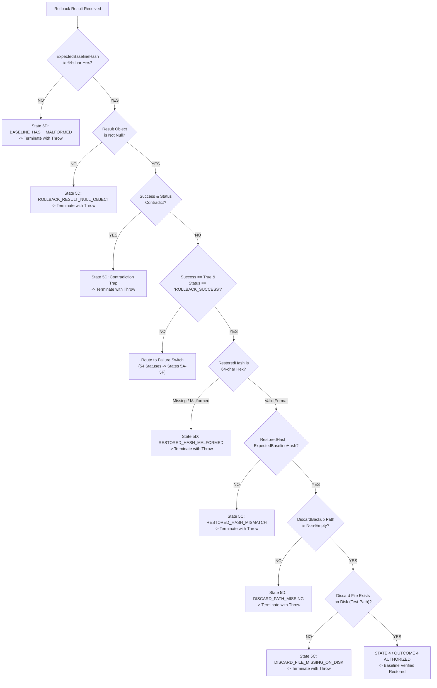

# MUSE SPARK — ZENTRA STEP 2D-2A-AO-S
## DISPATCH CONTROL FLOW, EVIDENCE VALIDATION & COVERAGE RECONCILIATION REPORT

**Project:** ZENTRA — Hi-Tech Lab Field Service Management Platform  
**Target Repository:** `D:\Zentra`  
**Input Reference:** [`docs/MUSE_SPARK_STEP2D_2A_AO_R_DISPATCH_CONSISTENCY_AND_COVERAGE_REMEDIATION_REPORT.md`](file:///d:/Zentra/docs/MUSE_SPARK_STEP2D_2A_AO_R_DISPATCH_CONSISTENCY_AND_COVERAGE_REMEDIATION_REPORT.md)  
**Host Environment:** Windows Workstation (`127.0.0.1:5432`)  
**Report Date:** 2026-10-09  
**Mode:** STRICT DOCUMENTATION-ONLY SPECIFICATION AUDIT & RECONCILIATION  
**Budget Constraint:** Strict ₹0/month (Zero cost, no credit cards, no paid upgrades)  
**Remote Access:** STRICTLY PROHIBITED (Zero remote connections permitted or made)  
**Execution Authorization:** NOT GRANTED — NO OPERATIONAL COMMANDS EXECUTED IN THIS STEP  
**Status:** COMPLETE — WAITING FOR HUMAN OPERATOR REVIEW  

---

## 1. Executive Verdict & Scope

### 1.1 Executive Verdict

A comprehensive audit of the Step 2D-2A-AO-R remediation report identified **three critical control-flow and evidence-validation vulnerabilities**, as well as **branch-accounting arithmetic inconsistencies**:

1. **Non-Terminal Fall-Through Vulnerability in `Dispatch-RollbackResultV18`:**  
   In V18, every defensive check and switch clause invoked `Enter-ManualRecoveryBoundaryV14` without an explicit local `throw` or `return`. If `Enter-ManualRecoveryBoundaryV14` returns normally (e.g., in a test harness, or if modified/suppressed), control flow continues into subsequent checks! In Check 4 (lines 121–143 of AO-R), if an evidence check failed and the recovery boundary returned, execution fell directly into line 147, declaring **`[OUTCOME 4: ROLLBACK SUCCESS]`** and falsely announcing successful configuration restoration despite corrupted or missing evidence!
2. **Incomplete Precondition Validation on Success Evidence:**  
   V18 checked whether `$RollbackResult.RestoredHash` was non-empty and equal to `$ExpectedBaselineHash`, but failed to validate:
   - Whether `$ExpectedBaselineHash` itself was valid (non-empty 64-character SHA-256 hexadecimal string).
   - Whether `$RollbackResult.RestoredHash` conformed to SHA-256 format before string comparison.
   - Whether the discard backup file (`$RollbackResult.DiscardBackup`) actually existed on disk, was readable, and non-empty.
3. **Branch-Accounting Arithmetic Inconsistencies in Section 5.1:**  
   AO-R Section 5.1 listed "5 branches" for PF-1 while explicitly enumerating 7 distinct outcome paths in parentheses, listed "5 branches" for PF-1B while enumerating 7 items, and listed "3 branches" for PF-4A/B while enumerating 4 items. The subtotals were mathematically disconnected from source-level branches and semantic outcome paths.
4. **Missing Dispatcher Edge-Case Test Specifications:**  
   The 64-test DSP matrix in AO-R lacked explicit test cases for malformed baseline hash, malformed restored hash, discard backup absent on disk, and recovery-boundary return without termination.

This report, **Step 2D-2A-AO-S**, provides the complete, authoritative remediation:
- Formulates the **Revised Terminal-Control-Flow Contract** and specifies **`Dispatch-RollbackResultV19`**, guaranteeing that every single non-success branch terminates control flow locally via explicit `throw [System.InvalidOperationException]`, eliminating any possibility of post-boundary fall-through.
- Formulates the **Revised Success-Evidence Contract**, establishing strict SHA-256 format regex validation (`^[A-Fa-f0-9]{64}$`) on baseline and restored hashes, independent filesystem verification (`Test-Path` leaf check) of the discard backup artifact, and unambiguous separation of missing, invalid, mismatched, helper-failure, and unknown evidence categories.
- Delivers a fully reconciled, mathematically verified **Branch-Count Worksheet** distinguishing source-level AST branches, semantic branch outcomes, dispatcher cases, and test specifications.
- Expands the outer-dispatch test suite to **68 exhaustive dispatch specifications (DSP-01 through DSP-68)** and preserves the 7 recovery diagnostic specifications (REC-01 through REC-07), for a grand total of **109 test specifications**, all marked `NOT EXECUTED — UNTESTED`.
- Re-confirms all safety constraints, execution wording distinctions, and preserves `BLOCKER-1` (missing runbook).

> [!IMPORTANT]
> **Strict Documentation Boundary:** All scripts, procedures, and fault-injection scenarios documented in this report are strictly **[NOT EXECUTED — UNTESTED]**. Zero operational commands of any kind were executed. Zero operational files (`postgresql.conf`, `pg_hba.conf`), Windows Firewall rules, Windows services, application source files, `.env` files, or databases were modified.

---

## 2. Findings with Exact Report Section & Line References

| Finding ID | Location in AO-R Report | Vulnerability / Defect Description | Technical Impact | Mandatory Correction in Step AO-S |
|---|---|---|---|---|
| **FIND-AS1** | `Dispatch-RollbackResultV18`<br/>Lines 95–100, 103–108, 111–116, 121–143, 153–158, 165–255 | **Non-Terminal Control Flow:** Every call to `Enter-ManualRecoveryBoundaryV14` lacks an explicit local `throw` or `return`. Switch clauses lack `break` or `throw`. | If `Enter-ManualRecoveryBoundaryV14` returns normally or an exception is caught, control flow falls through to subsequent checks. In Check 4, an evidence failure falls through directly to lines 145–147, falsely announcing State 4 / Outcome 4 (Rollback Success). | Codify Terminal Control-Flow Contract. Every invocation of `Enter-ManualRecoveryBoundaryV14` must be followed by an unconditional local `throw [System.InvalidOperationException]`. |
| **FIND-AS2** | `Dispatch-RollbackResultV18`<br/>Lines 119–134 | **Unvalidated Baseline & Restored Hash Format:** Code performs string equality `$RollbackResult.RestoredHash -ne $ExpectedBaselineHash` without verifying whether `$ExpectedBaselineHash` or `$RollbackResult.RestoredHash` conform to 64-character SHA-256 hex format. | If `$ExpectedBaselineHash` is malformed (e.g., empty string or truncated), or if `$RollbackResult.RestoredHash` contains an invalid status string that happens to match an invalid baseline, State 4 is declared. | Enforce strict regex validation `^[A-Fa-f0-9]{64}$` on both baseline and restored hashes before equality comparison. |
| **FIND-AS3** | `Dispatch-RollbackResultV18`<br/>Lines 137–142 | **Unverified Discard Artifact on Disk:** Code checks only `[string]::IsNullOrWhiteSpace($RollbackResult.DiscardBackup) -eq $false` without asserting that the discard file actually exists on disk or is readable. | If rollback engine returns a path string but the file was deleted or never flushed, State 4 is declared without a verified quarantine artifact. | Enforce filesystem validation: Discard backup path must exist as a leaf file on disk (`Test-Path -PathType Leaf`). If missing, fail closed to State 5C (`DISCARD_FILE_MISSING_ON_DISK`). |
| **FIND-AS4** | `Section 5.1`<br/>Lines 388–393 | **Branch-Accounting Arithmetic Inconsistency:** Stated "5 branches" for PF-1 while listing 7 parenthetical items; stated "5 branches" for PF-1B while listing 7 items; stated "3 branches" for PF-4A/B while listing 4 items. | Subtotals in accounting table did not match actual source code branches or semantic outcomes, undermining audit rigor. | Produce a fully reconciled Branch-Count Worksheet distinguishing syntactic AST branches from semantic outcome paths. |
| **FIND-AS5** | `Section 3 Table`<br/>Lines 352–360 | **Missing Edge-Case Dispatch Specifications:** DSP matrix ended at DSP-64 and omitted tests for malformed baseline hash, malformed restored hash, discard missing on disk, and recovery boundary return. | Incomplete specification of dispatcher boundary edge cases. | Expand DSP matrix from 64 to 68 specifications (DSP-01 through DSP-68). |

---

## 3. Revised Terminal-Control-Flow Contract

### 3.1 The Fail-Closed Terminal Invariant

> [!CAUTION]
> **MANDATORY TERMINAL CONTROL-FLOW INVARIANT:**  
> A dispatch engine must NEVER assume that a callee procedure halts execution.  
> Every code branch that enters the manual recovery boundary MUST contain an explicit local termination statement (`throw [System.InvalidOperationException]::new(...)`).  
> Under no circumstances may control flow fall through past a recovery boundary invocation.

### 3.2 Formal Architectural Specification: `Dispatch-RollbackResultV19`

Below is the hardened operational specification for `Dispatch-RollbackResultV19`. It implements:
1. Strict pre-validation of `$ExpectedBaselineHash`.
2. Immediate local terminal guards (`throw`) following every call to `Enter-ManualRecoveryBoundaryV14`.
3. Multi-factor success evidence validation with explicit regex assertions and disk-level artifact checks.
4. Independent categorization of missing, invalid, mismatched, helper-failure, and unknown evidence states.

```powershell
# [NOT EXECUTED — UNTESTED OPERATIONAL PROCEDURE]

function Dispatch-RollbackResultV19 {
    <#
    .SYNOPSIS
        Hardened outer rollback-result dispatcher with terminal fail-closed control flow,
        strict SHA-256 evidence validation, and comprehensive contradiction interception.
    #>
    param (
        [PSCustomObject]$RollbackResult,
        [string]$LiveConfigPath,
        [string]$GoldenBackupPath,
        [string]$ExpectedBaselineHash,
        [string]$CandidateHash,
        [System.Exception]$TriggerError,
        [string]$ContextName
    )

    $sha256Regex = '^[A-Fa-f0-9]{64}$'

    # -------------------------------------------------------------------------
    # STAGE 0: BASELINE PARAMETER INTEGRITY ASSERTION
    # -------------------------------------------------------------------------
    if ([string]::IsNullOrWhiteSpace($ExpectedBaselineHash)) {
        Enter-ManualRecoveryBoundaryV14 -LivePath $LiveConfigPath -BackupPath $GoldenBackupPath `
            -ExpectedBaselineHash $ExpectedBaselineHash -CandidateHash $CandidateHash `
            -InitialError $TriggerError -HashInspectionError $null -RollbackResult $RollbackResult `
            -Detail "[STATE 5D: $ContextName] BASELINE_HASH_MISSING: ExpectedBaselineHash parameter is null or empty. Fail-closed."
        throw [System.InvalidOperationException]::new("FAIL-CLOSED TERMINAL GUARD: ExpectedBaselineHash is null or empty.")
    }

    if ($ExpectedBaselineHash -notmatch $sha256Regex) {
        Enter-ManualRecoveryBoundaryV14 -LivePath $LiveConfigPath -BackupPath $GoldenBackupPath `
            -ExpectedBaselineHash $ExpectedBaselineHash -CandidateHash $CandidateHash `
            -InitialError $TriggerError -HashInspectionError $null -RollbackResult $RollbackResult `
            -Detail "[STATE 5D: $ContextName] BASELINE_HASH_MALFORMED: ExpectedBaselineHash [$ExpectedBaselineHash] is not a valid 64-char SHA-256 hex string. Fail-closed."
        throw [System.InvalidOperationException]::new("FAIL-CLOSED TERMINAL GUARD: ExpectedBaselineHash is malformed.")
    }

    # -------------------------------------------------------------------------
    # STAGE 1: DEFENSIVE RESULT OBJECT VALIDATION
    # -------------------------------------------------------------------------
    if ($RollbackResult -eq $null) {
        Enter-ManualRecoveryBoundaryV14 -LivePath $LiveConfigPath -BackupPath $GoldenBackupPath `
            -ExpectedBaselineHash $ExpectedBaselineHash -CandidateHash $CandidateHash `
            -InitialError $TriggerError -HashInspectionError $null -RollbackResult $null `
            -Detail "[STATE 5D: $ContextName] ROLLBACK_RESULT_NULL_OBJECT: Rollback engine returned null result object. Indeterminate — fail-closed."
        throw [System.InvalidOperationException]::new("FAIL-CLOSED TERMINAL GUARD: RollbackResult is null.")
    }

    # -------------------------------------------------------------------------
    # STAGE 2: CONTRADICTION INTERCEPTION TRAPS
    # -------------------------------------------------------------------------
    # Contradiction Trap A: Success is true, but Status is NOT 'ROLLBACK_SUCCESS'
    if ($RollbackResult.Success -eq $true -and $RollbackResult.Status -ne "ROLLBACK_SUCCESS") {
        Enter-ManualRecoveryBoundaryV14 -LivePath $LiveConfigPath -BackupPath $GoldenBackupPath `
            -ExpectedBaselineHash $ExpectedBaselineHash -CandidateHash $CandidateHash `
            -InitialError $TriggerError -HashInspectionError $null -RollbackResult $RollbackResult `
            -Detail "[STATE 5D: $ContextName] CONTRADICTORY_ROLLBACK_RESULT_FLAG_TRUE: Success is true, but Status is '$($RollbackResult.Status)'. Fail-closed."
        throw [System.InvalidOperationException]::new("FAIL-CLOSED TERMINAL GUARD: Contradictory flag/status pair (Success=true, Status!=ROLLBACK_SUCCESS).")
    }

    # Contradiction Trap B: Success is NOT true, but Status IS 'ROLLBACK_SUCCESS'
    if ($RollbackResult.Success -ne $true -and $RollbackResult.Status -eq "ROLLBACK_SUCCESS") {
        Enter-ManualRecoveryBoundaryV14 -LivePath $LiveConfigPath -BackupPath $GoldenBackupPath `
            -ExpectedBaselineHash $ExpectedBaselineHash -CandidateHash $CandidateHash `
            -InitialError $TriggerError -HashInspectionError $null -RollbackResult $RollbackResult `
            -Detail "[STATE 5D: $ContextName] CONTRADICTORY_ROLLBACK_RESULT_STATUS_SUCCESS: Status claims 'ROLLBACK_SUCCESS', but Success is false. Fail-closed."
        throw [System.InvalidOperationException]::new("FAIL-CLOSED TERMINAL GUARD: Contradictory flag/status pair (Success=false, Status=ROLLBACK_SUCCESS).")
    }

    # -------------------------------------------------------------------------
    # STAGE 3: STRICT SUCCESS EVIDENCE VALIDATION (STATE 4 AUTHORIZATION)
    # -------------------------------------------------------------------------
    if ($RollbackResult.Success -eq $true -and $RollbackResult.Status -eq "ROLLBACK_SUCCESS") {
        
        # Evidence Check 1: RestoredHash presence
        if ([string]::IsNullOrWhiteSpace($RollbackResult.RestoredHash)) {
            Enter-ManualRecoveryBoundaryV14 -LivePath $LiveConfigPath -BackupPath $GoldenBackupPath `
                -ExpectedBaselineHash $ExpectedBaselineHash -CandidateHash $CandidateHash `
                -InitialError $TriggerError -HashInspectionError $null -RollbackResult $RollbackResult `
                -Detail "[STATE 5D: $ContextName] RESTORED_HASH_MISSING: Rollback reported success, but RestoredHash property is null or empty. Fail-closed."
            throw [System.InvalidOperationException]::new("FAIL-CLOSED TERMINAL GUARD: RestoredHash is missing on success report.")
        }

        # Evidence Check 2: RestoredHash format validity
        if ($RollbackResult.RestoredHash -notmatch $sha256Regex) {
            Enter-ManualRecoveryBoundaryV14 -LivePath $LiveConfigPath -BackupPath $GoldenBackupPath `
                -ExpectedBaselineHash $ExpectedBaselineHash -CandidateHash $CandidateHash `
                -InitialError $TriggerError -HashInspectionError $null -RollbackResult $RollbackResult `
                -Detail "[STATE 5D: $ContextName] RESTORED_HASH_MALFORMED: RestoredHash [$($RollbackResult.RestoredHash)] is not a valid 64-char SHA-256 hex string. Fail-closed."
            throw [System.InvalidOperationException]::new("FAIL-CLOSED TERMINAL GUARD: RestoredHash is malformed.")
        }

        # Evidence Check 3: RestoredHash strictly matches ExpectedBaselineHash
        if ($RollbackResult.RestoredHash -ine $ExpectedBaselineHash) {
            Enter-ManualRecoveryBoundaryV14 -LivePath $LiveConfigPath -BackupPath $GoldenBackupPath `
                -ExpectedBaselineHash $ExpectedBaselineHash -CandidateHash $CandidateHash `
                -InitialError $TriggerError -HashInspectionError $null -RollbackResult $RollbackResult `
                -Detail "[STATE 5C: $ContextName] RESTORED_HASH_MISMATCH: RestoredHash [$($RollbackResult.RestoredHash)] differs from ExpectedBaselineHash [$ExpectedBaselineHash]. Content corruption — fail-closed."
            throw [System.InvalidOperationException]::new("FAIL-CLOSED TERMINAL GUARD: RestoredHash mismatch against baseline.")
        }

        # Evidence Check 4: DiscardBackup property presence
        if ([string]::IsNullOrWhiteSpace($RollbackResult.DiscardBackup)) {
            Enter-ManualRecoveryBoundaryV14 -LivePath $LiveConfigPath -BackupPath $GoldenBackupPath `
                -ExpectedBaselineHash $ExpectedBaselineHash -CandidateHash $CandidateHash `
                -InitialError $TriggerError -HashInspectionError $null -RollbackResult $RollbackResult `
                -Detail "[STATE 5D: $ContextName] DISCARD_PATH_MISSING: Rollback reported success, but DiscardBackup property is null or empty. Incomplete forensic audit trail — fail-closed."
            throw [System.InvalidOperationException]::new("FAIL-CLOSED TERMINAL GUARD: DiscardBackup property is missing.")
        }

        # Evidence Check 5: DiscardBackup artifact existence on disk
        if (-not (Test-Path -Path $RollbackResult.DiscardBackup -PathType Leaf)) {
            Enter-ManualRecoveryBoundaryV14 -LivePath $LiveConfigPath -BackupPath $GoldenBackupPath `
                -ExpectedBaselineHash $ExpectedBaselineHash -CandidateHash $CandidateHash `
                -InitialError $TriggerError -HashInspectionError $null -RollbackResult $RollbackResult `
                -Detail "[STATE 5C: $ContextName] DISCARD_FILE_MISSING_ON_DISK: DiscardBackup file [$($RollbackResult.DiscardBackup)] does not exist on disk as a leaf file. Forensic quarantine missing — fail-closed."
            throw [System.InvalidOperationException]::new("FAIL-CLOSED TERMINAL GUARD: DiscardBackup file absent from disk.")
        }

        # ALL 5 EVIDENCE REQUIREMENTS SATISFIED -> STATE 4 / OUTCOME 4 AUTHORIZED
        Write-Host "[OUTCOME 4: ROLLBACK SUCCESS] Original configuration verified and restored [SHA256: $($RollbackResult.RestoredHash)]." -ForegroundColor Yellow
        Write-Host "[OUTCOME 4: ARTIFACT STATUS] Golden backup [$GoldenBackupPath] and Discard backup [$($RollbackResult.DiscardBackup)] retained on disk." -ForegroundColor Yellow
        throw "FAIL-CLOSED ABORT [OUTCOME 4]: $ContextName failed ($($TriggerError.Message)), but rollback successfully restored original configuration. Live service safe."
    }

    # -------------------------------------------------------------------------
    # STAGE 4: FAILURE PATHS — STATUS STRING VALIDATION
    # -------------------------------------------------------------------------
    $rbStatus = $RollbackResult.Status

    if ([string]::IsNullOrEmpty($rbStatus)) {
        Enter-ManualRecoveryBoundaryV14 -LivePath $LiveConfigPath -BackupPath $GoldenBackupPath `
            -ExpectedBaselineHash $ExpectedBaselineHash -CandidateHash $CandidateHash `
            -InitialError $TriggerError -HashInspectionError $null -RollbackResult $RollbackResult `
            -Detail "[STATE 5D: $ContextName] ROLLBACK_RESULT_NULL_STATUS: Rollback engine returned null or empty status string. Indeterminate — fail-closed."
        throw [System.InvalidOperationException]::new("FAIL-CLOSED TERMINAL GUARD: Rollback Status property is null or empty.")
    }

    # -------------------------------------------------------------------------
    # STAGE 5: EXHAUSTIVE STATUS-TO-STATE SWITCH (54 FAILURE STATUSES)
    # -------------------------------------------------------------------------
    switch ($rbStatus) {
        # ---------------------------------------------------------
        # STATE 5A: TARGET FILE CONFIRMED MISSING (3 STATUSES)
        # ---------------------------------------------------------
        { $_ -in @("ROLLBACK_DEST_MISSING", "PRE_ROLLBACK_LIVE_MISSING", "RESTORED_FILE_MISSING") } {
            Enter-ManualRecoveryBoundaryV14 -LivePath $LiveConfigPath -BackupPath $GoldenBackupPath `
                -ExpectedBaselineHash $ExpectedBaselineHash -CandidateHash $CandidateHash `
                -InitialError $TriggerError -HashInspectionError $null -RollbackResult $RollbackResult `
                -Detail "[STATE 5A: $ContextName] Live destination file confirmed missing ($rbStatus): $($RollbackResult.Message)"
            throw [System.InvalidOperationException]::new("FAIL-CLOSED TERMINAL GUARD: Handled State 5A ($rbStatus).")
        }

        # ---------------------------------------------------------
        # STATE 5B: TARGET FILE PRESENT BUT UNREADABLE (3 STATUSES)
        # ---------------------------------------------------------
        { $_ -in @("ROLLBACK_DEST_UNREADABLE", "PRE_ROLLBACK_LIVE_UNREADABLE", "RESTORED_FILE_UNREADABLE") } {
            Enter-ManualRecoveryBoundaryV14 -LivePath $LiveConfigPath -BackupPath $GoldenBackupPath `
                -ExpectedBaselineHash $ExpectedBaselineHash -CandidateHash $CandidateHash `
                -InitialError $TriggerError -HashInspectionError $RollbackResult.Error -RollbackResult $RollbackResult `
                -Detail "[STATE 5B: $ContextName] Live destination file present but unreadable ($rbStatus): $($RollbackResult.Message)"
            throw [System.InvalidOperationException]::new("FAIL-CLOSED TERMINAL GUARD: Handled State 5B ($rbStatus).")
        }

        # ---------------------------------------------------------
        # STATE 5C: ROLLBACK MECHANICALLY FAILED (17 STATUSES)
        # ---------------------------------------------------------
        { $_ -in @(
            "GOLDEN_BACKUP_MISSING",
            "GOLDEN_BACKUP_UNREADABLE",
            "GOLDEN_BACKUP_HASH_MISMATCH",
            "ROLLBACK_DEST_TRIGGER_MISMATCH",
            "DISCARD_CAPTURE_READ_FAILED",
            "DISCARD_CAPTURE_FAILED",
            "DISCARD_FILE_MISSING",
            "DISCARD_FILE_UNREADABLE",
            "DISCARD_HASH_MISMATCH",
            "SACRIFICIAL_CLONE_READ_FAILED",
            "SACRIFICIAL_CLONE_CREATION_FAILED",
            "SACRIFICIAL_CLONE_MISSING",
            "SACRIFICIAL_CLONE_UNREADABLE",
            "SACRIFICIAL_CLONE_HASH_MISMATCH",
            "LIVE_MUTATED_POST_DISCARD",
            "ROLLBACK_SWAP_EXCEPTION",
            "RESTORED_HASH_MISMATCH"
        ) } {
            Enter-ManualRecoveryBoundaryV14 -LivePath $LiveConfigPath -BackupPath $GoldenBackupPath `
                -ExpectedBaselineHash $ExpectedBaselineHash -CandidateHash $CandidateHash `
                -InitialError $TriggerError -HashInspectionError $null -RollbackResult $RollbackResult `
                -Detail "[STATE 5C: $ContextName] Rollback execution mechanically failed ($rbStatus): $($RollbackResult.Message)"
            throw [System.InvalidOperationException]::new("FAIL-CLOSED TERMINAL GUARD: Handled State 5C ($rbStatus).")
        }

        # ---------------------------------------------------------
        # STATE 5D: INDETERMINATE NULL / UNKNOWN STATUS (18 STATUSES)
        # ---------------------------------------------------------
        { $_ -in @(
            "GOLDEN_BACKUP_NULL_RESULT",
            "GOLDEN_BACKUP_NULL_STATUS",
            "GOLDEN_BACKUP_UNKNOWN_STATUS",
            "ROLLBACK_DEST_NULL_RESULT",
            "ROLLBACK_DEST_NULL_STATUS",
            "ROLLBACK_DEST_UNKNOWN_STATUS",
            "DISCARD_NULL_RESULT",
            "DISCARD_NULL_STATUS",
            "DISCARD_UNKNOWN_STATUS",
            "SACRIFICIAL_CLONE_NULL_RESULT",
            "SACRIFICIAL_CLONE_NULL_STATUS",
            "SACRIFICIAL_CLONE_UNKNOWN_STATUS",
            "PRE_ROLLBACK_LIVE_NULL_RESULT",
            "PRE_ROLLBACK_LIVE_NULL_STATUS",
            "PRE_ROLLBACK_LIVE_UNKNOWN_STATUS",
            "RESTORED_NULL_RESULT",
            "RESTORED_NULL_STATUS",
            "RESTORED_UNKNOWN_STATUS"
        ) } {
            Enter-ManualRecoveryBoundaryV14 -LivePath $LiveConfigPath -BackupPath $GoldenBackupPath `
                -ExpectedBaselineHash $ExpectedBaselineHash -CandidateHash $CandidateHash `
                -InitialError $TriggerError -HashInspectionError $null -RollbackResult $RollbackResult `
                -Detail "[STATE 5D: $ContextName] Rollback returned null/unknown status string ($rbStatus): $($RollbackResult.Message). Indeterminate — fail-closed."
            throw [System.InvalidOperationException]::new("FAIL-CLOSED TERMINAL GUARD: Handled State 5D ($rbStatus).")
        }

        # ---------------------------------------------------------
        # STATE 5E: ROLLBACK BYTE VERIFICATION FAILED (1 STATUS)
        # ---------------------------------------------------------
        "ROLLBACK_BYTE_VERIFY_FAILED" {
            Enter-ManualRecoveryBoundaryV14 -LivePath $LiveConfigPath -BackupPath $GoldenBackupPath `
                -ExpectedBaselineHash $ExpectedBaselineHash -CandidateHash $CandidateHash `
                -InitialError $TriggerError -HashInspectionError $null -RollbackResult $RollbackResult `
                -Detail "[STATE 5E: $ContextName] Rollback restored baseline hash, but byte integrity verification failed: $($RollbackResult.Message)"
            throw [System.InvalidOperationException]::new("FAIL-CLOSED TERMINAL GUARD: Handled State 5E ($rbStatus).")
        }

        # ---------------------------------------------------------
        # STATE 5F: TOOLING / HELPER / QUERY EXCEPTION (12 STATUSES)
        # ---------------------------------------------------------
        { $_ -in @(
            "GOLDEN_BACKUP_QUERY_THREW",
            "GOLDEN_BACKUP_HELPER_EXCEPTION",
            "ROLLBACK_DEST_QUERY_THREW",
            "ROLLBACK_DEST_HELPER_EXCEPTION",
            "DISCARD_QUERY_THREW",
            "DISCARD_HELPER_EXCEPTION",
            "SACRIFICIAL_CLONE_QUERY_THREW",
            "SACRIFICIAL_CLONE_HELPER_EXCEPTION",
            "PRE_ROLLBACK_LIVE_QUERY_THREW",
            "PRE_ROLLBACK_LIVE_HELPER_EXCEPTION",
            "RESTORED_QUERY_THREW",
            "RESTORED_HELPER_EXCEPTION"
        ) } {
            Enter-ManualRecoveryBoundaryV14 -LivePath $LiveConfigPath -BackupPath $GoldenBackupPath `
                -ExpectedBaselineHash $ExpectedBaselineHash -CandidateHash $CandidateHash `
                -InitialError $TriggerError -HashInspectionError $RollbackResult.Error -RollbackResult $RollbackResult `
                -Detail "[STATE 5F: $ContextName] Tooling/helper exception during rollback ($rbStatus): $($RollbackResult.Message). Indeterminate — fail-closed."
            throw [System.InvalidOperationException]::new("FAIL-CLOSED TERMINAL GUARD: Handled State 5F ($rbStatus).")
        }

        # ---------------------------------------------------------
        # DEFENSIVE DEFAULT: UNRECOGNIZED STATUS STRING (1 BRANCH)
        # ---------------------------------------------------------
        default {
            Enter-ManualRecoveryBoundaryV14 -LivePath $LiveConfigPath -BackupPath $GoldenBackupPath `
                -ExpectedBaselineHash $ExpectedBaselineHash -CandidateHash $CandidateHash `
                -InitialError $TriggerError -HashInspectionError $null -RollbackResult $RollbackResult `
                -Detail "[STATE 5D: $ContextName] UNRECOGNIZED_STATUS_STRING: Rollback returned unrecognized status [$rbStatus]. Indeterminate — fail-closed."
            throw [System.InvalidOperationException]::new("FAIL-CLOSED TERMINAL GUARD: Handled default unrecognized status ($rbStatus).")
        }
    }

    # UNREACHABLE SANITY GUARD
    throw [System.InvalidOperationException]::new("CRITICAL FATAL: Control flow reached post-dispatcher state. Terminal invariant breached.")
}
```

---

## 4. Revised Success-Evidence Contract

Before State 4 / Outcome 4 can be declared, all five requirements of the **Strict Success-Evidence Contract** must be independently verified:



### 4.1 Taxonomy of Evidence Failure Categories

The dispatcher enforces strict distinction between failure modes and never collapses distinct categories:

| Category | Trigger Condition | Assigned State | Outcome Class | Technical Distinction |
|---|---|---|---|---|
| **Missing Evidence** | `ExpectedBaselineHash`, `RestoredHash`, or `DiscardBackup` is `$null` or whitespace. | **State 5D** | Outcome 5D | Required forensic data property was never populated. |
| **Invalid Evidence** | `ExpectedBaselineHash` or `RestoredHash` does not match `^[A-Fa-f0-9]{64}$`. | **State 5D** | Outcome 5D | Data is syntactically malformed, not a valid cryptographic hash representation. |
| **Hash Mismatch** | `RestoredHash` is a valid 64-character hex string, but `$RestoredHash -ine $ExpectedBaselineHash`. | **State 5C** | Outcome 5C | File was restored, but content differs from baseline. True rollback mechanical failure. |
| **Discard Missing on Disk** | `DiscardBackup` string is present, but `Test-Path -PathType Leaf` returns `$false`. | **State 5C** | Outcome 5C | Live state evidence was not successfully quarantined on disk. |
| **Helper Failure** | `Get-SafeFileHashV4` threw an exception or returned `HELPER_EXCEPTION`. | **State 5F** | Outcome 5F | Tooling / runtime instrumentation failure. State is indeterminate. |
| **Unknown Status** | Helper or rollback engine returned an unmapped status string. | **State 5D** | Outcome 5D | State machine encountered an unrecognized state string. Fail-closed. |

---

## 5. Reconciled Branch-Count Worksheet

To correct the arithmetic discrepancies identified in AO-R Section 5.1, the worksheet below explicitly separates **Syntactic AST Branches** (if/catch/switch decision points), **Semantic Outcome Paths** (distinct functional outcomes), and **Test Specifications**:

### 5.1 Pre-Flight Engine (`Invoke-SafeConfigReplacementV17` Stages PF-0 through PF-4B)

| Stage | Syntactic AST Branches | Enumerated Semantic Outcome Paths | Exact Code Outcomes |
|---|---|---|---|
| **PF-0** | 2 branches (`try`, `catch`) | 2 paths | 1) Candidate byte check pass; 2) `PREFLIGHT_CANDIDATE_INVALID` throw. |
| **PF-1** | 7 decision points (`catch`, `if null`, `if null status`, `switch 4 cases + default`) | 8 paths | 1) `PREFLIGHT_LIVE_QUERY_THREW`; 2) `PREFLIGHT_LIVE_NULL_RESULT`; 3) `PREFLIGHT_LIVE_NULL_STATUS`; 4) `PREFLIGHT_LIVE_MISSING`; 5) `PREFLIGHT_LIVE_UNREADABLE`; 6) `PREFLIGHT_LIVE_HELPER_EXCEPTION`; 7) `HASH_VERIFIED` pass; 8) `PREFLIGHT_LIVE_UNKNOWN_STATUS`. |
| **PF-1B** | 7 decision points (`catch`, `if null`, `if null status`, `switch 4 cases + default`) | 8 paths | 1) `PREFLIGHT_CAND_QUERY_THREW`; 2) `PREFLIGHT_CAND_NULL_RESULT`; 3) `PREFLIGHT_CAND_NULL_STATUS`; 4) `PREFLIGHT_CAND_MISSING`; 5) `PREFLIGHT_CAND_UNREADABLE`; 6) `PREFLIGHT_CAND_HELPER_EXCEPTION`; 7) `HASH_VERIFIED` pass; 8) `PREFLIGHT_CAND_UNKNOWN_STATUS`. |
| **PF-2** | 4 decision points (Read `catch`, Write `catch [IOException]`, Write general `catch`, Normal pass) | 5 paths | 1) `PREFLIGHT_LIVE_READ_FAILED`; 2) `PREFLIGHT_COLLISION_DETECTED`; 3) `PREFLIGHT_BACKUP_WRITE_FAILED` (IO); 4) `PREFLIGHT_BACKUP_WRITE_FAILED` (general); 5) Golden backup written pass. |
| **PF-3** | 7 decision points (`catch`, `if null`, `if null status`, `switch 4 cases + default`) | 9 paths | 1) `PREFLIGHT_BACKUP_QUERY_THREW`; 2) `PREFLIGHT_BACKUP_NULL_RESULT`; 3) `PREFLIGHT_BACKUP_NULL_STATUS`; 4) `PREFLIGHT_BACKUP_MISSING`; 5) `PREFLIGHT_BACKUP_UNREADABLE`; 6) `PREFLIGHT_BACKUP_HELPER_EXCEPTION`; 7) `PREFLIGHT_BACKUP_HASH_MISMATCH`; 8) `HASH_VERIFIED` pass; 9) `PREFLIGHT_BACKUP_UNKNOWN_STATUS`. |
| **PF-4A** | 7 decision points (`catch`, `if null`, `if null status`, `switch 4 cases + default`) | 9 paths | 1) `PRE_SWAP_CAND_QUERY_THREW`; 2) `PRE_SWAP_CAND_NULL_RESULT`; 3) `PRE_SWAP_CAND_NULL_STATUS`; 4) `PRE_SWAP_CAND_MISSING`; 5) `PRE_SWAP_CAND_UNREADABLE`; 6) `PRE_SWAP_CAND_HELPER_EXCEPTION`; 7) `PRE_SWAP_CANDIDATE_MUTATED`; 8) `HASH_VERIFIED` pass; 9) `PRE_SWAP_CAND_UNKNOWN_STATUS`. |
| **PF-4B** | 7 decision points (`catch`, `if null`, `if null status`, `switch 4 cases + default`) | 9 paths | 1) `PRE_SWAP_LIVE_QUERY_THREW`; 2) `PRE_SWAP_LIVE_NULL_RESULT`; 3) `PRE_SWAP_LIVE_NULL_STATUS`; 4) `PRE_SWAP_LIVE_MISSING`; 5) `PRE_SWAP_LIVE_UNREADABLE`; 6) `PRE_SWAP_LIVE_HELPER_EXCEPTION`; 7) `PRE_SWAP_LIVE_MUTATED`; 8) `HASH_VERIFIED` pass; 9) `PRE_SWAP_LIVE_UNKNOWN_STATUS`. |
| **Subtotal** | **41 syntactic decision points** | **50 semantic outcome paths** | Fully reconciled pre-flight branch outcomes. |

### 5.2 Replacement Execution & Post-Swap Live Barriers (Stages 2–3)

| Stage | Syntactic AST Branches | Enumerated Semantic Outcome Paths | Exact Code Outcomes |
|---|---|---|---|
| **Stage 2 (Swap)** | 2 branches (`try`, `catch`) | 2 paths | 1) Win32 Replace succeeds; 2) Win32 Replace throws. |
| **Post-Throw Insp.** | 7 decision points (`catch`, `if null`, `switch 4 cases + default`) | 8 paths | 1) Tooling exception (State 5F); 2) Null result (State 5D); 3) Missing (State 5A); 4) Unreadable (State 5B); 5) Helper exc (State 5F); 6) Target untouched (State 2A / Outcome 1); 7) Target altered (triggers rollback); 8) Unknown status (State 5D). |
| **Stage 3 Post-Swap** | 8 decision points (`catch`, `if null`, `switch 5 cases + default`) | 9 paths | 1) Tooling exception (State 5F); 2) Null result (State 5D); 3) Missing (State 5A); 4) Unreadable (State 5B); 5) Helper exc (State 5F); 6) Promoted candidate verified (State 1 / Outcome 2); 7) Promoted candidate byte fail (triggers rollback); 8) Live unchanged no-op (State 2B / Outcome 1); 9) Promoted hash corrupt (triggers rollback). |
| **Subtotal** | **17 syntactic decision points** | **19 semantic outcome paths** | Fully reconciled replacement & post-swap branches. |

### 5.3 Rollback Engine Internal Return Paths (`Invoke-ControlledRollbackV14`)

| Stage | Return Outcomes | Exact Documented Return Statuses |
|---|---|---|
| **Stage 1 (Golden Backup)** | 8 paths | `QUERY_THREW`, `NULL_RESULT`, `NULL_STATUS`, `MISSING`, `UNREADABLE`, `HELPER_EXCEPTION`, `HASH_MISMATCH`, `UNKNOWN_STATUS`. |
| **Stage 2 (Live Target)** | 8 paths | `QUERY_THREW`, `NULL_RESULT`, `NULL_STATUS`, `MISSING`, `UNREADABLE`, `HELPER_EXCEPTION`, `TRIGGER_MISMATCH`, `UNKNOWN_STATUS`. |
| **Stage 3/3B (Discard Capture)**| 10 paths | `READ_FAILED`, `WRITE_FAILED`, `QUERY_THREW`, `NULL_RESULT`, `NULL_STATUS`, `MISSING`, `UNREADABLE`, `HELPER_EXCEPTION`, `HASH_MISMATCH`, `UNKNOWN_STATUS`. |
| **Stage 4/4A (Sacrificial Clone)**| 10 paths | `READ_FAILED`, `CREATION_FAILED`, `QUERY_THREW`, `NULL_RESULT`, `NULL_STATUS`, `MISSING`, `UNREADABLE`, `HELPER_EXCEPTION`, `HASH_MISMATCH`, `UNKNOWN_STATUS`. |
| **Stage 4B (Pre-Swap Live Barrier)**| 8 paths | `QUERY_THREW`, `NULL_RESULT`, `NULL_STATUS`, `MISSING`, `UNREADABLE`, `HELPER_EXCEPTION`, `MUTATED_POST_DISCARD`, `UNKNOWN_STATUS`. |
| **Stage 5 (Swap Execution)** | 1 path | `ROLLBACK_SWAP_EXCEPTION`. |
| **Stage 6 (Post-Verification)** | 10 paths | `QUERY_THREW`, `NULL_RESULT`, `NULL_STATUS`, `MISSING`, `UNREADABLE`, `HELPER_EXCEPTION`, `HASH_MISMATCH`, `UNKNOWN_STATUS`, `BYTE_VERIFY_FAILED`, `ROLLBACK_SUCCESS`. |
| **Subtotal** | **55 return paths** | Exactly 55 return paths (54 failure + 1 success). |

### 5.4 Manual Recovery Boundary Diagnostics (`Enter-ManualRecoveryBoundaryV14`)

| Diagnostic Check | Syntactic Branches | Semantic Outcome Paths |
|---|---|---|
| **Diag 1 (Live File)** | 3 branches (`try`, `if null`, `catch`) | 3 paths: 1) Valid inspection; 2) Null result; 3) Query threw catch. |
| **Diag 2 (Processes)** | 2 branches (`try`, `catch`) | 2 paths: 1) Processes checked; 2) Query threw catch. |
| **Diag 3 (Service)** | 2 branches (`try`, `catch`) | 2 paths: 1) Service checked; 2) Query threw catch. |
| **Subtotal** | **7 syntactic branches** | **7 diagnostic outcome paths.** |

$$\text{Total System Semantic Outcome Paths} = 50 + 19 + 55 + 7 = \mathbf{131 \text{ paths}}$$

---

## 6. Dispatch Test Coverage Matrix & Scenario Totals

### 6.1 Outer-Dispatch Test Suite (68 Test Specifications: DSP-01 through DSP-68)

The table below specifies all 68 outer-dispatch test scenarios against `Dispatch-RollbackResultV19`. Every test explicitly specifies:
- Input conditions and evidence state.
- Expected final State and Outcome class.
- Expected terminal action (guaranteed termination via `throw`).
- Deterministic artifact disposition.

> [!NOTE]
> All 68 scenarios below are strictly **[TEST SPECIFICATIONS — NOT EXECUTED — UNTESTED]**.

| Test ID | Input `Status` | `Success` | Evidence Profile | Expected State | Outcome | Terminal Action | Artifact Disposition |
|---|---|---|---|---|---|---|---|
| **DSP-01** | `GOLDEN_BACKUP_QUERY_THREW` | `$false` | `$null` / `$null` | **State 5F** | 5F | Local Throw | Candidate: Retained; Backup: Retained; Clone: N/C; Discard: N/C; Live: Altered. |
| **DSP-02** | `GOLDEN_BACKUP_NULL_RESULT` | `$false` | `$null` / `$null` | **State 5D** | 5D | Local Throw | Candidate: Retained; Backup: Retained; Clone: N/C; Discard: N/C; Live: Altered. |
| **DSP-03** | `GOLDEN_BACKUP_NULL_STATUS` | `$false` | `$null` / `$null` | **State 5D** | 5D | Local Throw | Candidate: Retained; Backup: Retained; Clone: N/C; Discard: N/C; Live: Altered. |
| **DSP-04** | `GOLDEN_BACKUP_MISSING` | `$false` | `$null` / `$null` | **State 5C** | 5C | Local Throw | Candidate: Retained; Backup: N/C; Clone: N/C; Discard: N/C; Live: Altered. |
| **DSP-05** | `GOLDEN_BACKUP_UNREADABLE` | `$false` | `$null` / `$null` | **State 5C** | 5C | Local Throw | Candidate: Retained; Backup: Retained; Clone: N/C; Discard: N/C; Live: Altered. |
| **DSP-06** | `GOLDEN_BACKUP_HELPER_EXCEPTION`| `$false` | `$null` / `$null` | **State 5F** | 5F | Local Throw | Candidate: Retained; Backup: Retained; Clone: N/C; Discard: N/C; Live: Altered. |
| **DSP-07** | `GOLDEN_BACKUP_HASH_MISMATCH` | `$false` | `$null` / `$null` | **State 5C** | 5C | Local Throw | Candidate: Retained; Backup: Retained; Clone: N/C; Discard: N/C; Live: Altered. |
| **DSP-08** | `GOLDEN_BACKUP_UNKNOWN_STATUS` | `$false` | `$null` / `$null` | **State 5D** | 5D | Local Throw | Candidate: Retained; Backup: Retained; Clone: N/C; Discard: N/C; Live: Altered. |
| **DSP-09** | `ROLLBACK_DEST_QUERY_THREW` | `$false` | `$null` / `$null` | **State 5F** | 5F | Local Throw | Candidate: Retained; Backup: Retained; Clone: N/C; Discard: N/C; Live: Altered. |
| **DSP-10** | `ROLLBACK_DEST_NULL_RESULT` | `$false` | `$null` / `$null` | **State 5D** | 5D | Local Throw | Candidate: Retained; Backup: Retained; Clone: N/C; Discard: N/C; Live: Altered. |
| **DSP-11** | `ROLLBACK_DEST_NULL_STATUS` | `$false` | `$null` / `$null` | **State 5D** | 5D | Local Throw | Candidate: Retained; Backup: Retained; Clone: N/C; Discard: N/C; Live: Altered. |
| **DSP-12** | `ROLLBACK_DEST_MISSING` | `$false` | `$null` / `$null` | **State 5A** | 5A | Local Throw | Candidate: Retained; Backup: Retained; Clone: N/C; Discard: N/C; Live: Missing. |
| **DSP-13** | `ROLLBACK_DEST_UNREADABLE` | `$false` | `$null` / `$null` | **State 5B** | 5B | Local Throw | Candidate: Retained; Backup: Retained; Clone: N/C; Discard: N/C; Live: Locked. |
| **DSP-14** | `ROLLBACK_DEST_HELPER_EXCEPTION`| `$false` | `$null` / `$null` | **State 5F** | 5F | Local Throw | Candidate: Retained; Backup: Retained; Clone: N/C; Discard: N/C; Live: Altered. |
| **DSP-15** | `ROLLBACK_DEST_TRIGGER_MISMATCH`| `$false` | `$null` / `$null` | **State 5C** | 5C | Local Throw | Candidate: Retained; Backup: Retained; Clone: N/C; Discard: N/C; Live: Altered. |
| **DSP-16** | `ROLLBACK_DEST_UNKNOWN_STATUS` | `$false` | `$null` / `$null` | **State 5D** | 5D | Local Throw | Candidate: Retained; Backup: Retained; Clone: N/C; Discard: N/C; Live: Altered. |
| **DSP-17** | `DISCARD_CAPTURE_READ_FAILED` | `$false` | `$null` / `$null` | **State 5C** | 5C | Local Throw | Candidate: Retained; Backup: Retained; Clone: N/C; Discard: N/C; Live: Altered. |
| **DSP-18** | `DISCARD_CAPTURE_FAILED` | `$false` | `$null` / Valid Path | **State 5C** | 5C | Local Throw | Candidate: Retained; Backup: Retained; Clone: N/C; Discard: Partial; Live: Altered. |
| **DSP-19** | `DISCARD_QUERY_THREW` | `$false` | `$null` / Valid Path | **State 5F** | 5F | Local Throw | Candidate: Retained; Backup: Retained; Clone: N/C; Discard: Retained; Live: Altered. |
| **DSP-20** | `DISCARD_NULL_RESULT` | `$false` | `$null` / Valid Path | **State 5D** | 5D | Local Throw | Candidate: Retained; Backup: Retained; Clone: N/C; Discard: Retained; Live: Altered. |
| **DSP-21** | `DISCARD_NULL_STATUS` | `$false` | `$null` / Valid Path | **State 5D** | 5D | Local Throw | Candidate: Retained; Backup: Retained; Clone: N/C; Discard: Retained; Live: Altered. |
| **DSP-22** | `DISCARD_FILE_MISSING` | `$false` | `$null` / Valid Path | **State 5C** | 5C | Local Throw | Candidate: Retained; Backup: Retained; Clone: N/C; Discard: N/C; Live: Altered. |
| **DSP-23** | `DISCARD_FILE_UNREADABLE` | `$false` | `$null` / Valid Path | **State 5C** | 5C | Local Throw | Candidate: Retained; Backup: Retained; Clone: N/C; Discard: Retained; Live: Altered. |
| **DSP-24** | `DISCARD_HELPER_EXCEPTION` | `$false` | `$null` / Valid Path | **State 5F** | 5F | Local Throw | Candidate: Retained; Backup: Retained; Clone: N/C; Discard: Retained; Live: Altered. |
| **DSP-25** | `DISCARD_HASH_MISMATCH` | `$false` | `$null` / Valid Path | **State 5C** | 5C | Local Throw | Candidate: Retained; Backup: Retained; Clone: N/C; Discard: Retained; Live: Altered. |
| **DSP-26** | `DISCARD_UNKNOWN_STATUS` | `$false` | `$null` / Valid Path | **State 5D** | 5D | Local Throw | Candidate: Retained; Backup: Retained; Clone: N/C; Discard: Retained; Live: Altered. |
| **DSP-27** | `SACRIFICIAL_CLONE_READ_FAILED` | `$false` | `$null` / Valid Path | **State 5C** | 5C | Local Throw | Candidate: Retained; Backup: Retained; Clone: N/C; Discard: Retained; Live: Altered. |
| **DSP-28** | `SACRIFICIAL_CLONE_CREATION_FAILED`| `$false` | `$null` / Valid Path | **State 5C** | 5C | Local Throw | Candidate: Retained; Backup: Retained; Clone: Partial; Discard: Retained; Live: Altered. |
| **DSP-29** | `SACRIFICIAL_CLONE_QUERY_THREW` | `$false` | `$null` / Valid Path | **State 5F** | 5F | Local Throw | Candidate: Retained; Backup: Retained; Clone: Retained; Discard: Retained; Live: Altered. |
| **DSP-30** | `SACRIFICIAL_CLONE_NULL_RESULT` | `$false` | `$null` / Valid Path | **State 5D** | 5D | Local Throw | Candidate: Retained; Backup: Retained; Clone: Retained; Discard: Retained; Live: Altered. |
| **DSP-31** | `SACRIFICIAL_CLONE_NULL_STATUS` | `$false` | `$null` / Valid Path | **State 5D** | 5D | Local Throw | Candidate: Retained; Backup: Retained; Clone: Retained; Discard: Retained; Live: Altered. |
| **DSP-32** | `SACRIFICIAL_CLONE_MISSING` | `$false` | `$null` / Valid Path | **State 5C** | 5C | Local Throw | Candidate: Retained; Backup: Retained; Clone: N/C; Discard: Retained; Live: Altered. |
| **DSP-33** | `SACRIFICIAL_CLONE_UNREADABLE` | `$false` | `$null` / Valid Path | **State 5C** | 5C | Local Throw | Candidate: Retained; Backup: Retained; Clone: Retained; Discard: Retained; Live: Altered. |
| **DSP-34** | `SACRIFICIAL_CLONE_HELPER_EXCEPTION`| `$false` | `$null` / Valid Path | **State 5F** | 5F | Local Throw | Candidate: Retained; Backup: Retained; Clone: Retained; Discard: Retained; Live: Altered. |
| **DSP-35** | `SACRIFICIAL_CLONE_HASH_MISMATCH` | `$false` | `$null` / Valid Path | **State 5C** | 5C | Local Throw | Candidate: Retained; Backup: Retained; Clone: Retained; Discard: Retained; Live: Altered. |
| **DSP-36** | `SACRIFICIAL_CLONE_UNKNOWN_STATUS`| `$false` | `$null` / Valid Path | **State 5D** | 5D | Local Throw | Candidate: Retained; Backup: Retained; Clone: Retained; Discard: Retained; Live: Altered. |
| **DSP-37** | `PRE_ROLLBACK_LIVE_QUERY_THREW` | `$false` | `$null` / Valid Path | **State 5F** | 5F | Local Throw | Candidate: Retained; Backup: Retained; Clone: Retained; Discard: Retained; Live: Altered. |
| **DSP-38** | `PRE_ROLLBACK_LIVE_NULL_RESULT` | `$false` | `$null` / Valid Path | **State 5D** | 5D | Local Throw | Candidate: Retained; Backup: Retained; Clone: Retained; Discard: Retained; Live: Altered. |
| **DSP-39** | `PRE_ROLLBACK_LIVE_NULL_STATUS` | `$false` | `$null` / Valid Path | **State 5D** | 5D | Local Throw | Candidate: Retained; Backup: Retained; Clone: Retained; Discard: Retained; Live: Altered. |
| **DSP-40** | `PRE_ROLLBACK_LIVE_MISSING` | `$false` | `$null` / Valid Path | **State 5A** | 5A | Local Throw | Candidate: Retained; Backup: Retained; Clone: Retained; Discard: Retained; Live: Missing. |
| **DSP-41** | `PRE_ROLLBACK_LIVE_UNREADABLE` | `$false` | `$null` / Valid Path | **State 5B** | 5B | Local Throw | Candidate: Retained; Backup: Retained; Clone: Retained; Discard: Retained; Live: Locked. |
| **DSP-42** | `PRE_ROLLBACK_LIVE_HELPER_EXCEPTION`| `$false` | `$null` / Valid Path | **State 5F** | 5F | Local Throw | Candidate: Retained; Backup: Retained; Clone: Retained; Discard: Retained; Live: Altered. |
| **DSP-43** | `LIVE_MUTATED_POST_DISCARD` | `$false` | `$null` / Valid Path | **State 5C** | 5C | Local Throw | Candidate: Retained; Backup: Retained; Clone: Retained; Discard: Retained; Live: Mutated. |
| **DSP-44** | `PRE_ROLLBACK_LIVE_UNKNOWN_STATUS`| `$false` | `$null` / Valid Path | **State 5D** | 5D | Local Throw | Candidate: Retained; Backup: Retained; Clone: Retained; Discard: Retained; Live: Altered. |
| **DSP-45** | `ROLLBACK_SWAP_EXCEPTION` | `$false` | `$null` / Valid Path | **State 5C** | 5C | Local Throw | Candidate: Retained; Backup: Retained; Clone: Retained; Discard: Retained; Live: Indeterminate. |
| **DSP-46** | `RESTORED_QUERY_THREW` | `$false` | `$null` / Valid Path | **State 5F** | 5F | Local Throw | Candidate: Retained; Backup: Retained; Clone: Consumed; Discard: Retained; Live: Indeterminate. |
| **DSP-47** | `RESTORED_NULL_RESULT` | `$false` | `$null` / Valid Path | **State 5D** | 5D | Local Throw | Candidate: Retained; Backup: Retained; Clone: Consumed; Discard: Retained; Live: Indeterminate. |
| **DSP-48** | `RESTORED_NULL_STATUS` | `$false` | `$null` / Valid Path | **State 5D** | 5D | Local Throw | Candidate: Retained; Backup: Retained; Clone: Consumed; Discard: Retained; Live: Indeterminate. |
| **DSP-49** | `RESTORED_FILE_MISSING` | `$false` | `$null` / Valid Path | **State 5A** | 5A | Local Throw | Candidate: Retained; Backup: Retained; Clone: Consumed; Discard: Retained; Live: Missing. |
| **DSP-50** | `RESTORED_FILE_UNREADABLE` | `$false` | `$null` / Valid Path | **State 5B** | 5B | Local Throw | Candidate: Retained; Backup: Retained; Clone: Consumed; Discard: Retained; Live: Locked. |
| **DSP-51** | `RESTORED_HELPER_EXCEPTION` | `$false` | `$null` / Valid Path | **State 5F** | 5F | Local Throw | Candidate: Retained; Backup: Retained; Clone: Consumed; Discard: Retained; Live: Indeterminate. |
| **DSP-52** | `RESTORED_HASH_MISMATCH` | `$false` | `$null` / Valid Path | **State 5C** | 5C | Local Throw | Candidate: Retained; Backup: Retained; Clone: Consumed; Discard: Retained; Live: Wrong Hash. |
| **DSP-53** | `RESTORED_UNKNOWN_STATUS` | `$false` | `$null` / Valid Path | **State 5D** | 5D | Local Throw | Candidate: Retained; Backup: Retained; Clone: Consumed; Discard: Retained; Live: Indeterminate. |
| **DSP-54** | `ROLLBACK_BYTE_VERIFY_FAILED` | `$false` | Baseline Hash / Valid Path | **State 5E** | 5E | Local Throw | Candidate: Retained; Backup: Retained; Clone: Consumed; Discard: Retained; Live: Bad Bytes. |
| **DSP-55** | `ROLLBACK_SUCCESS` | `$true` | Valid Baseline / Disk Verified | **State 4** | 4 | Success Throw | Candidate: Retained; Backup: Retained; Clone: Consumed; Discard: Retained; Live: Restored. |
| **DSP-56** | Result Object is `$null` | N/A | N/A | **State 5D** | 5D | Local Throw | Candidate: Retained; Backup: Retained; Clone: Unknown; Discard: Unknown; Live: Indeterminate. |
| **DSP-57** | Result Status is `$null` | `$false` | `$null` / Valid Path | **State 5D** | 5D | Local Throw | Candidate: Retained; Backup: Retained; Clone: Unknown; Discard: Unknown; Live: Indeterminate. |
| **DSP-58** | Result Status is `""` (Empty) | `$false` | `$null` / Valid Path | **State 5D** | 5D | Local Throw | Candidate: Retained; Backup: Retained; Clone: Unknown; Discard: Unknown; Live: Indeterminate. |
| **DSP-59** | Status = `"UNRECOGNIZED_XYZ"` | `$false` | `$null` / Valid Path | **State 5D** | 5D | Local Throw | Candidate: Retained; Backup: Retained; Clone: Unknown; Discard: Unknown; Live: Indeterminate. |
| **DSP-60** | Contradiction: Success=True + Fail Stat | `$true` | `"ROLLBACK_SWAP_EXCEPTION"` | **State 5D** | 5D | Local Throw | Candidate: Retained; Backup: Retained; Clone: Unknown; Discard: Unknown; Live: Indeterminate. |
| **DSP-61** | Contradiction: Success=False + Success | `$false` | `"ROLLBACK_SUCCESS"` | **State 5D** | 5D | Local Throw | Candidate: Retained; Backup: Retained; Clone: Unknown; Discard: Unknown; Live: Indeterminate. |
| **DSP-62** | RestoredHash Missing | `$true` | `$null` / Valid Path | **State 5D** | 5D | Local Throw | Candidate: Retained; Backup: Retained; Clone: Consumed; Discard: Retained; Live: Indeterminate. |
| **DSP-63** | RestoredHash Malformed (Length != 64) | `$true` | `"abc123"` (Invalid) / Valid Path| **State 5D** | 5D | Local Throw | Candidate: Retained; Backup: Retained; Clone: Consumed; Discard: Retained; Live: Indeterminate. |
| **DSP-64** | RestoredHash Mismatch vs Baseline | `$true` | Valid 64-hex != Baseline | **State 5C** | 5C | Local Throw | Candidate: Retained; Backup: Retained; Clone: Consumed; Discard: Retained; Live: Corrupt. |
| **DSP-65** | ExpectedBaselineHash Malformed | N/A | Malformed Baseline Parameter | **State 5D** | 5D | Local Throw | Candidate: Retained; Backup: Retained; Clone: Unknown; Discard: Unknown; Live: Untouched. |
| **DSP-66** | DiscardBackup Path Property Missing | `$true` | Valid Baseline / `$null` Path | **State 5D** | 5D | Local Throw | Candidate: Retained; Backup: Retained; Clone: Consumed; Discard: Missing; Live: Restored. |
| **DSP-67** | DiscardBackup File Missing on Disk | `$true` | Valid Baseline / File Absent | **State 5C** | 5C | Local Throw | Candidate: Retained; Backup: Retained; Clone: Consumed; Discard: Absent; Live: Restored. |
| **DSP-68** | Terminal Guard Post-Boundary Check | N/A | Simulated Non-Throwing Boundary | **State 5D** | 5D | Local Guard Throw | Execution halted by terminal guard; post-boundary fall-through blocked. |

---

### 6.2 Overall Test Specification Accounting

Across all test matrices:
- **Replacement Pre-Flight & Promotion Suite:** TEST-01 through TEST-34 (**34 specifications**).
- **Dedicated Outer-Dispatch Coverage Suite:** DSP-01 through DSP-68 (**68 specifications**).
- **Dedicated Recovery Diagnostic Suite:** REC-01 through REC-07 (**7 specifications**).

$$\text{Total Test Specifications} = 34 + 68 + 7 = \mathbf{109 \text{ test specifications}}$$

> [!IMPORTANT]
> **Specification vs. Execution Declaration:**
> All 109 test specifications are static engineering definitions. Every scenario is strictly **[NOT EXECUTED — UNTESTED]**. Zero operational tests were run on the Windows host.

---

## 7. Open Blockers & Residual Risks

### 7.1 Active Open Blockers

1. **BLOCKER-1: Missing Manual Restoration Protocol Runbook (`docs/MUSE_SPARK_STEP2D_2A_RUNBOOK.md`):**
   - Empirical filesystem assertion (`Test-Path`) in Step AO confirmed this file does NOT exist.
   - **Status:** ACTIVE OPEN BLOCKER.
   - **Policy:** Step AP must NOT be initiated, and live restoration must NOT be authorized in this step. The missing runbook remains a prerequisite for human review and Gate 5/6 approval.
2. **BLOCKER-2: Implementation Authorization Pending (Gate 5 / Gate 6 Sign-Off):**
   - Zero operational execution is authorized until the human operator signs off on the final audited specification.
3. **BLOCKER-3: Inherent Windows User-Mode TOCTOU Window:**
   - A non-zero window exists between pre-swap handle closure and `ReplaceFileW` acquisition. Detected post-swap via dual verification.
4. **BLOCKER-4: Standalone Migration Runner Absence:**
   - Dedicated CLI migration tool with pre-flight database assertions has not yet been authored.
5. **BLOCKER-5: Role Creation Interactive Password Policy:**
   - Interactive `\password zentra_dev` prompt required to preserve zero-plaintext credential standard.

### 7.2 Residual Risks & Unverified Assumptions

- **UNVERIFIED: Anti-Virus / EDR Interference during Rapid CreateNew / Replace Sequences:**  
  On Windows workstations, aggressive endpoint detection (EDR) or Windows Defender real-time scanning can hold transient read locks on newly created `.discard` or `.sacrificial` files. The state machine correctly classifies this as `HASH_READ_FAILED` (State 5B) rather than corrupting data, but operational recovery under active EDR scanning remains unverified on live hosts.

---

## 8. Explicit Execution-Status & Safety Confirmation

### 8.1 Precise Execution-Status Accounting

To maintain absolute transparency and eliminate conflicting wording:

- **Operational Procedures & Scripts:** **ZERO (0) EXECUTED.** `Dispatch-RollbackResultV19`, `Invoke-SafeConfigReplacementV17`, `Invoke-ControlledRollbackV14`, `Enter-ManualRecoveryBoundaryV14`, and all 109 test scenarios are strictly **[NOT EXECUTED — UNTESTED]**.
- **Read-Only Diagnostic Commands:** Exactly one read-only command was executed during the Step AO audit sequence:
  ```powershell
  powershell -Command "Test-Path -Path 'docs/MUSE_SPARK_STEP2D_2A_RUNBOOK.md'"
  # Result: False
  ```
  **Zero** operational commands of any kind were executed in Step AO-R or Step AO-S.
- **Host & Database Alterations:** **ZERO (0).** No configuration files (`postgresql.conf`, `pg_hba.conf`), Windows Firewall rules, Windows services, application code, or `.env` files were modified. No databases, schemas, tables, roles, or records were created, altered, or dropped.
- **Cloud Connections:** **ZERO (0).** No connections made to Neon, AWS, Supabase, Render, or any remote infrastructure.
- **Budget Preservation:** Strict ₹0/month budget preserved.
- **Preserved Application Databases:** Catalogs `hisecure_erp`, `hitech_platform`, and `zentra_test` remain completely untouched.

---

```
STOP — STEP 2D-2A-AO-S COMPLETE — WAITING FOR HUMAN REVIEW
```
