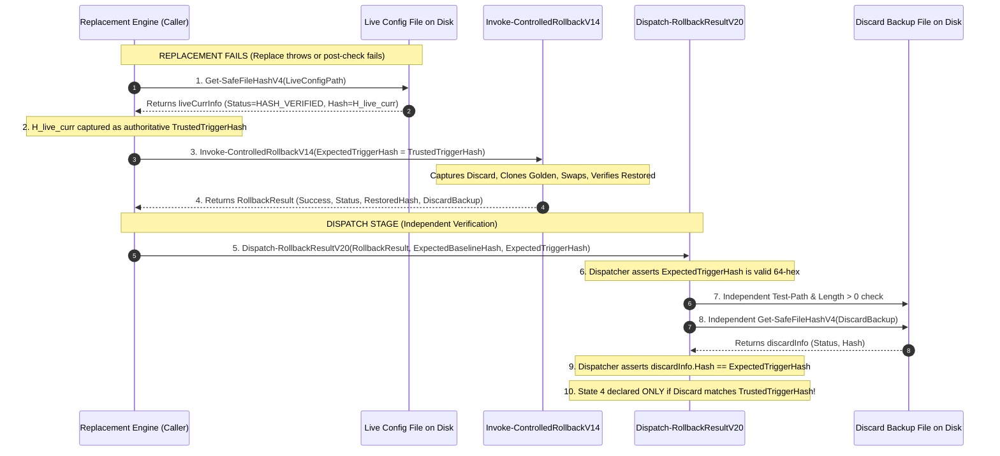

# MUSE SPARK — ZENTRA STEP 2D-2A-AO-T
## DISCARD ARTIFACT INTEGRITY & FAIL-CLOSED EVIDENCE AUDIT REPORT

**Project:** ZENTRA — Hi-Tech Lab Field Service Management Platform  
**Target Repository:** `D:\Zentra`  
**Input Reference:** [`docs/MUSE_SPARK_STEP2D_2A_AO_S_DISPATCH_CONTROL_FLOW_AND_EVIDENCE_AUDIT_REPORT.md`](file:///d:/Zentra/docs/MUSE_SPARK_STEP2D_2A_AO_S_DISPATCH_CONTROL_FLOW_AND_EVIDENCE_AUDIT_REPORT.md)  
**Host Environment:** Windows Workstation (`127.0.0.1:5432`)  
**Report Date:** 2026-10-09  
**Mode:** STRICT DOCUMENTATION-ONLY SPECIFICATION AUDIT  
**Budget Constraint:** Strict ₹0/month (Zero cost, no credit cards, no paid upgrades)  
**Remote Access:** STRICTLY PROHIBITED (Zero remote connections permitted or made)  
**Execution Authorization:** NOT GRANTED — NO OPERATIONAL COMMANDS EXECUTED IN THIS STEP  
**Status:** COMPLETE — WAITING FOR HUMAN OPERATOR REVIEW  

---

## 1. Executive Verdict & Scope

### 1.1 Executive Verdict

A critical human review of the Step 2D-2A-AO-S report revealed that while terminal control flow was successfully solved via local `throw` guards, **the discard artifact validation model remained critically incomplete**:

1. **Superficial `Test-Path` Discard Check:**  
   `Dispatch-RollbackResultV19` verified only `Test-Path -Path $RollbackResult.DiscardBackup -PathType Leaf`. This test checked only whether an entry existed on disk, but failed to assert whether the discard path was a regular leaf file, whether it had non-zero length, whether it was readable, or whether its cryptographic hash matched the pre-rollback state. An empty 0-byte file, locked file, or tampered file would satisfy `Test-Path` and authorize a false State 4 (Rollback Success).
2. **Untrusted Discard Hash Trust Boundary Breach:**  
   The dispatcher had no independent reference for what the discard backup's hash *should* be. In AO-S, `Dispatch-RollbackResultV19` accepted `$ExpectedBaselineHash` and `$CandidateHash`, but omitted `$ExpectedTriggerHash` (the authoritative pre-rollback live hash). If the dispatcher attempted to verify the discard backup, it had to rely on hash values supplied by the *same untrusted `$RollbackResult` object being evaluated*, violating core trust boundaries.
3. **Unaudited Exception Paths During Evidence Checks:**  
   The evidence checks (`Test-Path`, `[System.IO.FileInfo]::new`, `Get-SafeFileHashV4`) lacked exhaustive exception containment. An unexpected exception during evidence verification could bypass structured classification or result in unhandled runtime halts.
4. **Coarse Test Matrix Granularity on Discard Evidence:**  
   The DSP test matrix in AO-S collapsed discard verification into two scenarios (DSP-66 and DSP-67), omitting distinct scenarios for directory/reparse paths, empty files, locked files, helper exceptions, and cryptographic mismatches against trusted trigger hashes.

This report, **Step 2D-2A-AO-T**, provides the definitive architectural remediation:
- Establishes the **Authoritative Evidence-Trust Model** and **Trusted Discard-Hash Contract**, mandating that the caller pass `$ExpectedTriggerHash` (captured independently from the live configuration immediately prior to invoking rollback) to the dispatcher.
- Specifies **`Dispatch-RollbackResultV20`**, incorporating full multi-factor discard artifact validation: leaf type check, length > 0 bytes check, safe hash computation, and strict comparison against the caller-supplied `$ExpectedTriggerHash`, with isolated try/catch terminal containment on every inspection call.
- Formulates a rigorous **Discard Failure-State Mapping Taxonomy** defining separate operational outcomes for all 14 discard failure and exception modes.
- Expands the outer-dispatch test suite to **79 exhaustive test specifications (DSP-01 through DSP-79)**, bringing the total test specification count across the system to **120 specifications**, all strictly marked `NOT EXECUTED — UNTESTED`.
- Re-verifies all safety constraints, execution-status wording, and active blockers (`BLOCKER-1`).

> [!IMPORTANT]
> **Strict Documentation Boundary:** All operational scripts, procedures, and test specifications documented in this report are strictly **[NOT EXECUTED — UNTESTED]**. Zero operational commands of any kind were executed. Zero operational files (`postgresql.conf`, `pg_hba.conf`), Windows Firewall rules, Windows services, application source files, `.env` files, or databases were modified.

---

## 2. Findings with Exact AO-S Section & Line References

| Finding ID | Location in AO-S Report | Defect / Vulnerability Description | Technical Impact | Mandatory Correction in Step AO-T |
|---|---|---|---|---|
| **FIND-AT1** | `Dispatch-RollbackResultV19`<br/>Lines 150–156 | **Superficial Discard Check:** Code checks `Test-Path -Path $RollbackResult.DiscardBackup -PathType Leaf`, but performs zero verification of file size, file readability, or cryptographic content. | A 0-byte file, locked file, or corrupt file satisfies `Test-Path`, falsely declaring State 4 / Outcome 4 without a verified quarantine artifact. | Enforce multi-factor verification: non-container leaf file, length > 0 bytes, readable stream, and SHA-256 hash match. |
| **FIND-AT2** | `Dispatch-RollbackResultV19`<br/>Lines 86–94 | **Missing Trusted Trigger Hash Parameter:** Parameters include `$ExpectedBaselineHash` and `$CandidateHash`, but omit `$ExpectedTriggerHash`. | Dispatcher cannot independently verify discard backup content without trusting properties returned by the untrusted `$RollbackResult` object. | Add mandatory parameter `[string]$ExpectedTriggerHash` to dispatcher, passed directly from caller's pre-rollback live inspection. |
| **FIND-AT3** | `Dispatch-RollbackResultV19`<br/>Lines 150–156 | **Unaudited Evidence Inspection Exceptions:** Invocations of `Test-Path` and potential file metadata queries are not wrapped in dedicated try/catch blocks with local terminal guards. | If `Test-Path` or file metadata queries throw an unexpected I/O or security exception, structured manual recovery classification is bypassed. | Wrap every filesystem and helper call in dedicated try/catch blocks routing to State 5F (`*_QUERY_THREW`) with local terminal guards. |
| **FIND-AT4** | `Section 6.1 Table`<br/>Lines 360–363 | **Discard Test Matrix Gaps:** DSP matrix collapsed discard checks into DSP-66 (path missing) and DSP-67 (file absent), omitting tests for non-leaf path, empty file, locked file, helper crash, and trigger hash mismatch. | Test specification does not provide 1:1 coverage of all possible discard evidence outcomes. | Expand DSP matrix from 68 to 79 test specifications (DSP-01 through DSP-79). |

---

## 3. Evidence-Trust Model & Trustworthy Discard-Hash Contract

### 3.1 The Trust Boundary Flaw in Prior Dispatchers

In Steps AO through AO-S, the dispatcher evaluated the result of `Invoke-ControlledRollbackV14`. However, `Invoke-ControlledRollbackV14` is an internal engine whose output is *subject to verification*. If the dispatcher verifies the discard backup using a hash property provided by the rollback result itself (e.g. `$RollbackResult.DiscardHash`), a compromised or buggy rollback engine could return an arbitrary file path and its own matching hash, creating a **circular trust vulnerability**.

### 3.2 The Trustworthy Discard-Hash Architecture

To establish an unassailable trust boundary, the expected discard hash must originate outside the rollback engine:



### 3.3 Formal Specification: `Dispatch-RollbackResultV20`

Below is the hardened operational specification for `Dispatch-RollbackResultV20`:

```powershell
# [NOT EXECUTED — UNTESTED OPERATIONAL PROCEDURE]

function Dispatch-RollbackResultV20 {
    <#
    .SYNOPSIS
        Outer rollback-result dispatcher with terminal fail-closed control flow,
        authoritative discard artifact verification, and strict cryptographic trust contracts.
    #>
    param (
        [PSCustomObject]$RollbackResult,
        [string]$LiveConfigPath,
        [string]$GoldenBackupPath,
        [string]$ExpectedBaselineHash,
        [string]$ExpectedTriggerHash,
        [string]$CandidateHash,
        [System.Exception]$TriggerError,
        [string]$ContextName
    )

    $sha256Regex = '^[A-Fa-f0-9]{64}$'

    # -------------------------------------------------------------------------
    # STAGE 0: CALLER PARAMETER INTEGRITY ASSERTIONS (TRUST ROOTS)
    # -------------------------------------------------------------------------
    # 0A. Validate ExpectedBaselineHash
    if ([string]::IsNullOrWhiteSpace($ExpectedBaselineHash)) {
        Enter-ManualRecoveryBoundaryV14 -LivePath $LiveConfigPath -BackupPath $GoldenBackupPath `
            -ExpectedBaselineHash $ExpectedBaselineHash -CandidateHash $CandidateHash `
            -InitialError $TriggerError -HashInspectionError $null -RollbackResult $RollbackResult `
            -Detail "[STATE 5D: $ContextName] BASELINE_HASH_MISSING: ExpectedBaselineHash parameter is null or empty. Fail-closed."
        throw [System.InvalidOperationException]::new("FAIL-CLOSED TERMINAL GUARD: ExpectedBaselineHash is null or empty.")
    }
    if ($ExpectedBaselineHash -notmatch $sha256Regex) {
        Enter-ManualRecoveryBoundaryV14 -LivePath $LiveConfigPath -BackupPath $GoldenBackupPath `
            -ExpectedBaselineHash $ExpectedBaselineHash -CandidateHash $CandidateHash `
            -InitialError $TriggerError -HashInspectionError $null -RollbackResult $RollbackResult `
            -Detail "[STATE 5D: $ContextName] BASELINE_HASH_MALFORMED: ExpectedBaselineHash [$ExpectedBaselineHash] is not a valid 64-char SHA-256 hex string. Fail-closed."
        throw [System.InvalidOperationException]::new("FAIL-CLOSED TERMINAL GUARD: ExpectedBaselineHash is malformed.")
    }

    # 0B. Validate ExpectedTriggerHash (Trust Root for Discard Artifact)
    if ([string]::IsNullOrWhiteSpace($ExpectedTriggerHash)) {
        Enter-ManualRecoveryBoundaryV14 -LivePath $LiveConfigPath -BackupPath $GoldenBackupPath `
            -ExpectedBaselineHash $ExpectedBaselineHash -CandidateHash $CandidateHash `
            -InitialError $TriggerError -HashInspectionError $null -RollbackResult $RollbackResult `
            -Detail "[STATE 5D: $ContextName] TRIGGER_HASH_MISSING: Caller failed to supply ExpectedTriggerHash. Discard validation impossible — fail-closed."
        throw [System.InvalidOperationException]::new("FAIL-CLOSED TERMINAL GUARD: ExpectedTriggerHash parameter is null or empty.")
    }
    if ($ExpectedTriggerHash -notmatch $sha256Regex) {
        Enter-ManualRecoveryBoundaryV14 -LivePath $LiveConfigPath -BackupPath $GoldenBackupPath `
            -ExpectedBaselineHash $ExpectedBaselineHash -CandidateHash $CandidateHash `
            -InitialError $TriggerError -HashInspectionError $null -RollbackResult $RollbackResult `
            -Detail "[STATE 5D: $ContextName] TRIGGER_HASH_MALFORMED: ExpectedTriggerHash [$ExpectedTriggerHash] is not a valid 64-char SHA-256 hex string. Fail-closed."
        throw [System.InvalidOperationException]::new("FAIL-CLOSED TERMINAL GUARD: ExpectedTriggerHash is malformed.")
    }

    # -------------------------------------------------------------------------
    # STAGE 1: DEFENSIVE RESULT OBJECT VALIDATION
    # -------------------------------------------------------------------------
    if ($RollbackResult -eq $null) {
        Enter-ManualRecoveryBoundaryV14 -LivePath $LiveConfigPath -BackupPath $GoldenBackupPath `
            -ExpectedBaselineHash $ExpectedBaselineHash -CandidateHash $CandidateHash `
            -InitialError $TriggerError -HashInspectionError $null -RollbackResult $null `
            -Detail "[STATE 5D: $ContextName] ROLLBACK_RESULT_NULL_OBJECT: Rollback engine returned null result object. Indeterminate — fail-closed."
        throw [System.InvalidOperationException]::new("FAIL-CLOSED TERMINAL GUARD: RollbackResult is null.")
    }

    # -------------------------------------------------------------------------
    # STAGE 2: CONTRADICTION INTERCEPTION TRAPS
    # -------------------------------------------------------------------------
    if ($RollbackResult.Success -eq $true -and $RollbackResult.Status -ne "ROLLBACK_SUCCESS") {
        Enter-ManualRecoveryBoundaryV14 -LivePath $LiveConfigPath -BackupPath $GoldenBackupPath `
            -ExpectedBaselineHash $ExpectedBaselineHash -CandidateHash $CandidateHash `
            -InitialError $TriggerError -HashInspectionError $null -RollbackResult $RollbackResult `
            -Detail "[STATE 5D: $ContextName] CONTRADICTORY_ROLLBACK_RESULT_FLAG_TRUE: Success is true, but Status is '$($RollbackResult.Status)'. Fail-closed."
        throw [System.InvalidOperationException]::new("FAIL-CLOSED TERMINAL GUARD: Contradictory flag/status pair (Success=true, Status!=ROLLBACK_SUCCESS).")
    }

    if ($RollbackResult.Success -ne $true -and $RollbackResult.Status -eq "ROLLBACK_SUCCESS") {
        Enter-ManualRecoveryBoundaryV14 -LivePath $LiveConfigPath -BackupPath $GoldenBackupPath `
            -ExpectedBaselineHash $ExpectedBaselineHash -CandidateHash $CandidateHash `
            -InitialError $TriggerError -HashInspectionError $null -RollbackResult $RollbackResult `
            -Detail "[STATE 5D: $ContextName] CONTRADICTORY_ROLLBACK_RESULT_STATUS_SUCCESS: Status claims 'ROLLBACK_SUCCESS', but Success is false. Fail-closed."
        throw [System.InvalidOperationException]::new("FAIL-CLOSED TERMINAL GUARD: Contradictory flag/status pair (Success=false, Status=ROLLBACK_SUCCESS).")
    }

    # -------------------------------------------------------------------------
    # STAGE 3: MULTI-FACTOR SUCCESS EVIDENCE VALIDATION (STATE 4 AUTHORIZATION)
    # -------------------------------------------------------------------------
    if ($RollbackResult.Success -eq $true -and $RollbackResult.Status -eq "ROLLBACK_SUCCESS") {
        
        # 3A. RestoredHash Presence Check
        if ([string]::IsNullOrWhiteSpace($RollbackResult.RestoredHash)) {
            Enter-ManualRecoveryBoundaryV14 -LivePath $LiveConfigPath -BackupPath $GoldenBackupPath `
                -ExpectedBaselineHash $ExpectedBaselineHash -CandidateHash $CandidateHash `
                -InitialError $TriggerError -HashInspectionError $null -RollbackResult $RollbackResult `
                -Detail "[STATE 5D: $ContextName] RESTORED_HASH_MISSING: RestoredHash property is null or empty. Fail-closed."
            throw [System.InvalidOperationException]::new("FAIL-CLOSED TERMINAL GUARD: RestoredHash is missing.")
        }

        # 3B. RestoredHash Format Validation
        if ($RollbackResult.RestoredHash -notmatch $sha256Regex) {
            Enter-ManualRecoveryBoundaryV14 -LivePath $LiveConfigPath -BackupPath $GoldenBackupPath `
                -ExpectedBaselineHash $ExpectedBaselineHash -CandidateHash $CandidateHash `
                -InitialError $TriggerError -HashInspectionError $null -RollbackResult $RollbackResult `
                -Detail "[STATE 5D: $ContextName] RESTORED_HASH_MALFORMED: RestoredHash [$($RollbackResult.RestoredHash)] is not a valid 64-char SHA-256 hex string. Fail-closed."
            throw [System.InvalidOperationException]::new("FAIL-CLOSED TERMINAL GUARD: RestoredHash is malformed.")
        }

        # 3C. RestoredHash Equality against ExpectedBaselineHash
        if ($RollbackResult.RestoredHash -ine $ExpectedBaselineHash) {
            Enter-ManualRecoveryBoundaryV14 -LivePath $LiveConfigPath -BackupPath $GoldenBackupPath `
                -ExpectedBaselineHash $ExpectedBaselineHash -CandidateHash $CandidateHash `
                -InitialError $TriggerError -HashInspectionError $null -RollbackResult $RollbackResult `
                -Detail "[STATE 5C: $ContextName] RESTORED_HASH_MISMATCH: RestoredHash [$($RollbackResult.RestoredHash)] differs from ExpectedBaselineHash [$ExpectedBaselineHash]. Content corruption — fail-closed."
            throw [System.InvalidOperationException]::new("FAIL-CLOSED TERMINAL GUARD: RestoredHash mismatch against baseline.")
        }

        # 3D. DiscardBackup Property Presence Check
        if ([string]::IsNullOrWhiteSpace($RollbackResult.DiscardBackup)) {
            Enter-ManualRecoveryBoundaryV14 -LivePath $LiveConfigPath -BackupPath $GoldenBackupPath `
                -ExpectedBaselineHash $ExpectedBaselineHash -CandidateHash $CandidateHash `
                -InitialError $TriggerError -HashInspectionError $null -RollbackResult $RollbackResult `
                -Detail "[STATE 5D: $ContextName] DISCARD_PATH_MISSING: DiscardBackup property is null or empty. Fail-closed."
            throw [System.InvalidOperationException]::new("FAIL-CLOSED TERMINAL GUARD: DiscardBackup property is missing.")
        }

        $discardPath = $RollbackResult.DiscardBackup

        # 3E. DiscardBackup Filesystem Existence Query (Isolated Try/Catch)
        $pathExists = $false
        $pathTestError = $null
        try {
            $pathExists = Test-Path -Path $discardPath
        }
        catch {
            $pathTestError = $_.Exception
        }
        if ($pathTestError -ne $null) {
            Enter-ManualRecoveryBoundaryV14 -LivePath $LiveConfigPath -BackupPath $GoldenBackupPath `
                -ExpectedBaselineHash $ExpectedBaselineHash -CandidateHash $CandidateHash `
                -InitialError $TriggerError -HashInspectionError $pathTestError -RollbackResult $RollbackResult `
                -Detail "[STATE 5F: $ContextName] DISCARD_PATH_QUERY_THREW: Test-Path threw an exception on discard backup: $($pathTestError.Message)"
            throw [System.InvalidOperationException]::new("FAIL-CLOSED TERMINAL GUARD: Discard Test-Path threw an exception.")
        }
        if (-not $pathExists) {
            Enter-ManualRecoveryBoundaryV14 -LivePath $LiveConfigPath -BackupPath $GoldenBackupPath `
                -ExpectedBaselineHash $ExpectedBaselineHash -CandidateHash $CandidateHash `
                -InitialError $TriggerError -HashInspectionError $null -RollbackResult $RollbackResult `
                -Detail "[STATE 5C: $ContextName] DISCARD_FILE_ABSENT: Discard backup file [$discardPath] does not exist on disk. Fail-closed."
            throw [System.InvalidOperationException]::new("FAIL-CLOSED TERMINAL GUARD: Discard file absent from disk.")
        }

        # 3F. DiscardBackup Leaf File Type Assertion
        $isLeaf = $false
        try {
            $isLeaf = Test-Path -Path $discardPath -PathType Leaf
        }
        catch {
            $pathTestError = $_.Exception
        }
        if ($pathTestError -ne $null) {
            Enter-ManualRecoveryBoundaryV14 -LivePath $LiveConfigPath -BackupPath $GoldenBackupPath `
                -ExpectedBaselineHash $ExpectedBaselineHash -CandidateHash $CandidateHash `
                -InitialError $TriggerError -HashInspectionError $pathTestError -RollbackResult $RollbackResult `
                -Detail "[STATE 5F: $ContextName] DISCARD_LEAF_QUERY_THREW: Test-Path -PathType Leaf threw an exception: $($pathTestError.Message)"
            throw [System.InvalidOperationException]::new("FAIL-CLOSED TERMINAL GUARD: Discard leaf check threw an exception.")
        }
        if (-not $isLeaf) {
            Enter-ManualRecoveryBoundaryV14 -LivePath $LiveConfigPath -BackupPath $GoldenBackupPath `
                -ExpectedBaselineHash $ExpectedBaselineHash -CandidateHash $CandidateHash `
                -InitialError $TriggerError -HashInspectionError $null -RollbackResult $RollbackResult `
                -Detail "[STATE 5C: $ContextName] DISCARD_PATH_NOT_LEAF_FILE: Discard backup path [$discardPath] exists but is a directory or container, not a leaf file. Fail-closed."
            throw [System.InvalidOperationException]::new("FAIL-CLOSED TERMINAL GUARD: Discard path is not a leaf file.")
        }

        # 3G. DiscardBackup Non-Zero Length Assertion (Isolated Try/Catch)
        $discardLength = -1
        $statError = $null
        try {
            $fi = [System.IO.FileInfo]::new($discardPath)
            $discardLength = $fi.Length
        }
        catch {
            $statError = $_.Exception
        }
        if ($statError -ne $null) {
            Enter-ManualRecoveryBoundaryV14 -LivePath $LiveConfigPath -BackupPath $GoldenBackupPath `
                -ExpectedBaselineHash $ExpectedBaselineHash -CandidateHash $CandidateHash `
                -InitialError $TriggerError -HashInspectionError $statError -RollbackResult $RollbackResult `
                -Detail "[STATE 5F: $ContextName] DISCARD_STAT_QUERY_THREW: FileInfo inspection threw an exception: $($statError.Message)"
            throw [System.InvalidOperationException]::new("FAIL-CLOSED TERMINAL GUARD: Discard stat query threw.")
        }
        if ($discardLength -le 0) {
            Enter-ManualRecoveryBoundaryV14 -LivePath $LiveConfigPath -BackupPath $GoldenBackupPath `
                -ExpectedBaselineHash $ExpectedBaselineHash -CandidateHash $CandidateHash `
                -InitialError $TriggerError -HashInspectionError $null -RollbackResult $RollbackResult `
                -Detail "[STATE 5C: $ContextName] DISCARD_FILE_EMPTY: Discard backup file [$discardPath] is 0 bytes. Quarantine artifact corrupt — fail-closed."
            throw [System.InvalidOperationException]::new("FAIL-CLOSED TERMINAL GUARD: Discard file is 0 bytes.")
        }

        # 3H. Independent Discard Cryptographic Hash Calculation (9-Class)
        $discardHashInfo = $null
        $discardHashError = $null
        try {
            $discardHashInfo = Get-SafeFileHashV4 -FilePath $discardPath
        }
        catch {
            $discardHashError = $_.Exception
        }
        if ($discardHashError -ne $null) {
            Enter-ManualRecoveryBoundaryV14 -LivePath $LiveConfigPath -BackupPath $GoldenBackupPath `
                -ExpectedBaselineHash $ExpectedBaselineHash -CandidateHash $CandidateHash `
                -InitialError $TriggerError -HashInspectionError $discardHashError -RollbackResult $RollbackResult `
                -Detail "[STATE 5F: $ContextName] DISCARD_HASH_QUERY_THREW: Hash query on discard backup threw an exception: $($discardHashError.Message)"
            throw [System.InvalidOperationException]::new("FAIL-CLOSED TERMINAL GUARD: Discard hash query threw an exception.")
        }
        if ($discardHashInfo -eq $null -or $discardHashInfo.Status -eq $null) {
            Enter-ManualRecoveryBoundaryV14 -LivePath $LiveConfigPath -BackupPath $GoldenBackupPath `
                -ExpectedBaselineHash $ExpectedBaselineHash -CandidateHash $CandidateHash `
                -InitialError $TriggerError -HashInspectionError $null -RollbackResult $RollbackResult `
                -Detail "[STATE 5D: $ContextName] DISCARD_HASH_NULL_RESULT: Discard hash query returned null object or null status property. Fail-closed."
            throw [System.InvalidOperationException]::new("FAIL-CLOSED TERMINAL GUARD: Discard hash returned null.")
        }

        switch ($discardHashInfo.Status) {
            "HASH_READ_FAILED" {
                Enter-ManualRecoveryBoundaryV14 -LivePath $LiveConfigPath -BackupPath $GoldenBackupPath `
                    -ExpectedBaselineHash $ExpectedBaselineHash -CandidateHash $CandidateHash `
                    -InitialError $TriggerError -HashInspectionError $discardHashInfo.Error -RollbackResult $RollbackResult `
                    -Detail "[STATE 5B: $ContextName] DISCARD_FILE_UNREADABLE: Discard backup file is locked or unreadable: $($discardHashInfo.Message)"
                throw [System.InvalidOperationException]::new("FAIL-CLOSED TERMINAL GUARD: Discard file unreadable.")
            }
            "HELPER_EXCEPTION" {
                Enter-ManualRecoveryBoundaryV14 -LivePath $LiveConfigPath -BackupPath $GoldenBackupPath `
                    -ExpectedBaselineHash $ExpectedBaselineHash -CandidateHash $CandidateHash `
                    -InitialError $TriggerError -HashInspectionError $discardHashInfo.Error -RollbackResult $RollbackResult `
                    -Detail "[STATE 5F: $ContextName] DISCARD_HELPER_EXCEPTION: Hash helper failed on discard backup: $($discardHashInfo.Message)"
                throw [System.InvalidOperationException]::new("FAIL-CLOSED TERMINAL GUARD: Discard helper exception.")
            }
            "HASH_VERIFIED" {
                if ($discardHashInfo.Hash -ine $ExpectedTriggerHash) {
                    Enter-ManualRecoveryBoundaryV14 -LivePath $LiveConfigPath -BackupPath $GoldenBackupPath `
                        -ExpectedBaselineHash $ExpectedBaselineHash -CandidateHash $CandidateHash `
                        -InitialError $TriggerError -HashInspectionError $null -RollbackResult $RollbackResult `
                        -Detail "[STATE 5C: $ContextName] DISCARD_HASH_MISMATCH: Discard hash [$($discardHashInfo.Hash)] does not match trusted trigger hash [$ExpectedTriggerHash]. Quarantine content corrupt — fail-closed."
                    throw [System.InvalidOperationException]::new("FAIL-CLOSED TERMINAL GUARD: Discard hash mismatch against trusted trigger hash.")
                }
            }
            default {
                Enter-ManualRecoveryBoundaryV14 -LivePath $LiveConfigPath -BackupPath $GoldenBackupPath `
                    -ExpectedBaselineHash $ExpectedBaselineHash -CandidateHash $CandidateHash `
                    -InitialError $TriggerError -HashInspectionError $null -RollbackResult $RollbackResult `
                    -Detail "[STATE 5D: $ContextName] DISCARD_HASH_UNKNOWN_STATUS: Discard hash query returned unknown status [$($discardHashInfo.Status)]. Fail-closed."
                throw [System.InvalidOperationException]::new("FAIL-CLOSED TERMINAL GUARD: Discard hash unknown status.")
            }
        }

        # ALL 8 EVIDENCE CHECKS STRICTLY SATISFIED -> STATE 4 / OUTCOME 4 AUTHORIZED
        Write-Host "[OUTCOME 4: ROLLBACK SUCCESS] Original configuration verified and restored [SHA256: $($RollbackResult.RestoredHash)]." -ForegroundColor Yellow
        Write-Host "[OUTCOME 4: ARTIFACT STATUS] Golden backup [$GoldenBackupPath] and Discard backup [$discardPath] independently verified on disk." -ForegroundColor Yellow
        throw "FAIL-CLOSED ABORT [OUTCOME 4]: $ContextName failed ($($TriggerError.Message)), but rollback successfully restored original configuration. Live service safe."
    }

    # -------------------------------------------------------------------------
    # STAGE 4: FAILURE PATHS — STATUS STRING VALIDATION
    # -------------------------------------------------------------------------
    $rbStatus = $RollbackResult.Status

    if ([string]::IsNullOrEmpty($rbStatus)) {
        Enter-ManualRecoveryBoundaryV14 -LivePath $LiveConfigPath -BackupPath $GoldenBackupPath `
            -ExpectedBaselineHash $ExpectedBaselineHash -CandidateHash $CandidateHash `
            -InitialError $TriggerError -HashInspectionError $null -RollbackResult $RollbackResult `
            -Detail "[STATE 5D: $ContextName] ROLLBACK_RESULT_NULL_STATUS: Rollback engine returned null or empty status string. Indeterminate — fail-closed."
        throw [System.InvalidOperationException]::new("FAIL-CLOSED TERMINAL GUARD: Rollback Status property is null or empty.")
    }

    # -------------------------------------------------------------------------
    # STAGE 5: EXHAUSTIVE STATUS-TO-STATE SWITCH (54 FAILURE STATUSES)
    # -------------------------------------------------------------------------
    switch ($rbStatus) {
        # STATE 5A: TARGET FILE CONFIRMED MISSING (3 STATUSES)
        { $_ -in @("ROLLBACK_DEST_MISSING", "PRE_ROLLBACK_LIVE_MISSING", "RESTORED_FILE_MISSING") } {
            Enter-ManualRecoveryBoundaryV14 -LivePath $LiveConfigPath -BackupPath $GoldenBackupPath `
                -ExpectedBaselineHash $ExpectedBaselineHash -CandidateHash $CandidateHash `
                -InitialError $TriggerError -HashInspectionError $null -RollbackResult $RollbackResult `
                -Detail "[STATE 5A: $ContextName] Live destination file confirmed missing ($rbStatus): $($RollbackResult.Message)"
            throw [System.InvalidOperationException]::new("FAIL-CLOSED TERMINAL GUARD: Handled State 5A ($rbStatus).")
        }

        # STATE 5B: TARGET FILE PRESENT BUT UNREADABLE (3 STATUSES)
        { $_ -in @("ROLLBACK_DEST_UNREADABLE", "PRE_ROLLBACK_LIVE_UNREADABLE", "RESTORED_FILE_UNREADABLE") } {
            Enter-ManualRecoveryBoundaryV14 -LivePath $LiveConfigPath -BackupPath $GoldenBackupPath `
                -ExpectedBaselineHash $ExpectedBaselineHash -CandidateHash $CandidateHash `
                -InitialError $TriggerError -HashInspectionError $RollbackResult.Error -RollbackResult $RollbackResult `
                -Detail "[STATE 5B: $ContextName] Live destination file present but unreadable ($rbStatus): $($RollbackResult.Message)"
            throw [System.InvalidOperationException]::new("FAIL-CLOSED TERMINAL GUARD: Handled State 5B ($rbStatus).")
        }

        # STATE 5C: ROLLBACK MECHANICALLY FAILED (17 STATUSES)
        { $_ -in @(
            "GOLDEN_BACKUP_MISSING", "GOLDEN_BACKUP_UNREADABLE", "GOLDEN_BACKUP_HASH_MISMATCH",
            "ROLLBACK_DEST_TRIGGER_MISMATCH", "DISCARD_CAPTURE_READ_FAILED", "DISCARD_CAPTURE_FAILED",
            "DISCARD_FILE_MISSING", "DISCARD_FILE_UNREADABLE", "DISCARD_HASH_MISMATCH",
            "SACRIFICIAL_CLONE_READ_FAILED", "SACRIFICIAL_CLONE_CREATION_FAILED", "SACRIFICIAL_CLONE_MISSING",
            "SACRIFICIAL_CLONE_UNREADABLE", "SACRIFICIAL_CLONE_HASH_MISMATCH", "LIVE_MUTATED_POST_DISCARD",
            "ROLLBACK_SWAP_EXCEPTION", "RESTORED_HASH_MISMATCH"
        ) } {
            Enter-ManualRecoveryBoundaryV14 -LivePath $LiveConfigPath -BackupPath $GoldenBackupPath `
                -ExpectedBaselineHash $ExpectedBaselineHash -CandidateHash $CandidateHash `
                -InitialError $TriggerError -HashInspectionError $null -RollbackResult $RollbackResult `
                -Detail "[STATE 5C: $ContextName] Rollback execution mechanically failed ($rbStatus): $($RollbackResult.Message)"
            throw [System.InvalidOperationException]::new("FAIL-CLOSED TERMINAL GUARD: Handled State 5C ($rbStatus).")
        }

        # STATE 5D: INDETERMINATE NULL / UNKNOWN STATUS (18 STATUSES)
        { $_ -in @(
            "GOLDEN_BACKUP_NULL_RESULT", "GOLDEN_BACKUP_NULL_STATUS", "GOLDEN_BACKUP_UNKNOWN_STATUS",
            "ROLLBACK_DEST_NULL_RESULT", "ROLLBACK_DEST_NULL_STATUS", "ROLLBACK_DEST_UNKNOWN_STATUS",
            "DISCARD_NULL_RESULT", "DISCARD_NULL_STATUS", "DISCARD_UNKNOWN_STATUS",
            "SACRIFICIAL_CLONE_NULL_RESULT", "SACRIFICIAL_CLONE_NULL_STATUS", "SACRIFICIAL_CLONE_UNKNOWN_STATUS",
            "PRE_ROLLBACK_LIVE_NULL_RESULT", "PRE_ROLLBACK_LIVE_NULL_STATUS", "PRE_ROLLBACK_LIVE_UNKNOWN_STATUS",
            "RESTORED_NULL_RESULT", "RESTORED_NULL_STATUS", "RESTORED_UNKNOWN_STATUS"
        ) } {
            Enter-ManualRecoveryBoundaryV14 -LivePath $LiveConfigPath -BackupPath $GoldenBackupPath `
                -ExpectedBaselineHash $ExpectedBaselineHash -CandidateHash $CandidateHash `
                -InitialError $TriggerError -HashInspectionError $null -RollbackResult $RollbackResult `
                -Detail "[STATE 5D: $ContextName] Rollback returned null/unknown status string ($rbStatus): $($RollbackResult.Message). Indeterminate — fail-closed."
            throw [System.InvalidOperationException]::new("FAIL-CLOSED TERMINAL GUARD: Handled State 5D ($rbStatus).")
        }

        # STATE 5E: ROLLBACK BYTE VERIFICATION FAILED (1 STATUS)
        "ROLLBACK_BYTE_VERIFY_FAILED" {
            Enter-ManualRecoveryBoundaryV14 -LivePath $LiveConfigPath -BackupPath $GoldenBackupPath `
                -ExpectedBaselineHash $ExpectedBaselineHash -CandidateHash $CandidateHash `
                -InitialError $TriggerError -HashInspectionError $null -RollbackResult $RollbackResult `
                -Detail "[STATE 5E: $ContextName] Rollback restored baseline hash, but byte integrity verification failed: $($RollbackResult.Message)"
            throw [System.InvalidOperationException]::new("FAIL-CLOSED TERMINAL GUARD: Handled State 5E ($rbStatus).")
        }

        # STATE 5F: TOOLING / HELPER / QUERY EXCEPTION (12 STATUSES)
        { $_ -in @(
            "GOLDEN_BACKUP_QUERY_THREW", "GOLDEN_BACKUP_HELPER_EXCEPTION", "ROLLBACK_DEST_QUERY_THREW",
            "ROLLBACK_DEST_HELPER_EXCEPTION", "DISCARD_QUERY_THREW", "DISCARD_HELPER_EXCEPTION",
            "SACRIFICIAL_CLONE_QUERY_THREW", "SACRIFICIAL_CLONE_HELPER_EXCEPTION", "PRE_ROLLBACK_LIVE_QUERY_THREW",
            "PRE_ROLLBACK_LIVE_HELPER_EXCEPTION", "RESTORED_QUERY_THREW", "RESTORED_HELPER_EXCEPTION"
        ) } {
            Enter-ManualRecoveryBoundaryV14 -LivePath $LiveConfigPath -BackupPath $GoldenBackupPath `
                -ExpectedBaselineHash $ExpectedBaselineHash -CandidateHash $CandidateHash `
                -InitialError $TriggerError -HashInspectionError $RollbackResult.Error -RollbackResult $RollbackResult `
                -Detail "[STATE 5F: $ContextName] Tooling/helper exception during rollback ($rbStatus): $($RollbackResult.Message). Indeterminate — fail-closed."
            throw [System.InvalidOperationException]::new("FAIL-CLOSED TERMINAL GUARD: Handled State 5F ($rbStatus).")
        }

        # DEFENSIVE DEFAULT: UNRECOGNIZED STATUS STRING (1 BRANCH)
        default {
            Enter-ManualRecoveryBoundaryV14 -LivePath $LiveConfigPath -BackupPath $GoldenBackupPath `
                -ExpectedBaselineHash $ExpectedBaselineHash -CandidateHash $CandidateHash `
                -InitialError $TriggerError -HashInspectionError $null -RollbackResult $RollbackResult `
                -Detail "[STATE 5D: $ContextName] UNRECOGNIZED_STATUS_STRING: Rollback returned unrecognized status [$rbStatus]. Indeterminate — fail-closed."
            throw [System.InvalidOperationException]::new("FAIL-CLOSED TERMINAL GUARD: Handled default unrecognized status ($rbStatus).")
        }
    }

    throw [System.InvalidOperationException]::new("CRITICAL FATAL: Control flow reached post-dispatcher state. Terminal invariant breached.")
}
```

---

## 4. Discard Failure-State Mapping & Exception Taxonomy

The table below defines the strict categorization for all 14 discard artifact evidence failure modes:

| # | Inspection Condition / Failure Mode | Failure Code String | Assigned State | Outcome Class | Technical Definition & Rationale |
|---|---|---|---|---|---|
| 1 | `$RollbackResult.DiscardBackup` is `$null`, empty string, or whitespace. | `DISCARD_PATH_MISSING` | **State 5D** | Outcome 5D | Required property absent from result contract. Indeterminate evidence. |
| 2 | `Test-Path` invocation threw an unexpected runtime exception. | `DISCARD_PATH_QUERY_THREW` | **State 5F** | Outcome 5F | Tooling / runtime exception accessing filesystem. Indeterminate. |
| 3 | `Test-Path` returned `$false` (file does not exist on disk). | `DISCARD_FILE_ABSENT` | **State 5C** | Outcome 5C | Confirmed missing quarantine artifact on disk. Integrity breach. |
| 4 | `Test-Path -PathType Leaf` returned `$false` (exists as container). | `DISCARD_PATH_NOT_LEAF_FILE` | **State 5C** | Outcome 5C | Path is a directory, reparse point, or device. Invalid artifact type. |
| 5 | `[System.IO.FileInfo]::new` metadata query threw an exception. | `DISCARD_STAT_QUERY_THREW` | **State 5F** | Outcome 5F | Security or filesystem failure inspecting file attributes. Indeterminate. |
| 6 | File length is 0 bytes (`Length -le 0`). | `DISCARD_FILE_EMPTY` | **State 5C** | Outcome 5C | Quarantine artifact contains zero bytes. Corrupt evidence. |
| 7 | `Get-SafeFileHashV4` on discard backup threw an unhandled exception. | `DISCARD_HASH_QUERY_THREW` | **State 5F** | Outcome 5F | Tooling / CLR exception during cryptographic hash calculation. |
| 8 | Discard hash helper returned `$null` result or null status. | `DISCARD_HASH_NULL_RESULT` | **State 5D** | Outcome 5D | Cryptographic verification returned null result object. Indeterminate. |
| 9 | Discard file locked by external process (`HASH_READ_FAILED`). | `DISCARD_FILE_UNREADABLE` | **State 5B** | Outcome 5B | File exists and non-empty, but locked by anti-virus or indexer. Unreadable. |
| 10 | Discard hash helper encountered CLR fault (`HELPER_EXCEPTION`). | `DISCARD_HELPER_EXCEPTION` | **State 5F** | Outcome 5F | Internal failure in cryptographic calculation helper. Indeterminate. |
| 11 | Discard hash helper returned unrecognized status string. | `DISCARD_HASH_UNKNOWN_STATUS` | **State 5D** | Outcome 5D | Helper returned unmapped status. Indeterminate — fail-closed. |
| 12 | Discard hash differs from trusted trigger hash (`Hash -ine Trigger`).| `DISCARD_HASH_MISMATCH` | **State 5C** | Outcome 5C | Discard artifact does NOT match pre-rollback live state. Evidence corrupt. |
| 13 | `$ExpectedTriggerHash` parameter is missing or empty. | `TRIGGER_HASH_MISSING` | **State 5D** | Outcome 5D | Caller failed to supply trust root for discard verification. Fail-closed. |
| 14 | `$ExpectedTriggerHash` parameter does not match `^[A-Fa-f0-9]{64}$`. | `TRIGGER_HASH_MALFORMED` | **State 5D** | Outcome 5D | Caller supplied syntactically invalid trigger hash. Fail-closed. |

---

## 5. Revised Outer-Dispatch Test Matrix (79 Specifications)

The table below expands the outer-dispatch test specifications from 68 in Step AO-S to **79 exhaustive specifications (DSP-01 through DSP-79)**:

- **DSP-01 through DSP-55:** All 55 documented return paths of `Invoke-ControlledRollbackV14`.
- **DSP-56 through DSP-59:** Defensive dispatch edge handlers (null object, null status property, empty status string, unrecognized status string).
- **DSP-60 through DSP-61:** Contradiction interception traps (Trap A: `Success=$true` with fail status; Trap B: `Success=$false` with success status).
- **DSP-62 through DSP-65:** Baseline and Restored hash evidence validations (RestoredHash missing, RestoredHash malformed, RestoredHash mismatch, BaselineHash malformed).
- **DSP-66 through DSP-78:** Dedicated Discard Artifact Integrity & Evidence Assertions.
- **DSP-79:** Terminal guard post-boundary fall-through verification.

> [!NOTE]
> All 79 scenarios below are strictly **[TEST SPECIFICATIONS — NOT EXECUTED — UNTESTED]**.

| Test ID | Input `Status` | `Success` | Evidence Profile Tested | Expected State | Outcome | Terminal Action | Artifact Disposition |
|---|---|---|---|---|---|---|---|
| **DSP-01** | `GOLDEN_BACKUP_QUERY_THREW` | `$false` | Standard failure profile | **State 5F** | 5F | Local Throw | Candidate: Retained; Backup: Retained; Clone: N/C; Discard: N/C; Live: Altered. |
| **DSP-02** | `GOLDEN_BACKUP_NULL_RESULT` | `$false` | Standard failure profile | **State 5D** | 5D | Local Throw | Candidate: Retained; Backup: Retained; Clone: N/C; Discard: N/C; Live: Altered. |
| **DSP-03** | `GOLDEN_BACKUP_NULL_STATUS` | `$false` | Standard failure profile | **State 5D** | 5D | Local Throw | Candidate: Retained; Backup: Retained; Clone: N/C; Discard: N/C; Live: Altered. |
| **DSP-04** | `GOLDEN_BACKUP_MISSING` | `$false` | Standard failure profile | **State 5C** | 5C | Local Throw | Candidate: Retained; Backup: N/C; Clone: N/C; Discard: N/C; Live: Altered. |
| **DSP-05** | `GOLDEN_BACKUP_UNREADABLE` | `$false` | Standard failure profile | **State 5C** | 5C | Local Throw | Candidate: Retained; Backup: Retained; Clone: N/C; Discard: N/C; Live: Altered. |
| **DSP-06** | `GOLDEN_BACKUP_HELPER_EXCEPTION`| `$false` | Standard failure profile | **State 5F** | 5F | Local Throw | Candidate: Retained; Backup: Retained; Clone: N/C; Discard: N/C; Live: Altered. |
| **DSP-07** | `GOLDEN_BACKUP_HASH_MISMATCH` | `$false` | Standard failure profile | **State 5C** | 5C | Local Throw | Candidate: Retained; Backup: Retained; Clone: N/C; Discard: N/C; Live: Altered. |
| **DSP-08** | `GOLDEN_BACKUP_UNKNOWN_STATUS` | `$false` | Standard failure profile | **State 5D** | 5D | Local Throw | Candidate: Retained; Backup: Retained; Clone: N/C; Discard: N/C; Live: Altered. |
| **DSP-09** | `ROLLBACK_DEST_QUERY_THREW` | `$false` | Standard failure profile | **State 5F** | 5F | Local Throw | Candidate: Retained; Backup: Retained; Clone: N/C; Discard: N/C; Live: Altered. |
| **DSP-10** | `ROLLBACK_DEST_NULL_RESULT` | `$false` | Standard failure profile | **State 5D** | 5D | Local Throw | Candidate: Retained; Backup: Retained; Clone: N/C; Discard: N/C; Live: Altered. |
| **DSP-11** | `ROLLBACK_DEST_NULL_STATUS` | `$false` | Standard failure profile | **State 5D** | 5D | Local Throw | Candidate: Retained; Backup: Retained; Clone: N/C; Discard: N/C; Live: Altered. |
| **DSP-12** | `ROLLBACK_DEST_MISSING` | `$false` | Standard failure profile | **State 5A** | 5A | Local Throw | Candidate: Retained; Backup: Retained; Clone: N/C; Discard: N/C; Live: Missing. |
| **DSP-13** | `ROLLBACK_DEST_UNREADABLE` | `$false` | Standard failure profile | **State 5B** | 5B | Local Throw | Candidate: Retained; Backup: Retained; Clone: N/C; Discard: N/C; Live: Locked. |
| **DSP-14** | `ROLLBACK_DEST_HELPER_EXCEPTION`| `$false` | Standard failure profile | **State 5F** | 5F | Local Throw | Candidate: Retained; Backup: Retained; Clone: N/C; Discard: N/C; Live: Altered. |
| **DSP-15** | `ROLLBACK_DEST_TRIGGER_MISMATCH`| `$false` | Standard failure profile | **State 5C** | 5C | Local Throw | Candidate: Retained; Backup: Retained; Clone: N/C; Discard: N/C; Live: Altered. |
| **DSP-16** | `ROLLBACK_DEST_UNKNOWN_STATUS` | `$false` | Standard failure profile | **State 5D** | 5D | Local Throw | Candidate: Retained; Backup: Retained; Clone: N/C; Discard: N/C; Live: Altered. |
| **DSP-17** | `DISCARD_CAPTURE_READ_FAILED` | `$false` | Standard failure profile | **State 5C** | 5C | Local Throw | Candidate: Retained; Backup: Retained; Clone: N/C; Discard: N/C; Live: Altered. |
| **DSP-18** | `DISCARD_CAPTURE_FAILED` | `$false` | Discard: Partial Path | **State 5C** | 5C | Local Throw | Candidate: Retained; Backup: Retained; Clone: N/C; Discard: Partial; Live: Altered. |
| **DSP-19** | `DISCARD_QUERY_THREW` | `$false` | Discard: Retained Path | **State 5F** | 5F | Local Throw | Candidate: Retained; Backup: Retained; Clone: N/C; Discard: Retained; Live: Altered. |
| **DSP-20** | `DISCARD_NULL_RESULT` | `$false` | Discard: Retained Path | **State 5D** | 5D | Local Throw | Candidate: Retained; Backup: Retained; Clone: N/C; Discard: Retained; Live: Altered. |
| **DSP-21** | `DISCARD_NULL_STATUS` | `$false` | Discard: Retained Path | **State 5D** | 5D | Local Throw | Candidate: Retained; Backup: Retained; Clone: N/C; Discard: Retained; Live: Altered. |
| **DSP-22** | `DISCARD_FILE_MISSING` | `$false` | Discard: Missing Path | **State 5C** | 5C | Local Throw | Candidate: Retained; Backup: Retained; Clone: N/C; Discard: N/C; Live: Altered. |
| **DSP-23** | `DISCARD_FILE_UNREADABLE` | `$false` | Discard: Retained Path | **State 5C** | 5C | Local Throw | Candidate: Retained; Backup: Retained; Clone: N/C; Discard: Retained; Live: Altered. |
| **DSP-24** | `DISCARD_HELPER_EXCEPTION` | `$false` | Discard: Retained Path | **State 5F** | 5F | Local Throw | Candidate: Retained; Backup: Retained; Clone: N/C; Discard: Retained; Live: Altered. |
| **DSP-25** | `DISCARD_HASH_MISMATCH` | `$false` | Discard: Retained Path | **State 5C** | 5C | Local Throw | Candidate: Retained; Backup: Retained; Clone: N/C; Discard: Retained; Live: Altered. |
| **DSP-26** | `DISCARD_UNKNOWN_STATUS` | `$false` | Discard: Retained Path | **State 5D** | 5D | Local Throw | Candidate: Retained; Backup: Retained; Clone: N/C; Discard: Retained; Live: Altered. |
| **DSP-27** | `SACRIFICIAL_CLONE_READ_FAILED` | `$false` | Discard: Retained Path | **State 5C** | 5C | Local Throw | Candidate: Retained; Backup: Retained; Clone: N/C; Discard: Retained; Live: Altered. |
| **DSP-28** | `SACRIFICIAL_CLONE_CREATION_FAILED`| `$false` | Clone: Partial Path | **State 5C** | 5C | Local Throw | Candidate: Retained; Backup: Retained; Clone: Partial; Discard: Retained; Live: Altered. |
| **DSP-29** | `SACRIFICIAL_CLONE_QUERY_THREW` | `$false` | Clone: Retained Path | **State 5F** | 5F | Local Throw | Candidate: Retained; Backup: Retained; Clone: Retained; Discard: Retained; Live: Altered. |
| **DSP-30** | `SACRIFICIAL_CLONE_NULL_RESULT` | `$false` | Clone: Retained Path | **State 5D** | 5D | Local Throw | Candidate: Retained; Backup: Retained; Clone: Retained; Discard: Retained; Live: Altered. |
| **DSP-31** | `SACRIFICIAL_CLONE_NULL_STATUS` | `$false` | Clone: Retained Path | **State 5D** | 5D | Local Throw | Candidate: Retained; Backup: Retained; Clone: Retained; Discard: Retained; Live: Altered. |
| **DSP-32** | `SACRIFICIAL_CLONE_MISSING` | `$false` | Clone: Missing Path | **State 5C** | 5C | Local Throw | Candidate: Retained; Backup: Retained; Clone: N/C; Discard: Retained; Live: Altered. |
| **DSP-33** | `SACRIFICIAL_CLONE_UNREADABLE` | `$false` | Clone: Retained Path | **State 5C** | 5C | Local Throw | Candidate: Retained; Backup: Retained; Clone: Retained; Discard: Retained; Live: Altered. |
| **DSP-34** | `SACRIFICIAL_CLONE_HELPER_EXCEPTION`| `$false` | Clone: Retained Path | **State 5F** | 5F | Local Throw | Candidate: Retained; Backup: Retained; Clone: Retained; Discard: Retained; Live: Altered. |
| **DSP-35** | `SACRIFICIAL_CLONE_HASH_MISMATCH` | `$false` | Clone: Retained Path | **State 5C** | 5C | Local Throw | Candidate: Retained; Backup: Retained; Clone: Retained; Discard: Retained; Live: Altered. |
| **DSP-36** | `SACRIFICIAL_CLONE_UNKNOWN_STATUS`| `$false` | Clone: Retained Path | **State 5D** | 5D | Local Throw | Candidate: Retained; Backup: Retained; Clone: Retained; Discard: Retained; Live: Altered. |
| **DSP-37** | `PRE_ROLLBACK_LIVE_QUERY_THREW` | `$false` | Clone: Retained Path | **State 5F** | 5F | Local Throw | Candidate: Retained; Backup: Retained; Clone: Retained; Discard: Retained; Live: Altered. |
| **DSP-38** | `PRE_ROLLBACK_LIVE_NULL_RESULT` | `$false` | Clone: Retained Path | **State 5D** | 5D | Local Throw | Candidate: Retained; Backup: Retained; Clone: Retained; Discard: Retained; Live: Altered. |
| **DSP-39** | `PRE_ROLLBACK_LIVE_NULL_STATUS` | `$false` | Clone: Retained Path | **State 5D** | 5D | Local Throw | Candidate: Retained; Backup: Retained; Clone: Retained; Discard: Retained; Live: Altered. |
| **DSP-40** | `PRE_ROLLBACK_LIVE_MISSING` | `$false` | Clone: Retained Path | **State 5A** | 5A | Local Throw | Candidate: Retained; Backup: Retained; Clone: Retained; Discard: Retained; Live: Missing. |
| **DSP-41** | `PRE_ROLLBACK_LIVE_UNREADABLE` | `$false` | Clone: Retained Path | **State 5B** | 5B | Local Throw | Candidate: Retained; Backup: Retained; Clone: Retained; Discard: Retained; Live: Locked. |
| **DSP-42** | `PRE_ROLLBACK_LIVE_HELPER_EXCEPTION`| `$false` | Clone: Retained Path | **State 5F** | 5F | Local Throw | Candidate: Retained; Backup: Retained; Clone: Retained; Discard: Retained; Live: Altered. |
| **DSP-43** | `LIVE_MUTATED_POST_DISCARD` | `$false` | Clone: Retained Path | **State 5C** | 5C | Local Throw | Candidate: Retained; Backup: Retained; Clone: Retained; Discard: Retained; Live: Mutated. |
| **DSP-44** | `PRE_ROLLBACK_LIVE_UNKNOWN_STATUS`| `$false` | Clone: Retained Path | **State 5D** | 5D | Local Throw | Candidate: Retained; Backup: Retained; Clone: Retained; Discard: Retained; Live: Altered. |
| **DSP-45** | `ROLLBACK_SWAP_EXCEPTION` | `$false` | Clone: Retained Path | **State 5C** | 5C | Local Throw | Candidate: Retained; Backup: Retained; Clone: Retained; Discard: Retained; Live: Indeterminate. |
| **DSP-46** | `RESTORED_QUERY_THREW` | `$false` | Discard: Retained Path | **State 5F** | 5F | Local Throw | Candidate: Retained; Backup: Retained; Clone: Consumed; Discard: Retained; Live: Indeterminate. |
| **DSP-47** | `RESTORED_NULL_RESULT` | `$false` | Discard: Retained Path | **State 5D** | 5D | Local Throw | Candidate: Retained; Backup: Retained; Clone: Consumed; Discard: Retained; Live: Indeterminate. |
| **DSP-48** | `RESTORED_NULL_STATUS` | `$false` | Discard: Retained Path | **State 5D** | 5D | Local Throw | Candidate: Retained; Backup: Retained; Clone: Consumed; Discard: Retained; Live: Indeterminate. |
| **DSP-49** | `RESTORED_FILE_MISSING` | `$false` | Discard: Retained Path | **State 5A** | 5A | Local Throw | Candidate: Retained; Backup: Retained; Clone: Consumed; Discard: Retained; Live: Missing. |
| **DSP-50** | `RESTORED_FILE_UNREADABLE` | `$false` | Discard: Retained Path | **State 5B** | 5B | Local Throw | Candidate: Retained; Backup: Retained; Clone: Consumed; Discard: Retained; Live: Locked. |
| **DSP-51** | `RESTORED_HELPER_EXCEPTION` | `$false` | Discard: Retained Path | **State 5F** | 5F | Local Throw | Candidate: Retained; Backup: Retained; Clone: Consumed; Discard: Retained; Live: Indeterminate. |
| **DSP-52** | `RESTORED_HASH_MISMATCH` | `$false` | Discard: Retained Path | **State 5C** | 5C | Local Throw | Candidate: Retained; Backup: Retained; Clone: Consumed; Discard: Retained; Live: Wrong Hash. |
| **DSP-53** | `RESTORED_UNKNOWN_STATUS` | `$false` | Discard: Retained Path | **State 5D** | 5D | Local Throw | Candidate: Retained; Backup: Retained; Clone: Consumed; Discard: Retained; Live: Indeterminate. |
| **DSP-54** | `ROLLBACK_BYTE_VERIFY_FAILED` | `$false` | Discard: Retained Path | **State 5E** | 5E | Local Throw | Candidate: Retained; Backup: Retained; Clone: Consumed; Discard: Retained; Live: Bad Bytes. |
| **DSP-55** | `ROLLBACK_SUCCESS` | `$true` | All 8 Discard & Hash Checks Pass | **State 4** | 4 | Success Throw | Candidate: Retained; Backup: Retained; Clone: Consumed; Discard: Retained; Live: Restored. |
| **DSP-56** | Result Object is `$null` | N/A | Defensively Handled | **State 5D** | 5D | Local Throw | Candidate: Retained; Backup: Retained; Clone: Unknown; Discard: Unknown; Live: Indeterminate. |
| **DSP-57** | Result Status is `$null` | `$false` | Defensively Handled | **State 5D** | 5D | Local Throw | Candidate: Retained; Backup: Retained; Clone: Unknown; Discard: Unknown; Live: Indeterminate. |
| **DSP-58** | Result Status is `""` (Empty) | `$false` | Defensively Handled | **State 5D** | 5D | Local Throw | Candidate: Retained; Backup: Retained; Clone: Unknown; Discard: Unknown; Live: Indeterminate. |
| **DSP-59** | Status = `"UNRECOGNIZED_XYZ"` | `$false` | Default Switch Branch | **State 5D** | 5D | Local Throw | Candidate: Retained; Backup: Retained; Clone: Unknown; Discard: Unknown; Live: Indeterminate. |
| **DSP-60** | Contradiction: Success=True + Fail Stat | `$true` | `Status="ROLLBACK_SWAP_EXCEPTION"` | **State 5D** | 5D | Local Throw | Candidate: Retained; Backup: Retained; Clone: Unknown; Discard: Unknown; Live: Indeterminate. |
| **DSP-61** | Contradiction: Success=False + Success | `$false` | `Status="ROLLBACK_SUCCESS"` | **State 5D** | 5D | Local Throw | Candidate: Retained; Backup: Retained; Clone: Unknown; Discard: Unknown; Live: Indeterminate. |
| **DSP-62** | RestoredHash Property Missing | `$true` | `RestoredHash = $null` | **State 5D** | 5D | Local Throw | Candidate: Retained; Backup: Retained; Clone: Consumed; Discard: Retained; Live: Indeterminate. |
| **DSP-63** | RestoredHash Malformed (Length != 64) | `$true` | `RestoredHash = "bad_hex"` | **State 5D** | 5D | Local Throw | Candidate: Retained; Backup: Retained; Clone: Consumed; Discard: Retained; Live: Indeterminate. |
| **DSP-64** | RestoredHash Mismatch vs Baseline | `$true` | Restored 64-hex != Baseline | **State 5C** | 5C | Local Throw | Candidate: Retained; Backup: Retained; Clone: Consumed; Discard: Retained; Live: Corrupt. |
| **DSP-65** | ExpectedBaselineHash Malformed | N/A | Caller Parameter Malformed | **State 5D** | 5D | Local Throw | Candidate: Retained; Backup: Retained; Clone: Unknown; Discard: Unknown; Live: Untouched. |
| **DSP-66** | DiscardBackup Property Missing | `$true` | `DiscardBackup = $null` | **State 5D** | 5D | Local Throw | Candidate: Retained; Backup: Retained; Clone: Consumed; Discard: Missing; Live: Restored. |
| **DSP-67** | Discard Test-Path Throws Exception | `$true` | Security/IO Exception on Discard | **State 5F** | 5F | Local Throw | Candidate: Retained; Backup: Retained; Clone: Consumed; Discard: Indeterminate; Live: Restored. |
| **DSP-68** | Discard File Absent from Disk | `$true` | `Test-Path` returns `$false` | **State 5C** | 5C | Local Throw | Candidate: Retained; Backup: Retained; Clone: Consumed; Discard: Absent; Live: Restored. |
| **DSP-69** | Discard Path is Container / Directory | `$true` | `Test-Path -PathType Leaf` false | **State 5C** | 5C | Local Throw | Candidate: Retained; Backup: Retained; Clone: Consumed; Discard: Invalid Type; Live: Restored. |
| **DSP-70** | Discard Metadata Query Throws | `$true` | `FileInfo.Length` throws | **State 5F** | 5F | Local Throw | Candidate: Retained; Backup: Retained; Clone: Consumed; Discard: Indeterminate; Live: Restored. |
| **DSP-71** | Discard File Empty (0 Bytes) | `$true` | `Length -eq 0` | **State 5C** | 5C | Local Throw | Candidate: Retained; Backup: Retained; Clone: Consumed; Discard: Empty; Live: Restored. |
| **DSP-72** | Discard Hash Query Throws | `$true` | `Get-SafeFileHashV4` throws | **State 5F** | 5F | Local Throw | Candidate: Retained; Backup: Retained; Clone: Consumed; Discard: Indeterminate; Live: Restored. |
| **DSP-73** | Discard Hash Helper Returns Null | `$true` | Hash Helper returns `$null` | **State 5D** | 5D | Local Throw | Candidate: Retained; Backup: Retained; Clone: Consumed; Discard: Indeterminate; Live: Restored. |
| **DSP-74** | Discard File Locked / Unreadable | `$true` | `HASH_READ_FAILED` on Discard | **State 5B** | 5B | Local Throw | Candidate: Retained; Backup: Retained; Clone: Consumed; Discard: Locked; Live: Restored. |
| **DSP-75** | Discard Hash Helper Exception | `$true` | `HELPER_EXCEPTION` on Discard | **State 5F** | 5F | Local Throw | Candidate: Retained; Backup: Retained; Clone: Consumed; Discard: Indeterminate; Live: Restored. |
| **DSP-76** | Discard Hash Unknown Status | `$true` | Unrecognized status string | **State 5D** | 5D | Local Throw | Candidate: Retained; Backup: Retained; Clone: Consumed; Discard: Indeterminate; Live: Restored. |
| **DSP-77** | Discard Hash Mismatch vs Trigger | `$true` | Discard Hash != Trigger Hash | **State 5C** | 5C | Local Throw | Candidate: Retained; Backup: Retained; Clone: Consumed; Discard: Corrupt; Live: Restored. |
| **DSP-78** | ExpectedTriggerHash Missing/Malformed | `$true` | Parameter null or invalid hex | **State 5D** | 5D | Local Throw | Candidate: Retained; Backup: Retained; Clone: Consumed; Discard: Unverified; Live: Restored. |
| **DSP-79** | Terminal Guard Post-Boundary Fall-Through| N/A | Boundary returns normally | **State 5D** | 5D | Local Guard Throw | Execution halted by terminal guard; post-boundary fall-through blocked. |

---

## 6. Corrected Counts & Branch-Coverage Accounting

The complete engineering accounting model is reconciled across four distinct dimensions:

### 6.1 Dimension 1: Syntactic AST Decision Points

- Pre-Flight Replacement Engine (PF-0 through PF-4B): **41 decision points**
- Replacement Swap & Post-Swap Inspection (Stages 2–3): **17 decision points**
- Recovery Boundary Non-Mutating Diagnostics: **7 decision points**
- Dispatcher V20 Decision Points: **30 decision points** (Stage 0: 4 checks; Stage 1: 1 check; Stage 2: 2 traps; Stage 3: 16 evidence checks & try/catch blocks; Stage 4: 1 check; Stage 5: 6 switch branches).
- **Total Syntactic AST Decision Points:** $41 + 17 + 7 + 30 = \mathbf{95 \text{ decision points}}$.

### 6.2 Dimension 2: Semantic Pipeline Outcome Paths

- Pre-Flight Replacement Outcomes: **50 semantic paths**
- Replacement Swap & Post-Swap Live Barrier Outcomes: **19 semantic paths**
- Rollback Engine Internal Return Paths: **55 return paths**
- Recovery Diagnostic Outcomes: **7 diagnostic paths**
- **Total Semantic Pipeline Outcome Paths:** $50 + 19 + 55 + 7 = \mathbf{131 \text{ paths}}$.

### 6.3 Dimension 3: Defined Test Specifications

- Replacement Pre-Flight & Promotion Suite: TEST-01 through TEST-34 (**34 specifications**)
- Outer-Dispatch Integrity Suite: DSP-01 through DSP-79 (**79 specifications**)
- Recovery Diagnostic Suite: REC-01 through REC-07 (**7 specifications**)
- **Total Test Specifications Defined:** $34 + 79 + 7 = \mathbf{120 \text{ test specifications}}$.

### 6.4 Dimension 4: Executed Operational Tests

- **Executed Operational Tests:** **ZERO (0).**  
  All 120 test specifications are strictly marked **[NOT EXECUTED — UNTESTED]**.

---

## 7. Open Blockers & Residual Risks

### 7.1 Active Open Blockers

1. **BLOCKER-1: Missing Manual Restoration Protocol Runbook (`docs/MUSE_SPARK_STEP2D_2A_RUNBOOK.md`):**
   - Direct read-only filesystem assertion in Step AO confirmed `Test-Path` returned `False`.
   - **Status:** ACTIVE OPEN BLOCKER.
   - **Policy:** Step AP must NOT be initiated, and live restoration must NOT be authorized in this step. The missing runbook remains a prerequisite for human review and Gate 5/6 sign-off.
2. **BLOCKER-2: Operational Implementation Authorization Pending:**
   - Zero operational execution is permitted until human approval is formally recorded.
3. **BLOCKER-3: Inherent Windows User-Mode TOCTOU Window:**
   - Non-zero window between handle closure and `ReplaceFileW` acquisition cannot be eliminated in Windows user-mode; fully detected post-swap via dual verification.
4. **BLOCKER-4: Standalone Migration Runner Absence:**
   - CLI migration runner with pre-flight database assertions has not yet been authored.
5. **BLOCKER-5: Role Creation Interactive Credential Policy:**
   - Interactive console `\password zentra_dev` prompt required to preserve zero-plaintext credential standard.

### 7.2 Residual Risks

- **UNVERIFIED: Anti-Virus / Search Indexer File Locking on Discard Artifacts:**  
  Rapid creation and hash inspection of `.discard` files on Windows may collide with real-time file scanners. `Dispatch-RollbackResultV20` safely classifies this as `DISCARD_FILE_UNREADABLE` (State 5B) rather than falsely reporting success, but live behavior under aggressive EDR configurations remains unverified.

---

## 8. Explicit Execution-Status & Safety Confirmation

### 8.1 Precise Execution-Status Accounting

To eliminate ambiguity across all reports:

- **Operational Procedures & Scripts:** **ZERO (0) EXECUTED.**  
  `Dispatch-RollbackResultV20`, `Invoke-SafeConfigReplacementV17`, `Invoke-ControlledRollbackV14`, `Enter-ManualRecoveryBoundaryV14`, and all 120 test specifications are strictly **[NOT EXECUTED — UNTESTED]**.
- **Read-Only Diagnostic Commands:** Exactly one read-only command was executed during the Step AO sequence:
  ```powershell
  powershell -Command "Test-Path -Path 'docs/MUSE_SPARK_STEP2D_2A_RUNBOOK.md'"
  # Result: False
  ```
  **Zero** operational commands of any kind were executed in Step AO-R, AO-S, or AO-T.
- **Host & Database Alterations:** **ZERO (0).** No configuration files (`postgresql.conf`, `pg_hba.conf`), Windows Firewall rules, Windows services, application code, or `.env` files were modified. No databases, schemas, tables, roles, or records were created, altered, or dropped.
- **Cloud Connections:** **ZERO (0).** No connections made to Neon, AWS, Supabase, Render, or any remote infrastructure.
- **Budget Preservation:** Strict ₹0/month budget preserved.
- **Preserved Application Databases:** Catalogs `hisecure_erp`, `hitech_platform`, and `zentra_test` remain completely untouched.

---

```
STOP — STEP 2D-2A-AO-T COMPLETE — WAITING FOR HUMAN REVIEW
```
