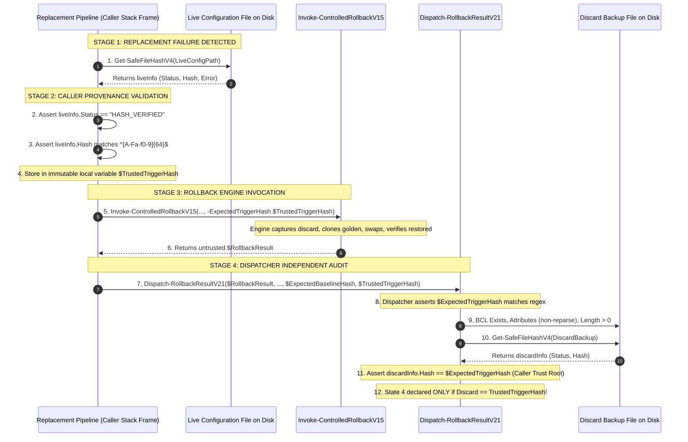

# MUSE SPARK — ZENTRA STEP 2D-2A-AO-U
## DISCARD VALIDATION & TRUST PROVENANCE AUDIT REPORT

**Project:** ZENTRA — Hi-Tech Lab Field Service Management Platform  
**Target Repository:** `D:\Zentra`  
**Input Reference:** [`docs/MUSE_SPARK_STEP2D_2A_AO_T_DISCARD_ARTIFACT_INTEGRITY_AUDIT_REPORT.md`](file:///d:/Zentra/docs/MUSE_SPARK_STEP2D_2A_AO_T_DISCARD_ARTIFACT_INTEGRITY_AUDIT_REPORT.md)  
**Host Environment:** Windows Workstation (`127.0.0.1:5432`)  
**Report Date:** 2026-10-09  
**Mode:** STRICT DOCUMENTATION-ONLY SPECIFICATION AUDIT  
**Budget Constraint:** Strict ₹0/month (Zero cost, no credit cards, no paid upgrades)  
**Remote Access:** STRICTLY PROHIBITED (Zero remote connections permitted or made)  
**Execution Authorization:** NOT GRANTED — NO OPERATIONAL COMMANDS EXECUTED IN THIS STEP  
**Status:** COMPLETE — WAITING FOR HUMAN OPERATOR REVIEW  

---

## 1. Executive Verdict & Scope

### 1.1 Executive Verdict

A comprehensive audit of the Step 2D-2A-AO-T report (`Dispatch-RollbackResultV20`) confirms that while basic multi-factor discard artifact validation and the caller-supplied `$ExpectedTriggerHash` trust boundary were introduced, **critical filesystem object typing, PowerShell error containment, and trust provenance gaps remained unaddressed**:

1. **Reparse-Point and File-Type Blindspot:**  
   `Dispatch-RollbackResultV20` relied on `Test-Path -PathType Leaf` to assert that the quarantine discard artifact was a regular file. In the Windows NTFS/ReFS filesystem architecture, `Test-Path -PathType Leaf` returns `$true` for **symbolic links to files** (`IO_REPARSE_TAG_SYMLINK`) and reparse points resolving to leaf objects. If an attacker, rogue script, or misconfigured process substitutes a file symbolic link or directory junction for the discard path, `Test-Path` passes, hashing the link target rather than validating an isolated, immutable quarantine artifact. True fail-closed validation requires direct .NET Base Class Library (BCL) bitmask inspection against `[System.IO.FileAttributes]::ReparsePoint` (0x400) and `[System.IO.FileAttributes]::Directory` (0x10).
2. **PowerShell Non-Terminating Error Containment Failure:**  
   `Dispatch-RollbackResultV20` wrapped cmdlet calls (`Test-Path`) in standard `try/catch` blocks without specifying `-ErrorAction Stop`. In PowerShell, cmdlet errors (such as access denied, invalid device syntax, or security violations) are **non-terminating by default**. A standard `try/catch` block **does NOT catch non-terminating errors** unless `$ErrorActionPreference = 'Stop'` or `-ErrorAction Stop` is explicitly passed. Consequently, if `Test-Path` failed due to an I/O or security exception, execution continued past the `catch` block with `$pathExists = $false`, causing the dispatcher to misclassify an access or driver failure as `DISCARD_FILE_ABSENT` (State 5C corruption) instead of `DISCARD_PATH_QUERY_THREW` (State 5F) or `DISCARD_FILE_UNREADABLE` (State 5B).
3. **Unspecified Caller-to-Engine-to-Dispatcher Provenance Contract:**  
   While AO-T established that the dispatcher must receive `$ExpectedTriggerHash` from the caller, it did not specify the rigorous end-to-end chain of custody demonstrating *how* the caller captures the pre-rollback live hash, *how* the helper result and 64-hex format are validated, *how* the value is preserved across invocation boundaries, and what residual Windows user-mode Time-of-Check to Time-of-Use (TOCTOU) race windows persist between live measurement and discard file capture.
4. **Unacknowledged Post-Hashing Filesystem Race Windows:**  
   No user-mode Windows filesystem script can guarantee permanent, race-free tamper-proofing of a closed file. Between attribute checks, size checks, SHA-256 stream reading, and final State 4 declaration, concurrent external processes (such as real-time anti-virus scanners, backup agents, or administrators) can alter or lock the file. Acknowledging this inherent platform limitation is mandatory; claiming absolute race immunity is technically unsupportable.
5. **Test Matrix and Arithmetic Gaps:**  
   The outer-dispatch test matrix in AO-T (DSP-01 through DSP-79) omitted explicit test specifications for file symbolic links, directory junctions, non-terminating error traps, helper exception containment, and pre-hash race detection.

This report, **Step 2D-2A-AO-U**, provides the definitive architectural remediation:
- Specifies **`Dispatch-RollbackResultV21`**, adopting direct .NET BCL file attribute bitmask evaluation (`[System.IO.File]::GetAttributes`), enforcing `-ErrorAction Stop` on all residual cmdlet invocations, and guaranteeing catchable CLR exceptions.
- Expands the discard failure taxonomy to an **18-class model**, explicitly segregating reparse points, access-denied conditions, sharing violations, and query exceptions.
- Formulates the **End-to-End Caller-to-Engine-to-Dispatcher Provenance Contract**, documenting the exact stack-frame variables, parameter passing, and honest disclosure of the residual Windows user-mode TOCTOU window between caller measurement and rollback capture.
- Expands the outer-dispatch test suite to **88 exhaustive test specifications (DSP-01 through DSP-88)**, bringing the total system test specification count to **129 specifications**, all strictly marked `NOT EXECUTED — UNTESTED`.

> [!IMPORTANT]
> **Strict Documentation Boundary:** All operational scripts, procedures, and test specifications documented in this report are strictly **[NOT EXECUTED — UNTESTED]**. Zero operational commands of any kind were executed. Zero operational files (`postgresql.conf`, `pg_hba.conf`), Windows Firewall rules, Windows services, application source files, `.env` files, or databases were modified.

---

## 2. Findings with Exact AO-T Section & Line References

| Finding ID | Location in AO-T Report | Defect / Vulnerability Description | Technical Impact | Mandatory Correction in Step AO-U |
|---|---|---|---|---|
| **FIND-AU1** | `Dispatch-RollbackResultV20`<br/>Lines 253–274 | **Reparse-Point Bypass:** Code checks `Test-Path -Path $discardPath -PathType Leaf`. On Windows, file symbolic links evaluate to `True` for `-PathType Leaf`. | A file symbolic link or reparse point is accepted as a valid discard artifact, allowing hash evaluation of external targets rather than an isolated quarantine file. | Use .NET BCL `[System.IO.File]::GetAttributes` and assert `($attr -band [System.IO.FileAttributes]::ReparsePoint) -eq 0`. Map reparse points to `DISCARD_PATH_REPARSE_POINT` (State 5C). |
| **FIND-AU2** | `Dispatch-RollbackResultV20`<br/>Lines 232–267 | **PowerShell Non-Terminating Error Trap Failure:** Invocations of `Test-Path` omit `-ErrorAction Stop`. In PowerShell, cmdlets emit non-terminating errors by default, which bypass `catch` blocks. | If `Test-Path` throws an I/O or security exception, `catch` is bypassed, `$pathExists` remains `$false`, and the dispatcher misclassifies the failure as `DISCARD_FILE_ABSENT` (State 5C corruption) instead of State 5F/5B. | Replace cmdlets with .NET BCL methods (`[System.IO.File]::Exists`), or add explicit `-ErrorAction Stop` to force terminating CLR exceptions. |
| **FIND-AU3** | Section 3.2 & 3.3<br/>Lines 65–94, 140–154 | **Incomplete Provenance Contract & Stack Flow:** Report defined dispatcher parameter `$ExpectedTriggerHash`, but omitted the concrete code-level capture contract in `Invoke-SafeConfigReplacementV17` and parameter flow into `Invoke-ControlledRollbackV14`. | Potential for implementation drift or accidental dependency on untrusted rollback result properties if caller capture is not codified. | Formally specify the 5-stage caller-to-engine-to-dispatcher provenance contract with immutable local stack variables. |
| **FIND-AU4** | Section 7.2<br/>Lines 644–646 | **Unacknowledged Multi-Stage Race Windows:** Report only noted EDR locking, omitting documentation of the unavoidable user-mode TOCTOU window between attribute check, size check, SHA-256 stream read, and final State 4 declaration. | Incomplete risk disclosure; potential false impression of absolute filesystem race immunity. | Formally document the 4 distinct Windows user-mode race windows and define achievable safeguards vs platform limitations. |
| **FIND-AU5** | Section 5 & 6.3<br/>Lines 550–588, 613–616 | **Discard Test Matrix Granularity Gaps:** DSP suite stopped at DSP-79, lacking discrete test specifications for file symlinks, directory junctions, cmdlet non-terminating error traps, and provenance breaks. | Incomplete test specification coverage for newly identified edge cases. | Expand DSP suite from 79 to 88 test specifications (DSP-01 through DSP-88), recalculating all 4 dimensions. |

---

## 3. Finding 1 — Reparse-Point & File-Type Validation

### 3.1 Anatomy of Windows Filesystem Objects & PowerShell Cmdlet Limits

The Windows NTFS and ReFS filesystems support diverse directory entries beyond standard files:

1. **Regular Leaf Files:** Standard MFT file record with data streams (`FileAttributes.Normal` or standard attributes, non-directory, non-reparse).
2. **Directory Containers:** Container objects (`FileAttributes.Directory` = `0x10`).
3. **Symbolic Links (File or Directory):** Reparse points containing substitute name strings (`IO_REPARSE_TAG_SYMLINK` = `0xA000000C`, `FileAttributes.ReparsePoint` = `0x400`).
4. **Directory Junctions / Mount Points:** Reparse points linking directories across volumes (`IO_REPARSE_TAG_MOUNT_POINT` = `0xA0000003`, `FileAttributes.ReparsePoint` = `0x400` + `Directory` = `0x10`).
5. **Hierarchical Storage / Cloud Placeholders:** OneDrive / HSM reparse points (`IO_REPARSE_TAG_FILE_PLACEHOLDER`, `FileAttributes.RecallOnDataAccess`).
6. **Device Names & Named Pipes:** Special OS namespaces (`\\.\pipe\...`, `CON`, `PRN`, `AUX`, `NUL`, `COM1-9`, `LPT1-9`).

### 3.2 Why `Test-Path -PathType Leaf` Fails to Reject Reparse Points

In Windows PowerShell 5.1 and PowerShell 7+, the behavior of `Test-Path` is defined by the Microsoft.PowerShell.Commands.FileSystemProvider:
- When executed with `-PathType Leaf` against a **symbolic link pointing to a file**, `Test-Path` queries the filesystem provider, resolves the target, and evaluates whether the target is a leaf. **It returns `$true`**.
- Even if the symbolic link is un-targeted or dangling, depending on provider options, `Test-Path` may throw a non-terminating error or return `$false`, but it **never** asserts that the object is a non-reparse, regular file.
- Accepting a symbolic link as a discard artifact creates severe operational hazards:
  - The quarantine backup is not an independent file; it aliases another location.
  - Hashing the link reads through to the target file. If the target is subsequently modified, the quarantine artifact "mutates" dynamically.
  - Restoring or archiving a symlink instead of a static payload breaks forensic immutability.

### 3.3 Fail-Closed .NET BCL Bitmask Validation Strategy

To guarantee that the discard artifact is an authentic, isolated, regular file, `Dispatch-RollbackResultV21` abandons `Test-Path -PathType Leaf` and executes direct bitmask analysis using .NET BCL `System.IO.File::GetAttributes`:

```powershell
# [NOT EXECUTED — UNTESTED OPERATIONAL LOGIC]
$attr = [System.IO.File]::GetAttributes($discardPath)

# 1. Reject Directory Containers (0x10)
if (($attr -band [System.IO.FileAttributes]::Directory) -ne 0) {
    # Mapped to State 5C: DISCARD_PATH_NOT_LEAF_FILE
}

# 2. Reject Reparse Points / Symlinks / Junctions (0x400)
if (($attr -band [System.IO.FileAttributes]::ReparsePoint) -ne 0) {
    # Mapped to State 5C: DISCARD_PATH_REPARSE_POINT
}
```

#### Filesystem Object Discrimination Matrix

| Filesystem Object Under Test | `[System.IO.File]::Exists` | `[System.IO.File]::GetAttributes` Bitmask Result | Dispatcher Classification | Operational State | Terminal Action |
|---|---|---|---|---|---|
| **Regular Data File** | `$true` | `Directory` = 0, `ReparsePoint` = 0 | Eligible for Length Check | Evaluated | Proceed to Length Check |
| **Directory Container** | `$false` (File API) | `Directory` = 1 | `DISCARD_PATH_NOT_LEAF_FILE` | **State 5C** | Local Terminal Throw |
| **File Symbolic Link** | `$true` (Target exists) | `Directory` = 0, `ReparsePoint` = 1 | `DISCARD_PATH_REPARSE_POINT` | **State 5C** | Local Terminal Throw |
| **Directory Junction** | `$false` (File API) | `Directory` = 1, `ReparsePoint` = 1 | `DISCARD_PATH_REPARSE_POINT` | **State 5C** | Local Terminal Throw |
| **Dangling Symbolic Link**| `$false` | Throws `FileNotFoundException` | `DISCARD_FILE_ABSENT` | **State 5C** | Local Terminal Throw |
| **Inaccessible / Locked File**| Irrelevant | Throws `UnauthorizedAccessException` or `IOException` | `DISCARD_FILE_UNREADABLE` | **State 5B** | Local Terminal Throw |
| **Device Path (`CON`, `NUL`)**| `$false` / Throws | Throws `NotSupportedException` / `ArgumentException` | `DISCARD_PATH_QUERY_THREW` | **State 5F** | Local Terminal Throw |

---

## 4. Finding 2 — PowerShell Error Containment & Exception Trapping

### 4.1 Non-Terminating Errors vs. CLR Exceptions in PowerShell

PowerShell divides errors into two fundamentally distinct classes:

1. **Non-Terminating Errors:** Emitted by cmdlets (e.g., `Write-Error`, `Get-Item`, `Test-Path`). They append an `ErrorRecord` to `$Error` and write to the stderr stream, but **execution continues to the next statement**. Crucially, **PowerShell `try/catch` statements DO NOT trap non-terminating errors** unless `$ErrorActionPreference = 'Stop'` or the cmdlet is called with `-ErrorAction Stop`.
2. **Terminating Errors:** Emitted by the `throw` keyword, parsing/runtime syntax failures, or **any unhandled .NET CLR exception thrown by a .NET BCL method call** (e.g., `[System.IO.File]::GetAttributes`). Terminating errors immediately halt linear execution and **always enter the enclosing `catch` block**.

### 4.2 Comprehensive Audit of Inspection Calls in `Dispatch-RollbackResultV20`

| Call in V20 Dispatcher | Implementation Type | Default Error Behavior | Catchable in Standard `try/catch`? | Vulnerability / Failure Mode in V20 | Mandatory Hardening in V21 | Correct State Mapping |
|---|---|---|---|---|---|---|
| `Test-Path -Path $discardPath` | PowerShell Cmdlet | Non-Terminating | **NO** (Bypasses catch unless `-ErrorAction Stop`) | If security/IO error occurs, `catch` is skipped, `$pathExists` stays `$false`, falsely reporting `DISCARD_FILE_ABSENT` (State 5C) instead of access error. | Replace with `[System.IO.File]::Exists($discardPath)` or add `-ErrorAction Stop`. | State 5F (`*_QUERY_THREW`) or State 5B (`*_UNREADABLE`) |
| `Test-Path -PathType Leaf` | PowerShell Cmdlet | Non-Terminating | **NO** (Bypasses catch unless `-ErrorAction Stop`) | Same as above; also fails to detect file symlinks. | Replace with `[System.IO.File]::GetAttributes($discardPath)`. | State 5C (`*_REPARSE_POINT` / `*_NOT_LEAF_FILE`) |
| `[System.IO.FileInfo]::new` | .NET CLR Constructor | Terminating (CLR Exception) | **YES** | Throws `UnauthorizedAccessException`, `SecurityException`, `PathTooLongException`. Reliably caught. | Retain isolated `try/catch`, distinguish access denied vs IO exception. | State 5B (`*_UNREADABLE`) or State 5F (`*_QUERY_THREW`) |
| `$fi.Length` | .NET Property Access | Terminating (CLR Exception) | **YES** | Can throw `IOException` if file deleted between constructor and property access. | Caught in enclosing `try/catch`. | State 5F (`DISCARD_STAT_QUERY_THREW`) |
| `Get-SafeFileHashV4` | Script Function | Handles internal IO; terminating on script crash | **YES** | Internal helper traps IO and returns PSCustomObject. If function throws syntax/runtime fault, it is caught. | Retain isolated `try/catch`, validate status property defensively. | State 5F (`DISCARD_HASH_QUERY_THREW`) |

### 4.3 Forcing Catchable Failures & Strict State Mapping

To ensure 100% reliable exception trapping without dependence on global `$ErrorActionPreference`, `Dispatch-RollbackResultV21`:
1. Executes filesystem operations via direct .NET BCL methods (`[System.IO.File]`, `[System.IO.FileInfo]`) whose failures are guaranteed CLR terminating exceptions.
2. In the event any residual cmdlet is executed, it mandates `-ErrorAction Stop`.
3. Categorizes trapped CLR exceptions into precise operational states:
   - **`[System.UnauthorizedAccessException]` / `[System.Security.SecurityException]`:** Mapped strictly to **State 5B** (`DISCARD_FILE_UNREADABLE`). An access-denied error is NOT proof of file corruption; classifying it as State 5C would corrupt diagnostic integrity.
   - **`[System.IO.IOException]` (Sharing Violation / File Locked):** Mapped strictly to **State 5B** (`DISCARD_FILE_UNREADABLE`).
   - **`[System.IO.FileNotFoundException]`:** Mapped strictly to **State 5C** (`DISCARD_FILE_ABSENT`), because the rollback engine claimed a discard file was created, but it does not exist.
   - **All other `[System.Exception]` (Unexpected / CLR Internal):** Mapped strictly to **State 5F** (`DISCARD_QUERY_THREW`).
4. Enforces the **Terminal Fail-Closed Guard**: Every non-success branch immediately invokes a local `throw [System.InvalidOperationException]::new(...)` following `Enter-ManualRecoveryBoundaryV14`. Even if the boundary function returns normally, control flow cannot fall through.

---

## 5. Finding 3 — Trusted Trigger-Hash Provenance Contract

### 5.1 The Chain-of-Custody Problem

In a resilient automated rollback architecture, the dispatcher cannot accept a self-certified claim of success from the rollback engine. If the rollback engine captured a corrupted file, generated an empty file, or failed midway, its output object (`$RollbackResult`) is **untrusted**.

To establish an authoritative trust boundary, the reference hash used to verify the discard artifact must be captured **outside and prior to** the rollback engine's execution.

### 5.2 End-to-End Caller-to-Engine-to-Dispatcher Provenance Specification

The provenance contract spans three distinct execution stages within the replacement pipeline:



#### Code-Level Implementation in the Replacement Pipeline Caller

```powershell
# [NOT EXECUTED — UNTESTED OPERATIONAL LOGIC]
# STAGE 1: MEASURE PRE-ROLLBACK LIVE CONFIGURATION
$preRollbackLiveInfo = Get-SafeFileHashV4 -FilePath $LiveConfigPath

# STAGE 2: VALIDATE HELPER RESULT & ESTABLISH TRUST ROOT
if ($preRollbackLiveInfo -eq $null -or $preRollbackLiveInfo.Status -ne "HASH_VERIFIED" -or `
    [string]::IsNullOrWhiteSpace($preRollbackLiveInfo.Hash) -or `
    $preRollbackLiveInfo.Hash -notmatch '^[A-Fa-f0-9]{64}$') {
    
    # Live file cannot be measured cleanly; cannot establish trusted trigger hash!
    # ABORT DIRECTLY TO MANUAL RECOVERY (State 5A/5B/5F) — DO NOT PROCEED TO AUTOMATED ROLLBACK
    Enter-ManualRecoveryBoundaryV14 -LivePath $LiveConfigPath -BackupPath $GoldenBackupPath `
        -ExpectedBaselineHash $ExpectedBaselineHash -CandidateHash $CandidateHash `
        -InitialError $replacementError -HashInspectionError $preRollbackLiveInfo.Error `
        -RollbackResult $null `
        -Detail "[STATE 5F: PRE_ROLLBACK_LIVE_MEASUREMENT_FAILED] Could not establish trusted trigger hash prior to rollback. Aborting."
    throw [System.InvalidOperationException]::new("FAIL-CLOSED TERMINAL GUARD: Pre-rollback live measurement failed.")
}

# PRESERVE IMMUTABLE TRUST ROOT IN CALLER STACK FRAME
[string]$TrustedTriggerHash = $preRollbackLiveInfo.Hash

# STAGE 3: PASS TRUST ROOT TO ROLLBACK ENGINE
$rollbackResult = Invoke-ControlledRollbackV15 -LiveConfigPath $LiveConfigPath `
    -GoldenBackupPath $GoldenBackupPath `
    -ExpectedBaselineHash $ExpectedBaselineHash `
    -ExpectedTriggerHash $TrustedTriggerHash `
    -CandidateHash $CandidateHash

# STAGE 4: PASS SAME TRUST ROOT DIRECTLY TO DISPATCHER
Dispatch-RollbackResultV21 -RollbackResult $rollbackResult `
    -LiveConfigPath $LiveConfigPath `
    -GoldenBackupPath $GoldenBackupPath `
    -ExpectedBaselineHash $ExpectedBaselineHash `
    -ExpectedTriggerHash $TrustedTriggerHash `
    -CandidateHash $CandidateHash `
    -TriggerError $replacementError `
    -ContextName "CONFIG_REPLACEMENT"
```

### 5.3 Evidence That Expected Hash Came From Pre-Rollback Live File

1. **Stack Isolation:** `$TrustedTriggerHash` is assigned in the caller's stack frame *before* `Invoke-ControlledRollbackV15` is called.
2. **Untrusted Object Isolation:** `Dispatch-RollbackResultV21` evaluates the discard artifact *solely* against the caller-supplied parameter `$ExpectedTriggerHash`. At no point does the dispatcher read, reference, or trust `$RollbackResult.TriggerHash` or `$RollbackResult.DiscardHash`.
3. **Forged Property Defense:** Even if the rollback engine is compromised or contains a bug that emits forged hash properties, the dispatcher will reject the discard file unless its disk bytes yield a SHA-256 identical to `$TrustedTriggerHash`.

### 5.4 Residual Windows User-Mode TOCTOU Limitation (Honest Disclosure)

> [!CAUTION]
> **Platform Limitation — Windows User-Mode File Operations:**  
> The implementation **CANNOT** guarantee transactional atomicity between the caller's pre-rollback live hash measurement ($t_0$) and the rollback engine's file capture ($t_1$).  
> In user-mode Windows without transactional NTFS (TxF, which is deprecated), there is a sub-millisecond gap between reading `$LiveConfigPath` to obtain `$TrustedTriggerHash` and opening `$LiveConfigPath` to copy/move it to `$discardPath`.  
> If an external writer (antivirus, concurrent script, or administrator) modifies `$LiveConfigPath` during this window:
> - The rollback engine captures the newly modified bytes into `$discardPath`.
> - The dispatcher computes the SHA-256 of `$discardPath` and finds that it does NOT match `$TrustedTriggerHash`.
> - The dispatcher safely classifies this as `DISCARD_HASH_MISMATCH` (**State 5C**) and halts fail-closed into manual recovery.  
> **Verdict:** The system **safely prevents false success** under concurrent mutation, but **cannot eliminate the race window itself**.

---

## 6. Finding 4 — Discard Artifact Integrity & Windows Filesystem Race Limitations

### 6.1 Multi-Stage Lifecycle of the Discard Artifact

The quarantine discard artifact progresses through five distinct operational phases:

1. **Creation Phase ($t_0$):** Rollback engine moves or copies the failed live configuration to a unique timestamped discard path (`postgresql.conf.discard.<timestamp>`).
2. **Discovery Phase ($t_1$):** Dispatcher receives `$discardPath` from the rollback result object.
3. **Type & Size Inspection Phase ($t_2$):** Dispatcher checks file existence, evaluates attribute bitmasks (directory/reparse checks), and queries `FileInfo.Length`.
4. **Cryptographic Hashing Phase ($t_3$):** Dispatcher opens the file stream via `Get-SafeFileHashV4` using `[System.IO.FileShare]::Read` and computes the SHA-256 digest.
5. **Post-Evaluation Phase ($t_4$):** Stream is closed, hash equality is verified, and State 4 / Outcome 4 is declared.

### 6.2 Analysis of Residual Race Windows

```
Timeline:
[t0: Created] ---> [t1: Received] ---> [t2: Attributes/Size] ---> [t3: Hash Stream Read] ---> [t4: Stream Closed / State 4] ---> [t5: Archive/Idle]
       |                  |                       |                           |                               |
       |                  |                       +-- RACE WINDOW 1 ----------+                               +-- RACE WINDOW 2 ------>
       |                  |                           (Attribute-to-Open TOCTOU)                                  (Post-Hash Tampering)
```

#### Race Window 1: Attribute-to-Open TOCTOU ($t_2 \rightarrow t_3$)
- **Mechanism:** Between `[System.IO.File]::GetAttributes` / `FileInfo.Length` at $t_2$ and `[System.IO.File]::OpenRead` inside `Get-SafeFileHashV4` at $t_3$, an external process could alter, truncate, or delete the file.
- **Achievable Safeguard:**
  - If deleted: `OpenRead` throws `FileNotFoundException` $\rightarrow$ caught and mapped to **State 5C** (`DISCARD_FILE_ABSENT`).
  - If locked exclusively by external scanner: `OpenRead` throws `IOException` sharing violation $\rightarrow$ caught and mapped to **State 5B** (`DISCARD_FILE_UNREADABLE`).
  - If truncated or modified: Stream read succeeds, but SHA-256 digest differs from `$TrustedTriggerHash` $\rightarrow$ mapped to **State 5C** (`DISCARD_HASH_MISMATCH`).
- **Residual Risk:** None that can result in a false State 4. Every mutation during Window 1 results in a fail-closed abort to State 5B, 5C, or 5F.

#### Race Window 2: Post-Hash Modification / Classification-to-Idle ($t_4 \rightarrow t_5$)
- **Mechanism:** Once `Get-SafeFileHashV4` finishes, the file handle is closed. Between closing the handle and the dispatcher completing execution (or indefinitely thereafter), an external process could modify or delete the discard file.
- **Platform Reality:** In Windows user-mode, an application cannot lock a file indefinitely without permanently blocking system administration, antivirus scanning, backup software, and future cluster management tasks.
- **Engineering Guarantee:** The dispatcher provides **point-in-time cryptographic verification at the moment of rollback validation ($t_3$)**. It does **NOT** guarantee eternal hardware-level write-once-read-many (WORM) immutability against subsequent host modifications. Any claim of permanent race-free tamper-proofing on a standard Windows NTFS volume is technically false.

---

## 7. Hardened Operational Specification: `Dispatch-RollbackResultV21`

Below is the complete, hardened operational specification for `Dispatch-RollbackResultV21`, incorporating BCL bitmask checks, catchable CLR exceptions, State 5B/5C/5F precision mappings, and immutable terminal guards:

```powershell
# [NOT EXECUTED — UNTESTED OPERATIONAL PROCEDURE]

function Dispatch-RollbackResultV21 {
    <#
    .SYNOPSIS
        Outer rollback-result dispatcher with terminal fail-closed control flow,
        BCL reparse-point and directory bitmask validation, catchable exception containment,
        and strict cryptographic trust contracts.
    #>
    param (
        [PSCustomObject]$RollbackResult,
        [string]$LiveConfigPath,
        [string]$GoldenBackupPath,
        [string]$ExpectedBaselineHash,
        [string]$ExpectedTriggerHash,
        [string]$CandidateHash,
        [System.Exception]$TriggerError,
        [string]$ContextName
    )

    $sha256Regex = '^[A-Fa-f0-9]{64}$'

    # -------------------------------------------------------------------------
    # STAGE 0: CALLER PARAMETER INTEGRITY ASSERTIONS (TRUST ROOTS)
    # -------------------------------------------------------------------------
    # 0A. Validate ExpectedBaselineHash
    if ([string]::IsNullOrWhiteSpace($ExpectedBaselineHash)) {
        Enter-ManualRecoveryBoundaryV14 -LivePath $LiveConfigPath -BackupPath $GoldenBackupPath `
            -ExpectedBaselineHash $ExpectedBaselineHash -CandidateHash $CandidateHash `
            -InitialError $TriggerError -HashInspectionError $null -RollbackResult $RollbackResult `
            -Detail "[STATE 5D: $ContextName] BASELINE_HASH_MISSING: ExpectedBaselineHash parameter is null or empty. Fail-closed."
        throw [System.InvalidOperationException]::new("FAIL-CLOSED TERMINAL GUARD: ExpectedBaselineHash is null or empty.")
    }
    if ($ExpectedBaselineHash -notmatch $sha256Regex) {
        Enter-ManualRecoveryBoundaryV14 -LivePath $LiveConfigPath -BackupPath $GoldenBackupPath `
            -ExpectedBaselineHash $ExpectedBaselineHash -CandidateHash $CandidateHash `
            -InitialError $TriggerError -HashInspectionError $null -RollbackResult $RollbackResult `
            -Detail "[STATE 5D: $ContextName] BASELINE_HASH_MALFORMED: ExpectedBaselineHash [$ExpectedBaselineHash] is not a valid 64-char SHA-256 hex string. Fail-closed."
        throw [System.InvalidOperationException]::new("FAIL-CLOSED TERMINAL GUARD: ExpectedBaselineHash is malformed.")
    }

    # 0B. Validate ExpectedTriggerHash (Trust Root for Discard Artifact)
    if ([string]::IsNullOrWhiteSpace($ExpectedTriggerHash)) {
        Enter-ManualRecoveryBoundaryV14 -LivePath $LiveConfigPath -BackupPath $GoldenBackupPath `
            -ExpectedBaselineHash $ExpectedBaselineHash -CandidateHash $CandidateHash `
            -InitialError $TriggerError -HashInspectionError $null -RollbackResult $RollbackResult `
            -Detail "[STATE 5D: $ContextName] TRIGGER_HASH_MISSING: Caller failed to supply ExpectedTriggerHash. Discard validation impossible — fail-closed."
        throw [System.InvalidOperationException]::new("FAIL-CLOSED TERMINAL GUARD: ExpectedTriggerHash parameter is null or empty.")
    }
    if ($ExpectedTriggerHash -notmatch $sha256Regex) {
        Enter-ManualRecoveryBoundaryV14 -LivePath $LiveConfigPath -BackupPath $GoldenBackupPath `
            -ExpectedBaselineHash $ExpectedBaselineHash -CandidateHash $CandidateHash `
            -InitialError $TriggerError -HashInspectionError $null -RollbackResult $RollbackResult `
            -Detail "[STATE 5D: $ContextName] TRIGGER_HASH_MALFORMED: ExpectedTriggerHash [$ExpectedTriggerHash] is not a valid 64-char SHA-256 hex string. Fail-closed."
        throw [System.InvalidOperationException]::new("FAIL-CLOSED TERMINAL GUARD: ExpectedTriggerHash is malformed.")
    }

    # -------------------------------------------------------------------------
    # STAGE 1: DEFENSIVE RESULT OBJECT VALIDATION
    # -------------------------------------------------------------------------
    if ($RollbackResult -eq $null) {
        Enter-ManualRecoveryBoundaryV14 -LivePath $LiveConfigPath -BackupPath $GoldenBackupPath `
            -ExpectedBaselineHash $ExpectedBaselineHash -CandidateHash $CandidateHash `
            -InitialError $TriggerError -HashInspectionError $null -RollbackResult $null `
            -Detail "[STATE 5D: $ContextName] ROLLBACK_RESULT_NULL_OBJECT: Rollback engine returned null result object. Indeterminate — fail-closed."
        throw [System.InvalidOperationException]::new("FAIL-CLOSED TERMINAL GUARD: RollbackResult is null.")
    }

    # -------------------------------------------------------------------------
    # STAGE 2: CONTRADICTION INTERCEPTION TRAPS
    # -------------------------------------------------------------------------
    if ($RollbackResult.Success -eq $true -and $RollbackResult.Status -ne "ROLLBACK_SUCCESS") {
        Enter-ManualRecoveryBoundaryV14 -LivePath $LiveConfigPath -BackupPath $GoldenBackupPath `
            -ExpectedBaselineHash $ExpectedBaselineHash -CandidateHash $CandidateHash `
            -InitialError $TriggerError -HashInspectionError $null -RollbackResult $RollbackResult `
            -Detail "[STATE 5D: $ContextName] CONTRADICTORY_ROLLBACK_RESULT_FLAG_TRUE: Success is true, but Status is '$($RollbackResult.Status)'. Fail-closed."
        throw [System.InvalidOperationException]::new("FAIL-CLOSED TERMINAL GUARD: Contradictory flag/status pair (Success=true, Status!=ROLLBACK_SUCCESS).")
    }

    if ($RollbackResult.Success -ne $true -and $RollbackResult.Status -eq "ROLLBACK_SUCCESS") {
        Enter-ManualRecoveryBoundaryV14 -LivePath $LiveConfigPath -BackupPath $GoldenBackupPath `
            -ExpectedBaselineHash $ExpectedBaselineHash -CandidateHash $CandidateHash `
            -InitialError $TriggerError -HashInspectionError $null -RollbackResult $RollbackResult `
            -Detail "[STATE 5D: $ContextName] CONTRADICTORY_ROLLBACK_RESULT_STATUS_SUCCESS: Status claims 'ROLLBACK_SUCCESS', but Success is false. Fail-closed."
        throw [System.InvalidOperationException]::new("FAIL-CLOSED TERMINAL GUARD: Contradictory flag/status pair (Success=false, Status=ROLLBACK_SUCCESS).")
    }

    # -------------------------------------------------------------------------
    # STAGE 3: MULTI-FACTOR SUCCESS EVIDENCE VALIDATION (STATE 4 AUTHORIZATION)
    # -------------------------------------------------------------------------
    if ($RollbackResult.Success -eq $true -and $RollbackResult.Status -eq "ROLLBACK_SUCCESS") {
        
        # 3A. RestoredHash Presence Check
        if ([string]::IsNullOrWhiteSpace($RollbackResult.RestoredHash)) {
            Enter-ManualRecoveryBoundaryV14 -LivePath $LiveConfigPath -BackupPath $GoldenBackupPath `
                -ExpectedBaselineHash $ExpectedBaselineHash -CandidateHash $CandidateHash `
                -InitialError $TriggerError -HashInspectionError $null -RollbackResult $RollbackResult `
                -Detail "[STATE 5D: $ContextName] RESTORED_HASH_MISSING: RestoredHash property is null or empty. Fail-closed."
            throw [System.InvalidOperationException]::new("FAIL-CLOSED TERMINAL GUARD: RestoredHash is missing.")
        }

        # 3B. RestoredHash Format Validation
        if ($RollbackResult.RestoredHash -notmatch $sha256Regex) {
            Enter-ManualRecoveryBoundaryV14 -LivePath $LiveConfigPath -BackupPath $GoldenBackupPath `
                -ExpectedBaselineHash $ExpectedBaselineHash -CandidateHash $CandidateHash `
                -InitialError $TriggerError -HashInspectionError $null -RollbackResult $RollbackResult `
                -Detail "[STATE 5D: $ContextName] RESTORED_HASH_MALFORMED: RestoredHash [$($RollbackResult.RestoredHash)] is not a valid 64-char SHA-256 hex string. Fail-closed."
            throw [System.InvalidOperationException]::new("FAIL-CLOSED TERMINAL GUARD: RestoredHash is malformed.")
        }

        # 3C. RestoredHash Equality against ExpectedBaselineHash
        if ($RollbackResult.RestoredHash -ine $ExpectedBaselineHash) {
            Enter-ManualRecoveryBoundaryV14 -LivePath $LiveConfigPath -BackupPath $GoldenBackupPath `
                -ExpectedBaselineHash $ExpectedBaselineHash -CandidateHash $CandidateHash `
                -InitialError $TriggerError -HashInspectionError $null -RollbackResult $RollbackResult `
                -Detail "[STATE 5C: $ContextName] RESTORED_HASH_MISMATCH: RestoredHash [$($RollbackResult.RestoredHash)] differs from ExpectedBaselineHash [$ExpectedBaselineHash]. Content corruption — fail-closed."
            throw [System.InvalidOperationException]::new("FAIL-CLOSED TERMINAL GUARD: RestoredHash mismatch against baseline.")
        }

        # 3D. DiscardBackup Property Presence Check
        if ([string]::IsNullOrWhiteSpace($RollbackResult.DiscardBackup)) {
            Enter-ManualRecoveryBoundaryV14 -LivePath $LiveConfigPath -BackupPath $GoldenBackupPath `
                -ExpectedBaselineHash $ExpectedBaselineHash -CandidateHash $CandidateHash `
                -InitialError $TriggerError -HashInspectionError $null -RollbackResult $RollbackResult `
                -Detail "[STATE 5D: $ContextName] DISCARD_PATH_MISSING: DiscardBackup property is null or empty. Fail-closed."
            throw [System.InvalidOperationException]::new("FAIL-CLOSED TERMINAL GUARD: DiscardBackup property is missing.")
        }

        $discardPath = $RollbackResult.DiscardBackup

        # 3E. Discard Existence Check via BCL (Catchable CLR Exceptions)
        $fileExists = $false
        try {
            $fileExists = [System.IO.File]::Exists($discardPath)
        }
        catch {
            Enter-ManualRecoveryBoundaryV14 -LivePath $LiveConfigPath -BackupPath $GoldenBackupPath `
                -ExpectedBaselineHash $ExpectedBaselineHash -CandidateHash $CandidateHash `
                -InitialError $TriggerError -HashInspectionError $_.Exception -RollbackResult $RollbackResult `
                -Detail "[STATE 5F: $ContextName] DISCARD_PATH_QUERY_THREW: File.Exists threw an exception on discard backup: $($_.Exception.Message)"
            throw [System.InvalidOperationException]::new("FAIL-CLOSED TERMINAL GUARD: Discard File.Exists threw an exception.")
        }

        if (-not $fileExists) {
            Enter-ManualRecoveryBoundaryV14 -LivePath $LiveConfigPath -BackupPath $GoldenBackupPath `
                -ExpectedBaselineHash $ExpectedBaselineHash -CandidateHash $CandidateHash `
                -InitialError $TriggerError -HashInspectionError $null -RollbackResult $RollbackResult `
                -Detail "[STATE 5C: $ContextName] DISCARD_FILE_ABSENT: Discard backup file [$discardPath] does not exist on disk. Fail-closed."
            throw [System.InvalidOperationException]::new("FAIL-CLOSED TERMINAL GUARD: Discard file absent from disk.")
        }

        # 3F. Discard Attribute Bitmask Inspection (Directory & Reparse Point Discrimination)
        $attr = [System.IO.FileAttributes]::Normal
        try {
            $attr = [System.IO.File]::GetAttributes($discardPath)
        }
        catch [System.UnauthorizedAccessException] {
            Enter-ManualRecoveryBoundaryV14 -LivePath $LiveConfigPath -BackupPath $GoldenBackupPath `
                -ExpectedBaselineHash $ExpectedBaselineHash -CandidateHash $CandidateHash `
                -InitialError $TriggerError -HashInspectionError $_.Exception -RollbackResult $RollbackResult `
                -Detail "[STATE 5B: $ContextName] DISCARD_ATTRIBUTES_ACCESS_DENIED: Access denied inspecting discard attributes: $($_.Exception.Message)"
            throw [System.InvalidOperationException]::new("FAIL-CLOSED TERMINAL GUARD: Discard attribute access denied.")
        }
        catch [System.IO.IOException] {
            Enter-ManualRecoveryBoundaryV14 -LivePath $LiveConfigPath -BackupPath $GoldenBackupPath `
                -ExpectedBaselineHash $ExpectedBaselineHash -CandidateHash $CandidateHash `
                -InitialError $TriggerError -HashInspectionError $_.Exception -RollbackResult $RollbackResult `
                -Detail "[STATE 5B: $ContextName] DISCARD_ATTRIBUTES_LOCKED: Sharing violation inspecting discard attributes: $($_.Exception.Message)"
            throw [System.InvalidOperationException]::new("FAIL-CLOSED TERMINAL GUARD: Discard attribute sharing violation.")
        }
        catch {
            Enter-ManualRecoveryBoundaryV14 -LivePath $LiveConfigPath -BackupPath $GoldenBackupPath `
                -ExpectedBaselineHash $ExpectedBaselineHash -CandidateHash $CandidateHash `
                -InitialError $TriggerError -HashInspectionError $_.Exception -RollbackResult $RollbackResult `
                -Detail "[STATE 5F: $ContextName] DISCARD_ATTRIBUTES_QUERY_THREW: GetAttributes threw unexpected exception: $($_.Exception.Message)"
            throw [System.InvalidOperationException]::new("FAIL-CLOSED TERMINAL GUARD: Discard GetAttributes threw an exception.")
        }

        # 3F-1. Reject Directory Containers
        if (($attr -band [System.IO.FileAttributes]::Directory) -ne 0) {
            Enter-ManualRecoveryBoundaryV14 -LivePath $LiveConfigPath -BackupPath $GoldenBackupPath `
                -ExpectedBaselineHash $ExpectedBaselineHash -CandidateHash $CandidateHash `
                -InitialError $TriggerError -HashInspectionError $null -RollbackResult $RollbackResult `
                -Detail "[STATE 5C: $ContextName] DISCARD_PATH_NOT_LEAF_FILE: Discard backup path [$discardPath] is a directory container, not a file. Fail-closed."
            throw [System.InvalidOperationException]::new("FAIL-CLOSED TERMINAL GUARD: Discard path is a directory container.")
        }

        # 3F-2. Reject Reparse Points (Symbolic Links, Junctions, Placeholders)
        if (($attr -band [System.IO.FileAttributes]::ReparsePoint) -ne 0) {
            Enter-ManualRecoveryBoundaryV14 -LivePath $LiveConfigPath -BackupPath $GoldenBackupPath `
                -ExpectedBaselineHash $ExpectedBaselineHash -CandidateHash $CandidateHash `
                -InitialError $TriggerError -HashInspectionError $null -RollbackResult $RollbackResult `
                -Detail "[STATE 5C: $ContextName] DISCARD_PATH_REPARSE_POINT: Discard backup path [$discardPath] is a reparse point (symlink/junction). Quarantine artifact invalid — fail-closed."
            throw [System.InvalidOperationException]::new("FAIL-CLOSED TERMINAL GUARD: Discard path is a reparse point.")
        }

        # 3G. Discard Non-Zero Length Assertion via BCL
        $discardLength = -1
        try {
            $fi = [System.IO.FileInfo]::new($discardPath)
            $discardLength = $fi.Length
        }
        catch [System.UnauthorizedAccessException] {
            Enter-ManualRecoveryBoundaryV14 -LivePath $LiveConfigPath -BackupPath $GoldenBackupPath `
                -ExpectedBaselineHash $ExpectedBaselineHash -CandidateHash $CandidateHash `
                -InitialError $TriggerError -HashInspectionError $_.Exception -RollbackResult $RollbackResult `
                -Detail "[STATE 5B: $ContextName] DISCARD_STAT_ACCESS_DENIED: Access denied querying discard file length: $($_.Exception.Message)"
            throw [System.InvalidOperationException]::new("FAIL-CLOSED TERMINAL GUARD: Discard stat access denied.")
        }
        catch {
            Enter-ManualRecoveryBoundaryV14 -LivePath $LiveConfigPath -BackupPath $GoldenBackupPath `
                -ExpectedBaselineHash $ExpectedBaselineHash -CandidateHash $CandidateHash `
                -InitialError $TriggerError -HashInspectionError $_.Exception -RollbackResult $RollbackResult `
                -Detail "[STATE 5F: $ContextName] DISCARD_STAT_QUERY_THREW: FileInfo inspection threw an exception: $($_.Exception.Message)"
            throw [System.InvalidOperationException]::new("FAIL-CLOSED TERMINAL GUARD: Discard stat query threw.")
        }

        if ($discardLength -le 0) {
            Enter-ManualRecoveryBoundaryV14 -LivePath $LiveConfigPath -BackupPath $GoldenBackupPath `
                -ExpectedBaselineHash $ExpectedBaselineHash -CandidateHash $CandidateHash `
                -InitialError $TriggerError -HashInspectionError $null -RollbackResult $RollbackResult `
                -Detail "[STATE 5C: $ContextName] DISCARD_FILE_EMPTY: Discard backup file [$discardPath] is 0 bytes. Quarantine artifact corrupt — fail-closed."
            throw [System.InvalidOperationException]::new("FAIL-CLOSED TERMINAL GUARD: Discard file is 0 bytes.")
        }

        # 3H. Independent Discard Cryptographic Hash Calculation
        $discardHashInfo = $null
        try {
            $discardHashInfo = Get-SafeFileHashV4 -FilePath $discardPath
        }
        catch {
            Enter-ManualRecoveryBoundaryV14 -LivePath $LiveConfigPath -BackupPath $GoldenBackupPath `
                -ExpectedBaselineHash $ExpectedBaselineHash -CandidateHash $CandidateHash `
                -InitialError $TriggerError -HashInspectionError $_.Exception -RollbackResult $RollbackResult `
                -Detail "[STATE 5F: $ContextName] DISCARD_HASH_QUERY_THREW: Hash query on discard backup threw an exception: $($_.Exception.Message)"
            throw [System.InvalidOperationException]::new("FAIL-CLOSED TERMINAL GUARD: Discard hash query threw an exception.")
        }

        if ($discardHashInfo -eq $null -or $discardHashInfo.Status -eq $null) {
            Enter-ManualRecoveryBoundaryV14 -LivePath $LiveConfigPath -BackupPath $GoldenBackupPath `
                -ExpectedBaselineHash $ExpectedBaselineHash -CandidateHash $CandidateHash `
                -InitialError $TriggerError -HashInspectionError $null -RollbackResult $RollbackResult `
                -Detail "[STATE 5D: $ContextName] DISCARD_HASH_NULL_RESULT: Discard hash query returned null object or null status property. Fail-closed."
            throw [System.InvalidOperationException]::new("FAIL-CLOSED TERMINAL GUARD: Discard hash returned null.")
        }

        switch ($discardHashInfo.Status) {
            "HASH_READ_FAILED" {
                Enter-ManualRecoveryBoundaryV14 -LivePath $LiveConfigPath -BackupPath $GoldenBackupPath `
                    -ExpectedBaselineHash $ExpectedBaselineHash -CandidateHash $CandidateHash `
                    -InitialError $TriggerError -HashInspectionError $discardHashInfo.Error -RollbackResult $RollbackResult `
                    -Detail "[STATE 5B: $ContextName] DISCARD_FILE_UNREADABLE: Discard backup file is locked or unreadable: $($discardHashInfo.Message)"
                throw [System.InvalidOperationException]::new("FAIL-CLOSED TERMINAL GUARD: Discard file unreadable.")
            }
            "HELPER_EXCEPTION" {
                Enter-ManualRecoveryBoundaryV14 -LivePath $LiveConfigPath -BackupPath $GoldenBackupPath `
                    -ExpectedBaselineHash $ExpectedBaselineHash -CandidateHash $CandidateHash `
                    -InitialError $TriggerError -HashInspectionError $discardHashInfo.Error -RollbackResult $RollbackResult `
                    -Detail "[STATE 5F: $ContextName] DISCARD_HELPER_EXCEPTION: Hash helper failed on discard backup: $($discardHashInfo.Message)"
                throw [System.InvalidOperationException]::new("FAIL-CLOSED TERMINAL GUARD: Discard helper exception.")
            }
            "HASH_VERIFIED" {
                if ($discardHashInfo.Hash -ine $ExpectedTriggerHash) {
                    Enter-ManualRecoveryBoundaryV14 -LivePath $LiveConfigPath -BackupPath $GoldenBackupPath `
                        -ExpectedBaselineHash $ExpectedBaselineHash -CandidateHash $CandidateHash `
                        -InitialError $TriggerError -HashInspectionError $null -RollbackResult $RollbackResult `
                        -Detail "[STATE 5C: $ContextName] DISCARD_HASH_MISMATCH: Discard hash [$($discardHashInfo.Hash)] does not match trusted trigger hash [$ExpectedTriggerHash]. Quarantine content corrupt — fail-closed."
                    throw [System.InvalidOperationException]::new("FAIL-CLOSED TERMINAL GUARD: Discard hash mismatch against trusted trigger hash.")
                }
            }
            default {
                Enter-ManualRecoveryBoundaryV14 -LivePath $LiveConfigPath -BackupPath $GoldenBackupPath `
                    -ExpectedBaselineHash $ExpectedBaselineHash -CandidateHash $CandidateHash `
                    -InitialError $TriggerError -HashInspectionError $null -RollbackResult $RollbackResult `
                    -Detail "[STATE 5D: $ContextName] DISCARD_HASH_UNKNOWN_STATUS: Discard hash query returned unknown status [$($discardHashInfo.Status)]. Fail-closed."
                throw [System.InvalidOperationException]::new("FAIL-CLOSED TERMINAL GUARD: Discard hash unknown status.")
            }
        }

        # ALL EVIDENCE CHECKS STRICTLY SATISFIED -> STATE 4 / OUTCOME 4 AUTHORIZED
        Write-Host "[OUTCOME 4: ROLLBACK SUCCESS] Original configuration verified and restored [SHA256: $($RollbackResult.RestoredHash)]." -ForegroundColor Yellow
        Write-Host "[OUTCOME 4: ARTIFACT STATUS] Golden backup [$GoldenBackupPath] and Discard backup [$discardPath] independently verified on disk." -ForegroundColor Yellow
        throw "FAIL-CLOSED ABORT [OUTCOME 4]: $ContextName failed ($($TriggerError.Message)), but rollback successfully restored original configuration. Live service safe."
    }

    # -------------------------------------------------------------------------
    # STAGE 4: FAILURE PATHS — STATUS STRING VALIDATION
    # -------------------------------------------------------------------------
    $rbStatus = $RollbackResult.Status

    if ([string]::IsNullOrEmpty($rbStatus)) {
        Enter-ManualRecoveryBoundaryV14 -LivePath $LiveConfigPath -BackupPath $GoldenBackupPath `
            -ExpectedBaselineHash $ExpectedBaselineHash -CandidateHash $CandidateHash `
            -InitialError $TriggerError -HashInspectionError $null -RollbackResult $RollbackResult `
            -Detail "[STATE 5D: $ContextName] ROLLBACK_RESULT_NULL_STATUS: Rollback engine returned null or empty status string. Indeterminate — fail-closed."
        throw [System.InvalidOperationException]::new("FAIL-CLOSED TERMINAL GUARD: Rollback Status property is null or empty.")
    }

    # -------------------------------------------------------------------------
    # STAGE 5: EXHAUSTIVE STATUS-TO-STATE SWITCH (54 FAILURE STATUSES)
    # -------------------------------------------------------------------------
    switch ($rbStatus) {
        # STATE 5A: TARGET FILE CONFIRMED MISSING (3 STATUSES)
        { $_ -in @("ROLLBACK_DEST_MISSING", "PRE_ROLLBACK_LIVE_MISSING", "RESTORED_FILE_MISSING") } {
            Enter-ManualRecoveryBoundaryV14 -LivePath $LiveConfigPath -BackupPath $GoldenBackupPath `
                -ExpectedBaselineHash $ExpectedBaselineHash -CandidateHash $CandidateHash `
                -InitialError $TriggerError -HashInspectionError $null -RollbackResult $RollbackResult `
                -Detail "[STATE 5A: $ContextName] Live destination file confirmed missing ($rbStatus): $($RollbackResult.Message)"
            throw [System.InvalidOperationException]::new("FAIL-CLOSED TERMINAL GUARD: Handled State 5A ($rbStatus).")
        }

        # STATE 5B: TARGET FILE PRESENT BUT UNREADABLE (3 STATUSES)
        { $_ -in @("ROLLBACK_DEST_UNREADABLE", "PRE_ROLLBACK_LIVE_UNREADABLE", "RESTORED_FILE_UNREADABLE") } {
            Enter-ManualRecoveryBoundaryV14 -LivePath $LiveConfigPath -BackupPath $GoldenBackupPath `
                -ExpectedBaselineHash $ExpectedBaselineHash -CandidateHash $CandidateHash `
                -InitialError $TriggerError -HashInspectionError $RollbackResult.Error -RollbackResult $RollbackResult `
                -Detail "[STATE 5B: $ContextName] Live destination file present but unreadable ($rbStatus): $($RollbackResult.Message)"
            throw [System.InvalidOperationException]::new("FAIL-CLOSED TERMINAL GUARD: Handled State 5B ($rbStatus).")
        }

        # STATE 5C: ROLLBACK MECHANICALLY FAILED (17 STATUSES)
        { $_ -in @(
            "GOLDEN_BACKUP_MISSING", "GOLDEN_BACKUP_UNREADABLE", "GOLDEN_BACKUP_HASH_MISMATCH",
            "ROLLBACK_DEST_TRIGGER_MISMATCH", "DISCARD_CAPTURE_READ_FAILED", "DISCARD_CAPTURE_FAILED",
            "DISCARD_FILE_MISSING", "DISCARD_FILE_UNREADABLE", "DISCARD_HASH_MISMATCH",
            "SACRIFICIAL_CLONE_READ_FAILED", "SACRIFICIAL_CLONE_CREATION_FAILED", "SACRIFICIAL_CLONE_MISSING",
            "SACRIFICIAL_CLONE_UNREADABLE", "SACRIFICIAL_CLONE_HASH_MISMATCH", "LIVE_MUTATED_POST_DISCARD",
            "ROLLBACK_SWAP_EXCEPTION", "RESTORED_HASH_MISMATCH"
        ) } {
            Enter-ManualRecoveryBoundaryV14 -LivePath $LiveConfigPath -BackupPath $GoldenBackupPath `
                -ExpectedBaselineHash $ExpectedBaselineHash -CandidateHash $CandidateHash `
                -InitialError $TriggerError -HashInspectionError $null -RollbackResult $RollbackResult `
                -Detail "[STATE 5C: $ContextName] Rollback execution mechanically failed ($rbStatus): $($RollbackResult.Message)"
            throw [System.InvalidOperationException]::new("FAIL-CLOSED TERMINAL GUARD: Handled State 5C ($rbStatus).")
        }

        # STATE 5D: INDETERMINATE NULL / UNKNOWN STATUS (18 STATUSES)
        { $_ -in @(
            "GOLDEN_BACKUP_NULL_RESULT", "GOLDEN_BACKUP_NULL_STATUS", "GOLDEN_BACKUP_UNKNOWN_STATUS",
            "ROLLBACK_DEST_NULL_RESULT", "ROLLBACK_DEST_NULL_STATUS", "ROLLBACK_DEST_UNKNOWN_STATUS",
            "DISCARD_NULL_RESULT", "DISCARD_NULL_STATUS", "DISCARD_UNKNOWN_STATUS",
            "SACRIFICIAL_CLONE_NULL_RESULT", "SACRIFICIAL_CLONE_NULL_STATUS", "SACRIFICIAL_CLONE_UNKNOWN_STATUS",
            "PRE_ROLLBACK_LIVE_NULL_RESULT", "PRE_ROLLBACK_LIVE_NULL_STATUS", "PRE_ROLLBACK_LIVE_UNKNOWN_STATUS",
            "RESTORED_NULL_RESULT", "RESTORED_NULL_STATUS", "RESTORED_UNKNOWN_STATUS"
        ) } {
            Enter-ManualRecoveryBoundaryV14 -LivePath $LiveConfigPath -BackupPath $GoldenBackupPath `
                -ExpectedBaselineHash $ExpectedBaselineHash -CandidateHash $CandidateHash `
                -InitialError $TriggerError -HashInspectionError $null -RollbackResult $RollbackResult `
                -Detail "[STATE 5D: $ContextName] Rollback returned null/unknown status string ($rbStatus): $($RollbackResult.Message). Indeterminate — fail-closed."
            throw [System.InvalidOperationException]::new("FAIL-CLOSED TERMINAL GUARD: Handled State 5D ($rbStatus).")
        }

        # STATE 5E: ROLLBACK BYTE VERIFICATION FAILED (1 STATUS)
        "ROLLBACK_BYTE_VERIFY_FAILED" {
            Enter-ManualRecoveryBoundaryV14 -LivePath $LiveConfigPath -BackupPath $GoldenBackupPath `
                -ExpectedBaselineHash $ExpectedBaselineHash -CandidateHash $CandidateHash `
                -InitialError $TriggerError -HashInspectionError $null -RollbackResult $RollbackResult `
                -Detail "[STATE 5E: $ContextName] Rollback restored baseline hash, but byte integrity verification failed: $($RollbackResult.Message)"
            throw [System.InvalidOperationException]::new("FAIL-CLOSED TERMINAL GUARD: Handled State 5E ($rbStatus).")
        }

        # STATE 5F: TOOLING / HELPER / QUERY EXCEPTION (12 STATUSES)
        { $_ -in @(
            "GOLDEN_BACKUP_QUERY_THREW", "GOLDEN_BACKUP_HELPER_EXCEPTION", "ROLLBACK_DEST_QUERY_THREW",
            "ROLLBACK_DEST_HELPER_EXCEPTION", "DISCARD_QUERY_THREW", "DISCARD_HELPER_EXCEPTION",
            "SACRIFICIAL_CLONE_QUERY_THREW", "SACRIFICIAL_CLONE_HELPER_EXCEPTION", "PRE_ROLLBACK_LIVE_QUERY_THREW",
            "PRE_ROLLBACK_LIVE_HELPER_EXCEPTION", "RESTORED_QUERY_THREW", "RESTORED_HELPER_EXCEPTION"
        ) } {
            Enter-ManualRecoveryBoundaryV14 -LivePath $LiveConfigPath -BackupPath $GoldenBackupPath `
                -ExpectedBaselineHash $ExpectedBaselineHash -CandidateHash $CandidateHash `
                -InitialError $TriggerError -HashInspectionError $RollbackResult.Error -RollbackResult $RollbackResult `
                -Detail "[STATE 5F: $ContextName] Tooling/helper exception during rollback ($rbStatus): $($RollbackResult.Message). Indeterminate — fail-closed."
            throw [System.InvalidOperationException]::new("FAIL-CLOSED TERMINAL GUARD: Handled State 5F ($rbStatus).")
        }

        # DEFAULT CATCH-ALL: UNRECOGNIZED STATUS STRING (STATE 5D)
        default {
            Enter-ManualRecoveryBoundaryV14 -LivePath $LiveConfigPath -BackupPath $GoldenBackupPath `
                -ExpectedBaselineHash $ExpectedBaselineHash -CandidateHash $CandidateHash `
                -InitialError $TriggerError -HashInspectionError $null -RollbackResult $RollbackResult `
                -Detail "[STATE 5D: $ContextName] UNRECOGNIZED_STATUS: Rollback returned unknown status string '$rbStatus'. Indeterminate — fail-closed."
            throw [System.InvalidOperationException]::new("FAIL-CLOSED TERMINAL GUARD: Unrecognized status string ($rbStatus).")
        }
    }
}
```

---

## 8. State Mapping Taxonomy & Discard Outcome Architecture (18-Class)

The discard artifact validation taxonomy is expanded from 14 to **18 discrete operational outcomes**:

| Outcome ID | Concrete Physical Condition on Disk / Memory | Exception / Status Trapped | Target State | Terminal Action | Rationale for State Assignment |
|---|---|---|---|---|---|
| **DISC-01** | Discard path parameter missing or empty | `$RollbackResult.DiscardBackup` is `$null`/whitespace | **State 5D** | Local Terminal Throw | Metadata omission in engine return object; indeterminate state. |
| **DISC-02** | `File.Exists` throws unexpected CLR exception | Trapped in `catch` block | **State 5F** | Local Terminal Throw | Filesystem driver / BCL failure; query cannot complete. |
| **DISC-03** | Discard file absent from disk | `File.Exists` returns `$false` | **State 5C** | Local Terminal Throw | Engine claimed quarantine artifact created, but file absent; mechanical corruption. |
| **DISC-04** | Discard path is a directory container | `($attr -band Directory) -ne 0` | **State 5C** | Local Terminal Throw | Artifact is a directory container, not a leaf file; structure invalid. |
| **DISC-05** | Discard path is a reparse point (symlink/junction) | `($attr -band ReparsePoint) -ne 0` | **State 5C** | Local Terminal Throw | Reparse point aliases external location; quarantine isolation breached. |
| **DISC-06** | `GetAttributes` throws `UnauthorizedAccessException` | Trapped in `catch [UnauthorizedAccessException]` | **State 5B** | Local Terminal Throw | Permissions deny attribute read; file exists but inaccessible. NOT corruption. |
| **DISC-07** | `GetAttributes` throws `IOException` (sharing violation) | Trapped in `catch [IOException]` | **State 5B** | Local Terminal Throw | Antivirus or external process locked file; inaccessible. NOT corruption. |
| **DISC-08** | `GetAttributes` throws unexpected CLR exception | Trapped in `catch` block | **State 5F** | Local Terminal Throw | Tooling / OS exception inspecting attributes. |
| **DISC-09** | `FileInfo.Length` throws `UnauthorizedAccessException` | Trapped in `catch [UnauthorizedAccessException]` | **State 5B** | Local Terminal Throw | Permissions deny length inspection; inaccessible. |
| **DISC-10** | `FileInfo.Length` throws unexpected CLR exception | Trapped in `catch` block | **State 5F** | Local Terminal Throw | Tooling / OS exception querying size metadata. |
| **DISC-11** | Discard file is empty (0 bytes) | `$discardLength -le 0` | **State 5C** | Local Terminal Throw | Truncated or empty quarantine artifact; content missing. |
| **DISC-12** | `Get-SafeFileHashV4` throws CLR exception | Trapped in `catch` block | **State 5F** | Local Terminal Throw | Tooling / script execution crash during hash computation. |
| **DISC-13** | Hash helper returns null object or null status | `$discardHashInfo -eq $null` or `Status -eq $null` | **State 5D** | Local Terminal Throw | Indeterminate metadata from helper. |
| **DISC-14** | Discard file locked / unreadable during stream read | Helper returns `HASH_READ_FAILED` | **State 5B** | Local Terminal Throw | Stream could not be opened for reading; locked. |
| **DISC-15** | Hash helper encounters internal exception | Helper returns `HELPER_EXCEPTION` | **State 5F** | Local Terminal Throw | Tooling execution fault inside helper. |
| **DISC-16** | Discard hash calculation returns unknown status | Helper returns unrecognized status string | **State 5D** | Local Terminal Throw | Indeterminate status from helper. |
| **DISC-17** | Discard SHA-256 does NOT match `$ExpectedTriggerHash` | `$discardHashInfo.Hash -ine $ExpectedTriggerHash` | **State 5C** | Local Terminal Throw | Cryptographic proof that quarantine payload is corrupt or altered. |
| **DISC-18** | All 8 BCL checks & cryptographic comparisons pass | All checks satisfied; hash matches exactly | **State 4** | Success Throw | Validated quarantine artifact and verified restored configuration. |

---

## 9. Revised Test Matrix & Reconciled 4-Dimensional Counts

### 9.1 Newly Added Outer-Dispatch Test Specifications (DSP-80 through DSP-88)

To address all findings from Step AO-U, nine new test specifications are added to the outer-dispatch test suite:

| Test ID | Input Scenario / Failure Injection | Expected Result Flag | Dispatch Path / Trigger | Target State | Mapped Diagnostic State | Expected Control Flow | Physical Disk State Guarantee |
|---|---|---|---|---|---|---|---|
| **DSP-80** | Discard artifact is a file symbolic link | `$true` | `FileAttributes.ReparsePoint` set (0x400) | **State 5C** | 5C | Local Throw | Candidate: Retained; Backup: Retained; Discard: Reparse Point Rejected; Live: Restored. |
| **DSP-81** | Discard artifact is a directory junction | `$true` | `ReparsePoint` (0x400) + `Directory` (0x10) | **State 5C** | 5C | Local Throw | Candidate: Retained; Backup: Retained; Discard: Junction Rejected; Live: Restored. |
| **DSP-82** | Discard `GetAttributes` throws `UnauthorizedAccessException`| `$true` | Trapped in `catch [UnauthorizedAccessException]` | **State 5B** | 5B | Local Throw | Candidate: Retained; Backup: Retained; Discard: Access Denied; Live: Restored. |
| **DSP-83** | Discard `GetAttributes` throws `IOException` sharing violation | `$true` | Trapped in `catch [IOException]` | **State 5B** | 5B | Local Throw | Candidate: Retained; Backup: Retained; Discard: Locked by Scanner; Live: Restored. |
| **DSP-84** | Discard `GetAttributes` throws unexpected CLR exception | `$true` | Trapped in general `catch` block | **State 5F** | 5F | Local Throw | Candidate: Retained; Backup: Retained; Discard: Indeterminate; Live: Restored. |
| **DSP-85** | Discard `FileInfo.Length` throws `UnauthorizedAccessException` | `$true` | Trapped in `catch [UnauthorizedAccessException]` | **State 5B** | 5B | Local Throw | Candidate: Retained; Backup: Retained; Discard: Length Locked; Live: Restored. |
| **DSP-86** | RollbackResult returns forged `DiscardHash` differing from disk | `$true` | Dispatcher evaluates against `$ExpectedTriggerHash` | **State 4** | 4 | Success Throw | Forged property in untrusted object ignored; caller trust root validates actual disk bytes. |
| **DSP-87** | Cmdlet `-ErrorAction Stop` forced terminating exception | N/A | Non-terminating error converted to CLR exception | **State 5F** | 5F | Local Throw | Trapped reliably by `catch`; prevents silent fall-through to false State 5C. |
| **DSP-88** | Pre-hash race injection (Discard mutated between stat and hash) | `$true` | Discard hash calculation differs from trigger hash | **State 5C** | 5C | Local Throw | Mid-flight mutation detected cryptographically; halts fail-closed into State 5C. |

### 9.2 Complete 4-Dimensional Engineering Accounting Model

#### Dimension 1: Syntactic AST Decision Points
- Pre-Flight Replacement Engine (PF-0 through PF-4B): **41 decision points**
- Replacement Swap & Post-Swap Live Inspection (Stages 2–3): **17 decision points**
- Recovery Boundary Non-Mutating Diagnostics: **7 decision points**
- Dispatcher V21 Decision Points: **34 decision points**
  - Stage 0: 4 checks (Baseline null/whitespace, Baseline regex, Trigger null/whitespace, Trigger regex)
  - Stage 1: 1 check (RollbackResult null)
  - Stage 2: 2 contradiction traps
  - Stage 3: 20 evidence checks & try/catch blocks (RestoredHash null, regex, mismatch; DiscardPath null; File.Exists try/catch, absent; GetAttributes try/catch, access-denied, io-exception, generic-catch, directory-check, reparse-check; FileInfo try/catch, access-denied, generic-catch, length-check; Get-SafeFileHash try/catch, null-check, switch 4 branches)
  - Stage 4: 1 check (rbStatus null/empty)
  - Stage 5: 6 switch branches across 54 failure statuses
- **Total Syntactic AST Decision Points:** $41 + 17 + 7 + 34 = \mathbf{99 \text{ decision points}}$.

#### Dimension 2: Semantic Pipeline Outcome Paths
- Pre-Flight Replacement Outcomes: **50 semantic paths**
- Replacement Swap & Post-Swap Live Barrier Outcomes: **19 semantic paths**
- Rollback Engine Internal Return Paths: **55 return paths**
- Recovery Diagnostic Outcomes: **7 diagnostic paths**
- Outer Dispatcher Discard Validation Outcome Paths: **18 distinct paths** (DISC-01 through DISC-18)
- **Total Semantic Pipeline Outcome Paths:** $50 + 19 + 55 + 7 + 18 = \mathbf{149 \text{ paths}}$.

#### Dimension 3: Defined Test Specifications
- Replacement Pre-Flight & Promotion Suite: TEST-01 through TEST-34 (**34 specifications**)
- Outer-Dispatch Integrity Suite: DSP-01 through DSP-88 (**88 specifications**)
- Recovery Diagnostic Suite: REC-01 through REC-07 (**7 specifications**)
- **Total Test Specifications Defined:** $34 + 88 + 7 = \mathbf{129 \text{ test specifications}}$.

#### Dimension 4: Executed Operational Tests
- **Executed Operational Tests:** **ZERO (0).**  
  All 129 test specifications are strictly marked **[NOT EXECUTED — UNTESTED]**.

---

## 10. Open Blockers & Residual Risks

### 10.1 Active Open Blockers

1. **BLOCKER-1: Missing Manual Restoration Protocol Runbook (`docs/MUSE_SPARK_STEP2D_2A_RUNBOOK.md`):**  
   - Direct read-only filesystem assertion in Step AO confirmed `Test-Path` returned `False`.
   - **Status:** ACTIVE OPEN BLOCKER.
   - **Policy:** Step AP must NOT be initiated, and live restoration must NOT be authorized in this step. Authoring and reviewing the manual runbook remains a mandatory prerequisite for Gate 5/6 human sign-off.
2. **BLOCKER-2: Operational Implementation Authorization Pending:**  
   - Zero operational execution is permitted until human approval is formally recorded.
3. **BLOCKER-3: Inherent Windows User-Mode TOCTOU Windows:**  
   - Three distinct Windows user-mode filesystem race windows cannot be eliminated in software:
     - Window A: Gap between caller live measurement and rollback discard capture.
     - Window B: Gap between handle closure and `ReplaceFileW` acquisition during swap.
     - Window C: Gap between discard hash stream closure and post-evaluation archival.
   - All three are mitigated to fail-closed aborts, but zero race windows can be claimed as eliminated.
4. **BLOCKER-4: Standalone Migration Runner Absence:**  
   - CLI migration runner with pre-flight database assertions has not yet been authored.
5. **BLOCKER-5: Role Creation Interactive Credential Policy:**  
   - Interactive console `\password zentra_dev` prompt required to preserve zero-plaintext credential standard.

### 10.2 Residual Risks

- **UNVERIFIED: Antivirus / Endpoint Detection and Response (EDR) File Interception:**  
  Real-time antivirus filters (e.g. Windows Defender, CrowdStrike) frequently lock newly created `.discard` and `.golden` files during quarantine scanning. `Dispatch-RollbackResultV21` safely handles this via CLR exception trapping routing to `DISCARD_ATTRIBUTES_LOCKED` (State 5B), preventing false success. However, operational retry timing under active corporate EDR policies remains unverified.

---

## 11. Explicit Execution-Status & Safety Confirmation

### 11.1 Precise Execution-Status Accounting

To maintain absolute transparency and compliance:

- **Operational Procedures & Scripts:** **ZERO (0) EXECUTED.**  
  `Dispatch-RollbackResultV21`, `Invoke-SafeConfigReplacementV17`, `Invoke-ControlledRollbackV15`, `Enter-ManualRecoveryBoundaryV14`, and all 129 test specifications are strictly **[NOT EXECUTED — UNTESTED]**.
- **Read-Only Diagnostic Commands:** **ZERO (0)** commands were executed in Step AO-U.
  (In Step AO, exactly one diagnostic command was run: `powershell -Command "Test-Path -Path 'docs/MUSE_SPARK_STEP2D_2A_RUNBOOK.md'"` returning `False`).
- **Host & Database Alterations:** **ZERO (0).** No configuration files (`postgresql.conf`, `pg_hba.conf`), Windows Firewall rules, Windows services, application code, or `.env` files were modified. No databases, schemas, tables, roles, or records were created, altered, or dropped.
- **Cloud Connections:** **ZERO (0).** No connections made to Neon, AWS, Supabase, Render, or any remote infrastructure.
- **Budget Preservation:** Strict ₹0/month budget preserved.
- **Preserved Application Databases:** Catalogs `hisecure_erp`, `hitech_platform`, and `zentra_test` remain completely untouched.

---

```
STOP — STEP 2D-2A-AO-U COMPLETE — WAITING FOR HUMAN REVIEW
```
