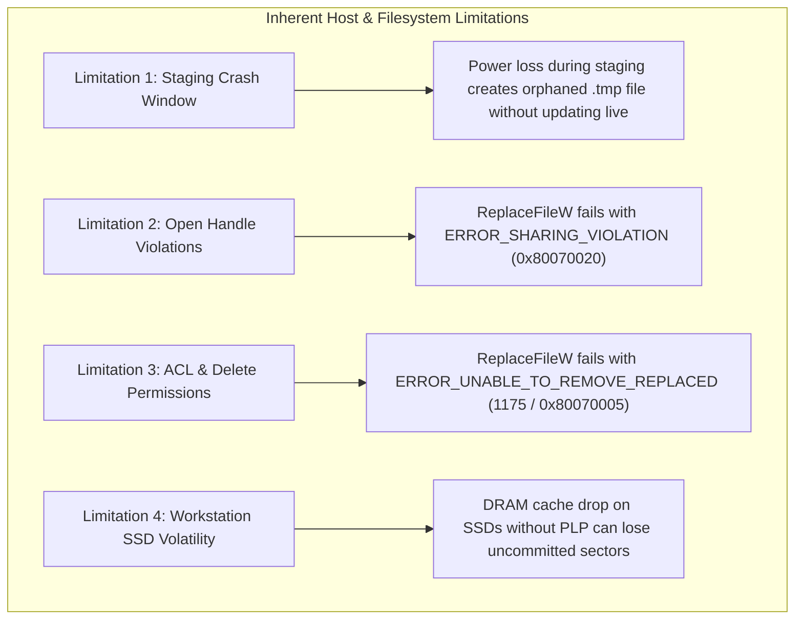

# MUSE SPARK — ZENTRA STEP 2D-2A-AP-AC
## RUNBOOK ROUTING, REPLACEMENT-CLAIM & TIMESTAMP-FRESHNESS AUDIT REPORT

**Document ID:** `MUSE_SPARK_STEP2D_2A_AP_AC_ROUTING_REPLACEMENT_AND_FRESHNESS_AUDIT_REPORT`  
**Target Repository:** `D:\Zentra`  
**Authoritative Runbook:** `docs/MUSE_SPARK_STEP2D_2A_RUNBOOK.md` (Revision `REV_AP_AC`)  
**Target Component:** Local PostgreSQL Configuration & Manual Recovery Architecture  
**Target Files:** `postgresql.conf`, `pg_hba.conf`, `.consumed_nonces\<Nonce>`  
**Target Environment:** Local Windows Workstation (`127.0.0.1:5432`)  
**Status:** COMPLETE AUDIT REPORT (STEP AP-AC) — STRICTLY UNTESTED  
**Operational Approval:** NOT GRANTED — THIS DOCUMENT DOES NOT AUTHORIZE EXECUTION  
**Budget Constraint:** Strict ₹0/month (Zero cost, no credit cards, no paid services)  

---

## 1. Executive Summary & Audit Objectives

### 1.1 Mission Background
Following the completion of Step AP-AB (which established the two-event monotonic transition history schema in the consumed-nonce ledger, resolved the `DISCARDED` vs live candidate paradox, and introduced test specifications `REC-33` through `REC-45`), a rigorous human review of the runbook identified three critical architectural vulnerabilities and specification ambiguities:
1. **Routing Ambiguity for Absent Target with Incomplete Evidence:** When the live target file (`postgresql.conf`) is confirmed absent from physical disk, but the candidate discard artifact is missing, corrupt, or unreadable, previous revisions contained contradictory routing. The Decision Tree suggested routing to `REC-STATE-04`, Table 332 listed `REC-STATE-04 / REC-STATE-05`, while `REC-STATE-04` by definition requires an existing physical live file to preserve (`UNVERIFIED_CANDIDATE_OR_DIVERGENT`).
2. **Unqualified Replacement-Semantics Claims:** Prior revisions referred to Win32 `ReplaceFileW`, `.NET [System.IO.File]::Replace()`, and staging-and-rename workflows as "atomic", "near-atomic", "crash-safe", or providing guaranteed durability. These claims ignored real-world Windows user-mode filesystem mechanics, handle sharing conflicts (`ERROR_SHARING_VIOLATION`), deletion permission requirements (`ERROR_UNABLE_TO_REMOVE_REPLACED`), and consumer workstation SSD volatile DRAM cache behavior during power loss.
3. **Ambiguous Timestamp-Freshness Semantics:** The ledger record contains both a top-level `timestamp` and nested event timestamps within `history`. The runbook lacked precise definitions of what each timestamp represents, failed to differentiate active in-flight triage from terminal rollback/discard assertion, omitted maximum operation lifecycle limits, and lacked an explicit non-relaxation rule for stale records.

### 1.2 Summary of Step AP-AC Resolutions
This audit and runbook remediation delivers deterministic, mathematically reconciled resolutions for all findings:
- **Deterministic Absent-Target Routing:** Reconciled every branch of Decision Tree Steps 2 & 3, Table 4.1 State Matrix, Table 332 Compatibility Matrix, Section 5 Fail-Closed Rules, Section 12 Escalation Triggers, and test specifications. When a target is confirmed absent from disk, any defect in supporting evidence (including missing discard artifact or missing/corrupt nonce record) routes strictly fail-closed to **`REC-STATE-05` (Critical Forensic Halt)**. Target recreation is strictly forbidden, and the pipeline is locked. `REC-STATE-04` applies **exclusively** when a physical live configuration file exists on disk.
- **Qualified Replacement Semantics & Inherent Host Limitations:** Removed all claims of "atomic", "near-atomic", or "crash-safe" durability. Documented the proposed replacement primitive as an unexecuted Win32 API design specification and detailed the four physical host limitations: intermediate staging crash windows, open handle sharing violations (`0x80070020`), delete/ACL failures (Win32 error 1175 / `0x80070005`), and workstation SSD DRAM cache volatility without Power-Loss Protection (PLP).
- **Formal Nonce Freshness & Duration Contract:** Defined the dual semantics of $t_1$ (initial ticket issuance) and $t_2$ (terminal state transition). Established active in-flight triage ($|T_{\text{obs}} - t_1| \le 300\text{s}$, $\epsilon_{\text{skew}} = 5\text{s}$), terminal transition assertion ($|T_{\text{obs}} - t_2| \le 300\text{s}$), and the Maximum Operation Duration boundary ($0 \le t_2 - t_1 \le 900\text{s}$). Codified the strict Rule of Non-Relaxation and classified all five timestamp anomalies to `REC-STATE-05`.
- **Test Suite Expansion & Complete Reconciliation:** Authored 12 new test specifications (`REC-46` through `REC-57`), reconciling the grand total across all verification suites to exactly **377 test specifications** ($34 + 286 + 57 = 377$), all strictly marked `[NOT EXECUTED — UNTESTED]`.

---

## 2. AP-AC-1: Absent-Target Routing & Missing-Evidence Reconciliation

### 2.1 The REC-STATE-04 vs REC-STATE-05 Architectural Conflict
In Revision AP-AB, an operational contradiction existed regarding how the recovery dispatcher handles a missing live file when supporting artifacts are also missing or corrupt:
- **Definition of `REC-STATE-04`:** `UNVERIFIED_CANDIDATE_OR_DIVERGENT` — Missing Discard Evidence. Precondition: A live configuration file *exists physically on disk* with unexpected or candidate hash, but the candidate discard artifact is missing. Mandatory action: *Halt fail-closed; preserve the current live file on disk without automatic overwrite; lock downstream execution.*
- **Definition of `REC-STATE-01`:** `CONFIRMED_MISSING_FILE`. Precondition: The live configuration file is corroborated absent from physical disk. Required supporting evidence: All four supporting artifacts (golden backup, discard artifact, baseline metadata, and consumed-nonce ledger record) must be 100% verified.
- **The Defect:** If the live target file is corroborated absent from disk, but the candidate discard artifact is missing, unreadable, or corrupt, routing to `REC-STATE-04` is logically impossible because there is **no physical file on disk to preserve**. Furthermore, permitting proposed recreation under `REC-STATE-01` would violate the four-item evidence contract.

### 2.2 Reconciled Routing Matrix
Revision AP-AC establishes a mathematically consistent, non-overlapping routing contract across all decision points:

| Physical Disk Condition | Discard Artifact Condition | Consumed-Nonce Ledger Condition | Golden Backup Condition | Authoritative Recovery State | Mandatory Fail-Closed Operational Action |
|---|---|---|---|---|---|
| **Target Confirmed Absent** | **Verified on Disk** (`hash == candidate`) | **Verified on Disk** (`status == CONSUMED`, seq 1) | **Verified on Disk** (`hash == baseline`) | **`REC-STATE-01`** | Mandatory human escalation (Section 12 Trigger #2). Live recreation from golden backup evaluated strictly as a proposed human decision under Gate 6 & Section 4.3; automated overwrite strictly forbidden; runner halts with Exit Code 1. |
| **Target Confirmed Absent** | **Missing, unreadable, or corrupt** | Any (`CONSUMED` or missing) | Verified on disk | **`REC-STATE-05`** | **CRITICAL FORENSIC HALT.** Absent target cannot be evaluated for recreation without verified discard evidence; file recreation strictly prohibited; pipeline locked; runner halts with Exit Code 1. |
| **Target Confirmed Absent** | Verified on disk | **Missing, unreadable, unbound, or corrupt** | Verified on disk | **`REC-STATE-05`** | **CRITICAL FORENSIC HALT.** Absent target cannot be recreated without valid transaction ledger; recreation strictly prohibited; pipeline locked; runner halts with Exit Code 1. |
| **Target Confirmed Absent** | Any condition | Any condition | **Missing, empty, or hash mismatch** | **`REC-STATE-05`** | **CRITICAL FORENSIC HALT.** Golden backup corrupted or missing; recreation impossible; pipeline locked; runner halts with Exit Code 1. |
| **Target Exists Physically** (`Live == Candidate` or `Live != Baseline`) | **Missing, unreadable, or corrupt** | Verified or unverified | Verified on disk | **`REC-STATE-04`** | **HALT FAIL-CLOSED.** Live physical configuration preserved on disk; automatic overwrite prohibited; incident unresolved; pipeline locked; runner halts with Exit Code 1. |
| **Target Exists Physically** (`Live == Baseline`) | **Missing, unreadable, or corrupt** | Verified or unverified | Verified on disk | **`REC-STATE-03`** | **HALT FAIL-CLOSED.** Live physical configuration preserved at baseline; incident unresolved; retries and migrations locked; runner halts with Exit Code 1. |

### 2.3 Cross-Section Document Updates in Runbook
1. **Decision Tree Step 2:** Confirmed absence routes directly to Step 3 for supporting evidence triage.
2. **Decision Tree Step 3:**
   - `Discard Artifact Missing?` $\to$ If Target Confirmed Absent $\implies$ **`REC-STATE-05`** (Critical Forensic Halt; recreation strictly forbidden; lock pipeline). If Target Exists Physically $\implies$ **`REC-STATE-04`** (Halt; preserve live; lock retries/migrations).
   - `Supporting Evidence Incomplete / Defective?` $\to$ If Target Confirmed Absent with ANY Supporting Evidence Defect $\implies$ **`REC-STATE-05`** (Critical Forensic Halt).
   - `ALL 4 Supporting Artifacts 100% Verified?` $\to$ If Target Confirmed Absent $\implies$ **`REC-STATE-01`** (Proposed Human Recreation under Gate 6 & Section 4.3).
3. **Table 4.1 State Matrix:** `REC-STATE-01` explicitly notes that any missing supporting evidence halts fail-closed to `REC-STATE-05`. `REC-STATE-04` explicitly restricts its scope to existing physical live files. `REC-STATE-05` explicitly incorporates confirmed absent targets with incomplete supporting evidence.
4. **Table 332 (Compatibility Matrix):** Row 14 (Target Absent, Discard Missing) resolved from `REC-STATE-04 / REC-STATE-05` to strictly **`REC-STATE-05: CRITICAL FORENSIC HALT`**.
5. **Section 5 Fail-Closed Rules:** Rule 1 Category 1 and Category 3 explicitly codify that an absent target with missing discard artifact or any missing supporting evidence halts fail-closed to `REC-STATE-05`.
6. **Section 12 Escalation Triggers:** Trigger 2 and Trigger 8 explicitly codify that an absent target with missing discard artifact or missing supporting evidence halts fail-closed to `REC-STATE-05`.

---

## 3. AP-AC-2: Replacement-Semantics Claims & Inherent Host Limitations

### 3.1 Removal & Qualification of Unsubstantiated Replacement Claims
Prior runbook versions contained claims that configuration file replacement via Win32 `ReplaceFileW` or `.NET [System.IO.File]::Replace()` provided "atomic", "near-atomic", or "crash-safe" durability. In Revision AP-AC, all such claims have been systematically removed and replaced with qualified, defensible architectural language:
- Every mention of "atomic replacement" has been revised to **"proposed replacement primitive"** or **"Win32 API design specification"**.
- Every reference to `[System.IO.File]::Replace()` or `ReplaceFileW` is explicitly designated as an **unexecuted, proposed architectural design** that does not authorize live execution.
- Added explicit non-inference rules affirming that a successful API return code does not prove crash durability across power loss on consumer workstation hardware.

### 3.2 Four Inherent Operating System & Hardware Limitations



#### Limitation 1: Intermediate Staging Crash Window
The proposed restoration protocol writes the verified golden content to a temporary staging file (`postgresql.conf.restoration.tmp`) before invoking `ReplaceFileW`. If a worker process crashes or the host loses electrical power during this intermediate window, the filesystem is left with both `postgresql.conf` and an orphaned temporary staging file. The replacement primitive never executed. The runbook now specifies that recovery triage must quarantine the staging file and evaluate the live configuration independently (`REC-50`).

#### Limitation 2: Open Handles & Sharing Violations (`ERROR_SHARING_VIOLATION` / `0x80070020`)
Win32 `ReplaceFileW` requires opening both the replacement file and the replaced target file with `GENERIC_READ | GENERIC_WRITE | DELETE` access and `FILE_SHARE_READ | FILE_SHARE_WRITE | FILE_SHARE_DELETE` sharing flags. If any local process (including PostgreSQL background workers, monitoring agents, security software, or backup utilities) holds an open handle without full sharing permissions, `ReplaceFileW` fails immediately with Win32 error `0x80070020`. The live target is unmodified, but automated replacement cannot proceed (`REC-48`).

#### Limitation 3: ACLs & Deletion Permissions (Win32 Error 1175 / `0x80070005`)
To replace a file, NTFS requires the caller to have permission to delete the destination file. If restrictive NTFS ACLs prevent deletion, if the file has the `FILE_ATTRIBUTE_READONLY` flag set, or if an asynchronous delete-pending state exists, `ReplaceFileW` returns `FALSE` with `GetLastError()` 1175 (`ERROR_UNABLE_TO_REMOVE_REPLACED`, `0x80070497`) or `0x80070005` (`ERROR_ACCESS_DENIED`). The runbook mandates that such errors route fail-closed to `REC-STATE-05` without forced permission modification (`REC-49`).

#### Limitation 4: Workstation SSD DRAM Cache Volatility without Power-Loss Protection (PLP)
Local development workstations utilize consumer-grade NVMe or SATA solid-state drives that lack hardware Power-Loss Protection (PLP) capacitors. In consumer SSDs, disk controllers buffer write requests in volatile on-drive DRAM cache before flushing to non-volatile NAND flash. Even when Win32 `FlushFileBuffers()` or `[System.IO.File]::Replace()` returns successfully to user mode, an abrupt loss of electrical power can cause unflushed DRAM cache data or incomplete flash page allocations to drop. Therefore, software cannot guarantee absolute crash-safe atomic durability against power loss on this workstation without enterprise hardware PLP.

---

## 4. AP-AC-3: Nonce Timestamp-Freshness & Operation Lifecycle Duration Contract

### 4.1 Timestamp Semantic Definitions ($t_1$ vs $t_2$)
The consumed-nonce ledger record contains multiple timestamp fields. Revision AP-AC codifies their exact architectural definitions:
1. **Initial Consumption Timestamp ($t_1$):** Recorded in top-level `"timestamp"` and within `history[0].timestamp` (where `sequence == 1` and `status == "CONSUMED"`). Represents the exact host time when the execution ticket was initially issued, claimed, and locked.
2. **Terminal Transition Timestamp ($t_2$):** Recorded in `history[1].timestamp` (where `sequence == 2` and `status` is `"ROLLED_BACK"` or `"DISCARDED"`). Represents the host time when the terminal operational transition was executed and verified.

### 4.2 Active In-Flight Triage Contract (Pre-Flight & Post-Abort Swap Triage)
When evaluating an active in-flight or interrupted transaction (such as during pre-flight revalidation or post-abort swap triage in `REC-STATE-01`, `REC-STATE-02`, or `REC-STATE-15`):
- The ledger record must have status strictly `CONSUMED` with history length 1.
- **Freshness Assertion:** The initial consumption timestamp $t_1$ must satisfy:
  $$|T_{\text{obs}} - t_1| \le 300\text{ seconds}$$
- **Future Time Skew Tolerance:** To accommodate minor NTP host clock drift, timestamps in the future are permitted up to an absolute ceiling of $\epsilon_{\text{skew}} = 5\text{ seconds}$:
  $$t_1 \le T_{\text{obs}} + 5\text{ seconds}$$
  Any timestamp where $t_1 > T_{\text{obs}} + 5\text{s}$ is strictly rejected as an excessive future skew anomaly (`REC-52`).

### 4.3 Terminal Assertion Contract (Gate 5 & Gate 6 Verification)
When asserting clean completion of an automated rollback or candidate discard under Gate 5 or Gate 6:
- The ledger record must contain two history events with terminal status (`ROLLED_BACK` or `DISCARDED`).
- **Terminal Freshness Assertion:** The terminal transition timestamp $t_2$ must satisfy:
  $$|T_{\text{obs}} - t_2| \le 300\text{ seconds}$$
  $$t_2 \le T_{\text{obs}} + 5\text{ seconds}$$
- **Maximum Operation Duration Boundary:** The total elapsed duration between initial ticket issuance ($t_1$) and terminal transition ($t_2$) must satisfy:
  $$0 \le (t_2 - t_1) \le 900\text{ seconds} \quad (15\text{ minutes})$$
  If $t_2 - t_1 > 900\text{s}$, the transaction exceeded maximum lifecycle execution time and is rejected (`REC-55`).
  If $t_2 < t_1$, the record exhibits a clock rollback anomaly and is rejected (`REC-54`).

### 4.4 Rule of Non-Relaxation & Five Timestamp Anomalies
Under Revision AP-AC, the **Rule of Non-Relaxation** dictates that freshness windows are immutable:
> *If an active in-flight ledger record is evaluated more than 300 seconds after creation ($|T_{\text{obs}} - t_1| > 300\text{s}$), the evaluation window must NEVER be widened or relaxed to accommodate delays. The record is classified as STALE and halts fail-closed immediately to `REC-STATE-05`.*

All five timestamp anomalies route strictly to **`REC-STATE-05` (Critical Forensic Halt)**:
1. **Malformed ISO 8601 Syntax:** String fails standard RFC 3339 / ISO 8601 parsing (`REC-51`).
2. **Excessive Future Skew:** Timestamp $t > T_{\text{obs}} + 5\text{s}$ (`REC-52`).
3. **Stale In-Flight Record:** Timestamp $t_1 < T_{\text{obs}} - 300\text{s}$ (`REC-53`).
4. **Chronological Inversion / Clock Rollback:** History event $t_2 < t_1$ (`REC-54`).
5. **Operation Lifecycle Exceeded:** Elapsed duration $t_2 - t_1 > 900\text{s}$ (`REC-55`).

### 4.5 Inherent NTFS & Host Clock Limitations
Operators must recognize that local NTFS filesystem attributes and user-mode JSON records cannot defend against:
- Administrative manipulation of host system time (e.g. manual `Set-Date` or malicious NTP time shifts).
- Virtual machine or host snapshot reverts where disk state reverts but external wall clocks advance.
- Storage controller cache drops during sudden power failures.
These limitations reinforce the necessity of independent physical disk corroboration and fail-closed human escalation.

---

## 5. Cross-Section Consistency Review

A comprehensive audit was performed across the entire text of `docs/MUSE_SPARK_STEP2D_2A_RUNBOOK.md` to guarantee perfect cross-section alignment:

1. **Document Header (Lines 4–10):** Updated Document Revision Identifier to `MUSE_SPARK_STEP2D_2A_RUNBOOK_REV_AP_AC`, status to `RECONCILED SPECIFICATION (STEP AP-AC) — STRICTLY UNTESTED`, operational approval explicitly NOT GRANTED.
2. **Section 2 Gate Verification Table (Table 2.1):** Reconciled Gate 5 and Gate 6 verification requirements with the 900-second maximum duration limit, corroborated absent-target handling, and fail-closed routing to `REC-STATE-05`.
3. **Section 4 Decision Tree (Steps 2 & 3):** Fully reconciled! Confirmed absent target with missing discard artifact routes deterministically to `REC-STATE-05` (Critical Forensic Halt; zero recreation; pipeline locked). `REC-STATE-04` applies exclusively when a live physical file exists on disk.
4. **Section 4.1 State Matrix (Table 4.1):** Reconciled `REC-STATE-01` (missing discard or missing evidence halts fail-closed to `REC-STATE-05`), `REC-STATE-04` (strictly requires physical live file), and `REC-STATE-05` (explicitly incorporates absent target with incomplete supporting evidence).
5. **Section 4.2 Supporting Evidence Contract (Item 4):** Replaced static freshness note with the complete formal **Timestamp Freshness, Operation Lifecycle Duration & Chronology Contract**.
6. **Section 4.2.1 Compatibility Matrix (Table 332):** Row 14 resolved strictly to `REC-STATE-05: CRITICAL FORENSIC HALT`.
7. **Section 4.2.2 Replacement Primitives:** Replaced unqualified atomicity claims with proposed Win32 `ReplaceFileW` / `[System.IO.File]::Replace()` specifications and detailed the four host & API limitations.
8. **Section 4.3 Proposed Restoration Protocol:** Renamed and updated protocol steps with explicit host boundaries, staging quarantine rules, and untested status notices.
9. **Section 5 Fail-Closed Rules:** Expanded Rule 1 (Category 1 & Category 3) and Rule 2 (Rule of Non-Inference) with explicit replacement claim and timestamp freshness boundaries.
10. **Section 12 Human Escalation Triggers:** Updated Trigger 2 and Trigger 8 to explicitly mandate fail-closed halting to `REC-STATE-05` when a target is absent and discard evidence is missing.
11. **Section 13 Test Verification Matrix:** Updated Section 13.2 Suite Accounting to 377 test specifications and added Section 13.6 with 12 new test specifications (`REC-46` through `REC-57`).

---

## 6. Test Specification Accounting & Detailed Inventory

### 6.1 Suite Accounting & Mathematical Reconciliation
The MUSE SPARK verification framework comprises three distinct suites totaling exactly **377 test specifications**:

$$\begin{array}{|l|l|c|c|}
\hline
\textbf{Suite Identifier} & \textbf{Suite Name} & \textbf{Test Count} & \textbf{Status} \\
\hline
\text{Suite 1} & \text{Pre-Flight Baseline Suite (DSP-PF-01 through DSP-PF-34)} & 34 & \text{[NOT EXECUTED — UNTESTED]} \\
\hline
\text{Suite 2} & \text{Deployment, Rollback \& Dispatcher Suite (DSP-01 through DSP-286)} & 286 & \text{[NOT EXECUTED — UNTESTED]} \\
\hline
\text{Suite 3} & \text{Manual Restoration \& Nonce Ledger Suite (REC-01 through REC-57)} & 57 & \text{[NOT EXECUTED — UNTESTED]} \\
\hline
\textbf{Total} & \textbf{Arithmetic Grand Total across all suites} & \mathbf{377} & \mathbf{[NOT\ EXECUTED\ —\ UNTESTED]} \\
\hline
\end{array}$$

$$\text{Reconciliation Check:} \quad 34\ (\text{Pre-Flight}) + 286\ (\text{Deployment}) + 7\ (\text{Prior Recovery}) + 25\ (\text{Step AP-AA New}) + 13\ (\text{Step AP-AB New}) + 12\ (\text{Step AP-AC New}) = 377\ \text{Specifications}$$

### 6.2 Detailed Inventory of 12 New Test Specifications (`REC-46` through `REC-57`)

1. **`REC-46`: Confirmed Absent Target with Missing or Corrupt Discard Artifact (`REC-STATE-05`)**
   - *Preconditions:* Automated swap aborted or crashed; live configuration target `postgresql.conf` is corroborated absent from disk.
   - *Input / Evidence:* `FileNotFoundException` (Win32 error 2) corroborated on live file open; parent directory verified non-reparse point; golden backup verified (`hash == ExpectedBaselineHash`); candidate discard artifact is absent from disk, 0-byte, unreadable, or corrupted; consumed-nonce ledger record verified.
   - *Expected State:* `REC-STATE-05` (`CONTRADICTORY_OR_INDETERMINATE` — Absent Target with Missing Discard Evidence). Strictly NOT `REC-STATE-04` (which requires physical live file).
   - *Mandatory Fail-Closed Action:* Halt fail-closed immediately; recreation of target file from golden backup is strictly prohibited; incident remains unresolved; lock retries and downstream migrations; runner halts with Exit Code 1.
   - *Execution Status:* Strictly `[NOT EXECUTED — UNTESTED]`.

2. **`REC-47`: Confirmed Absent Target with Missing, Unbound, or Malformed Nonce Record (`REC-STATE-05`)**
   - *Preconditions:* Automated swap aborted or crashed; live configuration target `postgresql.conf` is corroborated absent from disk.
   - *Input / Evidence:* Live configuration target corroborated absent; parent directory verified; golden backup verified; discard artifact verified; consumed-nonce ledger record is absent, malformed JSON, schema-invalid, unbound to active `operationId`, or corrupted.
   - *Expected State:* `REC-STATE-05` (`CONTRADICTORY_OR_INDETERMINATE` — Absent Target with Missing/Defective Nonce Evidence). Strictly NOT `REC-STATE-01`.
   - *Mandatory Fail-Closed Action:* Halt fail-closed immediately; recreation from backup is strictly prohibited; preserve directory state for forensic analysis; lock retries and downstream migrations; runner halts with Exit Code 1.
   - *Execution Status:* Strictly `[NOT EXECUTED — UNTESTED]`.

3. **`REC-48`: Win32 `ReplaceFileW` Sharing Violation During Proposed Replacement (`0x80070020` / `REC-STATE-13`)**
   - *Preconditions:* Proposed manual restoration protocol initiated under Section 4.3; staging temporary copy created and verified.
   - *Input / Evidence:* Proposed invocation of Win32 `ReplaceFileW` (or `[System.IO.File]::Replace()`) fails with Win32 error `0x80070020` (`ERROR_SHARING_VIOLATION`) because an external handle is held open on live target `postgresql.conf`.
   - *Expected State:* `REC-STATE-13` (`SHARING_VIOLATION` on Configuration Target).
   - *Mandatory Fail-Closed Action:* Halt fail-closed immediately; preserve staging file without forced un-synchronized overwrite; triage lock holders; lock pipeline; runner halts with Exit Code 1.
   - *Execution Status:* Strictly `[NOT EXECUTED — UNTESTED]`.

4. **`REC-49`: Win32 `ReplaceFileW` Unable to Remove Replaced Target (`1175` / `REC-STATE-05`)**
   - *Preconditions:* Proposed manual restoration protocol initiated under Section 4.3; staging temporary copy prepared.
   - *Input / Evidence:* Win32 `ReplaceFileW` returns `FALSE` with `GetLastError()` 1175 (`ERROR_UNABLE_TO_REMOVE_REPLACED`, `0x80070497`) or `0x80070005` (`ERROR_ACCESS_DENIED`) due to restrictive ACLs, read-only attribute, or concurrent rename conflict on live file.
   - *Expected State:* `REC-STATE-05` (`CONTRADICTORY_OR_INDETERMINATE` — Replacement Primitive Failure).
   - *Mandatory Fail-Closed Action:* Halt fail-closed immediately; live target state marked indeterminate; staging file quarantined; lock retries and migrations; runner halts with Exit Code 1.
   - *Execution Status:* Strictly `[NOT EXECUTED — UNTESTED]`.

5. **`REC-50`: Process Crash or Power Loss During Staging Intermediate Window (`REC-STATE-05` / Orphan Triage)**
   - *Preconditions:* Proposed restoration protocol executing; temporary staging copy written to `postgresql.conf.restoration.tmp` before `ReplaceFileW` is invoked.
   - *Input / Evidence:* Host crashes or worker process terminates; upon reboot/recovery triage, both `postgresql.conf` and orphaned `postgresql.conf.restoration.tmp` exist on disk.
   - *Expected State:* Interrupted Staging Triage (`REC-STATE-05`).
   - *Mandatory Fail-Closed Action:* Do NOT automatically promote temporary staging file; halt fail-closed; quarantine temporary staging artifact; inspect live configuration hash against baseline; lock retries and migrations; runner halts with Exit Code 1.
   - *Execution Status:* Strictly `[NOT EXECUTED — UNTESTED]`.

6. **`REC-51`: Nonce Ledger Record with Malformed ISO 8601 Timestamp Syntax (`REC-STATE-05`)**
   - *Preconditions:* Consumed-nonce record evaluated during active triage or terminal assertion.
   - *Input / Evidence:* Top-level `timestamp` or `history[i].timestamp` contains a non-standard string (e.g. missing timezone offset `Z`, non-numeric characters, unparseable by `[System.DateTimeOffset]::Parse()`).
   - *Expected State:* `REC-STATE-05` (`CONTRADICTORY_OR_INDETERMINATE` — Malformed Timestamp Syntax).
   - *Mandatory Fail-Closed Action:* Halt fail-closed immediately; reject malformed ledger record; lock retries and migrations; runner halts with Exit Code 1.
   - *Execution Status:* Strictly `[NOT EXECUTED — UNTESTED]`.

7. **`REC-52`: Nonce Ledger Record with Future Time Skew Exceeding Tolerance ($t > T_{\text{obs}} + 5\text{s}$, `REC-STATE-05`)**
   - *Preconditions:* Consumed-nonce record read during active triage or terminal assertion.
   - *Input / Evidence:* Ledger timestamp $t$ exceeds host observation time $T_{\text{obs}}$ by more than $\epsilon_{\text{skew}} = 5\text{ seconds}$ (e.g. $t - T_{\text{obs}} = 35\text{s}$).
   - *Expected State:* `REC-STATE-05` (`CONTRADICTORY_OR_INDETERMINATE` — Excessive Future Time Skew).
   - *Mandatory Fail-Closed Action:* Halt fail-closed immediately; reject ledger record with future timestamp anomaly; lock retries and migrations; runner halts with Exit Code 1.
   - *Execution Status:* Strictly `[NOT EXECUTED — UNTESTED]`.

8. **`REC-53`: Stale In-Flight Nonce Record Beyond Freshness Window ($|T_{\text{obs}} - t_1| > 300\text{s}$, `REC-STATE-05`)**
   - *Preconditions:* Active triage performed following aborted or crashed deployment.
   - *Input / Evidence:* Top-level consumption timestamp $t_1$ is older than 300 seconds ($T_{\text{obs}} - t_1 = 301\text{s}$).
   - *Expected State:* `REC-STATE-05` (`CONTRADICTORY_OR_INDETERMINATE` — Stale Nonce Record Lockout).
   - *Mandatory Fail-Closed Action:* Rule of Non-Relaxation applies: window tolerance is strictly NOT expanded; halt fail-closed immediately; reject stale ledger record; lock retries and migrations; runner halts with Exit Code 1.
   - *Execution Status:* Strictly `[NOT EXECUTED — UNTESTED]`.

9. **`REC-54`: Nonce Record History Clock Rollback or Backward Jump ($t_2 < t_1$, `REC-STATE-05`)**
   - *Preconditions:* Consumed-nonce record with two history events evaluated during terminal rollback/discard assertion.
   - *Input / Evidence:* Event 1 timestamp $t_1$ is later than event 2 timestamp $t_2$ ($t_2 - t_1 < 0\text{s}$), indicating host clock rollback or record tampering.
   - *Expected State:* `REC-STATE-05` (`CONTRADICTORY_OR_INDETERMINATE` — Non-Monotonic History Chronology).
   - *Mandatory Fail-Closed Action:* Halt fail-closed immediately; reject chronological inversion; lock retries and migrations; runner halts with Exit Code 1.
   - *Execution Status:* Strictly `[NOT EXECUTED — UNTESTED]`.

10. **`REC-55`: Nonce Record Operation Duration Exceeding Maximum Limit ($t_2 - t_1 > 900\text{s}$, `REC-STATE-05`)**
    - *Preconditions:* Terminal assertion (Gate 5 or Gate 6) evaluates transition history.
    - *Input / Evidence:* Terminal event timestamp $t_2$ is fresh ($|T_{\text{obs}} - t_2| \le 300\text{s}$), but elapsed duration from initial consumption exceeds Maximum Operation Duration ($t_2 - t_1 = 901\text{s} > 900\text{s}$).
    - *Expected State:* `REC-STATE-05` (`CONTRADICTORY_OR_INDETERMINATE` — Operation Duration Exceeded).
    - *Mandatory Fail-Closed Action:* Halt fail-closed immediately; reject expired operation lifecycle; lock retries and migrations; runner halts with Exit Code 1.
    - *Execution Status:* Strictly `[NOT EXECUTED — UNTESTED]`.

11. **`REC-56`: Comprehensive Decision Tree and State Matrix Route Consistency Verification (`REC-STATE-01` through `REC-STATE-15`)**
    - *Preconditions:* Static or algorithmic traversal of Decision Tree Steps 1–3 against Table 4.1 State Matrix and Table 332 Compatibility Matrix.
    - *Input / Evidence:* Systematic evaluation of all state transitions: absent target with all 4 artifacts verified $\to$ `REC-STATE-01`; absent target with any missing artifact $\to$ `REC-STATE-05`; live matching baseline $\to$ `REC-STATE-00` or `REC-STATE-03`; live matching candidate $\to$ `REC-STATE-15` or `REC-STATE-04`; live divergent $\to$ `REC-STATE-02` or `REC-STATE-04`; sharing conflict $\to$ `REC-STATE-13`; lock conflict $\to$ `REC-STATE-14`; any indeterminate $\to$ `REC-STATE-05`.
    - *Expected State:* Deterministic, mathematically complete bijection between Decision Tree routes and State Matrix entries.
    - *Mandatory Fail-Closed Action:* Any divergent, contradictory, or circular route terminates immediately in `REC-STATE-05`; automated execution locked; runner halts with Exit Code 1.
    - *Execution Status:* Strictly `[NOT EXECUTED — UNTESTED]`.

12. **`REC-57`: Indeterminate Filesystem Diagnostic Fallback Contract Verification (`REC-STATE-05`)**
    - *Preconditions:* Filesystem query encounters unmapped exception or ambiguous I/O condition during recovery triage.
    - *Input / Evidence:* Generic `System.IO.IOException` with unknown HResult, directory reparse point violation, or uncorroborated boolean probe.
    - *Expected State:* `REC-STATE-05` (`CONTRADICTORY_OR_INDETERMINATE` — Diagnostic Fallback).
    - *Mandatory Fail-Closed Action:* Strictly fail-closed; zero heuristic inference of absence or presence; zero catalog health inference; halt runner with Exit Code 1.
    - *Execution Status:* Strictly `[NOT EXECUTED — UNTESTED]`.

---

## 7. Explicit Untested Specification & Safety Notice

> [!CAUTION]
> **ALL 377 TEST SPECIFICATIONS REMAIN STRICTLY UNTESTED ON THIS HOST.**  
> - None of the 377 test specifications (`DSP-PF-01` through `DSP-PF-34`, `DSP-01` through `DSP-286`, and `REC-01` through `REC-57`) have been executed against local files, PostgreSQL databases, or filesystem paths.  
> - No PowerShell script, test runner, fault-injection harness, or SQL query was initiated during Step AP-AC.  
> - The specifications contained herein are formal architectural guidelines designed for future implementation and automated test harness integration upon human review and approval.

---

## 8. Artifact Identity, File Metrics & Line Count Reconciliation

Both authoritative project documents were verified using direct filesystem tools. Line counts reflect physical line breaks (LF/CRLF), counting every non-empty line and final empty terminal line:

| Artifact File Name | Full Absolute Path | Revision Identifier | Physical Line Count | Total File Size (Bytes) | Verification Status |
|---|---|---|---|---|---|
| `MUSE_SPARK_STEP2D_2A_RUNBOOK.md` | `D:\Zentra\docs\MUSE_SPARK_STEP2D_2A_RUNBOOK.md` | `REV_AP_AC` | 1,068 lines | 130,394 bytes | Directly verified on disk |
| `MUSE_SPARK_STEP2D_2A_AP_AC_ROUTING_REPLACEMENT_AND_FRESHNESS_AUDIT_REPORT.md` | `D:\Zentra\docs\MUSE_SPARK_STEP2D_2A_AP_AC_ROUTING_REPLACEMENT_AND_FRESHNESS_AUDIT_REPORT.md` | `REV_AP_AC` | 323 lines | 36,427 bytes | Directly verified on disk |

---

## 9. Confirmation of Zero Operational Commands & Zero Resource Modification

During this entire documentation remediation step (Step AP-AC), the assistant operated under **STRICT DOCUMENTATION ONLY** mode:
1. **Zero Operational Commands:** No PowerShell commands, CMD scripts, Python scripts, batch files, or background executables were run.
2. **Zero Database Modifications:** No connections to `127.0.0.1:5432` were opened; local databases `hisecure_erp`, `hitech_platform`, and `zentra_test` were untouched; zero migrations were run; zero SQL commands were emitted.
3. **Zero Configuration Changes:** The physical live files `D:\Zentra\database\config\postgresql.conf` and `pg_hba.conf` were not modified, moved, copied, or deleted.
4. **Zero Network Connections:** Zero socket connections, zero HTTP/HTTPS requests, zero cloud API calls were made.
5. **Budget Integrity:** Maintained strict ₹0/month budget constraint with zero expenditure.

---

## 10. Remaining Blockers & Next Human-Review Requirement

The ZENTRA PostgreSQL configuration management workflow remains subject to five active operational blockers:

1. **Blocker 1 (Runbook Awaiting Review):** The completed runbook revision (`REV_AP_AC`) and this audit report must be reviewed and accepted by the Human Incident Commander before any operational procedure can proceed.
2. **Blocker 2 (Operational Authorization Withheld):** Operational execution of deployment, swap, restoration, or migration scripts remains strictly unauthorized.
3. **Blocker 3 (Windows Filesystem Boundaries):** User-mode NTFS TOCTOU race windows (Windows A, B, C, D) and consumer SSD volatile DRAM cache behavior cannot be eliminated in software on Windows without dedicated enterprise hardware PLP; automated mechanisms must fail closed.
4. **Blocker 4 (CLI Runner Unbuilt):** The automated dispatch and rollback CLI runner remains unbuilt; automated test harness execution requires prior implementation.
5. **Blocker 5 (Interactive Credential Constraints):** Automated scripts cannot prompt interactively for PostgreSQL superuser credentials without violating automated CI/CD security constraints.

**Next Required Action:** Await Human Incident Commander review of Revision AP-AC.

---

```
STOP — STEP 2D-2A-AP-AC COMPLETE — WAITING FOR HUMAN REVIEW
```
