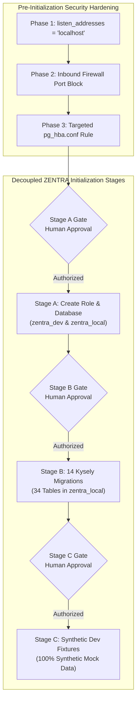

# MUSE SPARK — ZENTRA STEP 2D-2A-U
## POSTGRESQL SECURITY REMEDIATION RUNBOOK — PLAN ONLY

**Project:** ZENTRA — Hi-Tech Lab Field Service Management Platform  
**Target Repository:** `D:\Zentra`  
**Host Environment:** Windows Workstation (`127.0.0.1:5432`)  
**Runbook Date:** 2026-10-09  
**Mode:** STRICT PLAN-ONLY OPERATIONAL RUNBOOK  
**Budget Constraint:** Strict ₹0/month (Zero cost, no credit cards, no paid upgrades)  
**Remote Access:** STRICTLY PROHIBITED (Zero remote connections)  
**Execution Authorization:** NOT GRANTED — NO COMMANDS EXECUTED IN THIS STEP  
**Status:** COMPLETE — WAITING FOR HUMAN OPERATOR REVIEW  

---

## 1. Executive Summary & Objective

In **Steps 2D-2A-S** and **2D-2A-T**, an exhaustive read-only security preflight and shared application impact assessment established that:
1. Native PostgreSQL 18 is bound to wildcard addresses (`0.0.0.0` and `::`), exposing TCP port 5432 on the active Wi-Fi network adapter (`Airtel_Rayyan@2103`).
2. Windows Defender Firewall for the active `Public` network profile is currently `State: OFF`.
3. Client authentication in `pg_hba.conf` uses `trust` for all loopback connections, which existing applications (**`Hi-Secure-ERP`** and **`Test App`**) rely upon.
4. Enforcing global password authentication would immediately cause outages for existing local applications, but restricting socket binding to loopback (`listen_addresses = 'localhost'`) and adding a targeted `pg_hba.conf` rule for ZENTRA creates **zero disruption**.

The objective of **Step 2D-2A-U** is to synthesize these findings into a rigorous, step-by-step, administrator-executable operational runbook to secure the shared PostgreSQL instance **prior to initializing the ZENTRA development database**.

> [!IMPORTANT]
> **Strict Execution Boundary:** This document is **PLAN ONLY**. Zero commands in this runbook have been executed. Zero configuration files (`postgresql.conf`, `pg_hba.conf`), firewall rules, Windows services, application files, or `.env` files were modified. Zero databases or roles were created. All proposed operational commands are labeled **[NOT EXECUTED]**.

---

## 2. Section 1 — Verified Current State vs. Unverified Items

The following matrix distinguishes independently proven empirical facts from unverified assumptions:

| Dimension | Current State | Verification Source | Status |
|---|---|---|---|
| **PostgreSQL Windows Service** | `postgresql-x64-18` (PostgreSQL 18.6), PID 5928, `Running` | Windows SCM via `Get-Service` & `Get-Process` | 🟢 **Verified Fact** |
| **Server Socket Listeners** | `0.0.0.0:5432` (IPv4) and `[::]:5432` (IPv6), PID 5928 | `Get-NetTCPConnection -LocalPort 5432` | 🟢 **Verified Fact** |
| **`listen_addresses` Setting** | `*` (source: `C:/Program Files/PostgreSQL/18/data/postgresql.conf`) | `SHOW listen_addresses;` via SQL query | 🟢 **Verified Fact** |
| **`password_encryption`** | `scram-sha-256` | `SHOW password_encryption;` via SQL query | 🟢 **Verified Fact** |
| **Windows Firewall Profile** | `Public Profile: State OFF`; `Private: OFF`; `Domain: ON` | `netsh advfirewall show allprofiles state` | 🟢 **Verified Fact** |
| **Active Network Interface** | `Wi-Fi` adapter on `Airtel_Rayyan@2103` in `Public` category | `Get-NetConnectionProfile` | 🟢 **Verified Fact** |
| **Loopback Authentication** | Lines 113, 115, 117 in `pg_hba.conf` set to `trust` | `SELECT * FROM pg_hba_file_rules;` via SQL | 🟢 **Verified Fact** |
| **Non-Loopback Access** | `pg_hba.conf` has zero rules for external IPs; rejects non-loopback | `SELECT * FROM pg_hba_file_rules;` via SQL | 🟢 **Verified Fact** |
| **Existing Catalogs** | `hisecure_erp`, `hitech_platform`, `postgres`, `zentra_test` exist | `SELECT datname FROM pg_database;` via SQL | 🟢 **Verified Fact** |
| **ZENTRA Catalog State** | `zentra_local` database catalog does NOT exist | `SELECT datname FROM pg_database;` via SQL | 🟢 **Verified Fact** |
| **ZENTRA Role State** | `zentra_dev` role does NOT exist | `SELECT rolname FROM pg_roles;` via SQL | 🟢 **Verified Fact** |
| **Firewall Port Filters** | Port filter lookup without elevation returned Access Denied | `Get-NetFirewallPortFilter` returned Error 5 | 🟡 **Partially Verified** (Profile is OFF) |
| **Superuser Password** | Whether role `postgres` has a known password set | Unverified (not tested to avoid lockout) | 🔴 **NOT VERIFIED** |
| **External Client Dependence**| Whether any remote machine historically connected to port 5432 | `pg_hba.conf` rejects external, but traffic unmonitored | 🔴 **NOT VERIFIED** (Presumed Loopback Only) |

---

## 3. Section 2 — Phase 1: Network Socket Hardening Runbook

### 3.1 Objective & Scope
Restrict PostgreSQL 18 network socket listeners exclusively to the local loopback interfaces (`127.0.0.1` and `::1`), eliminating the wildcard `0.0.0.0` and `::` socket binding on physical Wi-Fi and Ethernet adapters.

- **Scope:** PostgreSQL Cluster-Wide (`postgresql.conf`).
- **Required Privilege:** Windows Local Administrator (elevated shell).
- **Service Restart Required:** **YES.** PostgreSQL cannot rebind network sockets without a complete server restart (`pg_ctl restart`).

### 3.2 Step-by-Step Procedure [NOT EXECUTED]

```powershell
# [NOT EXECUTED — REQUIRES ELEVATED ADMINISTRATOR PRIVILEGE]

# Step 1: Open an Elevated PowerShell Terminal ("Run as administrator")

# Step 2: Navigate to PostgreSQL 18 Data Directory
$pgData = "C:\Program Files\PostgreSQL\18\data"
$confFile = Join-Path $pgData "postgresql.conf"
$backupFile = Join-Path $pgData "postgresql.conf.bak.$(Get-Date -Format 'yyyyMMdd_HHmmss')"

# Step 3: Create Mandatory Pre-Change Backup
Copy-Item -Path $confFile -Destination $backupFile -Force
Write-Host "Backup created at: $backupFile" -ForegroundColor Green

# Step 4: Modify listen_addresses from '*' to 'localhost'
(Get-Content -Path $confFile) -replace "^\s*listen_addresses\s*=.*", "listen_addresses = 'localhost'" | Set-Content -Path $confFile

# Step 5: Restart PostgreSQL Windows Service
Restart-Service -Name "postgresql-x64-18" -Force
Start-Sleep -Seconds 3
```

### 3.3 Verification Commands [NOT EXECUTED]
```powershell
# [NOT EXECUTED]
# 1. Verify service is running
Get-Service -Name "postgresql-x64-18" | Select-Object Status, Name

# 2. Verify TCP listeners: must show ONLY 127.0.0.1:5432 and [::1]:5432 (0.0.0.0 and :: must be ABSENT)
Get-NetTCPConnection -LocalPort 5432 -State Listen | Select-Object LocalAddress, LocalPort, State, OwningProcess

# 3. Verify effective setting via SQL
psql -h localhost -p 5432 -U postgres -d postgres -c "SHOW listen_addresses;"
# Expected output: localhost
```

### 3.4 Service Restart Impact & Non-Destructive Recovery
- **Service Disruption:** Restarting `postgresql-x64-18` disconnects all active database sessions for approximately 2–4 seconds.
- **Application Behavior:** `Hi-Secure-ERP` and `Test App` client connection pools (e.g. `node-postgres` / `pg.Pool`) will encounter a brief socket error and automatically reconnect upon service availability.
- **Rollback Procedure:**
  ```powershell
  # [NOT EXECUTED — EMERGENCY ROLLBACK]
  Copy-Item -Path $backupFile -Destination $confFile -Force
  Restart-Service -Name "postgresql-x64-18" -Force
  ```

---

## 4. Section 3 — Phase 2: Host Firewall Hardening Runbook

### 4.1 Objective & Scope
Deploy an operating system-level packet filtering barrier blocking inbound TCP traffic on port 5432 arriving on physical network interfaces (Wi-Fi and Ethernet), providing defense-in-depth even if PostgreSQL configuration is altered in the future.

- **Scope:** Host Operating System-Wide (Windows Defender Firewall).
- **Required Privilege:** Windows Local Administrator (elevated shell).
- **Service Restart Required:** **NO.** Firewall rules take effect immediately.

### 4.2 Verified Command Syntax
Both PowerShell and `netsh` syntax were verified for parameter correctness on Windows 11:

#### Option A: PowerShell `New-NetFirewallRule` (Recommended) [NOT EXECUTED]
```powershell
# [NOT EXECUTED — REQUIRES ELEVATED ADMINISTRATOR PRIVILEGE]
New-NetFirewallRule `
  -Name "Block-PostgreSQL-Inbound-External" `
  -DisplayName "Block PostgreSQL Inbound from External Networks" `
  -Description "Drops inbound TCP port 5432 packets on Public and Private network adapters" `
  -Direction Inbound `
  -Action Block `
  -Protocol TCP `
  -LocalPort 5432 `
  -Profile Public, Private
```

#### Option B: Universal `netsh` Command [NOT EXECUTED]
```cmd
:: [NOT EXECUTED — REQUIRES ELEVATED COMMAND PROMPT]
netsh advfirewall firewall add rule name="Block-PostgreSQL-Inbound-External" dir=in action=block protocol=tcp localport=5432 profile=public,private
```

### 4.3 Verification Commands [NOT EXECUTED]
```powershell
# [NOT EXECUTED]
# 1. Verify firewall rule exists and is enabled
Get-NetFirewallRule -Name "Block-PostgreSQL-Inbound-External" | Select-Object Name, Enabled, Direction, Action, Profile

# 2. Verify local loopback connection remains completely unimpeded
psql -h 127.0.0.1 -p 5432 -U postgres -d postgres -c "SELECT inet_server_addr(), inet_client_addr();"
```

### 4.4 Non-Destructive Rollback Procedure [NOT EXECUTED]
```powershell
# [NOT EXECUTED — ROLLBACK]
Remove-NetFirewallRule -Name "Block-PostgreSQL-Inbound-External" -ErrorAction SilentlyContinue
```

---

## 5. Section 4 — Phase 3: Authentication Hardening Runbook

### 5.1 Objective & Rule-Matching Semantics
Deploy a targeted, database- and role-specific authentication policy in `pg_hba.conf` that enforces modern **`scram-sha-256`** password authentication for `zentra_local` and `zentra_dev`, while preserving legacy `trust` authentication for existing local applications (`Hi-Secure-ERP` and `Test App`).

- **Rule Ordering Semantics:** PostgreSQL evaluates `pg_hba.conf` **sequentially from top to bottom**. The **first matching record** determines the authentication method. Once matched, evaluation stops.
- **Architectural Design:** Placing targeted ZENTRA rules at the **very top** of `pg_hba.conf` guarantees:
  1. Connections targeting `database: zentra_local` as `user: zentra_dev` match the targeted rule and are challenged for a SCRAM-SHA-256 password.
  2. Connections targeting `hisecure_erp` or `hitech_platform` do not match `zentra_local`, fall through to existing legacy lines, and connect under `trust` without disruption.

### 5.2 Step-by-Step Procedure [NOT EXECUTED]

```powershell
# [NOT EXECUTED — REQUIRES ELEVATED ADMINISTRATOR PRIVILEGE]

# Step 1: Define File Paths
$pgData = "C:\Program Files\PostgreSQL\18\data"
$hbaFile = Join-Path $pgData "pg_hba.conf"
$backupHba = Join-Path $pgData "pg_hba.conf.bak.$(Get-Date -Format 'yyyyMMdd_HHmmss')"

# Step 2: Create Mandatory Pre-Change Backup
Copy-Item -Path $hbaFile -Destination $backupHba -Force
Write-Host "HBA backup created at: $backupHba" -ForegroundColor Green

# Step 3: Construct Targeted Rules Block
$zentraRules = @"
# ==============================================================================
# ZENTRA SECURITY POLICY: Enforce SCRAM-SHA-256 for zentra_dev on zentra_local
# Placed at TOP of file to ensure first-match evaluation
# ==============================================================================
host    zentra_local    zentra_dev      127.0.0.1/32            scram-sha-256
host    zentra_local    zentra_dev      ::1/128                 scram-sha-256

"@

# Step 4: Prepend Targeted Rules to pg_hba.conf
$originalHbaContent = Get-Content -Path $hbaFile -Raw
Set-Content -Path $hbaFile -Value ($zentraRules + $originalHbaContent)

# Step 5: Reload PostgreSQL Configuration Dynamically (Zero Service Disruption)
# Note: pg_hba.conf changes do NOT require restarting the service. Reload is instantaneous.
& "C:\Program Files\PostgreSQL\18\bin\pg_ctl.exe" reload -D $pgData
```

### 5.3 Password Verifier Generation Without Exposing Secrets
- In Step 2D-2A-S, `SHOW password_encryption;` verified the default setting is `scram-sha-256`.
- When creating role `zentra_dev` in Stage A:
  ```sql
  -- [NOT EXECUTED]
  CREATE ROLE zentra_dev WITH LOGIN PASSWORD '<ZENTRA_DEV_PASSWORD>' NOSUPERUSER NOCREATEDB NOCREATEROLE;
  ```
  PostgreSQL automatically compiles a cryptographically secure SCRAM-SHA-256 verifier (`SCRAM-SHA-256$...`) into `pg_authid`.
- The operator supplies `<ZENTRA_DEV_PASSWORD>` via masked interactive input (`Read-Host -AsSecureString`); secrets are never placed in script files or printed in shell history.

### 5.4 Verification Commands [NOT EXECUTED]
```powershell
# [NOT EXECUTED]
# 1. Query virtual catalog to prove rule order: zentra_local rules must have the lowest line numbers
psql -h 127.0.0.1 -p 5432 -U postgres -d postgres -c `
  "SELECT line_number, database, user_name, address, auth_method FROM pg_hba_file_rules ORDER BY line_number LIMIT 5;"

# 2. Verify legacy applications still connect without password
psql -h 127.0.0.1 -p 5432 -U postgres -d hisecure_erp -c "SELECT current_database(), current_user;"
psql -h 127.0.0.1 -p 5432 -U postgres -d hitech_platform -c "SELECT current_database(), current_user;"
```

### 5.5 Non-Destructive Rollback Procedure [NOT EXECUTED]
```powershell
# [NOT EXECUTED — ROLLBACK]
Copy-Item -Path $backupHba -Destination $hbaFile -Force
& "C:\Program Files\PostgreSQL\18\bin\pg_ctl.exe" reload -D "C:\Program Files\PostgreSQL\18\data"
```

---

## 6. Section 5 — Existing Application Protection & Health Checks

To ensure that changes never cause silent breakage in existing local software, the administrator must execute the following non-destructive health checks **before** and **after** any configuration change:

### 6.1 Pre-Change Baseline Health Checks [NOT EXECUTED]
```powershell
# [NOT EXECUTED — PRE-CHANGE BASELINE]

# Test 1: Hi-Secure-ERP Loopback Health Check
# Target: localhost:5432/hisecure_erp as user postgres
$erpCheck = psql -h localhost -p 5432 -U postgres -d hisecure_erp -t -c `
  "SELECT 'HEALTH_OK | DB: ' || current_database() || ' | USER: ' || current_user;"
Write-Host "Hi-Secure-ERP Baseline: $erpCheck"

# Test 2: Test App Loopback Health Check
# Target: localhost:5432/hitech_platform as user postgres
$testAppCheck = psql -h localhost -p 5432 -U postgres -d hitech_platform -t -c `
  "SELECT 'HEALTH_OK | DB: ' || current_database() || ' | USER: ' || current_user;"
Write-Host "Test App Baseline: $testAppCheck"

# Test 3: Existing ZENTRA Test Database Health Check
# Target: localhost:5432/zentra_test as user postgres
$zentraTestCheck = psql -h localhost -p 5432 -U postgres -d zentra_test -t -c `
  "SELECT 'HEALTH_OK | DB: ' || current_database() || ' | TABLES: ' || count(*) FROM information_schema.tables WHERE table_schema = 'public';"
Write-Host "ZENTRA Test DB Baseline: $zentraTestCheck"
```

### 6.2 Post-Change Verification Health Checks [NOT EXECUTED]
Execute the exact same three checks immediately after:
1. Phase 1 service restart (`listen_addresses = 'localhost'`).
2. Phase 2 firewall rule creation.
3. Phase 3 `pg_hba.conf` reload.

**Success Criteria:** All three applications must return `HEALTH_OK` with zero password prompts, confirming zero regression.

---

## 7. Section 6 — ZENTRA Initialization Prerequisites & Execution Boundary

Once the shared PostgreSQL instance is secured under Phases 1–3, ZENTRA database initialization can be authorized according to the decoupled multi-stage architecture defined in [`MUSE_SPARK_STEP2D_2A_LOCAL_DATABASE_INITIALIZATION_PLAN.md`](file:///d:/Zentra/docs/MUSE_SPARK_STEP2D_2A_LOCAL_DATABASE_INITIALIZATION_PLAN.md).



### 7.1 Technical SQL Execution Correctness (Outside Transaction Blocks)
- In PostgreSQL, **`CREATE DATABASE` cannot execute inside a transaction block** (`BEGIN ... COMMIT;` or `DO $$ ... $$`). Attempting to do so triggers `ERROR: 25001: CREATE DATABASE cannot run inside a transaction block`.
- Therefore, Stage A execution must be split into two separate, autocommit SQL statements:

```sql
-- [NOT EXECUTED — REQUIRES STAGE A OPERATOR APPROVAL]

-- Statement 1: Role creation (can run conditionally)
DO $$
BEGIN
  IF NOT EXISTS (SELECT FROM pg_catalog.pg_roles WHERE rolname = 'zentra_dev') THEN
    CREATE ROLE zentra_dev WITH LOGIN PASSWORD '<ZENTRA_DEV_PASSWORD>' NOSUPERUSER NOCREATEDB NOCREATEROLE;
  END IF;
END
$$;

-- Statement 2: Database creation (MUST EXECUTE IN AUTOCOMMIT MODE, OUTSIDE TRANSACTION BLOCK)
CREATE DATABASE zentra_local OWNER zentra_dev ENCODING 'UTF8';
GRANT ALL PRIVILEGES ON DATABASE zentra_local TO zentra_dev;
```

### 7.2 Non-Destructive Failure Handling
- **No Automatic Drops:** If any error occurs during Stage A, Stage B, or Stage C, the script halts immediately, captures diagnostic SQLSTATE codes, and preserves all database state for human triage.
- **Automated `DROP DATABASE`, `DROP ROLE`, or `pg_terminate_backend` calls are strictly prohibited.**
- Existing databases (`hisecure_erp`, `hitech_platform`, and `zentra_test`) are protected by explicit connection rejection checks.

---

## 8. Section 7 — Comprehensive Rollback, Recovery & Human Approval Matrix

| Phase / Stage | Proposed Action | Required Privilege | Primary Risk | Pre-Change Safety Asset | Non-Destructive Rollback Action | Human Approval Gate |
|---|---|---|---|---|---|---|
| **Phase 1: Network** | Change `listen_addresses` to `'localhost'` | OS Administrator | 2-4s service restart disruption | `postgresql.conf.bak` | Copy backup, restart service | **Gate 1 Required** |
| **Phase 2: Firewall** | Block TCP 5432 on Public Wi-Fi adapter | OS Administrator | Accidental local packet block | Documented rule name | `Remove-NetFirewallRule` | **Gate 2 Required** |
| **Phase 3: Auth** | Add `scram-sha-256` rule for `zentra_local` | OS Administrator | Accidental misplacement of rule | `pg_hba.conf.bak` | Copy backup, `pg_ctl reload` | **Gate 3 Required** |
| **Stage A: Provision** | Create `zentra_dev` role & `zentra_local` DB | DB Admin (`postgres`) | Name collision or syntax error | Catalog pre-check | Halt; preserve state; manual fix | **Gate 4 Required** |
| **Stage B: Migrate** | Execute 14 Kysely migrations | Application User (`zentra_dev`) | Partial migration failure | Pre-migration table check | Halt; preserve logs; manual fix | **Gate 5 Required** |
| **Stage C: Seed** | Seed synthetic mock fixtures | Application User (`zentra_dev`) | Unique constraint violation | 0-row verification check | Halt; preserve rows; manual fix | **Gate 6 Required** |

---

## 9. Section 8 — Summary of Actions, Facts, and Assumptions

### 9.1 Summary of Administrator Actions Remaining
To achieve a fully secured development environment:
1. **Action 1 (Phase 1):** Operator creates backup of `postgresql.conf`, sets `listen_addresses = 'localhost'`, and restarts `postgresql-x64-18`.
2. **Action 2 (Phase 2):** Operator executes PowerShell firewall rule blocking inbound port 5432 on Public/Private profiles.
3. **Action 3 (Phase 3):** Operator adds targeted `scram-sha-256` rule for `zentra_local` to `pg_hba.conf` and executes `pg_ctl reload`.
4. **Action 4 (Stage A):** Operator authorizes Stage A execution to provision `zentra_dev` and `zentra_local`.

### 9.2 Confirmation of Safety, Data Protection & ₹0 Budget
- **Database Writes / DDL:** **ZERO.** No databases, roles, tables, schemas, or records were created, modified, or dropped.
- **Data Mutating Commands:** **ZERO.** No `INSERT`, `UPDATE`, `DELETE`, `TRUNCATE`, migrations, seeds, or tests were executed.
- **Configuration Modifications:** **ZERO.** No changes were made to `postgresql.conf`, `pg_hba.conf`, Windows Firewall, Windows services, application code, or `.env` files.
- **Remote Cloud Connections:** **ZERO.** No connections made to Neon, AWS, Supabase, Render, or any remote host.
- **Budget Integrity:** Strict ₹0/month budget preserved.

---

```
STOP — STEP 2D-2A-U RUNBOOK COMPLETE — WAITING FOR HUMAN REVIEW
```
