# MUSE SPARK — ZENTRA STEP 2D-2A-V
## POSTGRESQL SECURITY RUNBOOK CORRECTIONS REPORT — DOCUMENTATION ONLY

**Project:** ZENTRA — Hi-Tech Lab Field Service Management Platform  
**Target Repository:** `D:\Zentra`  
**Input Reference:** [`docs/MUSE_SPARK_STEP2D_2A_U_POSTGRESQL_SECURITY_REMEDIATION_RUNBOOK.md`](file:///d:/Zentra/docs/MUSE_SPARK_STEP2D_2A_U_POSTGRESQL_SECURITY_REMEDIATION_RUNBOOK.md)  
**Host Environment:** Windows Workstation (`127.0.0.1:5432`)  
**Report Date:** 2026-10-09  
**Mode:** STRICT DOCUMENTATION-ONLY REVIEW & CORRECTION  
**Budget Constraint:** Strict ₹0/month (Zero cost, no credit cards, no paid upgrades)  
**Remote Access:** STRICTLY PROHIBITED (Zero remote connections made)  
**Execution Authorization:** NOT GRANTED — NO COMMANDS EXECUTED IN THIS STEP  
**Status:** COMPLETE — WAITING FOR HUMAN OPERATOR REVIEW  

---

## 1. Executive Summary & Objective

In **Step 2D-2A-U**, an administrator operational runbook was drafted to secure the shared PostgreSQL 18 instance prior to initializing the ZENTRA development database.

An independent safety and technical accuracy review identified five critical flaws in the Step 2D-2A-U runbook that could lead to configuration file corruption, database startup failures, ineffective firewall protection, or temporary exposure windows:
1. **PowerShell Encoding Corruption Risk:** Using `Set-Content` without explicit encoding in Windows PowerShell 5.1 alters file encoding (defaulting to ANSI or adding a UTF-8 Byte Order Mark), which can prevent PostgreSQL 18 from parsing `postgresql.conf` or `pg_hba.conf`.
2. **Invalid PL/pgSQL Role Syntax:** Using `IF NOT EXISTS` with `CREATE ROLE` inside a `DO $$` block is syntactically invalid in PostgreSQL, and dynamic password injection inside PL/pgSQL risks secret leakage.
3. **Ineffective Firewall Rule on Disabled Profile:** Adding a Windows Defender Firewall rule targeting the `Public` profile has **zero effect** because the `Public` network profile is currently `State: OFF`.
4. **Trust Exposure Window (Sequencing Flaw):** Creating `zentra_local` and `zentra_dev` *before* reloading `pg_hba.conf` creates a window where ZENTRA is accessible over loopback under passwordless `trust` authentication.
5. **Unverified Automatic Connection Pool Recovery:** Assuming that third-party application pools will automatically recover without defining concrete, observable health-check metrics.

The objective of **Step 2D-2A-V** is to formally document these findings, specify the precise technical corrections required, and formulate a corrected operational sequence.

> [!IMPORTANT]
> **Strict Documentation-Only Boundary:** Zero operational commands or configuration changes were performed. Zero configuration files (`postgresql.conf`, `pg_hba.conf`), firewall rules, Windows services, application files, or `.env` files were modified. Zero databases or roles were created. All proposed procedures in this document are strictly **[NOT EXECUTED]**.

---

## 2. Section 1 — Findings & Critical Corrections to the Runbook

The following table details the specific defects discovered in the Step 2D-2A-U runbook and the exact technical remediation required:

| Defect ID | Category | Finding Description in Runbook 2D-2A-U | Technical Impact / Failure Mode | Mandatory Correction in 2D-2A-V |
|---|---|---|---|---|
| **DEF-01** | **File Encoding** | Proposed `(Get-Content ...) -replace ... \| Set-Content ...` for editing `postgresql.conf` and `pg_hba.conf`. | In Windows PowerShell 5.1, `Set-Content` defaults to ANSI or UTF-8 with BOM (`0xEF 0xBB 0xBF`). PostgreSQL's configuration lexer fails to parse files with BOM or UTF-16LE, causing server crash on restart (`FATAL: syntax error on line 1`). | Replace with .NET `[System.IO.File]::WriteAllText($path, $content, [System.Text.UTF8Encoding]::new($false))` (strict UTF-8 without BOM). Add pre-change hash check and pre-restart config validation. |
| **DEF-02** | **SQL Syntax** | Proposed `DO $$ BEGIN IF NOT EXISTS (...) THEN CREATE ROLE zentra_dev WITH LOGIN PASSWORD '<PASS>' ... END IF; END $$;` | PostgreSQL SQL grammar does not support `CREATE ROLE IF NOT EXISTS`. In PL/pgSQL blocks, DDL does not support parameter binding without `EXECUTE format(...)`, which leaks credentials to server logs if errors occur. | Eliminate PL/pgSQL block. Use native `psql` interactive prompt (`\prompt 'Enter password: ' pass`) with autocommit `CREATE ROLE zentra_dev WITH LOGIN PASSWORD :'pass' ...` or an isolated client script with masked stdin. |
| **DEF-03** | **Firewall State** | Claimed Phase 2 firewall rule blocks port 5432 packets on Public Wi-Fi. | Step 2D-2A-S verified `Public Profile: State OFF`. On Windows, firewall rules attached to a disabled profile are completely inactive and drop zero packets. | Explicitly document that the firewall rule is INEFFECTIVE until the profile is enabled. Do not enable profile automatically. Require separate human decision. Emphasize that Phase 1 socket binding is the primary security barrier. |
| **DEF-04** | **Auth Sequencing** | Placed Phase 3 (`pg_hba.conf` SCRAM rule) as an optional or subsequent step after Stage A role/database creation. | If `zentra_dev` and `zentra_local` exist before the targeted `pg_hba.conf` rule is reloaded, they fall through to line 115 (`trust`), creating an exposure window where ZENTRA accepts passwordless loopback access. | Invert sequence: Prepend targeted `scram-sha-256` rule to `pg_hba.conf` and reload **BEFORE** Stage A role and database creation. When the database is created, it is immediately protected by SCRAM. |
| **DEF-05** | **Observable Health** | Health checks checked single query string without timeout thresholds or explicit observable pass/fail criteria. | Assumed client pools automatically reconnect after service restart. Transient restart could leave orphaned connection pools or unhandled pool errors in unmonitored services. | Define observable metrics: exit code 0, max latency threshold (< 2000ms), exact regex match on output, and documented fail-closed action for each failed check. |

---

## 3. Section 2 — Corrected Technical Specifications & Procedures

### 3.1 Correction 1: Encoding-Preserving Configuration Management

#### The Problem:
- In Windows PowerShell 5.1 (the default shell on Windows 11), `Set-Content -Encoding UTF8` automatically prepends a 3-byte Byte Order Mark (`EF BB BF`).
- PostgreSQL configuration files (`postgresql.conf` and `pg_hba.conf`) are parsed by a C lexer expecting 7-bit ASCII or UTF-8 without BOM. When a BOM is encountered, PostgreSQL fails with:
  ```
  FATAL: configuration file "C:/Program Files/PostgreSQL/18/data/postgresql.conf" contains errors
  LOG: syntax error in file "C:/Program Files/PostgreSQL/18/data/postgresql.conf" line 1, near token ""
  ```
- Redirection (`>`) in PowerShell 5.1 outputs UTF-16LE, which completely prevents PostgreSQL from starting.

#### The Corrected Procedure [NOT EXECUTED]:
To guarantee byte-for-byte encoding integrity, all configuration modifications must use the .NET `UTF8Encoding($false)` class:

```powershell
# [NOT EXECUTED — ENCODING-PRESERVING UPDATE PROCEDURE]

function Update-PostgresConfigFile {
    param (
        [string]$FilePath,
        [scriptblock]$TransformBlock
    )

    # 1. Verify source file exists
    if (-not (Test-Path -Path $FilePath)) {
        throw "ABORT: Target configuration file [$FilePath] does not exist."
    }

    # 2. Capture pre-change metadata and compute SHA256 hash
    $preHash = (Get-FileHash -Path $FilePath -Algorithm SHA256).Hash
    $preLength = (Get-Item -Path $FilePath).Length
    $backupPath = "$FilePath.bak.$(Get-Date -Format 'yyyyMMdd_HHmmss')"

    # 3. Create verified backup
    Copy-Item -Path $FilePath -Destination $backupPath -Force
    $postBackupHash = (Get-FileHash -Path $backupPath -Algorithm SHA256).Hash

    if ($preHash -ne $postBackupHash -or (Get-Item -Path $backupPath).Length -ne $preLength) {
        throw "FAIL-CLOSED ABORT: Backup integrity check failed. Source and backup hashes do not match."
    }
    Write-Host "Verified backup created: $backupPath [SHA256: $postBackupHash]" -ForegroundColor Green

    # 4. Read content preserving raw text
    $rawContent = [System.IO.File]::ReadAllText($FilePath, [System.Text.Encoding]::UTF8)

    # 5. Apply transformation block
    $newContent = & $TransformBlock $rawContent

    # 6. Write new content using UTF-8 WITHOUT BOM
    $utf8NoBom = [System.Text.UTF8Encoding]::new($false)
    [System.IO.File]::WriteAllText($FilePath, $newContent, $utf8NoBom)

    # 7. Verify file is non-empty and has changed
    $newLength = (Get-Item -Path $FilePath).Length
    if ($newLength -eq 0) {
        # Emergency restore immediately
        Copy-Item -Path $backupPath -Destination $FilePath -Force
        throw "FAIL-CLOSED ABORT: File was written with 0 bytes. Restored original backup."
    }
    Write-Host "Configuration successfully updated using UTF-8 No-BOM ($newLength bytes)." -ForegroundColor Green
    return $backupPath
}
```

#### Pre-Restart Configuration Syntax Validation [NOT EXECUTED]:
Before invoking `Restart-Service -Name "postgresql-x64-18"`, the administrator must validate the syntax of `postgresql.conf` using the PostgreSQL engine binary directly:

```powershell
# [NOT EXECUTED — CONFIGURATION SYNTAX VALIDATION]
$pgBin = "C:\Program Files\PostgreSQL\18\bin\postgres.exe"
$pgData = "C:\Program Files\PostgreSQL\18\data"

# Test configuration parsing without starting a new server instance (-C evaluates parameter)
$testResult = & $pgBin -C listen_addresses -D $pgData 2>&1

if ($LASTEXITCODE -ne 0 -or $testResult -notmatch "localhost") {
    Write-Error "FAIL-CLOSED ABORT: postgres.exe rejected postgresql.conf syntax. Output: $testResult"
    Write-Warning "DO NOT RESTART THE SERVICE. Restore backup immediately."
} else {
    Write-Host "Configuration syntax validated successfully: listen_addresses = $testResult" -ForegroundColor Green
}
```

---

### 3.2 Correction 2: Corrected Role Creation & Password Handling

#### The Problem:
1. `DO $$ BEGIN IF NOT EXISTS (SELECT FROM pg_roles WHERE rolname = 'zentra_dev') THEN CREATE ROLE ... END IF; END $$;`
   - In PostgreSQL, `CREATE ROLE` does not accept `IF NOT EXISTS`.
   - In PL/pgSQL, injecting a dynamic password without `EXECUTE format(...)` fails compilation.
   - If `EXECUTE format(...)` is used, the password string is passed through query formatting and can be logged in plain text in server logs (`log_statement = 'all'` or error logs).
2. Hardcoding passwords or writing them in shell commands pollutes PowerShell history (`(Get-History)` / `ConsoleHost_history.txt`).

#### The Corrected Procedure [NOT EXECUTED]:
Use `psql` with interactive variable prompting or a dedicated non-destructive check. `psql` supports `\prompt` which reads directly from terminal stdin without displaying echo and binds into SQL via variable substitution `:'variable'`:

```sql
-- [NOT EXECUTED — CORRECTED ROLE CREATION SQL VIA PSQL]
-- File: create_zentra_dev_role.sql
-- Executed with: psql -h 127.0.0.1 -p 5432 -U postgres -d postgres -f create_zentra_dev_role.sql

\set ON_ERROR_STOP on

-- 1. Check if role already exists; exit cleanly if present
SELECT count(*) AS role_exists 
FROM pg_catalog.pg_roles 
WHERE rolname = 'zentra_dev' \gset

\if :role_exists
    \echo 'Role zentra_dev already exists. Skipping role creation.'
\else
    \echo 'Role zentra_dev does not exist. Preparing secure creation...'
    \prompt 'Enter secure password for zentra_dev: ' zentra_password
    
    -- Create role with modern SCRAM encryption, no superuser, no createdb, no createrole
    CREATE ROLE zentra_dev WITH 
        LOGIN 
        PASSWORD :'zentra_password' 
        NOSUPERUSER 
        NOCREATEDB 
        NOCREATEROLE 
        CONNECTION LIMIT 20;
    
    \echo 'Role zentra_dev created successfully with SCRAM-SHA-256 verifier.'
\endif
```

#### Autocommit Database Creation (Outside Transaction Blocks) [NOT EXECUTED]:
PostgreSQL mandates that `CREATE DATABASE` must execute outside any transaction block. In `psql`, this is executed as a standalone statement with autocommit:

```sql
-- [NOT EXECUTED — AUTOCOMMIT DATABASE CREATION]
SELECT count(*) AS db_exists 
FROM pg_catalog.pg_database 
WHERE datname = 'zentra_local' \gset

\if :db_exists
    \echo 'Database zentra_local already exists. Halting to prevent data loss.'
\else
    CREATE DATABASE zentra_local 
        OWNER zentra_dev 
        ENCODING 'UTF8' 
        LC_COLLATE 'English_United States.1252' 
        LC_CTYPE 'English_United States.1252';
        
    GRANT ALL PRIVILEGES ON DATABASE zentra_local TO zentra_dev;
    \echo 'Database zentra_local created successfully with OWNER zentra_dev.'
\endif
```

---

### 3.3 Correction 3: Firewall State Limitation & Human Decision Boundary

#### The Problem:
- In Step 2D-2A-S, empirical inspection revealed:
  - `Public Profile Settings: State OFF`
  - Active adapter: `Wi-Fi` (`Airtel_Rayyan@2103`) in the `Public` category.
- **Critical Technical Fact:** On Windows Defender Firewall, if a network profile is `State: OFF`, the firewall engine **does not evaluate rules** for traffic arriving on interfaces belonging to that profile.
- Therefore, creating rule `Block-PostgreSQL-Inbound-External` on the `Public` profile while that profile is `State: OFF` has **zero effect on packet filtering**. Inbound TCP 5432 packets will NOT be blocked by the firewall.

#### The Correction:
1. **Accurate Status Representation:** The runbook must explicitly document that Phase 2 firewall rule creation is a **dormant defense** until the host administrator decides whether to activate the firewall profile.
2. **Primary Defense is Socket Binding:** The runbook must establish that **Phase 1 (`listen_addresses = 'localhost'`) is the actual, active security boundary**. By unbinding port 5432 from `0.0.0.0` and `::` at the PostgreSQL engine level, the port becomes closed to the Wi-Fi network immediately, rendering firewall profile state irrelevant for PostgreSQL protection.
3. **Decoupled Approval Gate:** Enabling the Windows Defender Firewall Public profile (`State ON`) impacts **all applications and services** running on the host (e.g. mobile testing servers, local web servers, development tools). The runbook must **NEVER** enable the profile automatically. A separate human review gate is required.

---

### 3.4 Correction 4: Inverted Authentication Sequencing (Zero Trust Window)

#### The Problem:
If the administrator follows this sequence:
1. Create role `zentra_dev` and database `zentra_local`.
2. *(Time delay / development work)*
3. Add `scram-sha-256` rule to `pg_hba.conf`.

During the window between step 1 and step 3, any client on loopback connecting to `zentra_local` as `zentra_dev` matches line 115 in `pg_hba.conf`:
`host  all  all  127.0.0.1/32  trust`
This allows **passwordless, unrestricted access** to `zentra_local` under `trust` authentication!

#### The Corrected Sequence:
`pg_hba.conf` rules match on literal database name and role name strings. The rule **can and must be deployed before the database or role exists**:
1. **Step 1 (Pre-Creation Policy):** Prepend the targeted `scram-sha-256` rules for `zentra_local` / `zentra_dev` to `pg_hba.conf` and execute `pg_ctl reload`.
2. **Step 2 (Immediate Protection):** Now, any connection attempt targeting `zentra_local` will strictly require a valid SCRAM-SHA-256 password challenge.
3. **Step 3 (Provisioning):** Create role `zentra_dev` and catalog `zentra_local`.
4. **Outcome:** From the very first millisecond of its existence, `zentra_local` is protected by mandatory SCRAM authentication. There is **zero window of trust exposure**.

---

### 3.5 Correction 5: Concrete, Observable Application Health Checks

#### The Problem:
Assuming that client connection pools (e.g. in `Hi-Secure-ERP` or `Test App`) automatically recover without observable confirmation is an operational risk.

#### The Corrected Health-Check Specification [NOT EXECUTED]:
Every health check must measure:
1. Exit code (must strictly be `0`).
2. Execution latency (must respond in under `3000ms`).
3. Returned identity string (`current_database()` and `current_user`).
4. Basic query execution on active table data.

```powershell
# [NOT EXECUTED — OBSERVABLE HEALTH CHECK SUITE]

function Test-AppDatabaseHealth {
    param (
        [string]$AppName,
        [string]$DatabaseName,
        [string]$TestQuery = "SELECT 'HEALTH_OK | DB: ' || current_database() || ' | USER: ' || current_user;"
    )

    $stopwatch = [System.Diagnostics.Stopwatch]::StartNew()
    $result = psql -h 127.0.0.1 -p 5432 -U postgres -d $DatabaseName -t -c $TestQuery 2>&1
    $exitCode = $LASTEXITCODE
    $stopwatch.Stop()
    $latencyMs = $stopwatch.ElapsedMilliseconds

    $healthPassed = ($exitCode -eq 0) -and ($result -match "HEALTH_OK") -and ($latencyMs -lt 3000)

    if ($healthPassed) {
        Write-Host "[$AppName] HEALTH PASSED ($latencyMs ms): $($result.Trim())" -ForegroundColor Green
        return $true
    } else {
        Write-Error "[$AppName] HEALTH FAILED ($latencyMs ms, ExitCode $exitCode): $result"
        return $false
    }
}
```

#### Application Test Matrix:
- `Hi-Secure-ERP`: `Test-AppDatabaseHealth -AppName "Hi-Secure-ERP" -DatabaseName "hisecure_erp"`
- `Test App`: `Test-AppDatabaseHealth -AppName "Test App" -DatabaseName "hitech_platform"`
- `Zentra Test`: `Test-AppDatabaseHealth -AppName "ZENTRA Test DB" -DatabaseName "zentra_test"`

**Fail-Closed Action:** If any application health check returns `false`, execution immediately halts, and the rollback procedure for that phase is triggered.

---

## 4. Section 3 — The Corrected Operational Sequence

The definitive, corrected operational workflow consists of four hardening phases and three initialization stages, linked by six explicit human approval gates:

```mermaid
flowchart TD
    subgraph Hardening["Pre-Initialization Shared Cluster Hardening"]
        G1{"Gate 1: Network Hardening<br/>Human Approval"} --> P1["Phase 1: Socket Hardening<br/>(listen_addresses = 'localhost')<br/>UTF-8 No-BOM + Config Check + Restart"]
        P1 --> H1["Observable Health Checks<br/>(Hi-Secure-ERP, Test App, zentra_test)"]
        H1 --> G2{"Gate 2: Host Firewall<br/>Human Approval"}
        G2 --> P2["Phase 2: Inbound Firewall Evaluation<br/>(Add Port 5432 Block Rule;<br/>Profile remains OFF unless authorized)"]
        P2 --> G3{"Gate 3: Auth Hardening<br/>Human Approval"}
        G3 --> P3["Phase 3: Targeted SCRAM Deployment<br/>(Prepend zentra_local rules to pg_hba.conf)<br/>UTF-8 No-BOM + Dynamic Reload"]
        P3 --> H2["Verify Legacy Apps Continue Unaffected"]
    end

    subgraph Initialization["ZENTRA Database Initialization Stages"]
        H2 --> G4{"Gate 4: Stage A Provisioning<br/>Human Approval"}
        G4 --> SA["Stage A: Provisioning<br/>1. Create zentra_dev (Interactive Password)<br/>2. Create zentra_local (Autocommit Mode)<br/>Protected by SCRAM from Birth"]
        SA --> G5{"Gate 5: Stage B Migrations<br/>Human Approval"}
        G5 --> SB["Stage B: Controlled Migrations<br/>(Execute 14 Kysely Migrations via reviewed runner)"]
        SB --> G6{"Gate 6: Stage C Seeding<br/>Human Approval"}
        G6 --> SC["Stage C: Synthetic Dev Seeding<br/>(Pre-seed 0-row check + Single Execution)"]
    end
```



---

## 5. Section 4 — Unverified Commands & Lingering Assumptions

The following procedures and commands have been statically designed and syntactically analyzed, but remain **UNTESTED in a live administrative environment** because execution is strictly unauthorized:

| Procedure / Command | Target Component | Why It Remains Unverified | Operational Caveat |
|---|---|---|---|
| `postgres.exe -C listen_addresses -D <path>` | PostgreSQL Engine | Non-elevated execution in active session not evaluated. | Must be run by administrator to verify config syntax before restarting service. |
| `.NET UTF8Encoding($false) File Write` | `postgresql.conf` / `pg_hba.conf` | File permissions on `C:\Program Files\PostgreSQL\18\data` require Administrator rights. | Administrator must ensure file permissions are preserved. |
| `New-NetFirewallRule -Profile Public, Private` | Windows Defender Firewall | Non-elevated check returned Access Denied in Step 2D-1. | Rule will remain dormant on Wi-Fi until administrator reviews and enables Public profile. |
| `\prompt ... CREATE ROLE zentra_dev` | `psql` interactive prompt | Requires database connection as `postgres` and operator input. | Operator must enter password interactively; never script in plaintext. |
| Standalone Migration Runner Script | `@zentra/api` Kysely Migrations | Runner script has not been implemented or reviewed yet. | Marked NOT VERIFIED for execution in Step 2D-2A-R; requires separate proposal. |

---

## 6. Section 5 — Remaining Risks & Explicit Human Approval Gates

### 6.1 Remaining Risks
1. **Firewall Inactivity on Public Wi-Fi:** Unless the human administrator explicitly decides to activate the Windows Defender Firewall Public profile, protection against LAN packet probes depends entirely on Phase 1 socket binding (`listen_addresses = 'localhost'`).
2. **Local Machine Multi-Tenancy:** On `127.0.0.1` and `::1`, legacy applications continue to operate under `trust`. Any other local user or process on this workstation can still connect to `hisecure_erp` and `hitech_platform` without a password. Eliminating this risk requires migrating those applications independently.

### 6.2 The Six Mandatory Human Approval Gates

| Gate ID | Operational Milestone | Prerequisites to Verify Before Granting Approval | Action Authorized Upon Approval |
|---|---|---|---|
| **Gate 1** | **Network Socket Hardening** | Verified backup of `postgresql.conf` exists; hash matches; syntax validated with `postgres.exe -C`. | Set `listen_addresses = 'localhost'` using UTF-8 No-BOM; restart `postgresql-x64-18`. |
| **Gate 2** | **Host Firewall Policy** | Verified existing firewall profile states; evaluated impact of profile activation on dev tools. | Create targeted port 5432 inbound block rule; decide on profile activation. |
| **Gate 3** | **Targeted SCRAM Policy** | Verified backup of `pg_hba.conf` exists; hash matches; rules prepended to top of file. | Deploy targeted `scram-sha-256` rule for `zentra_local` / `zentra_dev`; reload config dynamically. |
| **Gate 4** | **Stage A Database Provisioning**| Phases 1 and 3 complete; legacy apps healthy; SCRAM rule active; target catalog `zentra_local` does not exist. | Create `zentra_dev` role with masked interactive password; create `zentra_local` catalog in autocommit mode. |
| **Gate 5** | **Stage B Schema Migrations** | Stage A verified; `current_database() === 'zentra_local'`; 0 public tables; standalone runner reviewed. | Execute 14 Kysely migrations sequentially; verify 34 tables created. |
| **Gate 6** | **Stage C Synthetic Seeding** | Stage B verified; 14 migrations complete; domain tables have strictly 0 rows. | Execute synthetic mock seeding; verify row counts; confirm zero real PII. |

---

## 7. Confirmation of Safety & Compliance

- **Operational Execution:** **ZERO.** No operational commands were executed.
- **Database Writes / DDL:** **ZERO.** No databases, roles, tables, schemas, or records were created, modified, or dropped.
- **Data Mutating Commands:** **ZERO.** No `INSERT`, `UPDATE`, `DELETE`, `TRUNCATE`, migrations, seeds, or tests were executed.
- **Configuration Modifications:** **ZERO.** No changes were made to `postgresql.conf`, `pg_hba.conf`, Windows Firewall, Windows services, application code, or `.env` files.
- **Remote Cloud Connections:** **ZERO.** No connections made to Neon, AWS, Supabase, Render, or any remote host.
- **Budget Integrity:** Strict ₹0/month budget preserved.

---

```
STOP — STEP 2D-2A-V COMPLETE — WAITING FOR HUMAN REVIEW
```
