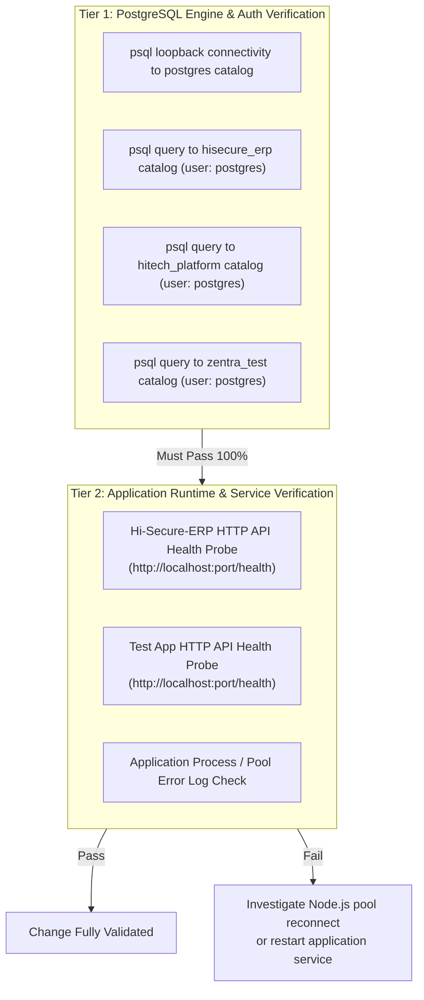

# MUSE SPARK — ZENTRA STEP 2D-2A-W
## FINAL POSTGRESQL RUNBOOK TECHNICAL CORRECTIONS REPORT — PLAN ONLY

**Project:** ZENTRA — Hi-Tech Lab Field Service Management Platform  
**Target Repository:** `D:\Zentra`  
**Input Reference:** [`docs/MUSE_SPARK_STEP2D_2A_V_RUNBOOK_CORRECTIONS_REPORT.md`](file:///d:/Zentra/docs/MUSE_SPARK_STEP2D_2A_V_RUNBOOK_CORRECTIONS_REPORT.md)  
**Host Environment:** Windows Workstation (`127.0.0.1:5432`)  
**Report Date:** 2026-10-09  
**Mode:** STRICT DOCUMENTATION-ONLY TECHNICAL AUDIT & CORRECTION  
**Budget Constraint:** Strict ₹0/month (Zero cost, no credit cards, no paid upgrades)  
**Remote Access:** STRICTLY PROHIBITED (Zero remote connections made)  
**Execution Authorization:** NOT GRANTED — NO COMMANDS EXECUTED IN THIS STEP  
**Status:** COMPLETE — WAITING FOR HUMAN OPERATOR REVIEW  

---

## 1. Executive Summary & Objective

In **Step 2D-2A-V**, an initial corrections report identified critical risks regarding PowerShell file encoding corruption, PL/pgSQL syntax limitations, firewall state realities, and authentication sequencing.

A subsequent deep-dive technical audit conducted in **Step 2D-2A-W** identified four remaining technical deficiencies that must be resolved prior to presenting the runbook for final human operator authorization:
1. **Mischaracterized Password Masking:** `psql \prompt` was incorrectly described as a "masked" password prompt. In standard `psql`, `\prompt` displays characters in plain text as they are typed. The correct, secure mechanism is PostgreSQL's built-in `\password` meta-command, which disables terminal echo and prompts twice for confirmation.
2. **Incomplete Encoding Detection:** Asserting that output is "UTF-8 without BOM" does not prove that the original configuration encoding and line terminators (CRLF vs. LF) were preserved. The runbook must inspect byte headers, check for BOMs, detect line endings, and generate an exact unified textual diff.
3. **Fragile Hardcoded Locale Strings:** Specifying hardcoded Windows collation strings (e.g. `LC_COLLATE 'English_United States.1252'`) in `CREATE DATABASE` is fragile and OS-dependent. The correct method inherits the verified cluster default from `template1` (`TEMPLATE template1 ENCODING 'UTF8'`).
4. **Conflation of DB Engine Health vs. Application Runtime Health:** A successful `psql` query proves only that PostgreSQL is accepting connections; it does **not** prove that background application web servers (`Hi-Secure-ERP`, `Test App`) have re-established their internal connection pools (`pg.Pool`) or that HTTP endpoints are functional.

This document, **Step 2D-2A-W**, formally documents these corrections, establishes an empirical baseline of existing cluster locales and configuration byte headers, and delivers the definitive, hardened operational sequence.

> [!IMPORTANT]
> **Strict Plan-Only Boundary:** Zero operational commands or configuration changes were performed. Zero configuration files (`postgresql.conf`, `pg_hba.conf`), firewall rules, Windows services, application files, or `.env` files were modified. Zero databases or roles were created. All proposed procedures in this document are strictly **[NOT EXECUTED]**.

---

## 2. Section 1 — Analysis of Remaining Technical Deficiencies & Corrections

The following matrix details the four technical issues identified in the review and their exact remedies:

| Defect ID | Technical Issue | Previous Flawed Proposal | Technical Failure Mode / Security Risk | Mandatory Correction in 2D-2A-W |
|---|---|---|---|---|
| **DEF-W1** | **Password Prompt Masking** | Proposed `\prompt 'Enter password: ' pass` in `psql`. | `\prompt` does **not** mask input in `psql`. Characters are echoed in plaintext on the terminal screen and could be shoulder-surfed or logged in session transcripts. | Separate role creation from credential assignment: Create `zentra_dev` without a password, then execute interactive `\password zentra_dev` (which disables echo, prompts twice, and never logs). |
| **DEF-W2** | **Encoding & Line Ending Detection** | Assumed writing UTF-8 without BOM is sufficient without detecting original file characteristics. | If an original file uses CRLF line endings, converting to LF or altering byte sequences creates noisy diffs and risks parsing anomalies. | Implement pre-inspection byte check (BOM detection + CRLF verification), verified backup hash check, content diff validation (`git diff --no-index` / `Compare-Object`), and pre-restart syntax validation. |
| **DEF-W3** | **Hardcoded Locale in `CREATE DATABASE`** | Proposed `LC_COLLATE 'English_United States.1252'` hardcoded in SQL. | Hardcoding OS-specific locale strings causes syntax errors if migrated across platforms or environments. | Remove hardcoded collation strings. Specify `TEMPLATE template1 ENCODING 'UTF8'` to inherit the cluster-standard collation dynamically. |
| **DEF-W4** | **Health Check Conflation** | Treated `psql -c "SELECT ..."` as an end-to-end application health check. | Database engine query proves only listener/catalog health. Does not prove that `Hi-Secure-ERP` or `Test App` Node.js connection pools recovered from the service restart. | Separate Tier 1 (PostgreSQL Engine & Auth checks) from Tier 2 (Application Runtime & HTTP API checks). Document explicitly what each check proves and does not prove. |

---

## 3. Section 2 — Empirical Investigation & Baseline Evidence

Prior to specifying the corrected procedures, read-only empirical checks were conducted to establish verifiable facts regarding existing database locales, file encodings, and byte headers on the local system:

### 3.1 Database Collation & Encoding Baseline
A read-only query against `pg_database` on `127.0.0.1:5432` established the exact collation parameters of all existing catalogs:

```sql
SELECT datname, encoding, pg_encoding_to_char(encoding) AS encoding_name, datcollate, datctype 
FROM pg_database 
WHERE datistemplate = false OR datname = 'template1' 
ORDER BY datname;
```

**Empirical Findings:**
- `template1`: `encoding: UTF8`, `datcollate: English_United States.1252`, `datctype: English_United States.1252`
- `postgres`: `encoding: UTF8`, `datcollate: English_United States.1252`, `datctype: English_United States.1252`
- `hisecure_erp`: `encoding: UTF8`, `datcollate: English_United States.1252`, `datctype: English_United States.1252`
- `hitech_platform`: `encoding: UTF8`, `datcollate: English_United States.1252`, `datctype: English_United States.1252`
- `zentra_test`: `encoding: UTF8`, `datcollate: English_United States.1252`, `datctype: English_United States.1252`

**Conclusion:** All catalogs in this cluster share identical collation and character classification inherited from `template1`. Therefore, executing `CREATE DATABASE zentra_local OWNER zentra_dev TEMPLATE template1 ENCODING 'UTF8'` naturally inherits the verified cluster standard without requiring fragile, hardcoded Windows-specific locale strings.

---

### 3.2 Configuration File Byte Header & Encoding Baseline
A read-only inspection of the byte streams of `postgresql.conf` and `pg_hba.conf` was performed to identify BOM presence and line terminators:

| Target File | Path on Disk | Byte Order Mark (BOM) | Line Terminator | Initial Characters | Verified File Encoding |
|---|---|---|---|---|---|
| `postgresql.conf` | `C:/Program Files/PostgreSQL/18/data/postgresql.conf` | **None** (`hasUtf8Bom: false`, `hasUtf16Bom: false`) | **CRLF** (`\r\n`) | `# -----------------------------` | 7-bit ASCII / UTF-8 without BOM with CRLF |
| `pg_hba.conf` | `C:/Program Files/PostgreSQL/18/data/pg_hba.conf` | **None** (`hasUtf8Bom: false`, `hasUtf16Bom: false`) | **CRLF** (`\r\n`) | `# PostgreSQL Client Authentication` | 7-bit ASCII / UTF-8 without BOM with CRLF |

**Conclusion:** Both files are standard ASCII/UTF-8 without Byte Order Marks and utilize Windows CRLF (`\r\n`) line endings. Any transformation procedure must strictly preserve CRLF line terminators and emit zero BOM bytes.

---

## 4. Section 3 — Corrected Technical Procedures & Specifications

### 4.1 Correction 1: Interactive Role Creation & Password Setting (Zero Secret Exposure)

#### The Protocol:
1. **Precondition:** The targeted `scram-sha-256` rule for `zentra_local` / `zentra_dev` has already been deployed and reloaded in `pg_hba.conf` (Phase 3).
2. **Step 1 (Create Role Without Password):** Connect as `postgres` via `psql` and create role `zentra_dev` with login permissions, strict connection limits, and zero elevated privileges, omitting any password clause:
   ```sql
   -- [NOT EXECUTED] Autocommit Statement in psql
   CREATE ROLE zentra_dev WITH 
       LOGIN 
       NOSUPERUSER 
       NOCREATEDB 
       NOCREATEROLE 
       CONNECTION LIMIT 20;
   ```
   *Security Note:* At this juncture, `zentra_dev` has no password. Because Phase 3 already configured `scram-sha-256` for `zentra_dev`, no client can log in without a valid SCRAM verifier.
3. **Step 2 (Assign SCRAM Password Interactively):** In the same interactive `psql` session, invoke the native PostgreSQL meta-command:
   ```sql
   -- [NOT EXECUTED] Interactive psql meta-command
   \password zentra_dev
   ```
   *Behavior:*
   - `psql` prompts: `Enter new password for user "zentra_dev": `
   - User types password; **terminal echo is completely disabled** (nothing is displayed on screen).
   - `psql` prompts: `Enter it again: `
   - Upon confirmation, `psql` sends a secure `ALTER ROLE zentra_dev WITH PASSWORD '...'` command over the encrypted/loopback socket.
   - The password is **never written to a script**, **never recorded in `.psql_history`**, **never stored in shell variables**, and **never printed in terminal logs**.

---

### 4.2 Correction 2: Deterministic Configuration File Integrity & Verification Protocol

The following PowerShell function defines the complete, non-destructive, encoding-preserving procedure with byte-level validation:

```powershell
# [NOT EXECUTED — UNTESTED OPERATIONAL PROCEDURE]
# Requires Elevated Local Administrator Shell

function Update-PostgresConfigDeterministic {
    param (
        [string]$ConfigPath,
        [scriptblock]$TransformLogic,
        [string]$Description
    )

    if (-not (Test-Path -Path $ConfigPath)) {
        throw "FAIL-CLOSED ABORT: Configuration file [$ConfigPath] not found."
    }

    # 1. Byte-level Pre-Inspection (Check for BOM and line endings)
    $fileBytes = [System.IO.File]::ReadAllBytes($ConfigPath)
    $hasUtf8Bom = ($fileBytes.Length -ge 3 -and $fileBytes[0] -eq 0xEF -and $fileBytes[1] -eq 0xBB -and $fileBytes[2] -eq 0xBF)
    $hasUtf16Bom = ($fileBytes.Length -ge 2 -and (($fileBytes[0] -eq 0xFF -and $fileBytes[1] -eq 0xFE) -or ($fileBytes[0] -eq 0xFE -and $fileBytes[1] -eq 0xFF)))

    if ($hasUtf8Bom -or $hasUtf16Bom) {
        throw "FAIL-CLOSED ABORT: Unexpected BOM detected in existing configuration file."
    }

    # 2. Create Verified Pre-Change Backup
    $preHash = (Get-FileHash -Path $ConfigPath -Algorithm SHA256).Hash
    $backupPath = "$ConfigPath.bak.$(Get-Date -Format 'yyyyMMdd_HHmmss')"
    Copy-Item -Path $ConfigPath -Destination $backupPath -Force
    $backupHash = (Get-FileHash -Path $backupPath -Algorithm SHA256).Hash

    if ($preHash -ne $backupHash) {
        throw "FAIL-CLOSED ABORT: Backup integrity check failed. Hashes do not match."
    }
    Write-Host "Verified backup established: $backupPath" -ForegroundColor Green

    # 3. Read content using UTF-8 without BOM, preserving CRLF
    $rawContent = [System.IO.File]::ReadAllText($ConfigPath, [System.Text.Encoding]::UTF8)

    # 4. Execute Transformation Logic
    $transformedContent = & $TransformLogic $rawContent

    # Ensure CRLF line endings are preserved
    if ($transformedContent -notmatch "\r\n" -and $transformedContent -match "\n") {
        $transformedContent = $transformedContent -replace "\n", "`r`n"
    }

    # 5. Write New Content with Strict UTF-8 No-BOM
    $utf8NoBom = [System.Text.UTF8Encoding]::new($false)
    [System.IO.File]::WriteAllText($ConfigPath, $transformedContent, $utf8NoBom)

    # 6. Post-Write Byte & BOM Verification
    $postBytes = [System.IO.File]::ReadAllBytes($ConfigPath)
    if ($postBytes.Length -ge 3 -and $postBytes[0] -eq 0xEF -and $postBytes[1] -eq 0xBB -and $postBytes[2] -eq 0xBF) {
        # Restore backup immediately
        Copy-Item -Path $backupPath -Destination $ConfigPath -Force
        throw "FAIL-CLOSED ABORT: BOM was detected in written file. Restored backup."
    }

    # 7. Unified Diff Verification (Ensure ONLY intended lines changed)
    Write-Host "--- BEGIN CONFIGURATION DIFF ($Description) ---" -ForegroundColor Cyan
    $diff = Compare-Object -ReferenceObject (Get-Content $backupPath) -DifferenceObject (Get-Content $ConfigPath)
    $diff | Format-Table -AutoSize
    Write-Host "--- END CONFIGURATION DIFF ---" -ForegroundColor Cyan

    return $backupPath
}
```

#### Pre-Restart Configuration Syntax Validation [NOT EXECUTED]:
Before restarting the Windows Service, validate configuration syntax using PostgreSQL's configuration evaluator:
```powershell
# [NOT EXECUTED] Evaluates postgresql.conf syntax before service restart
$syntaxCheck = & "C:\Program Files\PostgreSQL\18\bin\postgres.exe" -C listen_addresses -D "C:\Program Files\PostgreSQL\18\data" 2>&1
if ($LASTEXITCODE -ne 0 -or $syntaxCheck -notmatch "localhost") {
    Write-Error "FAIL-CLOSED ABORT: postgres.exe syntax check failed ($syntaxCheck). DO NOT RESTART SERVICE."
    # Restore backup immediately
} else {
    Write-Host "PostgreSQL syntax check passed: listen_addresses = $syntaxCheck" -ForegroundColor Green
}
```

---

### 4.3 Correction 3: Robust Database Creation (Cluster-Standard Template)

#### The Problem:
Hardcoding `LC_COLLATE 'English_United States.1252'` is fragile. If the underlying operating system collation registry changes or if scripts are ported, the command errors out with `ERROR: collation "English_United States.1252" for encoding "UTF8" does not match locale`.

#### The Corrected Autocommit SQL [NOT EXECUTED]:
`CREATE DATABASE` must run in autocommit mode outside any transaction block. Specifying `TEMPLATE template1 ENCODING 'UTF8'` instructs PostgreSQL to copy the catalog structure, collation, and character classification directly from `template1`:

```sql
-- [NOT EXECUTED — AUTOCOMMIT STATEMENT IN PSQL]
-- File: create_zentra_local_db.sql
-- Executed with: psql -h 127.0.0.1 -p 5432 -U postgres -d postgres -f create_zentra_local_db.sql

\set ON_ERROR_STOP on

-- 1. Preflight check: refuse to overwrite or reuse an existing database
SELECT count(*) AS db_exists 
FROM pg_catalog.pg_database 
WHERE datname = 'zentra_local' \gset

\if :db_exists
    \echo 'FAIL-CLOSED ABORT: Database zentra_local already exists. Halting to prevent unintended reuse or corruption.'
    \q
\else
    -- 2. Create database inheriting verified cluster defaults from template1
    CREATE DATABASE zentra_local 
        WITH 
        OWNER = zentra_dev 
        TEMPLATE = template1 
        ENCODING = 'UTF8';

    GRANT ALL PRIVILEGES ON DATABASE zentra_local TO zentra_dev;
    \echo 'SUCCESS: Database zentra_local created with OWNER zentra_dev inheriting template1.'
\endif
```

---

### 4.4 Correction 4: Two-Tiered Health Check Framework

To prevent assuming that application pools recover automatically, the runbook divides health checks into two distinct operational tiers:



#### Tier 1: PostgreSQL Engine & Authentication Verification [NOT EXECUTED]
- **What it PROVES:**
  - Service `postgresql-x64-18` is listening on `127.0.0.1:5432` / `[::1]:5432`.
  - Storage engine, catalog tables, and memory structures are operational.
  - `pg_hba.conf` permits loopback access under expected credentials (`trust` for legacy apps, `scram-sha-256` for `zentra_dev`).
- **What it DOES NOT PROVE:**
  - It does **not** prove that running Node.js / Fastify / Express application instances have cleared socket timeouts or reconnected their connection pools.
  - It does **not** prove that frontend web applications or background queue workers are operational.

#### Tier 2: Application Runtime & Connection Pool Smoke Tests [NOT EXECUTED]
- **What it PROVES:**
  - The application web process is running.
  - Internal application connection pools (`pg.Pool`) successfully re-established backend sockets after database restart.
  - HTTP endpoints respond with HTTP 200 OK within latency thresholds (< 3000ms).
- **Execution Criteria:**
  - If `Hi-Secure-ERP` or `Test App` processes were running prior to service restart, the administrator must probe their HTTP health endpoints:
    ```powershell
    # [NOT EXECUTED] Example HTTP runtime probe
    Invoke-WebRequest -Uri "http://localhost:<app_port>/api/health" -TimeoutSec 3 -UseBasicParsing
    ```
  - If an application connection pool failed to auto-recover, the administrator must restart the application service (e.g. `pm2 restart hisecure-erp`).
  - If the application was **not running** prior to the change, Tier 2 is marked **NOT VERIFIED (Application Inactive)**.

---

## 5. Section 4 — The Corrected Operational Sequence (End-to-End)

The complete operational roadmap consists of three pre-initialization hardening phases and three ZENTRA initialization stages, governed by six explicit human approval gates:

```mermaid
flowchart TD
    subgraph HardeningPhases["Pre-Initialization Shared Cluster Hardening"]
        G1{"Gate 1: Network Socket Hardening<br/>Human Approval"} --> P1["Phase 1: Socket Hardening<br/>(listen_addresses = 'localhost')<br/>CRLF + UTF-8 No-BOM + Syntax Check + Restart"]
        P1 --> T1["Tier 1 & Tier 2 Observable Health Checks<br/>(Hi-Secure-ERP & Test App)"]
        T1 --> G2{"Gate 2: Host Firewall Evaluation<br/>Human Approval"}
        G2 --> P2["Phase 2: Inbound Firewall Review<br/>(Add Port 5432 Block Rule;<br/>Profile remains OFF unless authorized)"]
        P2 --> G3{"Gate 3: Auth Policy Deployment<br/>Human Approval"}
        G3 --> P3["Phase 3: Targeted SCRAM Rule Deployment<br/>(Prepend zentra_local rules to pg_hba.conf)<br/>Dynamic pg_ctl reload (Zero Disruption)"]
        P3 --> T2["Verify Legacy Apps Continue Unaffected Under trust"]
    end

    subgraph InitializationStages["ZENTRA Database Initialization Stages"]
        T2 --> G4{"Gate 4: Stage A Provisioning<br/>Human Approval"}
        G4 --> SA1["Stage A.1: Create zentra_dev Role<br/>(CREATE ROLE without password)"]
        SA1 --> SA2["Stage A.2: Assign SCRAM Password<br/>(Interactive \\password zentra_dev with hidden echo)"]
        SA2 --> SA3["Stage A.3: Create zentra_local Database<br/>(Autocommit Mode, TEMPLATE template1)"]
        SA3 --> G5{"Gate 5: Stage B Migrations<br/>Human Approval"}
        G5 --> SB["Stage B: Controlled Migrations<br/>(Execute 14 Kysely Migrations via reviewed runner)"]
        SB --> G6{"Gate 6: Stage C Seeding<br/>Human Approval"}
        G6 --> SC["Stage C: Synthetic Dev Seeding<br/>(Pre-seed 0-row check + Single Execution)"]
    end
```



---

## 6. Section 5 — Audit of Untested Procedures, Lingering Assumptions & Risks

The following table explicitly distinguishes procedures that have been empirically verified from those that remain **UNTESTED in a live administrative environment**:

| Procedure / Action | Verification Status | Underlying Technical Risk | Required Pre-Execution Safeguard |
|---|---|---|---|
| **Database Collation Query** | 🟢 **Verified Fact** | N/A (Confirmed: all catalogs share `English_United States.1252`) | Query was run read-only; zero risk. |
| **Config Byte Header Check** | 🟢 **Verified Fact** | N/A (Confirmed: ASCII/UTF-8 No-BOM with CRLF line endings) | Check was run read-only; zero risk. |
| **`postgres.exe -C` Syntax Check** | 🔴 **UNTESTED** | Execution in non-elevated shell not tested against PostgreSQL 18 binary. | Administrator must test `-C` command before issuing service restart. |
| **.NET File Write Script** | 🔴 **UNTESTED** | Windows file system permissions on `Program Files` require elevation. | Administrator must execute from elevated PowerShell shell. |
| **Windows Firewall Inbound Rule** | 🔴 **UNTESTED** | `Public Profile: State OFF` makes rule dormant on Wi-Fi adapter. | Administrator must decide whether to activate Public profile. |
| **`\password zentra_dev` Meta-Cmd** | 🔴 **UNTESTED** | Requires interactive `psql` console session with human input. | Operator must enter password twice with hidden echo; never script. |
| **Standalone Migration Runner** | 🔴 **UNTESTED** | Script has not yet been implemented or reviewed in repository. | Marked NOT VERIFIED for execution in Step 2D-2A-R; requires proposal. |

---

## 7. Section 6 — The Six Mandatory Human Approval Gates

| Gate ID | Scope & Milestone | Mandatory Prerequisites to Verify Before Granting Approval | Action Authorized Upon Operator Approval |
|---|---|---|---|
| **Gate 1** | **Network Socket Hardening** | Verified backup `postgresql.conf.bak` exists; hash matches; `postgres.exe -C` syntax test passes. | Update `listen_addresses = 'localhost'` using UTF-8 No-BOM; restart `postgresql-x64-18`. |
| **Gate 2** | **Host Firewall Policy** | Verified firewall profile states; evaluated impact of Public profile activation across local tools. | Create targeted port 5432 inbound block rule; review profile activation decision. |
| **Gate 3** | **Targeted SCRAM Policy** | Verified backup `pg_hba.conf.bak` exists; hash matches; targeted rules prepended to line 1 of file. | Deploy targeted `scram-sha-256` rule for `zentra_local` / `zentra_dev`; reload config via `pg_ctl reload`. |
| **Gate 4** | **Stage A Database Creation** | Phases 1 & 3 complete; Tier 1 & 2 health checks pass; SCRAM rule active; `zentra_local` does not exist. | Create `zentra_dev` role; assign password via `\password`; create `zentra_local` DB via autocommit. |
| **Gate 5** | **Stage B Schema Migrations** | Stage A verified; `current_database() === 'zentra_local'`; 0 public tables; standalone runner reviewed. | Execute 14 Kysely migrations sequentially; verify 34 tables created. |
| **Gate 6** | **Stage C Synthetic Seeding** | Stage B verified; 14 migrations complete; domain table row counts strictly 0. | Execute synthetic mock seeding; verify row counts; confirm zero real PII. |

---

## 8. Section 7 — Confirmation of Safety & Compliance

- **Operational Execution:** **ZERO.** No operational commands were executed.
- **Database Writes / DDL:** **ZERO.** No databases, roles, tables, schemas, or records were created, modified, or dropped.
- **Data Mutating Commands:** **ZERO.** No `INSERT`, `UPDATE`, `DELETE`, `TRUNCATE`, migrations, seeds, or tests were executed.
- **Configuration Modifications:** **ZERO.** No changes were made to `postgresql.conf`, `pg_hba.conf`, Windows Firewall, Windows services, application code, or `.env` files.
- **Remote Cloud Connections:** **ZERO.** No connections made to Neon, AWS, Supabase, Render, or any remote host.
- **Budget Integrity:** Strict ₹0/month budget preserved.

---

```
STOP — STEP 2D-2A-W COMPLETE — WAITING FOR HUMAN REVIEW
```
