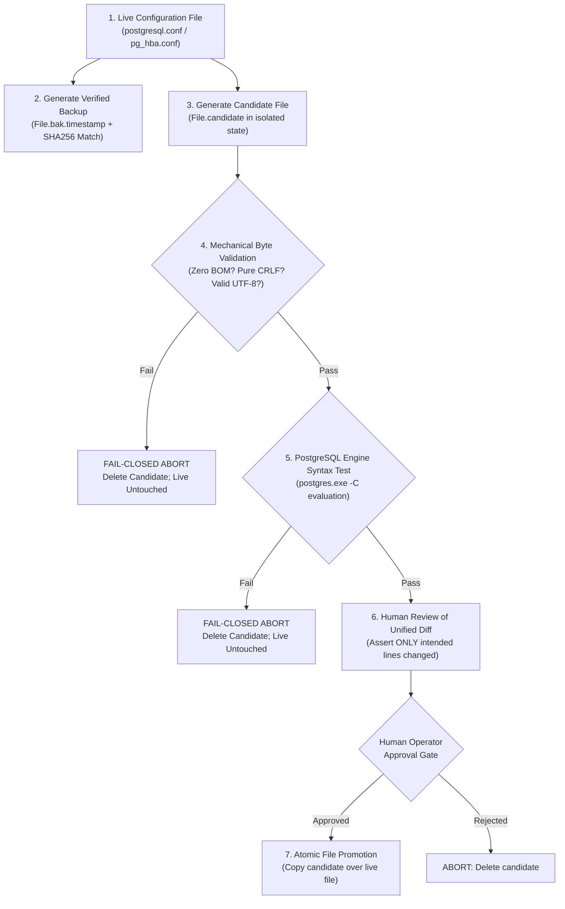

# MUSE SPARK — ZENTRA STEP 2D-2A-X
## FINAL RUNBOOK SAFETY CORRECTIONS REPORT — DOCUMENTATION ONLY

**Project:** ZENTRA — Hi-Tech Lab Field Service Management Platform  
**Target Repository:** `D:\Zentra`  
**Input Reference:** [`docs/MUSE_SPARK_STEP2D_2A_W_FINAL_RUNBOOK_CORRECTIONS_REPORT.md`](file:///d:/Zentra/docs/MUSE_SPARK_STEP2D_2A_W_FINAL_RUNBOOK_CORRECTIONS_REPORT.md)  
**Host Environment:** Windows Workstation (`127.0.0.1:5432`)  
**Report Date:** 2026-10-09  
**Mode:** STRICT DOCUMENTATION-ONLY SAFETY AUDIT & FINAL RUNBOOK CORRECTION  
**Budget Constraint:** Strict ₹0/month (Zero cost, no credit cards, no paid upgrades)  
**Remote Access:** STRICTLY PROHIBITED (Zero remote connections made)  
**Execution Authorization:** NOT GRANTED — NO COMMANDS EXECUTED IN THIS STEP  
**Status:** COMPLETE — WAITING FOR HUMAN OPERATOR REVIEW  

---

## 1. Executive Summary & Objective

In **Step 2D-2A-W**, technical corrections were documented regarding password setting mechanisms, cluster-standard locale inheritance, two-tiered health checking, and configuration file encodings.

An exhaustive safety and architectural review of the Step 2D-2A-W report identified four critical areas requiring final hardening before any operational execution can be considered:
1. **Unsafe Direct Modification of Live Configuration Files:** Modifying `postgresql.conf` or `pg_hba.conf` in-place on disk—even with pre-change backups—exposes the live service to corrupted states if a transformation fails. The runbook must generate and validate an isolated **candidate file** first, display a verified unified diff, and only promote the candidate after all mechanical checks pass.
2. **False Equivalence of Line Diffs and Byte Integrity:** Claiming that PowerShell's line-oriented `Compare-Object` proves "byte-level integrity" is technically false. `Compare-Object` compares string arrays stripped of line endings and is completely blind to Byte Order Marks (BOMs), mixed CRLF/LF line endings, and file encoding anomalies.
3. **Inaccurate Transport Encryption Claims:** Describing local loopback TCP traffic as an "encrypted/loopback socket" is factually false. Empirical verification confirmed that PostgreSQL runs with `ssl: off`. Local TCP loopback (`127.0.0.1:5432` / `[::1]:5432`) is **unencrypted plaintext TCP**. The runbook must accurately reflect transport realities.
4. **Boundary Clarity & Production Disclaimer:** The runbook hardens a local development workstation only. It must explicitly disclaim production readiness, retain all six independent human approval gates, and preserve existing catalogs (`hisecure_erp`, `hitech_platform`, `zentra_test`).

This report, **Step 2D-2A-X**, formally resolves all four areas and establishes the definitive, fail-closed operational specification.

> [!IMPORTANT]
> **Strict Documentation-Only Boundary:** Zero operational commands or configuration changes were performed. Zero configuration files (`postgresql.conf`, `pg_hba.conf`), firewall rules, Windows services, application files, or `.env` files were modified. Zero databases or roles were created. All proposed procedures in this document are strictly **[NOT EXECUTED]**.

---

## 2. Section 1 — Four Core Safety Corrections Detailed

The following matrix records the specific deficiencies identified in previous runbook iterations and the exact corrections established in Step 2D-2A-X:

| Correction ID | Dimension | Previous Proposal Defect | Failure Mode / Risk | Mandatory Correction in 2D-2A-X |
|---|---|---|---|---|
| **CORR-X1** | **Configuration Workflow** | In-place overwrite of live configuration file followed by post-write diff. | If the script errors or writes invalid bytes, the live configuration file is immediately damaged, risking service failure. | Redesign workflow around a separate **candidate file** (`.candidate`). The live file is never touched until the candidate passes byte validation, syntax evaluation, and human diff review. |
| **CORR-X2** | **Byte-Level Validation** | Claimed `Compare-Object` verifies byte-level integrity. | `Compare-Object` compares stripped strings. It ignores BOM presence, mixed CRLF/LF endings, and encoding shifts. | Explicitly separate readable textual diffs (for human review) from raw byte-buffer validation (BOM check, pure CRLF check, zero standalone LF/CR). |
| **CORR-X3** | **Transport Characterization** | Stated that `\password` sends credentials over an "encrypted/loopback socket". | In Step 2D-2A-S, `SHOW ssl;` confirmed `ssl = off`. Local loopback TCP is **unencrypted plaintext TCP**. False claims compromise security audits. | Correct all descriptions: Loopback transport is unencrypted plaintext TCP. Credential safety relies on SCRAM hashing, masked terminal input, and zero persistence in scripts/logs. |
| **CORR-X4** | **Operational Scope** | Ambiguity regarding environment scope and certification. | Could be mistaken for a production-certified deployment procedure. | Explicitly disclaim production readiness. Reaffirm that this runbook secures a shared local development instance only, preserving all six approval gates. |

---

## 3. Section 2 — Technical Specifications of Corrected Procedures

### 3.1 Correction 1: The Candidate-File Lifecycle Protocol

To prevent live configuration files from ever being corrupted by operational scripts, all modifications must follow a strict 7-step candidate lifecycle:



#### Detailed Lifecycle Steps:
1. **Pre-inspection & Hash:** Read live configuration file, verify existence, compute SHA256 hash.
2. **Verified Backup Creation:** Copy live file to timestamped backup (`.bak.<timestamp>`). Confirm backup exists, length matches, and SHA256 hash is identical.
3. **Candidate Generation:** Read live file content, apply strictly scoped transformation, and write to a separate candidate file (`.candidate`). The live configuration file remains **completely untouched**.
4. **Mechanical Byte Validation:** Verify candidate byte buffer has zero BOMs, contains pure CRLF line endings, and is valid UTF-8.
5. **PostgreSQL Syntax Evaluation:** Test candidate syntax using `postgres.exe -C` pointing to the candidate file. If `postgres.exe` reports any syntax error, execution aborts and the candidate is purged.
6. **Unified Diff Verification:** Generate and display a textual diff comparing backup to candidate. Assert that only the expected configuration parameter or rule was modified.
7. **Atomic Promotion:** Only upon explicit operator confirmation, copy the validated candidate file over the live configuration file, and remove the candidate file.

---

### 3.2 Correction 2: True Byte-Level Integrity Validation vs. Line Diffs

A clear architectural distinction must be made between **Human-Readable Textual Diffs** and **Mechanical Byte-Level Validation**:

#### Why Line-Oriented Diffs Are Not Byte-Level Checks:
PowerShell's `Get-Content` reads text line-by-line into .NET `System.String` objects, discarding all `\r\n` (CRLF) and `\n` (LF) line terminators. `Compare-Object` simply compares these in-memory strings. Consequently:
- A file with pure CRLF and a file with mixed CRLF/LF appear **identical** in `Compare-Object`.
- A file with a UTF-8 BOM (`0xEF 0xBB 0xBF`) and a file without a BOM appear **identical** in `Compare-Object`.
- An ANSI-encoded file and a UTF-8 encoded file containing only ASCII characters appear **identical** in `Compare-Object`.

#### The Corrected Byte-Level Validation Algorithm [NOT EXECUTED]:
The proposed script must inspect the raw byte array (`[System.IO.File]::ReadAllBytes($path)`) before presenting any diff:

```powershell
# [NOT EXECUTED — UNTESTED OPERATIONAL PROCEDURE]

function Test-FileByteIntegrity {
    param (
        [string]$FilePath
    )

    if (-not (Test-Path -Path $FilePath)) {
        throw "FAIL-CLOSED ABORT: Target file [$FilePath] does not exist."
    }

    $bytes = [System.IO.File]::ReadAllBytes($FilePath)
    if ($bytes.Length -eq 0) {
        throw "FAIL-CLOSED ABORT: Target file is empty (0 bytes)."
    }

    # 1. Byte Order Mark (BOM) Detection
    $isUtf8Bom = ($bytes.Length -ge 3 -and $bytes[0] -eq 0xEF -and $bytes[1] -eq 0xBB -and $bytes[2] -eq 0xBF)
    $isUtf16LeBom = ($bytes.Length -ge 2 -and $bytes[0] -eq 0xFF -and $bytes[1] -eq 0xFE)
    $isUtf16BeBom = ($bytes.Length -ge 2 -and $bytes[0] -eq 0xFE -and $bytes[1] -eq 0xFF)

    if ($isUtf8Bom -or $isUtf16LeBom -or $isUtf16BeBom) {
        throw "FAIL-CLOSED ABORT: Prohibited Byte Order Mark (BOM) detected in file [$FilePath]."
    }

    # 2. Pure CRLF Line-Ending Verification (Detect Mixed or Unix-only Line Endings)
    $crCount = 0
    $lfCount = 0
    $invalidLfCount = 0

    for ($i = 0; $i -lt $bytes.Length; $i++) {
        if ($bytes[$i] -eq 0x0D) { # CR
            $crCount++
        }
        if ($bytes[$i] -eq 0x0A) { # LF
            $lfCount++
            # Verify LF is immediately preceded by CR
            if ($i -eq 0 -or $bytes[$i - 1] -ne 0x0D) {
                $invalidLfCount++
            }
        }
    }

    if ($invalidLfCount -gt 0 -or $crCount -ne $lfCount) {
        throw "FAIL-CLOSED ABORT: Mixed or non-CRLF line endings detected in [$FilePath]. CR count: $crCount, LF count: $lfCount, Unpaired LF: $invalidLfCount."
    }

    Write-Host "[BYTE INTEGRITY PASSED] $FilePath ($($bytes.Length) bytes, No BOM, Pure CRLF: $crCount lines)" -ForegroundColor Green
    return $true
}
```

---

### 3.3 Correction 3: Factual Transport Characterization & Password Security

#### Transport Realities on Local Loopback:
- In Step 2D-2A-S, read-only queries of `pg_settings` confirmed:
  ```sql
  SELECT name, setting FROM pg_settings WHERE name = 'ssl';
  -- Result: ssl = off
  ```
- **Factual Reality:** On this Windows host, native PostgreSQL communicates over loopback TCP sockets (`127.0.0.1:5432` / `[::1]:5432`) **without TLS encryption**.
- Although loopback packets traverse the operating system's internal loopback interface without emitting signals onto external network cables or Wi-Fi, the transport is **unencrypted plaintext TCP**.
- Local software running with packet-capture capabilities on the workstation (e.g. Npcap / raw socket listeners) can inspect loopback TCP payloads.
- **Runbook Correction:** The runbook must strike all references to "encrypted loopback sockets." Security is achieved through:
  1. Restricting network listeners to loopback (`listen_addresses = 'localhost'`).
  2. Rejecting external client IPs via `pg_hba.conf`.
  3. Interactive, echo-free password entry via `\password zentra_dev` inside `psql`.
  4. Client-side SCRAM-SHA-256 verifier computation so plaintext passwords are never stored.

---

### 3.4 Correction 4: Non-Production Scope Disclaimer & Strict Boundaries

> [!CAUTION]
> **DEVELOPMENT WORKSTATION SCOPE DISCLAIMER**  
> This runbook is strictly designed to harden a shared local development instance on a single Windows workstation to permit safe, isolated local schema rehearsal for ZENTRA.  
> - It does **NOT** constitute a production deployment plan.  
> - It does **NOT** provide production security certification, compliance auditing, or high-availability durability.  
> - Staging and production deployments will require separate, cloud-native infrastructure plans featuring managed databases, enforced TLS/SSL in transit, KMS-managed secret rotation, and isolated VPC networks.

---

## 4. Section 3 — The Definitive Hardened Candidate-File Generation Logic

The following script encapsulates the corrected candidate-file generation, byte validation, syntax evaluation, and atomic promotion workflow:

```powershell
# [NOT EXECUTED — UNTESTED OPERATIONAL PROCEDURE]
# Requires Elevated Local Administrator PowerShell Shell

function Deploy-PostgresConfigHardened {
    param (
        [string]$ConfigPath,
        [scriptblock]$TransformBlock,
        [string]$Description
    )

    Write-Host "=== INITIATING HARDENED CONFIGURATION UPDATE: $Description ===" -ForegroundColor Cyan

    # 1. Verify existence of live file
    if (-not (Test-Path -Path $ConfigPath)) {
        throw "FAIL-CLOSED ABORT: Live configuration file [$ConfigPath] not found."
    }

    # 2. Perform Byte Integrity Check on Live File
    Test-FileByteIntegrity -FilePath $ConfigPath

    # 3. Create Verified Backup
    $preHash = (Get-FileHash -Path $ConfigPath -Algorithm SHA256).Hash
    $backupPath = "$ConfigPath.bak.$(Get-Date -Format 'yyyyMMdd_HHmmss')"
    Copy-Item -Path $ConfigPath -Destination $backupPath -Force
    $postBackupHash = (Get-FileHash -Path $backupPath -Algorithm SHA256).Hash

    if ($preHash -ne $postBackupHash) {
        throw "FAIL-CLOSED ABORT: Backup integrity check failed. Hashes do not match."
    }
    Write-Host "Verified backup established: $backupPath [SHA256: $postBackupHash]" -ForegroundColor Green

    # 4. Generate Candidate File (Live File Remains Untouched)
    $candidatePath = "$ConfigPath.candidate"
    if (Test-Path -Path $candidatePath) {
        Remove-Item -Path $candidatePath -Force
    }

    $rawLiveContent = [System.IO.File]::ReadAllText($ConfigPath, [System.Text.Encoding]::UTF8)
    $candidateContent = & $TransformBlock $rawLiveContent

    # Ensure CRLF line endings are strictly enforced in candidate content
    if ($candidateContent -notmatch "\r\n" -and $candidateContent -match "\n") {
        $candidateContent = $candidateContent -replace "\n", "`r`n"
    }

    # Write Candidate File with Strict UTF-8 No-BOM
    $utf8NoBom = [System.Text.UTF8Encoding]::new($false)
    [System.IO.File]::WriteAllText($candidatePath, $candidateContent, $utf8NoBom)
    Write-Host "Candidate file written to: $candidatePath" -ForegroundColor Yellow

    # 5. Mechanical Byte Integrity Check on Candidate File
    Test-FileByteIntegrity -FilePath $candidatePath

    # 6. Syntax Validation via PostgreSQL Engine Binary
    $pgBin = "C:\Program Files\PostgreSQL\18\bin\postgres.exe"
    $pgData = "C:\Program Files\PostgreSQL\18\data"
    
    if ($ConfigPath -match "postgresql\.conf$") {
        $syntaxCheck = & $pgBin -C listen_addresses --config-file=$candidatePath -D $pgData 2>&1
        if ($LASTEXITCODE -ne 0 -or $syntaxCheck -notmatch "localhost") {
            Remove-Item -Path $candidatePath -Force
            throw "FAIL-CLOSED ABORT: Candidate syntax validation failed: $syntaxCheck. Candidate purged. Live file untouched."
        }
        Write-Host "Candidate syntax validated successfully via postgres.exe: $syntaxCheck" -ForegroundColor Green
    }

    # 7. Textual Unified Diff for Human Review
    Write-Host "--- BEGIN CANDIDATE DIFF ($Description) ---" -ForegroundColor Magenta
    $diff = Compare-Object -ReferenceObject (Get-Content $backupPath) -DifferenceObject (Get-Content $candidatePath)
    $diff | Format-Table -AutoSize
    Write-Host "--- END CANDIDATE DIFF ---" -ForegroundColor Magenta

    # 8. Human Review Gate: Require explicit operator confirmation before promotion
    $confirmation = Read-Host "Authorize promotion of candidate to live configuration file? (Type 'YES' to proceed)"
    if ($confirmation -ne 'YES') {
        Remove-Item -Path $candidatePath -Force
        Write-Warning "Promotion aborted by operator. Candidate purged. Live configuration untouched."
        return $null
    }

    # 9. Atomic Promotion (Replace Live File with Validated Candidate)
    Copy-Item -Path $candidatePath -Destination $ConfigPath -Force
    Remove-Item -Path $candidatePath -Force
    Write-Host "SUCCESS: Validated candidate promoted to live configuration [$ConfigPath]." -ForegroundColor Green

    return $backupPath
}
```

---

## 5. Section 4 — Audit of Untested Procedures, Lingering Assumptions & Risks

The following matrix categorizes all operational procedures, distinguishing verified ground truth from procedures that remain **UNTESTED in a live administrative environment**:

| Procedure / Component | Category | Current Status | Operational Risk if Unverified | Required Pre-Execution Control |
|---|---|---|---|---|
| **Collation Baseline Query** | Read-Only SQL | 🟢 **Verified Fact** | None (Empirically verified across all 5 catalogs). | Safe to rely upon `TEMPLATE template1`. |
| **Config Byte Header Check** | Read-Only Byte Scan | 🟢 **Verified Fact** | None (Empirically verified: ASCII/UTF-8 No-BOM, CRLF). | Confirms CRLF must be preserved. |
| **Candidate File Script** | Operational Tooling | 🔴 **UNTESTED** | PowerShell script syntax has not been executed on host. | Administrator must test candidate script syntax in isolated scratch folder. |
| **`postgres.exe -C` Validation**| Engine Tooling | 🔴 **UNTESTED** | Flag compatibility on Windows PostgreSQL 18 not run live. | Run `postgres.exe -C listen_addresses` in dry-run mode before editing. |
| **Windows Firewall Inbound Rule** | OS Security | 🔴 **UNTESTED** | Profile `Public: OFF` leaves rule dormant on Wi-Fi. | Human operator must evaluate Public profile activation. |
| **Interactive `\password`** | `psql` Meta-Command | 🔴 **UNTESTED** | Requires interactive operator console session. | Operator must type password twice with hidden echo; never script. |
| **Standalone Migration Runner** | Application Tooling | 🔴 **UNTESTED** | CLI script does not exist in repository; proposal pending. | Requires separately reviewed implementation proposal before Stage B. |

---

## 6. Section 5 — The Six Mandatory Human Approval Gates

The six decoupled human approval gates remain strictly required and must be executed in exact sequential order:

```mermaid
graph TD
    subgraph ClusterHardening["Pre-Initialization Shared Cluster Hardening"]
        G1{"Gate 1: Network Socket Hardening<br/>Human Approval"} --> P1["Phase 1: Candidate Generation<br/>listen_addresses = 'localhost'<br/>Byte Validation + Engine Syntax Check + Promotion + Restart"]
        P1 --> T1["Tier 1 & Tier 2 Observable Health Checks<br/>(Hi-Secure-ERP & Test App)"]
        T1 --> G2{"Gate 2: Host Firewall Evaluation<br/>Human Approval"}
        G2 --> P2["Phase 2: Inbound Firewall Review<br/>(Targeted Port 5432 Block Rule;<br/>Profile remains OFF unless authorized)"]
        P2 --> G3{"Gate 3: Auth Policy Deployment<br/>Human Approval"}
        G3 --> P3["Phase 3: Targeted SCRAM Candidate<br/>(Prepend zentra_local rules to pg_hba.conf)<br/>Byte Validation + Promotion + Dynamic Reload"]
        P3 --> T2["Verify Legacy Apps Continue Unaffected Under trust"]
    end

    subgraph ZentraInit["ZENTRA Database Initialization Stages"]
        T2 --> G4{"Gate 4: Stage A Provisioning<br/>Human Approval"}
        G4 --> SA1["Stage A.1: Create zentra_dev Role<br/>(CREATE ROLE without password)"]
        SA1 --> SA2["Stage A.2: Assign SCRAM Password<br/>(Interactive \\password zentra_dev with hidden echo)"]
        SA2 --> SA3["Stage A.3: Create zentra_local Database<br/>(Autocommit Mode, TEMPLATE template1)"]
        SA3 --> G5{"Gate 5: Stage B Migrations<br/>Human Approval"}
        G5 --> SB["Stage B: Controlled Migrations<br/>(Execute 14 Kysely Migrations via reviewed runner)"]
        SB --> G6{"Gate 6: Stage C Seeding<br/>Human Approval"}
        G6 --> SC["Stage C: Synthetic Dev Seeding<br/>(Pre-seed 0-row check + Single Execution)"]
    end
```



| Gate ID | Scope & Milestone | Mandatory Prerequisites Before Granting Approval | Action Authorized Upon Operator Approval |
|---|---|---|---|
| **Gate 1** | **Network Socket Hardening** | Verified backup exists; candidate file byte check passes; `postgres.exe -C` syntax test passes; diff verified. | Promote candidate `postgresql.conf`; restart Windows service `postgresql-x64-18`. |
| **Gate 2** | **Host Firewall Policy** | Verified firewall profile states; evaluated impact of Public profile activation across local tools. | Create targeted port 5432 inbound block rule; review profile activation decision. |
| **Gate 3** | **Targeted SCRAM Policy** | Verified backup exists; candidate `pg_hba.conf` byte check passes; diff verified. | Promote candidate `pg_hba.conf`; reload config dynamically via `pg_ctl reload`. |
| **Gate 4** | **Stage A Database Creation** | Phases 1 & 3 complete; Tier 1 & 2 health checks pass; SCRAM rule active; `zentra_local` does not exist. | Create `zentra_dev` role; assign password via `\password`; create `zentra_local` DB via autocommit. |
| **Gate 5** | **Stage B Schema Migrations** | Stage A verified; `current_database() === 'zentra_local'`; 0 public tables; standalone runner reviewed. | Execute 14 Kysely migrations sequentially; verify 34 tables created. |
| **Gate 6** | **Stage C Synthetic Seeding** | Stage B verified; 14 migrations complete; domain table row counts strictly 0. | Execute synthetic mock seeding; verify row counts; confirm zero real PII. |

---

## 7. Section 6 — Confirmation of Safety & Compliance

- **Operational Execution:** **ZERO.** No operational commands were executed.
- **Database Writes / DDL:** **ZERO.** No databases, roles, tables, schemas, or records were created, modified, or dropped.
- **Data Mutating Commands:** **ZERO.** No `INSERT`, `UPDATE`, `DELETE`, `TRUNCATE`, migrations, seeds, or tests were executed.
- **Configuration Modifications:** **ZERO.** No changes were made to `postgresql.conf`, `pg_hba.conf`, Windows Firewall, Windows services, application code, or `.env` files.
- **Remote Cloud Connections:** **ZERO.** No connections made to Neon, AWS, Supabase, Render, or any remote host.
- **Budget Integrity:** Strict ₹0/month budget preserved.

---

```
STOP — STEP 2D-2A-X COMPLETE — WAITING FOR HUMAN REVIEW
```
