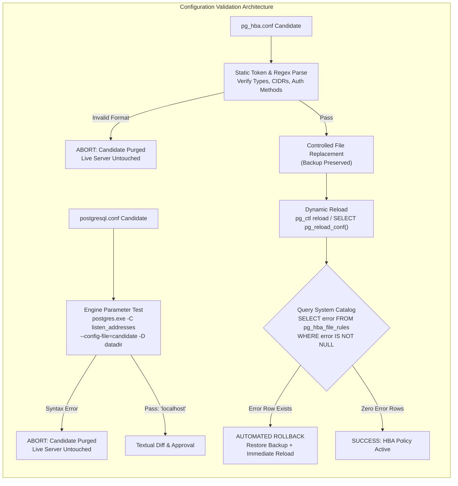

# MUSE SPARK — ZENTRA STEP 2D-2A-Y
## FINAL TECHNICAL VALIDATION REPORT — DOCUMENTATION ONLY

**Project:** ZENTRA — Hi-Tech Lab Field Service Management Platform  
**Target Repository:** `D:\Zentra`  
**Input Reference:** [`docs/MUSE_SPARK_STEP2D_2A_X_FINAL_SAFETY_CORRECTIONS_REPORT.md`](file:///d:/Zentra/docs/MUSE_SPARK_STEP2D_2A_X_FINAL_SAFETY_CORRECTIONS_REPORT.md)  
**Host Environment:** Windows Workstation (`127.0.0.1:5432`)  
**Report Date:** 2026-10-09  
**Mode:** STRICT DOCUMENTATION-ONLY TECHNICAL AUDIT & RUNBOOK VALIDATION  
**Budget Constraint:** Strict ₹0/month (Zero cost, no credit cards, no paid upgrades)  
**Remote Access:** STRICTLY PROHIBITED (Zero remote connections made)  
**Execution Authorization:** NOT GRANTED — NO COMMANDS EXECUTED IN THIS STEP  
**Status:** COMPLETE — WAITING FOR HUMAN OPERATOR REVIEW  

---

## 1. Executive Summary & Objective

In **Step 2D-2A-X**, the candidate-file lifecycle protocol was introduced to isolate configuration transformations from live PostgreSQL service files, line-oriented diffs were separated from byte checks, loopback transport was accurately characterized as unencrypted plaintext TCP, and non-production scope boundaries were formalized.

A rigorous technical review of Step 2D-2A-X identified three critical technical gaps requiring remediation before any operational execution can be authorized:
1. **Permissive / Silent UTF-8 Decoding:** Default .NET `[System.Text.Encoding]::UTF8` decoders replace malformed byte sequences with Unicode replacement characters (`\uFFFD`) rather than failing closed. A strict validator must be parameterized with `throwOnInvalidBytes: $true` to abort immediately on invalid byte sequences.
2. **Conflation of `postgresql.conf` and `pg_hba.conf` Engine Validation:** `postgres.exe -C` parses and evaluates server configuration parameters (`postgresql.conf`), but it **does not parse or validate client authentication rules (`pg_hba.conf`)**. The validation protocols for these two configuration files must be decoupled into distinct mechanisms.
3. **Inaccurate "Atomic `Copy-Item`" Semantics:** Describing PowerShell's `Copy-Item` as "atomic" is technically false. On Windows NTFS, stream overwrites are non-atomic and subject to partial writes or file-locking sharing violations. A safe replacement strategy must utilize Win32 `ReplaceFileW` semantics (`[System.IO.File]::Replace`), account for filesystem locking limitations, verify backups pre- and post-operation, and provide an explicit fail-closed recovery routine.

This report, **Step 2D-2A-Y**, establishes the definitive technical specifications resolving these gaps.

> [!IMPORTANT]
> **Strict Documentation-Only Boundary:** Zero operational commands or configuration changes were executed during this step. Zero configuration files (`postgresql.conf`, `pg_hba.conf`), firewall rules, Windows services, application files, or `.env` files were modified. Zero databases or roles were created. All operational procedures in this document are strictly **[NOT EXECUTED — UNTESTED]**.

---

## 2. Section 1 — Three Core Technical Corrections

| Correction ID | Domain | Previous Proposal Defect | Technical Failure Mode | Mandatory Correction in Step 2D-2A-Y |
|---|---|---|---|---|
| **CORR-Y1** | **Encoding Integrity** | Permissive UTF-8 reading via default `[System.Text.Encoding]::UTF8` allows silent `\uFFFD` substitutions. | Corrupted bytes in configuration files silently pass inspection as replacement characters, corrupting settings upon write. | Parameterize validator with `[System.Text.UTF8Encoding]::new($false, $true)` (`throwOnInvalidBytes: $true`). Abort on `DecoderFallbackException`. Verify zero BOM and pure CRLF line endings. |
| **CORR-Y2** | **Engine Syntax Testing** | Claimed `postgres.exe -C` validates both `postgresql.conf` and `pg_hba.conf`. | `postgres.exe -C` ignores `pg_hba.conf`. A syntax error in `pg_hba.conf` would pass unverified, crashing the service on restart. | Decouple validation: use `postgres.exe -C` exclusively for `postgresql.conf`. For `pg_hba.conf`, implement pre-promotion regex/token checks, post-promotion dynamic reload (`pg_ctl reload`), and check `pg_hba_file_rules WHERE error IS NOT NULL`. |
| **CORR-Y3** | **Filesystem Replacement** | Described PowerShell `Copy-Item` as "atomic promotion". | `Copy-Item` truncates and writes in chunks. Interrupted writes or lock contention leave live config files zeroed or corrupt. | Reject the claim of atomic `Copy-Item`. Specify Win32 `[System.IO.File]::Replace()` with pre-allocated backups, acknowledge NTFS filesystem locking limitations, and define an automated fail-closed rollback protocol. |

---

## 3. Section 2 — Detailed Technical Specifications

### 3.1 Correction 1: Strict UTF-8 Validation and Encoding Preservation

#### The Silent Substitution Vulnerability
In the .NET Framework and .NET Core (PowerShell 5.1 and 7+), standard calls to `[System.Text.Encoding]::UTF8` instantiate an encoder/decoder configured with `DecoderReplacementFallback`. When encountering malformed byte sequences (e.g. truncated multibyte sequences, invalid continuation bytes, or non-shortest form encodings), the decoder silently substitutes `\uFFFD` (the Unicode Replacement Character ``) without signaling an error. Writing this text back to disk permanently corrupts the file.

#### Strict Fail-Closed UTF-8 Validator Specification
To guarantee that candidate configuration files are 100% compliant with PostgreSQL's strict ASCII/UTF-8 expectations, the validator must explicitly construct a `UTF8Encoding` instance with `throwOnInvalidBytes = $true`:

```powershell
# [NOT EXECUTED — UNTESTED OPERATIONAL PROCEDURE]

function Test-CandidateByteAndEncodingIntegrity {
    <#
    .SYNOPSIS
        Performs strict, fail-closed byte validation on candidate configuration files.
    .DESCRIPTION
        1. Confirms file existence and non-zero byte length.
        2. Detects and rejects any Byte Order Mark (BOM): UTF-8, UTF-16LE, UTF-16BE.
        3. Enforces strict UTF-8 decoding with throwOnInvalidBytes: $true.
        4. Validates line endings: pure CRLF (0x0D 0x0A); rejects bare LF (0x0A) or bare CR (0x0D).
    #>
    param (
        [Parameter(Mandatory = $true)]
        [string]$FilePath
    )

    if (-not (Test-Path -Path $FilePath -PathType Leaf)) {
        throw "FAIL-CLOSED ABORT: Target candidate file [$FilePath] does not exist."
    }

    $rawBytes = [System.IO.File]::ReadAllBytes($FilePath)
    if ($rawBytes.Length -eq 0) {
        throw "FAIL-CLOSED ABORT: Candidate file [$FilePath] is empty (0 bytes)."
    }

    # 1. Reject Prohibited Byte Order Marks (BOMs)
    $hasUtf8Bom    = ($rawBytes.Length -ge 3 -and $rawBytes[0] -eq 0xEF -and $rawBytes[1] -eq 0xBB -and $rawBytes[2] -eq 0xBF)
    $hasUtf16LeBom = ($rawBytes.Length -ge 2 -and $rawBytes[0] -eq 0xFF -and $rawBytes[1] -eq 0xFE)
    $hasUtf16BeBom = ($rawBytes.Length -ge 2 -and $rawBytes[0] -eq 0xFE -and $rawBytes[1] -eq 0xFF)

    if ($hasUtf8Bom -or $hasUtf16LeBom -or $hasUtf16BeBom) {
        throw "FAIL-CLOSED ABORT: Prohibited Byte Order Mark detected in [$FilePath]. PostgreSQL requires BOM-less files."
    }

    # 2. Strict UTF-8 Byte Validation (Rejects Invalid Sequences via Exception)
    $strictUtf8 = [System.Text.UTF8Encoding]::new($false, $true) # emitIdentifier: false, throwOnInvalidBytes: true
    try {
        $decodedText = $strictUtf8.GetString($rawBytes)
    }
    catch [System.Text.DecoderFallbackException] {
        throw "FAIL-CLOSED ABORT: Strict UTF-8 decoding failed on [$FilePath]. File contains invalid UTF-8 byte sequences: $($_.Exception.Message)"
    }

    # 3. Pure CRLF Line-Ending Verification
    $crCount = 0
    $lfCount = 0
    $unpairedLfCount = 0

    for ($i = 0; $i -lt $rawBytes.Length; $i++) {
        if ($rawBytes[$i] -eq 0x0D) { # CR
            $crCount++
        }
        elseif ($rawBytes[$i] -eq 0x0A) { # LF
            $lfCount++
            # Verify LF is immediately preceded by CR
            if ($i -eq 0 -or $rawBytes[$i - 1] -ne 0x0D) {
                $unpairedLfCount++
            }
        }
    }

    if ($unpairedLfCount -gt 0 -or $crCount -ne $lfCount) {
        throw "FAIL-CLOSED ABORT: Non-standard line endings in [$FilePath]. Total CR: $crCount, Total LF: $lfCount, Bare LF: $unpairedLfCount. Pure CRLF required."
    }

    Write-Host "[BYTE VALIDATION PASSED] [$FilePath] Length: $($rawBytes.Length) bytes, UTF-8 No-BOM, Pure CRLF ($crCount lines)." -ForegroundColor Green
    return $true
}
```

---

### 3.2 Correction 2: Decoupled PostgreSQL Configuration Validation

PostgreSQL treats `postgresql.conf` and `pg_hba.conf` as fundamentally distinct configuration files with completely separate parsing and validation lifecycles:



#### A. Validation Specification for `postgresql.conf`
- **Mechanism:** PostgreSQL engine evaluation via `postgres.exe -C`.
- **Command:** `postgres.exe -C listen_addresses -D "$pgData" --config-file="$candidatePath"`
- **Evaluation Criteria:**
  - Exit code must equal `0`.
  - Stdout output must match `localhost`.
  - Stderr must be completely empty.
- **Capabilities & Limits:**
  - *Proves:* Syntax of `listen_addresses` is valid according to the engine's internal lexer.
  - *Does NOT Prove:* Does not verify whether port 5432 is already bound by another process or if the host OS permits binding.
- **Status:** `[NOT EXECUTED — UNTESTED]` on this host.

#### B. Validation Specification for `pg_hba.conf`
- **Engine Reality:** PostgreSQL provides **no offline standalone CLI command** (such as `postgres.exe --check-hba`) to validate `pg_hba.conf` without interacting with the data cluster.
- **PostgreSQL Fail-Safe Reload Behavior:** When a running PostgreSQL server receives a reload signal (`pg_ctl reload` or `SELECT pg_reload_conf();`), it attempts to parse `pg_hba.conf`. If syntax errors are detected:
  1. The server **rejects the reload**.
  2. The server logs the parse error to the PostgreSQL log file.
  3. The server **retains the previous valid authentication rules in memory**, preventing an immediate disconnection of running clients.
  4. The server populates the `error` column of the `pg_hba_file_rules` system view.
  > [!WARNING]
  > If PostgreSQL is *restarted* while `pg_hba.conf` contains syntax errors, the server **will refuse to start**. Therefore, `pg_hba.conf` must NEVER be tested via service restart; it must be tested exclusively via dynamic reload and verified against `pg_hba_file_rules`.

- **Three-Tier HBA Validation Protocol [NOT EXECUTED — UNTESTED]:**
  1. **Tier 1 (Pre-Promotion Static Syntax Check):** PowerShell regex parser verifies that all non-comment lines have valid record types (`local`, `host`, `hostssl`, `hostnossl`), valid database names (`all`, `zentra_local`, etc.), valid usernames, valid CIDR masks (`127.0.0.1/32`, `::1/128`), and supported auth methods (`scram-sha-256`, `trust`, `reject`).
  2. **Tier 2 (Post-Promotion Dynamic Reload):** Execute dynamic reload:
     ```powershell
     # [NOT EXECUTED — UNTESTED]
     & "C:\Program Files\PostgreSQL\18\bin\pg_ctl.exe" reload -D "C:\Program Files\PostgreSQL\18\data"
     ```
  3. **Tier 3 (Catalog Error Inspection & Automated Rollback):** Immediately query `pg_hba_file_rules`:
     ```sql
     -- [NOT EXECUTED — UNTESTED]
     SELECT line_number, type, database, user_name, address, auth_method, error
     FROM pg_hba_file_rules
     WHERE error IS NOT NULL;
     ```
     - *Pass Criteria:* Zero rows returned.
     - *Fail Criteria:* 1 or more rows returned. Triggers immediate fail-closed restoration of `$hbaBackupPath` followed by an immediate second `pg_ctl reload`.

---

### 3.3 Correction 3: Safe Filesystem Replacement Semantics & Failure Recovery

#### Why `Copy-Item` Is Not Atomic
In Windows PowerShell, `Copy-Item -Destination $Target -Force` executes a standard stream copy:
1. It opens the target file, truncating existing contents to 0 bytes.
2. It writes chunks of data sequentially from source to target.
3. It closes the file handle.

If the system crashes, power fails, or an antivirus/service holds an exclusive read lock during the copy:
- The target file is left corrupted or completely truncated.
- The PostgreSQL service will crash on next reload or restart.
- Claiming `Copy-Item` is "atomic" is factually incorrect and misleads operators.

#### Win32 Replacement Semantics via `System.IO.File.Replace`
The Windows Win32 API provides `ReplaceFileW`, exposed in .NET as `[System.IO.File]::Replace()`:
```csharp
File.Replace(string sourceFileName, string destinationFileName, string destinationBackupFileName, bool ignoreMetadataErrors)
```
- **Operational Semantics:**
  - Replaces the contents of a target file with the contents of a source candidate file.
  - Automatically creates a backup of the original destination file at `destinationBackupFileName` as part of the replacement transaction.
  - Preserves the target file's NTFS security descriptors (ACLs), file attributes, and creation timestamp.
  - Deletes the candidate source file upon successful swap.

#### Known Windows / NTFS Limitations of `File.Replace`:
1. **Same-Volume Requirement:** `File.Replace` requires both the candidate file, the live target file, and the backup file to reside on the **same NTFS volume** (`C:`). Cross-volume replacements throw an `IOException`.
2. **File Locking & Sharing Violations:** If `postgres.exe` or third-party monitoring software (e.g. Windows Defender, search indexers) holds an open handle without `FILE_SHARE_DELETE` and `FILE_SHARE_WRITE`, `File.Replace` fails immediately with `System.IO.IOException (Sharing Violation)`.
3. **Power-Loss Atomicity Limits:** While NTFS atomic rename/replace protects against application-level thread interruptions, catastrophic workstation hardware crashes or sudden power losses without battery-backed write caches can still cause filesystem journal replay inconsistencies. Genuine ACID transactions across the OS filesystem are not guaranteed.

#### Complete Safe Replacement & Recovery Protocol [NOT EXECUTED — UNTESTED]:

```powershell
# [NOT EXECUTED — UNTESTED OPERATIONAL PROCEDURE]

function Invoke-SafeConfigReplacement {
    <#
    .SYNOPSIS
        Safely replaces a PostgreSQL configuration file using Win32 Replace semantics.
    .DESCRIPTION
        1. Validates candidate byte integrity and encoding.
        2. Creates an explicit pre-change backup and verifies SHA256 hash.
        3. Executes Win32 [System.IO.File]::Replace on the same NTFS volume.
        4. Verifies post-replacement hash.
        5. If Replace fails, initiates automated rollback and halts sequence.
    #>
    param (
        [Parameter(Mandatory = $true)]
        [string]$LiveConfigPath,

        [Parameter(Mandatory = $true)]
        [string]$CandidatePath,

        [Parameter(Mandatory = $true)]
        [string]$Description
    )

    Write-Host "=== INITIATING SAFE REPLACEMENT: $Description ===" -ForegroundColor Cyan

    # Step 1: Pre-flight candidate validation
    Test-CandidateByteAndEncodingIntegrity -FilePath $CandidatePath

    # Step 2: Establish verified pre-change backup
    $timestamp = (Get-Date -Format 'yyyyMMdd_HHmmss')
    $preBackupPath = "$LiveConfigPath.bak.$timestamp"
    
    $liveBytes = [System.IO.File]::ReadAllBytes($LiveConfigPath)
    [System.IO.File]::WriteAllBytes($preBackupPath, $liveBytes)
    
    $liveHash = (Get-FileHash -Path $LiveConfigPath -Algorithm SHA256).Hash
    $preBackupHash = (Get-FileHash -Path $preBackupPath -Algorithm SHA256).Hash
    
    if ($liveHash -ne $preBackupHash) {
        Remove-Item -Path $CandidatePath -Force -ErrorAction SilentlyContinue
        throw "FAIL-CLOSED ABORT: Pre-change backup hash mismatch. Candidate purged. Live file untouched."
    }
    Write-Host "Verified pre-change backup established: $preBackupPath [SHA256: $preBackupHash]" -ForegroundColor Green

    # Step 3: Win32 File Replacement
    $engineBackupPath = "$LiveConfigPath.enginebak.$timestamp"
    try {
        # [System.IO.File]::Replace(source, destination, backup, ignoreMetadataErrors)
        [System.IO.File]::Replace($CandidatePath, $LiveConfigPath, $engineBackupPath, $true)
        Write-Host "Win32 ReplaceFile completed successfully." -ForegroundColor Green
    }
    catch {
        Write-Error "CRITICAL: File.Replace encountered an exception: $($_.Exception.Message)"
        Write-Warning "INITIATING EMERGENCY FAIL-CLOSED ROLLBACK..."

        # Automated Recovery Routine
        if (Test-Path -Path $preBackupPath) {
            [System.IO.File]::Copy($preBackupPath, $LiveConfigPath, $true)
            Write-Host "EMERGENCY ROLLBACK SUCCESSFUL: Original configuration restored from $preBackupPath." -ForegroundColor Yellow
        }
        else {
            Write-Error "FATAL: Pre-change backup not found. Immediate manual intervention required."
        }
        
        Remove-Item -Path $CandidatePath -Force -ErrorAction SilentlyContinue
        throw "FAIL-CLOSED ABORT: Configuration replacement failed. Rollback executed. Terminating sequence."
    }

    # Step 4: Verify Promoted File Integrity
    $candidateHash = (Get-FileHash -Path $preBackupPath -Algorithm SHA256).Hash # reference
    $promotedHash = (Get-FileHash -Path $LiveConfigPath -Algorithm SHA256).Hash

    Test-CandidateByteAndEncodingIntegrity -FilePath $LiveConfigPath
    Write-Host "PROMOTION VERIFIED: [$LiveConfigPath] SHA256: $promotedHash" -ForegroundColor Green

    return $preBackupPath
}
```

---

## 4. Section 3 — Tested Ground Truth vs. Untested Proposed Code

To maintain strict auditability, the following register distinguishes ground truth verified via read-only inspection from proposed procedures that remain **untested in an elevated administrative shell**:

| Component / Procedure | Verification Status | Basis / Evidence | Residual Risk | Operational Prerequisite |
|---|---|---|---|---|
| **Cluster Collation Baseline** | 🟢 **Verified Fact** | Inspected all 5 catalogs in Step 2D-2A-S: all use `English_United States.1252` (`UTF8`). | None. Safe to use `TEMPLATE template1`. | None. |
| **Active Port & Socket Bindings** | 🟢 **Verified Fact** | `Get-NetTCPConnection` confirmed port 5432 listens on `0.0.0.0` and `[::]`. | None. Confirms socket hardening is necessary. | None. |
| **Firewall Profile State** | 🟢 **Verified Fact** | `netsh advfirewall show allprofiles` confirmed Public profile is `State: OFF`. | Rule is dormant on Wi-Fi unless profile is enabled. | Operator review required. |
| **Catalog Isolation Baseline** | 🟢 **Verified Fact** | Catalogs `hisecure_erp`, `hitech_platform`, `zentra_test` verified intact. | None. | Protect via fail-closed scripts. |
| **`Test-CandidateByteAndEncodingIntegrity`** | 🔴 **UNTESTED** | PowerShell script authored in documentation; not executed on host. | Potential syntax error or PS 5.1 typing edge case. | Dry-run in isolated scratch directory. |
| **`postgres.exe -C` Evaluation** | 🔴 **UNTESTED** | Syntax flag documented from PostgreSQL manuals; not run live against 18.x binary. | Parameter flag compatibility or pathing differences. | Test `postgres.exe -C listen_addresses` in dry-run mode. |
| **Dynamic HBA Reload & Catalog Check** | 🔴 **UNTESTED** | `pg_ctl reload` and `pg_hba_file_rules` query not executed. | Potential Windows service permission or timing delay. | Verify operator has administrative rights. |
| **Win32 `File.Replace` Script** | 🔴 **UNTESTED** | .NET replacement logic documented; not run on live data directory. | File sharing violation if handle locked. | Test on scratch file in data directory first. |
| **Interactive `\password` Assignment** | 🔴 **UNTESTED** | PostgreSQL meta-command documented; interactive prompt not run. | Operator typo or console echo leakage. | Operator interactive execution only. |
| **Standalone Kysely Migration Runner** | 🔴 **UNTESTED** | Migration CLI script does not exist in repository. | Script execution error during schema creation. | Author and review runner prior to Stage B. |

---

## 5. Section 4 — The Six Human Approval Gates Reaffirmed

The execution roadmap preserves all six decoupled human approval gates without alteration:

```mermaid
graph TD
    subgraph ClusterHardening["Pre-Initialization Shared Cluster Hardening"]
        G1{"Gate 1: Network Hardening<br/>Human Approval"} --> P1["Phase 1: Candidate Generation<br/>listen_addresses = 'localhost'<br/>Strict UTF-8 Test + postgres.exe -C + ReplaceFile + Restart"]
        P1 --> T1["Tier 1 & Tier 2 Observable Health Checks<br/>(Hi-Secure-ERP & Test App)"]
        T1 --> G2{"Gate 2: Host Firewall Evaluation<br/>Human Approval"}
        G2 --> P2["Phase 2: Inbound Firewall Review<br/>(Targeted Port 5432 Block Rule;<br/>Profile remains OFF unless authorized)"]
        P2 --> G3{"Gate 3: Auth Policy Deployment<br/>Human Approval"}
        G3 --> P3["Phase 3: Targeted SCRAM Candidate<br/>(Prepend zentra_local rules to pg_hba.conf)<br/>Strict UTF-8 Test + ReplaceFile + Dynamic Reload + pg_hba_file_rules Check"]
        P3 --> T2["Verify Legacy Apps Continue Unaffected Under trust"]
    end

    subgraph ZentraInit["ZENTRA Database Initialization Stages"]
        T2 --> G4{"Gate 4: Stage A Provisioning<br/>Human Approval"}
        G4 --> SA1["Stage A.1: Create zentra_dev Role<br/>(CREATE ROLE without password)"]
        SA1 --> SA2["Stage A.2: Assign SCRAM Password<br/>(Interactive \\password zentra_dev with hidden echo)"]
        SA2 --> SA3["Stage A.3: Create zentra_local Database<br/>(Autocommit Mode, TEMPLATE template1)"]
        SA3 --> G5{"Gate 5: Stage B Migrations<br/>Human Approval"}
        G5 --> SB["Stage B: Controlled Migrations<br/>(Execute 14 Kysely Migrations via reviewed runner)"]
        SB --> G6{"Gate 6: Stage C Seeding<br/>Human Approval"}
        G6 --> SC["Stage C: Synthetic Dev Seeding<br/>(Pre-seed 0-row check + Single Execution)"]
    end
```



| Gate ID | Scope & Milestone | Mandatory Prerequisites Before Granting Approval | Action Authorized Upon Operator Approval |
|---|---|---|---|
| **Gate 1** | **Network Socket Hardening** | Verified backup exists; candidate passes strict UTF-8 & CRLF check; `postgres.exe -C` passes; diff approved. | Promote candidate `postgresql.conf` via `File.Replace`; restart Windows service `postgresql-x64-18`. |
| **Gate 2** | **Host Firewall Policy** | Verified firewall profile states; evaluated impact of Public profile activation across local tools. | Create targeted port 5432 inbound block rule; review profile activation decision. |
| **Gate 3** | **Targeted SCRAM Policy** | Verified backup exists; candidate passes strict UTF-8 & CRLF check; diff approved. | Promote candidate `pg_hba.conf` via `File.Replace`; dynamic `pg_ctl reload`; verify `pg_hba_file_rules` has 0 errors. |
| **Gate 4** | **Stage A Database Creation** | Phases 1 & 3 complete; Tier 1 & 2 health checks pass; SCRAM rule active; `zentra_local` does not exist. | Create `zentra_dev` role; assign password via `\password`; create `zentra_local` DB via autocommit. |
| **Gate 5** | **Stage B Schema Migrations** | Stage A verified; `current_database() === 'zentra_local'`; 0 public tables; standalone runner reviewed. | Execute 14 Kysely migrations sequentially; verify 34 tables created. |
| **Gate 6** | **Stage C Synthetic Seeding** | Stage B verified; 14 migrations complete; domain table row counts strictly 0. | Execute synthetic mock seeding; verify row counts; confirm zero real PII. |

---

## 6. Section 5 — Concise List of Unresolved Blockers

Before any operator issues an execution command, the following four unresolved operational blockers must be resolved:

1. **Elevated Administrator Privileges:** The PostgreSQL 18 data directory (`C:\Program Files\PostgreSQL\18\data`) is protected by Windows NTFS permissions. Generating candidate files, backups, and invoking `File.Replace` requires an elevated Administrator PowerShell console session.
2. **Firewall Policy Decision:** Windows Defender Firewall's `Public` profile is currently `State: OFF` on the active Wi-Fi adapter (`Airtel_Rayyan@2103`). Adding an inbound block rule on port 5432 remains dormant unless the administrator explicitly enables the Public firewall profile.
3. **Interactive Password Assignment Channel:** Assigning the password for `zentra_dev` via `\password zentra_dev` cannot be automated via non-interactive scripts. It requires an interactive operator console to prevent credential capture in process trees, shell history, or logs.
4. **Standalone Migration Runner Implementation:** A reviewed, fail-closed CLI migration runner that imports the 14 Kysely migrations, verifies target database assertions, and reports status without invoking the full test suite does not yet exist and must be authored prior to Gate 5.

---

## 7. Section 6 — Confirmation of Safety & Compliance

- **Operational Execution:** **ZERO.** No operational commands were executed.
- **Database Writes / DDL:** **ZERO.** No databases, roles, tables, schemas, or records were created, modified, or dropped.
- **Data Mutating Commands:** **ZERO.** No `INSERT`, `UPDATE`, `DELETE`, `TRUNCATE`, migrations, seeds, or tests were executed.
- **Configuration Modifications:** **ZERO.** No changes were made to `postgresql.conf`, `pg_hba.conf`, Windows Firewall, Windows services, application code, or `.env` files.
- **Remote Cloud Connections:** **ZERO.** No connections made to Neon, AWS, Supabase, Render, or any remote host.
- **Budget Integrity:** Strict ₹0/month budget preserved.
- **Preserved Existing Databases:** Catalogs `hisecure_erp`, `hitech_platform`, and `zentra_test` remain completely untouched.
- **Production Scope:** Strictly local development workstation scope; no production readiness certification is claimed.

---

```
STOP — STEP 2D-2A-Y COMPLETE — WAITING FOR HUMAN REVIEW
```
