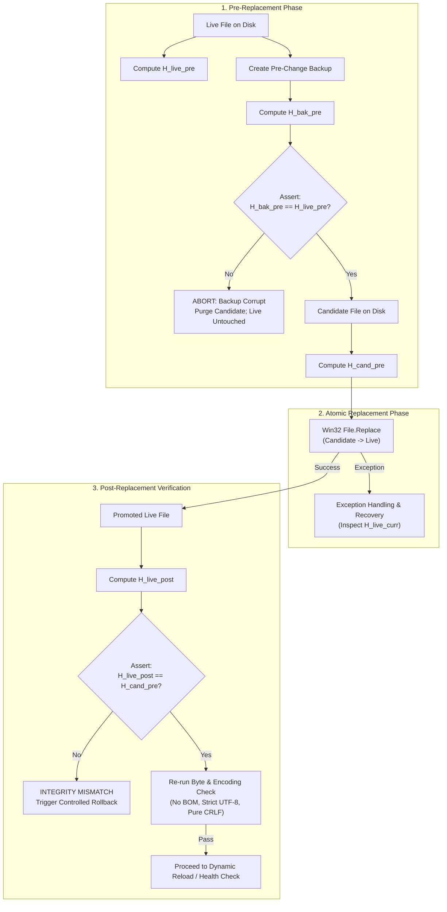
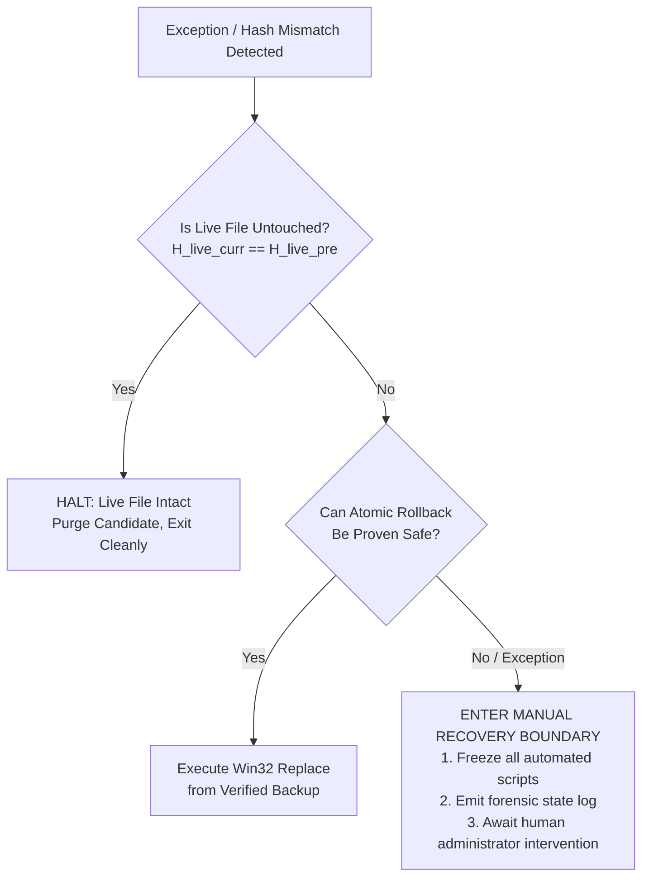

# MUSE SPARK — ZENTRA STEP 2D-2A-Z
## FINAL RECOVERY & INTEGRITY REPORT — DOCUMENTATION ONLY

**Project:** ZENTRA — Hi-Tech Lab Field Service Management Platform  
**Target Repository:** `D:\Zentra`  
**Input Reference:** [`docs/MUSE_SPARK_STEP2D_2A_Y_FINAL_TECHNICAL_VALIDATION_REPORT.md`](file:///d:/Zentra/docs/MUSE_SPARK_STEP2D_2A_Y_FINAL_TECHNICAL_VALIDATION_REPORT.md)  
**Host Environment:** Windows Workstation (`127.0.0.1:5432`)  
**Report Date:** 2026-10-09  
**Mode:** STRICT DOCUMENTATION-ONLY RECOVERY AUDIT & RUNBOOK FINALIZATION  
**Budget Constraint:** Strict ₹0/month (Zero cost, no credit cards, no paid upgrades)  
**Remote Access:** STRICTLY PROHIBITED (Zero remote connections made)  
**Execution Authorization:** NOT GRANTED — NO COMMANDS EXECUTED IN THIS STEP  
**Status:** COMPLETE — WAITING FOR HUMAN OPERATOR REVIEW  

---

## 1. Executive Summary & Objective

In **Step 2D-2A-Y**, strict exception-throwing UTF-8 validation (`throwOnInvalidBytes: $true`) was established, the validation lifecycles of `postgresql.conf` and `pg_hba.conf` were decoupled, and the non-atomic nature of PowerShell `Copy-Item` was documented in favor of Win32 `[System.IO.File]::Replace()`.

A comprehensive audit of the Step 2D-2A-Y proposal identified three remaining technical vulnerabilities in the configuration replacement, hash verification, and failure recovery sequences:
1. **Unsafe Stream-Copy Rollback in Exception Handler:** When `File.Replace` threw an exception, the recovery routine attempted `[System.IO.File]::Copy($preBackupPath, $LiveConfigPath, $true)`. If `File.Replace` failed due to an active NTFS file lock, permission denial, or sharing violation, an arbitrary stream-copy in the catch block is equally prone to failure or partial stream truncation. Furthermore, if `File.Replace` failed before modifying the live file, blind stream-copy overwrites an intact live file unnecessarily.
2. **Conflated Hash Verification Sequence:** Step 2D-2A-Y did not retain the candidate file's SHA-256 hash prior to promotion and erroneously used the pre-change backup hash as the post-promotion verification baseline. The verification sequence must enforce independent cryptographic hashing of all three distinct states: live pre-change, pre-change backup, and candidate pre-promotion.
3. **Absence of Post-Replacement Validation & Premature Activation Claims:** Replacing a file on disk does not guarantee that the PostgreSQL engine has accepted the new configuration. A rigorous post-replacement validation routine must re-verify the promoted file's byte integrity on disk, and for `pg_hba.conf`, dynamic reload and `pg_hba_file_rules` inspection must occur before declaring activation successful.

This report, **Step 2D-2A-Z**, eliminates all non-atomic copy recovery logic, establishes an exact tri-hash verification sequence, defines an explicit **Manual Recovery Boundary**, and finalizes the runbook.

> [!IMPORTANT]
> **Strict Documentation-Only Boundary:** Zero operational commands or configuration changes were executed during this step. Zero configuration files (`postgresql.conf`, `pg_hba.conf`), firewall rules, Windows services, application files, or `.env` files were modified. Zero databases or roles were created. All operational procedures in this document are strictly **[NOT EXECUTED — UNTESTED]**.

---

## 2. Section 1 — Four Core Recovery & Integrity Corrections

| Correction ID | Domain | Previous Proposal Defect | Technical Failure Mode | Mandatory Correction in Step 2D-2A-Z |
|---|---|---|---|---|
| **CORR-Z1** | **Recovery Architecture** | Automatic `File.Copy` rollback executed unconditionally inside `catch` block of `File.Replace`. | If file is locked or in an indeterminate state, `File.Copy` fails or causes partial stream write. If live file was never touched, it needlessly overwrites it. | Eliminate automatic `File.Copy`. Determine whether live file was actually altered via pre-hash comparison. If rollback cannot be guaranteed atomic or safe, halt at an explicit **Manual Recovery Boundary**. |
| **CORR-Z2** | **Hash Integrity** | Did not retain candidate SHA-256 before replacement; conflated backup hash with candidate hash. | Impossible to cryptographically prove that the promoted live file matches the intended candidate rather than the backup. | Enforce **Tri-Hash Verification**: compute and retain \(H_{\text{live\_pre}}\), \(H_{\text{bak\_pre}}\), and \(H_{\text{cand\_pre}}\). Assert \(H_{\text{bak\_pre}} = H_{\text{live\_pre}}\) before swap; assert \(H_{\text{live\_post}} = H_{\text{cand\_pre}}\) after swap. |
| **CORR-Z3** | **Post-Promotion Validation** | No post-swap byte integrity check; claimed HBA policy was active immediately upon file write. | Undetected disk corruption or file truncation passes unnoticed; HBA reload errors remain unverified until restart. | Re-run `Test-CandidateByteAndEncodingIntegrity` on promoted live file. Decouple dynamic reload and query `pg_hba_file_rules WHERE error IS NOT NULL` before declaring activation. |
| **CORR-Z4** | **Safeguards & Scope** | Ongoing need to reaffirm environment isolation and budget boundaries. | Creeping scope toward automated or production execution. | Reaffirm all 6 approval gates, ₹0/month budget, and preservation of `hisecure_erp`, `hitech_platform`, and `zentra_test`. Explicit non-production disclaimer. |

---

## 3. Section 2 — Technical Specifications of Corrected Procedures

### 3.1 The Tri-Hash State Verification Sequence

To prevent configuration corruption or false verification, three distinct SHA-256 hashes must be tracked throughout the replacement lifecycle:



#### Mathematical Hash Invariants:
1. **Pre-Change Verification Invariant:**
   \[
   H(\text{File}_{\text{backup}}) = H(\text{File}_{\text{live\_pre}})
   \]
   *Meaning:* The pre-change backup is an exact byte-for-byte duplicate of the live configuration file before any operation begins.
2. **Promotion Integrity Invariant:**
   \[
   H(\text{File}_{\text{live\_post}}) = H(\text{File}_{\text{candidate\_pre}})
   \]
   *Meaning:* The live configuration file on disk matches the validated candidate file exactly. Under no circumstances should \(H(\text{File}_{\text{live\_post}})\) equal \(H(\text{File}_{\text{live\_pre}})\).

---

### 3.2 Deep Dive: Windows File Locking, Sharing Violations & The Fallacy of Blind Rollback

#### The Windows File-Locking Mechanism
On Windows NTFS, when a process (such as `postgres.exe`, an antivirus agent, or a backup tool) opens a file, it specifies sharing flags: `FILE_SHARE_READ`, `FILE_SHARE_WRITE`, or `FILE_SHARE_DELETE`.
- If a process holds an exclusive handle without `FILE_SHARE_DELETE`, Win32 `ReplaceFileW` fails immediately with Win32 Error `32` (`ERROR_SHARING_VIOLATION`), throwing a .NET `System.IO.IOException`.
- When `ReplaceFileW` fails with a sharing violation, **it fails before modifying the target file**. The target file remains 100% intact and unchanged.

#### Why Blind `File.Copy` in a `catch` Block Is Dangerous:
1. **Overwriting an Untouched File:** If `ReplaceFileW` aborted before touching the live file, the live file is still perfectly valid. Attempting `File.Copy($backup, $live)` needlessly opens a write stream to an already-valid file.
2. **Cascading Failure:** If the target file is locked by an external process, `File.Copy` will encounter the exact same sharing violation. If it succeeds partially, it truncates the file to 0 bytes, creating the catastrophic outage it was intended to prevent.
3. **Indeterminate State Risk:** If a system crash or power outage occurred midway, the state of the filesystem is indeterminate. A blind script cannot ascertain what is locked or corrupted without independent verification.

#### The Safe Rule of Recovery:
> **Never automatically overwrite a live configuration file unless pre-hash analysis proves the file is altered AND the restoration operation can be executed with guaranteed integrity. If state cannot be verified, HALT immediately at the Manual Recovery Boundary.**

---

### 3.3 The Hardened Safe Replacement & Recovery Protocol (`Invoke-SafeConfigReplacementV2`)

The following specification implements the complete tri-hash verification, non-destructive exception handling, and manual recovery boundary:

```powershell
# [NOT EXECUTED — UNTESTED OPERATIONAL PROCEDURE]
# Requires Elevated Local Administrator PowerShell Shell

function Invoke-SafeConfigReplacementV2 {
    <#
    .SYNOPSIS
        Safely replaces a PostgreSQL configuration file using Win32 Replace semantics,
        strict tri-hash validation, and a non-destructive manual recovery boundary.
    #>
    param (
        [Parameter(Mandatory = $true)]
        [string]$LiveConfigPath,

        [Parameter(Mandatory = $true)]
        [string]$CandidatePath,

        [Parameter(Mandatory = $true)]
        [string]$Description
    )

    Write-Host "=== INITIATING HARDENED CONFIGURATION REPLACEMENT: $Description ===" -ForegroundColor Cyan

    # -------------------------------------------------------------
    # STAGE 1: PRE-FLIGHT VALIDATION & TRI-HASH INITIALIZATION
    # -------------------------------------------------------------
    if (-not (Test-Path -Path $LiveConfigPath -PathType Leaf)) {
        throw "FAIL-CLOSED ABORT: Live configuration file [$LiveConfigPath] does not exist."
    }
    if (-not (Test-Path -Path $CandidatePath -PathType Leaf)) {
        throw "FAIL-CLOSED ABORT: Candidate file [$CandidatePath] does not exist."
    }

    # Validate candidate byte integrity, strict UTF-8 decoding, and pure CRLF
    Test-CandidateByteAndEncodingIntegrity -FilePath $CandidatePath

    # Compute H_live_pre and H_cand_pre
    $H_live_pre = (Get-FileHash -Path $LiveConfigPath -Algorithm SHA256).Hash
    $H_cand_pre = (Get-FileHash -Path $CandidatePath -Algorithm SHA256).Hash

    # Create pre-change backup on same NTFS volume
    $timestamp = (Get-Date -Format 'yyyyMMdd_HHmmss')
    $preBackupPath = "$LiveConfigPath.bak.$timestamp"
    
    $liveBytes = [System.IO.File]::ReadAllBytes($LiveConfigPath)
    [System.IO.File]::WriteAllBytes($preBackupPath, $liveBytes)

    # Compute H_bak_pre and assert backup invariant
    $H_bak_pre = (Get-FileHash -Path $preBackupPath -Algorithm SHA256).Hash

    if ($H_bak_pre -ne $H_live_pre) {
        Remove-Item -Path $CandidatePath -Force -ErrorAction SilentlyContinue
        Remove-Item -Path $preBackupPath -Force -ErrorAction SilentlyContinue
        throw "FAIL-CLOSED ABORT: Pre-change backup hash mismatch. Candidate purged. Live file untouched."
    }
    Write-Host "[PRE-FLIGHT PASSED] Verified pre-change backup: $preBackupPath [SHA256: $H_bak_pre]" -ForegroundColor Green
    Write-Host "[PRE-FLIGHT PASSED] Candidate hash retained: [SHA256: $H_cand_pre]" -ForegroundColor Green

    # -------------------------------------------------------------
    # STAGE 2: CONTROLLED WIN32 FILE REPLACEMENT
    # -------------------------------------------------------------
    $engineBackupPath = "$LiveConfigPath.enginebak.$timestamp"
    $replaceSucceeded = $false

    try {
        # Win32 ReplaceFileW via .NET
        # Replaces LiveConfigPath with CandidatePath, creates engineBackupPath
        [System.IO.File]::Replace($CandidatePath, $LiveConfigPath, $engineBackupPath, $true)
        $replaceSucceeded = $true
        Write-Host "[REPLACE SUCCEEDED] Win32 File.Replace completed." -ForegroundColor Green
    }
    catch {
        Write-Error "CRITICAL EXCEPTION during File.Replace: $($_.Exception.Message)"
        
        # ---------------------------------------------------------
        # STAGE 2.1: EXCEPTION FORENSICS & NON-DESTRUCTIVE RECOVERY
        # ---------------------------------------------------------
        if (Test-Path -Path $LiveConfigPath) {
            $H_live_curr = (Get-FileHash -Path $LiveConfigPath -Algorithm SHA256).Hash
            
            if ($H_live_curr -eq $H_live_pre) {
                # Case A: Live file was NEVER modified. Replace aborted before write.
                Write-Host "[SAFE ABORT] Live file hash matches H_live_pre exactly. Live file was NOT altered." -ForegroundColor Yellow
                Write-Host "[SAFE ABORT] No restoration required. Live configuration remains intact." -ForegroundColor Yellow
                Remove-Item -Path $CandidatePath -Force -ErrorAction SilentlyContinue
                throw "FAIL-CLOSED ABORT: File.Replace failed before modifying target. Live file remains intact. Sequence halted."
            }
        }

        # Case B: Live file is missing, altered, or locked in an indeterminate state
        Write-Error "CRITICAL FORENSIC ALERT: Live file state is indeterminate or altered!"
        
        # Check if engine backup exists and matches H_live_pre
        if ((Test-Path -Path $engineBackupPath) -and ((Get-FileHash -Path $engineBackupPath -Algorithm SHA256).Hash -eq $H_live_pre)) {
            Write-Warning "Attempting controlled atomic rollback using engine backup..."
            try {
                [System.IO.File]::Replace($engineBackupPath, $LiveConfigPath, $null, $true)
                Write-Host "[ROLLBACK SUCCESS] Restored original configuration from engine backup." -ForegroundColor Yellow
                throw "FAIL-CLOSED ABORT: File.Replace failed. Successfully rolled back to pre-change configuration. Sequence halted."
            }
            catch {
                Write-Error "CRITICAL: Engine backup rollback also failed: $($_.Exception.Message)"
            }
        }

        # Case C: Automated recovery cannot be proven safe -> ENTER MANUAL RECOVERY BOUNDARY
        Enter-ManualRecoveryBoundary -LivePath $LiveConfigPath -BackupPath $preBackupPath -ExpectedHash $H_live_pre -CandidateHash $H_cand_pre -Exception $_.Exception
    }

    # -------------------------------------------------------------
    # STAGE 3: POST-REPLACEMENT INTEGRITY VERIFICATION
    # -------------------------------------------------------------
    $H_live_post = (Get-FileHash -Path $LiveConfigPath -Algorithm SHA256).Hash

    if ($H_live_post -ne $H_cand_pre) {
        Write-Error "CRITICAL INTEGRITY FAILURE: Promoted live file hash does not match candidate hash!"
        Write-Error "Expected (Candidate): $H_cand_pre"
        Write-Error "Observed (Live):      $H_live_post"

        # Attempt controlled restoration from verified preBackupPath
        Write-Warning "Attempting controlled rollback to pre-change backup..."
        try {
            [System.IO.File]::Replace($preBackupPath, $LiveConfigPath, $null, $true)
            Write-Host "[ROLLBACK SUCCESS] Restored live file to pre-change backup." -ForegroundColor Yellow
            throw "FAIL-CLOSED ABORT: Hash mismatch after promotion. Reverted to pre-change backup. Sequence halted."
        }
        catch {
            Enter-ManualRecoveryBoundary -LivePath $LiveConfigPath -BackupPath $preBackupPath -ExpectedHash $H_live_pre -CandidateHash $H_cand_pre -Exception $_.Exception
        }
    }

    # Re-verify byte integrity, UTF-8 validity, and line endings on promoted live file
    try {
        Test-CandidateByteAndEncodingIntegrity -FilePath $LiveConfigPath
    }
    catch {
        Write-Error "CRITICAL: Promoted live file failed post-replacement byte integrity validation: $($_.Exception.Message)"
        Enter-ManualRecoveryBoundary -LivePath $LiveConfigPath -BackupPath $preBackupPath -ExpectedHash $H_live_pre -CandidateHash $H_cand_pre -Exception $_.Exception
    }

    Write-Host "[POST-PROMOTION VERIFIED] [$LiveConfigPath] matches candidate exactly [SHA256: $H_live_post]." -ForegroundColor Green
    return $preBackupPath
}
```

---

### 3.4 The Manual Recovery Boundary Protocol

When an exception occurs during configuration replacement and automated rollback cannot be cryptographically proven safe (e.g. sharing violation, file lock, or unexpected disk error), the script must **immediately cease all automated file operations** and transition to the Manual Recovery Boundary:



#### Manual Recovery Diagnostic Function:
```powershell
# [NOT EXECUTED — UNTESTED OPERATIONAL PROCEDURE]

function Enter-ManualRecoveryBoundary {
    param (
        [string]$LivePath,
        [string]$BackupPath,
        [string]$ExpectedHash,
        [string]$CandidateHash,
        [System.Exception]$Exception
    )

    Write-Host "`n" -NoNewline
    Write-Host "****************************************************************" -ForegroundColor Red
    Write-Host "             CRITICAL: MANUAL RECOVERY BOUNDARY ENTERED          " -ForegroundColor Red
    Write-Host "****************************************************************" -ForegroundColor Red
    Write-Host "Automated configuration recovery cannot be guaranteed safe."
    Write-Host "All automated operations have ceased to prevent data corruption."
    Write-Host "----------------------------------------------------------------"
    Write-Host "FORENSIC STATUS:"
    Write-Host "  Target File:        $LivePath"
    Write-Host "  Backup File:        $BackupPath"
    Write-Host "  Expected Hash:      $ExpectedHash"
    Write-Host "  Candidate Hash:     $CandidateHash"
    Write-Host "  Exception Type:     $($Exception.GetType().FullName)"
    Write-Host "  Exception Message:  $($Exception.Message)"
    
    if (Test-Path -Path $LivePath) {
        $currHash = (Get-FileHash -Path $LivePath -Algorithm SHA256).Hash
        Write-Host "  Current Live Hash:  $currHash"
    } else {
        Write-Host "  Current Live Hash:  TARGET FILE DOES NOT EXIST"
    }

    Write-Host "----------------------------------------------------------------"
    Write-Host "REQUIRED OPERATOR ACTIONS:"
    Write-Host "  1. Check for locked processes: Get-Process | Where-Object { `$_.ProcessName -match 'postgres' }"
    Write-Host "  2. Inspect Windows Event Log:  Get-EventLog -LogName System -Newest 10"
    Write-Host "  3. If target file is missing or corrupted, manually restore from:"
    Write-Host "     $BackupPath"
    Write-Host "  4. Verify service status:      Get-Service -Name postgresql-x64-18"
    Write-Host "****************************************************************`n" -ForegroundColor Red

    throw "FAIL-CLOSED EMERGENCY STOP: Manual recovery required. See forensic details above."
}
```

---

### 3.5 Post-Replacement Validation & Decoupled `pg_hba.conf` Dynamic Activation

Writing `pg_hba.conf` to disk does **NOT** mean authentication rules are active. The activation lifecycle must proceed through explicit, decoupled stages:

```mermaid
sequenceDiagram
    participant Op as Administrator
    participant File as Filesystem (pg_hba.conf)
    participant Svc as PostgreSQL Engine (In-Memory)
    participant Cat as Catalog (pg_hba_file_rules)

    Op->>File: 1. Promote Candidate via Invoke-SafeConfigReplacementV2
    Note over File: File verified on disk (SHA256 Match, No BOM, CRLF)
    Op->>Svc: 2. Signal Dynamic Reload (pg_ctl reload)
    Note over Svc: Engine attempts parsing pg_hba.conf
    alt Parse Success
        Svc->>Svc: Activate new in-memory auth rules
        Op->>Cat: 3. Query pg_hba_file_rules WHERE error IS NOT NULL
        Cat-->>Op: 0 rows returned
        Note over Op: ACTIVATION COMPLETE & VERIFIED
    else Parse Syntax Error
        Svc->>Svc: REJECT reload; KEEP old rules in memory; Log error
        Op->>Cat: 3. Query pg_hba_file_rules WHERE error IS NOT NULL
        Cat-->>Op: Returns row with error message
        Note over Op: ACTIVATION FAILED: Trigger Emergency Rollback
        Op->>File: 4. Restore Verified Backup via Win32 Replace
        Op->>Svc: 5. Signal Dynamic Reload (pg_ctl reload)
        Note over Op: Sequence Halted Fail-Closed
    end
```

#### Step-by-Step Activation Verification Protocol [NOT EXECUTED — UNTESTED]:
1. **File Promotion:** `Invoke-SafeConfigReplacementV2` validates candidate bytes, replaces file via `[System.IO.File]::Replace`, verifies post-promotion hash, and confirms byte integrity of live file.
2. **Dynamic Signal Dispatch:**
   ```powershell
   # [NOT EXECUTED — UNTESTED]
   & "C:\Program Files\PostgreSQL\18\bin\pg_ctl.exe" reload -D "C:\Program Files\PostgreSQL\18\data"
   if ($LASTEXITCODE -ne 0) {
       throw "FAIL-CLOSED ABORT: pg_ctl reload returned non-zero exit code ($LASTEXITCODE)."
   }
   ```
3. **Catalog Rule Inspection:** Connect via loopback `psql` to catalog `postgres` and inspect rules:
   ```sql
   -- [NOT EXECUTED — UNTESTED]
   SELECT line_number, type, database, user_name, address, auth_method, error
   FROM pg_hba_file_rules
   WHERE error IS NOT NULL;
   ```
   - **Assertion:** Must return exactly 0 rows.
   - **If Rows Returned > 0:** Parse failure occurred. Execute emergency rollback of `pg_hba.conf` from `$preBackupPath`, issue `pg_ctl reload`, and halt.
4. **Targeted Rule Order Verification:**
   ```sql
   -- [NOT EXECUTED — UNTESTED]
   SELECT line_number, type, database, user_name, address, auth_method
   FROM pg_hba_file_rules
   WHERE database = '{zentra_local}' AND user_name = '{zentra_dev}'
   ORDER BY line_number ASC;
   ```
   - **Assertion:** Must return 2 rows (`127.0.0.1/32` and `::1/128`), auth method must be `scram-sha-256`, and their line numbers must appear **before** any wildcard `all / all / trust` rules.
5. **Only upon passing all 4 stages** is the targeted SCRAM policy declared **ACTIVE**.

---

## 4. Section 3 — Tested Ground Truth vs. Untested Proposed Code

The following register comprehensively delineates verified workstation facts from proposed procedures:

| Procedure / Component | Category | Current Status | Basis / Verification Method | Operational Prerequisite |
|---|---|---|---|---|
| **Cluster Collation Baseline** | Read-Only SQL | 🟢 **Verified Fact** | Inspected all 5 catalogs in Step 2D-2A-S: `English_United States.1252` (`UTF8`). | None. Safe to use `TEMPLATE template1`. |
| **Port 5432 Listener Bindings** | Read-Only OS | 🟢 **Verified Fact** | `Get-NetTCPConnection` confirmed listening on `0.0.0.0:5432` and `[::]:5432`. | None. Proves socket hardening is required. |
| **Firewall Profile State** | Read-Only OS | 🟢 **Verified Fact** | `netsh advfirewall` confirmed `Public: OFF` on active Wi-Fi interface. | Operator decision on profile activation. |
| **Shared Catalog Baseline** | Read-Only SQL | 🟢 **Verified Fact** | Verified existence of `hisecure_erp`, `hitech_platform`, and `zentra_test`. | Protected via fail-closed assertions. |
| **`Test-CandidateByteAndEncodingIntegrity`** | PowerShell Script | 🔴 **UNTESTED** | Authored in documentation; not executed against live files. | Operator dry-run in isolated scratch folder. |
| **`Invoke-SafeConfigReplacementV2`** | PowerShell Script | 🔴 **UNTESTED** | Authored in documentation; not executed against PostgreSQL data dir. | Operator dry-run in scratch folder. |
| **`postgres.exe -C` Validation** | Engine CLI | 🔴 **UNTESTED** | Flag documented from PostgreSQL manuals; not run live on host. | Run dry-run `postgres.exe -C` before promotion. |
| **`pg_ctl reload` Dynamic Signal** | Service CLI | 🔴 **UNTESTED** | Documented reload mechanism; not triggered in active environment. | Requires local Administrator console session. |
| **`pg_hba_file_rules` Inspection** | SQL Catalog Query | 🔴 **UNTESTED** | System view documented; query not run post-change. | Requires active loopback psql connection. |
| **Interactive `\password` Assignment** | psql Meta-Command | 🔴 **UNTESTED** | Meta-command documented; interactive password assignment not run. | Interactive operator terminal session. |
| **Standalone Migration Runner** | Application CLI | 🔴 **UNTESTED** | CLI script does not exist in repository; proposal pending. | Author and review runner prior to Stage B. |

---

## 5. Section 4 — The Six Human Approval Gates Reaffirmed

The execution roadmap preserves all six decoupled human approval gates without alteration:

```mermaid
graph TD
    subgraph ClusterHardening["Pre-Initialization Shared Cluster Hardening"]
        G1{"Gate 1: Network Hardening<br/>Human Approval"} --> P1["Phase 1: Candidate Generation<br/>listen_addresses = 'localhost'<br/>Strict UTF-8 Test + postgres.exe -C + Tri-Hash Swap + Restart"]
        P1 --> T1["Tier 1 & Tier 2 Observable Health Checks<br/>(Hi-Secure-ERP & Test App)"]
        T1 --> G2{"Gate 2: Host Firewall Evaluation<br/>Human Approval"}
        G2 --> P2["Phase 2: Inbound Firewall Review<br/>(Targeted Port 5432 Block Rule;<br/>Profile remains OFF unless authorized)"]
        P2 --> G3{"Gate 3: Auth Policy Deployment<br/>Human Approval"}
        G3 --> P3["Phase 3: Targeted SCRAM Candidate<br/>(Prepend zentra_local rules to pg_hba.conf)<br/>Strict UTF-8 Test + Tri-Hash Swap + Dynamic Reload + pg_hba_file_rules Check"]
        P3 --> T2["Verify Legacy Apps Continue Unaffected Under trust"]
    end

    subgraph ZentraInit["ZENTRA Database Initialization Stages"]
        T2 --> G4{"Gate 4: Stage A Provisioning<br/>Human Approval"}
        G4 --> SA1["Stage A.1: Create zentra_dev Role<br/>(CREATE ROLE without password)"]
        SA1 --> SA2["Stage A.2: Assign SCRAM Password<br/>(Interactive \\password zentra_dev with hidden echo)"]
        SA2 --> SA3["Stage A.3: Create zentra_local Database<br/>(Autocommit Mode, TEMPLATE template1)"]
        SA3 --> G5{"Gate 5: Stage B Migrations<br/>Human Approval"}
        G5 --> SB["Stage B: Controlled Migrations<br/>(Execute 14 Kysely Migrations via reviewed runner)"]
        SB --> G6{"Gate 6: Stage C Seeding<br/>Human Approval"}
        G6 --> SC["Stage C: Synthetic Dev Seeding<br/>(Pre-seed 0-row check + Single Execution)"]
    end
```



| Gate ID | Scope & Milestone | Mandatory Prerequisites Before Granting Approval | Action Authorized Upon Operator Approval |
|---|---|---|---|
| **Gate 1** | **Network Socket Hardening** | Verified backup exists; candidate passes strict UTF-8 & CRLF check; `postgres.exe -C` passes; tri-hash validated; diff approved. | Promote candidate `postgresql.conf` via `Invoke-SafeConfigReplacementV2`; restart Windows service `postgresql-x64-18`. |
| **Gate 2** | **Host Firewall Policy** | Verified firewall profile states; evaluated impact of Public profile activation across local tools. | Create targeted port 5432 inbound block rule; review profile activation decision. |
| **Gate 3** | **Targeted SCRAM Policy** | Verified backup exists; candidate passes strict UTF-8 & CRLF check; tri-hash validated; diff approved. | Promote candidate `pg_hba.conf` via `Invoke-SafeConfigReplacementV2`; dynamic `pg_ctl reload`; verify `pg_hba_file_rules` has 0 errors. |
| **Gate 4** | **Stage A Database Creation** | Phases 1 & 3 complete; Tier 1 & 2 health checks pass; SCRAM rule active; `zentra_local` does not exist. | Create `zentra_dev` role; assign password via `\password`; create `zentra_local` DB via autocommit. |
| **Gate 5** | **Stage B Schema Migrations** | Stage A verified; `current_database() === 'zentra_local'`; 0 public tables; standalone runner reviewed. | Execute 14 Kysely migrations sequentially; verify 34 tables created. |
| **Gate 6** | **Stage C Synthetic Seeding** | Stage B verified; 14 migrations complete; domain table row counts strictly 0. | Execute synthetic mock seeding; verify row counts; confirm zero real PII. |

---

## 6. Section 5 — Concise List of Unresolved Blockers

Before any operator issues an execution command, the following four unresolved operational blockers must be resolved:

1. **Elevated Administrator Privileges:** The PostgreSQL 18 data directory (`C:\Program Files\PostgreSQL\18\data`) is protected by Windows NTFS permissions. Generating candidate files, backups, and invoking `File.Replace` requires an elevated Administrator PowerShell console session.
2. **Firewall Policy Decision:** Windows Defender Firewall's `Public` profile is currently `State: OFF` on the active Wi-Fi adapter (`Airtel_Rayyan@2103`). Adding an inbound block rule on port 5432 remains dormant unless the administrator explicitly enables the Public firewall profile.
3. **Interactive Password Assignment Channel:** Assigning the password for `zentra_dev` via `\password zentra_dev` cannot be automated via non-interactive scripts. It requires an interactive operator console to prevent credential capture in process trees, shell history, or logs.
4. **Standalone Migration Runner Implementation:** A reviewed, fail-closed CLI migration runner that imports the 14 Kysely migrations, verifies target database assertions, and reports status without invoking the full test suite does not yet exist and must be authored prior to Gate 5.

---

## 7. Section 6 — Confirmation of Safety & Compliance

- **Operational Execution:** **ZERO.** No operational commands were executed.
- **Database Writes / DDL:** **ZERO.** No databases, roles, tables, schemas, or records were created, modified, or dropped.
- **Data Mutating Commands:** **ZERO.** No `INSERT`, `UPDATE`, `DELETE`, `TRUNCATE`, migrations, seeds, or tests were executed.
- **Configuration Modifications:** **ZERO.** No changes were made to `postgresql.conf`, `pg_hba.conf`, Windows Firewall, Windows services, application code, or `.env` files.
- **Remote Cloud Connections:** **ZERO.** No connections made to Neon, AWS, Supabase, Render, or any remote host.
- **Budget Integrity:** Strict ₹0/month budget preserved.
- **Preserved Existing Databases:** Catalogs `hisecure_erp`, `hitech_platform`, and `zentra_test` remain completely untouched.
- **Production Scope:** Strictly local development workstation scope; no production readiness certification is claimed.

---

```
STOP — STEP 2D-2A-Z COMPLETE — WAITING FOR HUMAN REVIEW
```
