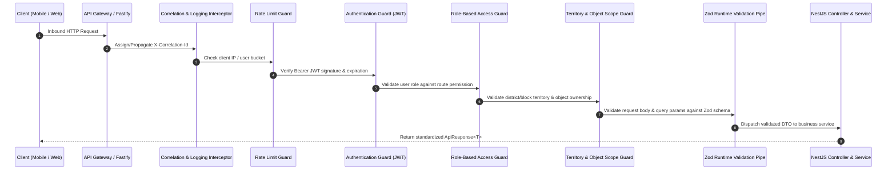
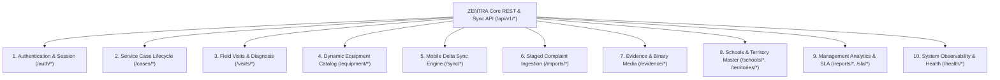

# ZENTRA — API Foundation & Shared Contract Specification
## Hi-Tech Lab Field Service Management Platform

---

## 1. Architectural Purpose & Trust Boundaries

The ZENTRA Core API serves as the authoritative, transactional gateway for all business operations, mobile delta synchronization, staged complaint ingestion, and administrative governance.

### Trust Boundary Principle
> [!IMPORTANT]
> **TypeScript Compile-Time Types Do Not Protect Runtime Boundaries.**
> While TypeScript enforces type safety within internal code, external inputs arriving over HTTP (from mobile clients, web browsers, external webhooks, or spreadsheet parsers) are **untrusted**.
> 
> ZENTRA enforces strict **Runtime Schema Validation (Zod)** at every trust boundary before request payloads reach application services or database query builders.

---

## 2. API Design Conventions & Protocols

### 2.1 URL Structure & Versioning
- **Base URL Prefix**: `/api/v1`
- **Versioning Strategy**: Explicit path-based versioning (`/api/v1`, `/api/v2`). Major versions represent breaking contract changes; minor backwards-compatible field additions occur within the active version.
- **Resource Naming**: Plural nouns representing domain resources (e.g., `/api/v1/cases`, `/api/v1/visits`, `/api/v1/schools`).
- **Sub-Resource Nesting**: Restricted to direct ownership hierarchies (e.g., `/api/v1/cases/:id/visits`). Deep nesting beyond 2 levels is avoided in favor of flat top-level query parameters.

### 2.2 Standard HTTP Headers
Every API request and response exchanges mandatory tracing and audit headers:
- `X-Correlation-Id`: Client or gateway-generated UUIDv7 tracing the request lifecycle across all internal microservices and audit logs.
- `X-Client-Operation-Id`: Client-generated idempotency token for state-mutating requests (`POST`, `PUT`, `DELETE`).
- `X-Client-Version`: Version and build number of the calling client (e.g., `ZENTRA-Field/1.0.0-build.12`).
- `Authorization`: Bearer token (`Bearer <jwt_access_token>`).

---

## 3. Standardized Contract Envelopes

To ensure deterministic client parsing across React Native and React Web, all API responses adhere to strict contract envelopes defined in `packages/contracts`:

### 3.1 Standard Success Envelope
```typescript
export interface ApiResponse<T> {
  success: true;
  correlation_id: string;
  timestamp: string; // ISO 8601 UTC
  data: T;
  meta?: {
    pagination?: PaginationMeta;
    sync_cursor?: string;
  };
}
```

### 3.2 Standard Pagination Contract
```typescript
export interface PaginationMeta {
  current_page: number;
  per_page: number;
  total_records: number;
  total_pages: number;
  has_next_page: boolean;
  has_previous_page: boolean;
}
```

### 3.3 Standard Error Contract
In accordance with enterprise error handling guidelines, error payloads are strictly structured:
```typescript
export type ErrorCategory =
  | 'AUTHENTICATION_ERROR'
  | 'AUTHORIZATION_ERROR'
  | 'TERRITORY_ACCESS_DENIED'
  | 'VALIDATION_ERROR'
  | 'ENTITY_NOT_FOUND'
  | 'CONFLICT_STATE'
  | 'IDEMPOTENCY_COLLISION'
  | 'RATE_LIMITED'
  | 'TEMPORARY_STORAGE_FAILURE'
  | 'SYNC_PROTOCOL_ERROR'
  | 'IMPORT_STAGING_ERROR'
  | 'INTERNAL_ERROR';

export interface ApiErrorResponse {
  success: false;
  correlation_id: string;
  timestamp: string;
  error: {
    code: ErrorCategory;
    message: string; // Sanitized, human-readable message (zero stack traces)
    is_retryable: boolean; // Informs mobile sync engine whether to retry automatically
    details?: Array<{
      field: string;
      issue: string;
    }>;
  };
}
```

---

## 4. Request Lifecycle & Security Interceptor Chain

Every inbound API request traverses an enterprise interceptor and guard pipeline:



### Authorization Guard Responsibilities
1. **`AuthGuard`**: Validates the cryptographic signature of the access token, verifies it is not on the revocation blacklist, and extracts the `user_id` and role claims.
2. **`RbacGuard`**: Checks if the extracted role possesses the required permission string (e.g., `@RequirePermission('case:assign')`).
3. **`TerritoryAbacGuard`**: For requests targeting specific districts, blocks, or schools, verifies that the user's `user_territory_assignments` permits access to that geographic jurisdiction.
4. **`ObjectOwnershipGuard`**: For Field Engineer operations, verifies that the target `service_case` is explicitly assigned to that engineer.
5. **`ValidationPipe`**: Parses request parameters, query strings, and body payloads against the authoritative Zod contract in `packages/contracts`. If validation fails, immediately returns HTTP 400 with structured validation details without invoking business services.

---

## 5. Architectural Endpoint Categories

> [!NOTE]
> In accordance with Phase 2 restrictions, endpoint categories are architectural specifications only. No routes are implemented in this phase.



### Detailed Endpoint Category Specifications

#### 1. Authentication & Session Management (`/api/v1/auth/*`)
- `POST /api/v1/auth/login`: Authenticates username/password; returns access token + refresh token.
- `POST /api/v1/auth/refresh`: Exchanges refresh token for new access token.
- `POST /api/v1/auth/offline-permit`: Issues cryptographically signed 14-day `offline_work_permit` for mobile Field Engineers.
- `POST /api/v1/auth/logout`: Revokes active refresh token and invalidates device session.

#### 2. Service Case Management (`/api/v1/cases/*`)
- `GET /api/v1/cases`: Paginated, territory-scoped query of service cases with multi-parameter filtering.
- `GET /api/v1/cases/:id`: Detailed case dossier including immutable source complaint snapshot, assignment history, and visit logs.
- `POST /api/v1/cases/:id/assign`: Dispatches or reassigns primary/secondary engineer.
- `POST /api/v1/cases/:id/verify`: District Coordinator reviews field evidence and approves/rejects resolution.
- `POST /api/v1/cases/:id/close`: Final administrative closure.

#### 3. Field Visits & Diagnostic Execution (`/api/v1/visits/*`)
- `POST /api/v1/visits/check-in`: Commits on-site check-in with accuracy-verified GPS coordinates.
- `PUT /api/v1/visits/:id/diagnosis`: Updates hardware inspection findings, actions performed, and dynamic attribute values.
- `POST /api/v1/visits/:id/spares`: Records inventory parts consumed during the visit.
- `POST /api/v1/visits/:id/check-out`: Records physical departure, conveyance distance, and visit outcome.

#### 4. Dynamic Equipment Catalog (`/api/v1/equipment/*`)
- `GET /api/v1/equipment/types`: Returns list of active equipment classes (UPS, PC, Router, etc.).
- `GET /api/v1/equipment/types/:code/schema`: Returns dynamic attribute definitions (`equipment_attribute_definitions`) for rendering mobile inspection forms.
- `GET /api/v1/equipment/lab/:lab_id`: Returns registered equipment asset inventory for a specific Hi-Tech Lab.

#### 5. Mobile Delta Synchronization Engine (`/api/v1/sync/*`)
- `POST /api/v1/sync/push`: Mobile client uploads batched transaction queue mutations (`pending_sync_mutations`). Server evaluates domain ownership, applies row-level updates, and returns per-mutation acknowledgments.
- `GET /api/v1/sync/pull`: Mobile client downloads server-side changes and tombstones that occurred since its `last_sync_seq` cursor for its assigned territory.

#### 6. Staged Complaint Ingestion (`/api/v1/imports/*`)
- `POST /api/v1/imports/stage`: Uploads bulk complaint spreadsheet (XLSX/CSV); parses and inserts rows into `import_staging_records`.
- `GET /api/v1/imports/:job_id/preview`: Returns parsed diff preview, anomaly warnings, and 5-tier duplicate classifications.
- `POST /api/v1/imports/:job_id/approve`: Administrator signs off on staged batch; triggers atomic promotion to `source_complaints` and `service_cases`.
- `POST /api/v1/imports/:job_id/abort`: Discards staged records without touching production tables.

#### 7. Evidence & Binary Media Authorization (`/api/v1/evidence/*`)
- `POST /api/v1/evidence/upload-url`: Client requests pre-signed S3 `PUT` URL for Slot 1 or Slot 2; server validates visit ownership, file size limits, and checksum parameters.
- `POST /api/v1/evidence/confirm`: Client confirms successful binary S3 upload; server validates S3 ETag, inspects EXIF GPS metadata, and commits `evidence_files` record.
- `DELETE /api/v1/evidence/:id`: Soft-deletes an evidence file with a tombstone (slot-isolated; deleting Slot 2 never affects Slot 1).

#### 8. Schools & Territory Master (`/api/v1/schools/*`, `/api/v1/territories/*`)
- `GET /api/v1/territories/districts`: Returns list of 38 Tamil Nadu districts.
- `GET /api/v1/schools/by-udise/:udise`: Returns school dossier, lab counts, gate coordinates, and AI/HM contacts (PII masked unless user possesses authorized territory assignment).

#### 9. Management Analytics, SLA & Conveyance (`/api/v1/reports/*`, `/api/v1/sla/*`)
- `GET /api/v1/reports/kpi-summary`: Aggregates active calls, unassigned calls, resolved today, and SLA compliance.
- `GET /api/v1/reports/export`: Generates official Excel/CSV departmental reports.
- `GET /api/v1/sla/breach-radar`: Real-time monitoring of tickets approaching or exceeding SLA thresholds.
- `GET /api/v1/conveyance/claims`: Approvals desk for engineer travel claims.

#### 10. System Observability & Health (`/api/v1/health/*`)
- `GET /api/v1/health/liveness`: Returns HTTP 200 if Fastify server process is alive.
- `GET /api/v1/health/readiness`: Returns HTTP 200 if PostgreSQL pool and MinIO/S3 endpoints are verified connected and responsive.

---

## 6. Summary of API Foundation Architectural Specifications

1. **Zero Unvalidated Inputs**: 100% of request bodies, route parameters, and query strings are validated by Zod schemas.
2. **Deterministic Error Handling**: Clients receive structured error envelopes with explicit retryability flags.
3. **Idempotency Protection**: Mutating operations deduplicated via monotonic `X-Client-Operation-Id` assertions.
4. **Decoupled Binary Pipeline**: Zero base64 image strings transported through application JSON endpoints.
