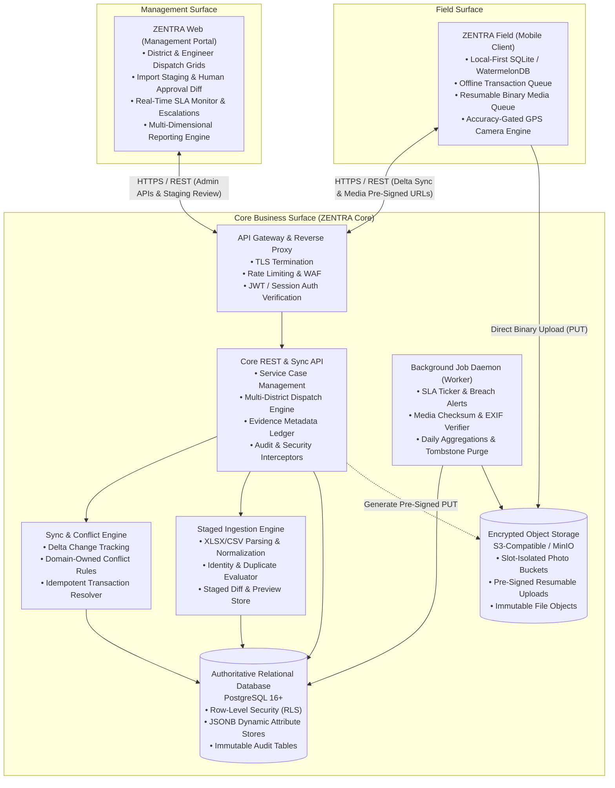
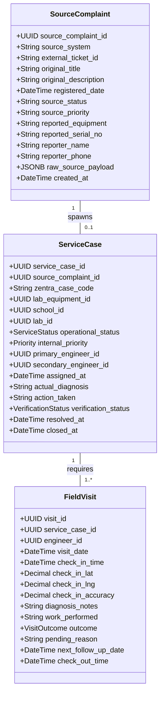
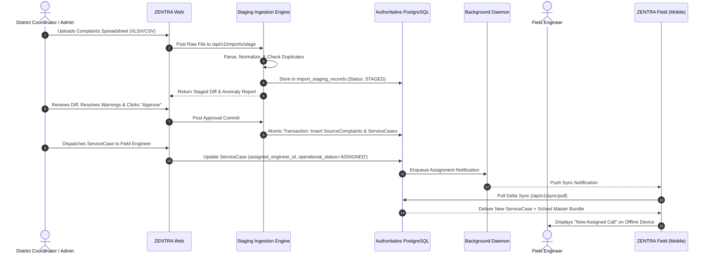
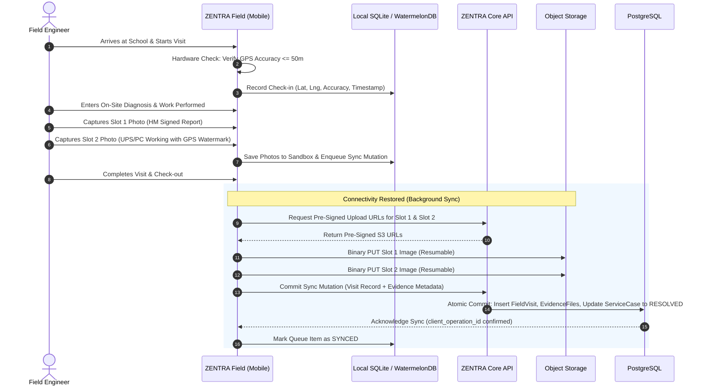

# ZENTRA — System Architecture Specification
## Hi-Tech Lab Field Service Management Platform

---

## 1. Executive Summary & Purpose

**ZENTRA** is an enterprise-grade, mobile-first field service management (FSM) platform purpose-built for the maintenance, repair, and operational governance of Information & Communication Technology (ICT) infrastructure across government school **Hi-Tech Labs**.

Hi-Tech Labs represent critical digital classroom infrastructure deployed across thousands of government high and higher secondary schools. When ICT hardware (computing, power, networking, surveillance, or interactive audio-visual systems) fails, educational programs and statewide computer-based assessments stall.

ZENTRA replaces ad-hoc spreadsheets, uncoordinated messaging groups, and error-prone legacy trackers with an integrated, three-surface platform:
1. **ZENTRA Field**: A resilient, offline-first mobile application designed for Field Engineers operating outdoors in low-connectivity rural environments.
2. **ZENTRA Web**: A centralized administration, dispatch, master data, SLA governance, and reporting portal for State Leads, District Coordinators, and System Administrators.
3. **ZENTRA Core**: A highly secure, transactional backend engine handling business rules, multi-tenant RBAC, staged data ingestion, evidence verification, and deterministic mobile synchronization.

---

## 2. High-Level Architectural Topology

ZENTRA is organized around three decoupled operational surfaces communicating through strict API boundaries:

### The Three Operational Surfaces
1. **ZENTRA Field (Field Engineer Edge)**:
   - Primary operational surface.
   - Built to operate independently of real-time server connectivity.
   - Maintains an authoritative local database and an append-only transaction queue.
   - Enforces field evidence contracts (Slot 1 HM Signed Report and Slot 2 Equipment Photo) with hardware-level GPS verification.
2. **ZENTRA Core (Central Platform)**:
   - Contains all business logic, authorization policies, state machines, and relational persistence.
   - Exposes RESTful JSON endpoints for administrative operations and specialized delta synchronization endpoints for the mobile client.
   - Decouples background processing (SLA monitoring, file processing, report generation) via dedicated worker daemons.
3. **ZENTRA Web (Management & Governance Desk)**:
   - Desktop-optimized web application for administrators, coordinators, and state reporting heads.
   - Provides high-density data tables, multi-ticket dispatch boards, human-in-the-loop import staging wizards, and executive analytics.

---

## 3. Technology Evaluation & Selection Rationale

In Phase 1, technology options were rigorously evaluated against the primary project requirement: **a robust, mobile-first field engineering system operating across rural Tamil Nadu with unreliable network conditions, hardware GPS gating, and camera integration**.

### 3.1 Mobile Client Architecture Evaluation

| Framework Option | Offline Database Support | Native Hardware & Camera Control | Developer Velocity & Code Sharing | Ecosystem Stability | Evaluation Verdict |
|---|---|---|---|---|---|
| **Flutter (Dart)** | Excellent (Isar / drift / SQLite) | High (Native Camera / GPS plugins) | High across iOS/Android | High (Google backed) | **Strong Candidate** |
| **React Native + Expo** | Excellent (WatermelonDB / OP-SQLite) | Excellent (Camera / Geolocation) | Maximum (Shared TypeScript types with backend/web) | Very High (Mature) | **RECOMMENDED PRIMARY** |
| **Native Android (Kotlin)** | Maximum (Room / SQLite) | Maximum (CameraX / FusedLocation) | Zero web code sharing; higher maintenance overhead | Very High | Viable alternative for single-platform |
| **Progressive Web App (PWA)** | Fragile (IndexedDB storage quota evictions) | Poor (Background sync restricted; Safari/Android camera quirks) | High (Standard web) | Low durability in offline-heavy field environments | **REJECTED** |

> **Recommendation: React Native with TypeScript and WatermelonDB / OP-SQLite**.
> - Enables 100% shared TypeScript interfaces between ZENTRA Field, ZENTRA Web, and ZENTRA Core.
> - Proven reactive local-first database architecture (WatermelonDB) optimized for fast startup on low-cost Android hardware.
> - Direct access to native Android CameraX and Fused Location Provider APIs for strict <=50m GPS gating.

### 3.2 Web Frontend Architecture Evaluation
- **Option 1: React 18+ with Vite and Tailwind CSS (RECOMMENDED)**:
  - Lightning-fast build times, zero server-rendering complexity for internal administrative dashboards, full ecosystem compatibility with high-density data grids (TanStack Table), and headless component architecture.
- **Option 2: Next.js (App Router)**:
  - Powerful, but SSR/Edge complexity is unnecessary for an authenticated management portal behind corporate logins.

### 3.3 Backend API & Runtime Evaluation
- **Option 1: Node.js with NestJS / Fastify & TypeScript (RECOMMENDED)**:
  - Enterprise modular architecture (Dependency Injection, interceptors, guards).
  - High throughput with Fastify HTTP engine.
  - End-to-end type safety using shared Zod contracts between client and server.
- **Option 2: Go (Golang)**:
  - Superb raw concurrency and minimal memory footprint, but bifurcates contracts and models from the TypeScript frontend ecosystem.

### 3.4 Authoritative Database Evaluation
- **Option: PostgreSQL 16+ with Row-Level Security (RLS) (RECOMMENDED)**:
  - ACID-compliant relational core for financial ledgers, audit trails, and multi-district territory enforcement.
  - First-class `JSONB` support enables dynamic, schema-driven equipment attributes without requiring schema migrations for new hardware types.
  - Native Row-Level Security (RLS) provides a cryptographically tight defense against cross-district data leakage.

### 3.5 Local Mobile Database Evaluation
- **Option: WatermelonDB (SQLite engine via JSI) (RECOMMENDED)**:
  - Lazy loading: Can handle tens of thousands of school records with near-instant UI render on budget Android hardware.
  - Built-in observable synchronization protocol matching ZENTRA's delta-sync philosophy.

### 3.6 Media & Object Storage Evaluation
- **Option: S3-Compatible Object Storage (MinIO on-premise or AWS S3 / Cloudflare R2) (RECOMMENDED)**:
  - Pre-signed URL architecture allows mobile clients to upload 2MB–5MB photo binaries directly to object storage, bypassing the API gateway and eliminating payload bottlenecks.

---

## 4. Separation of Concerns: Source Complaint vs. ZENTRA Service Case

One of the foundational architectural lessons learned from historical system failures is the **absolute separation** between external complaint intake and physical field execution:

### Key Architectural Boundaries
1. **Source Complaint Immutability**:
   - `SourceComplaint` captures external truth as logged by school teachers, helpline operators, or external department tools.
   - Neither Field Engineers nor District Coordinators may overwrite source descriptions, intake timestamps, or original reporter details.
2. **Service Case Dynamism**:
   - `ServiceCase` governs internal execution: which engineer is dispatched, what equipment was actually inspected, how many visits occurred, and what spares were consumed.
3. **Dual-Status Architecture**:
   - `source_status` (e.g., `Open`, `In Progress`, `Pending Verification` in external portals) is tracked separately from `operational_status` (e.g., `ASSIGNED`, `VISIT_IN_PROGRESS`, `PENDING_SPARES`, `RESOLVED`, `CLOSED` in ZENTRA).
   - Updating operational status in ZENTRA never destructively mutates historical source records.

---

## 5. Understanding the Statewide Scale: 8,209 Asset Records

Phase 0 analysis identified a statewide dataset containing 8,209 records (`HiTech Labs Live _ Down Assets_data (1).xlsx`). An essential architectural distinction must be enforced:

> [!IMPORTANT]
> **8,209 Records ≠ 8,209 Unique Labs.**
> The dataset represents **monitored asset / laboratory status snapshots** across schools in Tamil Nadu's 38 districts.
> 
> Within the data:
> - **Schools**: Distinct educational institutions identified by 11-digit national UDISE codes.
> - **Hi-Tech Labs**: Individual physical laboratory installations within a school (e.g., `33320100101_HL01` indicates Lab 1; larger higher secondary schools frequently have `HL01` and `HL02`).
> - **Equipment Records**: Multiple monitored asset items within each lab (e.g., Computers count, Router status, IP-Camera status, UPS status).
> 
> ZENTRA's relational model normalizes this into clean hierarchical entities: `District` → `Block` → `School` → `HiTechLab` → `LabEquipment`.

---

## 6. Configurable Business Rule Candidates vs. Permanent Rules

In accordance with Phase 1 directives, current field values observed during discovery are classified as **Current Business Rule Candidates** rather than hard-coded system invariants:

| Parameter | Current Observed Value | Architectural Classification | System Design Requirement |
|---|---|---|---|
| **SLA Critical Turnaround** | 24 Hours | Candidate Business Rule | Configurable via `SlaPolicy` entity |
| **SLA High Turnaround** | 48 Hours | Candidate Business Rule | Configurable via `SlaPolicy` entity |
| **SLA Medium Turnaround** | 72–96 Hours | Candidate Business Rule | Configurable via `SlaPolicy` entity |
| **SLA Low Turnaround** | 7 Days | Candidate Business Rule | Configurable via `SlaPolicy` entity |
| **Motorcycle Conveyance Rate** | ₹5.00 / km | Candidate Business Rule | Configurable via `ConveyancePolicy` entity |
| **GPS Geofence Accuracy** | <= 50 meters | Candidate Security Directive | Configurable per territory threshold |
| **Active Districts** | 38 Districts in Tamil Nadu | Reference Master Data | Dynamic database table; zero code hard-coding |

---

## 7. Component Interaction Flows

### 7.1 Complaint Ingestion & Staged Dispatch Flow

### 7.2 On-Site Service & Evidence Completion Flow

---

## 8. Summary of Architectural Guarantees

1. **Local-First Resilience**: Field Engineers never experience application stalls, blank screens, or lost data due to weak cellular coverage.
2. **Tamper-Evident Evidence**: Physical repairs are corroborated by isolated, dual-slot photographic evidence coupled with validated GPS coordinates.
3. **Data Integrity & Lineage**: Source complaints remain immutable; field execution is tracked independently; all mutations leave an append-only audit trail.
4. **Configuration-Driven Flexibility**: All hardware types, diagnostic fields, territories, SLA matrices, and travel expense rates are driven by database configurations.
