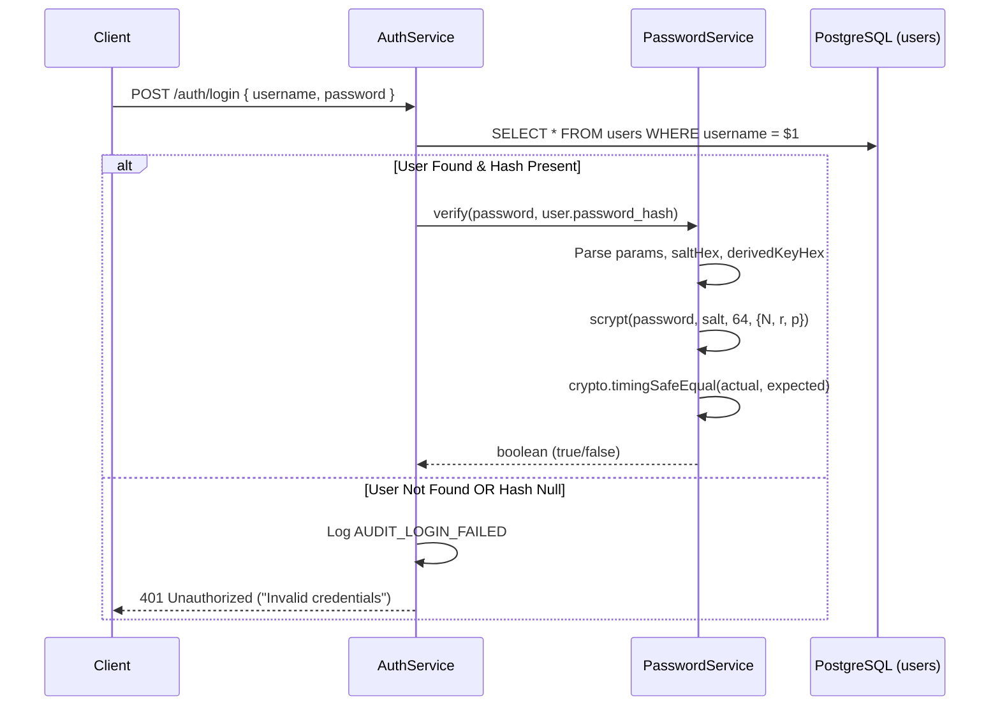
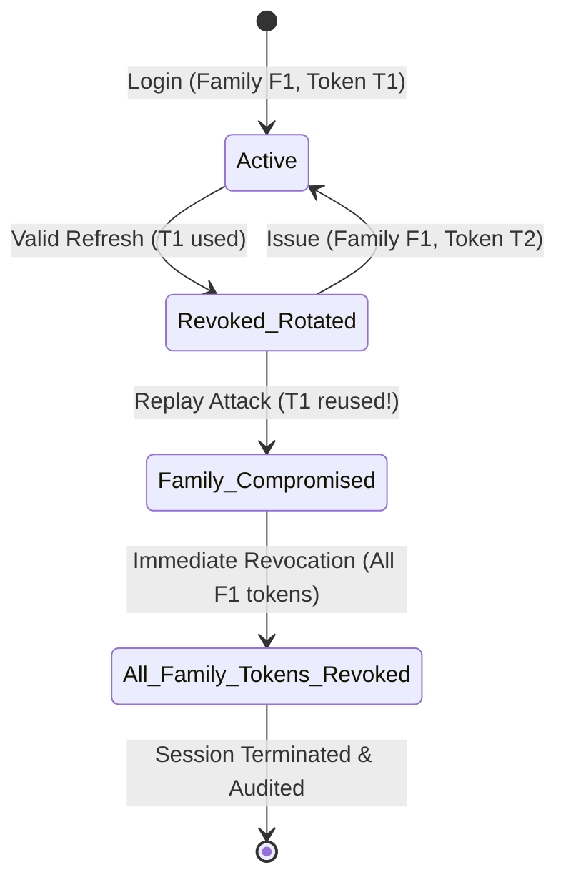

# ZENTRA — Authentication & Identity Architecture
## Hi-Tech Lab Field Service Management Platform
### Authoritative Technical Specification — Phase 5: Authentication, Multi-District RBAC & Core API Foundation

---

## 1. Executive Summary & Security Objectives

This document provides the authoritative engineering specification for the Authentication and Identity architecture implemented in **Phase 5** of the **ZENTRA Hi-Tech Lab Field Service Management Platform**.

ZENTRA operates in public education infrastructure across Tamil Nadu, supporting field engineers, district coordinators, state reporting heads, system administrators, and automated AI workers. Field service personnel operate in low-connectivity rural settings, requiring robust session management, resilient token issuance, and strict multi-district data boundaries.

### Core Security Objectives:
1. **Zero Plaintext Credential Exposure**: Passwords and refresh tokens are strictly hashed before persistence. Plaintext secrets are never stored on disk, logged in system traces, or reflected in audit events.
2. **Resistance to Offline Brute-Force & Timing Attacks**: Passwords use Scrypt with tuned memory-hardness parameters. Credential checks use constant-time byte comparisons (`crypto.timingSafeEqual`) to eliminate timing side-channels.
3. **Non-Enumeration Protection**: Login failures return generic 401 Unauthorized responses regardless of whether the identifier exists or the password is incorrect.
4. **Refresh Token Rotation (RTR) & Replay Defense**: Refresh tokens are single-use. If a previously consumed or revoked token is replayed, the entire token family is immediately revoked, an incident is flagged in `audit_events`, and all related sessions are terminated.
5. **Decoupled Identity & Ephemeral Session Tokens**: High-privilege access tokens are short-lived (15 minutes). Long-lived refresh tokens (7 days) remain securely isolated in hashed form.

---

## 2. Password Security & Scrypt Cryptography

### 2.1 Cryptographic Algorithm Selection
ZENTRA standardizes on Node.js native `crypto.scrypt` (RFC 7914 compliant). Scrypt is designed specifically for password-based key derivation, offering sequential memory-hardness that renders GPU and ASIC-accelerated brute-force attacks cost-prohibitive.

### 2.2 Parameters & Specification
| Parameter | Value | Rationale |
|---|---|---|
| **CPU/Memory Cost ($N$)** | `16384` ($2^{14}$) | Strong resistance to hardware parallelization while maintaining sub-100ms verification latency on server CPUs. |
| **Block Size ($r$)** | `8` | 1024-byte block size optimal for modern CPU L1/L2 cache lines. |
| **Parallelization ($p$)** | `1` | Single execution thread per hash evaluation. |
| **Output Key Length** | `64` bytes (512 bits) | Sufficient cryptographic entropy matching SHA-512 standard. |
| **Per-User Salt** | `16` random bytes | 128-bit cryptographically secure entropy generated via `crypto.randomBytes(16)`. |
| **Maximum Memory** | `32 MB` (`33554432` bytes) | Safeguard against memory allocation exhaustion. |

### 2.3 Storage Format
Hashes are stored in `users.password_hash` (`varchar(255)`) using a self-describing delimited format:
```
scrypt$N=16384,r=8,p=1$<saltHex>$<derivedKeyHex>
```
- `<saltHex>`: 32 hexadecimal characters (16 bytes).
- `<derivedKeyHex>`: 128 hexadecimal characters (64 bytes).

### 2.4 Verification Protocol & Constant-Time Comparison


To eliminate side-channel timing attacks, hash verification enforces:
1. **Hex & Format Validation**: Reject corrupted hash strings before invoking Scrypt.
2. **Constant-Time Comparison**: Comparison of computed and stored keys uses `crypto.timingSafeEqual(actualKey, expectedKey)`, preventing timing attacks based on early string-comparison termination.
3. **Generic Error Response**: Non-existent users and incorrect passwords return identical HTTP 401 `Invalid credentials` error envelopes.

---

## 3. JWT Access Token Architecture

### 3.1 Token Characteristics
- **Standard**: RFC 7519 JSON Web Token (JWT).
- **Signature Algorithm**: HMAC-SHA256 (`HS256`).
- **Signing Secret**: `JWT_ACCESS_SECRET` loaded from environment variables (minimum 16 characters enforced by Zod schema).
- **Time-to-Live (TTL)**: 15 minutes (`900` seconds).
- **Payload Claims Definition**: Strongly typed via `@zentra/types` (`AccessTokenClaims`).

### 3.2 Claims Specification & Active-Role Model
```typescript
export interface AccessTokenClaims {
  sub: string;                    // UUIDv7 Primary User Identifier
  username: string;               // User account handle
  roles: UserRole[];              // All assigned active roles
  activeRole?: UserRole;          // Current operational role context
  territoryDistrictIds: string[]; // UUID array of assigned districts
  deviceId?: string;              // Client device identifier if registered
  iat: number;                    // Issued-at Unix timestamp (seconds)
  exp: number;                    // Expiration Unix timestamp (seconds, iat + 900)
}
```

### 3.3 The Active-Role Model
In ZENTRA, users may be assigned multiple roles (e.g., `DISTRICT_COORDINATOR` and `FIELD_ENGINEER`). To prevent privilege amalgamation ("privilege bleeding") and ambiguous permission evaluation:
1. **Singular Active Role Context**: Every issued JWT access token specifies an `activeRole` claim. At login and refresh, `activeRole` defaults to the user's primary/first role (`roles[0]`).
2. **Explicit Persona Enforcement**: Authorization checks in `RolesGuard` and database RLS session settings evaluate `activeRole`. A user operating as a `FIELD_ENGINEER` cannot exercise `DISTRICT_COORDINATOR` dispatch actions, even if they hold both roles.
3. **Session Switching**: Switching active personas requires requesting a new token context, ensuring audit logs and security contexts unambiguously identify the operational role.

### 3.4 Token Verification Lifecycle
1. The client transmits the token via HTTP header: `Authorization: Bearer <token>`.
2. `JwtAuthGuard` extracts the token and verifies:
   - Header specifies `alg: 'HS256'`.
   - HMAC-SHA256 signature matches using constant-time equality.
   - Current time is strictly less than `exp`.
   - Required claims (`sub`, `roles`) are populated.
3. The validated `AccessTokenClaims` object is attached to `request.user`.

---

## 4. Refresh Token Lifecycle & Cryptographic Storage

### 4.1 Token Generation
- **Entropy Source**: `crypto.randomBytes(32)`.
- **Client Secret**: 64-character hexadecimal string returned to the client in `LoginResponse` or `RefreshTokenResponse`.
- **Database Hash**: Computed immediately via SHA-256 (`crypto.createHash('sha256').update(secret).digest('hex')`).
- **TTL**: 7 days (`604,800,000` milliseconds).

### 4.2 Database Schema (`refresh_tokens` Table)
```sql
CREATE TABLE refresh_tokens (
    refresh_token_id  uuid PRIMARY KEY,
    user_id           uuid NOT NULL REFERENCES users(user_id) ON DELETE CASCADE,
    token_hash        varchar(64) NOT NULL,
    family_id         uuid NOT NULL,
    is_revoked        boolean NOT NULL DEFAULT false,
    expires_at        timestamptz NOT NULL,
    device_id         varchar(128),
    ip_address        varchar(64),
    user_agent        text,
    created_at        timestamptz NOT NULL DEFAULT CURRENT_TIMESTAMP,
    revoked_at        timestamptz
);

CREATE INDEX idx_refresh_tokens_hash ON refresh_tokens(token_hash);
CREATE INDEX idx_refresh_tokens_family ON refresh_tokens(family_id);
```

### 4.3 Refresh Token Rotation (RTR) & Replay Attack Defense
Refresh tokens follow the strict **Refresh Token Rotation (RTR)** security model:
1. **Single-Use Semantics**: Each refresh token can be exchanged exactly once for a new access token and a new refresh token.
2. **Family Tracking**: Every login session creates a unique `family_id` (UUIDv7). All subsequent rotated tokens in that session inherit the same `family_id`.
3. **Replay Detection & Family Revocation**:
   - When a refresh request arrives, the server hashes the secret and locates the record.
   - If `is_revoked === true`, **a replay attack or token theft is detected**.
   - The server immediately revokes **all** active tokens in that `family_id`:
     ```sql
     UPDATE refresh_tokens
     SET is_revoked = true, revoked_at = CURRENT_TIMESTAMP
     WHERE family_id = $family_id;
     ```
   - An incident is recorded in `audit_events` with category `SECURITY` and action `REFRESH_TOKEN_REUSE_DETECTED`.
   - The request is terminated with HTTP 401: *"Token reuse detected. All sessions in this family have been invalidated."*



---

## 5. Session & Device Management

### 5.1 Device Registration
- Clients optionally submit `deviceId` (e.g. mobile UUID or browser installation ID) during authentication.
- Upon successful login, `users.current_device_id` is updated, and the `deviceId` is bound to the refresh token record.

### 5.2 Logout Protocol
- `POST /api/v1/auth/logout` accepts `{ refreshToken: string }`.
- The server hashes the token secret and marks the specific token `is_revoked = true`, recording a `LOGOUT` audit event.

---

## 6. Authentication API Specification

### 6.1 `POST /api/v1/auth/login`
- **Request Body**:
  ```json
  {
    "username": "coordinator.erode@zentra.test",
    "password": "<DEMO_PASSWORD>",
    "deviceId": "dev-device-001"
  }
  ```
- **Response (200 OK)**:
  ```json
  {
    "success": true,
    "data": {
      "user": {
        "userId": "01a116d8-...",
        "username": "coordinator.erode@zentra.test",
        "fullName": "Demo Erode District Coordinator",
        "phoneNumber": "+919999900003",
        "accountStatus": "ACTIVE",
        "roles": ["DISTRICT_COORDINATOR"],
        "territories": [
          {
            "assignmentId": "01a116d8-...",
            "userId": "01a116d8-...",
            "districtId": "01a116d8-...",
            "districtCode": "DEMO_DIS",
            "blockId": null,
            "blockCode": null,
            "isPrimaryTerritory": true,
            "validFrom": "2026-10-07T14:30:00.000Z",
            "validTo": null
          }
        ]
      },
      "accessToken": "eyJhbGciOiJIUzI1NiIs...",
      "refreshToken": "e3b0c44298fc1c149afbf4c8996fb92427ae41e4649b934ca495991b7852b855",
      "tokenType": "Bearer",
      "expiresIn": 900
    },
    "correlationId": "550e8400-...",
    "timestamp": "2026-10-07T14:30:00.000Z"
  }
  ```
- **Error Responses**:
  - `401 Unauthorized`: `"Invalid credentials"` (uniform response for nonexistent users, incorrect passwords, and accounts that are `SUSPENDED`, `ON_LEAVE`, or `TERMINATED` — strictly preventing account enumeration).
  - `400 Bad Request`: Validation failure.

### 6.2 `POST /api/v1/auth/refresh`
- **Request Body**: `{ "refreshToken": "<hexSecret>" }`
- **Response (200 OK)**: Returns new `{ accessToken, refreshToken, tokenType: 'Bearer', expiresIn: 900 }`.
- **Error Responses**:
  - `401 Unauthorized`: `"Invalid refresh token"`
  - `401 Unauthorized`: `"Refresh token has expired"`
  - `401 Unauthorized`: `"Token reuse detected. All sessions in this family have been invalidated."`

### 6.3 `POST /api/v1/auth/logout`
- **Request Body**: `{ "refreshToken": "<hexSecret>" }`
- **Response (200 OK)**: `{ "success": true, "data": { "loggedOut": true } }`.

### 6.4 `GET /api/v1/auth/me`
- **Headers**: `Authorization: Bearer <accessToken>`
- **Response (200 OK)**: Returns full `UserProfileDto`.

---

## 7. Audit Logging & Non-Leakage Proof

All authentication events are logged to the immutable `audit_events` table:
- Categories: `AUTHENTICATION`, `SECURITY`.
- Action Types: `LOGIN_SUCCESS`, `LOGIN_FAILED`, `TOKEN_REFRESH_SUCCESS`, `REFRESH_TOKEN_REUSE_DETECTED`, `LOGOUT`.
- Pre/Post Mutation States: Include metadata such as role counts, territory counts, and token family IDs.
- **Strict Invariant**: Plaintext passwords, password hashes, and raw token secrets are **never** written to `audit_events` or application logs.
- **Granular Internal Audit on Login Failures**: While the external client receives uniform HTTP 401 `"Invalid credentials"`, internal audit logs record the exact root cause (`INVALID_CREDENTIALS`, `ACCOUNT_SUSPENDED`, `ACCOUNT_ON_LEAVE`, `ACCOUNT_TERMINATED`, `NO_ACTIVE_ROLES`) for security monitoring and fraud detection.

---

## 8. Multi-District Resource-Level Authorization Chain & RLS Semantics

### 8.1 The Five-Tier Authorization Chain
ZENTRA implements defense-in-depth across 5 consecutive enforcement layers:

1. **Tier 1: Identity Authentication**:
   - Cryptographic verification of JWT access token signature (`HS256`), active expiration (`exp`), and structure.
2. **Tier 2: API RBAC Guard (`RolesGuard`)**:
   - Verification that the user's `activeRole` matches or exceeds the required role annotation (`@Roles(...)`).
3. **Tier 3: Route Territory Guard (`TerritoryGuard`)**:
   - Route-level parameter check verifying that the target `:districtId` is contained in `request.user.territoryDistrictIds` (bypassed for `MASTER_ADMIN` and `REPORTING_HEAD`).
4. **Tier 4: Resource-Level Authorization (Service Layer)**:
   - Domain service validation ensuring that the specific entity (e.g. school, lab, complaint, service case) belongs to a district/block assigned to the authenticated user.
5. **Tier 5: PostgreSQL Row-Level Security (RLS)**:
   - Database kernel-enforced data isolation executing inside an active transaction. PostgreSQL injects `zentra.current_user_id` and `zentra.current_role` via `SET LOCAL`, enforcing fail-closed row visibility directly in SQL execution plans.

### 8.2 Dynamic RLS Evaluation vs API Token Staleness
A critical architectural feature of ZENTRA is the temporal decoupling between API tokens and database authorization:
- **API Access Tokens (Bounded Staleness)**: Access tokens carry `territoryDistrictIds` as claims with a 15-minute lifespan (`TTL = 900s`). If a user's territory is revoked, API route guards may allow the request through during this 15-minute window (unless token revocation is explicitly invoked).
- **PostgreSQL RLS (Instantaneous Zero-Delay Evaluation)**: PostgreSQL RLS policies evaluate `user_territory_assignments` dynamically inside the SQL query:
  ```sql
  WHERE s.district_id IN (
    SELECT uta.district_id
    FROM user_territory_assignments uta
    WHERE uta.user_id = current_setting('zentra.current_user_id', true)::uuid
      AND (uta.valid_to IS NULL OR uta.valid_to > CURRENT_TIMESTAMP)
  )
  ```
  Consequently, the instant an administrator revokes or expires a territory assignment in PostgreSQL, **the very next database query executed under that user's context immediately returns 0 rows for the revoked territory**, providing true zero-delay security enforcement regardless of unexpired API tokens.

### 8.3 Phase 5 RLS Coverage Boundary
In Phase 5, PostgreSQL Row-Level Security policies are actively enforced on:
- `schools` (district-level scoping)
- `service_cases` (assigned-engineer and district scoping)

All other domain tables (`districts`, `blocks`, `hi_tech_labs`, `lab_equipment`, `source_complaints`, `field_visits`, `evidence_files`) are governed via relational foreign key lineage and API RBAC guards in Phase 5, and will receive dedicated RLS policies in subsequent domain implementation phases.
