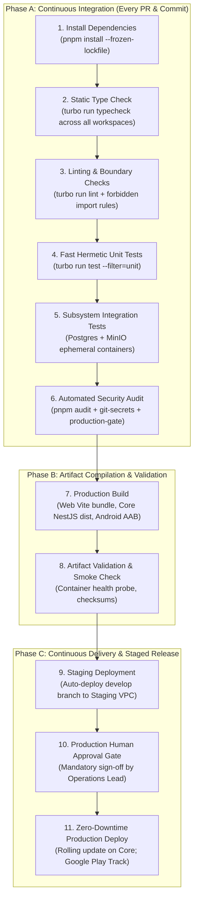
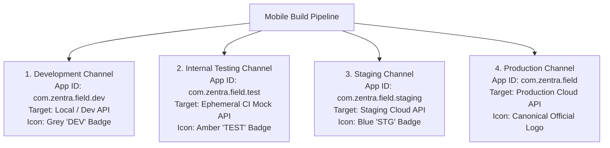

# ZENTRA — CI/CD, Release Channels & Governance Blueprint
## Hi-Tech Lab Field Service Management Platform

---

## 1. Purpose & Continuous Delivery Principles

The ZENTRA CI/CD blueprint establishes an automated, repeatable, and secure pipeline for validating, compiling, testing, and deploying all three surfaces of the platform:
- **ZENTRA Field** (Android Mobile APK / AAB)
- **ZENTRA Web** (Static Web Application Distribution)
- **ZENTRA Core** (Backend Container & Database Migrations)

### Core Governance Principles
1. **Zero Unreviewed Commits**: All changes enter via Pull Requests (PRs) subject to automated quality gates and mandatory peer code review.
2. **Fail-Closed Security Gating**: Any vulnerability detected by automated scanners or environment safety checks immediately halts pipeline execution.
3. **No Automatic Production Deployments**: Production deployments require explicit, authenticated human approval from the Engineering Lead / Operations Lead.
4. **Isolated Mobile Release Channels**: Development builds cannot accidentally overwrite production mobile installations on physical test devices.

---

## 2. The 11-Stage Continuous Integration & Deployment Pipeline

---

## 3. Branching Strategy & Quality Gates

### 3.1 Branching Topology
ZENTRA adopts a structured **Git-Flow / Trunk-Hybrid Model**:
- **`main`**: Reflects authoritative, active **Production** code. Commits occur exclusively via squash merges from `release/*` or hotfix branches. Strictly protected; direct pushes forbidden.
- **`develop`**: The primary integration branch for active development. Automatically deploys to the **Staging** environment.
- **`feature/<JIRA-or-ID>-description`**: Ephemeral feature branches branched from `develop`; merged back via PR.
- **`fix/<ID>-description`**: Bugfix branches branched from `develop`.
- **`release/vX.Y.Z`**: Stabilization branch for release rehearsal; freezes code before production promotion.
- **`hotfix/vX.Y.Z`**: Critical production patch branches branched directly from `main`.

### 3.2 Mandatory Pull Request (PR) Quality Gates
A PR cannot be merged into `develop` or `main` unless:
1. `pnpm install --frozen-lockfile` succeeds with zero lockfile drift.
2. `turbo run typecheck` reports 0 TypeScript errors across all workspaces.
3. `turbo run lint` reports 0 ESLint warnings or forbidden boundary violations.
4. 100% of unit and integration test suites pass without flaky retries.
5. `production-gate.ts` verifies zero production connection strings in test configurations.
6. `pnpm audit --audit-level=high` reports 0 high or critical vulnerabilities.
7. Code coverage meets minimum threshold ($\ge 85\%$ for domain and sync services).
8. At least 1 approved peer review from an authorized code owner.

---

## 4. Mobile Release Channels & Channel Pinning

A common field failure is a developer accidentally installing a development-configured mobile build on an active field engineer's phone, which then attempts to write mock data to production or point to local workstations.

ZENTRA Field enforces **Distinct Android Application Identifiers per Channel**:

### Channel Configuration Matrix

| Attribute | Development (`dev`) | Internal Test (`test`) | Staging (`staging`) | Production (`prod`) |
|---|---|---|---|---|
| **Android Application ID** | `com.zentra.field.dev` | `com.zentra.field.test` | `com.zentra.field.staging`| `com.zentra.field` |
| **API Base URL** | `http://10.0.2.2:4000/api/v1`| `https://test-api.zentra.internal` | `https://staging-api.zentra.in` | `https://api.zentra.in` |
| **Logging Level** | `DEBUG` | `DEBUG` | `INFO` | `WARN` / `ERROR` |
| **MinIO / S3 Bucket** | `zentra-dev-evidence` | `zentra-test-evidence` | `zentra-staging-evidence` | `zentra-prod-evidence` |
| **Coexistence on Device** | Installs alongside prod | Installs alongside prod | Installs alongside prod | Standalone official app |

> **Safety Design Principle**: Because application package IDs differ, an engineer or tester can install the `dev` or `staging` APK without overwriting or interfering with the production `com.zentra.field` installation.

---

## 5. Server-Controlled Feature Flag Architecture

To decouple code deployment from feature release (e.g., enabling AI extraction or route optimization only after field training), ZENTRA implements a **Dynamic Feature Flag Engine**:

### 5.1 Core Architectural Requirements
1. **Server-Controlled**: Mobile and web clients fetch feature flag state from `/api/v1/config/features`. Clients cannot unilaterally enable sensitive operational features.
2. **Default-Safe**: If the mobile client is offline or cannot fetch flags, it defaults to the most secure, conservative state (flags default to `false`).
3. **Territory / Role Aware**: Feature flags can be scoped by district (e.g., enabling AI OCR only in pilot district `Nagapattinam`) or by user role.
4. **Auditable**: Every feature flag modification in ZENTRA Web is logged in `audit_events`.

### 5.2 Initial Feature Flag Registry
- `feature.ai_ocr_extraction`: Enables OCR/AI assisted import processing (Default: `false`).
- `feature.qr_asset_scanning`: Enables camera barcode/QR scanner in ZENTRA Field (Default: `false`).
- `feature.automated_route_optimization`: Enables GPS distance-based visit sequencing (Default: `false`).
- `feature.on_glass_digital_signatures`: Enables touchscreen sign-off alongside paper report (Default: `false`).
- `feature.whatsapp_sms_notifications`: Enables external messaging dispatch to school staff (Default: `false`).

---

## 6. Third-Party Dependency Governance

Uncontrolled npm dependencies introduce supply-chain vulnerabilities, licensing risks, and mobile bundle bloat.

### Strict Governance Rules
1. **License Whitelist**: Only permissive open-source licenses are permitted (`MIT`, `Apache-2.0`, `BSD-2-Clause`, `BSD-3-Clause`, `ISC`). Viral copyleft licenses (`GPL-2.0`, `GPL-3.0`, `AGPL-3.0`) are strictly banned from all production bundles.
2. **Lockfile Freezing**: CI pipelines execute `pnpm install --frozen-lockfile`. Modifying dependencies without updating `pnpm-lock.yaml` fails the build.
3. **Automated Vulnerability Scanning**:
   - `pnpm audit` runs on every PR.
   - Any dependency with an unresolved high or critical CVE blocks the merge.
4. **Mobile Native Module Audit**:
   - Every new mobile dependency must be vetted for Android 14/15 background service compatibility and native binary size impact.
   - Heavy libraries that bloat the Android APK by more than 5MB require formal architectural approval.

---

## 7. Summary of CI/CD Blueprint Design Specifications

1. **Zero Undetected Regression**: All PRs must pass 100% of types, lint, and integration suites before merge.
2. **Deterministic Release Track**: Distinct Android app package IDs eliminate environment confusion.
3. **Human Production Gate**: Zero automated production rollouts without explicit operations sign-off.
4. **Strict Supply Chain Hygiene**: Permissive license whitelisting and automated vulnerability blocking.
