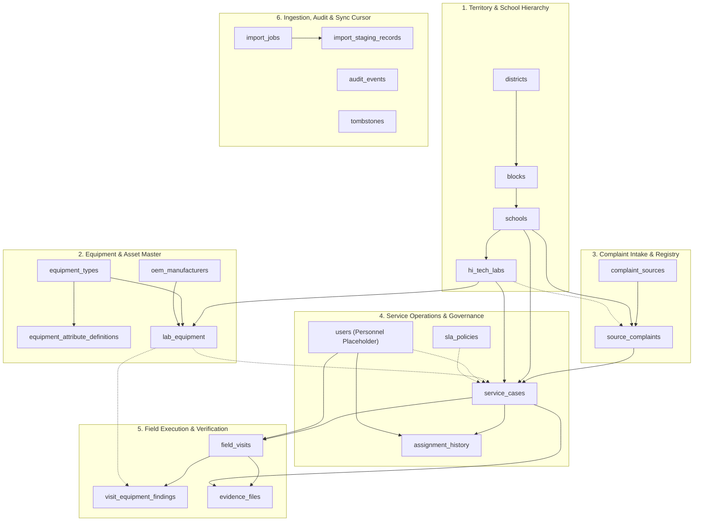

# ZENTRA — Database Implementation Specification
## Hi-Tech Lab Field Service Management Platform
### Authoritative Technical Specification — Phase 4: Database & Core Domain Implementation

---

## 1. Executive Summary & Purpose

This document provides the authoritative engineering specification for the PostgreSQL database schema and core domain models implemented in **Phase 4** of the **ZENTRA Hi-Tech Lab Field Service Management Platform**.

ZENTRA replaces legacy, ad-hoc spreadsheets and uncoordinated ticketing by introducing a resilient, offline-first, dual-platform field service engine tailored for school computer laboratories across Tamil Nadu.

This specification documents the physical schema, type system, relational structures, constraint boundaries, indexing strategies, audit models, and synchronization primitives implemented across **21 authoritative domain tables**.

### Strict Architectural Boundaries Implemented in Phase 4:
- **Zero Authentication / RBAC Runtime Implementation**: The database defines core domain entities and foreign key placeholders (`users` table with surrogate identity only), but contains no password hashes, JWT handlers, permission middleware, or active RLS session evaluation. Authentication and authorization are strictly deferred to **Phase 5 (Authentication & Multi-District RBAC)**.
- **Zero Production or Legacy Contamination**: No connection to legacy databases (Field Call Tracker, Ai Ticket App) or production Google Sheets. All fixtures and integration test datasets are 100% synthetic with zero real school PII.
- **Zero Binary File Storage**: Images and PDFs are strictly forbidden from database storage; all evidence tables store metadata, SHA-256 hashes, and storage paths only. Binary streaming is deferred to **Phase 14 (Evidence Pipeline & Direct S3 Streaming)**.
- **Preservation & Separation of Source Complaint Data vs. Field Service Operations**: External complaint records from legacy portals or EMIS are preserved in separate intake tables, while internal ZENTRA service cases and field visits evolve independently. Note: Immutability of source complaints is a domain/application rule and is **not** enforced by database-level triggers in Phase 4.

---

## 2. Technology Stack & Driver Architecture

| Component | Selected Technology | Version / Configuration | Technical Rationale |
|---|---|---|---|
| **Database Engine** | PostgreSQL | 16+ (Verified on 18.6 locally) | Robust transactional ACID support, native JSONB with GIN indexing, standard RLS kernel support. |
| **Driver Engine** | Node-Postgres (`pg` / `pg-pool`) | `^8.13.0` | High-performance, connection-pooling driver for Node.js runtimes. |
| **Query & DDL Builder** | Kysely | `^0.27.4` | Pure TypeScript compile-time type safety; zero runtime ORM overhead; explicit SQL generation without hidden schema drift. |
| **Migration Framework** | Kysely Migration Engine | Custom `ExplicitMigrationProvider` | Bidirectional (`up()` / `down()`) migrations bundled in compile-safe TypeScript modules without runtime file system reflection vulnerabilities. |
| **Time Engine** | PostgreSQL / Node.js UTC Standard | `TIMESTAMPTZ` / `TZ=UTC` | `TIMESTAMPTZ` represents absolute instants in time. All application timestamps are normalized to UTC upon serialization. Database and session timezones must be explicitly controlled. |
| **ID Standard** | RFC 9562 UUIDv7 | 128-bit sequential UUID | Millisecond time-ordered UUID that reduces random insertion patterns and associated B-tree fragmentation/write amplification compared with UUIDv4, while supporting client-side offline generation. |

---

## 3. Schema Architecture & Domain Segregation

The database schema is organized into **six logical domain subsystems**, maintaining strict separation of concerns across 21 relational tables:



---

## 4. Entity Inventory & Schema Definitions (21 Tables)

### Domain 1: Territory & School Hierarchy

#### 1. `districts`
- **Purpose**: Represents educational administrative districts across the state (e.g., Chennai, Nagapattinam, Coimbatore).
- **Primary Key**: `district_id` (UUIDv7)
- **Natural Key**: `district_code` (`VARCHAR(32)` UNIQUE, e.g., `NGP`, `CHN`)
- **Columns**: `district_id`, `district_code`, `district_name`, `is_active`, `created_at`, `updated_at`.
- **Foreign Keys**: None.

#### 2. `blocks`
- **Purpose**: Represents sub-district educational administrative blocks within a district.
- **Primary Key**: `block_id` (UUIDv7)
- **Columns**: `block_id`, `district_id` (FK $\to$ `districts.district_id`), `block_code`, `block_name`, `is_active`, `created_at`, `updated_at`.
- **Integrity**: Unique composite constraint on `(district_id, block_code)`.

#### 3. `schools`
- **Purpose**: Represents educational institutions containing Hi-Tech computer laboratories.
- **Primary Key**: `school_id` (UUIDv7)
- **Natural Key**: `udise_code` (`VARCHAR(11)` UNIQUE, 11-digit Unified District Information System for Education code).
- **Columns**: `school_id`, `udise_code`, `school_name`, `district_id` (FK $\to$ `districts`), `block_id` (FK $\to$ `blocks`), `school_category`, `base_pincode`, `is_special_zone`, `latitude`, `longitude`, `hm_name`, `hm_phone`, `ai_name`, `ai_phone`, `ai_emp_id`, `is_active`, `created_at`, `updated_at`.
- **Indexes**: `idx_schools_udise` (UNIQUE), `idx_schools_district`, `idx_schools_block`.

#### 4. `hi_tech_labs`
- **Purpose**: Represents individual computer laboratories established inside a school. Supports multiple labs per school (e.g., primary lab vs. higher secondary lab).
- **Primary Key**: `lab_id` (UUIDv7)
- **Columns**: `lab_id`, `school_id` (FK $\to$ `schools`), `lab_code` (`VARCHAR(32)`), `lab_type` (`PRIMARY`, `UPPER_PRIMARY`, `HIGH_SCHOOL`, `HIGHER_SECONDARY`), `room_location`, `active_computers_count`, `commissioning_date`, `is_active`, `created_at`, `updated_at`.
- **Integrity**: Unique composite constraint on `(school_id, lab_code)`.

---

### Domain 2: Equipment Master & Asset Tracking

#### 5. `oem_manufacturers`
- **Purpose**: Catalog of original equipment manufacturers and vendors supplying hardware (e.g., Acer, HP, BSNL, Numeric).
- **Primary Key**: `oem_id` (UUIDv7)
- **Columns**: `oem_id`, `oem_name` (`VARCHAR(128)` UNIQUE), `oem_code`, `support_contact_info`, `is_active`, `created_at`, `updated_at`.

#### 6. `equipment_types`
- **Purpose**: Standard taxonomy of laboratory assets and peripherals (e.g., SERVER, CLIENT_PC, UPS_1KVA, PROJECTOR, WEBCAM).
- **Primary Key**: `equipment_type_id` (UUIDv7)
- **Natural Key**: `type_code` (`VARCHAR(64)` UNIQUE).
- **Columns**: `equipment_type_id`, `type_code`, `type_name`, `description`, `is_active`, `created_at`, `updated_at`.

#### 7. `equipment_attribute_definitions`
- **Purpose**: Defines schema-driven dynamic technical and diagnostic fields per equipment type (e.g., battery bank voltage for UPS, bulb hours for projectors).
- **Primary Key**: `attribute_def_id` (UUIDv7)
- **Columns**: `attribute_def_id`, `equipment_type_id` (FK $\to$ `equipment_types`), `attribute_key`, `attribute_label`, `data_type` (`TEXT`, `NUMBER`, `BOOLEAN`, `DROPDOWN`), `dropdown_options` (JSONB), `is_diagnostic_field`, `is_required`, `created_at`, `updated_at`.
- **Integrity**: Unique composite constraint on `(equipment_type_id, attribute_key)`.

#### 8. `lab_equipment`
- **Purpose**: Concrete hardware asset instances deployed inside a school laboratory.
- **Primary Key**: `lab_equipment_id` (UUIDv7)
- **Columns**: `lab_equipment_id`, `lab_id` (FK $\to$ `hi_tech_labs`), `equipment_type_id` (FK $\to$ `equipment_types`), `oem_id` (FK $\to$ `oem_manufacturers`, nullable), `oem_name`, `model_number`, `serial_number`, `asset_barcode`, `installation_date`, `warranty_end_date`, `operational_condition`, `custom_attributes` (JSONB), `is_active`, `created_at`, `updated_at`.
- **Indexes**: `idx_lab_equipment_lab`, `idx_lab_equipment_type`, `idx_lab_equipment_serial`, GIN index `idx_lab_equipment_custom_attributes` on `custom_attributes jsonb_path_ops`.

---

### Domain 3: Governance, Personnel & Service Level Policies

#### 9. `users`
- **Purpose**: Personnel directory placeholder for system actors, engineers, coordinators, and administrators. Strictly decoupled from authentication logic (no password hashes or security credentials).
- **Primary Key**: `user_id` (UUIDv7)
- **Columns**: `user_id`, `username` (`VARCHAR(64)` UNIQUE), `full_name`, `phone_number`, `is_active`, `created_at`, `updated_at`.

#### 10. `complaint_sources`
- **Purpose**: Registry of authorized upstream ticket sources (e.g., `LEGACY_CALL_TRACKER`, `EMIS_PORTAL`, `HELPLINE_MANUAL`, `DIRECT_FIELD_REPORT`).
- **Primary Key**: `source_system_id` (UUIDv7)
- **Natural Key**: `system_code` (`VARCHAR(64)` UNIQUE).
- **Columns**: `source_system_id`, `system_code`, `system_name`, `description`, `is_active`, `created_at`, `updated_at`.

#### 11. `sla_policies`
- **Purpose**: Configurable service level resolution policies by priority tier.
- **Primary Key**: `sla_policy_id` (UUIDv7)
- **Columns**: `sla_policy_id`, `policy_name`, `priority_level` (`P1_CRITICAL`, `P2_HIGH`, `P3_MEDIUM`, `P4_LOW`), `target_resolution_hours`, `warning_threshold_percentage`, `is_active`, `created_at`, `updated_at`.
- **Integrity**: Unique constraint on `priority_level`.

---

### Domain 4: Complaint Intake & Operational Service Cases

#### 12. `source_complaints`
- **Purpose**: Preserved external complaint intake records capturing raw complaint information as originally reported by schools or upstream portals.
- **Primary Key**: `source_complaint_id` (UUIDv7)
- **Columns**: `source_complaint_id`, `source_system_id` (FK $\to$ `complaint_sources`), `external_ticket_id` (`VARCHAR(128)`), `school_id` (FK $\to$ `schools`), `lab_id` (FK $\to$ `hi_tech_labs`, nullable), `original_title`, `original_description`, `registered_at`, `source_status`, `source_priority`, `source_sla_target`, `reported_equipment_text`, `reported_serial_number`, `reporter_name`, `reporter_phone`, `original_remarks`, `raw_payload` (JSONB), `created_at`, `updated_at`.
- **Integrity & Deduplication**:
  - Unique composite index `idx_source_complaints_ext_id` on `(source_system_id, external_ticket_id)` provides exact-source deduplication **when an external ticket ID exists**.
  - Complaints without external IDs (e.g. manual helpline calls or direct field reports) do not rely on this composite key and must be managed through the staged ingestion and correlation workflow (**Phase 8: Staged Ingestion & Duplicate Classification Engine**).
  - A simplistic `(school_id, issue)` unique constraint is deliberately **not used**, allowing schools to legitimately register multiple simultaneous or recurring complaints over time.
- **Immutability Status**: Immutability of source complaints is a domain/application governance rule and is **not database-enforced via UPDATE/DELETE triggers** in Phase 4.

#### 13. `service_cases`
- **Purpose**: Authoritative operational entity managed by ZENTRA field coordinators and engineers.
- **Primary Key**: `service_case_id` (UUIDv7)
- **Business Identifier**: `zentra_case_code` (`VARCHAR(64)` UNIQUE, e.g. `ZNT-2026-NGP-000481`).
- **Columns**: `service_case_id`, `source_complaint_id` (FK $\to$ `source_complaints` UNIQUE), `zentra_case_code`, `school_id` (FK $\to$ `schools`), `lab_id` (FK $\to$ `hi_tech_labs`), `lab_equipment_id` (FK $\to$ `lab_equipment`, nullable), `operational_status`, `internal_priority`, `assigned_primary_engineer_id` (FK $\to$ `users`, nullable), `assigned_secondary_engineer_id` (FK $\to$ `users`, nullable), `assigned_at`, `sla_policy_id` (FK $\to$ `sla_policies`, nullable), `sla_target_at`, `sla_breach_status`, `actual_diagnosis_summary`, `actual_action_taken_summary`, `verification_status`, `verified_by_user_id` (FK $\to$ `users`, nullable), `resolved_at`, `closed_at`, `is_deleted`, `deleted_at`, `deleted_by_user_id` (FK $\to$ `users`, nullable), `created_at`, `updated_at`.
- **Integrity**:
  - `source_complaint_id` UNIQUE enforcing 1:1 relationship with source complaints.
  - CHECK constraint on `operational_status IN ('UNASSIGNED', 'ASSIGNED', 'SCHEDULED', 'IN_PROGRESS', 'PENDING_SPARES', 'RESOLVED', 'CLOSED', 'CANCELLED')`.
  - CHECK constraint on `internal_priority IN ('P1_CRITICAL', 'P2_HIGH', 'P3_MEDIUM', 'P4_LOW')`.
  - CHECK constraint on `sla_breach_status IN ('ON_TRACK', 'APPROACHING_BREACH', 'BREACHED', 'EXEMPTED')`.
  - CHECK constraint on `verification_status IN ('UNVERIFIED', 'PENDING_HM_SIGN', 'HM_VERIFIED', 'REJECTED')`.

#### 14. `assignment_history`
- **Purpose**: Complete audit trail of engineer assignments and re-assignments per service case.
- **Primary Key**: `assignment_history_id` (UUIDv7)
- **Columns**: `assignment_history_id`, `service_case_id` (FK $\to$ `service_cases`), `assigned_by_user_id` (FK $\to$ `users`, nullable), `engineer_id` (FK $\to$ `users`), `assignment_role` (`PRIMARY`, `SECONDARY`), `assigned_at`, `reassignment_reason`, `created_at`.
- **Indexes**: `idx_assignment_case` on `(service_case_id, assigned_at)`.

---

### Domain 5: Field Visits & Physical Verification Evidence

#### 15. `field_visits`
- **Purpose**: Physical on-site visits conducted by field engineers for a service case. Supports multiple sequential visits per case (e.g., initial diagnosis, spares installation, final verification).
- **Primary Key**: `visit_id` (UUIDv7, offline generated)
- **Columns**: `visit_id`, `service_case_id` (FK $\to$ `service_cases`), `engineer_id` (FK $\to$ `users`), `visit_sequence_number`, `visit_date`, `check_in_timestamp`, `check_in_latitude`, `check_in_longitude`, `check_in_accuracy_meters`, `check_in_within_geofence`, `equipment_condition_observed`, `on_site_diagnosis`, `work_performed`, `visit_outcome`, `pending_reason_text`, `target_next_visit_date`, `check_out_timestamp`, `check_out_latitude`, `check_out_longitude`, `check_out_accuracy_meters`, `conveyance_km`, `client_operation_id`, `is_deleted`, `deleted_at`, `deleted_by_user_id`, `created_at`, `updated_at`.
- **Integrity**:
  - Unique composite constraint on `(service_case_id, visit_sequence_number)` ensuring sequential visit indexing.
  - CHECK constraint on `visit_outcome IN ('COMPLETED_RESOLVED', 'PENDING_SPARES', 'PENDING_REVISIT', 'UNABLE_TO_ACCESS', 'CANCELLED')`.
- **Clarification on Conveyance**:
  - `conveyance_km` is purely a **numeric distance record** (distance traveled in kilometers as a numeric value).
  - It is **not** a reimbursement rate or financial reimbursement calculation. Reimbursement calculation rules (including candidate ₹5.00/km rate) are business logic deferred to **Phase 15 (Conveyance Claims & Management Web Portal)** and remain subject to stakeholder clarification.

#### 16. `visit_equipment_findings`
- **Purpose**: Specific hardware findings observed during a visit, recording discrepancies between what the school reported vs. what was actually diagnosed on site.
- **Primary Key**: `finding_id` (UUIDv7)
- **Columns**: `finding_id`, `visit_id` (FK $\to$ `field_visits`), `lab_equipment_id` (FK $\to$ `lab_equipment`, nullable), `reported_equipment_text`, `actual_serial_number_observed`, `actual_equipment_type_id` (FK $\to$ `equipment_types`, nullable), `condition_observed`, `diagnostic_attributes` (JSONB), `diagnosis_notes`, `action_taken`, `created_at`.

#### 17. `evidence_files`
- **Purpose**: Digital evidence files captured on-site (Slot 1 HM signed call report, Slot 2 working equipment photo). Strictly stores metadata, SHA-256 hashes, and storage paths.
- **Primary Key**: `evidence_file_id` (UUIDv7, offline generated)
- **Columns**: `evidence_file_id`, `visit_id` (FK $\to$ `field_visits`), `service_case_id` (FK $\to$ `service_cases`), `evidence_slot`, `storage_path`, `file_checksum_sha256`, `file_size_bytes`, `mime_type`, `captured_at`, `gps_latitude`, `gps_longitude`, `gps_accuracy_meters`, `uploaded_at`, `is_verified`, `verification_notes`, `is_tombstoned`, `is_deleted`, `deleted_at`, `deleted_by_user_id`, `created_at`.
- **Integrity & Slot Distinction**:
  - **Allowed Slot Values (Enforced)**: The table CHECK constraint strictly enforces allowed values: `evidence_slot IN ('SLOT_1_HM_SIGNED_REPORT', 'SLOT_2_EQUIPMENT_WORKING_PHOTO', 'DEFECTIVE_PART_PHOTO', 'REPLACED_PART_PHOTO', 'SUPPLEMENTARY_EVIDENCE')`.
  - **Mandatory Completion Requirement (NOT Enforced at DB Level)**: The table CHECK constraint does **NOT** enforce mandatory Slot 1 + Slot 2 completion before a service case can transition to `RESOLVED`.
  - **Status**: Enforcing mandatory completion (blocking resolution until both Slot 1 and Slot 2 are present) is `REQUIRES IMPLEMENTATION / DEFERRED` to **Phase 9 (Service Case Lifecycle & Dispatch Engine)** and **Phase 14 (Evidence Pipeline & Direct S3 Streaming)**.
  - **Slot Uniqueness**: Uniqueness per visit (e.g. exactly one active Slot 1 per visit) is not constrained at the table level in Phase 4 and is `REQUIRES IMPLEMENTATION / DEFERRED`.

---

### Domain 6: Staging, Ingestion, Audit & Synchronization

#### 18. `import_jobs`
- **Purpose**: Tracks batch spreadsheet/CSV import processes from external complaint exports.
- **Primary Key**: `import_job_id` (UUIDv7)
- **Columns**: `import_job_id`, `uploaded_by_user_id` (FK $\to$ `users`, nullable), `source_filename`, `file_type`, `total_rows_parsed`, `valid_rows_count`, `duplicate_rows_count`, `error_rows_count`, `job_status` (`UPLOADED`, `PARSED`, `VALIDATED`, `COMMITTED`, `FAILED`), `created_at`, `committed_at`.

#### 19. `import_staging_records`
- **Purpose**: Isolated staging buffer holding parsed rows from imports prior to domain promotion. Prevents unvalidated external records from corrupting core tables.
- **Primary Key**: `staging_record_id` (UUIDv7)
- **Columns**: `staging_record_id`, `import_job_id` (FK $\to$ `import_jobs`), `raw_row_data` (JSONB), `mapped_udise_code`, `resolved_school_id` (FK $\to$ `schools`, nullable), `mapped_external_ticket_id`, `mapped_issue_text`, `mapped_priority`, `duplicate_classification` (`NEW_UNIQUE`, `EXACT_DUPLICATE`, `POTENTIAL_UPDATE`), `validation_error_message`, `is_approved_for_commit`, `created_at`.

#### 20. `audit_events`
- **Purpose**: Append-only audit trail capturing system mutations and security events across all tables.
- **Primary Key**: `audit_event_id` (UUIDv7)
- **Columns**: `audit_event_id`, `event_timestamp`, `actor_user_id` (FK $\to$ `users`, nullable), `actor_ip_address`, `actor_device_id`, `event_category`, `target_entity_type`, `target_entity_id`, `action_type`, `pre_mutation_state` (JSONB, nullable), `post_mutation_state` (JSONB, nullable).
- **Indexes**: `idx_audit_events_target` on `(target_entity_type, target_entity_id)`, `idx_audit_events_timestamp` on `(event_timestamp)`.
- **Note on Immutability**: The schema provides the append-only structure. Hard database-level trigger prevention of UPDATE/DELETE on `audit_events` is `REQUIRES IMPLEMENTATION / DEFERRED`.

#### 21. `tombstones`
- **Purpose**: Global deletion log tracking purged records with a monotonic cursor for offline mobile synchronization.
- **Primary Key**: `tombstone_id` (UUIDv7)
- **Columns**: `tombstone_id`, `entity_type` (`VARCHAR(64)`), `entity_id` (UUID), `sync_sequence_number` (`BIGSERIAL` UNIQUE), `deleted_at`, `deleted_by_user_id` (FK $\to$ `users`, nullable), `tombstone_reason`.
- **Indexes**: `idx_tombstones_sync_seq` on `(sync_sequence_number)`.

---

## 5. Primary Key & Identity Architecture

### 5.1 UUIDv7 vs. Alternatives Evaluation

```
+------------------------------------------------------------------------+
| 48-bit Unix Epoch (ms) | 12-bit Sub-ms / Counter | 62-bit Random Bits  |
+------------------------------------------------------------------------+
|<---------------------------- 128 Bits (16 Bytes) --------------------->|
```

- **UUIDv4 (Rejected as Primary)**: Pseudo-random distribution causes random insertion patterns across index leaves, leading to elevated B-tree page splits, write amplification, and buffer cache misses under high insert volume.
- **UUIDv7 (Adopted)**: Standardized in RFC 9562. Combines a 48-bit millisecond timestamp prefix with random bits. **Reduces random insertion patterns and associated B-tree fragmentation/write amplification compared with UUIDv4**, while supporting client-side offline generation on mobile devices without centralized ID coordination.
- **Implementation**: Generated in application code via `@zentra/shared::generateUuidV7()` and stored in PostgreSQL as native 16-byte `UUID` columns.

### 5.2 Human-Readable Business Identifiers
Human-friendly reference numbers are generated for operational usability:
- **Service Cases**: `ZNT-[YYYY]-[DISTRICT_CODE]-[6_DIGIT_SEQUENCE]`
  - Example: `ZNT-2026-NGP-000481`
- **Import Jobs**: `IMP-[YYYYMMDD]-[4_DIGIT_SEQUENCE]`
  - Example: `IMP-20261005-0012`
- **Conveyance Claims**: `EXP-[YYYYMM]-[ENGINEER_SUFFIX]-[4_DIGIT_SEQUENCE]`
  - Example: `EXP-202610-0481-0003`

---

## 6. Time & Temporal Standards

### 6.1 Database & Transport Standard
1. **Absolute Instants via `TIMESTAMPTZ`**: All temporal columns use `TIMESTAMP WITH TIME ZONE` (`TIMESTAMPTZ`). In PostgreSQL, `TIMESTAMPTZ` stores the absolute instant in UTC internally.
2. **Normalized Application Timestamps**: Application runtimes normalize all temporal values to UTC prior to transmission and persistence. The Node.js application environment is configured with `TZ=UTC`.
3. **Explicit Timezone Control**: Database sessions and connection pools must explicitly execute with UTC configuration (`SET timezone = 'UTC'`). It is recognized that `CURRENT_TIMESTAMP` returns a `TIMESTAMPTZ` value representing the current transaction start instant, and text representations depend on the session timezone; therefore session timezone must be explicitly controlled.
4. **Wire Format**: ISO 8601 UTC with millisecond precision (`YYYY-MM-DDTHH:mm:ss.sssZ`).
5. **Presentation Layer**: Converted to Indian Standard Time (IST, UTC+05:30) exclusively at the UI presentation boundary.

### 6.2 Device/Server Time & Location Evidence Model
To detect potential mobile clock tampering in field operations without relying on unsubstantiated hardware assumptions:
1. **Device Capture Timestamp**: Recorded by the client mobile application when check-in or evidence capture occurs (`check_in_timestamp`).
2. **Server Ingestion Timestamp**: Authoritative NTP-synchronized timestamp recorded upon receipt and storage at the backend (`created_at`).
3. **Location Coordinates & Estimated Accuracy**: Hardware latitude, longitude, and estimated horizontal accuracy recorded via fused location (`check_in_latitude`, `check_in_longitude`, `check_in_accuracy_meters`). Note: Location coordinates constitute spatial evidence, not a clock source.
4. **Device/Server Clock-Skew Detection**:
   - The backend compares the client device capture timestamp against the authoritative server arrival timestamp.
   - Significant discrepancies ($> 15$ minutes) can be flagged as `CLOCK_SKEW_SUSPECT` in `audit_events`.
5. **Authoritative Hardware GPS Clock Status**:
   - Standard mobile platform location APIs (e.g. Android Fused Location) do not unconditionally expose an immutable, tamper-proof satellite hardware clock across arbitrary devices and mock-location providers.
   - Establishing an authoritative hardware GPS-clock trust mechanism remains strictly deferred to **Phase 11 (Mobile Hardware GPS & Camera Module)** for native security validation.

---

## 7. Separation of Source Complaint Data vs. Field Service Data

A core architectural tenet of ZENTRA is the physical and operational decoupling of upstream complaint intake from internal field execution:

```
+-----------------------------------------------------------------------------------------+
|                                    UPSTREAM DOMAIN                                      |
|                                                                                         |
|  complaint_sources                                                                      |
|  └── source_complaints (Preserved External Records)                                     |
|      ├── external_ticket_id: "TICK-8472"                                                |
|      ├── source_status: "OPEN"                                                          |
|      ├── reported_equipment_text: "Lab computer not turning on"                        |
|      └── raw_payload: { ...original export json... }                                    |
+-----------------------------------------------------------------------------------------+
                                           │
                                1:1 Promotion Bridge
                                           ▼
+-----------------------------------------------------------------------------------------+
|                                ZENTRA OPERATIONAL DOMAIN                                |
|                                                                                         |
|  service_cases                                                                          |
|  ├── zentra_case_code: "ZNT-2026-NGP-000481"                                            |
|  ├── operational_status: "IN_PROGRESS" / "RESOLVED"                                     |
|  ├── lab_equipment_id: (Resolved actual hardware asset)                                 |
|  │                                                                                      |
|  └── field_visits (Sequential Multi-Visit Tracking)                                     |
|      ├── visit 1: Initial diagnosis -> visit_outcome: "PENDING_SPARES"                  |
|      └── visit 2: SMPS replacement -> visit_outcome: "COMPLETED_RESOLVED"               |
|                                                                                         |
|  evidence_files                                                                         |
|  ├── Slot 1: HM signed physical call report                                             |
|  └── Slot 2: Photo of equipment running live                                            |
+-----------------------------------------------------------------------------------------+
```

### Architectural Distinctions:
1. **Independent Lifecycles**: A source complaint may exist indefinitely without being promoted to a service case (e.g., pending coordinator review).
2. **Independent Statuses**: Transitioning a `service_cases.operational_status` to `RESOLVED` does not mutate `source_complaints.source_status`. The source status preserves the upstream ticket portal's native status until an explicit synchronization export occurs.
3. **Reported vs. Observed Equipment**: `source_complaints` records free-text reported equipment; `visit_equipment_findings` and `service_cases` link to verified `lab_equipment` records and observe actual serial numbers.
4. **Preservation Scope**: Source complaints are preserved separately. Note that database-level UPDATE/DELETE prevention triggers are not implemented in Phase 4; immutability is governed at the application layer.

---

## 8. Multi-Visit & Visit Findings Model

Rural school lab repairs frequently cannot be completed in a single visit due to parts shortages or school closures. ZENTRA models multi-visit workflows natively:
1. **Sequential Indexing**: Every visit records a `visit_sequence_number` (1, 2, 3...) strictly constrained by `UNIQUE(service_case_id, visit_sequence_number)`.
2. **Visit Outcomes**: Explicitly records whether each visit concluded the issue (`COMPLETED_RESOLVED`) or requires follow-up (`PENDING_SPARES`, `PENDING_REVISIT`, `UNABLE_TO_ACCESS`).
3. **Equipment Discrepancy Tracking**: `visit_equipment_findings` links to the visit, allowing engineers to document situations where the reported equipment was "Server" but the actual defective component was the "UPS Battery Bank".

---

## 9. Evidence Metadata & Slot Isolation Architecture

Hi-Tech Lab contracts mandate two distinct digital evidence items before a service case can be submitted for verification:

| Evidence Slot | Database Constraint Constant | Description & Content Rules |
|---|---|---|
| **Slot 1** | `SLOT_1_HM_SIGNED_REPORT` | Photograph of the physical field service sheet containing the Head Master (HM) or AI coordinator signature and school seal. |
| **Slot 2** | `SLOT_2_EQUIPMENT_WORKING_PHOTO` | Photograph showing the repaired hardware powered on and functioning in the lab environment. |

### Storage Isolation Rules:
- **No Binary Blobs in Database**: Image files and PDFs are stored in object storage (MinIO/S3). The database stores `storage_path`, SHA-256 content checksum, file size in bytes, MIME type, GPS coordinates, and capture timestamp.
- **Allowed Slot Values Enforced**: `evidence_files` enforces slot identifiers via `CHECK (evidence_slot IN ('SLOT_1_HM_SIGNED_REPORT', 'SLOT_2_EQUIPMENT_WORKING_PHOTO', ...))`.
- **Mandatory Completion Rules**: Enforcing that a service case cannot transition to `RESOLVED` without both valid Slot 1 and Slot 2 evidence is `REQUIRES IMPLEMENTATION / DEFERRED` to **Phase 9 (Service Case Lifecycle & Dispatch Engine)** and **Phase 14 (Evidence Pipeline & Direct S3 Streaming)**.

---

## 10. Semi-Structured Data & JSONB Strategy

ZENTRA balances relational rigor with semi-structured flexibility using PostgreSQL `JSONB`:

| Column | Table | Usage Justification | Indexing Applied |
|---|---|---|---|
| `custom_attributes` | `lab_equipment` | Dynamic hardware attributes defined by `equipment_attribute_definitions`. Allows arbitrary vendor fields without altering table schema. | GIN (`jsonb_path_ops`) |
| `dropdown_options` | `equipment_attribute_definitions` | Stores selectable options for dropdown attribute types. | None (low cardinality) |
| `raw_payload` | `source_complaints` | Preserves verbatim external JSON/row payloads from legacy imports for debugging and provenance. | None |
| `diagnostic_attributes` | `visit_equipment_findings` | Captures diagnostic measurement values recorded by engineers on site (e.g. `{"input_voltage": 228, "output_voltage": 230}`). | None |
| `raw_row_data` | `import_staging_records` | Stores raw imported CSV row columns prior to schema mapping. | None |
| `pre_mutation_state` / `post_mutation_state` | `audit_events` | Stores before/after delta snapshots for administrative and security auditing. | None |

---

## 11. Soft-Delete & Tombstone Synchronization Engine

To guarantee that records deleted by administrators can be purged from offline mobile caches without causing resurrection bugs:

1. **Dual Column Soft-Delete**: Operational tables (`service_cases`, `field_visits`, `evidence_files`) include `is_deleted BOOLEAN NOT NULL DEFAULT FALSE`, `deleted_at TIMESTAMPTZ`, and `deleted_by_user_id UUID`.
2. **Monotonic Tombstone Cursor**: The `tombstones` table records deletions with an auto-incrementing `BIGSERIAL sync_sequence_number`.
3. **Sync Pull Protocol (Phase 12)**: Mobile devices will synchronize deletions by passing their last acknowledged sequence number (`since_seq`):
   ```sql
   SELECT entity_type, entity_id, sync_sequence_number
   FROM tombstones
   WHERE sync_sequence_number > :since_seq
   ORDER BY sync_sequence_number ASC;
   ```
4. **Implementation Ownership Clarification**:
   - Setting `service_cases.is_deleted = TRUE` does **not** automatically insert a record into `tombstones` via a database trigger in Phase 4 (no trigger exists).
   - In integration test 14, the test code explicitly executed both an `UPDATE` on `service_cases` and an `INSERT` into `tombstones`.
   - Automatic coordinated tombstone insertion is an **application/repository service responsibility** deferred to future phases (**Phase 9** deletion workflows and **Phase 12** synchronization). Implementation ownership is documented as `REQUIRES IMPLEMENTATION / DEFERRED`.

---

## 12. Row-Level Security (RLS) & Multi-Tenant Boundaries

### Phase 4 Architectural Status: Prepared for Phase 5 Activation
In strict compliance with Phase 4 boundaries, RLS policies are **architected and designed**, but runtime enforcement and user credential session variables are deferred to **Phase 5 (Authentication & Multi-District RBAC)** when the authentication subsystem is implemented.

### Territory-Based Isolation Architecture:
1. Operational tables (`schools`, `service_cases`, `field_visits`, `evidence_files`) correlate to `district_id`.
2. In Phase 5, connection sessions will set:
   ```sql
   SET LOCAL zentra.current_user_id = '<user_uuid>';
   SET LOCAL zentra.current_district_id = '<district_uuid>';
   SET LOCAL zentra.current_role = 'DISTRICT_COORDINATOR';
   ```
3. PostgreSQL RLS policies will filter queries at the database kernel level:
   ```sql
   CREATE POLICY district_coordinator_isolation ON service_cases
   FOR ALL TO zentra_app
   USING (
     school_id IN (
       SELECT school_id FROM schools WHERE district_id = NULLIF(current_setting('zentra.current_district_id', true), '')::UUID
     )
   );
   ```

---

## 13. Migration Lifecycle & Execution Standard

### Migration Files Implemented
All migrations are located in `apps/api/src/database/migrations/`:
1. `20261005000001_create_territory_and_schools.ts`
   - Provisions `districts`, `blocks`, `schools`, `hi_tech_labs`.
2. `20261005000002_create_equipment_master.ts`
   - Provisions `oem_manufacturers`, `equipment_types`, `equipment_attribute_definitions`, `lab_equipment`.
3. `20261005000003_create_complaints_and_service_cases.ts`
   - Provisions `users`, `complaint_sources`, `source_complaints`, `sla_policies`, `service_cases`, `assignment_history`.
4. `20261005000004_create_visits_evidence_and_findings.ts`
   - Provisions `field_visits`, `visit_equipment_findings`, `evidence_files`.
5. `20261005000005_create_governance_staging_and_audit.ts`
   - Provisions `import_jobs`, `import_staging_records`, `audit_events`, `tombstones`.

### Reversibility Contract
Every migration exports both `up(db: Kysely<any>)` and `down(db: Kysely<any>)`. In test suites, migration reversibility is verified by rolling back migration 5 and re-executing it cleanly without data corruption or orphan DDL objects.

---

## 14. Seed Data & Synthetic Fixture Strategy

### Absolute Zero Production Contamination
To eliminate any risk of data exposure or privacy violations:
- **No Real School PII**: No UDISE codes or names from real Tamil Nadu schools are included in test seeds.
- **Deterministic Synthetic Generators**: All seed fixtures in `apps/api/src/database/seeds/synthetic-dev-fixtures.ts` generate clearly marked synthetic entities (e.g. `Dev Demo School Alpha`, UDISE `33990000001`, `Dev Engineer Alpha`).
- **Production Gate Guard**: Production safety assertions (`assertTestEnvironmentIsSafe()`) prevent tests and seed scripts from executing against non-test database targets.

---

## 15. Candidate Business Rules & Open Decisions Requiring Clarification

The following operational rules were identified during Phase 0 / Phase 1 and are supported structurally by the database schema, but remain subject to formal stakeholder clarification prior to production lock:

1. **Geofence Radius Threshold**: Structured as `check_in_within_geofence BOOLEAN`. Candidate rule assumes $\le 50\text{ meters}$. Status: `REQUIRES CLARIFICATION`.
2. **Sign-Off Authority Role**: Structured as `verification_status` and `verified_by_user_id`. Candidate rule permits Head Master or Assistant Instructor sign-off. Status: `REQUIRES CLARIFICATION`.
3. **Multi-Lab Room Mapping**: Supported structurally via `(school_id, lab_code)`. Formal naming convention for schools with 3+ labs. Status: `REQUIRES CLARIFICATION`.
4. **Third-Party Contractor Access**: Modeled as `assignment_role` and `users`. Policy on whether third-party OEMs update tickets directly or via coordinator. Status: `REQUIRES CLARIFICATION`.
5. **External Ticket Integration**: Modeled via `complaint_sources` and `source_complaints`. Determination of whether upstream EMIS/Tracker systems offer REST APIs or file-only batch imports. Status: `REQUIRES CLARIFICATION`.
6. **Conveyance Rate Variations**: Modeled as `conveyance_km` (purely a numeric distance record in kilometers). Candidate rate ₹5.00/km for two-wheelers across rural terrain. Status: `REQUIRES CLARIFICATION` (Reimbursement calculations are not hardcoded in the database).
