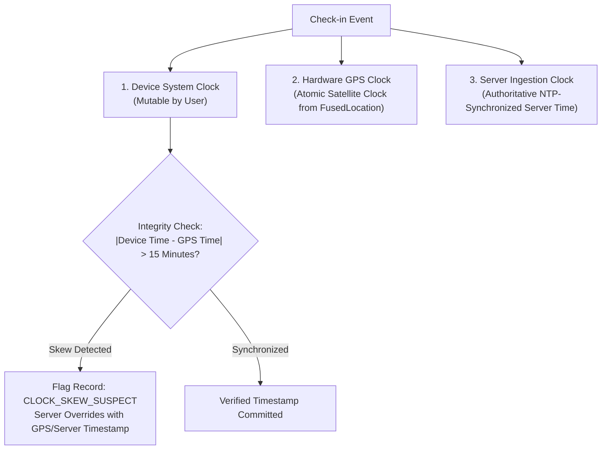

# ZENTRA — Database Implementation Blueprint
## Hi-Tech Lab Field Service Management Platform

---

## 1. Purpose & Implementation Scope

This document specifies the exact database implementation blueprint for **PostgreSQL 16+**, bridging the Phase 1 conceptual data model into an execution-ready engineering standard.

In strict adherence to Phase 2 restrictions:
> [!CAUTION]
> **NO MIGRATIONS OR DATABASE TABLES ARE CREATED IN THIS PHASE.**
> This document defines the tooling, migration lifecycle, indexing standards, ID policies, time strategies, and Row-Level Security (RLS) deployment patterns for implementation in Phase 4.

---

## 2. Migration Tooling & Schema Versioning Strategy

### 2.1 Tooling Recommendation: Kysely Native Migration Runner
- **Recommended Tool**: **Kysely Migration Runner (`kysely-migration-cli` / `Migrator`)**.
- **Evaluation vs Alternatives**:
  - *Kysely Migrations*: Full TypeScript compile-time type safety; explicit raw DDL execution; zero hidden magical abstractions; seamless integration with the Kysely query builder.
  - *Prisma Migrate*: Heavy shadow database requirements; inflexible with complex PostgreSQL Row-Level Security (RLS) policies and custom GIN/GiST index definitions.
  - *TypeORM / Sequelize Migrations*: Known schema drift bugs, fragile rollback tracking, and unnecessary object-relational mapping overhead.
- **Migration Ownership**: Owned strictly by the central backend workspace (`apps/core/src/database/migrations/`).
- **File Naming & Sequencing**: Strict monotonic timestamp naming:
  `YYYYMMDDHHMMSS_description.ts` (e.g., `20261005000001_create_territory_and_schools.ts`).
- **Two-Way Contract**: Every migration file must export both `up(db: Kysely<any>): Promise<void>` and `down(db: Kysely<any>): Promise<void>` functions. Rollbacks must be tested in CI.

---

## 3. Authoritative Identity & ID Strategy

### 3.1 Evaluation of ID Formats

| ID Candidate | Generation Location | Indexing Performance in B-Tree | Collision Probability | Time-Orderable | Evaluation Verdict |
|---|---|---|---|---|---|
| **UUIDv4** | Client / Server | **POOR**: Random bytes cause massive B-Tree index fragmentation and cache misses. | Extremely low | No | **REJECTED AS PRIMARY** |
| **UUIDv7** | Client / Server | **EXCELLENT**: First 48 bits represent Unix epoch timestamp. Naturally sequential in B-Tree indexes. | Cryptographically negligible | **YES (Millisecond precision)** | **RECOMMENDED PRIMARY** |
| **ULID** | Client / Server | Good, but requires custom 26-char string representations in Postgres instead of native 16-byte `UUID` type. | Negligible | Yes | **REJECTED** |
| **BIGSERIAL / Auto-Increment** | Server Only | Excellent, but completely impossible to generate offline on mobile clients. | None | Yes | **REJECTED FOR OFFLINE ENTITIES** |

### 3.2 System-Wide Entity ID Allocation Matrix

All internal database entities standardize on **native 16-byte `UUID` fields populated with `UUIDv7`**:

| Entity Name | Primary Key Type | Generation Origin | Format & Example |
|---|---|---|---|
| `users` | UUIDv7 | Server | `01925b42-8e10-7341-b2c9-9430c49a1020` |
| `schools` | UUIDv7 | Server | `01925b42-8e11-7a22-81fa-e9b21f31a100` (UDISE code preserved as unique natural key) |
| `hi_tech_labs` | UUIDv7 | Server | `01925b42-8e12-7b33-90dd-f8a10b42b200` (`lab_code` e.g., `_HL01` as composite key) |
| `lab_equipment` | UUIDv7 | Server | `01925b42-8e13-7c44-b1ee-123456789abc` (Serial number as unique asset key) |
| `source_complaints` | UUIDv7 | Server / Import | `01925b42-8e14-7d55-83aa-987654321fed` |
| `service_cases` | UUIDv7 | Server | `01925b42-8e15-7e66-94bb-abcdef123456` |
| `field_visits` | UUIDv7 | **Mobile Client (Offline)** | `01925b42-8e16-7f77-85cc-fedcba654321` (Generated offline on device) |
| `evidence_files` | UUIDv7 | **Mobile Client (Offline)** | `01925b42-8e17-7088-96dd-112233445566` (Generated offline on device) |
| `spares_consumption`| UUIDv7 | **Mobile Client (Offline)** | `01925b42-8e18-7199-87ee-665544332211` |
| `conveyance_claims` | UUIDv7 | **Mobile Client (Offline)** | `01925b42-8e19-72aa-98ff-778899aabbcc` |
| `import_jobs` | UUIDv7 | Server | `01925b42-8e1a-73bb-8900-ddeeff001122` |
| `audit_events` | UUIDv7 | Server | `01925b42-8e1b-74cc-9011-334455667788` |
| `tombstones` | UUIDv7 | Server | `01925b42-8e1c-75dd-a122-8899aabbccdd` |
| `sync_mutations` | UUIDv7 | **Mobile Client (Offline)** | Monotonic `client_operation_id` |

### 3.3 Human-Readable Business Identifiers
Because internal UUIDs are unwieldy for phone calls and paper reports, human-readable business codes are generated by the server upon commit:
- **Service Cases**: `ZNT-[YYYY]-[DISTRICT_CODE]-[6_DIGIT_SEQUENCE]`
  - Example: `ZNT-2026-NGP-000481` (ZENTRA, Year 2026, Nagapattinam District, Sequence #481).
- **Import Jobs**: `IMP-[YYYYMMDD]-[4_DIGIT_SEQUENCE]`
  - Example: `IMP-20261005-0012`.
- **Conveyance Claims**: `EXP-[YYYYMM]-[ENGINEER_ID_SUFFIX]-[4_DIGIT_SEQUENCE]`
  - Example: `EXP-202610-569-0014`.

---

## 4. Single Time & Date Strategy

Hi-Tech Lab maintenance contracts enforce strict hourly SLA penalties and travel conveyance audits across Tamil Nadu. Clock discrepancies must be addressed systematically:

### 4.1 System Timezone Standards
1. **Database Kernel**: Configured to UTC (`SET timezone = 'UTC'`). All temporal columns use `TIMESTAMP WITH TIME ZONE` (`TIMESTAMPTZ`).
2. **Backend Application**: Node.js runtime environment set to `TZ=UTC`.
3. **API Wire Serialization**: Timestamps transmitted exclusively in **ISO 8601 UTC format**:
   `YYYY-MM-DDTHH:mm:ss.sssZ` (e.g., `2026-10-05T08:30:00.000Z`).
4. **Presentation & Display Layer**: Formatted into **Indian Standard Time (IST, UTC+05:30)** on the client UI (both mobile and web).
5. **SLA Calculation Timezone**: SLA target deadlines and breach tickers are calculated strictly against UTC timestamps, normalized to official state working hours (09:00 to 17:30 IST) where contractual rules dictate.

### 4.2 Protection Against Mobile Clock Manipulation & Skew
In rural field operations, engineers might intentionally alter their phone clock to falsify arrival times or avoid SLA penalties.

ZENTRA enforces a **Three-Clock Verification Triangle**:



- When capturing photos and GPS check-ins, the mobile client records both the device local time and the **hardware GPS satellite timestamp**.
- If the difference between the device clock and GPS satellite clock exceeds 15 minutes, the record is flagged in `audit_events` as `CLOCK_MANIPULATION_SUSPECTED`, and the satellite timestamp is taken as authoritative.

---

## 5. Storage Engines, JSONB & Indexing Strategy

### 5.1 JSONB Indexing Standards
Dynamic equipment attributes and external intake payloads are stored in PostgreSQL `JSONB` columns:
- `lab_equipment.custom_attributes`: Dynamic hardware attributes matching `equipment_attribute_definitions`.
- `source_complaints.raw_payload`: Complete original external intake record.
- **Indexing Rules**:
  - GIN Index on `custom_attributes` using `jsonb_path_ops` for fast attribute searches (e.g., searching for all UPS units with `battery_bank_voltage = 48V`).
  - Expression indexes for frequently queried JSONB fields:
    ```sql
    CREATE INDEX idx_equipment_custom_voltage 
    ON lab_equipment (((custom_attributes->>'battery_bank_voltage')::numeric));
    ```

### 5.2 Relational B-Tree & Composite Indexing
- Foreign keys must be indexed unconditionally to prevent full-table sequential scans during joins:
  - `service_cases (school_id, operational_status)`
  - `service_cases (assigned_primary_engineer_id, operational_status)`
  - `field_visits (service_case_id, visit_sequence_number)`
  - `evidence_files (visit_id, evidence_slot)`
  - `tombstones (sync_sequence_number)`

---

## 6. Soft Delete & Tombstone Synchronization Implementation

To prevent the historical vulnerability where deleted records resurrected during mobile synchronization:

```sql
-- Conceptual Schema for Soft Deletes and Tombstones
ALTER TABLE service_cases ADD COLUMN is_deleted BOOLEAN NOT NULL DEFAULT FALSE;
ALTER TABLE service_cases ADD COLUMN deleted_at TIMESTAMP WITH TIME ZONE;
ALTER TABLE service_cases ADD COLUMN deleted_by_user_id UUID;

CREATE TABLE tombstones (
    tombstone_id UUID PRIMARY KEY,
    entity_type VARCHAR(64) NOT NULL, -- e.g., 'service_cases', 'evidence_files'
    entity_id UUID NOT NULL,
    sync_sequence_number BIGSERIAL NOT NULL, -- Monotonically increasing sync cursor
    deleted_at TIMESTAMP WITH TIME ZONE NOT NULL DEFAULT CURRENT_TIMESTAMP,
    deleted_by_user_id UUID REFERENCES users(user_id),
    reason TEXT
);

CREATE INDEX idx_tombstones_sync_cursor ON tombstones(sync_sequence_number);
```

### Deletion Rules
1. Hard `DELETE` operations on core operational tables (`service_cases`, `field_visits`, `evidence_files`) are **strictly prohibited** in application code.
2. An administrative deletion triggers an atomic transaction:
   - Sets `is_deleted = TRUE`, `deleted_at = NOW()`, `deleted_by_user_id = :userId`.
   - Appends an entry into `tombstones` with an auto-incrementing `sync_sequence_number`.
   - Emits an immutable `audit_events` record.
3. When an offline mobile client calls `/api/v1/sync/pull?since_seq=X`, the server delivers all tombstones where `sync_sequence_number > X`, instructing the client to delete the local records.

---

## 7. Row-Level Security (RLS) Deployment & Testing Strategy

PostgreSQL Row-Level Security (RLS) is deployed as the foundational defense against cross-district data leakage:

### Deployment Pattern
1. Every migration creating a territory-sensitive table (`service_cases`, `schools`, `field_visits`) must execute:
   `ALTER TABLE <table_name> ENABLE ROW LEVEL SECURITY;`
   `ALTER TABLE <table_name> FORCE ROW LEVEL SECURITY;`
2. Application database connection pools connect using a standard application user (`zentra_app`).
3. For every incoming HTTP request, the backend transaction sets session variables inside a local transaction:
   ```sql
   SET LOCAL jwt.claims.user_id = '01925b42-8e10-7341-b2c9-9430c49a1020';
   SET LOCAL jwt.claims.role = 'DISTRICT_COORDINATOR';
   ```
4. PostgreSQL kernel automatically evaluates RLS policies against these session settings.
5. In CI testing, automated test suites attempt cross-district SQL queries; the tests assert that cross-district queries return 0 rows even when executed by valid database connections.

---

## 8. Database Seed Strategy (Zero Production Contamination)

In strict adherence to Phase 2 safety directives:
> [!IMPORTANT]
> **NO REAL SCHOOL PII OR PRODUCTION DATA IN TEST FIXTURES.**
> Seed files must be 100% synthetic and deterministic.

### Three Isolated Seed Profiles
1. **`seed:dev`**:
   - Provisions 2 synthetic test districts (`Dev District Alpha`, `Dev District Beta`).
   - Provisions 10 synthetic schools with mock UDISE codes (`33990000001` to `33990000010`).
   - Provisions 4 demo users: `admin@dev.zentra.local`, `coord.alpha@dev.zentra.local`, `engineer.shameer@dev.zentra.local`, `engineer.priya@dev.zentra.local`.
   - Seeds baseline equipment types (12 classes) and standard SLA policies.
2. **`seed:test`**:
   - Minimal hermetic fixture set for CI unit/integration suites; resets before each test run.
3. **`seed:prod`**:
   - **Zero mock users or test schools**.
   - Seeds only static enum catalogs: `districts`, `equipment_types`, `equipment_attribute_definitions`, and system roles/permissions.

---

## 9. Summary of Database Blueprint Design Specifications

1. **Deterministic Indexing**: UUIDv7 is designed for sequential B-Tree index insertions without index fragmentation.
2. **Clock Manipulation Immunity**: Three-clock triangulation is designed to prevent mobile timestamp falsification.
3. **Zero Deletion Resurrection**: Monotonic tombstone sequence counters are designed to enforce local cache purge.
4. **Kernel-Level Territory Defense**: PostgreSQL RLS policies enforce multi-district data isolation.
