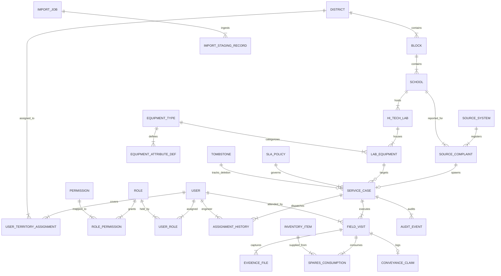

# ZENTRA — Conceptual & Logical Data Model Specification
## Hi-Tech Lab Field Service Management Platform

---

## 1. Data Model Principles & Architectural Boundaries

The ZENTRA data model is designed around strict relational integrity, domain-driven ownership, and field durability. It eliminates past failure modes identified during Phase 0 discovery:
- **No Monolithic Tables**: Equipment-specific attributes are decoupled from core asset tables using schema-driven attribute definitions.
- **Source vs. Service Isolation**: Intake complaint metadata is preserved immutably in `source_complaints`, while field engineering lifecycle operations reside in `service_cases`.
- **Status Domain Segregation**: Multiple distinct status domains are maintained simultaneously (`source_status`, `service_status`, `visit_outcome`, `verification_status`, `closure_status`).
- **Multi-Visit First-Class Entity**: A service case links to one or more independent `field_visits`.
- **Evidence Slot Isolation**: Proof artifacts (`Slot 1: HM Signed Report` and `Slot 2: Equipment Working Photo`) are stored as distinct entities with independent lifecycles.
- **Tombstone Synchronization**: Deletions generate immutable tombstone records to guarantee that offline mobile nodes do not resurrect purged entities.

---

## 2. Entity-Relationship Diagram (Global Domain Model)

---

## 3. Core Entity Catalog

For every entity in the ZENTRA domain model, the following architectural attributes are strictly defined:
- **Purpose**: Why the entity exists.
- **Important Fields**: Structural attributes and data types.
- **Ownership Domain**: Subsystem or actor possessing authoritative write rights.
- **Lifecycle**: Creation, mutation, and termination rules.
- **Relationships**: Cardinality and foreign key relationships.
- **Authorization Boundary**: Access control and tenant scoping rules.

---

### 3.1 Identity & Access Control Domain

#### 3.1.1 `users`
- **Purpose**: Represents authenticated personnel across all operational tiers (Field Engineers, District Coordinators, Reporting Heads, Master Admins).
- **Important Fields**:
  - `user_id` (UUID, Primary Key)
  - `username` / `email` (String, Unique)
  - `password_hash` (String, Scrypt / Argon2id)
  - `full_name` (String)
  - `phone_number` (String, 10-digit normalized)
  - `is_active` (Boolean, Default True)
  - `account_status` (Enum: `ACTIVE`, `SUSPENDED`, `ON_LEAVE`, `TERMINATED`)
  - `current_device_id` (String, Optional, for mobile pinning)
  - `created_at`, `updated_at` (Timestamps)
- **Ownership**: Central Administration (ADMIN OWNED).
- **Lifecycle**: Provisioned by Master Admin; updated upon territory reallocation; deactivated upon departure.
- **Relationships**:
  - `1:N` with `user_roles`
  - `1:N` with `user_territory_assignments`
  - `1:N` with `service_cases` (as assigned engineer)
  - `1:N` with `field_visits` (as visiting technician)
- **Authorization Boundary**: Global system identity; subject to server-enforced RBAC.

#### 3.1.2 `roles` & `permissions`
- **Purpose**: Decouples fine-grained capabilities from organizational titles.
- **Important Fields**:
  - `role_id` (UUID, PK) / `role_code` (Enum: `MASTER_ADMIN`, `REPORTING_HEAD`, `DISTRICT_COORDINATOR`, `FIELD_ENGINEER`)
  - `permission_id` (UUID, PK) / `permission_code` (String, e.g., `ticket:dispatch`, `evidence:verify`, `import:approve`)
- **Ownership**: System Infrastructure (ADMIN OWNED).
- **Lifecycle**: Static baseline initialized at deployment; dynamic permission mappings.
- **Relationships**: Many-to-Many via `role_permissions` join table.
- **Authorization Boundary**: Server-evaluated on every API request.

#### 3.1.3 `user_territory_assignments`
- **Purpose**: Represents multi-district and multi-block operational allocations for Field Engineers.
- **Important Fields**:
  - `assignment_id` (UUID, PK)
  - `user_id` (UUID, FK -> `users.user_id`)
  - `district_id` (UUID, FK -> `districts.district_id`)
  - `block_id` (UUID, Nullable FK -> `blocks.block_id`)
  - `is_primary_territory` (Boolean)
  - `valid_from`, `valid_to` (Timestamps)
- **Ownership**: District Coordinators & Operations Heads.
- **Lifecycle**: Created when an engineer is allocated to an area; supports temporary emergency deployments to adjacent districts.
- **Relationships**: Bridges `users` to `districts` and `blocks`.
- **Authorization Boundary**: Enforces Row-Level Security (RLS) filters for mobile synchronization.

---

### 3.2 Geographical & Institutional Master Data

#### 3.2.1 `districts` & `blocks`
- **Purpose**: Defines administrative boundaries for school education governance across Tamil Nadu.
- **Important Fields**:
  - `district_id` (UUID, PK)
  - `district_name` (String, e.g., `Nagapattinam`, `Thiruvarur`, `Ariyallur`)
  - `district_code` (String, e.g., `NGP`, `TVR`, `ARI`)
  - `block_id` (UUID, PK) / `block_name` (String, e.g., `Keezhaiyur`, `Koradachery`)
- **Ownership**: Central Administration (ADMIN OWNED).
- **Lifecycle**: Reference data; dynamic database insertion; zero code hard-coding.
- **Relationships**: `District 1:N Block 1:N School`.
- **Authorization Boundary**: Scopes user permissions and reporting filters.

#### 3.2.2 `schools`
- **Purpose**: Represents the primary educational institution hosting one or more Hi-Tech Labs.
- **Important Fields**:
  - `school_id` (UUID, PK)
  - `udise_code` (String(11), Unique Natural Key, e.g., `33190400501`)
  - `school_name` (String, e.g., `PUMS VILUNTHAMAVADI WEST`)
  - `district_id` (UUID, FK)
  - `block_id` (UUID, FK)
  - `school_category` (Enum: `PUMS`, `GHS`, `GHSS`, `GGHSS`)
  - `base_pincode` (String(6), e.g., `609703`)
  - `is_special_zone` (Boolean, e.g., `611001 Zone`)
  - `latitude`, `longitude` (Decimals, Geo-coordinates of school gate)
  - `hm_name`, `hm_phone` (Strings, Headmaster contact)
  - `ai_name`, `ai_phone`, `ai_emp_id` (Strings, Lab Instructor contact)
- **Ownership**: Operations Head & Master Admin.
- **Lifecycle**: Ingested via Education Department master lists; updated upon staff transfers.
- **Relationships**: Parent entity to `hi_tech_labs` and `source_complaints`.
- **Authorization Boundary**: Accessible to any engineer assigned to the school's district/block.

#### 3.2.3 `hi_tech_labs`
- **Purpose**: Represents the physical laboratory installation within a school.
- **Important Fields**:
  - `lab_id` (UUID, PK)
  - `school_id` (UUID, FK -> `schools.school_id`)
  - `lab_code` (String, e.g., `33190400501_HL01`, composite natural key)
  - `lab_type` (Enum: `PRIMARY`, `UPPER_PRIMARY`, `HIGH_SCHOOL`, `HIGHER_SECONDARY`)
  - `room_location` (String, e.g., `First Floor, Room 14`)
  - `active_computers_count` (Integer, Baseline count e.g., 10 or 20)
  - `commissioning_date` (Date)
- **Ownership**: Central Administration.
- **Lifecycle**: Created when a lab is provisioned; decommissioned if lab relocated.
- **Relationships**: Child of `schools`; parent to `lab_equipment`.
- **Authorization Boundary**: Inherited from `schools`.

---

### 3.3 Dynamic Equipment & Asset Catalog

#### 3.3.1 `equipment_types`
- **Purpose**: Configurable catalog of supported ICT equipment classes.
- **Important Fields**:
  - `equipment_type_id` (UUID, PK)
  - `type_code` (String, Unique, e.g., `UPS`, `DESKTOP_PC`, `ROUTER`, `SWITCH`, `IP_CAMERA`, `PROJECTOR`, `SMARTBOARD`, `IO_CABLING`)
  - `type_name` (String, Human-readable name)
  - `description` (String)
  - `is_active` (Boolean)
- **Ownership**: Central Administration (ADMIN OWNED).
- **Lifecycle**: Added as new hardware classes are introduced to labs.
- **Relationships**: Parent to `lab_equipment` and `equipment_attribute_definitions`.
- **Authorization Boundary**: System-wide configuration.

#### 3.3.2 `equipment_attribute_definitions`
- **Purpose**: Defines dynamic, equipment-specific technical attributes and diagnostic fields.
- **Important Fields**:
  - `attribute_def_id` (UUID, PK)
  - `equipment_type_id` (UUID, FK)
  - `attribute_key` (String, e.g., `battery_bank_voltage`, `port_count`, `lamp_hours`, `rtsp_stream_url`)
  - `attribute_label` (String)
  - `data_type` (Enum: `STRING`, `NUMBER`, `BOOLEAN`, `DROPDOWN`, `VOLTAGE_READING`)
  - `dropdown_options` (JSONB, Optional array of allowed values)
  - `is_diagnostic_field` (Boolean, Indicates if entered by engineer during visit)
  - `is_required` (Boolean)
- **Ownership**: Central Administration.
- **Lifecycle**: Configured dynamically; allows ZENTRA Field to render dynamic forms.
- **Relationships**: Child of `equipment_types`.
- **Authorization Boundary**: System-wide configuration.

#### 3.3.3 `lab_equipment`
- **Purpose**: Authoritative physical asset ledger for individual hardware units installed in a lab.
- **Important Fields**:
  - `lab_equipment_id` (UUID, PK)
  - `lab_id` (UUID, FK -> `hi_tech_labs.lab_id`)
  - `equipment_type_id` (UUID, FK -> `equipment_types.equipment_type_id`)
  - `oem_name` (String, e.g., `APC`, `Emerson`, `D-Link`, `Cisco Meraki`, `Acer`)
  - `model_number` (String)
  - `serial_number` (String, Unique asset identifier)
  - `asset_barcode` (String, Optional scanned tag)
  - `installation_date` (Date)
  - `warranty_end_date` (Date)
  - `operational_condition` (Enum: `OPERATIONAL`, `DEGRADED`, `CRITICAL_FAULT`, `REPLACED`, `DECOMMISSIONED`)
  - `custom_attributes` (JSONB, Structured dynamic values matching `equipment_attribute_definitions`)
- **Ownership**: Maintained by Field Engineers (during visits) and Central Admins.
- **Lifecycle**: Provisioned at lab setup; modified when hardware replaced.
- **Relationships**: Child of `hi_tech_labs`; linked target of `service_cases`.
- **Authorization Boundary**: Scoped by School / Lab territory.

---

### 3.4 Complaint Ingestion & Service Case Domain

#### 3.4.1 `source_systems`
- **Purpose**: Registry of external complaint channels.
- **Important Fields**:
  - `source_system_id` (UUID, PK)
  - `system_code` (Enum / String: `HELPLINE_PORTAL`, `STATE_ITSM_TOOL`, `AI_GOOGLE_FORM`, `VENDOR_DRIVE`)
  - `system_name` (String)
  - `default_sla_priority` (Enum)
- **Ownership**: Central Administration.
- **Lifecycle**: Configured per departmental contract.
- **Relationships**: Parent to `source_complaints`.
- **Authorization Boundary**: Global configuration.

#### 3.4.2 `source_complaints` (SOURCE OWNED — IMMUTABLE)
- **Purpose**: Preserves the immutable, authoritative intake record as received from external channels.
- **Important Fields**:
  - `source_complaint_id` (UUID, PK)
  - `source_system_id` (UUID, FK)
  - `external_ticket_id` (String, e.g., `12511`, `HTL-NGP-01004-2`)
  - `school_id` (UUID, FK -> `schools.school_id`)
  - `lab_id` (UUID, Nullable FK -> `hi_tech_labs.lab_id`)
  - `original_title` (String)
  - `original_description` (Text, Raw reported problem)
  - `registered_at` (Timestamp, External creation time)
  - `source_status` (String, e.g., `Open`, `New / Under Review`, `Pending Verification`)
  - `source_priority` (Enum: `CRITICAL`, `HIGH`, `MEDIUM`, `LOW`)
  - `reported_equipment_text` (String, e.g., `UPS`, `LAN Port 6`)
  - `reported_serial_number` (String)
  - `reporter_name` (String)
  - `reporter_phone` (String)
  - `original_remarks` (Text)
  - `raw_payload` (JSONB, Complete original intake payload)
  - `created_at` (Timestamp, ZENTRA ingest time)
- **Ownership**: SOURCE OWNED (Strictly Immutable; Field Engineers cannot edit).
- **Lifecycle**: Ingested via Excel/CSV imports or webhook; never deleted except via explicit admin purge.
- **Relationships**: 1:0..1 with `service_cases`.
- **Authorization Boundary**: Read-only for Field Engineers; writable only by Staged Ingestion Engine.

#### 3.4.3 `service_cases` (SERVER OPERATIONAL OWNED)
- **Purpose**: The core operational service ticket governing field investigation, dispatch, and physical resolution.
- **Important Fields**:
  - `service_case_id` (UUID, PK)
  - `source_complaint_id` (UUID, FK -> `source_complaints.source_complaint_id`)
  - `zentra_case_code` (String, Unique canonical identifier, e.g., `ZTR-2026-004812`)
  - `school_id` (UUID, FK -> `schools.school_id`)
  - `lab_id` (UUID, FK -> `hi_tech_labs.lab_id`)
  - `lab_equipment_id` (UUID, Nullable FK -> `lab_equipment.lab_equipment_id`)
  - `operational_status` (Enum: `UNASSIGNED`, `ASSIGNED`, `IN_TRANSIT`, `VISIT_IN_PROGRESS`, `PENDING_SPARES`, `ESCALATED_OEM`, `RESOLVED`, `CLOSED`)
  - `internal_priority` (Enum: `CRITICAL`, `HIGH`, `MEDIUM`, `LOW`)
  - `assigned_primary_engineer_id` (UUID, Nullable FK -> `users.user_id`)
  - `assigned_secondary_engineer_id` (UUID, Nullable FK -> `users.user_id`)
  - `assigned_at` (Timestamp)
  - `sla_policy_id` (UUID, FK -> `sla_policies.sla_policy_id`)
  - `sla_target_at` (Timestamp)
  - `sla_breach_status` (Enum: `WITHIN_SLA`, `WARNING_75`, `BREACHED`)
  - `actual_diagnosis_summary` (Text)
  - `actual_action_taken_summary` (Text)
  - `verification_status` (Enum: `PENDING_REVIEW`, `VERIFIED_BY_COORDINATOR`, `REJECTED_NEEDS_REVISIT`)
  - `verified_by_user_id` (UUID, Nullable FK)
  - `resolved_at` (Timestamp, Set upon valid evidence submission)
  - `closed_at` (Timestamp, Final admin reconciliation)
  - `created_at`, `updated_at` (Timestamps)
- **Ownership**: SERVER OPERATIONAL (State transitions enforced by backend state machine).
- **Lifecycle**: Spawns when a source complaint is accepted; progresses through assignments and visits to `RESOLVED` and `CLOSED`.
- **Relationships**:
  - Parent to `field_visits` (1:N)
  - Parent to `assignment_history` (1:N)
- **Authorization Boundary**: District-scoped for Coordinators; assigned-only for Field Engineers.

#### 3.4.4 `assignment_history`
- **Purpose**: Append-only ledger of engineer dispatches and reassignments.
- **Important Fields**:
  - `assignment_history_id` (UUID, PK)
  - `service_case_id` (UUID, FK)
  - `assigned_by_user_id` (UUID, FK)
  - `engineer_id` (UUID, FK)
  - `assignment_role` (Enum: `PRIMARY`, `SECONDARY`)
  - `assigned_at` (Timestamp)
  - `reassignment_reason` (Text, Optional)
- **Ownership**: Central Administration / District Coordinator.
- **Lifecycle**: Append-only log.
- **Relationships**: Child of `service_cases`.
- **Authorization Boundary**: Accessible to management.

---

### 3.5 Field Execution & Evidence Domain

#### 3.5.1 `field_visits` (FIELD VISIT OWNED)
- **Purpose**: Represents an independent physical on-site service attendance by a Field Engineer.
- **Important Fields**:
  - `visit_id` (UUID, PK)
  - `service_case_id` (UUID, FK -> `service_cases.service_case_id`)
  - `engineer_id` (UUID, FK -> `users.user_id`)
  - `visit_sequence_number` (Integer, 1 for initial visit, 2 for follow-up, etc.)
  - `visit_date` (Date)
  - `check_in_timestamp` (Timestamp, UTC)
  - `check_in_latitude` (Decimal(10,8))
  - `check_in_longitude` (Decimal(11,8))
  - `check_in_accuracy_meters` (Decimal(6,2), Verified <= 50m)
  - `check_in_within_geofence` (Boolean)
  - `equipment_condition_observed` (String)
  - `on_site_diagnosis` (Text)
  - `work_performed` (Text)
  - `visit_outcome` (Enum: `RESOLVED_ON_SITE`, `PENDING_PARTS`, `PENDING_OEM_ESCALATION`, `ABORTED_SCHOOL_CLOSED`, `UNABLE_TO_REPRODUCE`)
  - `pending_reason_text` (Text, Required if outcome is PENDING)
  - `target_next_visit_date` (Date, Optional follow-up target)
  - `check_out_timestamp` (Timestamp, UTC)
  - `check_out_latitude`, `check_out_longitude` (Decimals)
  - `check_out_accuracy_meters` (Decimal(6,2))
  - `conveyance_km` (Decimal(6,2))
  - `client_operation_id` (UUID, Idempotency token generated by mobile client)
  - `created_at`, `updated_at` (Timestamps)
- **Ownership**: FIELD VISIT OWNED (Created by visiting Field Engineer on mobile).
- **Lifecycle**: Created at check-in on mobile; updated on check-out; immutable once synced and approved.
- **Relationships**:
  - Child of `service_cases`
  - Parent to `evidence_files` (1:N)
  - Parent to `spares_consumption` (1:N)
  - 1:1 with `conveyance_claims`
- **Authorization Boundary**: Editable only by the visiting engineer prior to final sync; read-only thereafter.

#### 3.5.2 `evidence_files` (SLOT ISOLATED)
- **Purpose**: Authoritative photographic and document evidence proving physical attendance and repair completion.
- **Important Fields**:
  - `evidence_file_id` (UUID, PK)
  - `visit_id` (UUID, FK -> `field_visits.visit_id`)
  - `service_case_id` (UUID, FK -> `service_cases.service_case_id`)
  - `evidence_slot` (Enum: `SLOT_1_HM_SIGNED_REPORT`, `SLOT_2_EQUIPMENT_WORKING_PHOTO`, `SLOT_AUX_FAULT_PRE_SERVICE`, `SLOT_AUX_SERIAL_PLATE`, `SLOT_AUX_REPLACED_PARTS`)
  - `storage_path` (String, Object storage S3 key)
  - `file_checksum_sha256` (String(64), Cryptographic integrity hash)
  - `file_size_bytes` (Integer)
  - `mime_type` (String, e.g., `image/jpeg`)
  - `captured_at` (Timestamp, Device hardware capture time)
  - `gps_latitude`, `gps_longitude` (Decimals, Watermarked coordinates)
  - `gps_accuracy_meters` (Decimal(6,2))
  - `uploaded_at` (Timestamp, S3 commit time)
  - `is_verified` (Boolean, Coordinator sign-off)
  - `verification_notes` (Text)
  - `is_tombstoned` (Boolean, Default False)
- **Ownership**: Field Engineer creates; Object Storage hosts; Coordinator verifies.
- **Lifecycle**: Pre-signed upload requested by mobile; committed to DB upon S3 verification; soft-deleted with tombstone if rejected.
- **Relationships**: Child of `field_visits`.
- **Authorization Boundary**: Slot 1 and Slot 2 have independent life cycles; modifying Slot 2 cannot delete Slot 1.

#### 3.5.3 `inventory_items` & `spares_consumption`
- **Purpose**: Tracks spare parts consumed during field servicing (e.g., RJ45 connectors, Cat6 patch cables, UPS battery links, HDMI cables).
- **Important Fields**:
  - `inventory_item_id` (UUID, PK) / `part_number` / `item_name` / `unit_of_measure`
  - `consumption_id` (UUID, PK) / `visit_id` (UUID, FK) / `quantity_used` (Decimal) / `serial_numbers_installed` (String)
- **Ownership**: Warehouse / Operations Head tracks stock; Engineer records consumption.
- **Lifecycle**: Decremented upon visit completion.
- **Relationships**: Child of `field_visits`.
- **Authorization Boundary**: District-scoped inventory.

#### 3.5.4 `conveyance_claims`
- **Purpose**: Authoritative record of engineer travel claims per field visit.
- **Important Fields**:
  - `conveyance_claim_id` (UUID, PK)
  - `visit_id` (UUID, FK -> `field_visits.visit_id`)
  - `engineer_id` (UUID, FK -> `users.user_id`)
  - `travel_date` (Date)
  - `from_location` (String, Starting pincode / school / residence)
  - `to_location` (String, School destination)
  - `mode_of_transport` (Enum: `BIKE`, `BUS`, `TRAIN`, `AUTO`, `OTHER`)
  - `starting_odometer_km` (Decimal, Optional for bike)
  - `ending_odometer_km` (Decimal, Optional for bike)
  - `total_distance_km` (Decimal(6,2))
  - `rate_per_km` (Decimal(5,2), Default Candidate ₹5.00/km)
  - `claim_amount` (Decimal(8,2), Calculated `distance * rate` or ticket fare)
  - `ticket_receipt_file_id` (UUID, Optional FK -> `evidence_files`)
  - `approval_status` (Enum: `SUBMITTED`, `VERIFIED_COORDINATOR`, `APPROVED_FINANCE`, `REJECTED`)
  - `approved_by_user_id` (UUID, Nullable FK)
  - `remarks` (Text)
- **Ownership**: FIELD VISIT OWNED (Generated automatically or confirmed by Engineer).
- **Lifecycle**: Submitted on visit sync; approved by Coordinator during bi-weekly finance runs.
- **Relationships**: 1:1 with `field_visits`.
- **Authorization Boundary**: Personal claim visible only to engineer and approving leads.

---

### 3.6 Ingestion, Staging & Governance Domain

#### 3.6.1 `import_jobs`
- **Purpose**: Tracks batch complaint spreadsheet upload sessions.
- **Important Fields**:
  - `import_job_id` (UUID, PK)
  - `uploaded_by_user_id` (UUID, FK)
  - `source_filename` (String)
  - `file_type` (Enum: `XLSX`, `XLS`, `CSV`, `PDF`, `IMAGE`)
  - `total_rows_parsed` (Integer)
  - `valid_rows_count` (Integer)
  - `duplicate_rows_count` (Integer)
  - `error_rows_count` (Integer)
  - `job_status` (Enum: `UPLOADED`, `PARSED_STAGED`, `DIFF_PREVIEWED`, `COMMITTED`, `ABORTED`)
  - `created_at`, `committed_at` (Timestamps)
- **Ownership**: Central Administration (ADMIN OWNED).
- **Lifecycle**: Created upon upload; discarded if aborted; committed upon admin approval.
- **Relationships**: Parent to `import_staging_records`.
- **Authorization Boundary**: Restricted to District Coordinators and Admins.

#### 3.6.2 `import_staging_records`
- **Purpose**: Staging table holding parsed rows before authoritative database commit.
- **Important Fields**:
  - `staging_record_id` (UUID, PK)
  - `import_job_id` (UUID, FK)
  - `raw_row_data` (JSONB, Exact original column values)
  - `mapped_udise_code` (String(11))
  - `resolved_school_id` (UUID, Nullable FK -> `schools.school_id`)
  - `mapped_external_ticket_id` (String)
  - `mapped_issue_text` (Text)
  - `mapped_priority` (String)
  - `duplicate_classification` (Enum: `NEW_UNIQUE`, `EXACT_SOURCE_DUPLICATE`, `ACTIVE_ISSUE_EXISTS_SAME_EQUIPMENT`, `NEW_ISSUE_DIFFERENT_EQUIPMENT`, `SUPPLEMENTARY_INFO`)
  - `validation_error_message` (Text, Nullable)
  - `is_approved_for_commit` (Boolean, Default True if valid)
  - `created_at` (Timestamp)
- **Ownership**: Staging Ingestion Engine.
- **Lifecycle**: Transient staging data; committed rows promoted to `source_complaints` and `service_cases`.
- **Relationships**: Child of `import_jobs`.
- **Authorization Boundary**: Restricted to Admins.

---

### 3.7 Governance, Audit & Deletion Domain

#### 3.7.1 `sla_policies`
- **Purpose**: Configurable SLA turnaround targets.
- **Important Fields**:
  - `sla_policy_id` (UUID, PK)
  - `policy_name` (String, e.g., `Standard Government Contract SLA 2026`)
  - `priority_level` (Enum: `CRITICAL`, `HIGH`, `MEDIUM`, `LOW`)
  - `target_resolution_hours` (Integer, Candidate values: 24, 48, 72, 168)
  - `warning_threshold_percentage` (Integer, Default 75%)
  - `is_active` (Boolean)
- **Ownership**: Central Administration.
- **Lifecycle**: Configurable master record.
- **Relationships**: Governs `service_cases`.
- **Authorization Boundary**: System-wide configuration.

#### 3.7.2 `audit_events` (IMMUTABLE LOG)
- **Purpose**: Tamper-proof, append-only record of all critical system mutations.
- **Important Fields**:
  - `audit_event_id` (UUID, PK)
  - `event_timestamp` (Timestamp, UTC)
  - `actor_user_id` (UUID, Nullable FK -> `users.user_id`, Null for system jobs)
  - `actor_ip_address` (String)
  - `actor_device_id` (String)
  - `event_category` (Enum: `AUTH`, `DISPATCH`, `VISIT_LOG`, `EVIDENCE_MUTATION`, `IMPORT_COMMIT`, `SECURITY_ALERT`)
  - `target_entity_type` (String, e.g., `service_cases`, `evidence_files`)
  - `target_entity_id` (UUID)
  - `action_type` (Enum: `INSERT`, `UPDATE`, `SOFT_DELETE`, `VERIFY`, `LOGIN_FAILED`)
  - `pre_mutation_state` (JSONB, Optional before image)
  - `post_mutation_state` (JSONB, After image)
- **Ownership**: ZENTRA Core Security Subsystem.
- **Lifecycle**: Append-only; zero update or delete permissions granted to any user or admin.
- **Relationships**: Polymorphic audit trail across all entities.
- **Authorization Boundary**: Read-only for Master Admins.

#### 3.7.3 `tombstones`
- **Purpose**: Guarantees that deleted entities do not resurrect during asynchronous mobile sync.
- **Important Fields**:
  - `tombstone_id` (UUID, PK)
  - `entity_type` (String, e.g., `service_cases`, `evidence_files`)
  - `entity_id` (UUID, Identity of deleted record)
  - `deleted_at` (Timestamp, UTC)
  - `deleted_by_user_id` (UUID, FK)
  - `tombstone_reason` (String)
  - `sync_sequence_number` (BigInt, Monotonically increasing sync cursor)
- **Ownership**: ZENTRA Core Sync Engine.
- **Lifecycle**: Retained indefinitely or for configured retention period (e.g., 90 days).
- **Relationships**: Bridges server deletion events to mobile sync engine.
- **Authorization Boundary**: Scoped by entity territory.

---

## 4. Status Domain Separation Matrix

To completely prevent status collision bugs, ZENTRA enforces 5 non-overlapping status domains:

| Status Domain | Owning Entity | Permitted Values | Architectural Purpose |
|---|---|---|---|
| **1. Source Status** | `source_complaints` | `Open`, `New / Under Review`, `Pending Verification`, `External Escalation` | Mirrors external department portal status. Immutable to engineers. |
| **2. Service Status** | `service_cases` | `UNASSIGNED`, `ASSIGNED`, `IN_TRANSIT`, `VISIT_IN_PROGRESS`, `PENDING_SPARES`, `ESCALATED_OEM`, `RESOLVED`, `CLOSED` | Governs internal ZENTRA dispatch, physical progress, and resolution. |
| **3. Visit Outcome** | `field_visits` | `RESOLVED_ON_SITE`, `PENDING_PARTS`, `PENDING_OEM_ESCALATION`, `ABORTED_SCHOOL_CLOSED`, `UNABLE_TO_REPRODUCE` | Represents the specific outcome of one single on-site attendance. |
| **4. Verification Status**| `service_cases` | `PENDING_REVIEW`, `VERIFIED_BY_COORDINATOR`, `REJECTED_NEEDS_REVISIT` | Coordinator sign-off on uploaded HM report and equipment photo. |
| **5. Conveyance Status** | `conveyance_claims` | `SUBMITTED`, `VERIFIED_COORDINATOR`, `APPROVED_FINANCE`, `REJECTED` | Financial approval state of engineer travel reimbursement. |

---

## 5. Summary of Data Model Guarantees

1. **Relational Rigor**: Every record links to valid foreign keys with zero ambiguous string joins.
2. **Dynamic Extensibility**: New hardware categories and diagnostic attributes can be added via `equipment_attribute_definitions` without running database migrations.
3. **Audit Immutability**: All sensitive transitions (assignments, visits, status changes) are recorded in append-only audit tables.
4. **Offline Sync Safety**: Every mutable client entity carries a `client_operation_id` for idempotent reconciliation.
