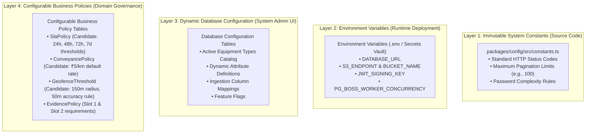
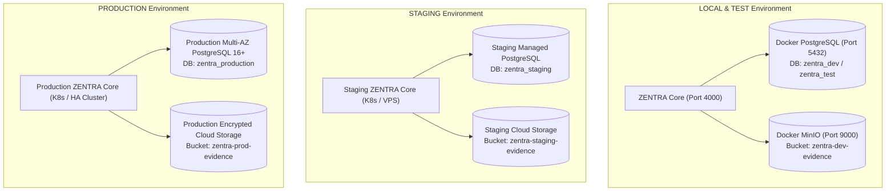

# ZENTRA — Environment & Secret Management Strategy
## Hi-Tech Lab Field Service Management Platform

---

## 1. Architectural Purpose & The Isolation Mandate

In legacy field service trackers, historical post-mortems revealed severe security breaches:
- Automated tests (`npm test`) connected to live production storage, creating synthetic folders and uploading fake test photos to genuine school directories.
- Internal authorization headers and proxy signatures were reflected publicly in debug responses (`KI-006`).
- Test scripts lacked environment verification and operated directly against live datasets.

ZENTRA enforces an **absolute physical, cryptographic, and network separation** between environments.

---

## 2. Environment Matrix & Progressive Introduction

ZENTRA defines 5 strict, isolated environments introduced across the implementation lifecycle:

| Environment | Purpose | Infrastructure Scope | Data Profile | Introduced In |
|---|---|---|---|---|
| **1. LOCAL** | Individual developer workstations | Local Docker (PostgreSQL 16, MinIO, Node.js) | Pure synthetic mock seeds (`seed:dev`) | Phase 3 |
| **2. TEST** | Automated CI/CD test runners (Unit, Integration, Security) | Ephemeral Docker containers in GitHub Actions | Hermetic, self-contained fixtures; reset per run | Phase 3 |
| **3. DEVELOPMENT** | Shared cloud sandbox for engineering feature integration | Dedicated cloud VPS / PaaS containers | Anonymized synthetic datasets | Phase 14 |
| **4. STAGING** | Pre-production acceptance testing by coordinators & leads | Mirrored production clone (isolated cloud VPC) | Masked / scrubbed historical rehearsal data | Phase 15 |
| **5. PRODUCTION** | Live statewide operational field execution | Production cloud cluster with encrypted DB & S3 | Authoritative live state data (Tamil Nadu) | Phase 16+ |

---

## 3. Four-Tier Configuration Hierarchy

To prevent business logic from being trapped in environment variables or hard-coded constants, configuration is partitioned into 4 distinct layers:



### The Rule of Separation
- **Never put business rules in `.env`**: SLA hours, conveyance rates, and equipment types belong to database policy tables so they can be modified by authorized administrators without redeploying code.
- **Never put secrets in code**: API keys, signing secrets, and database credentials belong exclusively to environment vaults.

---

## 4. Secret Management Standards

### 4.1 Secrets Catalog

| Secret Name | Purpose | Local Dev Source | Production Source |
|---|---|---|---|
| `DATABASE_URL` | PostgreSQL connection string | `.env.local` (Local Docker) | Cloud Secrets Manager (IAM Auth) |
| `JWT_ACCESS_SECRET` | Signs short-lived access tokens (HMAC-SHA256) | `.env.local` (Static dev key) | KMS / Secrets Manager (Rotated every 90 days) |
| `REFRESH_TOKEN_SECRET`| Signs long-lived refresh tokens | `.env.local` (Static dev key) | KMS / Secrets Manager (Rotated every 90 days) |
| `S3_ACCESS_KEY` & `S3_SECRET_KEY` | MinIO / S3 object storage credentials | `.env.local` (`minioadmin`) | Dedicated IAM Role (Zero hardcoded keys) |
| `OFFLINE_PERMIT_SIGNING_KEY`| Signs offline work permits for mobile | `.env.local` (Static dev key) | Asymmetric Private Key in HSM / KMS |
| `AI_OCR_API_KEY` | Optional OCR / AI extraction helper | `.env.local` (Mock mode) | Cloud Secrets Manager |

### 4.2 Strict Prohibition Directives
Under no circumstances may a secret be:
1. Committed to Git (enforced via pre-commit hooks and `git-secrets`).
2. Bundled into mobile client source code or APK builds.
3. Injected into frontend web JavaScript bundles.
4. Output in application log streams (enforced by PII/secret redaction filters).
5. Reflected in API error messages, stack traces, or debug route responses.
6. Copied into automated test fixtures.

---

## 5. Fail-Closed Test Protection Gate (`production-gate.ts`)

To architecturally ensure that automated tests (`vitest`, `jest`, `pnpm run test`) cannot accidentally touch a production database or production storage bucket, ZENTRA enforces a mandatory fail-closed pre-test verification gate:

```typescript
// packages/testing/src/production-gate.ts
export function assertTestEnvironmentIsSafe(): void {
  const nodeEnv = process.env.NODE_ENV;
  const dbUrl = process.env.DATABASE_URL || '';
  const s3Endpoint = process.env.S3_ENDPOINT || '';
  const bucket = process.env.S3_BUCKET_NAME || '';

  // 1. Assert NODE_ENV is strictly 'test'
  if (nodeEnv !== 'test') {
    console.error(`FATAL: Test suite executed with NODE_ENV='${nodeEnv}'. Expected 'test'.`);
    process.exit(1);
  }

  // 2. Reject any production database connection patterns
  const forbiddenDbMarkers = ['prod', 'production', 'aws.neon.tech', 'supabase.co', 'rds.amazonaws.com'];
  if (forbiddenDbMarkers.some(marker => dbUrl.toLowerCase().includes(marker))) {
    console.error(`FATAL: Test suite detected forbidden production database host in DATABASE_URL!`);
    console.error(`Detected connection: ${dbUrl.replace(/:[^:@]+@/, ':****@')}`);
    process.exit(1);
  }

  // 3. Reject any production S3 bucket patterns
  const forbiddenBucketMarkers = ['prod', 'production', 'zentra-live', 'zentra-evidence'];
  if (forbiddenBucketMarkers.some(marker => bucket.toLowerCase().includes(marker))) {
    console.error(`FATAL: Test suite detected production storage bucket in S3_BUCKET_NAME!`);
    process.exit(1);
  }

  // 4. Require explicit local/mock indicators
  const allowedLocalHosts = ['localhost', '127.0.0.1', 'test_db', 'postgres_test'];
  const hasLocalHost = allowedLocalHosts.some(host => dbUrl.includes(host));
  if (!hasLocalHost) {
    console.error(`FATAL: Test suite DATABASE_URL does not point to an approved local mock host.`);
    process.exit(1);
  }
}
```

> **Execution Directive**: `assertTestEnvironmentIsSafe()` is executed in the `globalSetup` hook of the test runner. If any check fails, the test suite terminates immediately with exit code 1 before establishing a single network connection.

---

## 6. Environment Separation Across Infrastructure Components



---

## 7. Summary of Environment Strategy Controls

1. **Complete Infrastructure Isolation**: Each environment possesses its own database, object storage bucket, encryption keys, and logging streams.
2. **Fail-Closed Test Safety**: Test runners automatically abort if pointed toward production.
3. **Zero Secret Leakage**: Production secrets are managed via cloud IAM roles and secret vaults, completely isolated from Git and client bundles.
4. **Dynamic Business Governance**: Business policies (SLA hours, conveyance rates) reside in database configuration tables rather than static environment variables.
