# ZENTRA — Implementation Sequence & Phase Roadmap
## Hi-Tech Lab Field Service Management Platform

---

## 1. Sequencing Principles & Dependency Safety

Implementing an enterprise field service platform across three decoupled surfaces (Mobile, Web, Backend) requires strict **dependency-safe sequencing**. Attempting to build user interfaces before contracts are defined, or building synchronization before the transactional database core is locked, causes massive rework and architectural drift.

### Core Sequencing Directives
1. **Contracts Before Implementations**: Shared Zod schemas (`packages/contracts`) precede API controllers and mobile screens.
2. **Database Before Services**: Authoritative PostgreSQL schemas and Row-Level Security policies must be implemented and tested before business modules are constructed.
3. **Local Foundation Before Cloud Scale**: Local Dockerized environments (PostgreSQL, MinIO) are locked before cloud deployment automation.
4. **Offline Mobile Core Before UI Polish**: Local database persistence (WatermelonDB) and transaction queuing precede screen design.
5. **No Parallel Drift**: Each phase has unambiguous **Acceptance Gates** that must pass before the subsequent phase commences.

---

## 2. Global Implementation Roadmap (Phase 3 through Phase 16)

```mermaid
graph TD
    P3["Phase 3: Repository Scaffold & Contract Foundation<br/>(pnpm monorepo, Turborepo, packages/contracts, production-gate)"]
    P4["Phase 4: Database Core & Schema Migrations<br/>(PostgreSQL 16, Kysely migrations, RLS policies, seed:dev)"]
    P5["Phase 5: Authentication & Multi-District RBAC<br/>(JWT, Argon2, territory scoping, offline permits)"]
    P6["Phase 6: Territory & School Master Subsystem<br/>(Districts, blocks, schools, labs, UDISE indexing, contacts)"]
    P7["Phase 7: Dynamic Equipment & Asset Catalog<br/>(12 equipment types, JSONB attribute definitions, lab assets)"]
    P8["Phase 8: Staged Ingestion & Duplicate Engine<br/>(XLSX/CSV staging, 5-tier classification, diff preview, boundary wall)"]
    P9["Phase 9: Service Case Lifecycle & Dispatch Engine<br/>(State machine, multi-district engineer dispatch, SLA tickers)"]
    P10["Phase 10: Mobile Local-First Core (ZENTRA Field)<br/>(WatermelonDB SQLite, persistent transaction queue, offline permit)"]
    P11["Phase 11: Mobile Hardware GPS & Camera Module<br/>(Fused Location <=50m gating, CameraX viewfinder, watermark)"]
    P12["Phase 12: Delta Sync & Conflict Arbitration Engine<br/>(Row-level push/pull, domain ownership resolution, tombstones)"]
    P13["Phase 13: Field Visit Execution & Multi-Visit Flow<br/>(Check-in, on-site diagnosis, spares consumed, check-out)"]
    P14["Phase 14: Evidence Pipeline & Direct S3 Streaming<br/>(Slot 1 HM report, Slot 2 equipment photo, pre-signed URLs)"]
    P15["Phase 15: Conveyance Claims & Management Web Portal<br/>(ZENTRA Web dispatch boards, SLA radar, conveyance claims)"]
    P16["Phase 16: E2E Field Rehearsal & Production Hardening<br/>(Physical Android testing, k6 load testing, security audits)"]

    P3 --> P4
    P4 --> P5
    P5 --> P6
    P6 --> P7
    P7 --> P8
    P8 --> P9
    P9 --> P10
    P10 --> P11
    P11 --> P12
    P12 --> P13
    P13 --> P14
    P14 --> P15
    P15 --> P16
```

---

## 3. Detailed Phase Breakdown & Acceptance Criteria

### Phase 3: Repository Scaffold & Contract Foundation
- **Scope**: Initialize pnpm workspace and Turborepo. Scaffold directory structure (`apps/`, `packages/`). Implement `packages/contracts` with shared Zod schemas. Implement `production-gate.ts`.
- **Pre-requisites**: Phase 2 Blueprint approved.
- **Acceptance Gate**:
  - `pnpm install` and `turbo run typecheck` pass across all workspace packages.
  - `production-gate.ts` designed to fail closed when mock production markers are passed (to be tested during implementation).
  - Zero runtime application code or database connections.

### Phase 4: Database Core & Schema Migrations
- **Scope**: Set up local Docker PostgreSQL 16 container. Implement Kysely migration runner. Author foundational migrations (Territories, Schools, Users, Roles). Deploy PostgreSQL Row-Level Security (RLS) policies. Implement `seed:dev`.
- **Pre-requisites**: Phase 3 complete.
- **Acceptance Gate**:
  - Migrations run `up` and `down` cleanly with zero SQL errors.
  - Automated RLS tests prove that cross-district queries return 0 rows.
  - `seed:dev` inserts synthetic mock districts, schools, and demo accounts.

### Phase 5: Authentication & Multi-District RBAC
- **Scope**: Implement `/api/v1/auth/*` in ZENTRA Core. Implement Scrypt/Argon2 password hashing, short-lived JWT access tokens, long-lived refresh tokens, and 14-day `offline_work_permit` generator.
- **Pre-requisites**: Phase 4 complete.
- **Acceptance Gate**:
  - Authenticated calls successfully enforce role and territory guards.
  - Rate limiting blocks brute-force login attempts (5 attempts/min threshold).

### Phase 6: Territory & School Master Subsystem
- **Scope**: Implement school and lab dossier services. Index schools by 11-digit UDISE code. Implement PII masking filters for Headmaster and AI Instructor mobile numbers.
- **Pre-requisites**: Phase 5 complete.
- **Acceptance Gate**:
  - School query endpoints return full dossiers for assigned coordinators and engineers.
  - Unauthenticated requests cannot harvest contact numbers.

### Phase 7: Dynamic Equipment & Asset Catalog
- **Scope**: Implement `equipment_types` and dynamic `equipment_attribute_definitions`. Build asset registry services supporting all 12 confirmed hardware categories with JSONB validation.
- **Pre-requisites**: Phase 6 complete.
- **Acceptance Gate**:
  - Dynamic attribute schemas for UPS, Computers, and Routers validate correctly via Zod.
  - New equipment types can be added via database inserts without modifying application code.

### Phase 8: Staged Ingestion & Duplicate Classification Engine
- **Scope**: Implement two-phase spreadsheet ingestion pipeline (`/api/v1/imports/*`). Build 5-tier duplicate classification engine. Enforce authoritative boundary wall protecting field execution from re-imports.
- **Pre-requisites**: Phase 7 complete.
- **Acceptance Gate**:
  - Sample test spreadsheets parsed and staged into `import_staging_records`.
  - Duplicate complaints classified accurately across all 5 tiers.
  - Admin approval commits records atomically; re-imports never overwrite field data.

### Phase 9: Service Case Lifecycle & Dispatch Engine
- **Scope**: Implement core service case state machine (`UNASSIGNED` to `CLOSED`). Build multi-district engineer dispatch engine. Implement SLA breach warning and escalation calculations.
- **Pre-requisites**: Phase 8 complete.
- **Acceptance Gate**:
  - Invalid state transitions (e.g., jumping from `UNASSIGNED` directly to `RESOLVED`) are rejected.
  - Dispatching an engineer records an immutable `assignment_history` entry.

### Phase 10: Mobile Local-First Core (ZENTRA Field)
- **Scope**: Scaffold React Native + Expo Prebuild mobile app (`apps/field`). Implement WatermelonDB on SQLite. Pre-load territory master cache bundle. Implement persistent transaction queue.
- **Pre-requisites**: Phase 9 complete.
- **Acceptance Gate**:
  - App launches and displays cached school dossiers with zero cellular connectivity.
  - Mutations commit to local SQLite queue with client-generated `UUIDv7` operation IDs.

### Phase 11: Mobile Hardware GPS & Camera Module
- **Scope**: Implement native Fused Location stream with $\le 50\text{ m}$ accuracy threshold gating. Build rear-camera viewfinder with permanent metadata watermarking. Inject authentic EXIF GPS tags.
- **Pre-requisites**: Phase 10 complete.
- **Acceptance Gate**:
  - Camera shutter remains disabled while GPS accuracy $> 50\text{ m}$.
  - Captured JPEG contains permanent visual watermark banner and EXIF GPS tags.

### Phase 12: Delta Synchronization & Conflict Arbitration Engine
- **Scope**: Implement `/api/v1/sync/push` and `/api/v1/sync/pull`. Build domain-owned conflict resolution matrix. Implement monotonic `tombstones` to purge deleted records from mobile.
- **Pre-requisites**: Phase 11 complete.
- **Acceptance Gate**:
  - Offline mutations sync deterministically upon network restoration.
  - Offline field visits merge cleanly with concurrent admin reassignments.
  - Tombstoned records are deleted from mobile SQLite on sync pull.

### Phase 13: Field Visit Execution & Multi-Visit Flow
- **Scope**: Build mobile on-site visit wizard (GPS Check-in $\rightarrow$ Diagnosis $\rightarrow$ Spares Used $\rightarrow$ Check-out). Enable multiple visits per service case (`service_case 1:N field_visits`).
- **Pre-requisites**: Phase 12 complete.
- **Acceptance Gate**:
  - Engineer executes Visit 1 (`PENDING_PARTS`), records spares, and executes Visit 2 (`RESOLVED_ON_SITE`).
  - Both visits persist independently in database with full audit trail.

### Phase 14: Evidence Pipeline & Direct S3 Streaming
- **Scope**: Implement pre-signed S3 upload endpoints. Decouple binary uploads from JSON APIs. Enforce Slot 1 (HM Signed Report) and Slot 2 (Equipment Working Photo) isolation and SHA-256 validation.
- **Pre-requisites**: Phase 13 complete.
- **Acceptance Gate**:
  - Photos upload directly to MinIO/S3 via pre-signed URLs.
  - Deleting Slot 2 has zero side-effects on Slot 1.
  - Cases cannot transition to `RESOLVED` without both valid slots.

### Phase 15: Conveyance Claims & Management Web Portal (ZENTRA Web)
- **Scope**: Scaffold React + Vite web portal (`apps/web`). Build executive dashboard, dispatch boards, staging preview diff modals, SLA radar, and travel conveyance claim approval desk.
- **Pre-requisites**: Phase 14 complete.
- **Acceptance Gate**:
  - District Coordinators can review staged imports, dispatch calls, and approve conveyance claims.
  - Cross-district RLS prevents coordinators from viewing unauthorized schools or cases.

### Phase 16: E2E Field Rehearsal & Production Hardening
- **Scope**: End-to-end rehearsal across physical Android devices under real offline conditions. k6 load testing (500 concurrent sync pushes). CodeQL and dependency vulnerability audits.
- **Pre-requisites**: Phase 15 complete.
- **Acceptance Gate**:
  - Zero critical/high vulnerabilities.
  - 100% test pass rate across all unit, integration, and E2E suites.
  - Formal sign-off on Phase 16 acceptance report before live production deployment.

---

## 4. Summary of Sequencing Architectural Specifications

1. **No Circular Dependencies**: Every phase builds strictly upon the tested artifacts of preceding phases.
2. **Fail-Closed Verification**: Phases cannot be declared complete without passing their explicit acceptance gates.
3. **Architecture Fidelity**: All implementation phases strictly adhere to the authoritative Phase 0 and Phase 1 specifications.
