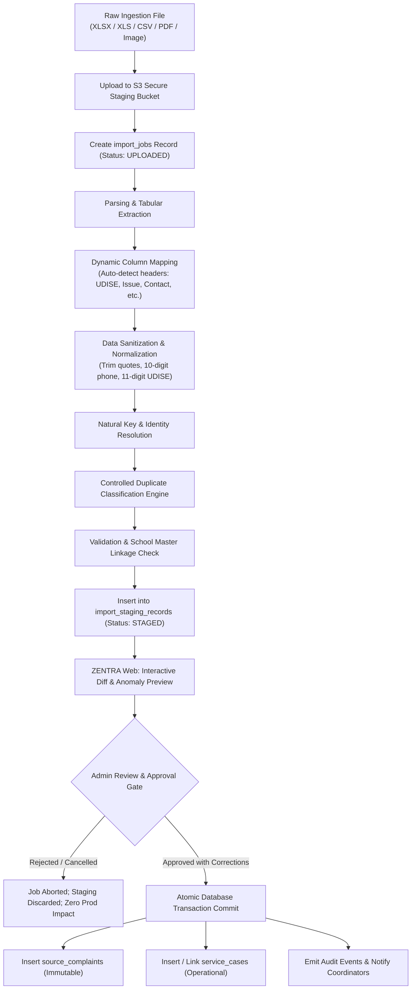
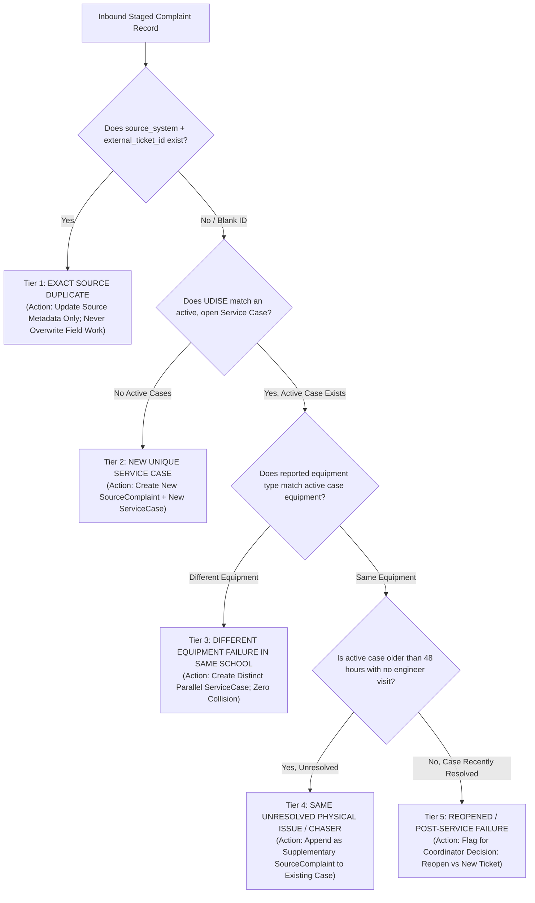
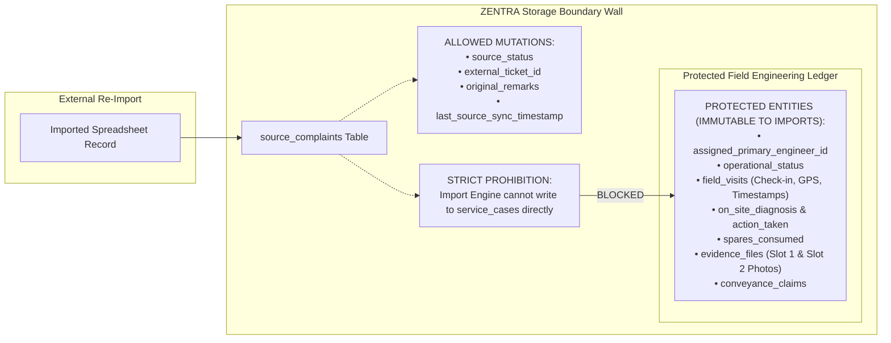
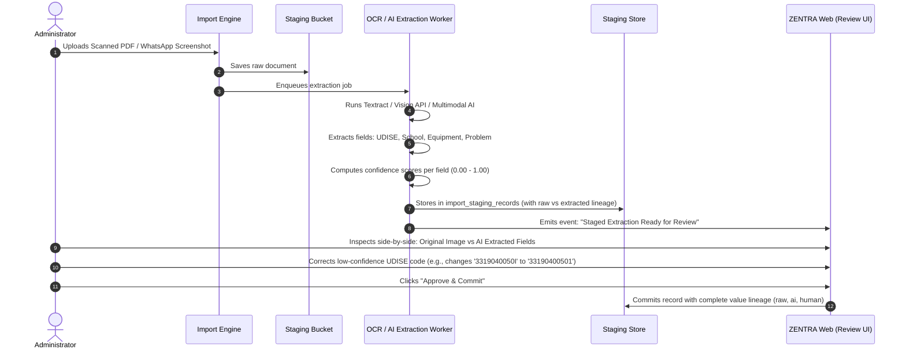

# ZENTRA — Staged Ingestion, OCR & AI Architecture Specification
## Hi-Tech Lab Field Service Management Platform

---

## 1. Architectural Purpose & Boundaries

In real-world Hi-Tech Lab operations, complaint data enters the ecosystem through heterogeneous, uncoordinated channels:
1. **Periodic Spreadsheet Dumps**: District Education Officers and state helpline contractors export bulk complaints in Microsoft Excel (`.xlsx`, `.xls`) or CSV formats.
2. **Direct Google Form Submissions**: Lab Instructors (AI Teachers) submit incident forms with attached photos.
3. **Physical / Scanned Service Call Logs**: Paper field call reports signed by Headmasters, scanned into PDF format.
4. **Mobile Screenshots**: WhatsApp screenshots or portal error screen captures shared by teachers.

A primary cause of data loss in legacy applications was **uncontrolled, direct-to-production imports**: raw spreadsheets were parsed and written directly into live production collections, overwriting active engineer assignments, resetting statuses, and creating duplicate tickets.

ZENTRA enforces an uncompromising architectural principle:
> [!IMPORTANT]
> **NO DIRECT-TO-PRODUCTION INGESTION.**
> All external files, OCR extractions, and AI-assisted data must pass through an isolated **Staging Pipeline** with an interactive **Human-in-the-Loop Approval Gate** before a single byte touches production tables.

---

## 2. End-to-End Staged Ingestion Pipeline



---

## 3. Complaint Identity & Controlled Duplicate Classification

Legacy systems failed by applying naive deduplication rules (such as a unique constraint on `UDISE + Issue`). Phase 0 data proved that:
- A single school frequently experiences **multiple distinct equipment failures simultaneously** (e.g., a broken I/O box and an un-assembled computer table in the same week). Treating these as duplicates caused severe under-reporting.
- Conversely, re-reporting an unresolved UPS breakdown three days later generates duplicate complaints that must be linked.

ZENTRA replaces simplistic constraints with a **5-Tier Duplicate Classification Model**:



### Detailed Duplicate Classification Matrix

| Classification Category | Operational Definition | System Behavior & Action |
|---|---|---|
| **1. Exact Source Duplicate** | Identical `source_system` and `external_ticket_id` already exists in database. | System updates unassigned source metadata (e.g., remarks). **NEVER overwrites assigned engineer, visit notes, or entered diagnostic data.** |
| **2. New Unique Complaint** | Valid school UDISE; no active open cases for this equipment category. | Spawns a new `source_complaints` row and initializes a new `service_cases` row in `UNASSIGNED` state. |
| **3. Different Equipment in Same School** | Same school UDISE, but reported equipment differs (e.g., active case is UPS; new complaint is D-Link Switch). | Spawns an independent parallel `service_cases` row. Both cases exist simultaneously without conflict. |
| **4. Same Unresolved Physical Issue (Chaser)** | Same school, same equipment type, existing case is still in progress (`ASSIGNED` or `PENDING_SPARES`). | New intake is classified as a "Chaser". Linked to the existing `service_case_id` as supplementary intake; avoids duplicate dispatch. |
| **5. Reopened / Post-Service Failure** | Same school and equipment, but prior case was marked `RESOLVED` within the past 7 days. | Flags an alert: `"Potential Recurring Fault"`. Coordinator can choose to reopen the existing case or create a new warranty case. |

---

## 4. Protection Against Accidental Overwrite

When an updated statewide spreadsheet is re-imported (a weekly occurrence in government operations), ZENTRA enforces an **Authoritative Boundary Wall**:



> [!CAUTION]
> **IMMUTABILITY DIRECTIVE**:
> Under no circumstances may an import job alter, clear, or overwrite:
> - `assigned_primary_engineer_id` or `assigned_secondary_engineer_id`
> - `field_visits` records (dates, check-in GPS, visit notes)
> - `spares_consumed` records
> - `evidence_files` (Slot 1 HM reports or Slot 2 photos)
> - `conveyance_claims`
> Any software code attempting to overwrite these fields during an import process is considered a critical defect.

---

## 5. OCR & AI Architecture (Advisory-Only Pipeline)

ZENTRA supports optical character recognition (OCR) and machine learning (AI) extraction to accelerate processing of scanned paper service reports and mobile screenshots.

However, ZENTRA enforces a strict governance model:
> **AI is an extraction assistant, NEVER an authoritative writer.**

### Pipeline Architecture



### Complete Value Lineage Schema
To guarantee institutional auditability, every field extracted via OCR or AI is stored with full provenance:

```json
{
  "field_name": "udise_code",
  "source_document_path": "s3://staging/2026/09/batch_84/scan_042.pdf",
  "raw_ocr_extracted_text": "3319040050I",
  "ocr_confidence_score": 0.78,
  "system_normalized_value": "33190400501",
  "human_reviewed": true,
  "human_corrected_value": "33190400501",
  "reviewed_by_user_id": "usr_coord_ngp_01",
  "reviewed_at": "2026-09-08T10:14:22Z",
  "authoritative_final_value": "33190400501"
}
```

### Architectural Guarantees for AI/OCR
1. **No Direct Production Commits**: AI extraction results are written exclusively to `import_staging_records`.
2. **Confidence-Based Highlighting**: Any field with an extraction confidence score below 0.90 is highlighted in amber/red on the web preview interface.
3. **Auditable Lineage**: The final database record permanently stores both what the AI originally saw and what the human administrator verified or corrected.
4. **Offline Safety**: OCR and AI processing operate strictly server-side in asynchronous background workers; the mobile app is never burdened with heavy local AI models.

---

## 6. Summary of Ingestion Architectural Guarantees

| Ingestion Challenge | Historical Failure Mode | ZENTRA Architectural Defense |
|---|---|---|
| Unmapped or Misspelled Headers | Silent column drop; blank tickets created | Dynamic column mapper with mandatory field verification. |
| Re-import of Same Spreadsheet | Overwrote assigned engineers and notes | Authoritative boundary wall blocks field mutation. |
| Duplicate Complaints | Parallel duplicate tickets; wasted travel | 5-Tier classification links chasers to existing cases. |
| Multi-Equipment School Breakdowns | Erroneously merged into single ticket | Distinct parallel cases created per equipment type. |
| Poor Quality Scans / OCR Errors | Corrupted UDISE codes and school names | Side-by-side human review with confidence scoring. |
| System Failure During Import | Partial, unrecoverable data corruption | All commits executed within atomic database transactions. |
